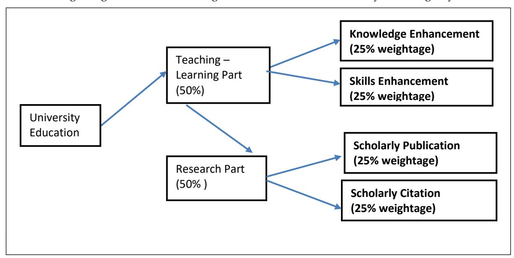

<!-- A1.R01 | source: papers_json/A1.R01/ -->

## **SCHOLEDGE International Journal of Business Policy & Governance**

ISSN 2394-3351, Vol.07, Issue 03 (2020), Pg 25-47.

**DOI:** [10.19085/sijbpg070301](http://dx.doi.org/10.19085/sijbpg070301)

© SCHOLEDGE Publishing

www.thescholedge.org |Email:[ editorial@thescholedge.org](mailto:editorial@thescholedge.org)

## Global Ranking and Its Implications in Higher Education

**P. S. Aithal****^1^** **& Suresh Kumar P. M.****^2^**

^1^College of Management & Commerce, Srinivas University, Mangalore, India.

^2^Department of Sociology and Social Work, Christ University, Bangalore, India.

## **Abstract**

Higher Education Institutions try to enhance their competitiveness so as to become distinguished centers of learning and research. Various agencies conduct rankings of institutions independent of each other using different criteria. Although the purpose of ranking is to encourage healthy competition and distinguish the best institution in the interest of the learners to choose, the differences in criteria have cast a lot of confusion in building a parity. Academic performance and allied factors, as well as research, publication, and allied factors, are common to all. Some ranking agencies take into consideration industry-institution collaborations, international outlook, alumni, overall reputation, and even financial stability. This paper aims to attempt a comparison of the ranking methodology adopted by selected prominent Global University Ranking Agencies all over the world and throw light on the positive and negative outcomes of the global ranking. Based on indepth analysis and critical comments on the limitations of these ranking systems, a generic model for balanced global university ranking is also proposed. Given the fact that nations differ, cultures differ, and the context of higher education itself differ across nations, the study illuminates the fallacy and dangers of segregating all institutions under the same mould.

**Keywords:** Global Ranking, Higher Education Institution, Global ranking methodology, Higher Education, India

## **1.** **Introduction:**

Nations the world across have been witnessing a mushrooming of Higher Educational Institutions in modern times. One reason for this has been an alarming rise in the population of young people who aspire to enroll in education. Many reasons have prompted this. The motivation for more stable and rewarding jobs have driven youth to pursue higher studies. Breaking the barriers of tradition, women in large numbers have turned to pursue studies. This has also been a significant reason for the increasing number of educational aspirants. Besides, availability, accessibility, and affordability in education had a dramatic increase in third world countries over the years. Unlike in the past, income levels have increased. Urban middle-class today have more capital and freedom from wants to shape their aspirations. This apart, health has become synonymous with education and there is a shared notion that better education brings with it awareness to maintain good health. Health is a commodity in the modern world. Education triggers earnings and awareness that leads to improved habits and desirable practices that ensure health. Though the objective of higher education is to enhance the knowledge, skills, and innovative abilities of human beings, it should basically focus on increasing the competency and confidence to face challenges in the society [1]. The quest for quality education has gained prominence amidst the compelling cross swords to attract the best talents and gain prominence. Such a situation was taken into an advantage by many agencies which championed the cause of Global ranking [2]. Presently there are many such agencies who claim acknowledged competence in ranking educational institutions. Nevertheless, the parameters they adopt differently

<!-- page 2 -->

have left them in incongruity [3-4]. A few leading global ranking agencies and their criteria are discussed here.

## **2.** **Related Literature Review:**

To know the effect of global university ranking on higher education quality and research productivity, we made an exclusive literature review based on Keywords using Google scholar. The relevant information published in scholarly papers with a focus on research and the references are listed in table 1.

**Table 1:** Relevant Published works in the area of Global ranking

| S. No. | Topic | Focus | Reference |
| --- | --- | --- | --- |
| 1 | Global Ranking methodology | Importance of the university world rankings | Rodionov, D. G. et al. (2014) [5] |
| 2 | Global Ranking methodology | How university ranking produce competition | Brankovic, J. et al. (2018). [6] |
| 3 | Global Ranking methodology | Model for estimating Academic Ranking | Pandiella-Dominique, A. et al. (2018). [7] |
| 4 | Global Ranking methodology | HEC Ranking Criteria | Noreen, F. (2019). [8] |
| 5 | Global Ranking methodology | STEM and the history of the university ranking movement | Stevenson, W. R. (2018). [9] |
| 6 | Global Ranking methodology | Criteria in the perspective of global university ranking | Noreen, F. et al. (2019). [10] |
| 7 | Global Ranking methodology | ABC model of research productivity and higher education institution ranking | Aithal, P. S. et al. (2016). [11] |
| 8 | Critical comments on Global Ranking methodology | Seven deadly sins of world university ranking | Soh, K. (2017). [12] |
| 9 | Critical comments on Global Ranking methodology | Building of weak expertise: the work of global university rankers | Lim, M. A. (2018). [13] |
| 10 | Critical comments on Global Ranking methodology | Are Rankings Telling Us Anything New? | Hazelkorn, E. (2016). [14] |
| 11 | Critical comments on Global Ranking methodology | Are university rankings useful to improve research? | Vernon, M. M. (2018). [15] |
| 12 | Critical comments on Global Ranking methodology | Study on confronts of global universities ranking | Kumar, Y. (2016). [3] |
| 13 | Critical comments on Global Ranking methodology | Remedy to University Ranking | Taradina, L. A. (2016). [2] |
| 14 | Suggestions to improve | Building World-Class Universities | Aithal, P. S., (2019). [16] |
| 15 | Suggestions to improve | Beyond university rankings? | Daraio, C. (2017). [17] |
| 16 | Ranking Agencies | Reputation of Higher- Education Ranking Agencies | Gunarto, M. et al. (2016). [18] |
| 17 | Comparative analysis | Critical analysis of five world university rankings | Moed, H. F. (2017). [4] |
| 18 | Scientific publishing | Ranking and top publishing universities | Kivinen, O. et al. (2017). [19] |

## **3.** **Objectives & Agenda:**

The following objectives are set.

- 1. To understand the context and relevance of the Global ranking of Higher Education Institutions.
- 2. To examine various Global ranking criteria followed by ranking agencies across the world.
- 3. To assess the positive and negative outcomes of the Global ranking of Higher Education Institutions.

<!-- page 3 -->

4. To propose a generic format applicable to all universities across the world, based on Teachinglearning Innovations and Research Productivity indicators.

## **4. Methodology:**

This is a conceptual research using data from primary sources, including Universities and institutional websites, and secondary data from various publications and research databases including Google Scholar, Research Gate, and Elsevier's SSRN. The postulates are developed using predictive analysis methodology on collected data and information and do not need testing [20], [21].

## **5. Hypotheses:**

Global Ranking of Higher Educational Institutions is relative and not absolute. Although there is wide disagreement on the criteria to arrive at ranking, there seems to be a uniformity in two indicators namely academics and research. Other factors are incidental and could be attributed to the culture, history and degree of development of each nation. Ranking of Higher Education Institutions has resulted in competition rather than competitiveness. Black ocean strategy deployed by ranking agencies has contributed to unhealthy competition, populism and deteriorating quality. Public perception of global ranking is associated with increased commercialization drive and quest for reputation.

## **6. Global University Ranking:**

The inherent question is which HE Institutions in which country is the suitable candidate for inviting to another country as an Inbound supportive system or sending their student for the Outbound supportive system? Different criteria are adopted to decide upon by each country. Those who want to promote anyone or both models above have to raise awareness among the aspirants. Global ranking of Universities and HE Institutions is one of the avenues to choose and promote the internationalization of higher education.

Of late there has been an increasing hue and cry on internationalization of higher education and the global ranking of institutions and many ranking agencies get birth every year with new, strange and stringent criteria or parameters to assess the capabilities of universities or higher education institutions and announce their version of the global ranking. Several ranking agencies publish annual world rankings of universities which attempt to identify the "best" undergraduate, graduate, research, and professional degree programs based upon academic reputation, number of foreign students & faculties, selectivity, and many other criteria. For eg. Times Higher Education Ranking model, the QS World University Ranking model, Academic Ranking of World Universities (ARWU) ranking, etc. Such rankings are more commonly used now a days by governments, media and funding agencies as a means to assess the performance of Universities. Global university rankings also give some idea to many countries to solve the question on whom to invite to the HE spaces of the country.

## **7. Ranking Agencies &** **Criteria:**

Presently there are six global university ranking agencies that are operational and announce annual global university ranking. Table 2 lists such agencies along with their country of origin and the criteria they follow for evaluation.

**Table 2:** Global Ranking Agencies & Criteria followed

| S. No. | Agencies | Country of Origin | Criteria followed |
| --- | --- | --- | --- |
| 1 | Times Higher Education Ranking model | United Kingdom | Five performance indicators in the areas: (1) Teaching-learning environment; (2) Research in terms of volume, reputation and income; (3) Citations; (4) International outlook in terms of staff and students; (5) Industry earnings based on knowledge transfer. |

<!-- page 4 -->

|  | Ranking model |  |  |
| --- | --- | --- | --- |
|  |  |  | (2) Employer reputation, (3) Faculty-student ratio, (4) Citation per faculty, (5) International faculty ratio, (6) International student ratio. Four Criteria: (1) Quality of Education, (2) Faculty Quality, (3) Research output, (4) Per capita performance. |
| 3 | Academic Ranking of World Universities (ARWU) model | China |  |
| 4 | Round University Ranking (RUR) | Russia | Three key principles: inclusiveness, balance, and stability. |
| 5 | U.S. News & World Report's Best Global Universities Ranking | USA | Thirteen indicators including (1) Global research reputation, (2) Regional research reputation, (3) Publications, (4) Books, (5) Conferences, (6) Citation impact, (7) Total citations, (8) Number of top most cited publications, (9) Percentage of the top cited publications among 10% most cited, (10) International collaboration relative to the country, (11) International collaboration, (12) No. of highly cited papers among top 1% of most cited, and (13) Percentage of total publications among the top 1% highly cited papers. |
| 6 | Global University Ranking | Russia | Seven criteria including (1) Academic performance, (2) Research performance, (3) Faculty expertise, (4) Resource availability, (5) Graduates who are socially contributed, (6) International activities, and (7) International opinion. |

## **7.1 Details of Times Higher Education Ranking Model:**

The *Times Higher Education* World University Rankings consider universities which have research as their core objective with the mission of teaching, research, knowledge transfer to industries, and international outlook. Times Higher Education uses thirteen performance indicators which are calibrated to provide suitable comprehensive scores to be trusted by students, academics, funding agencies, universities, industries, and governments all over the world. Based on chosen criteria, the performance indicators are divided into five groups which include : (1) Teaching-learning environment through reputation survey, (2) Research performance in terms of volume of publication, research income, and international research reputation, (3) Citation of research publication, (4) International outlook including international staff, international students, and international research collaboration, and (5) Industry income earned through knowledge transfer. The summary of these criteria and the corresponding weightage in the ranking model of Times Higher Education is shown in Table 3.

<!-- page 5 -->

| 3 | Research Influence | • Research productivity : 6% | 30% |
| --- | --- | --- | --- |
| • Research influence survey : 18% |  |  |  |
| • Research income: 6% |  |  |  |
| • Research productivity: 6% |  |  |  |
| 4 | International Brand | • Percentage of international students : 2.5% | 7.5% |
| • Percentage of international staff : 2.5% |  |  |  |
| • International collaboration : 2.5% |  |  |  |
| 5 | Knowledge transfer & Income | • Consultation based industry income: 2.5% | 2.5% |

## **7.2 Details of QS** **World University Ranking Model:**

The QS World University Ranking comprises of six simple criteria to measure the performance of universities. These include: (1) Academic reputation, (2) Employer reputation, (3) Faculty-student ratio, (4) Citations per faculty, (5) International faculty ratio, and (6) International student ratio. The details are summarized in table 4.

## **7.3 Details of Academic Ranking of World Universities (ARWU) Ranking model:**

The ARWU ranking is the oldest international university ranking, first published in 2003. It was originally produced by Shanghai University and since 2009 it has been published by the Shanghai Ranking Consultancy company. It is focussed mainly on the academic and research levels of the universities, using a different methodology than THE World University Rankings and QS World University Rankings. For evaluating world universities, it takes into account six indicators, including the number of articles published in the journals *Nature* and *Science* and the number of articles cited. In addition, it also takes into account the number of cited researchers in the Highly Cited Researchers database and the number of Nobel prize-winners affiliated with a given institution. The ARWU ranking model uses the six indicators for the global ranking of universities as depicted in table 5.

**Table 5: **Summary of various criteria and corresponding weightage of ARWU Rankings model [24]

| S. No. | Performance Criteria /Indicators | Elements | Weightage |
| --- | --- | --- | --- |
| 1 | Alumni (Quality of Education) |  Based on the number of alumni available who won Nobel prize and Fields medals | 10% |
| 2 | Awards (Quality of Faculty) |  Based on the number of faculty members who have received top international awards like Nobel prize and Field awards | 20% |
| 3 | Citations (Quality of Faculty) |  Based on highly cited Researchers rank in Clarivate Analytics. | 20% |
| 4 | Scholarly |  Scholarly papers published in two influential | 20% |

<!-- page 6 -->

|  | Publications (Research Output) | journals – Nature and Science |  |
| --- | --- | --- | --- |
|  |  |  |  |
| 5 | Papers Indexed (Research Output) | • Scholarly Publications in Indexed Journals (SCI) | 20% |
|  |  |  |  |
| 6 | Per capita performance | • Weighted score of above five indicators divided by the number of full-time faculty members | 10% |
|  |  |  |  |

## **7.4 Details of Round University Ranking (RUR):**

The Round university ranking model includes four major dimensions such as teaching with 40% weightage, research with 40% weightage, international diversity with 10% weightage, and financial sustainability with 10% weightage. The various areas and indicators of Round university ranking are listed in table 6 below:

**Table 6: **Summary of various criteria and corresponding weightage of RU Rankings model [25]

| S. No. | Performance Criteria  /Indicators | Elements | Weightage |
| --- | --- | --- | --- |
| 1 | Teaching – Learning |  Academic staff per students (8%)  Academic staff per degree awarded (8%)  Doctoral degree awarded per Faculty (8%)  Doctoral degrees awarded per bachelor degrees awarded (8%)  World teaching reputation (8%) | 40% |
| 2 | Research Contribution |  Citations per Academic & Research staff (8%)  Doctoral degrees per admitted Ph.D. candidates (8%)  Normalized Citation Impact (8%)  Number of scholarly publications per staff (8%)  World Research Reputation (8%) | 40% |
| 3 | International diversity |  Share of international staff in percentile (2%)  Share of international students in percentile (2%)  Share of international co-authored papers (2%)  Reputation outside the region (Country/Continent) (2%)  Institutions internationalization level (2%) | 10% |
| 4 | Financial Sustainability |  Institutional income per academic staff (2%)  Institutional income per student (2%)  Paper per research income (Research project output) (2%)  Research income per faculty (2%)  Research income per institutional income (2%) | 10% |

## **7.5 Details of U.S. News & World Report's Best Global Universities Rankings:**

This ranking model adopted by U.S. News & World Report, USA gives special emphasis on the research performance of the universities by using Web of Science data and InCites metrics provided by Clarivate Analytics Group and announces the Best Global Universities methodology weighs that measure a university's global and regional research reputation and academic research performance. For the overall ranking, the agency uses bibliometric indicators such as research publications, research citations, and international collaboration. The agency also offers subject-wise ranking using its own methodology based on academic research performance and reputation of the university in that specific area. The ranking indicators and corresponding weight in percentage are given in table 7.

<!-- page 7 -->

**Table 7:** Summary of U.S. News & World Report Best Global Universities Rankings indicators and weights [26]

| S. No. | Ranking Indicators | Details | Weight |
| --- | --- | --- | --- |
| 1 | Global research reputation | Based on the last five years Academic Reputation Survey for the best universities globally for research | 12.5 % |
| 2 | Regional research reputation | Based on the last five years Academic Reputation Survey for the best universities regionally for research | 12.5 % |
| 3 | Publications | Number of Scholarly Journal Publications | 10 % |
| 4 | Books | Subject and Edited Books | 2.5 % |
| 5 | Conference | Number of Conference Publications | 2.5 % |
| 6 | Normalized citation impact | Average total number of citations per paper | 10 % |
| 7 | Total citations | Normalized citations per faculty | 7.5 % |
| 8 | Number of publications that are among the 10% most cited | The number of papers that have been assigned as being in the top 10% of the most highly cited papers in the world for their respective fields. | 12.5 % |
| 9 | Percentage of total publications that are among the 10% most cited | Total papers that are in the top 10% of the most highly cited papers in the world – per field and publication year. | 10 % |
| 10 | International collaboration-relative to country | The proportion of the institution's total papers that contain international co-authors divided by the proportion of internationally co-authored papers for the country | 5 % |
| 11 | International collaboration | Total number of papers that contain international co-authors | 5 % |
| 12 | Number of highly cited papers that are among the top 1% of most cited in their respective field | Highly cited papers are considered indicators of scientific excellence and top performance and can be used to benchmark research performance against subject field baselines worldwide. | 5 % |
| 13 | Percentage of total publications that are among the top 1% most highly cited papers | Measure of excellence and shows the percentage of an institution's output that is among the most impactful papers in the world | 5 % |

## **7.6 Details of Global University Ranking Model:**

The Global University Ranking is a new ranking of 500 world universities carried out under an international global project of an Independent Rating Agency - RatER (Rating of Educational Resources) supported by the academic society of Russia. It combines main global rankings (Academic Ranking of World Universities, HEEACT, THE - QS World University Rankings, and Webometrics) and utilizes a pool of "experts" formed by project officials and managers to determine the rating scales for every indicator of the performance of the universities in seven areas which include : (1) academic performance, (2) research performance, (3) faculty expertise, (4) resource availability, (5) socially significant activities of graduates, (6) international activities of the university, and (7) international opinion of foreign universities.

The ranking is aimed at overcoming the barriers which have historically appeared between the domestic educational system and the world educational space, first of all, of information barriers. Secondly, it aims at a definition of the place of the Russian higher education institutions and the universities of the CIS countries and Baltic in the global educational space. Finally, the stimulation of the academic community for putting their efforts on the development of universities and educational

<!-- page 8 -->

systems. The first ranking was published in the beginning of 2009 and compared data from 15000 universities worldwide. The model makes use of six blocks of activity as shown in table 8. All estimations are standardized according to the maximum value and are brought to 100 points for ranking. The total score for each university is calculated as per the following formula using individual block weights:

(0.2×Block1) + (0.2×Block2) + (0.2×Block3) + (0.15×Block4) + (0.1×Block5) + (0.15×Block6).

**Table 8:** Six blocks of activities Global University Ranking model [27]

| S. No. | Block | Activity | Details |
| --- | --- | --- | --- |
| 1 | Block 1 | Educational Activity |  Number of students at UG, PG, and Research level  Number of UG, PG, & Research Programs  Student-faculty ratio |
| 2 | Block 2 | Research Activity |  Number of Patents and copyrights  Super computer productivity  H-index of the University |
| 3 | Block 3 | Professional Competence of the faculty |  Number of scholarly publications  Number of Quotations of the author of a university  Number of World level awards received |
| 4 | Block 4 | Financial Maintenance | The ratio of Volume of the budget to an aggregated number of students |
| 5 | Block 5 | International Activity |  Membership of a university in the international academic communities  The number of foreign students from an aggregate number of students. |
| 6 | Block 6 | Internet Audience | The volume of web-products created by a university during a fixed period. The popularity of the University in Google search PageRank value of the Universities Home page |

While studying the criteria used by the above six world university ranking agencies it appears that there is a huge difference in the methodology of ranking, weightage given to various criteria, and the performance indicators under each criterion. The ranking models have not followed at least a standard general model of determinant issues based on the objectives of higher education as the comparing criteria and their underlying performance indicators. There is a scope for commenting against the methodology of the individual ranking agencies and their sources of data chosen.

## **8. Critical Reviews on Global Ranking & Procedures:**

Based on the above analysis of ranking agencies and their criteria, it can be reasonably argued that many of these agencies are sponsored by different international publishers or establishments who have hidden interest to bring in the ranking model with their control. The organizations like Elsevier which controls Scopus indexing and other international publishers who have a stake in Web of Science are an example. Secondly, the world university ranking criteria are not to be universally adopted, due to diversity in higher education objectives, facilities, models, and beliefs in different countries. Further objectives of universities imparting higher education may itself be different. Reputation can be artificially created by spending money which ought to have been invested for promoting quality. Above all the staff-to-student ratio has no value in Higher education due to the availability of advanced educational technology. Even though the survey is conducted for universities which offer UG programme, the focus is on research performance. For example, in teaching criteria, the performance indicators are dependent on research degrees, as Doctorate to Bachelors ratio. All

<!-- page 9 -->

this will further contribute to chaos and bias in rating scores due to the black ocean strategy {28-30} of the ranking agencies or their funding agencies.

The following tables (table 9 to table 13) summarizes various measuring criteria, performance indicators, and critical comments in favour or against the assessment processes.

**Table 9:** Various criteria, corresponding performance indicators, and arguments against the methodology of the Times Higher Education Ranking Model

| S. No. | Performance Criteria | Indicator/Elements | Critical Comments/ Arguments against |
| --- | --- | --- | --- |
| 1 | Teaching Learning Environment (30%) |  Reputation survey: 15%  Staff-to-student ratio: 4.5%  Doctorate-to-bachelor's ratio: 2.25%  Doctorates-awarded-to-academic-staff ratio: 6%  Institutional income: 2.25% | (1) Reputation survey need not be transparent and scope for adjustment and partiality. (2) Many factors like the use of education technology, individual faculty capability, demographic factors of students, and staff effects this indicator. Hence cannot be generalized. (3) Doctorate to bachelor's ratio depends on the type of country, population, current GER of the country, Research fellowships, Economy, and Government policies. (4) No. of doctorate awarded depends on the number of research students, amount of fellowship offered, country economy and policy, upper limit of number of doctorate students to be guided by a faculty, University and country policies of admission and evaluation etc. (5) Depending on social responsibilities and country economy, universities have fee charging policies which affect institutional income. |
| 2 | Research Output (30%) |  Reputation survey: 18%  Research income: 6%  Research productivity: 6% | (1) Reputation survey for multi-departmental university need not be transparent and scope for adjustment and partiality. (2) Research is a contribution to the development of society and hence should not have a profit motive. (3) Research productivity should be measured by considering the number of copyright open access scholarly publications, patents and books produced by the university per faculty. (4) Considering only Scopus, or Web of science publications/citations will support biased evaluation and lobby against researchers. |
| 3 | Research Influence (30%) |  Reputation survey: 18%  Research income: 6%  Research productivity: 6% | (1) Reputation survey need not be transparent and scope for adjustment and partiality. (2) Many factors including the economy of the country, currency, Subject area, type & objectives of the organization affect |
| 4 | International Brand (7.5%) |  Proportion international students: 2.5%  Proportion international staff: 2.5%  International collaboration: 2.5% | (1) Factors like vicinity, cost of education, job opportunities after graduation, Number of seats offered to international students based on HE policy of the country, security, scholarships, and quality of life for international students plays a role. (2) Factors like vicinity, cost of living, Social life and social communities, Jobs offered to international faculty, ease of mobility, Job security based on HE policy of the country, social security, family prospects in the country, Perks and quality of life for international faculties plays an important role. (3) Along with university policies, country policies towards the internationalization of higher education plays an important role. |
| 5 | Knowledge transfer & Income (2.5%) |  Industry income through consultation: 2.5% | Institutional income is scaled against the number of staff members. This cannot be used as a comparable metric due to regional imbalance of fee-paying ability, Institutional social responsibilities, non- profit motive, subsidies given, economy of the country, Government rules on fee regulation, etc. |

research income.

<!-- page 10 -->

**Table 10:** Various criteria, corresponding performance indicators and arguments against the method of QS World University Rankings model

| S. No. | Performance Criteria | Elements/Indicator | Critical Comments/ Arguments against |
| --- | --- | --- | --- |
| 1 | Academic reputation (40%) |  Quality and effectiveness of Teaching - Learning process | Academic reputation is calculated based on an internal survey and is need not be transparent and scope for adjustment and partiality. |
| 2 | Employer Reputation (10%) |  Employability Skills & Confidence | Employer reputation is calculated based on internal survey and is need not be transparent and scope for adjustment and partiality. |
| 3 | Faculty/Student Ratio (20%) |  More qualified faculty members | Many factors like the use of education technology, individual faculty capability, demographic factors of students, and staff effects this indicator. Hence cannot be generalized. |
| 4 | Citation per faculty (20%) |  Useful research contribution | Scholarly publications and citations are useful metrics, this calculation uses only Scopus citations and hence biased. |
| 5 | International Faculty & International Student Ratio |  Branding & reputation to attract international faculty members and Students | (1) Factors like vicinity, cost of education, job opportunities after graduation, Number of seats offered to international students based on HE policy of the |

<!-- page 11 -->

| (10%) | (1) country, security, scholarships, and quality of life for international students plays a role. (2) Factors like vicinity, cost of living, Social life and social communities, Jobs offered to international faculty, ease of mobility, Job security based on HE policy of the country, social security, family prospects in the country, Perks and quality of life for international faculties plays an important role. |
| --- | --- |

**Table 11:** Various criteria, corresponding performance indicators and arguments against the

methodology of the ARWU Rankings model

| S. No. | Performance Criteria | Elements/ Indicator | Critical Comments/ Arguments against |
| --- | --- | --- | --- |
| 2 | Awards (Quality of Faculty) (20%) |  Based on the number of faculty members who have received top international awards like Nobel prize | (1) Nobel prize winners and Fields medal winners are very limited in number and are only motivators or role models in the organization. (2) Many inventors of killer applications in technology and society are not Nobel laurels (3) Nobel prize or Field medals are individual achievements not University achievement |
| 3 | Citations (Quality of Faculty) (20%) |  Based on the number of citations in scholarly publications | Highly cited researchers based on the Citation index of Clarivate Analytics are only considered which doubts the intention. |
| 4 | Scholarly Publications (Research Output) (20%) |  Scholarly papers published in two influential journals – Nature and Science | (1) Papers published in Nature and Science are only considered. Since these are not open access journals and collects copyright from authors, many researchers may not show interest to publish in these journals. (2) A false weightage is created through lobbying to enhance the status of these journals and hence subscription price. |
| 5 | Papers Indexed (Research Output) |  Scholarly Publications in Indexed Journals (SCI) | (1) Articles published in SCI of Clarivate Analytics is only considered which doubts the intention. |

<!-- page 12 -->

|  | (20%) |  | the intension. (2) No justice is given to open access publishers who want to keep copyright with them. |
| --- | --- | --- | --- |
| 6 | Per capita performance (10%) | • Weighted score of above five indicators divided by the number of full-time faculty members | This score depends on the weighted score of other indicators hence defected. |

**Table 12:** Various criteria, corresponding performance indicators and arguments against the methodology of RU Rankings model

| S. No. | Performance Criteria  /Indicators | Elements/Indicators | Critical Comments/ Arguments against |
| --- | --- | --- | --- |
| 1 | Teaching Learning (40%) | Academic staff per students (8%)Academic staff per degree awarded (8%)Doctoral degree awarded per Faculty (8%)Doctoral degrees awarded per bachelor degrees awarded (8%)World teaching reputation (8%) | (1) Many factors like the use of education technology, individual faculty capability, demographic factors of students, and staff effects this indicator. Hence cannot be generalized. (2) Doctoral degree awarded per faculty depends on country factors like HE policy, funding available, (3) Countries which are developing and have low GER for UG courses will have a high demand for UG programs and low demand for Research degrees. (4) World teaching reputation is based on a survey and susceptible to manipulation. |
| 2 | Research Contribution (40%) | Citations per Academic & Research staff (8%)Doctoral degrees per admitted Ph.D. candidates (8%)Normalized Citation Impact (8%)Number of scholarly publications per staff (8%)World Research Reputation (8%) | (1) Research contribution is measured not on the number of scholarly publications. But the number of citations in Web of Science of Clarivate Analytics. Justice for open access publication authors is not given. (2) Ratio of Ph.D. awarded to admitted is a good indicator of the quality of research support. (3) Normalized citation impact has no meaning due to the reason that Universities are different in terms of their objectives, subject focus, their UG, PG, and research areas. (4) Number of scholarly publications per staff is an acceptable indicator but no bias of publishers should be considered. (5) World research reputation is survey- based and susceptible for bias. |
| 3 | International diversity (10%) | Share of international staff in percentile (2%)Share of international students in percentile (2%)Share of international co-authored papers (2%)Reputation outside the region (Country/ | (1) International staff from which country is not clear. (2) International staff may not be suitable for some subjects as well as many non- English speaking countries. Further, it depends on the Government regulations and social security issues of the country. (3) International Teamwork is useful only |

<!-- page 13 -->

|  |  | Continent) (2%)  Institutions internationalization level (2%) | in a few areas. If you have better ideas and facilities, working in the home country gives credit to it. (4) Reputation outside the region is based on the survey and has its own weakness and susceptible to bias. (5) Institutions' internationalization level is intangible and cannot be measured perfectly and hence susceptible for bias. |
| --- | --- | --- | --- |
| 4 | Financial Sustainability (10%) |  Institutional income per academic staff (2%)  Institutional income per student (2%)  Paper per research income (Research project output) (2%)  Research income per faculty (2%)  Research income per institutional income (2%) | These indicators are subjective in nature and varies between university to university and subject to subject, department to department, and discipline to discipline. |

**Table 13:** Various criteria, corresponding performance indicators and arguments against the methodology of U.S. News & World Report Best Global Universities Rankings

| S. No. | Ranking Indicators | Elements/ Indicators | Critical Comments/ Arguments against |
| --- | --- | --- | --- |
| 1 | Global research reputation (12.5%) | Based on the last five years Academic Reputation Survey for the best universities globally for research |  |
| 2 | Regional research reputation (12.5%) | Based on the last five years Academic Reputation Survey for the best universities regionally for research | Regional research reputation is calculated based on internal survey and is need not be transparent and scope for adjustment and partiality. |
| 3 | Publications (10%) | Number of Scholarly Journal Publications | Based on Clarivate Analytics' Web of Science for the last five years of data and will not cover all research publications of the world. |
| 4 | Books (2.5%) | Subject and Edited Books | Good indicator but should cover all ISBN books |
| 5 | Conference (2.5%) | Number of Conference Publications | Good indicator but should cover all conference proceedings with ISBN |
| 6 | Normalized citation impact (10%) | Average total number of citations per paper | Acceptable indicator but partial by considering citations from only Clarivate Analytics' Web of Science. Hence biased. |
| 7 | Total citations (7.5%) | Normalized citations per faculty | Biased due to the fact that the data is taken from Clarivate Analytics' Web of Science to create a lobby to control international publications and profiting from them. |
| 8 | Number of publications that are among the 10% most cited (12.5%) | The number of papers that have been assigned as being in the top 10% of the most highly cited papers in the | When the number of Publications and the number of citations are already considered as indicators, giving such importance for most cited further is |

<!-- page 14 -->

|  | world for their respective | questionable. |  |
| --- | --- | --- | --- |
|  | fields. |  |  |
| 9 | Percentage of total publications that are among the 10% most cited (10%) | Total papers that are in the top 10% of the most highly cited papers in the world – per field and publication year. | Looks over importance to highly cited paper. |
| 10 | International collaboration- relative to country (5%) | The proportion of the institution's total papers that contain international co-authors divided by the proportion of internationally co-authored papers for the country | The property of internationalization of higher education and research |
| 11 | International collaboration (5%) | Total number of papers that contain international co- authors | The property of internationalization of higher education and research |
| 12 | Number of highly cited papers that are among the top 1% of most cited in their respective field (5%) | Highly cited papers are considered indicators of scientific excellence and top performance and can be used to benchmark research performance against subject field baselines worldwide. | Citation gets over emphasis. Most cited papers depend on General research subjects and not on futuristic, highly specific area of research. |
| 13 | Percentage of total publications that are among the top 1% most highly cited papers (5%) | Measure of excellence and shows the percentage of an institution's output that is among the most impactful papers in the world | Again, citation gets over emphasis. Most cited papers depend on General research subjects and not on futuristic, highly specific area of research. |

## **9. Evolving an Optimum Generic Model Based on Justice to All Stakeholders:**

An ideal ranking system is a hypothetical ranking system that identifies ideal universities around the world which have objectives to disseminate infinite knowledge and skills and develop the infinite amount of new knowledge and skills through research and innovations [31-35]. But in reality, we may conceive a Generic model for World University that take the following determinant criteria:

- (1) The objective of higher education is Education and Research. Thus, universities should give equal importance to Teaching – Learning based Education and new knowledge and new interpretation based Research. Any ranking model related to the Higher education system should have equal importance or weightage to both of them.
- (2) The ranking model should identify various criteria and performance indicators related to Teaching -learning process which could be measurable using a suitable metric.
- (3) The ranking model should also identify various criteria and performance indicators of the Research component which should be generalized to every university irrespective of the country and capture the research efforts and research output of universities by identifying suitable and measurable metrics.
- (4) In the teaching-learning process, the measurable metric should take care of country differences, university objectives, country culture and tradition, and the importance of preserving it through unique pedagogy, use of education technology, various infrastructure to provide quality teaching-learning environment. This also includes enhancing the employability skills along with the knowledge of discipline so that the education system improves competency and confidence in making lifelong decisions at the right time.
- (5) In the research and development part of university responsibility, Ranking model should take into account the research motivation, research leadership, and research output in a

<!-- page 15 -->

- systematic way by considering all research efforts irrespective of pressure from agencies who have a business motive in mind.
- (6) The research part of the ranking model should also consider the continuation of research initiated by a group/university based on its importance for future developments through recognizing the citations which again should not be biased for only certain agency's data.

Thus, a new generic model which can give justice to all universities of all countries should have four components as shown in figure 1. These components are (1) Knowledge enhancement, (2) Skills enhancement, (3) Scholarly publication (research productivity), and (4) Scholarly citation (Research quality). The strategy and quality of teaching and learning processes play an important role in improving the knowledge and skills [36-37]. The ranking model should identify suitable performance indicators with measurable metrics. These common performance indicators measurable quantitatively should not be susceptible to any kind of direct or indirect bias or lobbying from agencies or data suppliers. Adding too many criteria which are not commonly applicable to all universities across the world, the model becomes unacceptable and considered as a diseased model and the ranking agencies will not maintain credibility irrespective of their hue and cry about quality, efforts for impartial and foolproof assessment. There are many research-based evidences to calculate the research productivity of an organization or universities [11], [38- 39], and quality of research based on citations and research indices [40-43].

## **9.1 Comparison of Generic Model of World ranking with different Ranking Agencies:**

The generic ranking proposed in this paper gives equal importance to Teaching–Learning (Knowledge & Skills) and Research productivity & quality (Publication & Citation). It can be argued that the best teaching-learning process offered by university increases the contribution to enhancing the knowledge and skills of the students and hence determines the quality of education. Similarly, the average number of scholarly publications and patents based on academic research and industrial research respectively measures the research productivity of the university, and the citations attracted by the published papers during a considerable time period as a measured quality of research. Table 14 gives an idea of the global ranking model decided by six ranking agencies against the generic model.

<!-- page 16 -->

| 4 | RU Rankings model | Research Part is 40% Teaching- Learning part is 40% Research Part is 40% |
| --- | --- | --- |
| 5 | U.S. News & World Report Best Global Universities Rankings Model | Teaching- Learning part is 12.5% Research Part is 77.5% |
| 6 | Global University Ranking Model | Teaching- Learning part is 20% Research Part is 20% |
| 7 | Generic University Ranking Model (Proposed by this work) | Teaching- Learning part is 50% (Knowledge = 25%; Skills = 25%) Research Part is 50% (Publication 25%; Citation = 25%) |

The six ranking models analysed above have not identified any metric to measure the quality of the teaching-learning process in terms of the effectiveness of curriculum, amount of industry internship, mixing of subjects under the STEAM model to create all-rounders, or focussing in a given area to create super-specializations. Instead, the ranking criteria are devised with an objective to increase the annual course fees for the prospective students by creating an imaginary brand name to certain universities. While scrutinising the actual evaluation pattern of the universities using their model, it is evident that the evaluation is prejudicial and confronting, favouring certain universities in certain countries.

Similarly, the research performance should be measured based on the number of IPR generated during a given period of observation (research outcome/productivity) and the importance of research and continuation of research should be measured by means of citations they attract (quality of research). The methods used to collect the data to determine the scores for the universities under each performance indicator under each criterion also have questionable procedures and not justifies general models of evaluation or to give justice to all participant universities by offering equal competing platforms. Some of the critical comments on this line of arguments are listed in Table 15.

**Table 15:** Critical comments on Six existing World Ranking models based on Generic Model

| S. No. | Ranking Agency | Comparison against Generic model | Critical Comment |
| --- | --- | --- | --- |
| 1 | Times Higher Education Ranking Model | Teaching- Learning part is 30% Research Part is 60% Other things like Internationalization is 10% | Low emphasis on the Teaching-Learning process. Higher emphasis on Research. Emphasis on Internationalization. |
| 2 | QS World University Rankings model | Teaching- Learning part is 40% Research Part is 20% Other things like Internationalization is 40% | Low emphasis on the Teaching-Learning process. Least emphasis on Research. Higher emphasis on Internationalization. |
| 3 | ARWU Rankings model | Teaching- Learning part is 10% Research Part is 40% International Awards is 10% Others are 40% | Very low emphasis on the Teaching-Learning process. Low emphasis on Research. Higher emphasis on others. |
| 4 | RU Rankings model | Teaching- Learning part is 40% Research Part is 40% Internationalization is 10% Others (Finance status) is 10% | Low emphasis on the Teaching-Learning process. Low emphasis on Research. Emphasis on Internationalization. |
| 5 | U.S. News & World Report Best Global Universities Rankings Model | Teaching- Learning part is 12.5% Research Part is 77.5% Internationalization is 10% | Very low emphasis on the Teaching-Learning process. Very high emphasis on Research. Emphasis on Internationalization. |
| 6 | Global University Ranking Model | Teaching- Learning part is 20% Research Part is 20% | Very low emphasis on the Teaching-Learning process. |

<!-- page 17 -->

|  |  | Internationalization is 10% Others is 50% | Very low emphasis on Research. Emphasis on Internationalization. Higher emphasis on others. |
| --- | --- | --- | --- |
| 7 | Generic University Ranking Model | Teaching- Learning part is 50% (Knowledge = 25%; Skills = 25%) Research Part is 50% (Publication 25%; Citation = 25%) | Equal emphasis on teaching - Learning process. Equal emphasis on Research. |

Based on systematic observation and the analysis of the criteria and ranking indicators used in the ranking system, and the methodology followed to calculate the scores for each indicator, it can be easily suspected that there are some invisible agencies lobbying and influencing the ranking methodologies or restricting the sources of data collection through black ocean strategy. This results in suspicion of the efforts of ranking agencies. It seems evident that many top influential international publishers who have created a niche in scholarly publication and indexing through subscriptionbased publication model and forcefully encroaching copyright of the scholarly articles in publishers name are playing a dirty role on these global ranking agencies inherently for favouritism and hence having virtual control through their black ocean strategy [28-30]. Table 16 lists some of the suspected control and its resultant influence on breaking foolproof university ranking systems. Table 17 throws light on the susceptibility of the ranking models of these agencies.

**Table 16:** Influence of International publishers on World ranking agencies

| S. No. | World University Ranking Agency | Origin | Controlling Body |
| --- | --- | --- | --- |
| 1 | Times Higher Education | UK | Elsevier's Scopus |
| 2 | QS World University Ranking model | UK | Elsevier's Scopus |
| 3 | Academic Ranking of World Universities (ARWU) Ranking model | China | Nobel Prize winners, Nature & Science Journal Publishers, Clarivate Analytics owned Web of Science & Web of Social Science publication &Citation index |
| 4 | Round University Ranking (RUR) | Russia | Web of Science of Clarivate Analytics company |
| 5 | U.S. News & World Report's Best Global Universities Rankings | USA | Web of Science of Clarivate Analytics company |
| 6 | Global University Ranking | Russia | Depends on other 5 Ranking agencies |

**Table 17:** Ranking of World Ranking agencies based on the susceptibility of criteria used

| S. No. | World University Ranking Agency | Origin | Susceptibility on modification in measurement |
| --- | --- | --- | --- |
| 1 | Times Higher Education | UK | Survey methods susceptible to bias and confined to a small set of data available in the Scopus indexing agency. |
| 2 | QS World University Ranking model | UK | Survey methods susceptible to bias and confined to a small set of data available in the Scopus indexing agency. |
| 3 | Academic Ranking of World Universities (ARWU) Ranking model | China | Criteria are Not Acceptable worldwide |
| 4 | Round University Ranking (RUR) | Russia | Survey methods susceptible to bias and Web of Science of Clarivate Analytics company |
| 5 | U.S. News & World Report's Best Global Universities Rankings | USA | Completely favour to Web of Science of Clarivate Analytics company. Supports monopoly. |
| 6 | Global University Ranking | Russia | Not independent evaluation. It depends on other ranking agencies data and hence biased. |

<!-- page 18 -->

## **9.2 Postulates for Arguments Against Global Ranking:**

Based on the above observations an intensive study of various criteria, their derived performance indicators, and data collection methodology, we have developed certain postulates related to our arguments against the generalization of global university ranking announced by the agencies under consideration. They are:

- 1. Organizational objectives and types are different in different countries. Hence universities of different types have different objectives.
- 2. Use of Education technology and Individual capabilities of the staff members may effect on optimum Faculty Student Ratio for Quality teaching-learning process.
- 3. Subject Areas and verity of Courses in each Area, Number of specializations, Faculty utilization, Industry integration, use of education technology, University autonomy, Faculty academic freedom, are different in different universities.
- 4. The number of students studying in a university has no role in its HE quality in many times, due to the reason that the University may have many affiliated colleges, the university may be a monopoly entity in a given place, the demand may be more than competitive supply, the university may not functioning with perfect competition, the university may have advantages in terms of government policies, grants, or financial subsidies.
- 5. Universities functioning in different countries have different levels of autonomy and constraints, and hence develop their own policies in Teaching-learning process and Research contribution to the field.
- 6. Any Ranking agency should answer the following questions of an author/researcher for choosing the above research related scoring indicators data taken only from Scopus or Web of Science based publications and citations: a.Why a researcher should wait for 6 months to 12 months to publish his innovative research?b.Why a researcher should give copyright to the publisher for selling the paper throughout without any financial share for him?c. Why the research output result of a researcher should not available to the entire world free of cost?d.Why a researcher should do a free review of profit-oriented academic publishers?e. Why a researcher should pay a huge amount of Article Processing Charge varying from $2,000 to $5,000 for publishing his paper as an open access publication?

## **10. Positive and Negative Implications of Global Ranking:**

Every system has both positive and negative aspects for the stakeholders or for the viewers. But a good system will have more positive aspects and minimum negative aspects and they should continuously improve the performance to give justice to every stakeholder. The present global ranking systems we discussed also have both positive and negative outcomes and some of them are identified, analysed, and listed in table 18.

**Table 18:** Positive and negative aspects of the outcomes of the Global ranking system

| S. No. | Issues | Positive Outcome | Negative Outcome |
| --- | --- | --- | --- |
| 1 | Competition | Encourage healthy competition | Controlling the competing behind the screen |
| 2 | Knowledge and skills | Impart more knowledge and skills | This aspect is not a criterion or in performance indicators |
| 3 | New knowledge & ideas | Creation of new knowledge | Data measuring system is not providing natural justice and equality instead controlled by a monopoly |
| 4 | Comparison amides diversities | Enable comparison amides diversities | Enable comparison without diversity |
| 5 | Business proposition | Sustainable Education service through equality | Monopoly education service through black ocean strategy |

<!-- page 19 -->

| 6 | Goal setting | Equal importance to Teaching-learning processes and Research processes | Directed by hypocrisy and fail to encourage innovative thinking and new models. |
| --- | --- | --- | --- |
| 7 | Comparison Levels & Criteria | Common & open platforms and measurable from open databases. | Hidden agenda-based comparison levels and measurable from closed and bureaucratic controlled databases |
| 8 | Reliability & Openness | Reliable source and model for public | Questionable intention & inherent favouritism |
| 9 | Ranking Objectives | To develop pride in institutions and nations | Favourable to certain organizations in certain countries |
| 10 | Simple and measurable criteria based ranking. | Simple and easy criteria with varied importance to various performance indicators | Not justified due to unbalanced focus on Education and Research |
| 11 | Continuous Improvement platform & Opportunity | Universities should know their comparative position and continuously upgrade the HE quality of teaching and research | The ranking parameters should be derived from quality improvement aspects of teaching-learning and new knowledge creation through research instead of indirectly supporting business profits of sponsoring bodies |

## **10.1 Positive Outcomes:**

## *(1) Enhances healthy academic Service :*

A comparison of services based on certain criteria and performance indicators always creates concern on the quality of services and stimulates potential innovations through new experiments. The global ranking of universities also enhances the quality of academic services to its stakeholders through healthy competition.

## *(2) Boost the creation of new knowledge through research and publications :*

Organizations and people always work for recognition once their basic requirement for survival is achieved. The comparison based on certain justifiable parametric criteria commonly achievable at comparable levels stimulates them to boost performance in a competitive manner. Due to created comparative platform of global universities ranking, the internal performance of universities in terms of quality of teaching-learning processes and new knowledge creation through intensive research and publications enhances which in turn, improves IPR contribution of the university and the country.

## *(3) Attract the best talents and groom them :*

Global ranking based on healthy comparisons with an objective to create sustainable competition identifies the efforts of the quality initiatives of individual universities and the home countries leading to best organizations creation which in turn, attracts the best talents and groom them to be effective innovators in their working place.

## *(4) Contribute to society and national growth :*

Quality initiatives in identified areas of higher education based on important areas identified through selected general criteria, for quality higher education to fulfill its objectives creates innovators as the output of the HE system. The universities will focus on every area within their constraints and geographically identified responsibilities and struggle for the creation of responsible citizens as a smart educated contributor to society.

## *(5) Enables comparison amidst diversities :*

Global university ranking, if done systematically without any bias with an intension to give justice to every participant members, enable comparisons of best practices developed and offered by

<!-- page 20 -->

participating universities and can act as a platform for standardizing the higher education quality though there are diversities based on geographical, cultural, traditional, economical, and religious aspects incorporated scientifically.

## *(6) Encourages competition :*

When higher education institutions like universities have responsibilities to fulfill their objectives to educate their students through (1) innovative methodology for teaching-learning to enhance knowledge, skills, and experience in a chosen area to improve competency and confidence, (2) to contribute to solving problems of the society through creating new knowledge, new systems, new ideas or new analysis to solve the problems of the society through innovative research and publications, there should be healthy competition which enhances the visibility of performance. If the higher education system, through some comparative measures like global/national ranking during a specified time interval, creates competition among the universities and hence contributes to quality improvement.

## *(7) Promotes goal setting :*

A good global ranking system which is inherent to bias, influence, and speculations, identifies the important criteria's based on objectives of higher education, sets standardization and opens up innovations within it so that universities can choose priorities based on their goal and objectives through systematic planning. This, in turn, forces the universities to re-define their timebound goal in the midst of competition.

## *(8) Translate targets into realizable activities :*

The entire global ranking process and methodologies (even though are questionable) studied by a university gets an idea about the various core and subsidiary areas for improvements in their universities. The university (Public or private will be in a position to convince the stakeholders about the importance and necessity of innovations in teaching-learning activities and research and publication activities and translating these targets into realizable activities.

## *(9) Developing pride in institutions and nations :*

The publicity for best performing universities throughout the world is essential and certain agencies are using this opportunity to announce the global ranking. In this process both Universities and the Ranking agencies are gainers. The universities get recognition worldwide which increases the prideness of both the institution as well as the nation. Further, such publicity creates a higher demand for admission and the universities take monopoly decision to command their admission fee as well as placement.

## **10.2 Negative Outcomes:**

## *(1) Perceptions among players may differ :*

The objectives of the universities of different countries as well as of different types are different. Based on local and national restrictions, regulations, government priorities, the quality, and resource allocation may be different so that the quality perception among the players in the higher education industry may vary. As a result, the criteria, performance measures, and the methodology set by ranking agencies may not look fair.

## *(2) Ignores teaching-learning output :*

While analysing the performance indicators of individual determinant criteria, and overall determinant issues, there is systematic but purposeful negligence of considering teaching-learning processes and innovations & best practices related to it. Many ranking agencies have not given importance to the main purpose of higher education even though the undergraduate and postgraduate education and its quality is the evaluation focus. Quality should be seen at the bottom and percolate to the top instead of only at the top.

<!-- page 21 -->

## *(3) Non* *uniformity in criteria :*

As pointed out many times in the above analysis, the evaluation criteria for global ranking looks like picked from only a few universities based on some hidden reasons and influenced by many business agencies in international publication space. Many criteria used in global ranking in many agencies cannot be measured using a reliable yardstick. Even though, the methodology from the top looks inherent for external influence, when study and analyse in deep disclose many flaws and biases to make favours to some organizations and universities.

## *(4) Loses focus of institutions from quality to quantity :*

As per one frame of reference, the global ranking encourages universities to focus only on the ranking criteria instead of the general responsibilities of delivering quality higher education. Instead of giving equal importance to teaching-learning processes and research output, the emphasis is given to only research, that too on a number of publications and number of citations in some business-oriented journals only. This enforces the universities to follow black ocean strategy through their smartness to focus only on such criteria and tries to climb top in the global ranking. This also disorients and divert the universities in their actual objectives of providing quality education. For example, a university may allocate major parts of its budget for paying article processing charges (APC) of their publications to enhance Scopus indexed journal publications.

## *(5) Developing institutions lose* *motivation :*

The criteria and performance indicators chosen by the global ranking agencies, in most of the cases, are narrowly focussed in such a way that they are coinciding with the objective of many universities especially government-funded ones so that many developing universities lose their motivation to compete. It is seen from the global ranking results of all agencies, one of the common features of the top hundred universities is that they all are above 100 years of existence. Thus, for other younger universities, whatever strategy they use and however they compete they cannot break this requirement. Such parameters directly or indirectly inhibit the young universities to involve themselves in full-fledged competition and ranking process. As a result, only a few old universities from developed countries are pioneers in the global ranking.

## *(6) Academia in the rat race for performance :*

In many countries, most of the public sector universities are not interested in competition because there is no accountability for quality service both individually as an employee or collectively as an organization. These public sector universities are enjoying a kind of monopoly and whatever HE service they provide to their students should be acceptable. There is no challenge, competition, motivation, role models, encouragement for performers, and no time-based accountability for faculty members and researchers. Based on the cast or community of faculty members they can progress in their job verticals so that nobody is bothered on quality and performance. The universities get a fixed amount of funds for their normal activities and politics, as well as bureaucracy, plays a major role in deciding policy matters. This situation is true in many developed and developing countries that hinder competition-based performance.

## *(7) Many subtle factors that create a good University are left out of the criteria :*

The criteria chosen by the ranking agencies should have been derived from both internal factors (inlook) and external factors (outlook) of a university. But it seems that the ranking agencies only focus on outlook and brands to develop performance indicators. Many determinant issues related to the teaching-learning process and research process are missing and over-emphasis is given to certain parts of research output. Even though by choosing such criteria to ranking parameters, the agencies made their evaluation easy, but failed to highlight many relevant subtle factors that create a good university. Apart from that as mentioned in our critical comments, ranking agencies easify their methodology to implement their hidden agenda through their model.

## **11. Conclusion:**

Higher Educational Institutions are ranked for their excellence regionally, nationally, and globally. As we rightly expect, institutions should be judged on the very purpose for which it stands. It can be stated that the basic purpose of higher education institutions is the promotion of learning, more

<!-- page 22 -->

appropriately, discovery, and dissemination of knowledge. In other words, academic contribution and involvement in research are two inevitable parameters for ranking. A generic model of university ranking gives equal weightage to teaching-learning innovations at UG and PG levels as well as research and quality publications as research output. Ranking agencies have added many supplementary indicators to capture a holistic picture. Many sub-criteria are also included largely due to the differences in the culture and development of each nation. But it is established through critical comments that there are many improvements required in the methodology to make the model foolproof and eliminate inherent external influence for business benefits. So much so, global ranking is not the last word on the status assigned to an institution. When the parameters for ranking are variously used the results of ranking becomes incomparable.

## **References:**

- [1]. Aithal P. S. & Suresh Kumar P. M. (2018). Approaches to Confidence Building as a Primary Objective in Postgraduate Degree Programmes. International Journal of Applied Engineering and Management Letters (IJAEML), 2(1), 64-71. DOI: http://dx.doi.org/10.5281/zenodo.1205185.
- [2]. Taradina, L. A. R. I. S. A., &Yudkevich, M. A. R. I. A. (2016). Russia: Ranking fever–do we know the remedy?. In Global Rankings and the Geopolitics of Higher Education (pp. 168-185). Routledge.
- [3]. Kumar, Y., & Rajeshwari, H. S. (2016). A study on confronting global universities ranking. IJAR, 2(11), 05-08.
- [4]. Moed, H. F. (2017). A critical comparative analysis of five world university rankings. Scientometrics, 110(2), 967-990.
- [5]. Rodionov, D. G., Rudskaia, I. A., &Kushneva, O. A. (2014). The importance of the university world rankings in the context of globalization. Life Science Journal, 11(10), 442-446.
- [6]. Brankovic, J., Ringel, L., &Werron, T. (2018). How rankings produce competition: The case of global university rankings. ZeitschriftfürSoziologie, 47(4), 270-288.
- [7]. Pandiella-Dominique, A., Moreno-Lorente, L., García-Zorita, C., & Sanz-Casado, E. (2018). Model for estimating Academic Ranking of World Universities (Shanghai Ranking) scores. Revista Española de DocumentaciónCientífica, 41(2), 1-14.
- [8]. Noreen, F., & Hussain, B. (2019). HEC Ranking Criteria in the Perspective of Global University Ranking Systems. Global Social Sciences Review, 4(2), 59-70.
- [9]. Stevenson, W. R. (2018). STEM and the history of the university ranking movement: Contextualizing trends in methodologies and criteria. In New Directions of STEM Research and Learning in the World Ranking Movement (pp. 17-29). Palgrave Macmillan, Cham.
- [10]. Noreen, F., & Hussain, B. (2019). HEC Ranking Criteria in the Perspective of Global University Ranking Systems. Global Social Sciences Review, 4(2), 59-70.
- [11]. Aithal, P. S. & Suresh Kumar, P.M., (2016). ABC Model of Research Productivity and Higher Educational Institutional Ranking. International Journal of Education and Management Engineering (IJEME), 6(6), 74-84. DOI: 10.5815/ijeme.2016.06.08.
- [12]. Soh, K. (2017). The seven deadly sins of world university ranking: A summary from several papers. Journal of Higher Education Policy and Management, 39(1), 104-115.
- [13]. Lim, M. A. (2018). The building of weak expertise: the work of global university rankers. Higher Education, 75(3), 415-430.
- [14]. Hazelkorn, E., & Gibson, A. (2016). Another Year, Another Methodology: Are Rankings Telling Us Anything New?. International Higher Education, (84), 3-4.
- [15]. Vernon, M. M., Balas, E. A., & Momani, S. (2018). Are university rankings useful to improve research? A systematic review. PloS one, 13(3).
- [16]. Aithal, P. S., & Aithal, S. (2019). Building World-Class Universities: Some Insights & Predictions. Building World-Class Universities: Some Insights & Predictions. International Journal of Management, Technology, and Social Sciences (IJMTS), 4(2), 13-35. DOI[:http://doi.org/10.5281/zenodo.3377097.](http://doi.org/10.5281/zenodo.3377097)
- [17]. Daraio, C., &Bonaccorsi, A. (2017). Beyond university rankings? Generating new indicators on universities by linking data in open platforms. Journal of the Association for Information Science and Technology, 68(2), 508-529.
- [18]. Gunarto, M., Nugraha, D. Y., &Gaffar, V. (2016, August). Analysis of Perception and Public Preference on Reputation of Higher-Education Ranking Agencies. In 2016 Global Conference on Business, Management and Entrepreneurship. Atlantis Press.
- [19]. Kivinen, O., Hedman, J., &Artukka, K. (2017). Scientific publishing and global university rankings. How well are top publishing universities recognized?. Scientometrics, 112(1), 679-695.
- [20]. Shubhrajyotsna Aithal & Aithal, P. S. (2018). The Realization Opportunity of Ideal Energy System using Nanotechnology Based Research and Innovations. International Journal of Advanced Trends in Engineering and Technology, 3(2), 1-15. DOI[ :http://doi.org/10.5281/zenodo.2531876.](http://doi.org/10.5281/zenodo.2531876)

<!-- page 23 -->

- [21]. Aithal P. S., & Aithal Shubhrajyotsna (2020). Promoting Faculty and Student-Centered Research and Innovation based Excellence Model to Reimage Universities. International Journal of Management, Technology, and Social Sciences (IJMTS), 5(1), 24-41. DOI:[ http://doi.org/10.5281/zenodo.3702399.](http://doi.org/10.5281/zenodo.3702399)
- [22]. [https://www.timeshighereducation.com/world-university-rankings/world-university-rankings-2019](https://www.timeshighereducation.com/world-university-rankings/world-university-rankings-2019-methodology) [methodology ](https://www.timeshighereducation.com/world-university-rankings/world-university-rankings-2019-methodology)retrieved on 15/02/2020.
- [23]. [https://www.topuniversities.com/qs-world-university-rankings/methodology](https://www.topuniversities.com/qs-world-university-rankings/methodology) retrieved on 15/02/2020.
- [24]. [http://www.shanghairanking.com/ARWU-Methodology-2019.htmlr](http://www.shanghairanking.com/ARWU-Methodology-2019.html)etrieved on 15/02/2020.
- [25]. [http://roundranking.com/methodology/methodology.html ](http://roundranking.com/methodology/methodology.html)retrieved on 15/02/2020.
- [26]. [https://www.usnews.com/education/best-global universities/articles/methodology](https://www.usnews.com/education/best-global-universities/articles/methodology) retrieved on 15/02/2020.
- [27]. [http://wikibin.org/articles/global-university-ranking.html ](http://wikibin.org/articles/global-university-ranking.html)retrieved on 15/02/2020.
- [28]. Aithal, P. S. & Suresh Kumar, P. M. (2015). Black Ocean Strategy A Probe into a New type of Strategy used for Organizational Success. GE International Journal of Management Research, 3(8), 45 - 65. DOI [:http://doi.org/10.5281/zenodo.163423.](http://doi.org/10.5281/zenodo.163423)
- [29]. Aithal, P. S., Shailashree V. T., & P.M. Suresh Kumar, (2015). Application of ABCD Analysis Model for Black Ocean Strategy. International Journal of Applied Research (IJAR), 1(10), 331 – 337. DOI [:http://doi.org/10.5281/zenodo.163424.](http://doi.org/10.5281/zenodo.163424)
- [30]. Aithal, P. S. & Acharya, R. K. (2016). Strategic Management Models & Indian Epics. International Journal of Management Sciences and Business Research (IJMSBR), 5(4), 180-188. DOI [:http://doi.org/10.5281/zenodo.161093.](http://doi.org/10.5281/zenodo.161093)
- [31]. Aithal, P. S. (2016). Review on Various Ideal System Models Used to Improve the Characteristics of Practical Systems. International Journal of Applied and Advanced Scientific Research, 1(1), 47-56. DOI [:http://doi.org/10.5281/zenodo.159749.](http://doi.org/10.5281/zenodo.159749)
- [32]. Aithal, P. S. (2015). Concept of Ideal Business & Its Realization Using E-Business Model. International Journal of Science and Research (IJSR), 4(3), 1267 – 1274. DOI [:http://doi.org/10.5281/zenodo.61648.](http://doi.org/10.5281/zenodo.61648)
- [33]. Aithal, P. S.,&Shubhrajyotsna Aithal, (2015). Ideal Technology Concept & its Realization Opportunity using Nanotechnology, International Journal of Application or Innovation in Engineering & Management (IJAIEM), 4(2), 153 – 164. DOI[: http://doi.org/10.5281/zenodo.61591.](http://doi.org/10.5281/zenodo.61591)
- [34]. Aithal, P. S. &Shubhrajyotsna Aithal (2018). The Concept & Characteristics of Ideal Energy System and its Realization Constraints. International Journal of Applied Engineering and Management Letters (IJAEML), 2(2), 127-137. DOI[: https://doi.org/10.5281/zenodo.1487702.](https://doi.org/10.5281/zenodo.1487702)
- [35]. Aithal P. S. and Shubhrajyotsna Aithal (2015). An Innovative Education Model to realize Ideal Education System. International Journal of Scientific Research and Management (IJSRM), 3(3), 2464 - 2469. DOI[: http://doi.org/10.5281/zenodo.61654.](http://doi.org/10.5281/zenodo.61654)
- [36]. Aithal, P. S., &P. M. Suresh Kumar (2016). Teaching Learning Process in Higher Education Institutions. International Journal of Multidisciplinary Research and Modern Education (IJMRME), 2(1), 662-676. DOI[ :http://doi.org/10.5281/zenodo.160956.](http://doi.org/10.5281/zenodo.160956)
- [37]. Aithal, P. S., Suresh Kumar, P. M., and Pavithra Kumari (2015). [Methods and Approaches for ](http://www.ijmra.us/project%20doc/2015/SPECIAL_JULY2015/38.pdf) [Employability Skill Generation in Higher Educational Institutions.I](http://www.ijmra.us/project%20doc/2015/SPECIAL_JULY2015/38.pdf)nternational Journal of Management, IT and Engineering (IJMIE), 5(7), 390-410. DOI:[ http://doi.org/10.5281/zenodo.267044.](http://doi.org/10.5281/zenodo.267044)
- [38]. Aithal, P. S., Shailashree V. T. & Suresh Kumar P. M. (2016). Analysis of ABC Model of Annual Research Productivity using ABCD Framework. International Journal of Current Research and Modern Education (IJCRME), 1(1), 846-858. DOI [:http://doi.org/10.5281/zenodo.62022.](http://doi.org/10.5281/zenodo.62022)
- [39]. Aithal, P. S. (2016). Research Performance Analysis of Some Indian Top Business Schools Using ABC Model. International Journal of Computational Research and Development, 1(1), 70-83. DOI [:http://doi.org/10.5281/zenodo.163532.](http://doi.org/10.5281/zenodo.163532)
- [40]. Aithal, P. S. (2017). Comparative Study of Various Research Indices used to measure quality of Research Publications. International Journal of Applied and Advanced Scientific Research (IJAASR), 2(1), 81-89. DOI [:http://doi.org/10.5281/zenodo.569763.](http://doi.org/10.5281/zenodo.569763)
- [41]. Aithal, P. S. (2017). ABCD Analysis of Recently Announced New Research Indices. International Journal of Management, Technology, and Social Sciences (IJMTS), 1(1), 65-76. DOI: [http://doi.org/10.5281/zenodo.583644.](http://doi.org/10.5281/zenodo.583644)
- [42]. Aithal, P. S. (2017). Factor Analysis based on ABCD Framework on Recently Announced New Research Indices, International Journal of Management, Technology, and Social Sciences (IJMTS), 1(1), 82-94. DOI[: http://dx.doi.org/10.5281/zenodo.584105.](http://dx.doi.org/10.5281/zenodo.584105)
- [43]. Aithal, P. S., and Shubhrajyotsna Aithal, (2016). Scholarly Publishing : Why Smart Researcher Hesitate to Publish in/with Top Ranking Journals/Publishers,. International Journal of Current Research and Modern Education (IJCRME), 1(1), 829-845. DOI[: http://doi.org/10.5281/zenodo.62019.](http://doi.org/10.5281/zenodo.62019)

<!-- page 24 -->

Copyright of Scholedge International Journal of Business Policy & Governance is the property of Scholedge Publishing and its content may not be copied or emailed to multiple sites or posted to ^a^ listserv without the copyright holder's express written permission. However, users may print, download, or email articles for individual use.
