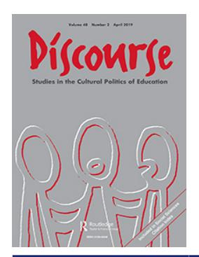

<!-- A1.R07 | source: papers_json/A1.R07/ -->

## **Discourse: Studies in the Cultural Politics of Education**

**ISSN: 0159-6306 (Print) 1469-3739 (Online) Journal homepage:****[ www.tandfonline.com/journals/cdis20](https://www.tandfonline.com/journals/cdis20?src=pdf)**

## **Neoliberalism, internationalisation and higher** **education: connections, contradictions and** **alternatives**

**Annette Bamberger, Paul Morris & Miri Yemini**

**To cite this article:** Annette Bamberger, Paul Morris & Miri Yemini (2019) Neoliberalism, internationalisation and higher education: connections, contradictions and alternatives, Discourse: Studies in the Cultural Politics of Education, 40:2, 203-216, DOI: [10.1080/01596306.2019.1569879](https://www.tandfonline.com/action/showCitFormats?doi=10.1080/01596306.2019.1569879)

**To link to this article: **[https://doi.org/10.1080/01596306.2019.1569879](https://doi.org/10.1080/01596306.2019.1569879)

*[Calendar]* Published online22 Jan 2019.*[Pencil]* Submit your article to this journal *[External Link]**[Bar Chart]* Article views6666*[Search Document]* View related articles *[External Link]**[Crossmark Logo]* View Crossmark data *[External Link]**[Documents]* Citing articles51 View citing articles *[External Link]*

<!-- page 2 -->

## Neoliberalism, internationalisation and higher education: connections, contradictions and alternatives

Annette Bamberger ^a^ , Paul Morrisa and Miri Yemini ^b^

a Education, Practice and Society, UCL Institute of Education, London, UK; ^b^ Constantiner School of Education, Tel Aviv University, Tel Aviv, Israel

## ABSTRACT

We explore the role of neoliberalism within portrayals of internationalisation in higher education (HE). Through an analysis of four features of internationalisation, we suggest that they embody a complex entanglement of neoliberal categories and assumptions with other, primarily progressive humanitarian ideals. This framing of internationalisation has three affects. One, humanitarian ideals coupled with neoliberal categories normalise inequalities, turning internationalisation into a meritocratic global race, focusing on celebrating the possibility of the few who can achieve, instead of the embedded inequalities within the system, which disadvantage the many. Two, this allows neoliberal practices to be advanced through the discourse of internationalisation and its association with progressive humanitarian values. Three, this neoliberal framing does not explain the nature of internationalisation of HE in many nations; we demonstrate this by analysing internationalisation in China, Israel and Cuba. We suggest that internationalisation in HE cannot be adequately explained by analyses which rely on neoliberalism.

## KEYWORDS

Neoliberalism; internationalisation; higher education; globalisation; China; Israel; Cuba

## Introduction

Internationalisation in higher education (HE) over time and space has never had a solitary meaning or practice. Yet, the forces shaping it have been defined in particular periods of time and thus, the internationalisation of HE is widely viewed as moving over time from the pursuit of academic and cultural exchange, to peace and mutual understanding to development aid and increasingly national competitiveness, commercial and economic considerations (de Wit, [2002;](#page-11-0) Knight, [2015](#page-12-0)). While these rationales have never been singular, and scholars emphasise the existence of multiple overlapping rationales for internationalisation (de Wit, Hunter, Howard, & Egron-Polak, [2015)](#page-11-0), currently its complex and hybrid nature is overshadowed by discussions of one dominant rationale with a particularly North American and Eurocentric focus.

In recent decades, the economic rationales and commercial manifestations of internationalisation practice have been viewed (and lamented) by scholars as increasingly dominant (Brandenburg & de Wit, [2011](#page-11-0)). Moreover, neoliberalism is seen as an ever more powerful and hegemonic frame through which internationalisation is conceived and

<!-- page 3 -->

operationalised. Little research has explored how neoliberalism and internationalisation are intertwined, the effects of this entanglement, or examined the usefulness of scholarship that increasingly internalises neoliberal categories and assumptions to explain internationalisation on a global scale. While neoliberalism has become increasingly hegemonic as an explanation of many areas of education policy and practice, internationalisation in HE is an area which has been widely identified with neoliberal ideas and practices (e.g. Shields, [2013](#page-13-0); Tannock, [2013)](#page-14-0).

We explore the role of neoliberalism in internationalisation in HE globally to understand how they are entangled, its effects, and the value of neoliberalism as an analytical and explanatory research tool. We begin with an analysis of the development of neoliberalism and internationalisation in HE, emphasising the complex, multi-faceted nature of both ideas and practices, as well as spatial and temporal shifts. We then illustrate how neoliberalism has become embedded in the normative categories and assumptions of key features of internationalisation. Finally, employing the cases of internationalisation in China, Israel and Cuba, we sketch examples of internationalisation which we argue cannot be explained by neoliberal frameworks. While this analysis is necessarily brief and runs the risk of overgeneralisation, we think it effectively shows the need for alternative organising concepts and perspectives to explain internationalisation globally.

## Neoliberalism and internationalisation

Scholars have argued that neoliberalism and internationalisation are various strands of globalisation (e.g. Rhoads & Torres, [2006;](#page-13-0) Rizvi & Lingard, [2010](#page-13-0); Shields, [2013](#page-13-0)). Building on this, we analyse the development of these two strands below.

## Neoliberalism

Neoliberalism is rooted in a belief that markets are the most efficient mode for decisionmaking and the optimal way to promote human welfare (Harvey, [2005](#page-12-0)). Consequently, neoliberal theory reduces the role of the state to market regulation, the protection of private property and national borders (Mudge, [2008)](#page-13-0). Globalisation and free-trade agreements lower barriers to movement, creating global markets for goods and labour. Thus, neoliberalism is associated with the propagation of free-market (and choice) policies, privatisation and deregulation of education services (e.g. Hursh, [2017](#page-12-0); Lubienski, [2006](#page-13-0)) and promotes the supremacy of the market, competition, rational choice, the global knowledge economy and the instrumental framing of education for individual economic gain.

Yet, neoliberalism is a concept with multiple, contested meanings resulting in serious problems when it is used as an explanatory device. Springer, Birch, and MacLeavy ([2016](#page-14-0)) describe it as a 'hegemonic ideology, a state form, a policy and programme, an epistemology, and a version of governmentality' (p. 2); and Mudge [(2008](#page-13-0)) describes it as'an oftinvoked but ill-defined concept' (p. 703) embodying 'a perplexing mix of overreach and underspecification' (Brenner, Peck, & Theodore, [2010](#page-11-0), p. 2). Some of this confusion, may stem from the fact that 'neoliberalism' is not a unified concept and has local variations. While neoliberal theory emanates from North America and Western Europe, it has travelled around the world – or particularly to the Global South, its practice has either been forcibly imposed, predominantly through aid (Auld, Rappleye, & Morris, [2018](#page-10-0);

<!-- page 4 -->

Peet, [2003](#page-13-0)) or used as a development strategy (Connell & Dados, [2014](#page-11-0)). During its travels, it has morphed and shifted, adapting itself to local histories, politics, cultures, and institutions and taken on a hybrid nature (Springer et al., [2016)](#page-14-0), giving rise to spatial variations: social democratic versions in Canada, New Zealand, and Germany (Peck & Tickell, [2002](#page-13-0)), autocratic and state-centred versions in China (Wu, [2010](#page-14-0)), the 'neoliberal-developmental state' in Singapore (Liow, [2012](#page-12-0)), and a progressive version in the US, in which humanist ideals are co-opted by and entangled with neoliberalism (Fraser, [2017)](#page-11-0). In addition to spatial variations, neoliberalism has also shifted within different locales over time. Varieties of neoliberalism may also be enacted in different ways, with diverse networks of actors, with different purposes and roles (Apple, [2017)](#page-10-0). Despite this recognition of its multiplicity and complexity, as Rowlands and Rawolle ([2013](#page-13-0)) demonstrate, when 'neoliberalism' is referenced in the literature on education it tends not to be scrutinised or even defined.

Despite the evidence of local variations, temporal shifts, diverse motives and the lack of consensus, Venugopal ([2015](#page-14-0)) argues that 'neoliberalism' nonetheless carries an overwhelming pejorative connotation; it is particularly associated with critical scholarship on capitalist, free-market policies. It has 'become a means of identifying a seemingly ubiquitous set of market-oriented policies as being largely responsible for a wide range of social, political, ecological and economic problems' (Springer, [2010](#page-14-0), p. 1025). Neoliberalism thus serves as a loose signifier (Venugopal, [2015](#page-14-0)) for the numerous economic practices that affect the internationalisation of HE and is often employed when the rationales for internationalisation are portrayed as moving away from humanistic motives, to those of a more commercial nature. Overall neoliberalism is commonly evoked to critique the undesirable and illegitimate manifestations of internationalisation in HE. These include the pursuit of international branding and reputation by universities and nations (Lomer, Papatsiba, & Naidoo, [2018](#page-13-0); Stein, [2018)](#page-14-0); a competitive as opposed to cooperative approach to internationalisation (e.g. Huisman & van der Wende, [2005;](#page-12-0) Knight, [2015)](#page-12-0); predatory international student recruitment (e.g. Huang, Raimo, & Humfrey, [2016](#page-12-0); Hulme, Thomson, Hulme, & Doughty, [2014](#page-12-0)); international students as 'cash cows' (e.g. De Vita & Case, [2003](#page-11-0); Lomer, [2014](#page-12-0)); the transformation of universities into international businesses (e.g. Sidhu, [2009](#page-13-0); Wu & Naidoo, [2016](#page-14-0)); and substandard quality in branch campuses and overseas education (e.g. Altbach, [2015](#page-10-0); Lieven & Martin, [2006)](#page-12-0). Thus, neoliberalism is often employed as a loose rhetorical or underspecified explanatory device for encompassing features that do not align with normative perspectives of what internationalisation in HE should be with little analysis of its meaning, or how neoliberalism is expressed in specific contexts.

## Internationalisation

Internationalisation in HE is a hybrid practice with different purposes, manifestations and actors (Bamberger, Morris, Weinreb, & Yemini, [2018)](#page-11-0). Rationales identified for internationalisation are academic, political, economic and socio-cultural (de Wit et al., [2015](#page-11-0)). These rationales have never been fixed or singular and are mutually inclusive and moving over time and space. While scholars stress multiple overlapping rationales for internationalisation, the dominant rationales – which heavily reflect Western timelines and perspectives – have been identified over time. These dominant rationales have undergone major shifts over the years, from colonial formations (Scott, [1998)](#page-13-0) to humanitarian ideas associated with peace and reconciliation in the post-war period, to a development agenda associated with political motives during the Cold War, and now increasingly with a

<!-- page 5 -->

focus on its economic and commercial potential (de Wit, [2002;](#page-11-0) Knight, [2015)](#page-12-0). This shift towards an economic rationale has fuelled the growth of internationalisation, which is now portrayed as a universal phenomenon (Chankseliani, [2018](#page-11-0); Larsen, [2016](#page-12-0)). During this period, scholars argue that neoliberalism has become inextricably linked to the internationalisation of HE (Marginson, [2000;](#page-13-0) Shields, [2013](#page-13-0)); and indeed, the terms 'internationalisation' and 'neoliberalism' emerged into the lexicon of education discourse (de Wit, [2002](#page-11-0); Rowlands & Rawolle, [2013)](#page-13-0) simultaneously in the early 1990s.

Like neoliberalism, the term internationalisation in HE, is used broadly to refer to many different manifestations; while some of these are more ostensibly in line with academic and humanitarian rationales, like the internationalisation of the curriculum or internationalisation in research, others are more connected with competitive and economic rationales, such as international student recruitment (Woldegiyorgis, Proctor, & de Wit, [2018](#page-14-0)). Internationalisation also has spatial variations and it has travelled and morphed around the world to create different local meanings and practices.

Yet while economic rationales and neoliberal ideas have become increasingly hegemonic, other rationales have not disappeared. Internationalisation is widely depicted as a positive response to destructive forms of globalised neoliberalism and the progressive, humanistic possibilities of internationalisation are often stressed, especially mutual understanding; diversity; intercultural awareness, global citizenship and tolerance (Haigh, [2008](#page-12-0); Yemini, [2015](#page-14-0)). Broadly, this humanitarian approach indicates a more holistic view of the individual; it emphasises cooperation over competition, fostering a more collaborative and communal approach (Bennett & Kottasz, [2011](#page-11-0); van der Wende, [2007](#page-14-0)). Further, it is associated with democracy (Svensson & Wihlborg, [2007](#page-14-0)) and consensus building while simultaneously downplaying ethnic and religious links in favour of a shared humanity. This humanitarian framing of internationalisation is reflected in the positive terms it is associated with (e.g. global citizenship; cosmopolitanism) (Goren & Yemini, [2017](#page-11-0)). Indeed, in a recent large-scale study on the state of internationalisation research in top higher education journals, George Mwangi et al. ([2018](#page-11-0)) argue that internationalisation is widely viewed as a positive force. Thus, while scholars suggest that in recent years, internationalisation has become increasingly aligned with economic and commercial motives which internalise neoliberal categories and assumptions, it has maintained a strong connection to other rationales and ideas, particularly positive views of human connectivity and humanitarianism.

## Examining entanglement

In this section, we analyse the portrayals of three key features associated with internationalisation namely its role in promoting: cosmopolitanism; mobility; and multiculturalism and diversity. We illustrate how the tenets of neoliberalism are interwoven with other rationales, particularly humanistic impulses. We also examine a key element of its governance, namely the role of the state.

First, cosmopolitanism is linked with and ostensibly valued in internationalisation, however, it has been recast from a progressive ideology that espouses openness to the other to a form of capital for individual, positional advantage (e.g. Igarashi & Saito, [2014](#page-12-0); Kim, [2011;](#page-12-0) Weenink, [2008)](#page-14-0). Cosmopolitanism as capital invokes Bourdieu's [(1986](#page-11-0)) ideas of positionality, stratification, inequalities and social reproduction and is associated with

<!-- page 6 -->

multicultural attitudes; speaking foreign languages; being accustomed to travel and foreign cultures; having international social networks; and possessing prestigious academic degrees (e.g. Bühlmann, David, & Mach, [2013;](#page-11-0) Carroll, [2010)](#page-11-0). Thus, international HE is the most powerful way to accumulate such capital. Yet, students from minority backgrounds, who may possess such capital (e.g. languages and social networks) are usually excluded from these advantages because they do not have the 'right' sort of cosmopolitan capital (i.e. elite forms) such as English language fluency. This stratification of the 'right' sort of cosmopolitan capital favours certain countries (e.g. US, UK), universities (highly ranked), languages (i.e. English), degrees (e.g. MBA) and fields (e.g. STEM) over others, in what Marginson [(2008](#page-13-0)) and Tannock ([2013)](#page-14-0) describe as a zero-sum game. Furthermore, multicultural attitudes and 'soft skills' of mutual understanding and tolerance tend not to be connected to humanistic and cooperative aims, but rather to increased readiness for employment in global and national labour markets (e.g. Jones, [2013](#page-12-0); Leggott & Stapleford, [2007](#page-12-0)). This rhetoric transforms multi-culturalism from a tool to promote constructive human relations, into an individual advantage for competition in employment markets. Similarly, whilst global citizenship has been portrayed (e.g. OECD, [2018](#page-13-0)) as a source of mutual understanding and peace, Auld and Morris [(2019](#page-10-0)) argue that attempts to measure 'Global Competencies' by the OECD have been based on a vision of an elite mobile worker in the global knowledge economy.

Second, the mobility of people is widely depicted as the rational pursuit of predominantly individual economic gains. Relying on large-scale statistical data, global student mobility patterns are thought of as an outcome of HE supply (from universities in the Global North) and student demand (from the Global South); indeed, the standard analytical framework to explain international student mobility is the push-pull model, borrowed from international trade (e.g. Altbach, [1998;](#page-10-0) Choudaha & de Wit, [2014;](#page-11-0) Maringe & Carter, [2007](#page-13-0)). In comparison, the humanistic rationales for mobility tend to be marginalised in the motives for students, institutions and national and supranational entities to engage in mobility, again, unless these can be related back to an employability narrative (Dvir & Yemini, [2017)](#page-11-0). Student mobility is instead linked to the pursuit of global skills and competencies, social networks and migration opportunities that are then transferred into increased economic opportunities in a rational, economic, human capital framing of mobility. In line with this framing, student mobility from affluent nations is relatively low and when they are mobile, they tend to study in other affluent nations (i.e. horizontal mobility) (Brooks & Waters, [2009](#page-11-0)). More troubling, student mobility from the Global South to the Global North has led to: brain drain as international students become 'talented' immigrants fuelling national knowledge economies (Brown & Tannock, [2009](#page-11-0)); to the underdevelopment of national HE systems in the Global South (Alemu, [2014](#page-10-0); Odhiambo, [2013](#page-13-0)); and to creating elite status when international students return home (Findlay, [2011](#page-11-0); Waters, [2007](#page-14-0)). Likewise, faculty mobility, is not a purely academic or humanistic undertaking but also a useful way to promote international cooperation, particularly to access international research funding (Woldegiyorgis et al., [2018](#page-14-0)) and to advance shared publications, a key indicator in global university rankings (Wan et al., [2017)](#page-14-0). Moreover, the benefits from mobility tend to be framed as individual private goods; there is less research about the effects of mobility on wider groups (besides brain drain), despite scholarship which emphasises the very different perceptions of public/private goods derived from HE in more communal societies (Unterhalter et al., [2018](#page-14-0)). Overall mobility is widely framed

<!-- page 7 -->

through a neoliberal lens focusing on the individual: person; institution; country; all seeking to maximise their gains through employment, global rankings or a global competition.

The mobility of institutions and programmes are also viewed through the lens of supply and demand in which all parties aim at improving their economic prospects from a 'transaction'. Institutions in the Global North provide capacity (and allegedly, quality) with financial profits and international branding being the incentives, while foreign partners, predominantly from the Global South, are helped to build capacity, largely to develop and spur the growth of their economies (Altbach & Knight, [2007](#page-10-0)). Much of the literature, frames branch campuses and the many cross-border forms of international mobility similarly. Further, institutional alliances are predominantly ties between similar status institutions (Mohrman, Ma, & Baker, [2008)](#page-13-0). Where partnerships exist between higher and lower status institutions, these are often portrayed through a deficit discourse with a development rationale or may be designed to benefit the more advantaged partner (Obamba & Mwema, [2009)](#page-13-0). Thus, through neoliberal categories, mobility, at the level of the individual, institution and nation is transformed into an investment for gain as opposed to a collaborative endeavour to promote more humanistic goals.

Third, while much of the internationalisation research propagates diversity and multi-culturalism, these are fused with neoliberal baggage. In practice, diversity is limited to those who can compete (e.g. sit ToEFL and entrance exams; publish in top journals) and pay (e.g. international tuition and housing fees; conferences) in the meritocratic 'global knowledge economy'. This perpetuates and reinforces inequalities instead of working to ensure widespread access and equity. Moreover, 'diverse' students and faculty may likely find that their diversity (particularly if it is not of an elite variety) is undervalued, their epistemologies misunderstood, and they must be 're-educated' in the ways of their new campus or faculty (Stockfelt, [2018](#page-14-0)). Thus, the humanitarian values coupled with neoliberal categories serve to normalise inequalities, instead transforming it into a meritocratic global race, focusing on celebrating the possibility of the few who can achieve, instead of the embedded inequalities within the system, which disadvantage the many (Fraser, [2017)](#page-11-0).

Fourth, the internationalisation literature, in line with neoliberal theory, tends to envisage a 'small state' and assume that its role is limited to that of a market regulator, as opposed to a strong, authoritarian state. The role that the state plays in internationalisation is often limited to regulating immigration, and generally promoting 'academic capitalism' (e.g. Lomer, [2017;](#page-13-0) Slaughter, [2014](#page-14-0)). The state is not viewed as setting the criteria for institutional partnerships, international programme development or the like and a large amount of institutional, researcher and student autonomy is assumed. Indeed, with few notable exceptions (e.g. Cantwell & Maldonado-Maldonado, [2009](#page-11-0); Larsen, [2016)](#page-12-0), internationalisation tends to be portrayed as an institutional (not a state) response by universities that have the autonomy to forge divergent strategies (e.g. Hudzik, [2015](#page-12-0)). This perspective necessarily precludes states in which institutional autonomy is limited and where the state exercises great control over the targets and trajectories of internationalisation (e.g. regarding foreign partners, branch campuses, joint-programmes, international students). In this way, analyses of internationalisation tend to normalise weakened neoliberal states, while disregarding the role of authoritarian states. Notwithstanding, some universities particularly from the US and UK have established branch campuses in nations where an

<!-- page 8 -->

authoritarian state imposes strong limitations on their core principles; namely academic and institutional autonomy (Clifford & Kinser, [2016](#page-11-0)).

Through these four illustrative (but not exhaustive) examples we suggest that many central features of internationalisation reflect a complex fusion of neoliberal categories (e.g. competition, supremacy of the market, rational choice) and assumptions (a regulatory as opposed to an authoritarian state) with other, primarily progressive humanitarian impulses (e.g. humanitarianism, cosmopolitanism, multi-culturalism). In many ways, this echoes Fraser's [(2017)](#page-11-0) analysis of the entanglement of progressive feminist discourse and practice with neoliberalism in the US, in which progressive ideals are interwoven with and co-opted by neoliberal forces in what Fraser dubs 'progressive neoliberalism'. The result of this framing of internationalisation is threefold. One, this fusion provides a powerful means to advance neoliberalism under the guise of progressive humanist aims. Two, it serves to normalise inequalities, transforming internationalisation into a part of the meritocratic global race, which deflects attention away from the embedded inequalities within the system. Three, we suggest that this framing is intellectually limiting and cannot provide a basis to explain the nature and motives for HE in many nations in which neoliberalism is either not an organising concept in internationalisation or the form of neoliberalism is radically different from the tendencies within the progressive version.

We now turn to demonstrate – through the cases of China, Israel and Cuba – why neoliberalism and particularly the progressive version echoed in much of the normative categories and assumptions of the academic literature, fails to provide a basis to explain the nature of and motives for the internationalisation of HE in many nations.

## China

If China can be considered a 'neoliberal' state at all is debateable (Huang, [2008](#page-12-0); Nonini, [2008](#page-13-0); Ong, [2007](#page-13-0); Wu, [2010)](#page-14-0). This ambiguity stems in part from the significant role of an authoritarian or developmental state in designing, promoting, implementing and governing economic development (Pei, [2008;](#page-13-0) Zheng, [2008)](#page-14-0). Through neoliberal reforms, it is argued that the state has consolidated more power and uses economic reform to maintain its legitimacy (Wu, [2010](#page-14-0)). While recognising the difficulties in labelling China as a neoliberal state, and the lasting legacies of socialism, according to Harvey [(2006)](#page-12-0) and Liew [(2005](#page-12-0)) China is embarked on a form of neoliberalism that fuses market reforms with strong centralised state control.

The HE sector in China is heavily regulated and internationalisation has been strongly promoted and resourced to help achieve national development goals (Li, [2016](#page-12-0); Wang, [2014](#page-14-0)). Dominant motives are not financial but focus on research and development, building 'world class universities', student scholarships and international partnerships, with a particular focus on high-status institutions from the West and STEM subjects (Paul & Long, [2016)](#page-13-0). As measured by their goals, internationalisation has made impressive progress, particularly in the growth of research publications, citations, patents and global rankings of Chinese universities (Huang, [2015](#page-12-0)). Given the primary role of the state, its need for legitimacy through economic development and the quest for power on an international stage, internationalisation in China is defined primarily in terms of its contributions to achieving national goals and bolstering its international power and influence (Wang, [2014)](#page-14-0). Thus, despite the legacy of communism and a collectivist society, the more humanistic aims of internationalisation

<!-- page 9 -->

are muted in this pursuit of the economic development from which the state derives its legitimacy; thus the categories, assumptions and discourses around internationalisation formed by a fusion of neoliberalism and humanitarianism hold little explanatory power in China, and instead reflects more the normative Western progressive views of the literature rather than the reality.

## Israel

While Israel was founded by the dominant social democratic party (Mapai), with the transition of power to a more right-wing party (Likud) with free-market views in 1977, a neoliberal agenda began to trickle through the various levels of the state, gaining ground in the 1980s (Maron & Shalev, [2017](#page-13-0)) and today, Israel is considered a neoliberal 'success story' (Avigur-Eshel, [2014](#page-10-0), p. 165). In HE this involved a wave of reforms in the 1990s which included the deregulation of the sector to foreign providers (since then restricted, see Bamberger, [2018;](#page-11-0) Lieven & Martin, [2006](#page-12-0)) and the addition of a private sector of secondtier academic institutions (Volansky, [2005](#page-14-0)). Israeli universities have always had an international element (Kirsch, [2018](#page-12-0)) which did not begin with the rise of neoliberalism or 'internationalisation' in the 1990s.

Israel views itself as a Western style democracy and espouses a commitment to civil and human rights. However, while most Western democracies promote an openness to ethnic and religious groups, Israel was established as the nation of the Jewish people – and remains an ethnoreligious state. However, there is a substantial Palestinian minority in Israel and thus, to maintain the Jewish majority in the state, the demographic balance has always been an important political issue. This affects the targets of internationalisation in HE restricting it to relations between majority/minority populations within the country (Yemini et al., [2015)](#page-14-0), the heterogenous Jewish population of Israel (e.g. integrating Jewish immigrants from different backgrounds); and the Jewish diaspora (Bamberger et al., [2018](#page-11-0)). Due to the intractable conflict with its neighbours and the desire to preserve a Jewish majority, the multi-cultural purposes of internationalisation are muted, whilst academic excellence is highlighted (Yemini, [2017](#page-14-0)); this is manifested in the pursuit of excellence in research, research funding abroad, and research partnerships with elite partners, particularly from countries which Israel would like to forge close political and economic ties (Bamberger et al., [2018](#page-11-0)). Moreover, student mobility, a primary focus of internationalisation, is extremely limited due to the intractable conflict which restricts the possibilities for cooperation both among groups in Israel and across the region; and the founding values of the state as the Jewish nation which limits who may live, work and immigrate to the country (Yemini, [2017](#page-14-0)).

While Israel is considered a neoliberal state, internationalisation is affected by its unique history, institutions and cultural trajectory. Rather than forms of neoliberalism, internationalisation is defined by its commitment to excellence; the ideological desire to maintain and legitimise a Jewish majority state; and the centrality of the Israeli-Palestinian conflict.

## Cuba

Since 1959, Cuba has taken a socialist path rooted in a post-colonial ethos and a philosophy of solidarity, as opposed to a neoliberal market and competition-based approach

<!-- page 10 -->

(Hickling-Hudson, González, & Preston, [2012)](#page-12-0). Since 1989 market reforms have crept in to Cuba following the collapse of the Soviet Union, Cuba's main ally during the first decades of the revolution; however, these reforms are limited and tend to focus on the development of small businesses. Furthermore, interactions with foreign investors are approved by the central government with a commitment to assure mutual benefits to society (Hudson-Hickling et al., 2012). In this way, Cuba's 'neoliberalism' – if it could be said to exist at all – operates within a socialist ideology, a strong state and a low level of market logic.

Cuba has, despite the economic hardships and marginalisation, raised the standards of health and education for its citizens (Martinez Perez, [2012)](#page-13-0) through the development of an impressive health and education system. Education levels are on par with developed countries and they have been able to obtain these levels with far less resources (Martin Sabina, Coronoa Gonzalez, & Hickling-Hudson, [2012](#page-13-0)).

Building on their experience with the Soviet Union – which helped Cuba to develop its own education system and brought thousands of young Cubans to Eastern Europe for education in the early decades of the revolution – Cuba has focused on sharing its educational expertise and resources. Cuban higher education has focused on promoting socialism and developing collaborative partnerships with strategic partners, at first primarily in Africa and later shifting towards regional partners in the Caribbean and Central and South America (Hickling-Hudson, González, & Preston, [2012](#page-12-0)). Despite its precarious economic situation over the years, Cuba has provided extensive support and training in universities abroad and has brought more than 55,000 international students from 148 countries to the island on full scholarships between 1961 and 2008 (Martinez Perez, [2012,](#page-13-0) p. 75). Internationalisation is viewed through the ideology of solidarity and as a way to promote socialism. Hickling-Hudson and Arnove ([2014](#page-12-0)) have described Cuba as a regional hub for HE and lauded it as a successful example of South-to-South cooperation. Given the low level of market forces and radically different social collectivist philosophy, the discourses in the internationalisation literature about financial gains; cosmopolitan capital; and competition fail to capture internationalisation in Cuba.

## Conclusion

We began by examining the development of neoliberalism and internationalisation in HE, emphasising the complex, multi-faceted nature of both its conception and operationalisation, and spatial and temporal shifts over time. We asserted that neoliberalism is increasingly hegemonic in analyses of internationalisation. However, research has not sufficiently addressed the ways in which it is interwoven within the normative categories and assumptions of internationalisation or the effects of this. We then illustrated how neoliberalism has become entangled in the literature's coverage of four key features of internationalisation. Through this analysis, we illustrated the fusion of neoliberalism with humanitarian impulses within the normative portrayals of internationalisation in HE. We highlighted how internationalisation often promotes progressive values (e.g. cosmopolitanism, multiculturalism, diversity) but that these are the key processess associated with neoliberalism (e.g. competition; markets; stratification). Our analysis suggests three consequences of this framing. First, this allows neoliberal practices to be promoted and advanced through the discourse of internationalisation and its association with progressive humanitarian values,

<!-- page 11 -->

emphasising the imperative to look critically at internationalisation. Second, it serves to normalise inequalities, transforming internationalisation into a part of the meritocratic global race as nations seek to compete in the global knowledge economy; which deflects attention away from the embedded inequalities within the system. Third, we suggest that this framing does not provide a basis to explain the nature and motives for internationalisation in HE in nations in which neoliberalism is either not an organising concept or the form of neoliberalism is radically different from the tendencies within the progressive version.

Picking up on this final thread, through a brief examination of the cases of internationalisation of HE in China, Israel and Cuba, we illustrated how their approach to internationalisation is shaped not by a progressive neoliberal approach but by diverse ideologies, local histories, and conflicts. Thus, we demonstrate that 'internationalisation' allows for a multitude of ideas and practices that at times may align and fuse with but extend beyond neoliberalism. It does not align with one particular understanding of neoliberalism and should be understood as a multi-faceted and complex assemblage of practices in which multiple intentions and ideas are interwoven with particular economic, political, social and cultural concerns which shift over time and space. The current tendency in the literature towards a reliance on a progressive neoliberal framing of internationalisation limits our understanding on a global scale. Instead of this framing, we argue for a more nuanced, historical and contextually-dependent understanding of internationalisation.

## Disclosure statement

No potential conflict of interest was reported by the authors.

## ORCID

Annette Bamberger [http://orcid.org/0000-0001-8006-5557](http://orcid.org/0000-0001-8006-5557) Miri Yemini [http://orcid.org/0000-0002-5633-6473](http://orcid.org/0000-0002-5633-6473)

## References

Alemu, S. K. [(2014](#page-5-0)). An appraisal of the internationalisation of higher education in Sub-Saharan Africa. CEPS Journal: Center for Educational Policy Studies Journal, 4(2), 71–90.

Altbach, P. ([2015](#page-3-0)). Why branch campuses may be unsustainable. International Higher Education, 58, 2–3.

Altbach, P. G. ([1998](#page-5-0)). Comparative higher education: Knowledge, the university, and development. Hong Kong: Comparative Education Research Centre, The University of Hong Kong.

Altbach, P. G., & Knight, J. ([2007)](#page-6-0). The internationalization of higher education: Motivations and realities. Journal of Studies in International Education, 11(3–4), 290–305.

Apple, M. W. ([2017](#page-3-0)). What is present and absent in critical analyses of neoliberalism in education. Peabody Journal of Education, 92(1), 148–153. [doi:10.1080/0161956X.2016.1265344](https://doi.org/10.1080/0161956X.2016.1265344)

Auld, E., & Morris, P. ([2019](#page-5-0)). From science to streetlights: Assessing the OECD's (measure of) global competence through PISA. Policy Futures in Education. [doi:10.1177/1478210318819246](https://doi.org/10.1177/1478210318819246)

Auld, E., Rappleye, J., & Morris, P. ([2018](#page-2-0)). Pisa for development: How the OECD and World Bank shaped education governance post-2015. Comparative Education. [doi:10.1080/03050068.2018.](https://doi.org/10.1080/03050068.2018.1538635) [1538635](https://doi.org/10.1080/03050068.2018.1538635)

Avigur-Eshel, A. ([2014](#page-8-0)). The ideological foundations of neoliberalism's political stability: An Israeli case study. Journal of Political Ideologies, 19(2), 164–186. [doi:10.1080/13569317.2014.909261](https://doi.org/10.1080/13569317.2014.909261)

<!-- page 12 -->

- Bamberger, A. ([2018](#page-8-0)). Academic degree recognition in a global era: The case of the doctorate of education (EdD) in Israel. London Review of Education, 16(1), 28–39.
- Bamberger, A., Morris, P., Weinreb, Y., & Yemini, M. ([2018](#page-3-0)). Hyperpoliticised internationalisation in a pariah university: An Israeli institution in the occupied West Bank. International Journal of Educational Development. [doi:10.1016/j.ijedudev.2018.09.005](https://doi.org/10.1016/j.ijedudev.2018.09.005)
- Bennett, R., & Kottasz, R. ([2011](#page-4-0)). Strategic, competitive, and cooperative approaches to internationalisation in European business schools. Journal of Marketing Management, 27(11–12), 1087–1116. [doi:10.1080/0267257X.2011.609131](https://doi.org/10.1080/0267257X.2011.609131)
- Bourdieu, P. ([1986](#page-4-0)). The forms of capital. In J. G. Richardson (Ed.), Handbook of theory and research for the sociology of education (pp. 241–258). New York: Greenwood Press.
- Brandenburg, U., & de Wit, H. [(2011)](#page-1-0). The end of internationalization. International Higher Education, 62, 15–17.
- Brenner, N., Peck, J., & Theodore, N. [(2010](#page-2-0)). Variegated neoliberalization: Geographies, modalities, pathways. Global Networks, 10(2), 182–222.
- Brooks, R., & Waters, J. [(2009)](#page-5-0). International higher education and the mobility of UK students. Journal of Research in International Education, 8(2), 191–209.
- Brown, P., & Tannock, S. ([2009](#page-5-0)). Education, meritocracy and the global war for talent. Journal of Education Policy, 24(4), 377–392.
- Bühlmann, F., David, T., & Mach, A. ([2013](#page-5-0)). Cosmopolitan capital and the internationalization of the field of business elites: Evidence from the Swiss case. Cultural Sociology, 7(2), 211–229.
- Cantwell, B., & Maldonado-Maldonado, A. ([2009](#page-6-0)). Four stories: Confronting contemporary ideas about globalisation and internationalisation in higher education. Globalisation, Societies and Education, 7 (3), 289–306.
- Carroll, W. K. ([2010](#page-5-0)). The making of a transnational capitalist class: Corporate power in the 21st century. London: Zed Books.
- Chankseliani, M. [(2018](#page-4-0)). Four rationales of HE internationalization: Perspectives of UK universities on attracting students from former Soviet countries. Journal of Studies in International Education, 22 (1), 53–70.
- Choudaha, R., & de Wit, H. ([2014)](#page-5-0). Challenges and opportunities for global student mobility in the future: A comparative and critical analysis. In B. Steitwieser (Ed.), Internationalisation of higher education and global mobility (pp. 19–33). Oxford: Symposium Books.
- Clifford, M., & Kinser, K. [(2016)](#page-7-0). How much autonomy do international branch campuses really have? International Higher Education, 87, 7–9.
- Connell, R., & Dados, N. ([2014](#page-3-0)). Where in the world does neoliberalism come from? Theory and Society, 43(2), 117–138.
- De Vita, G., & Case, P. [(2003)](#page-3-0). Rethinking the internationalisation agenda in UK higher education. Journal of Further and Higher Education, 27(4), 383–398.
- de Wit, H. [(2002](#page-1-0)). Internationalization of higher education in the United States of America and Europe: A historical, comparative, and conceptual analysis. Westport, CT: Greenwood.
- de Wit, H., Hunter, F., Howard, L., & Egron-Polak, E. [(2015)](#page-1-0). Internationalisation of higher education. Brussels: European Parliament. Retrieved from [http://www.europarl.europa.eu/RegData/etudes/](http://www.europarl.europa.eu/RegData/etudes/STUD/2015/540370/IPOL_STU%282015%29540370_EN.pdf) [STUD/2015/540370/IPOL_STU%282015%29540370_EN.pdf](http://www.europarl.europa.eu/RegData/etudes/STUD/2015/540370/IPOL_STU%282015%29540370_EN.pdf)
- Dvir, Y., & Yemini, M. ([2017](#page-5-0)). Mobility as a continuum: European commission mobility policies for schools and higher education. Journal of Education Policy, 32(2), 198–210.
- Findlay, A. M. ([2011](#page-5-0)). An assessment of supply and demand-side theorizations of international student mobility. International Migration, 49(2), 162–190.
- Fraser, N. ([2017](#page-3-0)). The end of progressive neoliberalism. Dissent, 64(2), 130–134.
- George Mwangi, C. A., Latafat, S., Hammond, S., Kommers, S., Thoma, H., Berger, J., & Blanco-Ramirez, G. ([2018](#page-4-0)). Criticality in international higher education research: A critical discourse analysis of higher education journals. Higher Education, 76(6), 1091–1107. [doi:10.1007/s10734-018-0259-9](https://doi.org/10.1007/s10734-018-0259-9)
- Goren, H., & Yemini, M. ([2017](#page-4-0)). Global citizenship education redefined: A systematic review of empirical studies on global citizenship education. International Journal of Educational Research, 82, 170–183.

<!-- page 13 -->

- Haigh, M. [(2008)](#page-4-0). Internationalisation, planetary citizenship and higher education inc. Compare, 38(4), 427–440.
- Harvey, D. [(2005)](#page-2-0). A brief history of neoliberalism. Oxford: Oxford University Press.
- Harvey, D. ([2006](#page-7-0)). Spaces of global capitalism: Towards a theory of uneven development. London: Verso. Hickling-Hudson, A., & Arnove, R. [(2014)](#page-9-0). Higher education and international student mobility: The extraordinary case of Cuba. In B. Streitwieser (Ed.), Internationalisation of higher education and

global mobility (pp. 209–228). Oxford: Symposium Books.

- Hickling-Hudson, A., González, J., & Preston, R. (Eds.). [(2012)](#page-9-0). The capacity to share: A study of Cuba's international cooperation in educational development. New York: Palgrave MacMillan.
- Huang, F. [(2015)](#page-7-0). Building the world-class research universities: A case study of China. Higher Education, 70(2), 203–215. [doi:10.1007/s10734-015-9876-8](https://doi.org/10.1007/s10734-015-9876-8)
- Huang, Y. S. ([2008](#page-7-0)). Capitalism with Chinese characteristics: Entrepreneurship and the state. Cambridge: Cambridge University Press.
- Huang, I. Y., Raimo, V., & Humfrey, C. ([2016](#page-3-0)). Power and control: Managing agents for international student recruitment in higher education. Studies in Higher Education, 41(8), 1333–1354. [doi:10.](https://doi.org/10.1080/03075079.2014.968543) [1080/03075079.2014.968543](https://doi.org/10.1080/03075079.2014.968543)
- Hudzik, J. K. [(2015)](#page-6-0). Comprehensive internationalization: Institutional pathways to success. New York: Routledge.
- Huisman, J., & van der Wende, M. (Eds.). ([2005](#page-3-0)). On cooperation and competition II: Institutional responses to internationalisation, Europeanisation and globalisation. ACA Papers on International Cooperation in Education. Bonn: Lemmens.
- Hulme, M., Thomson, A., Hulme, R., & Doughty, G. ([2014)](#page-3-0). Trading places: The role of agents in international student recruitment from Africa. Journal of Further and Higher Education, 38(5), 674–689. [doi:10.1080/0309877X.2013.778965](https://doi.org/10.1080/0309877X.2013.778965)
- Hursh, D. [(2017)](#page-2-0). The end of public schools? The corporate reform agenda to privatize education. Policy Futures in Education, 15(3), 389–399.
- Igarashi, H., & Saito, H. ([2014](#page-4-0)). Cosmopolitanism as cultural capital: Exploring the intersection of globalization, education and stratification. Cultural Sociology, 8(3), 222–239.
- Jones, E. [(2013)](#page-5-0). Internationalization and employability: The role of intercultural experiences in the development of transferable skills. Public Money & Management, 33(2), 95–104.
- Kim, J. [(2011)](#page-4-0). Aspiration for global cultural capital in the stratified realm of global higher education: Why do Korean students go to US graduate schools? British Journal of Sociology of Education, 32(1), 109–126.
- Kirsch, U. ([2018)](#page-8-0). Israeli Universities: Unique aspects in a changing world. Haifa: Samuel Neaman Institute. Retrieved from [https://www.neaman.org.il/EN/Israel-Universities-Unique-Aspects-in-a-](https://www.neaman.org.il/EN/Israel-Universities-Unique-Aspects-in-a-Changing-World)[Changing-World](https://www.neaman.org.il/EN/Israel-Universities-Unique-Aspects-in-a-Changing-World)
- Knight, J. ([2015](#page-1-0)). Meaning, rationales and tensions in the internationalisation of higher education. In S. McGrath & Q. Gu (Eds.), Routledge handbook of international education and development (pp. 345–359). Abingdon: Routledge.
- Larsen, M. [(2016)](#page-4-0). Internationalization of higher education: An analysis through spatial, network, and mobilities theories. New York: Palgrave Macmillan.
- Leggott, D., & Stapleford, J. ([2007](#page-5-0)). Internationalisation and employability. In E. Jones & S. Brown (Eds.), Internationalising higher education (pp. 120–134). Abdingdon: Routledge.
- Li, F. ([2016)](#page-7-0). The internationalization of higher education in China: The role of government. Journal of International Education Research, 12(1), 47–52.
- Lieven, M., & Martin, G. ([2006](#page-3-0)). Higher education in a global market: The case of British overseas provision in Israel. Higher Education, 52(1), 41–68.
- Liew, L. H. [(2005](#page-7-0)). China's engagement with neo-liberalism: Path dependency, geography, and party self-reinvention. The Journal of Development Studies, 41(2), 331–352. [doi:10.1177/](https://doi.org/10.1177/1478210317736208) [1478210317736208](https://doi.org/10.1177/1478210317736208)
- Liow, E. D. ([2012](#page-3-0)). The neoliberal-developmental state: Singapore as case study. Critical Sociology, 38 (2), 241–264. [doi:10.1177/0896920511419900](https://doi.org/10.1177/0896920511419900)
- Lomer, S. [(2014)](#page-3-0). Economic objects: How policy discourse in the United Kingdom represents international students. Policy Futures in Education, 12(2), 273–285.

<!-- page 14 -->

Lomer, S. [(2017](#page-6-0)). Soft power as a policy rationale for international education in the UK: A critical analysis. Higher Education, 74(4), 581–598.

Lomer, S., Papatsiba, V., & Naidoo, R. [(2018](#page-3-0)). Constructing a national higher education brand for the UK: Positional competition and promised capitals. Studies in Higher Education, 43(1), 134–153.

Lubienski, C. ([2006](#page-2-0)). School choice and privatization in education: An alternative analytical framework. Journal for Critical Education Policy Studies, 4(1), 1–26.

Marginson, S. [(2000)](#page-4-0). Rethinking academic work in the global era. Journal of Higher Education Policy and Management, 22(1), 23–35.

Marginson, S. [(2008)](#page-5-0). Global field and global imagining: Bourdieu and worldwide higher education. British Journal of Sociology of Education, 29(3), 303–315.

Maringe, F., & Carter, S. ([2007](#page-5-0)). International students' motivations for studying in UK HE: Insights into the choice and decision making of African students. International Journal of Educational Management, 21(6), 459–475.

Maron, A., & Shalev, M. (Eds.). ([2017](#page-8-0)). Neoliberalism as a state project: Changing the political economy of Israel. New York: Oxford University Press.

Martinez Perez, F. ([2012](#page-9-0)). Cuban higher education scholarships for international students: An overview. In A. Hickling-Hudson, J. Corona Gonzalez, & R. Preston (Eds.), The capacity to share: A study of Cuba's international cooperation in educational development (pp. 73–82). New York: Palgrave MacMillan.

Martin Sabina, E., Coronoa Gonzalez, J., & Hickling-Hudson, A. ([2012](#page-9-0)). Cuba's education system: A foundation for 'the capacity to share'. In A. Hickling-Hudson, J. Corona Gonzalez, & R. Preston (Eds.), The capacity to share: A study of Cuba's international cooperation in educational development (pp. 53–70). New York: Palgrave MacMillan.

Mohrman, K., Ma, W., & Baker, D. ([2008](#page-6-0)). The research university in transition: The emerging global model. Higher Education Policy, 21(1), 5–27.

Mudge, S. ([2008)](#page-2-0). What is neo-liberalism? Socio-Economic Review, 6(4), 703–731.

Nonini, D. M. ([2008](#page-7-0)). Is China becoming neoliberal? Critique of Anthropology, 28(2), 145–176.

Obamba, M. O., & Mwema, J. K. ([2009](#page-6-0)). Symmetry and asymmetry: New contours, paradigms, and politics in African academic partnerships. Higher Education Policy, 22, 349–371.

Odhiambo, G. O. [(2013)](#page-5-0). Academic brain drain: Impact and implications for public higher education quality in Kenya. Research in Comparative and International Education, 8(4), 510–523.

OECD. [(2018)](#page-5-0). Preparing our youth for an inclusive and sustainable world: The OECD PISA global competence framework. Paris: OECD.

Ong, A. ([2007](#page-7-0)). Neoliberalism as a mobile technology. Transactions of the Institute of British Geographers, 32(1), 3–8.

Paul, A. M., & Long, V. ([2016](#page-7-0)). Human-capital strategies to build world-class research universities in Asia: Impact on global flows. In M. H. Chou, I. Kamola, & T. Pietsch (Eds.), The transnational politics of higher education (pp. 142–167). Abingdon: Routledge.

Peck, J., & Tickell, A. ([2002](#page-3-0)). Neoliberalizing space. Antipode, 34(3), 380–404.

Peet, R. ([2003](#page-2-0)). Unholy trinity: The IMF, World Bank and WTO. London: ZednBooks.

Pei, M. [(2008)](#page-7-0). China's trapped transition: The limits of developmental autocracy. Cambridge, MA: Harvard University Press.

Rhoads, R. A., & Torres, C. A. ([2006](#page-2-0)). The university, state, and market: The political economy of globalisation in the Americas. Stanford: Stanford University Press.

Rizvi, F., & Lingard, B. [(2010](#page-2-0)). Globalising education policy. London: Routledge.

Rowlands, J., & Rawolle, S. ([2013](#page-3-0)). Neoliberalism is not a theory of everything: A Bourdieuian analysis of illusio in educational research. Critical Studies in Education, 54(3), 260–272.

Scott, P. ([1998](#page-3-0)). Massification, internationalization and globalization. In P. Scott (Ed.), The globalization of higher education (pp. 108–129). Buckingham: SRHE & Open University Press.

Shields, R. [(2013)](#page-2-0). Globalization and international student mobility: A network analysis. Comparative Education Review, 57(4), 609–636.

Sidhu, R. ([2009](#page-3-0)). The 'brand name' research university goes global. Higher Education, 57(2), 125–140. [doi:10.1007/s10734-008-9136-2](https://doi.org/10.1007/s10734-008-9136-2)

<!-- page 15 -->

- Slaughter, S. (2014). Retheorizing academic capitalism: Actors, mechanisms, fields, and networks. In B. Cantwell & I. Kauppinen (Eds.), Academic capitalism in the age of globalization (pp. 20–32). Baltimore, MD: Johns Hopkins Press.
- Springer, S. (2010). Neoliberalism and geography: Expansions, variegations, formations. Geography Compass, 4(8), 1025-1038.
- Springer, S., Birch, K., & MacLeavy, J. (Eds.). (2016). Handbook of neoliberalism. Abingdon: Routledge. Stein, S. (2018). National exceptionalism in the 'EduCanada' brand: Unpacking the ethics of internationalization marketing in Canada. Discourse: Studies in the Cultural Politics of Education, 39(3), 461– 477. doi:10.1080/01596306.2016.1276884
- Stockfelt, S. (2018). We the minority-of-minorities: A narrative inquiry of black female academics in the United Kingdom. British Journal of Sociology of Education, 39(7), 1012–1029. doi:10.1080/ 01425692.2018.1454297
- Svensson, L., & Wihlborg, M. (2007). Internationalisation in the Swedish nurse education from the perspective of teachers involved: An interview study. Higher Education, 53(3), 279-305.
- Tannock, S. (2013). When the demand for educational equality stops at the border: Wealthy students, international students and the restructuring of higher education in the UK. Journal of Education Policy, 28(4), 449-464.
- Unterhalter, E., Allais, S., Howell, C., McCowan, T., Morley, L., Oanda, I., & Oketch, M. (2018). Conceptualising higher education and the public good in Ghana, Kenya, Nigeria, and South Africa. Proceedings of the CIES 2018 Annual Conference (Vol. 2018). Comparative and International Education Society (CIES).
- van der Wende, M. (2007). Internationalization of higher education in the OECD countries: Challenges and opportunities for the coming decade. Journal of Studies in International Education, 11(3-4), 274-289.
- Venugopal, R. (2015). Neoliberalism as concept. Economy and Society, 44(2), 165-187. doi:10.1080/ 03085147.2015.1013356
- Volansky, A. (2005). Academia in a changing environment: Israel's policy of higher education, 1952– 2004. Tel Aviv: Kibbutz Ha-Me'uchad and the Shmuel Nee-Man Institute. (Hebrew).
- Wan, C. D., Chapman, D., Hutcheson, S., Lee, M., Austin, A., & Zain, A. N. M. (2017). Changing higher education practice in Malaysia: The conundrum of incentives. Studies in Higher Education, 42(11), 2134–2152. doi:10.1080/03075079.2015.1134475
- Wang, L. (2014). Internationalization with Chinese characteristics. Chinese Education & Society, 47(1), 7-26. doi:10.2753/CED1061-1932470101
- Waters, J. L. (2007). Roundabout routes and sanctuary schools: The role of situated educational practices and habitus in the creation of transnational professionals. Global Networks, 7(4), 477–497.
- Weenink, D. (2008). Cosmopolitanism as a form of capital: Parents preparing their children for a globalizing world. *Sociology*, 42(6), 1089–1106.
- Woldegiyorgis, A. A., Proctor, D., & de Wit, H. (2018). Internationalization of research: Key considerations and concerns. Journal of Studies in International Education, 22(2), 161–176.
- Wu, F. (2010). How neoliberal is China's reform? The origins of change during transition. Eurasian Geography and Economics, 51(5), 619–631. doi:10.2747/1539-7216.51.5.619
- Wu, T., & Naidoo, V. (Eds.). (2016). International marketing of higher education. New York: Palgrave
- Yemini, M. (2015). Internationalisation discourse hits the tipping point: A new definition is needed. Perspectives: Policy and Practice in Higher Education, 19(1), 19–22.
- Yemini, M. (2017). Internationalization under intractable conflict: The influence of national conflict on Israeli higher education institutions' internationalization efforts. European Education, 49(4), 293-
- Yemini, M., Holzmann, V., de Wit, H., Sadeh, E., Stavans, A., & Fadila, D. (2015). The drive to internationalize: Perceptions and motivations of Israeli college directors. Higher Education Policy, 28(3),
- Zheng, Y. (2008). Globalization and state transformation in China. Cambridge, MA: Cambridge University Press.
