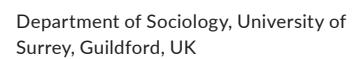

<!-- A1.R10 | source: papers_json/A1.R10/ -->

DOI: 10.1111/hequ.12332

## **RESEARCH ARTICLE**

## **Students as consumers? The perspectives of ** **students' union leaders across Europe**

## **Rachel** **Brook****[s](https://orcid.org/0000-0002-8692-1673)**

## **Funding information**

H2020 European Research Council, Grant/ Award Number: 681018_EUROSTUDENTS

## **Abstract**

Various scholars have argued that higher education is becoming increasingly similar across Europe as a result of processes of marketisation and neo-liberalisation, as well as the creation of a European Higher Education Area. While much of this body of work has focussed on governance, institutional structures and reforms related to teaching and learning, some have suggested that the subjectivities and perspectives of students have also altered—becoming more consumer-like in their orientation. Nevertheless, there has been relatively little work across the continent that has explored, in a comparative manner, students' own perspectives or those of students who represent other students. This article starts to redress this omission by drawing on interviews conducted with students' union leaders across six European nations to examine the extent to which they shared the same understanding of students, focussing specifically on the concept of student-as-consumer.

## **Abstracta**

Varios especialistas sostienen que la enseñanza superior es cada vez más similiar en toda Europa como consecuencia de los procesos de comercialización y de neoliberalización, así como debido también a la creación de un Espacio Europeo de Educación Superior (EEES). Aunque la gran parte del grueso de este trabajo se ha centrado en la gobernanza, en

This is an open access article under the terms of the [Creative Commons Attribution-NonCommercial ](http://creativecommons.org/licenses/by-nc/4.0/)License, which permits use, distribution and reproduction in any medium, provided the original work is properly cited and is not used for commercial purposes.

© 2021 The Authors. Higher Education Quarterly published by John Wiley & Sons Ltd

<!-- page 2 -->

las estructuras institucionales y en las reformas relacionadas con la enseñanza y el aprendizaje, algunos han sugerido que las subjetividades y perspectivas de los estudiantes también han cambiado - pareciéndose cada vez más a consumidores en su orientación. Sin embargo, se han realizado relativamente pocos trabajos en Europa que hayan investigado, de forma comparativa, las perspectivas propias de los estudiantes o de aquellos que representan a los estudiantes. Este artículo comienza a rectificar esta omisión mediante el uso de entrevistas llevadas a cabo con los líderes del sindicato de estudiantes de seis países europeos para estudiar hasta que punto comparten el mismo entendimiento de los estudiantes, centrándose expresamente en el concepto del estudiante como consumidor.

## **1 **|** INTRODUCTION**

Various scholars have argued that higher education is becoming increasingly similar across Europe as a result of processes of marketisation and neoliberalisation, as well as the creation of a European Higher Education Area (Slaughter & Cantwell, [2012](#page-11-0); Voegtle et al., [2011](#page-11-1); Wright & Shore, [2016](#page-11-2)). While much of this body of work has focussed on governance, institutional structures and reforms related to teaching and learning, some have suggested that the subjectivities and perspectives of students have also altered—becoming more consumer-like in their orientation. Moutsios ([2013](#page-11-3)) has, for example, argued that European students have come to be seen as consumers as a result of the reforms ushered in by the Bologna Process, while Kwiek ([2018](#page-11-4)) has made similar arguments with respect to various funding reforms across the continent. Moreover, some UK-based studies have shown how the language of consumerism is drawn on explicitly by students, higher education staff and policy actors (Raaper, [2020b](#page-11-5); Tomlinson, [2017](#page-11-6)). Nevertheless, there has been relatively little work across the continent that has explored, in a comparative manner, students' own perspectives or those of students' union leaders—who represent large numbers of individuals. Moreover, the wider literature on students' unions has typically focussed on changes within Anglophone countries of the Global North—despite some indications that there remain quite significant differences by nation-state in how such unions operate and the resources they have available to draw upon (Klemenčič,[ 2014)](#page-11-7).

This article starts to redress this omission by drawing on interviews conducted with students' union leaders across six European nations (Denmark, England, Germany, Ireland, Poland and Spain) to examine the extent to which they shared the same understanding of students, focussing specifically on the degree to which they conceptualised them as consumers. Analysing the discourses employed by policy actors is important because the language used by such individuals can have a significant impact on the ways in which social groups are understood and society more generally is shaped (Ball, [1990](#page-10-0)). Indeed, policy discourses help to shape subject positions, which can limit the 'horizons for action' available to individuals (Ball, [2013](#page-10-1)).

The article proceeds as follows: it first outlines previous work in this area, before describing the research methods that underpinned the study. It then provides evidence to show that, in Denmark, Germany, Ireland, Poland and Spain, there was a high degree of similarity in the responses of union leaders—all of whom were strongly opposed to viewing students as consumers. The article then contrasts this with the rather different perspectives of

<!-- page 3 -->

the students' union leader in England and explores the likely reasons for this dissonance. Conclusions are drawn about the implications of these findings for our understandings of both students' unions and the European higher education space.

## **2 **|** BACKGROUND**

## **2.1 **|** European students: Increasingly similar consumers?**

European higher education, it is argued, is being 'reverse engineered' around an Anglo-American model (Slaughter & Cantwell, [2012](#page-11-0)), in which the principles of marketisation have come to play an important role. While there is some debate about the precise impact of the higher education reforms played out across the continent during the past two decades, most scholars agree that there has been a significant degree of change. The Bologna Process, which began in 1999, sought, *inter alia*, to introduce a system of easily comparable degrees and learning credits, promote cooperation in quality assurance and facilitate the mobility of staff and students between European higher education institutions (Soltys, [2015](#page-11-8)). These reforms, it is widely asserted, have been underpinned by the principles of neo-liberalism—and have ushered in new rhetoric based on management and efficiency, the adoption of market-based mechanisms and the replacement of values associated with autonomy and academic freedom with the criterion of economic rationality (Amaral, [2008)](#page-10-2). The body of work on such changes has typically focussed more on governance and structures (of management processes, teaching programmes and quality assurance mechanisms, e.g.,) rather than the perspectives of students. One of the few studies to consider the impact of the Bologna reforms on the understandings of students, specifically, was published by Moutsios ([2013](#page-11-3)). In this, he argues that students have become clearly positioned by policy actors as consumers—and as part of a 'knowledge industry' rather than a traditional university. However, it is important to note that his work is a conceptual thinkpiece rather than the result of empirical research with students themselves. As noted above, Kwiek ([2018](#page-11-4)) has also contended that European students have become consumers—as a consequence of funding reforms across the continent, rather than those connected to the Bologna Process specifically.

While the literature on the impact of recent reforms on higher education students in mainland Europe is relatively small, there is a much more sizable literature on students in England—and other Anglophone nations of the Global North. This has typically suggested that neo-liberal reforms have influenced student perspectives and approaches to learning, although there is less consensus about the nature of these changes. Some scholars have contended that students have taken on more passive and instrumental behaviours with respect to their degree programmes, and have come to see themselves as consumers—as a result of the marketisation of higher education and, in the case of countries such as the United Kingdom, the United States, Australia and New Zealand, the payment of relatively high fees (e.g., Nixon et al., [2018)](#page-11-9). In contrast, others have argued that responses are complex, with some students actively resisting being understood as consumers because of their belief that this is likely to adversely affect their relationships with lecturing staff and undermine their own contribution to learning (e.g., Brooks & Abrahams, [2018;](#page-10-3) Tomlinson, [2017](#page-11-6)).

## **2.2 **|** Contemporary students' unions**

Although the literature on students' unions is much smaller than that about students in general, there is a similar degree of debate about the extent to which these organisations have changed under conditions of neo-liberalisation, mirroring some of the arguments made with respect to the wider student body discussed above. Some work has stressed, albeit implicitly, a degree of continuity—for example, in the potential for unions to further the political engagement of students and help develop their emerging political identities. Writing with respect to activities

<!-- page 4 -->

on individual campuses, rather than at the national level, Crossley and Ibrahim ([2012](#page-10-4)) point to the important role unions can play in bringing together like-minded students and forging a critical mass able to engage politically in an effective manner. They also draw attention to the physical resources that unions can offer—in terms of rooms to meet and photocopiers to print materials. Loader et al., ([2015](#page-11-10)) focus on student societies (typically organised under the umbrella of institutional unions) and contend that these can provide important spaces for students to try out new political identities in relatively safe, supportive and unthreatening environments—often facilitated, to some extent at least, by various new technologies.

Other scholars have suggested, however, that students' unions have not been immune to the pressures associated with marketisation and neo-liberalisation. Indeed, studies from Australia, New Zealand, the United Kingdom and the United States, in particular, have suggested that quite profound changes have been wrought (e.g., Rochford, [2014](#page-11-11)). A key line of argument advanced by researchers is that the role of students' unions has narrowed, typically focussing on representing 'the student voice' with respect to a range of education-related matters, rather than taking action on broader social issues (e.g., Brooks et al., [2015](#page-10-5)) and on seeking *recognition* for particular groups of student, rather than a *redistribution* of resources (e.g., Squire, [2020](#page-11-12)). In part, this is linked to the increasing alignment of students' unions with the priorities of institutional management. Nissen and Hayward ([2017](#page-11-13)), for example, have shown how, in New Zealand, this alignment is explained by the growing dependence of unions (in New Zealand referred to as 'associations') on universities for financial support—as a result of legislation passed in 2011 which made membership voluntary for all students. Nissen and Hayward assert that 'Without the funding stream of compulsory membership levies, students' associations have had to market themselves to as many students as possible as well as to potential donors, including university management (p. 131). Writing with respect to the United Kingdom, Brooks et al. ([2015](#page-10-5)) have documented a similar convergence of interests between unions and university management, arguing that this has been brought about by the shift to a competitive market—and, in particular, a mutual desire to avoid reputational damage (through, e.g., the explicit conflict between unions and management) and the measurement of unions' 'performance' through the annual National Student Survey[1](#page-10-6) —the results of which are made public and feed into national league tables.

Moreover, several studies have documented the increasing 'professionalisation' of students' unions—including the growing influence of those in paid, permanent positions within the union and the corresponding reduction of the influence of those in elected roles (Brooks et al., [2015](#page-10-5); Raaper, [2020a](#page-11-14)), and the preference of union officers for more formal means of political engagement, such as lobbying politicians and responding to consultations, rather than protests, occupations and other forms of direct action, and of working *within* institutional structures rather than against them (Raaper, [2020a](#page-11-14); Squire, [2020](#page-11-12)). Such changes are broadly in line with Giroux's ([2011](#page-11-15)) argument that higher education campuses, in general, have altered in fundamental ways, and tend to valorise individual competition rather than collective action. Klemenčič ([2012](#page-11-16)) has suggested that, despite students' unions now being more frequently represented on institutional governing bodies (often related to the foregrounding of the 'student voice' within marketised systems), student representation has shifted—not just in Anglophone nations from being conceived of as a political position, defending the collective interests of the student body, to an entrepreneurial role, dedicated to giving advice to senior university managers with respect to quality assurance and service delivery.

Research has, however, highlighted some diversity across the world; not all students' unions conform to the patterns seen in the Anglophone Global North, documented above (e.g., Della Porta et al., [2020](#page-11-17)). For example, writing with respect to the impact of students' unions (as well as student movements more broadly), Cini ([2017](#page-10-7)) has argued that those in Italy were more successful than their UK counterparts because of the structure of the higher education system in the two countries. He asserts that, as a result of the United Kingdom's more managerialist higher education sector, UK university leaders tend to treat student mobilisations in a much more repressive manner than their Italian counterparts—for example, refusing to make any concessions to students' demands and taking legal action to bring student occupations to a swift conclusion. Similarly, in examining why students were more successful in bringing about change with respect to fees in some countries than others, Klemenčič ([2014](#page-11-7))

<!-- page 5 -->

suggests that cultural factors were significant. She asserts that unions (and other groups of students) had the most influence in countries such as Chile and Canada where the national government believed there was considerable public support for the position adopted by students, compared to those such as the United Kingdom where neo-liberal norms were more firmly established. Historical legacies are also important. For example, writing with respect to students' unions in Russia, Chirikov and Gruzdev [(2014)](#page-10-8) assert that such organisations tend to focus primarily on issues connected to students' social benefits—because they are the successor of labour unions. Moreover, students' unions in Scandinavia often have access to more plentiful resources than their counterparts in many other nations—and have been more successful in resisting some of the pressures to 'professionalise' and assume merely a 'representational' role—because of their well-developed position in society (Klemenčič, [2012](#page-11-16), [2014)](#page-11-7).

## **3 **|** METHODS**

This article draws on data collected as part of a large, cross-national European Research Council-funded project ('[Eurostudents]') that explores how higher education students are understood across Europe, paying particular attention to similarities and differences both within and between countries. Data were collected in six European nations: Denmark, England, Germany, Ireland, Poland and Spain. These were chosen to provide diversity with respect to welfare regime; mechanisms for funding higher education and providing financial support to students; and relationship to the European Union (see Table [1](#page-5-0)). In each of the countries in the sample, we conducted focus groups with students and individual interviews with higher education staff and a wide range of policy actors (government officials, national students' union leaders and representatives of bodies that speak for university leaders and graduate employers). We also analysed university websites, newspaper articles, TV shows and films that feature students prominently, and a wide range of relevant policy documents. Most of the data were collected between 2017 and 2019.

This article focuses primarily on a sub-sample of the data from policy actors: primarily six in-depth interviews that were conducted with national union leaders in each of the countries.[2](#page-10-9) In Denmark, England, Germany, Ireland and Poland, the interviewees were involved in leading the national students' union. In Spain, however, it was not possible to interview a leader of the national students' union. Instead, we interviewed a leader of a national union that represents higher education staff. Comparisons are also made between the views of these policy actors and the perspectives articulated in a range of policy documents and university websites that we analysed. In each nation approximately 16 policy texts were selected for analysis (a total of 92), comprising speeches given by government ministers for higher education and key strategy documents, relating to higher education, produced by government, staff and student unions, and organisations representing graduate employers (in most cases, four documents were selected from each of the four groups[3](#page-10-10) ). Documents were chosen on the basis of their: national significance; relevance to the project's focus (on higher education students); and date of publication (the most recent documents were chosen from those deemed to be most significant and relevant). Those not available in English were translated prior to analysis. (Further details about the policy analysis are provided in Brooks, [2021](#page-10-11).) In addition, we analysed 30 institutional websites from each country (a total of 180)—paying particular attention to the main student-facing pages (further detail is provided in Colleague [Lazetic], [2019](#page-11-18)).

In the interviews with national students' union leaders, we were interested to explore how participants understood the role of the contemporary student. We asked a number of open-ended questions to this effect, before moving on to ask more specific questions about particular constructions that are discussed in the literature (e.g., understanding students as consumers, dedicated learners, future workers and/or significant political actors). We also asked participants to respond to an extract of an influential policy document from their own country. All interviews were conducted in English and lasted about an hour.

<!-- page 6 -->

*14682273, 2022, 3, Downloaded from https://onlinelibrary.wiley.com/doi/10.1111/hequ.12332 by CochraneUnitedArabEmirates, Wiley Online Library on [27/02/2024]. See the Terms and Conditions (https://onlinelibrary.wiley.com/terms-and-conditions) on Wiley Online Library for rules of use; OA articles are governed by the applicable Creative Commons License*

<!-- page 7 -->

The discussion that ensues focuses mainly on what participants said about constructing students as consumers. In this way, the article contributes to debates about the positioning of students as consumers across Europe. It also, however, enables us to tease out some interesting differences between our participants, which speak to broader debates about the positioning and perspectives of students' unions in contemporary society.

## **4 **|** STARK REJECTION OF UNDERSTANDING STUDENTS AS CONSUMER**

As noted above, participants were asked specifically about whether they viewed students (in their own country) as consumers—and some also made reference to consumerism in other parts of the interviews. For nearly all our union participants, the word 'consumer' tended to generate quite visceral reactions; it was clearly a term that—for these interviewees at least—held considerable emotional power. When asked whether they believed students should be seen as consumers, most expressed strong opposition. For example:

I am really against that. We don't consume education, we … we students want to learn … (Danish students' union leader)

Definitely not …. we see education as a public good, something that … brings a benefit to all of society…. (Irish students' union leader)

No, I think it's not a good way to speak about this [students]. (Polish students' union leader)

Views differed, however, with respect to whether the term was used by others in society. The Spanish interviewee, for example, claimed that it was rare to hear the concept of student-as-consumer used in his country because the state subsidised higher education (he acknowledged, however, that the term might be used in private universities which were not in receipt of state subsidies). In Ireland, the students' union leader thought that the term was 'creeping in', noting that 'there are all those people in politics, in higher education, who would see students as consumers, as customers, and use that language …. because they pay a fee of 3000 Euro …. [they think] they're buying this service or this product'. The Danish interviewee stated that the term consumer was not currently used within political and policy discourse in his country, but he feared that it may follow relatively soon, because of what he believed was the increasing commodification of higher education and the growth of a new discourse associated with this.

Irrespective of these differences, however, the union interviewees from Denmark, Germany, Ireland, Poland and Spain all believed that the term was problematic and should be resisted. In explaining their reasons for thinking this, they tended to draw on similar arguments. First, some held that constructing students as consumers undermined relationships between staff and students. The Polish interviewee, for example, claimed: '… we shouldn't be customers, we should be equals and … working together with professors … we are partners'. Consumerism, to him, posed a serious threat to this way of working and undermined the important contribution students make to their own learning. The German interviewee put forward a similar but wider-ranging analysis, arguing that understanding students as consumers rather than important contributors to the process of learning also affected how higher education institutions were run—shifting them from being democratic spaces in which students were seen as 'proper members of the university', closely involved in decision-making processes, to recipients of an educational experience the nature of which is determined by top-down management.

Second, interviewees believed that constructing students as consumers risked promoting a narrow view of the purpose of higher education and undermining its conceptualisation as a public good. This was communicated clearly by the Danish students' union leader:

<!-- page 8 -->

We are not … consuming our education, it's a tool that is given by our, by our society, for us to contribute to society back. You consume clothes, you consume food … there's a lot of products that can be consumed, but education is not something that's consumed … it's a tool that society gives to, to people to be able to then contribute back to society in a better way. But as well, to improve their lives and develop their capacities in a way that can make them happy in the future.

Similar sentiments were expressed by his counterparts in Ireland and Spain, both of whom made specific reference to understanding higher education as a public good. The Irish interviewee noted the important benefit to the whole of the country, not just individual students, from higher education, while the Spanish interviewee commented that 'public universities provide a service to society' based on the generation of knowledge—and that students were typically conceived of as part of this collective endeavour of creating socially useful knowledge, rather than as individualist consumers.

Linked to such points was a third argument—that a consumer discourse, as well as rejecting the idea of higher education as a public good and emphasising the advantages to individuals, tends to foreground labour market outcomes. As a result, the purpose of higher education comes to be reconfigured in very narrow terms. The Spanish interviewee made this point explicitly, arguing: '[We do] not see customers in our students. Public universities provide a service to society and they are offering knowledge not preparing [students] for the labour market'. The German interviewee was concerned that, although she thought students were not often viewed as consumers in her country, aspects of consumerism were nevertheless influential in the higher education system, including a narrow focus on employment as a measure of higher education 'success'. She asserted:

A lot of [politicians] see students as human capital actually. And they [believe] …. they are investing in education, in people, so they can get out and work in the labour market, but not seeing [students] as human beings who also want to not get *just* a ticket for the labour market, but … education should have … multiple purposes.

Thus, across the five countries, interviewees articulated a number of key critiques of understanding students as consumers. It was also notable that most believed that their views were not always shared by other key stakeholders particularly politicians, with responsibility for higher education policy, and university leaders. Indeed, as alluded to in some of the extracts above, many believed that there were shifts towards a consumer model of higher education in their country and that this was something that the union movement should play an active role in resisting. Several of the interviewees pointed to specific actions they and their union had taken as part of this resistance. In Ireland, for example, the national students' union leader talked about the importance to the Union of Students in Ireland of campaigning against tuition fees to ensure that higher education remained a public good. Similarly, his equivalent in Germany outlined how she had taken steps to counter the view of students as 'human capital' that she believed was being promoted by a German employers' organisation—and was actively opposing associated pressures to encourage students to engage in more paid work during their studies.

## **5 **|** THE ANOMALOUS CASE OF ENGLAND**

These responses, from five of the six countries in the sample, contrasted quite starkly, however, with those from the English students' union leader, who was much more sympathetic to viewing students as consumers. When asked, specifically, about whether he thought students should be seen in this way, he commented: 'I don't think any rejection, I don't think an outright rejection of all the kind of consumer rights principles is helpful'. Moreover, in contrast to some of the narratives reported above, in which students were seen as partners in learning, the English union leader viewed them primarily as recipients of a service. He claimed:

<!-- page 9 -->

it's fair to recognise the consumer elements of a student, as a participant in what is the service, an education … just another form of education service …. certainly there are facets of their role within it, which are transactional.

As well as being the only union interviewee to be comfortable with this particular way of talking about students, he was also the only one to articulate any benefits associated with either understanding students as consumers or embracing what he considered to be key elements of consumerism. In his analysis, the construction of students as consumers was related to debates about students' rights, and the educational standards they were entitled to expect. He stated that talking about students as consumers was an important part of a broader project of improving the quality of education—so that students were informed about what they could expect, and able to take action if they felt they were not receiving what they had been promised. As an example, he made reference to counselling services that are often provided on English campuses: 'so … if there's a counselling service, [students have a right to know] how long will I have to wait, will I be able to see this mythical counsellor, so on, so forth'.

While some of our interviewees from other countries suggested that a consumerist understanding was strongly associated with the payment of high fees, the English interviewee tended to reject this view. Instead, he suggested that a consumerist perspective—which foregrounds students' rights and the specification of minimum educational standards—was firmly engrained in lower levels of the education system in England, too, where the majority of pupils are funded by the state:

But I don't think that's [view of student as consumer] dependent necessarily on a funding system or anything like that, I would have a view of some elements of students even in, at school, about expectations on … the quality or the content of what they're being taught, why they're being taught, A versus B. The ways in which they're taught.

He thus claimed that he had tended to view students as consumers for a long time, dating back to his own educational experiences.

## **6 **|** DISCUSSION**

In the narratives of the union leaders who were interviewed, two key differences are evident between England, on the one hand, and Denmark, Germany, Ireland, Poland and Spain, on the other hand. The first of these relates, as documented above, to the extent to which students are understood as consumers. While the English interviewee appeared to view such construction as unproblematic and, indeed, associated with some benefits in terms of upholding students' rights, the interviewees from the other five nations were all vociferous in their rejection of the construction—because of their belief that it was associated with a narrowing of the purposes of higher education and an undermining of pedagogical relationships between staff and students.

The second difference relates to the extent to which the union leaders aligned themselves with their national governments. Research from other stands of the [Eurostudents] project has suggested that there are some significant differences, between nation-states, in the extent to which students are addressed as consumers. Our analysis of 180 higher education institution websites has indicated that students tend to be addressed as consumers in Denmark, England and Ireland, but not in Germany, Poland and Spain—where they are constructed, instead, as recipients of public service and/or novices in an academic community (Lazetic, [2019](#page-11-18)). Moreover, a fine-grained reading of policy documents has suggested that, even in England, students are not always viewed as strong and empowered consumers with various government speeches and strategy documents emphasising their ostensible 'vulnerability' (Brooks,[ 2018](#page-10-12)). Nevertheless, across the six countries, there is also clear evidence—at least to some degree—of the development of more consumerist tendencies within higher education policy and practice. This is perhaps most marked in the emphasis

<!-- page 10 -->

in government documents from all nations on labour market outcomes, and the construction of students as 'future workers' (Brooks, [2021](#page-10-11)). For example, several countries in the sample had begun to link data on graduate earnings (accessed through tax payments, e.g.,) to programmes of study within higher education, to enable prospective students to make what politicians typically talked of as 'better choices'. Against this context, it was notable that most of our interviewees were explicitly critical of the path they believed their national government was following, which, they held, may reinforce an understanding of students primarily as consumers. In only England was there no significant criticism of the governmental stance on such matters. Indeed, one of the campaigning activities with which the English interviewee was most involved at the time of data collection aimed to increase transparency about the charges students were expected to pay—highlighting various types of 'hidden' cost such as those payable in some institutions for field trips and joining professional associations. This appears to be quite far removed from the more thorough-going critique of commodified education systems outlined in the narratives of union leaders from the other five nations.

These national differences can be explained to some extent by the broader national cultural and political norms. As evident in Table [1](#page-5-0), England differs from the other five countries with respect to its neo-liberal welfare regime. (Although Ireland is sometimes seen as moving quite close to the English political model, it retains important differences; indeed, Hazelkorn ([2015](#page-11-20)) has argued that the underpinning model of higher education in Ireland adheres to social democratic, rather than neo-liberal, principles.) Klemenčič ([2014](#page-11-7)) has argued that such norms often affect the decisions made by higher education stakeholders:

Understanding cultural attitudes towards questions such as whom higher education serves, who should pay for higher education and what role universities have in society can offer important insights into understanding the political developments and outcomes in higher education. (p. 408).

Within the United Kingdom, she suggests, neo-liberal norms are so firmly established amongst the population at large that governments typically believe they do not have to acquiesce to the demands of students and others who contest the dominant market model of higher education. It is thus likely that, in such a context, students' union leaders may decide that it is relatively futile to oppose the foundations upon which much higher education policy is made. They may also—because of the widespread cultural acceptance of such norms in the United Kingdom—be more likely to accept them themselves (as appears to be evidenced in the case of the English interviewee) when compared to their peers in other parts of Europe. Moreover, given that specific policies that are underpinned by market mechanisms are so well established in England—notably the principle that individuals should make a significant financial contribution to the cost of their higher education—students' union leaders may feel there is no prospect of changing these, and that a more pragmatic approach is required.

As discussed earlier in this article, there is also evidence that, within the United Kingdom (like other Anglophone nations), institutional students' unions have become particularly close to senior management—not least because both groups have become subject to the same performative pressures (Brooks et al., [2015](#page-10-5); Raaper, [2020a](#page-11-14))—with their goals often very closely aligned. It is thus perhaps unsurprising that there is also relatively close alignment between the government and the *national* students' union. Moreover, research on the UK students' movement has highlighted significant differences between it and its equivalents in other European countries. McVitty ([2017](#page-11-21)) has argued that whereas in mainland Europe 'adherence to the prohibition of tuition fees and the principle that education should be free continue to dominate the political mainstream' (p. 98), in the United Kingdom, the dominance of political moderates within the National Union of Students (NUS) leadership during the late 20th and early 21st centuries led to the acceptability of the principle of a student contribution to the cost of higher education amongst many in the union movement. In many ways, McVitty's analysis draws on the same ideas as Klemenčič, discussed above. She argues that, during the student protests about funding between 1996 and 2010, the NUS leadership believed it to be impossible to present an argument for free education that would be perceived as credible by decision-makers—in this way, they appeared significantly affected by the widespread cultural and political acceptance of neo-liberal norms not evidenced to the same degree in other nations.

<!-- page 11 -->

Although some scholars have suggested that, as a result of various European reforms—typically those introduced under the auspices of the Bologna Process—students across Europe are being reconfigured as consumers (e.g., Moutsios, [2013](#page-11-3)), the data presented in this article have shown how, amongst union leaders in Denmark, Germany, Ireland, Poland and Spain, there was strong opposition to understanding students in this way even when some believed national policy in their various nations was moving in this direction. England was an anomaly—with respect to the union leader's views about conceptualising students as consumers and the relatively close alignment between his views and that of his national government. In explaining these findings, the article has suggested that enduring national differences in cultural and political norms are likely to be important—as are the ways in which institutional students' unions have been reconfigured in response to particular market pressures. Thus, the article speaks to debates about the extent of European homogenisation as well as the positioning of students' unions relative to both the conceptualisation of students as consumers and the policy trajectory of their national

## **CONFLICT OF INTEREST**

There is no conflict of interest.

## **DATA AVAILABILITY STATEMENT**

Data available on request from the authors.

## **ORCID**

government.

*Rachel Brooks* [https://orcid.org/0000-0002-8692-1673](https://orcid.org/0000-0002-8692-1673)

## **ENDNOTES**

- ^1^ At the time of writing, this is under review by the government, and may be discontinued.
- ^2^ A very small number of the students who participated in the student strand of the research were involved in their institutional students' union. However, as they were interviewed as part of a focus group with students who were not similarly involved, we did not ask them any specific questions about this and it was not brought up spontaneously.
- ^3^ In Poland, no relevant employer documents were identified. Thus, the Polish sample comprises only 12 documents.

## **REFERENCES**

Amaral, A. (2008). Transforming higher education. In A. Amaral, I. Bleiklie, & C. Musselin (Eds.), *From governance to identity* (pp. 81–94). Springer.

Ball, S. (1990). *Politics and policy making in education: Explorations in policy sociology*. Routledge.

Ball, S. (2013). *Foucault, power, and education*. Routledge.

Brooks, R. (2018). The construction of higher education students in English policy documents. *British Journal of Sociology * *of Education*, *39*(6), 745–761.

Brooks, R. (2021). The construction of higher education students within national policy: A cross-European comparison. *Compare: A Journal of Comparative and International Education*, *51*(2), 161–180.

Brooks, R., & Abrahams, J.(2018). Higher education students as consumers? Evidence from England. In A. Tarabini & N. Ingram (Eds.), *Educational choice, aspirations and transitions in Europe*. Routledge.

Brooks, R., Byford, K., & Sela, K. (2015). The changing role of students' unions within contemporary higher education. *Journal of Education Policy*, *30*(2), 165–181.

Chirikov, I., & Gruzdev, I. (2014). Back in the USSR: Path dependence effects in student representation in Russia. *Studies * *in Higher Education*, *39*(3), 455–469. [https://doi.org/10.1080/03075079.2014.896181](https://doi.org/10.1080/03075079.2014.896181)

Cini, L. (2017). Student struggles and power relations in contemporary universities: The cases of Italy and England. In R. Brooks (Ed.), *Student politics and protest: International perspectives* (pp. 31–45). Routledge.

Crossley, N., & Ibrahim, J. (2012). Critical mass, social networks and collective action: Exploring student political worlds. *Sociology*, *46*(4), 596–612.[ https://doi.org/10.1177/0038038511425560](https://doi.org/10.1177/0038038511425560)

<!-- page 12 -->

- Della Porta, D., Cini, L., & Guzman-Concha, C. (2020). *Contesting higher education. Student movements against neo-liberal * *universities*. Bristol University Press.
- European Commission/EACEA/Eurydice (2018). *National Student Fee and Support Systems in European Higher Education -* *2017/18*. Available online at: [https://webgate.ec.europa.eu/fpfis/mwikis/eurydice/images/e/e7/214_EN_Fees_and_](https://webgate.ec.europa.eu/fpfis/mwikis/eurydice/images/e/e7/214_EN_Fees_and_support_2017_18.pdf) [support_2017_18.pdf](https://webgate.ec.europa.eu/fpfis/mwikis/eurydice/images/e/e7/214_EN_Fees_and_support_2017_18.pdf) (accessed 23 April 2018).
- Giroux, H. (2011). Fighting for the future: American youth and the global struggle for democracy. *Cultural Studies—Critical * *Methodologies*, *11*(4), 328–340.[ https://doi.org/10.1177/1532708611414658](https://doi.org/10.1177/1532708611414658)
- Hazelkorn, E. (2015). *Rankings and the reshaping of higher education* (2nd ed.). Palgrave.
- Klemenčič, M. (2012). The changing conception of student participation in higher education governance in the European Higher Education Area. In A. Curaj, P. Scott, L. Vlasceanu, & L. Wilson (Eds.), *European higher education at the cross**roads: Between the Bologna process and national reforms* (pp. 631–653). Springer.
- Klemenčič, M. (2014). Student power in a global perspective and contemporary trends in student organising. *Studies in * *Higher Education*, *39*(3), 396–411.[ https://doi.org/10.1080/03075079.2014.896177](https://doi.org/10.1080/03075079.2014.896177)
- Kwiek, M. (2018). Building a new society and economy: High participation higher education in Poland. In B. Cantwell, S. Marginson, & A. Smolentseva (Eds.), *High participation systems of higher education* (pp. 334–357). Oxford Scholarship Online.
- Lazetic, P. (2019). Students and university websites - consumers of corporate brands or novices in the academic community? *Higher Education*, *77*(6), 995–1013.
- Loader, B., Vromen, A., Xenos, M., Steel, H., & Burgum, S. (2015). Campus politics, student societies and social media. *The * *Sociological Review*, *63*(4), 820–839.[ https://doi.org/10.1111/1467-954X.12220](https://doi.org/10.1111/1467-954X.12220)
- McVitty, D. (2017). Politics in UK student movement 1996–2010. In R. Brooks (Ed.), *Student politics and protest: * *International perspectives* (pp. 97–111). Routledge.
- Moutsios, S. (2013). The de-Europeanization of the university under the Bologna process. *Thesis Eleven*, *119*(1), 22–46. [https://doi.org/10.1177/0725513613512198](https://doi.org/10.1177/0725513613512198)
- Nissen, S., & Hayward, B. (2017). Students' associations: The New Zealand experience. In R. Brooks (Ed.), *Student politics * *and protest: International perspectives* (pp. 129–142). Routledge.
- Nixon, E., Scullion, R., & Hearn, R. (2018). Her majesty the student: Marketised higher education and the narcissistic (dis) satisfactions of the student-consumer. *Studies in Higher Education*, *43*(6), 927–943. [https://doi.org/10.1080/03075](https://doi.org/10.1080/03075079.2016.1196353) [079.2016.1196353](https://doi.org/10.1080/03075079.2016.1196353)
- Raaper, R. (2020a). Constructing political subjectivity: The perspectives of sabbatical officers from English students' unions. *Higher Education*, *79*, 141–157.[ https://doi.org/10.1007/s10734-019-00400-9](https://doi.org/10.1007/s10734-019-00400-9)
- Raaper, R. (2020b). Students' unions and consumerist policy discourses in English higher education. *Critical Studies in * *Education*, *61*(2), 245–261. [https://doi.org/10.1080/17508487.2017.1417877](https://doi.org/10.1080/17508487.2017.1417877)
- Rochford, F. (2014). Bringing them into the tent—Student association and the neutered academy. *Studies in Higher * *Education*, *39*(3), 485–499.[ https://doi.org/10.1080/03075079.2014.896184](https://doi.org/10.1080/03075079.2014.896184)
- Slaughter, S., & Cantwell, B. (2012). Transatlantic moves to the market: The United States and the European Union. *Higher * *Education*, *63*, 583–606. [https://doi.org/10.1007/s10734-011-9460-9](https://doi.org/10.1007/s10734-011-9460-9)
- Soltys, D. (2015). Similarities, divergence and incapacity in the Bologna Process reform implementation by the former socialist countries: The self-defeat of state regulations. *Comparative Education*, *51*(2), 179–195. [https://doi.](https://doi.org/10.1080/03050068.2014.957908) [org/10.1080/03050068.2014.957908](https://doi.org/10.1080/03050068.2014.957908)
- Squire, R. (2020). Class acts? Working class student officers in students' unions. *British Journal of Sociology of Education*, *41*(3), 377–392. [https://doi.org/10.1080/01425692.2019.1707066](https://doi.org/10.1080/01425692.2019.1707066)
- Tomlinson, M. (2017). Student perceptions of themselves as 'consumers' of higher education. *British Journal of Sociology * *of Education*, *38*(4), 450–467.[ https://doi.org/10.1080/01425692.2015.1113856](https://doi.org/10.1080/01425692.2015.1113856)
- Voegtle, E., Knill, C., & Dobbins, M. (2011). To what extent does transnational communication drive cross-national policy convergence? The impact of the bologna-process on domestic higher education policies. *Higher Education*, *61*, 77–94. [https://doi.org/10.1007/s10734-010-9326-6](https://doi.org/10.1007/s10734-010-9326-6)
- Wright, S., & Shore, C. (Eds.). (2016). *The death of the public university?*. Berghahn Press.

**How to cite this article:** Brooks R. Students as consumers? The perspectives of students' union leaders across Europe. *Higher Educ Q*. 2022;76:626–637. [https://doi.org/10.1111/hequ.12332](https://doi.org/10.1111/hequ.12332)
