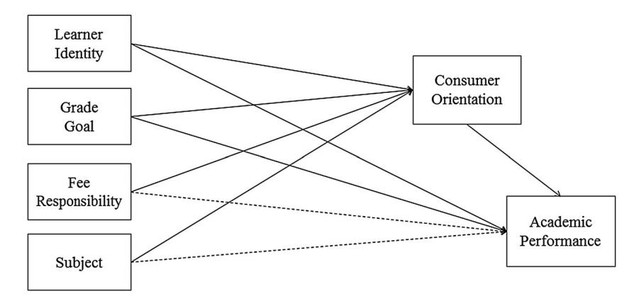
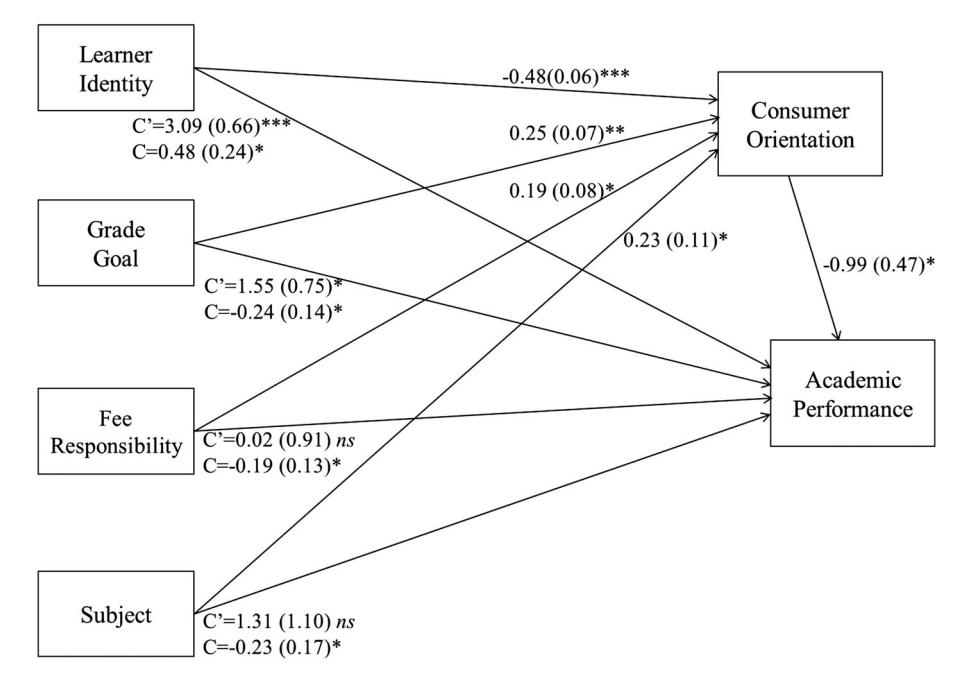
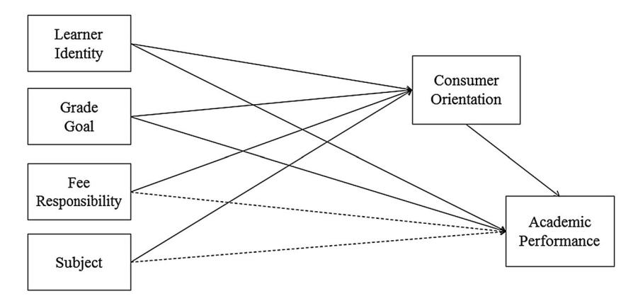

<!-- A1.R11 | source: papers_json/A1.R11/ -->

## **Studies in Higher Education**

**ISSN: 0307-5079 (Print) 1470-174X (Online) Journal homepage: ****[www.tandfonline.com/journals/cshe20](https://www.tandfonline.com/journals/cshe20?src=pdf)**

## **The student-as-consumer approach in** **higher education and its effects on academic** **performance**

**Louise Bunce, Amy Baird & Siân E. Jones**

**To cite this article:** Louise Bunce, Amy Baird & Siân E. Jones (2017) The student-as-consumer approach in higher education and its effects on academic performance, Studies in Higher Education, 42:11, 1958-1978, DOI:[ 10.1080/03075079.2015.1127908](https://www.tandfonline.com/action/showCitFormats?doi=10.1080/03075079.2015.1127908)

**To link to this article: **[https://doi.org/10.1080/03075079.2015.1127908](https://doi.org/10.1080/03075079.2015.1127908)

| Image: Open Access icon | © 2016 The Author(s). Published by Informa UK Limited, trading as Taylor & Francis Group |
| --- | --- |
| Image: Calendar icon | Published online: 14 Jan 2016. |
| Image: Pencil and paper icon | Submit your article to this journal Image: External link icon |
| Image: Bar chart icon | Article views: 91774 |
| Image: Magnifying glass on document icon | View related articles Image: External link icon |
| Image: Crossmark logo | View Crossmark data Image: External link icon |
| Image: Two documents icon | Citing articles: 116 View citing articles Image: External link icon |

<!-- page 2 -->

## The student-as-consumer approach in higher education and its effects on academic performance

Louise Buncea * [,](http://orcid.org/0000-0002-8754-9957) Amy Bairda and Siân E. Jonesb

a Department of Psychology, University of Winchester, Winchester, UK; ^b^ Department of Psychology, Goldsmiths College, University of London, London, UK

Students studying at universities in England have been defined as customers by the government since the introduction of student tuition fees. Although this approach has been rejected by educators, there is a lack of empirical evidence about the extent to which students express a consumer orientation and its effects on academic performance. These issues were examined in the current study by surveying 608 undergraduates at higher education institutions in England about their consumer attitudes and behaviours in relation to their higher education, their learner identity, and academic performance. The analysis revealed that consumer orientation mediated traditional relationships between learner identity, grade goal and academic performance, and found that a higher consumer orientation was associated with lower academic performance. Furthermore, responsibility for paying tuition fees and studying a Science, Technology, Engineering and Mathematics subject were associated with a higher consumer orientation and subsequently lower academic performance. Implications for academic performance are discussed.

Keywords: student-as-consumer; learner identity; academic performance; grade goal; tuition fees

## Introduction

Since the UK government identified students as 'customers' (Dearing [1997](#page-18-0)), higher education institutions (HEIs) in England have increasingly had to operate under forces of marketisation which demand competitiveness, efficiency and consumer satisfaction (Lesnik-Oberstein [2015](#page-18-0)). Moreover, this consumer identity appears to be increasingly recognised by students, who demand more from the higher education sector than ever before (Kandiko and Mawer [2013](#page-18-0); Tomlinson [2014,](#page-19-0) [2016](#page-19-0)). But, while a rich tradition of research has investigated how we can predict academic performance (for reviews see Poropat [2009;](#page-19-0) Richardson, Abraham, and Bond [2012](#page-19-0);) there remains a paucity of research on the extent to which today's students express a consumer orientation and how this may affect academic performance. In order to address this shortfall, this paper looks at traditional factors predicting academic performance, namely learner identity and grade goal, and the interplay with consumer orientation – and gives evidence that consumer orientation mediates or influences traditional predictors of academic performance: the more that students expressed a consumer orientation, the poorer their academic performance.

> ^*^Corresponding author. Email:[ louise.bunce@winchester.ac.uk](mailto:louise.bunce@winchester.ac.uk)

<!-- page 3 -->

## The changing landscape of higher education

In September 2012, HEIs in England were permitted to triple their annual tuition fee from £3000 to £9000 following The Browne Review (Browne [2010)](#page-17-0). A decade earlier, The Dearing Report (Dearing [1997](#page-18-0)) first identified students as the principle customers of universities and, as a result, HEIs have become increasingly subject to commercial pressures. A growing number of government agency initiatives have sought to increase the influence of students on their university experience, notably the National Student Survey (NSS). Universities also now frequently elicit their own student feedback and share improvements that have been made as a result of those opinions (Williams and Cappuccini-Ansfield [2007)](#page-20-0). Most recently, a studentas-consumer (SAC) approach has been consolidated with the inclusion of students and universities under the Consumer Rights Act (2015). This, coupled with the government policy change to remove the student number cap (for the academic year beginning 2015), has been said to have 'valorised' the consumer-orientated position of students (Tomlinson [2014)](#page-19-0). Indeed, universities are adapting to survive under new commercial pressures (Bunzel [2007)](#page-17-0): They have developed sophisticated brands and advertising programmes, and present themselves as tangible service providers (e.g. accommodation, information technology, careers) (Chapleo [2010;](#page-17-0) Dearing [1997;](#page-18-0) Gokcen [2014](#page-18-0)).

## Educational effects of a SAC approach

The SAC approach represents not only a political and financial shift in HE but a fundamental educational one too (Williams [2013)](#page-20-0). A SAC approach may have advantages for the student because it involves a shift in power from provider to consumer (Tomlinson [2014)](#page-19-0). Consequently, standards and quality of service are expected to rise because customers have control over expectations and evaluate services by their capacity to fulfil their demands. For example, lecturers may be expected to be increasingly accessible to students and respond more promptly to student matters. However, the SAC approach is concerning for universities, who do not traditionally regard education as a product or service, as it is said to create a 'conservative status quo mentality; for what is there left to learn, when you already know it in order to demand it?' (Lesnik-Oberstein [2015)](#page-18-0). It is also thought to risk academic standards (Furedi [2009](#page-18-0)), for example, students may rate popular lecturers more highly than rigorous ones, therefore rigorous lecturers are pressurised to dumb-down academic content for the sake of gaining high ratings of customer 'satisfaction' (Driscoll and Wicks [1998;](#page-18-0) Emery, Kramer, and Tian [2001](#page-18-0)). It has also been argued that an SAC approach may foster a culture whereby students seek to 'have a degree' rather than 'be learners' (Molesworth, Nixon, and Scullion [2009](#page-19-0)) because it promotes passive instrumental attitudes to learning (Finney and Finney [2010](#page-18-0); Naidoo and Jamieson [2005;](#page-19-0) Williams [2010](#page-20-0), [2013](#page-20-0); Woodall, Hiller, and Resnick [2014](#page-20-0)). For example, students who identify as consumers may have little interest in what is actually being taught and show reduced responsibility for producing their own knowledge. With these issues in mind, the broad aim of the current study was to conduct an empirical test of the hypothesis that there would be a negative relationship between the extent to which a student expressed a consumer orientation to their studies and their level of academic performance.

<!-- page 4 -->

## Are students consumers of higher education?

Currently, there is very limited empirical evidence concerning the extent to which students studying in England actually express a consumer approach to their university education (Gokcen 2014; Naidoo and Jamieson 2005; Saunders 2014). Evidence to support the view that students are demonstrating consumer attitudes and behaviours is largely anecdotal, for example, there has been a rise in complaints heard by the Office of the Independent Adjudicator (see e.g. Garner 2009; Lomas 2007). Paying money in exchange for a service has also been shown to create feelings of entitlement among students, which are associated with higher levels of complaining (Finney and Finney 2010). Dearing (1997) also reported that students are becoming more demanding of university support services, for example, library staff they spoke to noted that students are behaving more like 'customers' in their demands. In addition, students appear more career-focused than before, for example, by choosing courses that offer clear employment prospects and higher salaries (such as STEM – Science, Technology, Engineering and Mathematics subjects). This may be related to the increase in the level of financial investment required on the part of the student to pay university tuition fees (Ball 2015; Higher Education Statistics Agency 2015). In the current study, we accounted for the extent to which students were responsible for paying tuition fees to explore the impact of this variable on consumer orientation. Specifically, we tested the hypothesis that students who were personally responsible for paying their tuition fees (e.g. through a loan from student finance), as opposed to having their fees paid on their behalf (e.g. by a scholarship or employer), would express a higher consumer orientation, which in turn would be associated with lower academic performance.

It has also been suggested that a consumer orientation may correlate with academic discipline because surface approaches to learning may be emphasised in certain 'hard' or STEM subjects (Neumann 2001; Newton and Newton 1998; North 2005). Entwistle and Tait (1995), for example, found that students studying science or economics were more likely to use surface strategies, perhaps encouraged by the requirement to memorise facts and figures. The subject for which students were studying was, therefore, accounted for in the current study as a predictor of consumer orientation. It was expected that students studying STEM subjects would have a stronger consumer orientation than students studying non-STEM subjects, and that a higher consumer orientation would be associated with lower academic performance.

Empirically, however, the SAC position has received somewhat limited support. Saunders (2014) examined the extent of a SAC orientation in 2674 entering first year students in a university in northeast USA. Students responded to 18 consumer statements on a 5 point scale (1 = agree strongly to 5 = disagree strongly), such as: 'If I'm paying for my college education, I'm entitled to a degree' and 'I will only major in something that will help me earn a lot of money'. The mean score on this scale was 3.32, indicating that the majority students did not have a customer orientation towards their education. However, the study was conducted in America, which has a longer history of tuition fees, and the students were entering first years, meaning that we should be cautious about generalising these findings to university students studying in England.

Two recent studies mirror Saunders' findings but with students in England. Tomlinson (2014) interviewed 68 undergraduates to explore how increased financial contributions may have affected their approaches and attitudes towards learning. Despite students holding a strong sense that they were investing in their future, they rejected

<!-- page 5 -->

the consumer label. They explained that active participation in their studies was a key part of success: 'Because at the end of the day it's our education, we're the only ones that are going to get anything out of it, and you get out what you've put in' (25) and 'I don't want to just pass a degree, I want to get a good grade, because I want to do the best' (28). While only a minority of students interviewed saw themselves actively as consumers there was also a general concern among all students about obtaining good quality teaching and a positive learning experience, commensurate with requiring value for money and a consumer orientation.

Similarly, in interviews conducted by Williams (2013), students did not tend to self-identify as consumers of HE and some were strongly opposed to the idea: 'One time, we had a questionnaire come round, they said to us: "you as customers of the university" and we're thinking, "we're not customers!"" (female, aged 19). However, Williams concluded that students appeared to 'juggle complex identities', both by rejecting elements of the SAC approach, such as the idea that they have 'bought' their degree, while accepting the fact that they have chosen to invest in it financially.

In the current study, our measure of consumer orientation was based on Saunders (2014) but adapted to increase its suitability for undergraduates studying in England. Students were asked to rate their agreement with a number of statements such as 'I am entitled to leave university with a good grade because I am paying for it' and 'I think of myself primarily as a paying customer of the university'. In addition to exploring the relationships between consumer orientation and both fee responsibility and subject, we examined whether a consumer orientation would mediate the positive influence of other factors traditionally associated with academic performance, namely learner identity and grade goal, as discussed below.

## Learner identity

One factor linked to academic performance is *learner identity*. We use this term to refer to a broad set of attitudes and behaviours associated with intellectual engagement, approach to learning and identification with the social category, 'learner'. Adopting a deep approach to learning involves engaging with material to be learned in a critical and meaningful way with the intention to understand (Biggs, Kember, and Leung 2001; Ramsden 2003), which is associated with positive academic outcomes (Bliuc et al. 2011). In the current paper, we extend this analysis by looking at the extent to which learner approach and the internalisation of a learner identity impacts upon academic performance. In this vein, Platow, Mavor, and Grace (2013) found in a longitudinal study that a deep learning approach predicted social identification as a Psychology student, which in turn predicted greater willingness to engage with the discipline. Smyth et al. (2015) found that students' approaches to learning were affected not simply by their personal sense of self, but by norms specific to their discipline, embodied in the learning environment. Specifically, this research showed that students who identified more strongly with their discipline were (1) likely to perceive the norms among their fellow students to favour deep learning practices, and (2) a self-reported deep approach to learning was associated with both discipline identification and perceived deep learning norms among their course peers. Despite its positive influence on engagement and learning style, Wilkins et al. (in press) found that social identification with course mates was a weak predictor of undergraduates' academic performance. By contrast, it was organisational identification and student commitment that

<!-- page 6 -->

were the stronger predictors of later achievement. It is possible that the reason for these different findings (and the positive influence of organisational identification) is because both discipline and organisational identifications are driven by a third factor; consumer identification (indeed, in marketing terms, it could be the university *brand* with which the student is identifying). It is interesting to note in this regard that Stephenson and Bell (2014) found a positive association between alumni university identification and donations to the university: arguably organisational identification is directly associated with monetary outcomes. Here, we sought to investigate the differential influence of learner (student) and consumer identities on academic performance.

In line with the arguments above, our measure of learner identity was a composite measure that took into account studying attitudes and behaviours including attending class, reading relevant sources, making an effort to study, self-identifying as a learner, enjoying learning, and the importance of being at university to learn. It was predicted, in line with Smyth et al. (2015), that students who scored more highly on this measure of learner identity would have higher levels of academic performance, but, in extension to this research, that this effect would be accounted for by the extent to which they expressed a consumer orientation. In other words, we predicted that there would be two conflicting identities at play: and that a strong consumer orientation would override the positive influence of learner identity on academic performance. To our knowledge this is the first paper that has looked at the relationship between these two identities and their influence on academic performance.

## Grade goal

The other traditional factor associated with academic success is grade goal. This is a type of performance goal concerned with demonstrating competence relative to others (Ames and Archer 1988). Performance goals are positively related to academic performance, particularly when associated with approach rather than avoidance behaviours (Eum and Rice 2011; Harackiewicz et al. 1997; Harackiewicz et al. 2000; Harackiewicz et al. 2002; Linnenbrink-Garcia, Tyson, and Patall 2008; Midgley, Kaplan, and Middleton 2001; Wirthwein et al. 2013; Wolters 2004). In Richardson, Abraham, and Bond (2012) grade goal was found to be the second largest correlate of GPA, even after controlling for high school GPA.

Discussion of grade goals was also found to feature in the discourse of today's feepaying students, with the concern of reaching a certain grade threshold, commonly an upper second class degree, 'looming large' (Tomlinson 2014). One student Tomlinson interviewed explained: 'I love my subject but I'd be disappointed if I didn't get the grade I wished for' (38) and said that it was imperative to attain the 'all important 2;1' (38), while another student explained that their primary goal was to achieve the 'best possible grades' (30). Similarly, students interviewed by Baird (2014) felt that the '2;1' was sufficient for obtaining graduate employment, which is commensurate with a consumer approach to education.

In the current study, grade goal was assessed by asking students to indicate the final degree classification with which they hoped to graduate. In line with the above research, we predicted that a higher grade goal would be associated with a higher level of academic performance, but that this relationship would be mediated by their consumer orientation.

<!-- page 7 -->

## Present study

The model tested in the current study examined a number of factors that were theoretically related to academic performance and consumer orientation: learner identity, grade goal, level of tuition fee responsibility and subject. Specifically, the model proposed that learner identity and grade goal would be positively associated with academic performance, but that levels of consumerist thinking would mediate these relationships and in turn be associated with lower academic performance. The model also proposed that being responsible for paying tuition fees (as opposed, for example, to having a scholarship) and studying a STEM subject would not be related to academic performance, but would be related to levels of consumerist thinking, which in turn would be associated with lower academic performance.

A large scale survey was conducted in which students rated the extent of their agreement or disagreement with statements assessing consumer and learner orientations on a 7 point Likert-type scale. They indicated what subject they were studying, whether they were personally responsible for paying their tuition fees (e.g. through student finance) or not personally responsible (e.g. through a scholarship or employer). They were also asked to indicate their grade goal, that is, the degree classification with which they aimed to graduate, and their most recent grade for an assessed piece of work to measure academic performance.1

We also explored the potential influence of demographic factors, which have been shown to be related to academic performance, namely age and gender (McInnis, James, and McNaught 1995; Richardson, Abraham, and Bond 2012). In addition, we accounted for a number of situational factors that were thought to influence the model. The first factor was whether or not the student undertakes paid employment, although the findings are mixed as to whether this positively or negatively affects academic performance (Bradley 2006; Callender 2008). The second factor was year of study because the distance between year of study and graduation (reaching the grade goal) will be markedly different for first year students compared to students in other years (Trope and Liberman 2010) and because first year grades often do not contribute, or contribute a negligible amount, to a student's final degree classification (Goodall 2012). The third factor was whether or not students received course credit for taking part in the study because the possibility of receiving 'points' for taking part may affect the way in which students respond to the survey (Heyman and Ariely 2004; Skinner, Williams, and Neddenriep 2004). The fourth factor was extracurricular involvement, such as belonging to a society or being on a sports team, because this has been shown to improve academic outcomes (Eccles and Barber 1999; Mahoney, Cairns, and Farmer 2003). Finally, whether or not students undertake voluntary work during term time was accounted for because this factor has been positively related to higher academic performance (Avalos, Sax, and Astin 1999; John 2005).

The first hypothesis was that there would be a negative association between consumer orientation and academic performance whereby a higher consumer orientation would be associated with a lower level of academic performance. The second hypothesis was that learner identity and grade goal would be positively associated with academic performance. It was further predicted that the indirect effect of learner identity and grade goal on academic performance through consumer orientation would be negative. Regarding fee responsibility and subject, it was predicted that these would not be related directly to academic performance. However, we expected that there would be an indirect effect of fee responsibility and subject through consumer orientation on

<!-- page 8 -->

academic performance, such that paying fees and studying a STEM subject would be associated with a higher consumer orientation and subsequently poorer academic performance (see Figure 1).

## Method

## Participants

In total, the survey was opened 710 times between January and April 2015, and 608 students completed it in an average time of 9.16 minutes (SD = 7.87) (participants who completed the survey in under 3 minutes were excluded because they were deemed not to have been able to complete it meaningfully). The average age of participants was 21.59 years (SD = 4.99, range 18–66 years) and the majority were female (495, 81.4%) with 108 (17.8%) male, 2 (0.3%) transgender, and 2 who preferred not to answer (0.3%). A range of ethnic groups were represented but the majority (558, 92%) were White, while 32 (5%) were Asian, 13 (2%) were Black and 5 (1%) were Arab. Undergraduates from a total of 35 different universities in England took part, including red-brick and new universities, with an approximately equal number of first years (231, 38%), second years (180, 30%), and final year students (197, 32%). Participants who took part responded to an online invitation on their internal university websites or on social media. Students from one university (157, 26%) received course credit for participating.

## Survey

Consumer statements were adapted from Saunders [(2014](#page-19-0)). Example statements were: 'I regularly think about the financial cost of my degree', and 'I think of my university degree as a product I am purchasing'. Example learner identity statements were: 'I would choose to study even if I didn't achieve a degree from it','I always try my best in assignments' and 'I want to expand my intellectual ability'. See Appendix 1 for a full list of statements. Participants responded to each statement on the basis of how much they agreed or disagreed with it on a 7 point scale, where 0 = strongly disagree, 3 = neutral, and 6 = strongly agree. The statements underwent preliminary testing and, as a result, some statements were

*Figure 1. Hypothetical model of the direct and indirect paths of our predictors through consumer orientation to academic performance. Dashed lines indicate that no relationship was expected.*

<!-- page 9 -->

removed, and some were re-worded to improve clarity. The final survey included 15 consumer statements and 20 learner statements. There was very good internal reliability for each scale: consumer orientation = 0.80, learner identity = 0.83 (Cronbach's alpha). Online software (Questback) was used to administer the survey.

## Procedure

Adverts asking undergraduates to complete a questionnaire about their attitudes towards their degree were placed online on university websites as well as on appropriate social media pages. Students responded by clicking on a link that took them to an information page about the study. If they consented to take part, they ticked a box which took them to a second page that sought demographic information and information about their academic performance and course. Next, they were taken to a third page to respond to the consumer and learner statements, the order of which was randomised by the software.

## **Results **

Mediation analyses were conducted to explore whether consumer orientation mediated the effect of learner identity, grade goal, fee responsibility and subject on academic performance. Preliminary analyses were conducted to determine which additional variables to include in the model as covariates, using independent t-tests to discover whether there was a significant difference in consumer orientation within each variable. There was no difference in consumer orientation for three variables: Work (being in paid employment or not), Year of Study (Year 1 or other) and Gender (female or other). However, there were significant effects on consumer orientation for four variables: Extracurricular Involvement, Course Credit, Volunteering, and Age. Specifically, a higher consumer orientation was evident among (a) students who did not have an extracurricular role (M = 2.59, SD = 0.81) compared to those who did (M = 2.38, SD = 0.93, t(606) =-2.715, p < .007); (b) students who received course credit (M = 2.68, SD = 0.81) compared to those who did not (M = 2.46, SD = 0.86, t(606) = 2.929, p < .004); (c) students who did not work as a volunteer (M = 2.57, SD = 0.84) compared to those who did (M=2.35, SD=0.86, t(606)=-2.558, p<.01) and (d) younger students (M=0.01, p<.01)2.25, SD = 0.91) compared to mature students (M = 2.58, SD = 0.83, t(606) = -3.347,p < .001). Therefore these four variables were entered as covariates in the analysis.

In total, 10 variables were included in the final model. The outcome variable was academic performance and the mediator was consumer orientation, both of which were measured on an interval scale. There were four predictors. The first was learner identity, which was measured on an interval scale. The other three predictors were categorical: Fee responsibility (1 = responsible, 0 = not responsible), grade goal (1 = first class, 0 = other), and subject type (1 = STEM, 0 = non-STEM). The remaining variables were entered as covariates: Extracurricular Involvement (1 = involved, 0 = not involved), Course Credit (1 = received course credit, 0 = did not receive), Volunteering (1 = works as volunteer, 0 = does not work as a volunteer) and Age (1 = mature student, 0 = not mature).

## Descriptive statistics

Before describing the model, we present some basic descriptive statistics. The average level of academic performance for this sample (most recent grade) was 65% (SD =

<!-- page 10 -->

8.52), which equates to an upper second class degree classification. The mean consumer orientation score was 2.53 (SD = 0.85), that is, between 2 (somewhat disagree) and 3 (neutral), indicating a tendency to disagree or be neutral towards the consumer statements. In contrast, students largely agreed with a learner statements, with a mean score of 4.77 (SD = 0.61), that is, between 4 (somewhat agree) and 5 (mostly agree). Most students (80%) were responsible for paying their tuition fees and 46% were studying a STEM subject. In relation to grade goal, 37% of students were aiming for a first class degree classification.

## Mediation of consumer orientation

The aim of the analysis was to examine the impact of consumer orientation on academic performance (most recent grade), and to explore whether consumer orientation mediates the relationships between academic performance and learner identity, grade goal, fee responsibility and subject. Means-centred scores were used for learner identity and consumer orientation recommended by Aiken and West (1991). A correlation matrix for the variables is provided in Table 1.

A mediation bootstrap analysis (Preacher and Hayes 2008) was used to test the indirect effect of these predictors on academic performance via consumer orientation. Bootstrapping is a non-parametric approach to hypothesis testing and effect-size estimation that is recommended for mediation analysis (e.g. Hayes 2009; Rucker et al. 2011). Bootstrapping relies upon repeated random resampling to generate an empirical approximation to the sampling distribution of a given statistic. This distribution can be used to derive p-values and to calculate confidence intervals (CIs). Furthermore, the CIs that are produced are corrected for bias (Preacher and Hayes 2008). This analysis was based on 5000 bootstrap samples to describe the CIs of indirect effects. According to Preacher and Hayes (2008), interpretation of the bootstrap data is achieved by observing whether a zero is contained between the 95% CIs. If a zero is contained, the indirect effect is non-significant. In this way, the overall mediation model is not dependent on whether the individual paths are either significant or not. In line with recent recommendations for mediation analysis, we reject the emphasis on the significance of a total and direct effect (e.g. Rucker et al. 2011). We do so because an independent variable (predictor) may exert a stronger influence on a mediator (path a) than on the dependent measure (path c), which could lead to a stronger indirect effect than total effect. Thus, the a-b path can be significant, even when the c path is not. In line with Rucker et al. (2011), if theoretically driven indirect effects exist, these effects can be explored regardless of the significance of the total or direct effect. Notably, for this research, indirect effects that are in opposing directions can obscure the total effects as they are potentially competing with each other (for example, the effect of consumer orientation opposes the effect of grade goal from a positive association with academic performance to a negative association).

In line with our prediction, there was a negative relationship between consumer orientation and academic performance whereby a higher consumer orientation was associated with lower academic performance (see Figure 2).

Regarding direct effects, all predictors had a significant direct effect on consumer orientation (see Table 2). Learner identity had a negative association with consumer orientation (a lower learner identity was associated with a higher consumer orientation) whereas grade goal, fee responsibility and subject were positively associated with consumer orientation (a first class grade goal, being responsible for paying fees, and

<!-- page 11 -->

> ^**^p ^&^lt; .01.

> ^***^p ^&^lt; .001.

<!-- page 12 -->

*Figure 2. A mediation model of consumer orientation on the relationship between learner identity, grade goal, fee responsibility and subject on academic performance. Unstandardised regression coefficients (with standard errors) from a bootstrap procedure are provided along the paths. *p < .05, **p < .01, and ***p < .001.*

studying a STEM subject were associated with a higher consumer orientation). In relation to direct effects of the predictors on academic performance, learner identity and grade goal, but not fee responsibility or subject, were significant positive predictors of academic performance.

Regarding indirect effects, consumer orientation was a significant mediator of all the relationships between the predictors and academic performance, as demonstrated by CIs that did not contain zero. [Table 3](#page-12-0) displays the bootstrapped estimates for the total and specific indirect effects obtained from the main analysis. Specifically,

| Table 2. | Direct effects of predictors on consumer orientation and academic performance. |  |  |  |
| --- | --- | --- | --- | --- |
|  |  |  |  |  |

> ^**^p < .01.

> ^***^p < .001.

<!-- page 13 -->

higher grade goal, more fee responsibility, and studying a STEM subject were associated with higher consumer orientation, which were subsequently associated with a lower academic performance (see Figure 2). Regarding learner identity, a lower learner identity was associated with a higher consumer orientation, and in turn with a lower level of academic performance. However, contrary to our predictions the total indirect effect remained positive, albeit significantly reduced. Thus, consumer orientation partially accounts for the positive association between learner identity and recent academic performance.

## Discussion

The notion of the SAC in England has recently come to the fore, as a result of significant changes in the funding of HE: Students are now responsible for up to £9000 annually for their tuition, and the government protects students under the Consumer Rights Act (2015). As yet, the effect of this change on student approaches to higher education and effects on academic performance has received limited empirical attention (Tomlinson 2014). The current study examined the predictive role of traditional factors (learner identity and grade goal) upon academic performance and potential predictors of consumer orientation (fee responsibility and subject studied) whilst concurrently looking at the mediating role of consumer orientation on academic performance.

By testing our model, we found that all predictors had a significant direct effect on consumer orientation, after controlling for multiple demographic and situational factors including whether or not the student had a paid or voluntary job, year of study, age, gender, and extracurricular involvement. More specifically, learner identity had a negative association with consumer orientation (a lower learner identity was associated with a higher consumer orientation) whereas grade goal, fee responsibility, and subject were positively associated with consumer orientation (a first class grade goal, being responsible for paying fees, and studying a STEM subject were associated with a higher consumer orientation). In addition, as expected, learner identity and grade goal were significant direct positive predictors of academic performance, whereas fee responsibility and subject were not.

When testing the mediating impact of consumer orientation, we found that it was a significant mediator of the relationships between all of the predictors and academic performance. Specifically, higher grade goal, more fee responsibility, and studying a STEM subject were associated with higher consumer orientation, which were subsequently associated with lower academic performance (see Figure 2). Regarding

Note: CI = confidence interval. Based on 5000 bootstrap samples.

<!-- page 14 -->

learner identity, a lower learner identity was associated with a higher consumer orientation, and in turn with lower academic performance. Each of these effects is discussed in more detail below.

## Direct effects on consumer orientation

The effect of learner identity on consumer orientation, whereby a lower learner identity was associated with a higher consumer orientation, supported our hypothesis. A consumer attitude was previously thought to create a shift away from intellectual engagement with the content matter towards doing what is necessary to pass or obtain the desired degree classification (Williams [2013](#page-20-0)). The current findings provide data to support these concerns, and those raised by others (e.g. Naidoo and Jamieson [2005;](#page-19-0) Woodall, Hiller, and Resnick [2014](#page-20-0)) of the negative impact of a SAC approach. They also support previous research by Finney and Finney ([2010)](#page-18-0) and Tomlinson ([2014)](#page-19-0), who found that students who view themselves as consumers are less likely to be involved in their education and more likely to view themselves as entitled to receive positive academic outcomes. The current research builds on these findings by providing a more direct and robust test of the relationship between consumer orientation, learner identity and academic performance in undergraduates studying in England. The findings have important implications for students and universities if they are to maintain both levels of students' satisfaction, as required by government assessments such as the NSS, and academic standards, which are necessary for societal, technological and economic progression. Furthermore, the tested direction of the relationship between consumer orientation and identity as a learner suggests that students with a lower learner identity may develop a consumer orientation because they do not identify strongly as learners, and not because they necessarily come to university with a preexisting higher consumer orientation. Nonetheless, the speculated direction of this relationship needs to be empirically tested, for example, a longitudinal study could assess the development of consumer orientation and learner identity.

In contrast to learner identity, grade goal was positively associated with consumer orientation: a higher grade goal was related to a higher consumer orientation. This is in line with the findings of Tomlinson ([2014](#page-19-0)) who found that there was a preoccupation with graded performance among some of today's students, which was associated with instrumental approaches to learning, characteristic of a consumer orientation. Again, the current study extends this previous research by providing the first empirical demonstration of a direct relationship between approaches to learning, as encapsulated by a high grade goal, and consumer orientation. Further research is now needed that examines the learning approach and motivations of students (e.g. surface versus deep learning, personal development versus employability) and how these are related to one's identity as a learner versus consumer.

Fee responsibility (being responsible for paying fees) and subject (studying a STEM subject) were also positively associated with consumer orientation. This is in line with our predictions based on the tenet that paying money in exchange for a service creates a feeling of consumer entitlement (Finney and Finney [2010](#page-18-0)). It is also in line with previous research suggesting that STEM subjects may foster surface approaches to learning (Entwistle and Tait [1995)](#page-18-0) and offer higher earning potential (Ball [2015)](#page-17-0), which may explain a higher consumer mindset. The current study offers initial evidence to show that consumer orientation correlated positively with fee responsibility and with studying a STEM subject. We also found direct effects of age, being a volunteer, having

<!-- page 15 -->

extracurricular involvement, and receiving course credit upon consumer orientation, which were controlled for in the analysis. A lower consumer orientation was related to being a mature student, extracurricular involvement, being a volunteer and participating without receiving course credit.

## The mediating role of consumer orientation on academic performance

Taken as a whole, our mediation model shows that consumer orientation was a significant mediator of all the relationships between the predictors and academic performance when age, extracurricular involvement, volunteer job and course credit were controlled for. Turning first to the indirect effect of learner identity on academic performance through consumer orientation, here, a lower learner identity was associated with a higher consumer orientation, and in turn with lower academic performance. Thus, consumer orientation partially accounted for the positive association between learner identity and recent academic performance. This is in line with research by Smyth et al. [(2015](#page-19-0)) and Platow, Mavor, and Grace [(2013](#page-19-0)) who found that greater identification was associated with a deeper approach to learning, and of Bliuc et al. [(2011](#page-17-0)) who showed that a deeper approach to learning was associated with better academic performance. In addition to these links, we show here that learner identity might 'compete with' consumer orientation. That is, where consumer orientation was higher, the impact of a strong learner identity on academic performance was significantly reduced. Thus, future research would do well to measure identity as learner, and to consider consumer orientation as an additional, viable student identity, investigating the norms surrounding each of these identities (not looked at here) to determine their apparently opposing effects upon academic performance.

There was also a mediating link of consumer orientation between grade goal and academic performance whereby a higher grade goal was associated with lower academic performance when consumer orientation was taken into account. In line with Richardson, Abraham, and Bond [(2012](#page-19-0)) we initially found a positive relationship between grade goal and academic performance, but as anticipated by the findings of Tomlinson ([2014)](#page-19-0) and Baird ([2014)](#page-17-0) we also found that consumer orientation mediated this link; the relationship between a high grade goal and academic performance became negative when consumer orientation was taken into account. This is a worthy addition to the previous research on factors that affect academic performance and serves to demonstrate the importance of addressing a consumer approach among students striving for academic excellence.

Next, we found that the link between fee responsibility and academic performance was also mediated by consumer orientation: More fee responsibility was associated with higher consumer orientation and subsequently lower academic performance. This corresponds to a general concern among fee-paying students interviewed by Tomlinson ([2014)](#page-19-0) about receiving good quality teaching and a positive learning experience, which is commensurate with a desire for value for money. By providing a quantifiable demonstration of the extent of this effect, the current study demonstrates the negative impact of fee responsibility on academic performance when consumer orientation is taken into account. This is particularly important for universities to bear in mind, given that the current Government's Productivity Plan for HE involves introducing a Teaching Excellence Framework and to allow high quality teaching institutions to increase tuition fees (Osborne and Javid [2015)](#page-19-0).

<!-- page 16 -->

A number of factors may drive the link between fee responsibility and consumer orientation, and the ways in which fee responsibility drives consumer orientation are worthy of investigation. Future research should examine more closely the particular aspects of fee responsibility that predict consumer orientation, for example, the level of fee as a proportion of their income, or their sense of duty to the fee payer if fees are paid on the students' behalf. Feelings of entitlement have also been associated with the payment of tuition fees and consumer orientation (Finney and Finney [2010)](#page-18-0). Furthermore, there may be different reasons behind the level of fee responsibility, including financial hardship or academic excellence, which may affect the extent to which these two groups express a consumer orientation to their studies. It could be the case that a higher consumer orientation precedes fee-paying – such that paying fees might activate a sense of personal responsibility and a drive towards developing a learner identity. These factors require further research.

Finally, there was also a significant mediating effect of consumer orientation on the relationship between subject and academic performance, that is, studying a STEM subject was related to a higher level of consumer orientation that, in turn, was related to poorer academic performance. The current study is the first to uncover this link, but the nature of cause and effect of this relationship requires further research: one possibility is that STEM subjects may somehow foster a consumer orientation, for example, by employing methods of assessment that encourage surface learning approaches (Neumann [2001;](#page-19-0) Newton and Newton [1998)](#page-19-0); another possibility is that students with a higher consumer orientation choose STEM subjects because they are more career-focused or are more concerned about the financial investment they are making in their future than learning about a particular subject. Additional research which takes into account factors such as career goal may be important for further understanding the link between studying a STEM subject and consumer orientation.

## Limitations and suggestions for future research

There are a number of issues to bear in mind when interpreting the current findings. First, the data were correlational and from a single time-point, which limits the ability to make directional or causal inferences. For example, having a first class grade goal or studying a STEM subject might predict consumer orientation, but these relationships could also be the other way around whereby a consumer orientation might predict having a first class grade goal and choosing to study a STEM subject.

Second, the measure of academic performance was a student's self-reported most recent grade. While researchers in other countries have used a student's GPA, this is not available in the UK. Alternatively, a more objective measure of performance that could be considered is a student's pre-university entry qualifications, which has strong correlations with performance in higher education (Richardson, Abraham, and Bond [2012](#page-19-0)). However, the advantage of asking students for their most recent grade was that we could explore how current performance levels and corresponding levels of consumer orientation co-occur at one point in time. It is inevitable that both of these factors will experience variation over time; a longitudinal study that measures the relationship between academic performance and consumer orientation would illuminate the nature of this interaction.

Third, our measures of consumer orientation and learner identity were developed from a number of pre-existing scales and adapted for a UK sample and for addressing more precisely the research aims. Although their internal reliability was high, the

<!-- page 17 -->

wording of some of the learner statements may have been biased towards encouraging agreement or socially desirable responding. For example, the items 'I enjoy studying', 'I prepare for class', and 'I want to expand my intellectual ability' may have led students to agree, even if this was only slightly true. Therefore, future research should seek a more nuanced assessment of learner identity that provides a broader range of scores, and both consumer orientation and learner identity measures need to be validated.

Fourth, our measure of grade goal did not differentiate between students for whom a grade goal was important and students for whom it was not a primary concern. Future research should allow for this level of differentiation so that we can explore the impact of consumer orientation on mastery goals (demonstrating competence through skill and knowledge acquisition) and performance goals (demonstrating competence relative to others) (Ames and Archer [1988](#page-17-0)).

Finally, it is worth noting that the participants were home students who were studying at HEIs in England. Little is known about the attitudes towards learning and its price tag for international students studying in England (for whom the cost of tuition is substantially higher than home students), and whether the relationships found in the current study would be supported. Most research on the SAC approach has so far been conducted in North America, which has seen a recent soar in tuition costs and associated commercialisation (Williams [2013)](#page-20-0). Given that international students form an increasing proportion of the undergraduate cohort it is important for future research to understand their identities within the SAC framework.

## Practical implications

Notwithstanding the above limitations and need for further research, there are some immediate practical implications that could be drawn from the current findings. Given the negative relationship between a consumer orientation and academic performance, universities should consider initiating a dialogue with students about the SAC approach and its consequences. For example, in seminar or tutorial groups, students could analyse their consumer orientation and learner identity by responding to statements used in the current study and reflect on their responses in relation to their desired academic outcomes. Directly in line with this is an implication that governments and universities should resist conceptualising students as consumers in the first place. By drawing attention to concepts like 'value for money' this may inadvertently encourage students to view their education as an exchange of money for services.

The current study findings also suggest that universities should not unthinkingly implement changes in response to feedback from those students with a higher consumer orientation. Doing so may further risk academic standards because these students may have a propensity to see their degree as something that can be bought, and not something that requires effort and engagement. Finally, given that the current study found that students studying STEM subjects expressed a higher consumer orientation, these practical applications are particularly relevant to STEM subjects.

## Conclusion

Students at universities in England are increasingly being treated as customers by the government. However, there is little empirical evidence about the effect of paying substantial tuition fees and the extent to which students' expression of a consumer

<!-- page 18 -->

orientation effects academic performance. Here, we looked at the extent to which a consumer orientation mediates the link between factors traditionally associated with academic performance. The significant paths between learner identity, grade goal, fee responsibility, and subject underscore the need for further research to give direct attention to the SAC approach in HE to help mitigate its negative effects on academic performance.

## Acknowledgements

We would like to thank Michael Tomlinson for his insightful comments on an earlier draft of this manuscript. We are also grateful for the time our participants gave in providing data to us.

## Disclosure statement

No potential conflict of interest was reported by the authors.

## Note

1. Although Grade Point Average is a widely used measure of academic performance in other countries, it was not used in the current study because is not commonly used in the UK (HEA [2015](#page-18-0)).

## ORCID

Louise Bunce [http://orcid.org/0000-0002-8754-9957](http://orcid.org/0000-0002-8754-9957)

## References

- Aiken, L. S., and S. G. West. [1991.](#page-9-0) Multiple Regression: Testing and Interpreting Interactions. London: Sage.
- Ames, C., and J. Archer. [1988.](#page-5-0) "Achievement Goals in the Classroom: Students' Learning Strategies and Motivation Processes." Journal of Educational Psychology 80: 260–67.
- Avalos, J., L. J. Sax, and A. W. Astin. [1999.](#page-6-0) "Long-term Effects of Volunteerism During the Undergraduate Years." The Review of Higher Education 22 (2): 187–202.
- Baird, A. [2014.](#page-5-0) Interview with Amy Baird.
- Ball, C. [2015.](#page-3-0) Top Ten Degree Subjects for Graduate Starting Salaries. [http://university.which.](http://university.which.co.uk/advice/career-prospects/top-degree-subjects-for-graduate-starting-salaries) [co.uk/advice/career-prospects/top-degree-subjects-for-graduate-starting-salaries](http://university.which.co.uk/advice/career-prospects/top-degree-subjects-for-graduate-starting-salaries)
- Biggs, J., D. Kember, and D. Y. Leung. [2001](#page-4-0). "The Revised two-Factor Study Process Questionnaire: R-SPQ-2F." British Journal of Educational Psychology 71 (1): 133–49.
- Bliuc, A. M., R. A. Ellis, P. Goodyear, and D. M. Hendres. [2011](#page-4-0). "Understanding Student Learning in Context: Relationships Between University Students' Social Identity, Approaches to Learning and Academic Performance." European Journal of Psychology of Education 26: 417–33.
- Bradley, G. [2006.](#page-6-0) "Work Participation and Academic Performance: A Test of Alternative Propositions." Journal of Education and Work 19 (5): 481–501.
- Browne, J. [2010.](#page-2-0) Securing a Sustainable Future for Higher Education: An Independent Review of Higher Education Funding and Student Finance. London: Her Majesty's Stationary Office.
- Bunzel, D. L. [2007](#page-2-0). "Universities Sell Their Brands." Journal of Product & Brand Management 16 (2): 152–53.
- Callender, C. [2008.](#page-6-0) "The Impact of Term-Time Employment on Higher Education Students' Academic Attainment and Achievement." Journal of Education Policy 23 (4): 359–77.
- Chapleo, C. [2010.](#page-2-0) "What Defines "Successful" University Brands?" International Journal of Public Sector Management 23 (2): 169–83.

<!-- page 19 -->

- Dearing, R. [1997.](#page-1-0) Higher Education in the Learning Society: Report of the National Committee of Inquiry into Higher Education. London: Her Majesty's Stationary Office.
- Driscoll, C., & D. Wicks. [1998.](#page-2-0) "The Customer-Driven Approach in Business Education: A Possible Danger?" Journal of Education for Business 74 (1): 58–61.
- Eccles, J. S., & B. L. Barber. [1999.](#page-6-0) "Student Council, Volunteering, Basketball, or Marching Band What Kind of Extracurricular Involvement Matters?" Journal of Adolescent Research 14 (1): 10–43.
- Emery, C., T. Kramer, and R. Tian. [2001.](#page-2-0) "Customers vs. Products: Adopting an Effective Approach to Business Students." Quality Assurance in Education 9 (2): 110–15.
- Entwistle, N., and H. Tait. [1995.](#page-3-0) "Approaches to Studying and Perceptions of the Learning Environment Across Disciplines." New Directions for Teaching and Learning 64: 93–103.
- Eum, K., and K. G. Rice. [2011.](#page-5-0) "Test Anxiety, Perfectionism, Goal Orientation, and Academic Performance." Anxiety, Stress & Coping 24: 167–78.
- Finney, T., and R. Finney. [2010](#page-2-0). "Are Students Their Universities' Customers? An Exploratory Study." Education and Training 52 (4): 276–91.
- Furedi, F. [2009](#page-2-0). "Now is the Age of the Discontented." Times Higher Education. June 4. [https://](https://www.timeshighereducation.co.uk/features/now-is-the-age-of-the-discontented/406780.article) [www.timeshighereducation.co.uk/features/now-is-the-age-of-the-discontented/406780.](https://www.timeshighereducation.co.uk/features/now-is-the-age-of-the-discontented/406780.article) [article.](https://www.timeshighereducation.co.uk/features/now-is-the-age-of-the-discontented/406780.article)
- Garner, R. [2009.](#page-3-0) "Why Are Students Complaining so Much and do They Have a Case?" The Independent. May 20. [http://www.independent.co.uk/news/education/education-news/the](http://www.independent.co.uk/news/education/education-news/the-big-question-why-are-students-complaining-so-much-and-do-they-have-a-case-1687677.html)[big-question-why-are-students-complaining-so-much-and-do-they-have-a-case-1687677.](http://www.independent.co.uk/news/education/education-news/the-big-question-why-are-students-complaining-so-much-and-do-they-have-a-case-1687677.html) [html.](http://www.independent.co.uk/news/education/education-news/the-big-question-why-are-students-complaining-so-much-and-do-they-have-a-case-1687677.html)
- Gokcen, N. [2014](#page-2-0). "The Rise of Student Consumerism." The Psychologist 27: 940–1.
- Goodall, A. [2012](#page-6-0). "Students: Make Your First Year Count." The Guardian Students. May 21. [http://www.theguardian.com/education/mortarboard/2012/may/21/](http://www.theguardian.com/education/mortarboard/2012/may/21/first-year-university)first-year-university.
- Harackiewicz, J. M., K. E. Barron, S. M. Carter, A. T. Lehto, and A. J. Elliot. [1997.](#page-5-0) "Predictors and Consequences of Achievement Goals in the College Classroom: Maintaining Interest and Making the Grade." Journal of Personality and Social Psychology 73 (6): 1284–95.
- Harackiewicz, J. M., K. E. Barron, J. M. Tauer, S. M. Carter, and A. J. Elliot. [2000](#page-5-0). "Short-term and Long-Term Consequences of Achievement Goals: Predicting Interest and Performance Over Time." Journal of Educational Psychology 92 (2): 316–30.
- Harackiewicz, J. M., K. E. Barron, J. M. Tauer, and A. J. Elliot. [2002.](#page-5-0) "Predicting Success in College: A Longitudinal Study of Achievement Goals and Ability Measures as Predictors of Interest and Performance from Freshman Year Through Graduation." Journal of Educational Psychology 94 (3): 562–75.
- Hayes, A. F. [2009.](#page-9-0) "Beyond Baron and Kenny: Statistical Mediation Analysis in the new Millennium." Communication Monographs 76: 408–20.
- HEA. [2015](#page-17-0). Grade Point Average: Report of the GPA pilot project 2013-14. [https://www.](https://www.heacademy.ac.uk/resource/grade-point-average-report-gpa-pilot-project-2013-14) [heacademy.ac.uk/resource/grade-point-average-report-gpa-pilot-project-2013-14.](https://www.heacademy.ac.uk/resource/grade-point-average-report-gpa-pilot-project-2013-14)
- Heyman, J., and D. Ariely. [2004.](#page-6-0) "Effort for Payment a Tale of two Markets." Psychological Science 15 (11): 787–93.
- Higher Education Statistics Agency. [2015](#page-3-0). Destination of Leavers from Higher Education in the United Kingdom for the Academic Year 2013/14HESA SFR217. Accessed August 14, 2015. [https://www.hesa.ac.uk/sfr217](https://www.hesa.ac.uk/sfr217) (Table 7).
- John, P. [2005](#page-6-0). "The Contribution of Volunteering, Trust, and Networks to Educational Performance." Policy Studies Journal 33 (4): 635–56.
- Kandiko, C. B., and M. Mawer. [2013.](#page-1-0) Student Expectations and Perceptions of Higher Education. London: Kings Institute.
- Lesnik-Oberstein, K. [2015.](#page-1-0) "Let UK Universities Do What They Do Best Teaching and Research." The Guardian, Letters, July 6. [http://www.theguardian.com/education/2015/](http://www.theguardian.com/education/2015/jul/06/let-uk-universities-do-what-they-do-best-teaching-and-research) [jul/06/let-uk-universities-do-what-they-do-best-teaching-and-research.](http://www.theguardian.com/education/2015/jul/06/let-uk-universities-do-what-they-do-best-teaching-and-research)
- Linnenbrink-Garcia, L., D. F. Tyson, and E. A. Patall. [2008](#page-5-0). "When are Achievement Goal Orientations Beneficial for Academic Achievement? A Closer Look at Main Effects and Moderating Factors." International Review of Social Psychology 21: 19–70.
- Lomas, L. [2007](#page-3-0). "Are Students Consumers? Perceptions of Academic Staff." Quality in Higher Education 13 (1): 31–44.

<!-- page 20 -->

- Mahoney, J. L., B. D. Cairns, and T. W. Farmer. [2003](#page-6-0). "Promoting Interpersonal Competence and Educational Success Through Extracurricular Activity Participation." Journal of Educational Psychology 95 (2): 409–18.
- McInnis, C., R. James, and C. McNaught. [1995.](#page-6-0) First Year on Campus: Diversity in the Initial Experiences of Australian Undergraduates. Canberra: AGPS.
- Midgley, C., A. Kaplan, and M. Middleton. [2001.](#page-5-0) "Performance-approach Goals: Good for What, for Whom, Under What Circumstances, and at What Cost?" Journal of Educational Psychology 93 (1): 77–86.
- Molesworth, M., E. Nixon, and R. Scullion. [2009.](#page-2-0) "Having, Being and Higher Education: The Marketisation of the University and the Transformation of the Student into Consumer." Teaching in Higher Education 14 (3): 277–87.
- Naidoo, R., and I. Jamieson. [2005](#page-2-0). "Empowering Participants or Corroding Learning? Towards a Research Agenda on the Impact of Student Consumerism in Higher Education." Journal of Education Policy 20 (3): 267–81.
- Neumann, R. [2001.](#page-3-0) "Disciplinary Differences and University Teaching." Studies in Higher Education 26: 135–46.
- Newton, D. P., and L. D. Newton. [1998](#page-3-0). "Learning and Conceptions of Understanding in History and Science: Lecturers and new Graduates Compared." Studies in Higher Education 23: 43–58.
- North, S. [2005.](#page-3-0) "Different Values, Different Skills? A Comparison of Essay Writing by Students from Arts and Science Backgrounds." Studies in Higher Education 30 (5): 517–33.
- Osborne, G., and S. Javid. [2015](#page-14-0). Fixing the Foundations: Creating a More Prosperous Nation. Her Majesty's Stationary Office. [https://www.gov.uk/government/publications/](https://www.gov.uk/government/publications/fixing-the-foundations-creating-a-more-prosperous-nation)fixing-the[foundations-creating-a-more-prosperous-nation](https://www.gov.uk/government/publications/fixing-the-foundations-creating-a-more-prosperous-nation).
- Platow, M. J., K. I. Mavor, and D. M. Grace. [2013](#page-4-0). "On the Role of Discipline-Related Self-Concept in Deep and Surface Approaches to Learning among University Students." Instructional Science 41 (2): 271–85.
- Poropat, A. E. [2009](#page-1-0). "A Meta-Analysis of the Five-Factor Model of Personality and Academic Performance." Psychological Bulletin 135 (2): 322–38.
- Preacher, K. J., and A. F. Hayes. [2008](#page-9-0). "Asymptotic and Resampling Procedures for Assessing and Comparing Indirect Effects in Multiple Mediator Models." Behavior Research Methods 40: 879–91.
- Ramsden, P. [2003.](#page-4-0) Learning to Teach in Higher Education. 2nd ed. London: Taylor and Francis.
- Richardson, M., C. Abraham, and R. Bond. [2012.](#page-1-0) "Psychological Correlates of University Students' Academic Performance: A Systematic Review and Meta-Analysis." Psychological Bulletin 138 (2): 353–87.
- Rucker, D. D., K. J. Preacher, Z. L. Tormala, and R. E. Petty. [2011](#page-9-0). "Mediation Analysis in Social Psychology: Current Practices and new Recommendations." Social & Personality Psychology Compass 5: 359–71.
- Saunders, D. B. [2014](#page-3-0). "They do not Buy it: Exploring the Extent to Which Entering First-Year Students View Themselves as Customers." Journal of Marketing for Higher Education 25: 5–28.
- Skinner, C. H., R. L. Williams, and C. E. Neddenriep. [2004](#page-6-0). "Using Interdependent Group-Oriented Reinforcement to Enhance Academic Performance in General Education Classrooms." School Psychology Review 33 (3): 384–97.
- Smyth, L., K. Mavor, M. Platow, D. Grace, and K. Reynolds. [2015](#page-4-0). "Discipline Social Identification, Study Norms and Learning Approach in University Students." Educational Psychology 35 (1): 53–72.
- Stephenson, A. L., and N. Bell. [2014](#page-5-0). "Motivation for Alumni Donations: A Social Identity Perspective on the Role of Branding in Higher Education." International Journal of Nonprofit and Voluntary Sector Marketing 19: 176–86.
- Tomlinson, M. [2014.](#page-1-0) Exploring the Impacts of Policy Changes on Student Attitudes to Learning. York: Higher Education Academy. 50 pp.
- Tomlinson, M. [2016.](#page-1-0) "Students' Perception of Themselves as'Consumers' of Higher Education." British Journal of Sociology of Education. [doi:10.1080/01425692.2015.1113856](http://dx.doi.org/10.1080/01425692.2015.1113856).
- Trope, Y., and N. Liberman. [2010](#page-6-0). "Construal-level Theory of Psychological Distance." Psychological Review 117 (2): 440–63.

<!-- page 21 -->

- Wilkins, S., M. M. Butt, D. Kratochvil, and M. S. Balakrishnan. In press. "The Effects of Social Identification and Organizational Identification on Student Commitment, Achievement and Satisfaction in Higher Education." *Studies in Higher Education*. doi:10.1080/03075079. 2015.1034258 (ABS 3)
- Williams, J. 2010. "Constructing Consumption: What Media Representations Reveal about Today's Students." In *The Marketisation of Higher Education*, edited by M. Molesworth, R. Scullion, and E. Nixon, 170–82. Oxon: Routledge.
- Williams, J. 2013. Consuming Higher Education: Why Learning Can't be Bought. London: Bloomsbury.
- Williams, J., and G. Cappuccini-Ansfield. 2007. "Fitness for Purpose? National and Institutional Approaches to Publicising the Student Voice." *Quality in Higher Education* 13 (2): 159–72.
- Wirthwein, L., J. R. Sparfeldt, M. Pinquart, J. Wegerer, and R. Steinmayr. 2013. "Achievement Goals and Academic Achievement: A Closer Look at Moderating Factors." *Educational Research Review* 10: 66–89.
- Wolters, C. A. 2004. "Advancing Achievement Goal Theory: Using Goal Structures and Goal Orientations to Predict Student's Motivation, Cognition, and Achievement." *Journal of Educational Psychology* 96: 236–50.
- Woodall, T., A. Hiller, and S. Resnick. 2014. "Making Sense of Higher Education: Students as Consumers and the Value of the University Experience." *Studies in Higher Education* 39 (1): 48–67.

## Appendix 1: Consumer (115) and learner statements (1635). Starred items were reverse scored

- 1 The main purpose of my university education is to maximise my ability to earn money
- 2 I only want to learn things in my courses that will help me in my future career
- 3 I think of myself primarily as a paying customer of the university
- 4 If I cannot earn a lot of money after I graduate, I will have wasted my time at university
- 5 As long as I complete all of my assignments, I deserve a good grade
- 6 My lecturers should round up my final grade one or two points if I am close to the next grade boundary
- 7 I regularly think about the financial cost of my degree
- 8 *If I could get a well-paying job without going to university, I would still be interested in studying for a degree
- 9 It is solely the lecturer's responsibility to educate me at university
- What I learn in my course is not useful for my future
- *Although I have paid to attend university, the university does not owe me a degree
- 12 If I cannot get a good job after I graduate, I should have some of my tuition fees refunded
- 13 I think of my university degree as a product I am purchasing
- 14 I am entitled to leave university with a degree because I am paying for it
- 15 *The financial cost of my degree is not something that is frequently on my mind
- 16 I feel most satisfied when I work hard to learn something
- 17 I prepare for class
- 18 I think of myself as being at university to learn
- 19 *I do the bare minimum to pass assessments
- 20 I would choose to study even if I didn't achieve a degree from it
- *I am not at university to expand my knowledge
- When I'm working on a new topic, I try to see in my own mind how all the ideas fit together
- 23 I take part in class discussions
- 24 I read relevant sources to learn more about my subject at university
- 25 I want to expand my intellectual ability
- 26 *I am not at university to learn new things
- 27 I take notes during class
- 28 Lecturers treat students as if they are at university primarily to learn
- 29 I make good use of my study time

<!-- page 22 -->

# 1978 L. Bunce et al.

- 30 I want to learn as much as possible while at university
- 31 I enjoy studying
- 32 I always try my best in assessments
- 33 I attend every class on my timetable
- 34 I discuss my subject with my lecturer
- 35 *I do not enjoy learning at university
