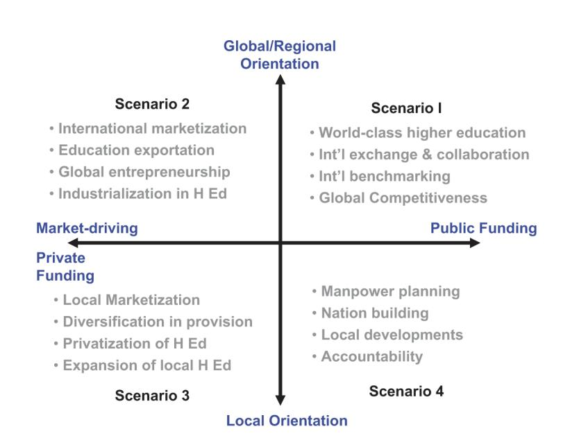
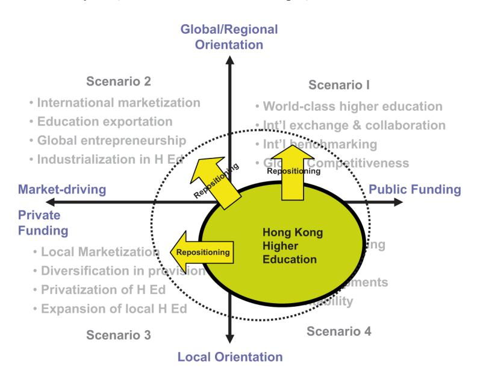
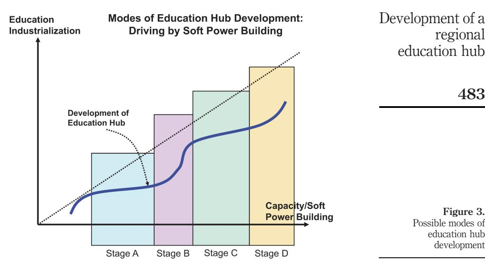
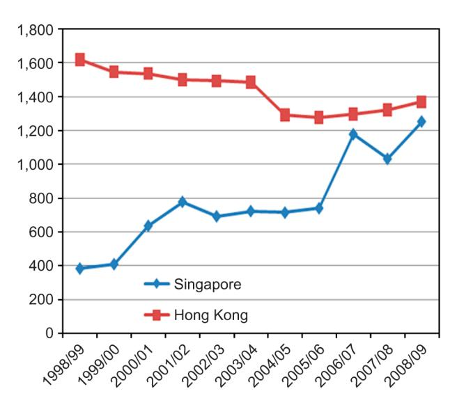

<!-- A1.R13 | source: papers_json/A1.R13/ -->

474

Received July 2010 Accepted July 2010

## Development of a regional education hub: the case of Hong Kong

Yin Cheong Cheng

The Hong Kong Institution of Education, Tai Po, Hong Kong Alan C.K. Cheung

Johns Hopkins University, Baltimore, Maryland, USA, and Timothy W.W. Yeun

The Hong Kong Institution of Education, Tai Po, Hong Kong

## Abstract

Purpose – This paper aims to review and analyze the functions, strategies and related issues of developing a regional education hub in the trends of education development in China as well as the Asian Pacific region.

Design/methodology/approach – Taking Hong Kong as an emerging case, it examines through literature and international comparison the relationship between education hub development and higher education development as well as the strategic functions of an education hub to the future development of Hong Kong.

Findings – The development of an education hub was found closely linked to the demand for higher education in the Asian Pacific region as well as the internal dynamic of higher education and society in Hong Kong. The mode of education hub development in Hong Kong should be driven by soft-power building instead of industrialization. The requirements for successful implementation include the huge demands for higher education in the region, the strengths of the higher education sector, the supporting policies and measures for international students and education service providers, and the leadership and support of central agencies.

Originality/value – This paper provides a new typology of higher education developments and a new mode of education hub development to analyze the strategic functions and requirements of developing education hub in the context of Asia-Pacific Region. The discussion and analysis in this paper will contribute to the related literature, policy development and initiative implementation in the areas of education hub and higher education not only in Hong Kong but also other parts of the world.

Keywords Higher education, Education hub, Education industry, Education export, International education, Education, Hong Kong

Paper type Case study

## Introduction

In the last decade, the tremendous impacts from the fast increasing globalization, international competition, and transformation towards knowledge-based economy have challenged the survival and development of many countries in the world. To face up to these challenges, initiatives in education particularly higher education are often believed important and crucial to create the necessary new human capital for the future

Emerald

International Journal of Educational Management Vol. 25 No. 5, 2011 pp. 474-493 q Emerald Group Publishing Limited 0951-354X DOI 10.1108/09513541111146378

Part of the material in this paper was adapted from Cheng (2009a, b).

<!-- page 2 -->

of individuals and the society (Cheng, 2005, 2009a). For example, the then Chancellor of Exchequer of the UK, Gordon Brown (2004) commented that the mission of the government in this globalized world is to make the people the best educated, most skilled, and best trained, as this is the only way to success. As pointed out by Becker (2002), this is "the age of human capital" reflecting the fact that the well-being of the nation and the individuals depends on the skills, knowledge, and the enterprise not just of a tiny elite, but of the people. Echoing the importance of higher education for the future, the notion of "magnet society" has also been used to predict the concentration of high-pay jobs in the educationally more advanced countries and hence the government of a society should help its people to achieve greater access to higher education and credentials (Brown and Lauder, 2001; Brown and Halsey, 2006).

## Tremendous growth in higher education

Given the increasing emphasis on higher education in many countries since the end of 1990s, there has led to a tremendous growth in tertiary student enrollment in different parts of the world. According to Global Education Digest 2009 (UNESCO Institute of Statistics, 2009), there has been an explosive growth in the last decade: the total higher education enrollment jumped from 85 million in 1997 to 150 million in 2007, a 76 percent increase. At the same time, the number of international students studying in overseas universities has grown by leaps and bounds. International education has become a booming business and the number of international students has been on the rise in the past two decades and will continue to rise at a phenomenal rate in the next 15-20 years (Institute of International Education, 2007, 2008 a, b, c, 2009).

## Emerging education hub

To meet the huge demands in higher education in general and international education in particular regionally and internationally, the question of how best to develop the country or the city itself as an educational hub to attract talented students and professors to come and provide educational services to both international and local students has become an increasingly important agenda for those countries or cities with the potential to do so (Cheng, 2009b). The figures by the Institute of International Education (2009) indicated that the UK and Australia had 376,190 and 202,448 non-local undergraduate and graduate students studying in 2007, accounting for 16 and 21 percent of the total higher education enrollment in the two countries, respectively. Singapore has been working vigorously to become an education hub in recent years and the number of international students has been increasing rapidly in the past two decades, reaching 86,000 in 2007 with target at 150,000 in 2012 (EDB Singapore, 2009).

What are the advantages for a country or city to serve as an education hub? From the international experiences, there may be three aspects. First, it can contribute to the formation of education industry that can be economically important. Exporting education services, for instance, has already become Australia's third largest export (Luke, 2005). Its share in the cross-border degree study market rose quickly from 1 to 9 percent from 1990 to 2003 (Marginson, 2007). Education has been taken as an important "knowledge industry" in Singapore and accounts for more than 3 percent of the GDP (Yonezawa, 2007).

Second, education hub can contribute to internationalization of higher education that can be seen as a response by academic institutions to a globalized world (Altbach

<!-- page 3 -->

and Knight, 2007). As Cremonini (2009) argued, internationalization of higher education has followed globalization and countries need to compete with others to become a magnet for world-class academics and the brightest students, as knowledge adds value to the countries involved. Internationalization of higher education can enhance the cultural sharing with other countries and help improve the network of the countries involved. As the British Council Hong Kong, which is responsible for promoting British culture and education to Hong Kong, explained on its webpage:

We build engagement and trust for the UK through the exchange of knowledge and ideas between people worldwide (British Council Hong Kong, n.d.a).

Many scholarships granted by the British government actually aim at supporting prospective foreign political, economic, and social leaders to study in UK universities. David Miliband, Secretary of State for Foreign and Commonwealth Affairs, commented:

The Chevening Program is a really exciting way in which the Foreign Office tries to contribute to the development of the sort of internationalism that should be about more than governments and more than trade but be about people. And you represent our investment in the future of British relations with a very wide range of countries (British Council Hong Kong, n.d.b).

Third, education hub can contribute to attracting foreign students to study in local tertiary institutions and enhancing the international capacity of these institutions. This will, in return, strengthen these institutions in the global scene. In the case of Hong Kong, serving as a hub of educational services would allow Hong Kong to develop and work with the human talents of Mainland China on one hand, and provide a bridge between human talents of the mainland and the outside world on the other (Jiang, 2002).

## Education hub and higher education

How can an education hub be built up in a region? Success in the endeavor to build up an education hub does not come by chance and often depends on carving out correct strategies and taking into consideration unique strengths, weaknesses, and background of the education system of one country or city (Chan and Ng, 2008). The international market for educational services is in fact complicated. For example, as perceived by Marginson (2006), the global higher education market can be stratified into elite and mass sectors, with huge differences in terms of target groups and price sensitivity. Niche building may also be important to success in becoming a hub (Marginson, 2007). There is an increasing number of research and studies in this direction (Gibbs and Knapp, 2002; Kehm and Teichler, 2007; Marginson, 2006). In fact, the major exporters of educational services in Asia, namely the UK, Australia, and Singapore, all have designated agencies to help with market research and promotional work (Singapore Education, n.d.; Australia Education International, n.d.). Supportive policies taken by the government and the tertiary institutes are also important to facilitate the hub development (Beaver, 2009; Carrington et al., 2007; Obst, 2008; Lee, 2008; Mok, 2008).

Higher education is a crucial element to an education hub but how education hub development is related to the development and change of higher education in a competitive international environment remains an unexplored question. Even though

<!-- page 4 -->

regional

Development of a

education hub

the literature has been increasing in discussion of different aspects of education hub development (in terms of education export, education industrialization and internationalization, international education, education market, etc.), unfortunately there is still lack of research or literature to focus on the issues of education hub development and higher education development as a whole.

## The case of Hong Kong as education hub

The Hong Kong government has started to recognize the importance of education hub development in recent years. In 2007, the Hong Kong government released its action agenda on China's 11th five-year plan and the development of Hong Kong, recommending the exploration of ways to attract more non-local students to study in Hong Kong and to develop Hong Kong into a regional education hub (Hong Kong Government, 2007). In 2009, education services had been earmarked as one of six major areas of economic development (Task Force on Economic Challenges, 2009). Some facilitating measures have been taken. The admission ceiling for non-local students was raised from 10 percent to 20 percent starting with the 2008-2009 academic year. Funds were provided to offer additional scholarships to both local and non-local students. A HK$18 billion research endowment fund has also been set up to further support the research work undertaken by higher education institutions in Hong Kong (Cheung et al., 2008).

In the past few years, the development of Hong Kong as a regional education hub has attracted a lot of public discussions in the local newspapers but there have been very few rigorous studies or reports to investigate the related issues seriously in a comprehensive way. Cheng et al. (2008, 2009) might be one of these very few projects. Without comprehensive investigation and analysis, the development of education hub in Hong Kong may suffer from the ignorance of its complexity in a regional or global context and finally becomes only an agenda for political propaganda or debate.

Taking the case of developing Hong Kong as a regional education hub, this paper aims to review the related issues in the trends of education development in China as well as the Asian Pacific region. It then examines the relationship between education hub development and higher education development as well as the strategic functions of an education hub to the future development of Hong Kong. Finally, this paper provides some key recommendations that would help facilitate Hong Kong in becoming a premier education hub in the region. It is hoped that the discussion and analysis in this paper will contribute to the related literature, policy development and initiative implementation in the areas of education hub and higher education not only in Hong Kong and also other parts of the world.

## A big picture: East Asia and the Pacific, China

According to the latest statistics by UNESCO Institute of Statistics (2009), higher education enrollment has been rising in many countries in the past few decades. The biggest increase in enrollment was in the Asia-Pacific region, especially in China. It is estimated that the higher education enrollment in many countries will continue to grow at a phenomenal rate in the next 10 years. In the 1970s, the percentage of higher education enrollment in the North America and West Europe constituted 48 percent of the total world enrollment. However, the percentage had dropped significantly to 23 percent in 2007. On the other hand, the percentage has continued to rise in East Asia

<!-- page 5 -->

478

and the Pacific, up to 31 percent in 2007. It is predicted that the upward trend will continue and the enrollment rate could rise to 50 percent in the next 15 to 20 years in Asia.

In 2007, the percentage of all high school graduates going to college was only about 26 percent in East Asia and the Pacific. Using the 60 to 70 percent level in North America and West Europe as a guide, there remains a huge market for higher education in East Asia and the Pacific. For example, approximately 5.2 million students enrolled in tertiary institutions in Mainland China in 2007 (of which 1.8 million were new entrants) and the total number of high school students was 25.1 million (of which 7.3 million were new entrants). And the percentage of high school graduates going to college was only about 25 percent. The huge demand for higher education in China will continue to fuel the growth of tertiary institutions in the country as well as in the region.

In the rapid development of higher education in the Asian Pacific region and Mainland China, there is a huge regional demand for quantity, quality, innovation, adaptation, and internationalization in education services. As a leader of higher education in the region, what kind of roles can Hong Kong play, what positioning can it take, and what contribution can it make in order to capture this growing regional market? All these are important questions to be answered when Hong Kong is aspiring to develop itself as a regional education hub.

## Development of the Pearl River Delta economic zone

There is a close relationship between the development of the Pearl River Delta and the future of Hong Kong. Though Hong Kong is an international city and world financial center with advanced infrastructures and international networks, it only has seven million people and an area of 430 square miles. The small population and the size of Hong Kong pose some serious constraints to Hong Kong in becoming a world-class metropolis like New York, Tokyo, and London. However, due to economic reform and open-door policy in the past thirty years in China, the economies of Hong Kong and the Pearl River Delta economic zone have been gradually integrating. The zone consists of nine major cities: Guangzhou, ShenZheng, Zhuhai, Foshan, Jiangmen, Dongguan, Zhongshan, and parts of Huizhou, and Zhaoqing. With approximately 50 million people and a total GDP of ¥1812 billion in 2005, the Pearl River Delta provides "fertile soil" in the future development of many industries, including education in Hong Kong.

In 2008, the National Development and Reform Commission in China announced the outline of the plan for the reform and development of the Pearl River Delta. According to the plan, from 2008 to 2020, the Pearl River Delta economic zone will become "a center for advanced manufacturing, and modern service industries," and "a center for international shipping, logistics, trade, conferences, and exhibitions, and tourism." In addition, through "labor division, cooperation, and mutual complementation" among Guangdong, Hong Kong, and Macao, the region will become "one of the world's mega metropolitan areas with the most abundant core competitive strengths" (The National Development and Reform Commission, 2008).

Based on this plan, there is an urgent and huge demand to raise the standard of human resources in the region, such as training and retraining a large number of professionals and providing a huge number of researchers and high-quality college graduates with international prospects. In addition, there is also a need to provide

<!-- page 6 -->

Development of a regional education hub

479

## Directions of higher education development

industrialize its education services.

Not only is the development of an education hub closely linked to the demand for higher education in the Asian Pacific region, it also hinges upon the internal dynamic of higher education and the society in Hong Kong.

Since the last decade, the Hong Kong higher education system has experienced various internal and external challenges and has been seriously reviewed in its development (University Grants Committee, 2002, 2004a, b). Recently, the University Grants Committee (UGC) has embarked on the higher education review 2010 with aim to come up with a forward looking document that can assist the Government and the public in reflecting on the purposes of higher education, perceived world trends, and hence the strategies for Hong Kong's higher education system.

Presently, the development of Hong Kong's higher education is influenced by two key tensions. The first tension is between public funding and private funding/market driving and the second is between global/regional orientation and local orientation, as illustrated in Figure 1 (Cheng, 2004).

Figure 1. Directions and scenarios of higher education development

<!-- page 7 -->

480

Four scenarios of higher education development

For many years, Hong Kong's higher education is publicly funded and serves the needs of the local community in development as scenario 4 of Figure 1. Further, it also serves the purposes of the government in manpower planning and society building.

However, since the economic crises in 1997, the Hong Kong higher education sector has been facing substantial financial cuts from the government. Nearly all UGC-funded tertiary institutions have started repositioning themselves to meet the challenges of globalization and the impact of international competition. As indicated in Figure 2, there are three directions of repositioning towards scenarios 1, 2 and 3.

First, with the resource support and the encouragement from the government, the tertiary sector in Hong Kong has started going more regional and global, pursuing world-class education, and building areas of excellence, as scenario 1. In addition, the tertiary sector continues to internationalize their institutions by attracting excellent non-local students and encouraging more international collaborations and exchanges in teaching and research (University Grants Committee, 2004a).

Second, with the backing of government policy, many higher education institutions start offering self-financed programs to meet the rising local demands for the universal postgraduate education and diversified continuing education, as scenario 3. For example, as encouraged by the government, higher education institutions have been offering large number of self-funded associate degree courses to meet the policy expectation of all 60 percent of high school graduates enrolled in college education in recent years. In the past eight years, each tertiary institution has contributed much to and generated substantial revenues from these self-financed programs. This signifies the start of the industrialization of education to serve the expanded local need in higher education market.

Third, some tertiary institutions have started expanding their self-financed programs to Mainland China and the Asian Pacific region to provide high value-added services in recent years, as scenario 2. For example, the world-renowned MBA and

*Figure 2. Repositioning of Hong Kong higher education*

<!-- page 8 -->

Development of a

EMBA programs offered by several Hong Kong universities are examples of this kind of high value-added education services. Despite Hong Kong's reputable universities and programs, the size and the scope of education exportation and international market is very limited. Hong Kong still has a long way to go if it wants to export their higher education and share a substantial portion of international market. The ongoing discussions on development of an education hub in Hong Kong are mainly focusing on exporting education services on a larger scale.

Overall, the direction of the higher education development in Hong Kong is first "to continue to serve local needs and at the same time to gear toward the global development" and second "to maintain the level of public funding and yet to further expand self-financed markets" as indicated in Figure 2.

## Formation and strategic functions of education hub

From the above discussion, we can see that the ongoing development and repositioning (from scenario 4 to scenarios 1, 2, and 3) of higher education in Hong Kong is becoming the major driving force to the formation of a regional education hub by serving two basic strategic functions: education industrialization and soft-power building (or capacity building).

## Education industrialization

The Hong Kong higher education sector is moving towards scenarios 1, 2 and 3 (Figure 1) that can help to meet the growing demands of a huge regional market in Hong Kong, the Pearl River Delta, and China. They can collaborate with professional communities and other related industries to industrialize the education services and exportation. In addition, supporting measures in terms of structures and systems, laws and regulations, quality assurance and qualification verification, and related facilities are needed to be in place for industrializing education (Cheng, 2009a). These supporting measures will help further promote the growth of the education industry (e.g. the establishment of more tertiary institutions), reap the short-term and long-term economic benefits, create other indirect social benefits (e.g. create more value-added positions and job opportunities), and contribute to the overall development of the Asian Pacific region and China (e.g. the economic transformation and professional training).

## Soft-power building

To develop a society amidst international competitions, it needs to control strategic resources or power. There are two types of strategic power: soft and hard power (Nye, 2004). Hard power often refers to the control of precious scarce resources (e.g. petroleum), strong infra-structures, cutting-edge hardware and technology, and strong military forces in the international competitions. Soft power refers to the influence of high-quality human capital, local and global human network, and high-valued intellectual capacity. In order to transform economies and develop a knowledge-based economy, high-skilled professionals from almost every advanced technological industry and high value-added professions such as global businesses, finance, communications, and creative industries are much needed. In other words, human capital is the most important asset or soft power in today's global competitions (Becker, 2002; Brown, 2004).

Looking at the direction of the future development of China and the Asian Pacific region, Hong Kong with the support of the new developments of its higher education

<!-- page 9 -->

sector has the advantages and strengths to become a regional education hub to attract, groom, preserve, and even export talents to the region as well as to the world. Being an education hub will help Hong Kong build up local and global capacity and improve its competitiveness in the future development of the region. First, like a magnet society, it can attract, develop and provide human capital that is much needed for high-level social and economic developments in Hong Kong (Brown and Lauder, 2001; Brown and Halsey, 2006). It also helps to promote growth points for new economies, new cultures, and new society building.

Second, the export of educational services will not only generate profitable incomes, but more importantly, it will help Hong Kong establish an intangible regional network and leadership position, which will extend its long-term political, cultural, and social impacts in the region and beyond. This will contribute to the soft power building of Hong Kong in the region. Third, such an education hub with rich human capital and soft power will help Hong Kong maintain a leadership position in certain cutting-edge areas, that will attract more outstanding researchers and scholars to Hong Kong and in return elevate the status of higher education and further promote education industrialization in Hong Kong. Finally, an education hub can create synergy among various industries in Hong Kong, by attracting together talents from the region and beyond to support the developments of these industries and create a profound cultural atmosphere for developing Hong Kong as a world-class financial center and international metropolis, even a regional hub for other high-value added industries (e.g. medicine, creative industries) (Brown and Halsey, 2006).

## Modes of education hub development

In developing an education hub, the emphasis on each of the two strategic functions (education industrialization and soft power building) may vary substantially from country to country depending on the strengths of higher education and related background. In Hong Kong, the focuses of ongoing public discussions, scholarly analyses, and even the policy direction released by the government also differ somewhat and will continue to be subject to change (Hong Kong Government, 2007; Task Force on Economic Challenges, 2009; Cheng et al., 2009; Cheung et al., 2008). Some focus more on soft power building while others on education industrialization. Some emphasize both. Some use a more conservative approach to look at the local demand and the supply of higher education, ignoring both strategic functions and having no understanding of the importance of an education hub.

Indeed, the concepts and functions of an education hub are dynamic. The relationship between education industrialization and soft-power building may be interactive. Figure 3 provides an imaginary curve to show the possible modes of education hub development in Hong Kong in terms of educational industrialization and soft power building. When soft power is established at a certain level, Hong Kong would be able to promote education industrialization. In the past 20 years, Hong Kong has already established a reputable tertiary education sector and professional communities with international standings (Cheng, 2004), as in stage A of education hub development in Figure 3. Based on the established strengths of human capital, Hong Kong has started to promote education industrialization and create education markets as in stage B of education hub development. When Hong Kong is able to reap great economic benefits and other beneficial resources from the industrialization of

<!-- page 10 -->

education services, it may reinvest these "dividends" into soft-power building to attract more talented students and professionals to Hong Kong and to groom its human capital at a higher level, as in stage C development. With the further enhanced human capacity in both the higher education sector and professional communities, Hong Kong can scale up the export of its education services to support the future development of the Asian Pacific region, China, and the Pearl River Delta region, as in stage D of education hub development.

Though Hong Kong has a vibrant and internationally competitive higher education sector, it has only a limited number of tertiary institutions, research centers, teaching and learning development centers, expert teams, and professional communities. In addition, the development of the education industry is greatly constrained by the limited space in Hong Kong. With these existing constraints, Hong Kong should avoid trying to spread itself too thin or wide by doing too much at once at the early stage of education hub development. Otherwise, it will not only divert its energy, but it will also reduce its competitiveness in the increasingly intensified international education market. Therefore, the strategies for education hub development in Hong Kong may have the following three key features.

## Capacity building driven

The policy and effort for education hub development should be driven by the function of capacity for Hong Kong. The main focus is on building local soft power, expanding the influence and network in the Asian Pacific region, developing high value-added centers, and promoting synergy among industries. When sufficient soft power or human capital is built in certain areas, Hong Kong can then develop education industrialization in these areas. As indicated in Figure 3, the curved line representing education hub development driven by capacity building tends to grow up below the diagonal line and closer to the horizontal axis (i.e. soft-power building).

<!-- page 11 -->

## Developing high-level education industry

There may be a wide range of services in education industry, some of which are intellectually intensive with high value and long term impact but some may not. For example, those educational services just providing general taught courses at a lower level may not be so value-added with impacts. This kind of services does not require high-level intellectual asset, exclusive qualifications, or world-class experts and is usually in the lower reach of the supply chain of knowledge and technology. Although it is easy to supply in large quantities, this market is usually competitive with many regional providers, easy to be replaced and difficult to sustain in the long run. Therefore, Hong Kong as a regional education hub should focus more on the development of a high-level, high-impact, high value-added, and intellectually intensive education industry that can provide high quality human capital and soft power.

Hong Kong's higher education has excelled in some areas of studies, such as the MBA and EMBA programs that are especially popular among Asian students. Many of these programs have received regional and international recognition. For example, the Economist Intelligence Unit ranked the MBA program offered by one Hong Kong tertiary institution the "twentieth" among 100 MBA programs in the world, and the "first" in the Asia Pacific Region in September 2007 (Ming Pao Daily News, 2007). One EMBA Program in Hong Kong was ranked top 15 worldwide in 2005 and the number one independent EMBA program in the Asia-Pacific from 2003 to 2005 by London-based Financial Times. In October 2007, the Financial Times ranked the abovementioned EMBA program the "first" position in the world (Apple Daily, 2007). This kind of high-quality and high-impact program can help in branding Hong Kong as a premier education hub.

## Coalition and collaboration

Since the scale of the Hong Kong education system is relatively small, the effort for education hub development in terms of soft power building and education industrialization in Hong Kong can be based on collaboration and coalition across-institutions, cross-studies, cross-industries, and cross-borders in order to create the necessary critical mass of academic and professional expertise, leverage effect and synergy for provision of world-class education services. In fact, some tertiary institutions in Hong Kong have been using these strategies for some time to develop various local and international collaborations to strive for international level performance in the areas of their research, development, teaching, and knowledge transfer (University Grants Committee, 2004a). Singapore, a city state smaller than Hong Kong, has initiated a good number of new measures in international collaboration in the past ten years and has accumulated valuable lessons for education hub development, to which other countries or Hong Kong can take a reference (Cheng, 2004; Cheng et al., 2009).

## Requirements for being an education hub

Following the above discussion, we can further explore the important internal and external requirements for Hong Kong to establish itself as an education hub, as follows.

## Education demands in the Asian pacific region

To support and sustain the operation of an education hub in Hong Kong, there needs to be a large enough market in the region. As mentioned earlier, it is clear that there is a huge demand for higher and professional education in the Asian Pacific region, China,

<!-- page 12 -->

and the Pearl River Delta region in the next 10-20 years. There is especially a high demand for high value-added and high quality international education due to the impact of globalization and international competitions. For example, in 2005 the number of international students was 2.7 million, representing a significant 50 percent increase from 2000. The global demand for international education is expected to grow to somewhere between 3.7 to 7.2 million by 2025 (Banks et al., 2007; Chow and Marcus, 2008; OECD, 2006). Recently, the demand for overseas education saw the fastest growth in the Asian region. Bohm et al. (2002) predicted that Asia will account for 70 percent of the demand for international education in 2025. In fact, according to the figures released by OECD in 2007, seven out of the top 14 sending countries were in Asia, and China ranked first in the list (Cheung et al., 2008). It is estimated that there were about 3 to 4 million international students in 2009, and 70 percent of them were from Asia (approximately 2-3 million). Using a conservative estimate of US$25,000 per year per student, the total expenses would reach US$64 billion annually. This is a huge enough market to support and sustain Hong Kong as an education hub in the region.

The experiences of other countries indicate that education can be a significant contributor to the economy (Cheung et al., 2008). At present, the economic benefits of education exports reach US$7.1 billion, $4.5 billion, and $2.3 billion annually in the UK, Australia, and Singapore, respectively. Because the population and the scale of education in Singapore are smaller than Hong Kong, there are many reasons to believe that the economic return for Hong Kong in exporting education services is at least $2.3 billion dollars per year, if not more (Cheng, 2009b).

## Strengths of Hong Kong's higher education

The strengths of higher education sector should be an important requirement for developing an education hub. What are the strengths and limitations of Hong Kong higher education, in particular compared with its counterpart, Singapore in the region?

University rankings. According to the world university rankings of Times Higher Education (2009), Hong Kong has five institutions in the top 200 despite having a total of only eight government-funded tertiary institutions. Three of them are in the top 50: the University of Hong Kong (24th); Hong Kong University of Science and Technology (35th); and the Chinese University of Hong Kong (46th). These rankings provide some international evidence to show the strengths of Hong Kong higher education sector in contribution to the formation of an education hub.

In recent years the records of the international Times magazine and the Times Higher Education Supplement (THES) show that the Singapore's two major universities, namely the National University of Singapore and Nanyang Polytechnics University were also continuously ranked in the top 100 universities in the world. In the past, Singapore's rankings were ahead of Hong Kong's, but Hong Kong has caught up with and even jumped ahead of Singapore in the recent years. We also need to pay attention to the fact that the National University of Singapore not only ranks high, it also has a high student enrollment of 25,000 students, which is more than that of the University of Hong Kong and the Chinese University of Hong Kong combined. The student enrollment in Nanyang Polytechnics in Singapore is close to 20,000 students. Compared with Singapore, the recent higher education development in Hong Kong will make it a more competitive place in contribution to developing Hong Kong as a regional education hub.

<!-- page 13 -->

Higher education provision. Based on the figures in 2007, the population in Singapore was about 3.5 million people, only half the size of Hong Kong. There were also 210,000 high school students, again half of that of Hong Kong (410,000). But the subsidized university places were 43,600 in Singapore, about 21 percent of all form 1 to form 5 students and 25 percent of the student cohort offered first degree admission in the three universities. This represented a significant increase in enrollment over the 21 percent achieved in 2000 and the 15 percent achieved in 1990. It also compared favorably with Hong Kong's 18 percent. In a speech given on 19 August 2007, Prime Minister, Mr Lee Hsien Loong, further explained that the aim can be further raised to 30 percent by 2015 (Ministry of Education Singapore, 2008).

The undergraduate university places in Hong Kong were about 50,000, 12 percent of all form 1 to form 5 students and 18 percent of all high school graduates. This percentage is far from fulfilling the needs of the local. Comparatively, the provision of Singapore's higher education is far better than Hong Kong because a student's chance of getting into university in Singapore is 1.38 times better than his/her counterparts in Hong Kong. Just looking at these figures alone, the provision of higher education in Hong Kong is far from sufficient to meet the local needs. If Hong Kong wants to develop its education industry and establish itself as the regional education hub, it needs to solve the problems of the very limited provision of higher education in fulfilling the local demands.

University subsidies and investment. The establishment and development of an education hub needs substantial investment. In the 1990s, the Hong Kong government invested tens of billions of dollars to build up a higher education sector of international standing, bringing together over 3,000 local and international scholars and the state of art academic facilities in eight tertiary institutions. In these years, most tertiary institutions in Hong Kong have achieved substantial progress locally and internationally and some of them have also achieved their international status in both teaching and research. But starting with the 1998-1999 academic year, public subsidies for all eight major tertiary institutions were greatly reduced due to financial crises. For example, their recurrent expenses had been cut from 20 to 30 percent in a few years. The total budget cut had accumulated to US $1.6 billion dollars in the past eight years, which has had a significant negative impact on higher education and its development.

In contrast, facing the same economic downturn in 1997, Singapore took a swift turn to transform its economy by cultivating large numbers of high quality talents. Since 1998-1999, Singapore has continued to increase its financial support to its tertiary sector. For example, the amount of recurrent expenses has increased from US$380 million in 1989-1999 to US$1.25 billion in 2008-2009, an over 300 percent increase. As indicated in Figure 4, while Hong Kong continued to cut university subsidies, Singapore took a different path by continuing to provide financial support to the growth of higher education during the same period of time. In 1998-1999, the recurrent expenses of higher education in Hong Kong was about 4.2 times (US$1.62 billion: US$380 million) but the expenses in both countries were about at the same level (US$1.37 billion to US$1.25 billion) in 2008-2009. Since the population in Hong Kong is double that of Singapore, the relatively small subsidies could set a tight limit preventing Hong Kong from becoming an education hub in provision of higher education for both local and international students.

<!-- page 14 -->

Development of a regional education hub

487

**Sources:** http://www.mof.gov.sg/budget*2009/revenue*expenditure/attachment/MOE_EE2009.pdf; Singapore Ministry of Education (2009). *Education statistics digest 2009*. (http://www.moe.gov.sg/education/education-statistics-digest/files/esd-2009.pdf); University Grants Committee of Hong Kong (2009). *Facts and figures 2009*. Hong Kong: HKSAR. (http://www.ugc.edu.hk/eng/doc/ugc/stat/19.pdf)

*Figure 4. Recurrent funding for higher education institutions in Hong Kong and Singapore*

Expenditures on research and development (R&D) of a country can also have positive impact on both its technological advancement and its higher education sector. As indicated in Table I, Hong Kong spent about 0.79 percent of its GDP on R&D in 2005. As compared with other countries, the effort made by the Hong Kong government lags behind in terms of its level of research funding as a share of GDP.

| Economic systems | Research and development expenditure as a percentage of GDP |
| --- | --- |
| 1. Japan | 3.53 |
| 2. USA | 2.68 |
| 3. Korea | 2.63 |
| 4. Switzerland | 2.57 |
| 5. Taiwan | 2.52 |
| 6. Singapore | 2.36 |
| 7. Australia | 1.76 |
| 8. UK | 1.76a |
| 9. Chinese mainland | 1.34 |
| 10. Ireland | 1.33 |
| 11. New Zealand | 1.17 |
| 12. Hong Kong | 0.79 |

Note: ^a^ The UK data here are retrieved from National Statistics (2007) Source: Legislative Council (2008). Finance Committee discussion paper

Table I. R&D expenditure as percentage of GDP (2005)

<!-- page 15 -->

Inadequate funding for higher education and research and development could have an adverse effect on the development and quality of higher education institutions. As an education hub, to enable education services to be internationally competitive and sustainable, an increase in investment on higher education in Hong Kong seems to be necessary. In 2008, the Hong Kong government has injected US$2.31 billion dollars in the higher education sector as endowment fund for research will no doubt enhance the quality of research work and boost the international academic standing of tertiary institutions in Hong Kong as a whole. However, the Hong Kong government should continue to make investment on higher education and research and development key priorities in the making of their future policy to enhance the international competitiveness of its higher education.

## Supporting policies for international students

In order to attract and recruit outstanding students from all over the world, Hong Kong needs to put into place a set of supporting policies and measures in recruitment, entry permit, residency, and employment. In the past, Hong Kong was slow to understand the importance of absorbing talents from other countries to studying in Hong Kong. Not until 2002-2005, Hong Kong increased the ratio of non-local students from 2 to 4 percent, again to 10 percent in 2005-2006. In 2008, the percentages had increased to 20 percent. In recent years, the Hong Kong government has established scholarships to attract non-local students and relax the restrictions of entry visas and employment. In addition to allowing working part-time and during holidays, non-local students are also allowed to stay in Hong Kong to work after graduation. Furthermore, the government is in the process of building more student housing to accommodate the needs of non-local students. Although Hong Kong still does not have a comprehensive and long-term population policy towards non-local students, the aforementioned measures are important steps to help attract talented international students and make Hong Kong an education hub (Cheung et al., 2008).

In the 1990s, Singapore already had supporting measures in terms of their population and immigration policy to attract professionals and non-local students. For example, some non-local students received up to 80 percent subsidies, but they had to stay and serve for three years after graduation in order to become citizens. Today, there are 73,000 non-local students in Singapore and close to 50,000 of them full-fee paying students. The number of non-local students will jump to 150,000 in 2012 and the majority of them will be coming from the Asian Pacific region. The sheer number of non-local students is sufficient to scale up the education industry in Singapore.

Comparatively, the number of non-local students in Hong Kong was smaller, around 10,000 in 2007. Among them, 7,300 enrolled in public-funded universities while 2,800 were fee-paying students. Over 80 percent of these non-local students were from Mainland China and 8.5 percent from other Asian Pacific areas. Relatively speaking, at this point Hong Kong does not have the scale to become an education hub or industrialize their education. It is estimated that the number of fee-paying students in Hong Kong may continue to increase in coming years but the number is still relatively small when compared to Singapore.

<!-- page 16 -->

489

To become an education hub, there need to be a series of policy measures for supporting tertiary institutions and other providers to develop and promote self financed, cross-border, collaborative, and world class education services and professional training programs. In the past few years, the Hong Kong government has initiated some measures (e.g. loans and lands given to providers, quality assurance in self-funded programs) to support the development of a self-financed tertiary sector. In terms of cross-border collaboration, since there is not yet to have government to government (G-G) agreement with other countries and Mainland China, some tertiary institutions and other services providers find it difficult to export higher education or recruit overseas students in large scale. Without the strong policy support of the government particularly in the regional or international level, it is difficult for the tertiary sector or providers to industrialize education to meet the huge education demands in the Pearl River Delta region, China, and the Asian Pacific region. It is recommended that Hong Kong should have a designated agency or bureau to develop supporting policies and G-G negotiations.

Partnership with other international institutions is also an important element in becoming an education hub. In the late 1990s, Singapore had started working with the Global School House scheme to partner with nine world-class universities such as the University of Chicago and MIT to attract international students. In 2000, Singapore Management University partnered with Wharton Business School at the University of Pennsylvania to cultivate business executives and leaders within the region. In 2007, the University of New South Wales in Australia opened up their fourth university in Singapore and their target groups are fee-paying students from Mainland China, the Asian Pacific, and European regions. In addition, many major cities in China or regions (e.g. Beijing, Shanghai, ZheJiang, Guangzhou, Zhuhai) have collaborations with other renowned international tertiary institutions to offer courses in order to meet the increasing high demand for education services locally, to upgrade the level of tertiary institutions in China, and to link up with universities globally. Based on the aforementioned observations, the Hong Kong government can consider initiating related supporting policies to promoting the international partnerships in development of an education hub.

## Central agencies

The development of an education hub and the industrialization of education require the involvement of various government bureaus, the implementation of overall supporting policies, and the negotiations at the G-G level for cross border education services. Therefore, there should be an inter-bureau Steering Committee to lead the development and the implementation of related policies, to coordinate activities among agencies and bureaus, to promote and achieve the development of G-G agreement on education, and to oversee the progress and achievement in development of an education hub and industrialization of education. The creation of a designated agency like the British Council, Australia Education International and Singapore Tourism Board with a formal and central role should be considered to facilitate and promote the goal of exporting Hong Kong higher education services. This agency could be supported by all interested parties such as the Hong Kong Trade Development Council, the Hong Kong Tourism Board, the Hong Kong higher education sector, the Hong Kong Education

regional education hub

Development of a

<!-- page 17 -->

490

Bureau, and other related industries. The major responsibilities of this agency may include undertaking generic promotion abroad, collaborating with other institutions and organizations, establishing a quality database, engaging in research and strategic development, and developing a formal performance management framework in the work of exporting education services and developing Hong Kong as a regional education hub (Cheng et al., 2008, 2009).

## Conclusions

Hong Kong had a late start developing itself into a regional hub of education. Its potential for the success quite depends on how it develops its policies and strategies to address its own strengths and limitations and meet the emerging huge demands for high quality education services in the Asia-Pacific region particularly mainland China in coming decades.

Hong Kong's reputation as a safe, advanced international city has made it attractive to many potential international students from Asia (Cheng et al., 2009). Proximity and close relationship with Mainland China, and the rigorous quality assurance mechanism governing her tertiary institutions also prove to be important (Cheung et al., 2008). As the core part of an education hub, Hong Kong has a strong higher education sector in which some are world-renowned and Asia-leading higher education institutions. The international reputation of this sector is a crucial factor that can attract international students from different parts of the region and beyond to come (Mazzarol et al., 2001; Mullins et al., 1995).

Furthermore, the Hong Kong government has determined to make Hong Kong a world-class city, to which education hub can make a very important contribution. As the Chief Executive of Hong Kong put it in his 2004 policy address:

We are promoting Hong Kong as Asia's world city, on par with the role that New York plays in North America and London in Europe (University Grants Committee, 2004a).

The aforementioned elements are crucial to the success of education hub development in Hong Kong.

The competition of international education will continue to be intensified as more and more countries enter into the race. Much work remains to be done at both the government and institution level if Hong Kong is to be a prominent education hub in the Asian Pacific region (Cheng et al., 2009). One of the immediate core policy issues needs to be resolved is how best to build up soft power and achieve the strategic functions of education industrialization in Hong Kong. In order to compete with other key competitors in the region, comprehensive analyses and more wide-ranging and coherent policies and supporting measures are likely to be needed (Mooney, 2008).

## References

Altbach, P. and Knight, J. (2007), "The internationalization of higher education: motivation and realities", Journal of Studies in International Education, Vol. 11 Nos 3/4, pp. 290-305.

Apple Daily (2007), "EMBA of Hong Kong University of Science and Technology ranked no. 1 globally by the Finance Times", available at: http://appledaily.atnext.com/template/apple/ art_main.cfm?iss_id¼20071023&sec_id¼4104&subsec_id¼11867&art_id¼10326545 (accessed 23 October 2007).

<!-- page 18 -->

regional

Development of a

education hub

- Australia Education International (n.d.), "Market information package", available at: www.aei. gov.au/AEI/MIP/Default.htm
- Banks, M., Olsen, A. and Pearce, D. (2007), "Global student mobility: an Australian perspective five years on", available at: www.idp.com/pdf/GSM_Brochure_Oct07.pdf
- Beaver, C. (2009), "The UK's international education strategy", available at: www.iienetowrk.org/ page/116258
- Becker, G. (2002), "The age of human capital", in Lazear, E.P. (Ed.), Education in the Twenty-First Century, The Hoover Institute, Stanford, CA.
- Bohm, A., Davis, T., Meares, D. and Pearce, D. (2002), Global Student Mobility 2025: Forecasts of Global Demand for International Higher Education, IDP Education, Australia.
- British Council Hong Kong (n.d.a), "About us", available at: www.britishcouncil.org/hongkong.
- British Council Hong Kong (n.d.b), "The British Chevening scholarships for postgraduate study in the UK", available at: www.britishcouncil.org/hongkong-education-scholarshipschevening.htm
- Brown, G. (2004), "Gordon Brown's Confederation of British Industry speech 9 November", available at: http://news.ft.com/cms/s/eb-4dc42a-3239-11d9-8498-00000e2511c8.html
- Brown, G.A. and Lauder, A.H. (2001), High Skills: Globalization, Competitiveness and Skill Formation, Oxford University Press, Oxford.
- Brown, P. and Halsey, A.H. (2006), "Globalization, knowledge and the myth of the magnet economy", in Lauder, H., Brown, P., Dillabough, J. and Halsey, A.H. (Eds), Education, Globalization and Social Change, Oxford University Press, Oxford.
- Carrington, R., Meek, V.L. and Wood, F.Q. (2007), "The role of further government intervention in Australian international education", Higher Education, Vol. 53, pp. 561-77.
- Chan, D. and Ng, P.T. (2008), "Similar agendas, diverse strategies: the quest for a regional hub of higher education in Hong Kong and Singapore", Higher Education Policy, Vol. 21 No. 4, pp. 487-503.
- Cheng, Y.C. (2004), "New thinking and strategic platform for higher education development in Hong Kong", in Kwok, K.H. and Chan, S.L. (Eds), Hong Kong Education in the Past Seventy Years, Hong Kong Teachers' Association, Hong Kong, pp. 187-200.
- Cheng, Y.C. (2005), New Paradigm for Re-engineering Education: Globalization, Localization and Individualization, Springer, Dordrecht.
- Cheng, Y.C. (2009a), "Managing human capital in the Asia-Pacific: higher education development", paper presented at the "Managing Human Capital in World Cities: Education Reform, Nurturing Talent and Student Learning in a Globalizing World" international conference, University of Hong Kong (Managing World Cities Symposium Series) and the Hong Kong Educational Research Association's 25th Anniversary Conference, 4 December.
- Cheng, Y.C. (2009b), "Development of education hub and industry: big picture, functions and conditions", Hong Kong Economic Journal Monthly, No. 393, December, pp. 46-55 (in Chinese).
- Cheng, Y.C., Cheung, A., Ng, S.W., Choi, P.L., Tang, S.Y.F., Yuen, C.Y.M. and Yuen, T.W.W. (2008), Report on the Study of Promoting Hong Kong's Higher Education Services to Markets Outside the Chinese Mainland, The Hong Kong Institute of Education, Hong Kong.
- Cheng, Y.C., Ng, S.W., Cheung, A., Choi, P.L., Tang, Y.F., Yuen, Y.M. and Yuen, W.W. (2009), A Technical Research Report on the Development of Hong Kong as a Regional Education Hub, The Hong Kong Institute of Education, Hong Kong, pp. 1-125.

<!-- page 19 -->

- Cheung, A., Yuen, W.W. and Yuen, Y.M. (2008), "Exporting Hong Kong's higher education in Asian markets: strengths, weaknesses, opportunities, and threats", International Journal of Educational Reform, Vol. 17, pp. 308-26.
- Chow, P. and Marcus, R. (2008), "International student mobility and the United States: the 2007 Open Doors survey", available at: www.bc.edu/bc_org/avp/soe/cihe/newsletter/ Number50/p13_Chow_Marcus.htm
- Cremonini, L. (2009), "In the eye of the beholder? Conceptualizing academic attraction in the global higher education market", European Education, Vol. 41 No. 2, pp. 52-74.
- EDB Singapore (2009), "Education: facts and figures", available at: www.sedb.com/edb/sg/en_ uk/index/industry_sectors/education/facts_and_figures.html
- Gibbs, P. and Knapp, M. (2002), Marketing Higher and Further Education, Kogan Page, London.
- Hong Kong Government (2007), "Report on economic summit on China's 11th five-year plan and the development of Hong Kong", available at: www.info.gov.hk/info/econ_summit/eng/ pdf/tb_aa.pdf
- Institute of International Education (2007), Open Doors 2007: Report on International Educational Exchange, Institute of International Education, New York, NY.
- Institute of International Education (2008a), Global Destinations for International Students at the Post-Secondary (Tertiary) Level 2007, Institute of International Education, New York, NY.
- Institute of International Education (2008b), IIE Study Abroad White Paper Series, Institute of International Education, New York, NY.
- Institute of International Education (2008c), Open Doors: Statistics on International Study Mobility, Institute of International Education, New York, NY.
- Institute of International Education (2009), Global Destinations for International Students at the Post-secondary (Tertiary) Level 2008, Institute of International Education, New York, NY.
- Jiang, X. (2002), "Hong Kong's universities see the mainland as fertile ground for recruiting students", The Chronicle of Higher Education, Vol. 48 No. 22, p. A41.
- Kehm, B.M. and Teichler, U. (2007), "Research on internationalisation in higher education", Journal of Studies in International Education, Vol. 11 Nos 3/4, pp. 260-73.
- Lee, M. (2008), "University restructuring in Singapore: amazing or a maze?", Policy Futures in Education, Vol. 6 No. 5, pp. 569-88.
- Luke, C. (2005), "Capital and knowledge flows: global higher education markets", Asia Pacific Journal of Education, Vol. 25 No. 2, pp. 159-74.
- Marginson, S. (2006), "Dynamics of national and global competition in higher education", Higher Education, Vol. 52, pp. 1-39.
- Marginson, S. (2007), "Global position and position taking: the case of Australia", Journal of Studies in International Education, Vol. 11 No. 1, pp. 5-32.
- Mazzarol, T.W., Soutar, G., Smart, N. and Choo, D. (2001), Perceptions, Information and Choice: Understanding how Chinese Students Select a Country for Overseas Study, Commonwealth of Australia: Australian Education International, Department of Education, Training and Youth Affairs, Australia.
- Ming Pao Daily News (2007), "MBA of the Hong Kong University of Science and Technology ranked in Global Top 22 and Asia no. 1", Ming Pao, Hong Kong, September 29.
- Ministry of Education Singapore (2008), "Expansion and diversification", available at: www.moe. gov.sg/media/press/2008/03/expansion-and-diversification.php (accessed 3 April 2008).

<!-- page 20 -->

Mok, K.H. (2008), "Positioning as regional hub of higher education: changing governance and regulatory reforms in Singapore and Malaysia", International Journal of Educational Reform, Vol. 17 No. 3, pp. 230-50.

Development of a regional education hub

Mooney, P. (2008), "Hong Kong hopes to be a higher-education hub", The Chronicle of Higher Education, Vol. 54 No. 25, p. A30.

l
t

- Mullins, G., Quintrell, N. and Hancock, L. (1995), "The experiences of international and local students at three Australian Universities", Higher Education Research and Development, Vol. 14 No. 2, pp. 201-31.
- National Development and Reform Commission (2008), "The outline of the plan for the reform and development of the Pearl River Delta (2008-2020)", available at: http://en.ndrc.gov.cn/
- Nye, J.S. Jr (2004), Soft Power: The Means to Success in World Politics, PublicAffair, New York, NY.
- Obst, D. (2008), "National policies for international education", available at: www.iienetwork.org/ page/116248
- OECD (2006), Education at a Glance: Indicator 2006, OECD, Paris.
- Singapore Education (n.d.), "Roles and responsibilities of education services division", available at: www.singaporeedu.gov.sg/htm/abo/abo01.htm
- Task Force on Economic Challenges (2009), "Six economic areas identified by task force on economic challenges for further development", April, available at: www.fso.gov.hk/tfec/ eng/press.html
- Times Higher Education (2009), "QS-world university rankings 2009", available at: www. timeshighereducation.co.uk/Rankings2009-Top200.html
- UNESCO Institute of Statistics (2009), Global Education Digest 2009, UNESCO-Institute of Statistics, Montreal.
- University Grants Committee (2002), Hong Kong Higher Education: Report of the University Grants Committee, Government Printer, Hong Kong.
- University Grants Committee (2004a), Hong Kong Higher Education: To Make a Difference, to Move with the Times, Government Printer, Hong Kong.
- University Grants Committee (2004b), Hong Kong Higher Education: Integration Matters, Government Printer, Hong Kong.
- Yonezawa, A. (2007), "Strategies for the emerging global higher education market in East Asia: a comparative study of Singapore, Malaysia and Japan", Globlisation, Societies and Education, Vol. 5 No. 1, pp. 125-36.

## Further reading

Singapore Ministry of Education (2009), "Education statistics digest 2009", available at: www. moe.gov.sg/education/education-statistics-digest/files/esd-2009.pdf

University Grants Committee (2009), Facts and Figures 2009, Government Printer, Hong Kong.

## Corresponding author

Yin Cheong Cheng can be contacted at: yccheng@ied.edu.hk

To purchase reprints of this article please e-mail: reprints@emeraldinsight.com Or visit our web site for further details: www.emeraldinsight.com/reprints

493
