<!-- A1.R20 | source: papers_json/A1.R20/ -->

## Technological University Dublin [ARROW@TU Dublin ](https://arrow.tudublin.ie/)

Reports

[Reports](https://arrow.tudublin.ie/cserrep) [Centre for Social and Educational Research ](https://arrow.tudublin.ie/cser)

2014-11-06

## Rankings in Institutional Strategies and Processes: Impact or Illusion

Ellen Hazelkorn Technological University Dublin, ellen.hazelkorn@tudublin.ie

Tia Loukkola European Universities Association

Thérèse Zhang European Universities Association

Follow this and additional works at: [https://arrow.tudublin.ie/cserrep](https://arrow.tudublin.ie/cserrep?utm_source=arrow.tudublin.ie%2Fcserrep%2F54&utm_medium=PDF&utm_campaign=PDFCoverPages)

Part of the[ Educational Leadership Commons,](https://network.bepress.com/hgg/discipline/1230?utm_source=arrow.tudublin.ie%2Fcserrep%2F54&utm_medium=PDF&utm_campaign=PDFCoverPages)[ Higher Education Commons,](https://network.bepress.com/hgg/discipline/1245?utm_source=arrow.tudublin.ie%2Fcserrep%2F54&utm_medium=PDF&utm_campaign=PDFCoverPages)[ Higher Education](https://network.bepress.com/hgg/discipline/791?utm_source=arrow.tudublin.ie%2Fcserrep%2F54&utm_medium=PDF&utm_campaign=PDFCoverPages) [Administration Commons,](https://network.bepress.com/hgg/discipline/791?utm_source=arrow.tudublin.ie%2Fcserrep%2F54&utm_medium=PDF&utm_campaign=PDFCoverPages) and the [Other Education Commons ](https://network.bepress.com/hgg/discipline/811?utm_source=arrow.tudublin.ie%2Fcserrep%2F54&utm_medium=PDF&utm_campaign=PDFCoverPages)

## Recommended Citation

Hazelkorn, E., Loukkola, T. & Zhang, T. (2014). Rankings in institutional strategies and processes:impact or illustion. European Universities Association, 2014.

This Report is brought to you for free and open access by the Centre for Social and Educational Research at ARROW@TU Dublin. It has been accepted for inclusion in Reports by an authorized administrator of ARROW@TU Dublin. For more information, please contact [arrow.admin@tudublin.ie, aisling.coyne@tudublin.ie, ](mailto:arrow.admin@tudublin.ie,%20aisling.coyne@tudublin.ie,%20gerard.connolly@tudublin.ie,%20vera.kilshaw@tudublin.ie) [gerard.connolly@tudublin.ie, vera.kilshaw@tudublin.ie](mailto:arrow.admin@tudublin.ie,%20aisling.coyne@tudublin.ie,%20gerard.connolly@tudublin.ie,%20vera.kilshaw@tudublin.ie).

Funder: European Universities Association

<!-- page 2 -->

## **RANKINGS IN INSTITUTIONAL ** **STRATEGIES AND PROCESSES:** **IMPACT OR ILLUSION?**

**BY ELLEN HAZELKORN, TIA LOUKKOLA, THÉRÈSE ZHANG**

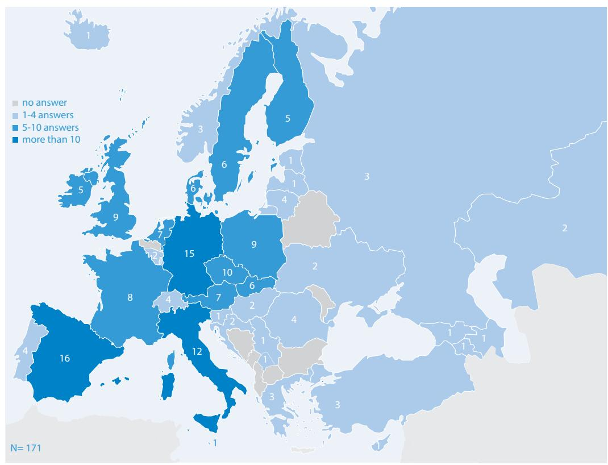

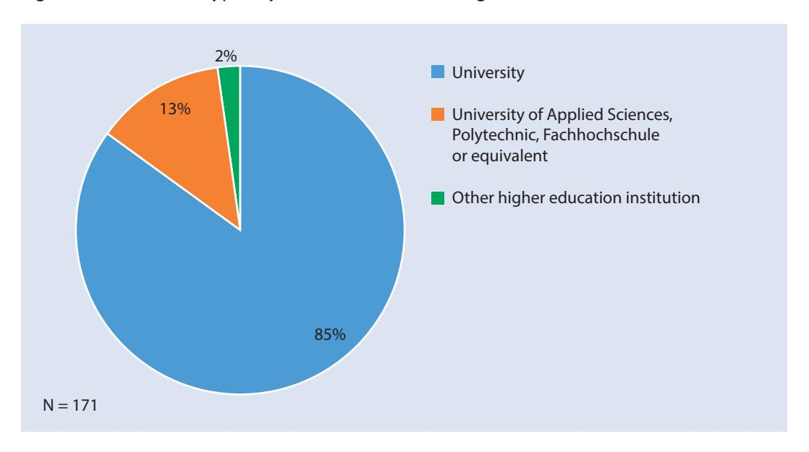

<!-- page 3 -->

Copyright © by the European University Association 2014 All rights reserved. This information may be freely used and copied for non-commercial purposes, provided that the source is acknowledged (© European University Association). European University Association asbl Avenue de l'Yser 24 1040 Brussels, Belgium Tel: +32-2 230 55 44 Fax: +32-2 230 57 51

A free electronic version of this report is available through www.eua.be

ISBN: 9789078997481

<!-- page 4 -->

## **RANKINGS IN INSTITUTIONAL ** **STRATEGIES AND PROCESSES:** **IMPACT OR ILLUSION?**

**BY ELLEN HAZELKORN, TIA LOUKKOLA, THÉRÈSE ZHANG**

<!-- page 5 -->

<!-- page 6 -->

## **CONTENTS**

LIST OF TABLES AND MAPS6GLOSSARY AND ABBREVIATIONS8FOREWORD10ACKNOWLEDGEMENTS11EXECUTIVE SUMMARY121. SETTING THE STAGE141.1 Rankings in Institutional Strategies and Processes (RISP)141.2 Objectives of the RISP project151.3 Methodology and framework of analysis161.4 Site visits161.5 The Roundtable172. TRENDS IN RANKINGS182.1 Rising influence of rankings182.2 Trends in transparency, accountability and comparability203. MAIN FINDINGS FROM THE RISP SURVEY233.1 Characteristics of RISP respondents233.2 Recognition and knowledge of rankings263.3 Monitoring rankings283.4 Internal dissemination303.5 Communication with, and influence on, external stakeholders313.6 The role of rankings in collaboration and engagement with stakeholders343.7 Benchmarking and relations with other institutions353.8 Institutional strategies incorporating rankings373.9 Impact on decision-making383.10 Choice of indicators414. EXPLORING THE IMPACT OF RANKINGS434.1 One development among others434.2 Diversity of rankings444.3 Who is interested in ranking results454.4 How rankings are used474.5 Implications for institutional processes495. CONCLUSION AND RECOMMENDATIONS50APPENDIX: KEY ACTORS IN THE RISP PROJECT53Partner organisations53Members of the RISP Steering Committee54Researchers who conducted RISP site visits54Project coordination at EUA54REFERENCES AND FURTHER READING55

<!-- page 7 -->

## **LIST OF TABLES AND MAPS **

FiguresFigure 1Distribution of RISP respondents per country23Figure 2What is the type of your institution according to the national statutes?24Figure 3How many full-time equivalent students do you have in total,
including undergraduates and postgraduates?24Figure 4Is your institution currently ranked in any ranking? (all respondents)25Figure 5Is your institution currently ranked in any ranking?
(HEIs counting over 30,000 students)25Figure 6Is your institution currently ranked in any ranking? (per type of HEI)26Figure 7Which ranking(s) do you find the most influential/have the greater impact
on your institution?27Figure 8Does your institution monitor its position in rankings? (all respondents)28Figure 9Does your institution monitor its position in rankings? (ranked institutions)28Figure 10When monitoring your rank, what is the highest level at which this review
takes place? (respondents who monitor their rank)30Figure 11Within your institution, is there any internal dissemination of your institution's
position in rankings and/or other transparency tools? (respondents who
monitor their rank)31Figure 12Does your institution use its position in rankings for marketing or publicity purposes31Figure 13In your opinion, which of the following groups is/are influenced by rankings
in their views, choices or decisions about your institution?32Figure 14In your opinion, which group(s) of students are influenced by rankings
when choosing their higher education institution? (respondents who believe
that prospective students are influenced by rankings)33Figure 15In what way do you think the results of rankings affect your institution's
reputation?35Figure 16Do you monitor the ranking of other/peer institutions?36Figure 17Do rankings play a part in your institutional strategy?37Figure 18Has your institution used the results of rankings or other transparency tools
to take strategic, organisational, managerial or academic action?38Figure 19Have the results of rankings or other transparency tools helped or hindered
the following activities in your institution?41Figure 20In the framework of your strategic planning and internal monitoring of activities,
does your institution pay special attention to the following, either at institutional or
at faculty level?42

<!-- page 8 -->

## **Tables**

Table 1To which level of studies does your institution educate students?24Table 2How does your institution inform itself about ranking methodologies?
(all respondents)27Table 3How does your institution monitor its position in rankings?
(respondents who monitor their rank)29Table 4Do you advertise the positioning of your institution in rankings
in your communication with the following external stakeholders or partners?33Table 5In your opinion, which of the following group(s) is/are influenced by rankings
in their views, choices or decisions about your institution?34Table 6What are/would be the reason(s) for monitoring the ranking of other institutions?
(respondents who monitor the ranking of other/peer institutions or are planning
to do so)36Table 7Do rankings play a part in your institutional strategy?38Table 8How have rankings influenced the type of institutional decisions you have made?
(all respondents)39Table 9Have the rankings influenced the type of institutional decisions you have made
in any of the following ways?40BoxesBox 1Major global rankings, 2014 (in order of year)19Box 2Typology of transparency, accountability and comparability instruments21Box 3Framework for guiding institutional responses to rankings51

<!-- page 9 -->

## **GLOSSARY AND ABBREVIATIONS **

**ARWU:** refers to the Academic Ranking of World Universities developed by Shanghai Jiao Tong University, China, in 2003 and annually thereafter.

**BRICS:** an acronym for the five major emerging or newly industrialised economies of Brazil, Russia, India, China and South Africa.

**Faculty:** sub-unit within a higher education institution comprising one subject area, or a number of subject areas.

**Higher Education Institution (HEI):** refers to all post-secondary institutions undertaking research and awarding higher degrees (Bachelor, Master's and/or doctorate), irrespective of their name and status in national law.

**Institution, institutional level:** refers to the higher education institution as a whole, beyond and including all its constituent parts (faculties, departments, institutes, etc.)

**Institutional research capacity:** the institution's capacity to generate comprehensive, highquality data and information to underpin strategic planning and decision-making.

**Performance funding:** funding based on how the institution has performed with regard to defined indicators or objectives.

**Postgraduate students:** students registered at second or third-cycle level who have already gained a first-cycle degree.

**QS: **refers to QS Quacquarelli Symonds Top Universities Rankings.

**Ranking:** in the framework of the RISP project, "rankings" in the higher education sector are understood as lists of higher education institutions. They compare HEIs using a range of different indicators, which are weighted differently, and then aggregated into a single digit in descending order. The term "league table" is often used to refer to rankings because of the way HEIs are listed in order; it is a metaphor that is taken from the world of sports.

**Rector:** refers here to an executive head of an institution, top senior leadership position, equivalent to President or Vice-Chancellor.

**RISP respondents and participants: **"RISP respondents" refers to those who completed the online survey, while "RISP participants" refers to those who participated in the Roundtable.

**THE:** refers to the Times Higher Education World University Rankings.

**Transparency tools: **refers to a range of different mechanisms which facilitate greater knowledge, understanding and comparability about higher education performance, such as benchmarking, accreditation, quality assurance, classification and profiling, etc. They all aim to enhance understanding and clarity about the different missions, activities and performances of higher education and research institutes.

<!-- page 10 -->

**RANKINGS IN INSTITUTIONAL STRATEGIES AND PROCESSES: IMPACT OR ILLUSION?**

**Undergraduate students:** students registered at first-cycle level.

**Universities:** the term "universities" is used throughout to describe those HEIs which award qualifications from Bachelor to doctoral level.

**University of Applied Sciences (UAS):** a collective term for higher education institutions designed with a focus on vocational degrees, especially in disciplines such as engineering, business, or health professions, and with a responsibility towards their region or the SME sector. Within their own countries, these HEIs have been called polytechnics (UK), Fachhochschulen (Germany), hogescholen (Netherlands and Belgium), institutes of technology (Ireland), etc. Depending on national legislation, they provide both undergraduate and postgraduate education.

<!-- page 11 -->

## **FOREWORD**

Since they were launched over a decade ago, global rankings have managed to shake up the world of higher education. They have provoked and been a source of numerous debates all over the world, as well as leading to discussions about the purpose of higher education and appropriate ways to measure its activities and consider its contribution to society and the economy.

The European University Association has previously contributed to the debate through its two publications: the *Global University Rankings and their Impact* reports I and II, published in 2011 and 2013 respectively. These two reports offered an analysis of ranking methodologies, and this work has shown the need to go

beyond studying how rankings are compiled, and focus on their impact on the higher education landscape. In recent years we have seen governments responding to rankings and some systems being shaped so as to aim for "world-class universities" as opposed to "world-class systems".

The *Rankings in Institutional Strategies and Processes* (RISP) project focuses on the institutional level. It is the first pan-European survey of higher education institutions seeking to understand how they use rankings, and the impact and influence that rankings are having on them. To what extent have institutional strategies or processes been affected or changed because of rankings? To what extent have rankings influenced institutional priorities or activities or led to some areas being given more emphasis than others so as to improve an institution's ranking position? How have stakeholders been influenced? The survey was complemented by site visits to six universities and a Roundtable of university managers and stakeholders, both of which were used to support the analysis of the data and form conclusions.

We hope that this publication, highlighting the key findings of the RISP project, will be of interest to a wide readership. The aim is to contribute to a broader discussion about the potential impact of rankings on institutional behaviour. Whether this impact is positive or perverse is, to a large extent, dependent upon each individual institution. In this regard, the concluding chapter offers some tips on how to make the best out of rankings as one source of information amongst others, and therefore to take greater control of the impact that rankings can have.

**Maria Helena Nazaré**

EUA President

<!-- page 12 -->

## **ACKNOWLEDGEMENTS**

We would like to thank,

- All the higher education institutions which replied to the survey, those institutions which hosted the site visits, and all participants to the Roundtable in June 2014;
- The project Steering Committee and associated researchers for their continuous support and feedback throughout the process, in particular when developing the questionnaire and guidance on the direction that this publication took; and
- Joanne Byrne for making sure that the project stayed on track, we stuck to the schedule and for her valuable feedback on the draft versions of this publication.

**Ellen Hazelkorn, Tia Loukkola and Thérèse Zhang **

<!-- page 13 -->

## **EXECUTIVE SUMMARY**

Higher education is undergoing rapid change in response to developments occurring at national and international level. Today, universities' performance worldwide is increasingly being measured using rankings which have been developed by governmental and/or commercial agencies, at both national and international level. The *Rankings in Institutional Strategies and * *Processes* (RISP) project is the first pan-European study of the impact and influence of rankings on European higher education institutions. The project has sought to build understanding of how rankings impact and influence the development of institutional strategies and processes and its results are presented in the publication.

The study carried out in the context of the project consisted of three steps:

- an online survey among European universities and higher education institutions;
- a series of site visits;
- a Roundtable with senior university managers and stakeholders.

The key findings of the project can be summarised as follows:

- 1. Identifying the precise role that rankings play in institutional strategies and processes is challenging due to the complexity of the context in which the HEIs operate and the number of factors that HEIs need to take into account when developing their strategies. In addition to global rankings, national rankings have an influential role although there is some confusion regarding what exactly constitutes a ranking.
- 2. The term "ranking" has come to be used as tantamount to any measurement of higher education performance. This interchange of concepts may arise because regardless of the accountability or transparency instrument in question, the results are often displayed as a league table or ordinal ranking. Indeed, there is some confusion regarding what exactly constitutes a ranking
- 3. HEIs pay attention to rankings as one source of information among others. The way in which HEIs study or reflect upon rankings is not systematic or coherent, and may occur at an informal as well as at a formal level. Institutions often use *ad hoc* monitoring patterns in response to strategic needs related to particular issues. Hence, there is no clear pattern as to how institutions respond: not all institutions or all institutions with a similar profile react in the same way.
- 4. The main user groups of rankings identified in the project were both external governments or national higher education authorities in general and international students – and internal – institutional leadership and the academic community as a whole. However, how these groups use the rankings varies as well as their attitudes towards rankings.
- 5. While HEIs can be highly critical of what is being measured and how, the evidence showed that they can still use rankings in a variety of ways: i) to fill an information gap; ii) for benchmarking; iii) to inform institutional decision-making; and last but by no means least iv) in their marketing efforts.

<!-- page 14 -->

- 6. The institutional processes that are impacted by rankings fall into the following four categories: i) mechanisms to monitor rankings; ii) clarification of institutional profile and adapting core activities; iii) improvements to institutional data collection; and iv) investment in enhancing institutional image.
- 7. Thus, rankings have helped generate a greater awareness of the changing dynamics of the higher education environment, both nationally and internationally, and especially in response to increasing focus on quality and performance.

The report concludes that cross-national comparisons are an inevitable by-product of globalisation and will intensify in the future. Therefore it is crucial that all institutions improve their institutional research capacity1 so as to be able to provide meaningful, comparative information about institutional performance to the public. Finally, the report provides a *Framework for * *Guiding Institutional Responses to Ranking*s on page 51.

<!-- page 15 -->

## **1 | SETTING THE STAGE**

## **1.1** **Rankings in Institutional Strategies ** **and Processes (RISP)**

Higher education is undergoing rapid change in response to developments nationally and internationally. Globalisation and demand for a highly educated and skilled knowledge-driven economy have combined to push higher education to the top of the policy agenda. Over the last decades, the number of students enrolled in higher education institutions around the world has grown dramatically; this number is forecast to more than double to 262 million by 2025, with international students expected to rise from current annual figures of 4.3 million to 7.2 million by 2025. The demand from society for more higher education is occurring at the same time as many public budgets and private incomes are constrained. This has heightened concerns about quality, especially in publicly funded systems. Questions are also being asked about the degree to which higher education is accountable for its actions to public stakeholders and students, and to the needs and demands of society and the economy. Focus on quality and excellence in a globally competitive world has led to calls for greater and better accountability and transparency, and tools which can enable and facilitate international comparison.

Today, universities' performance worldwide is increasingly being measured using rankings which have been developed by governmental and/or commercial agencies, at both national and international level. Although criticism of rankings' methodologies has been expressed by governments, institutional representatives, students, researchers and others throughout the years,2 rankings have succeeded in changing the way universities are perceived by students and parents, the business sector, employers and other stakeholders, and how they are presented in the media. They have placed consideration of higher education performance within a

wider comparative and international framework. In doing so, the higher education world has become visibly more competitive and multi-polar. Many more countries are now investing in building up their higher education and research systems and competing for mobile talent and investment. Consequently, one may conclude that international comparisons and classifications of universities are here to stay.

"It is generally easy to fall for the temptation to report and try to analyse movements up and down ranking lists, in spite of the knowledge that it may often be just "statistical noise", not necessarily reflecting any substantive underlying changes. "

*RISP respondent*

Because of the significance attached to being listed in the rankings, research3 indicates that rankings are having a growing and significant impact and influence on institutional decisionmaking and actions. With this in mind, the *Rankings in Institutional Strategies and Processes* (RISP) project was launched in late 2012. This is the first pan-European study using data drawn from a

> ^––––––––––––––––––––––––––––––––––––––––––––––––––––––––––––––––––––––––––––––––––––––––––––––––––––––––––––––––––––––––––––––––––––– 2^ EUA has previously published two reviews of the methodologies of rankings written by Andrejs Rauhvargers (see further details in References and further reading).

> ^3^ See References and further reading.

<!-- page 16 -->

large sample of HEIs, of how, and to what extent, European higher education institutions (HEIs) are being influenced by, and responding to, rankings. This is important because many people have their own views but until now this has not been based upon information provided from HEIs. The aim of this study is to better understand how complex and multifaceted rankings have become, and how HEIs use comparative information about institutional performance to inform their strategies.

This report presents the key findings of the project about the impact of rankings on institutional strategies and processes. It also makes some recommendations as to how higher education institutions can thoughtfully, cautiously and strategically use rankings to underpin institutional development while avoiding potential pitfalls.

The structure of the publication is as follows:

- ** Chapter 1** provides the rationale for the study and describes the project concept and methodology.
- ** Chapter 2 **gives an overview of trends in terms of rankings and how their impact has been discussed in recent studies.
- ** Chapter 3** goes through the main findings from the RISP survey.
- ** Chapter 4** further analyses the data presented in the previous section and discusses crosscutting trends observed in terms of impact on institutions.
- ** Chapter 5** draws conclusions from the findings, and, in the light of the RISP results, proposes to further reflect on and shape higher education policies.

## **1. 2 Objectives of the RISP project**

RISP is a project coordinated by the European University Association (EUA) in partnership with the Dublin Institute of Technology (DIT), the French Rectors' Conference (CPU) and the Academic Information Centre (AIC) in Latvia. The key actors in the project are described in the Appendix. The project, operating from October 2012 to March 2015, is co-funded by the Lifelong Learning Programme of the European Commission.

The objectives of the project were to:

- gain a deep understanding of the impact and influence of rankings and similar transparency tools on European higher education and institutional strategic decision-making;
- identify how HEIs can use rankings and similar transparency tools as a strategic tool to promote institutional development;
- provide input to the HE policy community on the potential effects of rankings on HE systems; and
- enhance European cooperation and sharing of good practices in the field.

In order to reach these objectives, the following activities were carried out:

- an online survey (March-July 2013) among European HEIs, on the influence of rankings on institutional strategic decision-making, policies and organisation;
- a series of site visits between January and February 2014; and

<!-- page 17 -->

• a Roundtable in June 2014 with senior university managers and stakeholders selected through an open call for participation to provide comments and input, as well as to benefit from peer learning through sharing experiences.

The findings of the survey were consolidated and complemented by the information gathered through the site visits and the Roundtable. Together, they have formed the basis for this report. In the next sections further information is provided regarding this three-pronged approach to gathering information.

## **1. 3 Methodology and framework of analysis**

A survey targeting European HEIs was designed to collect first-hand quantitative and qualitative data on institutional responses to rankings. The questionnaire was drafted by the RISP Steering Committee, who provided input and commentary to the various versions. The questionnaire4 was divided into seven sections, with questions about the respondent's general profile, the national policy environment, institutional decision-making framework and process, institutional approach to rankings, impact of rankings on institutional processes and decision-making, and the impact of rankings on communication and relations with stakeholders.

Prior to the survey launch, a sample of HEIs was invited to pilot the questionnaire and provide feedback, which in turn led to further refinement of the survey instrument. Following this phase, the online survey was officially launched in March 2013. An invitation to participate, along with reminders, was addressed to all EUA members as the main target audience. A number of partner organisations active in European higher education were also invited to disseminate the survey and encourage their member institutions to respond. Only one response per institution, for which a senior institutional representative took responsibility, was accepted. Responses were analysed in terms of general trends.

The research was undertaken in compliance with best practice in research ethics, and was approved by the DIT Research Ethics Committee. The anonymity of all participants is protected, and data has been securely stored.

A total of 171 HEIs from 39 countries replied to the survey. The profile of RISP respondents will be further detailed under Section 3.1.

## **1. 4 Site visits**

In January and February 2014, RISP researchers (see Appendix) carried out site visits to six institutions located in six countries: Austria, France, Denmark, Portugal, Romania and the United Kingdom. The institutions visited were selected from among those that had replied to the questionnaire and agreed to host such a visit, keeping in mind the aim of reaching a geographical balance, diversity of institutions and systems with respect to the size but also their outlook towards rankings. Out of the 171 institutions who responded to the survey, approximately half volunteered to host a site visit.

<!-- page 18 -->

A total of 48 meetings were conducted during the six site visits. The aim of the site visits was to gain a more in-depth understanding of how institutions are responding to rankings and what types of initiatives they are undertaking as a result, and to cross-check findings from the survey results. The researchers met different people in the institutions, as individuals or as focus groups: the rector and his/her leadership team, academic staff and students, as well as those in charge of strategic planning and internationalisation, and, where applicable, monitoring the rankings. In each country, in addition to the institution, the researcher(s) also visited the national rectors' conference or another organisation operating at system level that could provide information about the national context and the role of rankings within it. The schedule of the visit and interviews organised were adapted to accommodate the institutional context.

## **1.5 The Roundtable**

A Roundtable was organised in June 2014 to help validate the findings of the draft report and to offer participants the opportunity for peer learning through sharing experiences. There were 25 participants in the Roundtable, including the project team members. Most participants were from university senior management level representing 18 European countries. In addition, a few representatives of ministries and students took part in the discussion.

The one-day event was structured around short presentations of survey results, with participants being invited to provide feedback on how the results could be interpreted and examples of how rankings have an influence on their own institutional contexts. This methodology allowed a lively discussion to take place and provided useful insights for further interpretation of survey data and material.

<!-- page 19 -->

## **2 | TRENDS IN RANKINGS**

## **2.1 Rising influence of rankings**

Since the launch of the Shanghai-based Academic Ranking of World Universities (ARWU) in 2003, global rankings have become a significant factor influencing and impacting on higher education overall, on higher education institutions, and on policy and public opinion about higher education. Rankings are regularly referenced by policy makers and universities, by students and parents, by employers and the media because of what they purport to say about the performance and quality of higher education. The results of rankings are regularly produced as a league table not only of "world-class universities" but also of their host nations, because of the way results are often tabulated according to countries. This reflects both the importance of HEIs to national economic competitiveness and the benefits of continual investment in higher education and research and development (R&D). As a result, rankings today are less about informing student choice and more about the geopolitical positioning of HEIs and countries.

It is clear then that the influence and impact of global rankings has gone far beyond their original and more modest objectives. The ARWU was developed by Shanghai Jiao Tong University in order to highlight the position of Chinese universities *vis-à-vis* competitor universities worldwide in response to the Chinese government's desire to establish world-class universities. This is in contrast to both QS and Times Higher Education world rankings, amongst others, which had, and continue to have, a strong commercial intent. Recent developments show how rankings have evolved from being a semi-academic exercise undertaken by individuals in the USA to an international business, with significant commercial and consultancy opportunities, and substantial influence.

There are four main phases in the development of rankings (Hazelkorn, 2011, pp. 29-31):

**1910-1950s:** Rankings were first developed at the beginning of the 19th century by Alick Maclean and Havelock Ellis who had a fascination with *Where We Get Our Best Men* (1900), using the title of Maclean's book. In 1904, Ellis compiled a list of universities "in the order of how many 'geniuses' had attended them" (Myers and Robe, 2009, p. 7) followed by James McKeen Cattell's *American * *Men of Science* (1910) which highlighted the "'scientific strength' of leading universities using the research reputation of their faculty members". His methodology weighed the prominence of scientists employed and the ratio of "starred" scientists to total faculty in order to arrive at a final score. This early focus on "distinguished persons" effectively excluded most public universities, such as US Land Grant universities because they were newer institutions with a different mission than the older private universities.

**1959-2000:** The second phase – during which national rankings rose to prominence – emphasised reputational factors rather than academic origin. This approach was enabled by the publication of Science Citation Index (1961 and annually thereafter), and the Social Sciences Citation Index (1966 and annually thereafter). Various other publications were produced over the years but Allan Cartter's *Assessment of Quality in Graduate Education* (1966) had the most comprehensive methodology and received critical acclaim, selling approximately 26,000 copies (Myers and Robe, 2009, p. 13). While it did not aggregate departmental results into institutionwide rankings, its commercial success paved the way for *U.S. News and World Report Best College * *Rankings* (USNWR) in 1983 whose arrival coincided with an ideological shift towards markets,

<!-- page 20 -->

enhanced student mobility and a growing middle class. Today, USNWR ranks almost 1 800 colleges and universities, and produces several specialist and professional rankings.

In Europe, the Centre for Higher Education in Germany developed its own national ranking, CHE-Hochschul-Ranking (CHE University Ranking), beginning in 1998. Over the decades, other countries in Europe and beyond have developed their own national rankings.

**2003-:** The arrival of global rankings with ARWU in 2003 was inevitable in an increasingly globalised world, and marks the start of the third phase. These rankings rely primarily on reputational factors and bibliometric indicators and citations drawn from Thomson Reuters's Web of Science or Elsevier's Scopus data bases. The intervening decade has seen a significant amount of volatility in the titles and number of rankings, and in the methodologies, as one might expect in any emerging and competitive market (Rauhvargers, 2011, 2013). Both QS and Times Higher Education also produce other types of rankings, collated from information collected for their global rankings, and in some cases for the specific purposes of these sub-rankings, such as THE 100 under 50 Universities since 2012, and various regional rankings of Asia, the Middle East, Latin America, and the BRICS nations. Today there are nine major global rankings and a growing number of alternative rankings and alternatives to rankings.

**2008-:** While historically universities have been the main guarantors of their own quality, over the years there has been an increasing involvement of third parties at the national and international level. This change represents a significant paradigm shift. The OECD developed the AHELO (Assessment of Higher Education Learning Outcomes) project (Tremblay, Lalancette and Roseveare, 2012)5 and the EU has sponsored U-Multirank. In 2013, the federal government in the USA announced plans for a Postsecondary Institution Rating System (PIRS)6 linking access, outcomes and affordability. Other governments, most notably Australia and the United Kingdom, have begun to put institutional data online for easy accessibility and comparison.

## Box 1 – Major global rankings, 2014 (in order of year)

- Academic Ranking of World Universities (ARWU) (Shanghai Jiao Tong University), China, 2003
- Webometrics (Spanish National Research Council), Spain, 2004
- National Taiwan University Rankings (formerly Performance Ranking of Scientific Papers for Research Universities, HEEACT), Taiwan, 2007
- Leiden Ranking (Centre for Science & Technology Studies, University of Leiden), Netherlands, 2008
- SCImago Journal and Country Rank (SJR), Spain, 2009
- University Ranking by Academic Performance (URAP) (Informatics Institute of Middle East Technical University), Turkey, 2009
- QS World University Rankings (Quacquarelli Symonds), UK, 2010
- THE World University Ranking (Times Higher Education), UK, 2010
- U-Multirank (European Commission),7 Belgium, 2014

> ^––––––––––––––––––––––––––––––––––––––––––––––––––––––––––––––––––––––––––––––––––––––––––––––––––––––––––––––––––––––––––––––––––––– 5^ www.oecd.org/edu/ahelo

> ^6^ www.ed.gov/college-affordability/college-ratings-and-paying-performance

> ^7^ U-Multirank is a ranking prepared by a consortium led by CHE (Centre for Higher Education) and CHEPS (Center for Higher Education Policy Studies). It is financially supported in its initial years by the European Union.

<!-- page 21 -->

International experience shows that rankings have become a significant driver of opinionformation and decision-making at national and institutional level. The influence of rankings differs from country to country, and institution to institution – but there are few which have been immune to their effects. In some cases, governments have purposefully set about restructuring their national systems in order to identify a few universities capable of being designated as "world-class", while other governments have used rankings to help classify or accredit HEIs. They have been used to shape and reshape national priorities, and to refocus strategic direction. Institutional leaders have used rankings to inform managerial and organisational decisions, and often to establish a hierarchy of disciplines or departments. The disproportionate weight given by global rankings to research performance and productivity is reflected in the knock-on decisions about the relative importance of research as compared to teaching, and postgraduate compared to undergraduate students and activity – all of which have implications for the academic profession. While changes in research practice were already underway in response to greater emphasis on team- and project-based funding, as well as measurable and timely outcomes, rankings have been shown to have encouraged greater preference for English rather than national languages, for international knowledge rather than issues of national and regional relevance, and for publication in highly cited journals rather than in books and other formats. There has been some opposition to these tendencies as they could be construed to undermine national and regional goals, as well as the arts, humanities and social sciences (see *inter alia*: Hazelkorn, 2011 and forthcoming 2015; IHEP, 2009; Lo, 2014; Locke *et al., *2008; Shin *et al.,* 2011).

## **2.2** **Trends in transparency, accountability and ** **comparability**

Rankings have become the predominant method for comparing HEIs internationally because of their simplicity and perceived rigour. They use indicators as proxies to measure different aspects of higher education activity, and then assign a particular weight to these indicators according to the value judgements of the different ranking providers. The scores are then aggregated into a single digit in descending order and displayed as a "league table". The use of statistics has had a powerful ideological and norming effect, in the sense that promoting the perception of a single model of higher education excellence, accelerating the marketisation of higher education, and creating a winner-takes-all environment where marginal statistical differences in performance can lead to seemingly large differences in reputation, status and resources. The key question is whether rankings measure what is meaningful or, to paraphrase Einstein, they measure only what is easy to count.

Another way of viewing global rankings is to see them as part of the evolution for greater transparency, accountability and comparability in response to mounting public and political pressure for greater public disclosure. Box 2 below provides an overview of the different instruments used to assess, evaluate, measure and compare higher education performance and quality (Hazelkorn, 2015).

<!-- page 22 -->

## Box 2 – Typology of transparency, accountability and comparability instruments

- * Accreditation:* certification, directly by government or via an agency, of a particular HEI with authority/recognition as an HEI and to award qualifications.
- *Assessment, Quality Assurance (QA) and Evaluation:* assesses institutional quality processes, or quality of research and/or teaching & learning.
- * Benchmarking:* systematic comparison of practice and performance with peer institutions.
- * Classification and Profiling:* typology or framework of higher education institutions to denote diversity usually according to mission and type.
- * College Guides and Social Networking:* provides information about higher education institutions for students, employers, peers and the general public.
- * Rankings, Ratings and Banding:* enables national and global comparison of higher education performance according to particular indicators and characteristics which set a "norm" of achievement.

*Source: Hazelkorn, 2015, chapter 2 (forthcoming).*

While there are differences between the various instruments, they also share common objectives and indicators. For example, assessment, quality assurance, evaluation and benchmarking actions are often used for strategic and forward-looking purposes as compared with classification or profiling instruments which are focused on differentiating institutions according to mission or type. Accreditation is both a government and professional tool used to officially recognise an institution's authority to award qualifications and/or to regulate an increasingly more diverse higher education landscape, especially in the context of the growth of private and for-profit providers, franchising and subsidiaries. In the USA, college guides originally emerged from the need to provide information for an increasingly mobile student population; today, more of that information is available online or in other social-media formats.

In some instances, these instruments are used in tandem. For example, one of the main criticisms of rankings is that they compare different types of HEIs using a single set of criteria. Therefore, there is some merit in linking rankings with classification so that only similar institutions are ranked and compared, i.e. apples with apples rather than apples with pears. There can however be some risks with this process as classification systems tend to be "retrospective, based on observations from the past…[and] may not keep up with phenomena that are subject to change over time" (McCormick and Zhao, 2005, p. 53). U-Multirank has attempted to overcome the prescriptive nature of classification systems by enabling the user to choose the most appropriate comparators.

The ARWU, QS and Times Higher Education rankings represent opposite ends of a spectrum to U-Multirank, not just in terms of old and new but also in terms of elite and mass. The former focus exclusively and unapologetically on a select group of elite research-intensive universities accessible only to a tiny fraction of the post-secondary education student population. In contrast, U-Multirank aims to represent universal higher education, using the concept of Trow (1974) who used the label to describe participation by over 50% of society. This democratises rankings not just because it provides a wide range of indicators from which a user can choose the most appropriate for him/her, but because it operates by crowd-sourcing; in other words, any HEI can join U-Multirank and be ranked simply by providing the data.

Some rankings, most notably in the USA, have begun to ask questions about value, impact and benefit of higher education. System-level rankings, notably Lisbon Council (Ederer, Schuler and

<!-- page 23 -->

Wills, 2008) and Universitas 21 (Williams, de Rassenfosse, Jensen and Marginson, 2012-2013), have sought to assess the contribution of the higher education system as a whole rather than focusing on individual institutional performance on the basis that:

A university system has a much broader mandate than producing hordes of Nobel laureates or cabals of tenure- and patent-bearing professors. Indeed, we believe a system's broadest – and ultimately most important – mandate is to educate and prepare as many citizens as possible regardless of their age, social standing or previous academic record for the very real social and economic challenges we face (Ederer, Schuller and Willms, 2008, pp. 6-7).

The Washington Monthly Review College Rankings similarly "asks not what colleges can do for you, but what colleges are doing for the country" (Editors, 2013). More recently, in response to concern about student debt, the US Government has sought controversially to link access, affordability and performance.

Most radical is the growing use and influence of social media. Traditional rate-my-professor sites may be scorned, but they represent a fundamental transformation in assessment of quality beyond the control of the academy, governments, and ranking organisations. Combined with opinion surveys of students, peers and employers, these instruments are likely to have a profound influence on public perceptions of higher education quality.

There are over 18,000 HEIs worldwide today, yet rankings have encouraged a fascination with the standing and trajectory of the top 100 universities – less than 1%.8 Context is vital. Which university is "best" depends upon what question is being asked, who is asking the question, and the purpose of the question. This makes the conversation about quality, how it is measured and the choice of appropriate qualitative and quantitative indicators, a frequent topic at institutional, national and international levels.

At the same time, international comparative information of good quality is essential to underpin strategic leadership and decision-making at the national and institutional level. It enables countries and universities to gain a greater understanding of their own situation by learning from and sharing experience and "good practice". In the next chapters the results of the RISP project are discussed in order to reach a greater understanding of how HEIs are influenced by and use rankings and learn from institutional "good practice". This provides the basis for recommendations on the best use of such tools as part of an overall process of strategic leadership and management.

> ^––––––––––––––––––––––––––––––––––––––––––––––––––––––––––––––––––––––––––––––––––––––––––––––––––––––––––––––––––––––––––––––––––––– 8^ The IAU World Higher Education Database (WHED) (http://whed.net/home.php) provides information on almost 18,000 university-level institutions (institutions offering at least a postgraduate degree or a professional diploma in four years or more) in 189 countries (countries with no listed institutions are not counted). (As the number of HEIs continues to grow, this data is correct as of 15 May 2014.)

<!-- page 24 -->

## **3 |** **MAIN FINDINGS ** **FROM THE RISP SURVEY**

This section presents the main findings from the RISP survey responses.9 There are ten subsections focusing on areas such as the main characteristics of the survey respondents, their knowledge and use of rankings, the role of rankings with respect to collaboration and engagement with stakeholders and other HEIs, communication and publicity, the integration of rankings with strategic planning processes and the use of indicators. A more comprehensive analysis of the project results follows in Chapter 4.

## **3.1 Characteristics of RISP respondents**

A total of 171 higher education institutions from 39 countries replied to the survey (see Figure 1). Most countries within the European Higher Education Area (EHEA) are represented among the RISP respondents, with some countries counting more than 10 responses each: these were the Czech Republic, Germany, Italy and Spain. Over 80% of RISP respondents were from universities, and 13% from universities of applied sciences (see Figure 2); over 90% of RISP respondents educate students up to doctoral level (see Table 1). Each type of institution is represented in a range of sizes (see Figure 3).

<!-- page 25 -->

*Figure 2 – What is the type of your institution according to the national statutes?10*
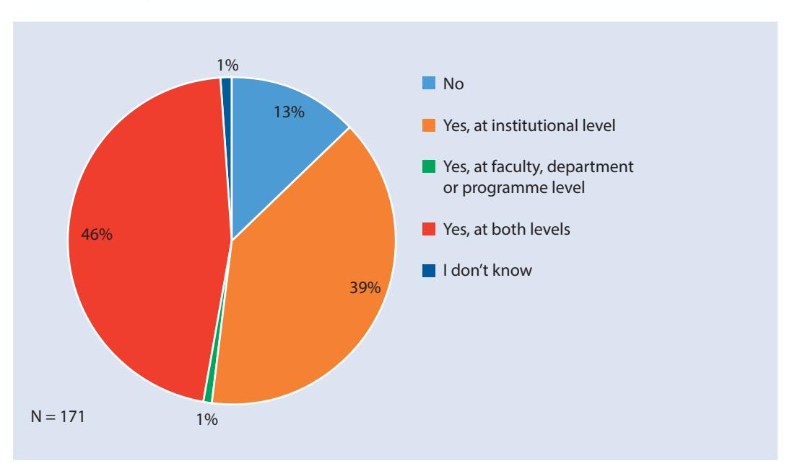
*Table 1 – To which level of studies does your institution educate students?*

| Qualification |  |
| --- | --- |
| Bachelor | 91% |
| Master | 93% |
| Doctorate (or 3rd cycle equivalent) | 91% |
| Other11 | 29% |

N = 171. The results do not add up to 100% as respondents to this question could indicate multiple replies.

*Figure 3 – How many full-time equivalent students do you have in total, including undergraduates and postgraduates?*
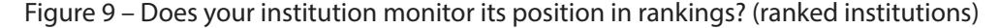
> ^––––––––––––––––––––––––––––––––––––––––––––––––––––––––––––––––––––––––––––––––––––––––––––––––––––––––––––––––––––––––––––––––––––– 10^ The "other HEIs" are discipline-based institutions and one third-cycle institute.

> ^11^ Institutions that offer "other [level of studies]" indicated that they may include lifelong learning programmes, postdoctoral education or other types of postgraduate studies, special discipline-related training, etc.

<!-- page 26 -->

*Figure 4 – Is your institution currently ranked in any ranking? (all respondents)*

Ninety per cent of RISP respondents are included in some type of ranking, either national or international or both (see Figure 4). Of those institutions which are not ranked, 40% are small institutions with less than 5 000 students. Unsurprisingly, large institutions (those with more than 30,000 students) are more likely to be ranked in both national and international rankings than smaller ones (see Figure 5). Universities are more likely to be ranked in international rankings than other HEIs, while universities of applied sciences and other HEIs are more likely to be ranked in national rankings (see Figure 6). This last observation points to the nature and methodologies of different types of rankings: global rankings tend to be selective whereas national rankings are more likely to include all national institutions.

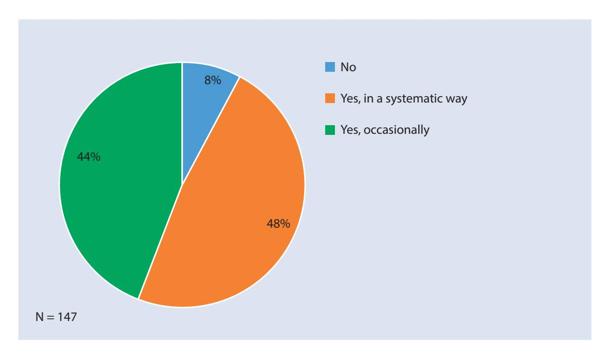

<!-- page 27 -->

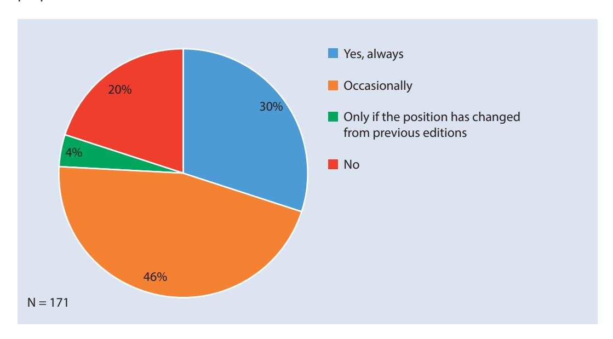
*Figure 6 – Is your institution currently ranked in any ranking? (per type of HEI)*

## **3.2 Recognition and knowledge of rankings**

As discussed in Chapter 2, despite methodological or other criticisms of rankings, HEIs do monitor developments in rankings.

Figure 7 identifies those rankings that RISP respondents find the most influential or those they consider as having the greatest impact on them. QS, Times Higher Education, and ARWU are considered the most influential. A wide range of other rankings, including national and discipline-specific rankings, were also listed, suggesting that RISP respondents use a multiplicity of different rankings. Interestingly, U-Multirank was mentioned as influential by 2% of RISP respondents even though, at the time of the survey, U-Multirank had not yet been launched.12 This could point to either the anticipation of what this new provider will bring to the market, or simply demonstrates the miscommunications which plague discussions about rankings.

<!-- page 28 -->

*Figure 7 – Which ranking(s) do you find most influential/have the greater impact on your institution?13*
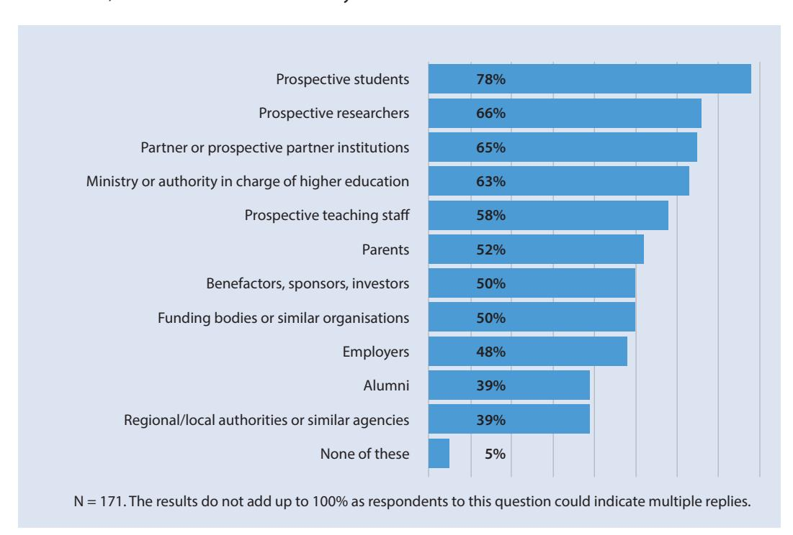

In comparison to all RISP respondents, those who appear in international rankings are more likely to consider international rankings as most influential. Similarly, respondents that appear in national rankings are more likely to favour national rankings.

In terms of learning about the methodologies used by different rankings, the overwhelming majority of RISP respondents refer to the websites of the respective rankings (see Table 2). About 10% of these rely exclusively on this method to learn about ranking methodologies. The remaining respondents, in other words the large majority, also seek out independent information to inform themselves.

N = 171. The results do not add up to 100% as respondents to this question could indicate multiple replies.

> ^––––––––––––––––––––––––––––––––––––––––––––––––––––––––––––––––––––––––––––––––––––––––––––––––––––––––––––––––––––––––––––––––––––– 13^ The Performance Ranking of Scientific Papers for World Universities by HEEACT has changed its name since the survey was conducted. It is now called the National Taiwan University Ranking.

<!-- page 29 -->

## **3.3 Monitoring rankings**

In general, RISP respondents pay close attention to their position in the rankings. As shown in Figure 8, 86% of respondents monitor their position in rankings. As can be expected, institutions that are ranked are even more likely to monitor their position in rankings (see Figure 9). As mentioned above, 10% of RISP respondents are not ranked at all but, interestingly, some of these nonetheless claim to monitor their position in rankings. Furthermore, 31% of RISP respondents who monitor their rank stated that rankings play no part in their institutional strategy.

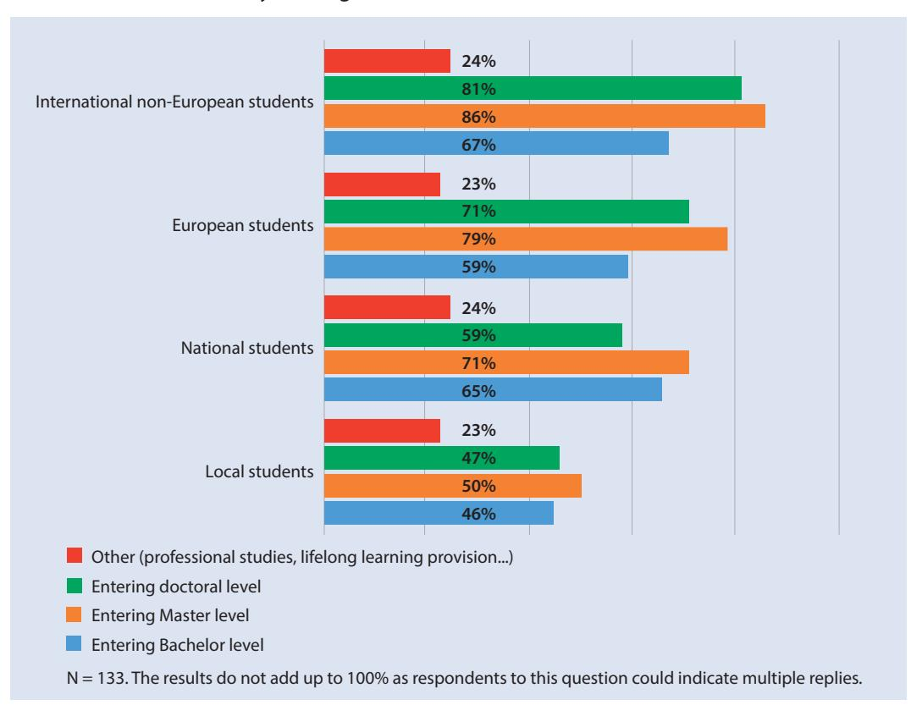
*Figure 8 – Does your institution monitor its position in rankings? (all respondents)*

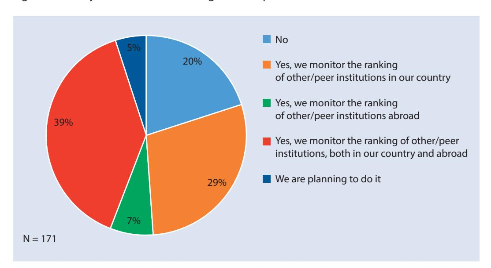

It is noteworthy that 60% of all RISP respondents dedicate human resources to this monitoring, through either a unit or staff (at either institutional or study field level). However, such a unit may not be solely dedicated to ranking-related activities; instead, these activities may be attributed to

<!-- page 30 -->

an existing unit responsible for matters such as data collection, strategic planning, institutional development, international outreach etc.

N = 147. The results do not add up to 100% as respondents to this question could indicate multiple replies.

However, the survey results seem to indicate that the respondents may not always have carefully considered how systematic their monitoring processes should be, what they wish to do with the results of the monitoring or how to use the information gathered to inform decision-making. For example, some institutions report that they *occasionally* look into rankings to inform decisionmaking, yet still dedicate *regular* resources to monitoring rankings. Furthermore, 6% of the respondents are planning to use the results of rankings to take action in the future even though they are not currently monitoring rankings.

Figure 10 shows that monitoring and review of an institution's rank is an issue of interest to the top institutional leadership level, with the review involving the rector or an institutional governing board in 85% of cases. However, this does not mean that in all these cases rankings are monitored at the level where strategic planning decisions are taken, because many institutions indicate that the rector is not the person ultimately responsible for strategic decisions. Indeed, in some higher education systems, strategic decisions are undertaken by the senate or the board. In less than 20% of the cases where the rector reviews rankings, the rector has the final say on strategic decision-making.

<!-- page 31 -->

*Figure 10 – When monitoring your rank, what is the highest level at which this review takes place? (respondents who monitor their rank)*
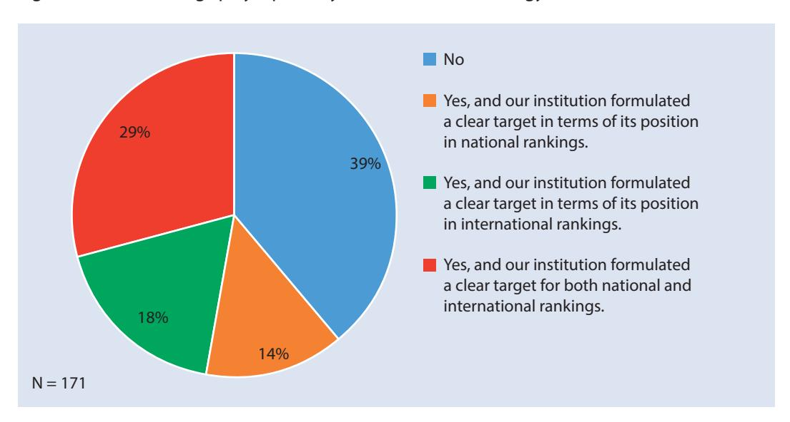

## **3.4 Internal dissemination**

Ninety-two percent of the RISP respondents who monitor their rank also communicate information about the rank within their institution. Typically, this information is provided to the senior institutional management, indicated by almost 90% of respondents. This makes sense also when considering the role of institutional leadership in monitoring the rank discussed above (see Figure 10). In addition, two thirds of the respondents who monitor their rank claimed to target academics with their internal communication methods, just less than 50% target administrative staff and 44% target students. Examples of such internal dissemination practices and processes include regular updates of the website and spreading information through committees or through faculty structures (such as faculty-based communication officers, students in specific programmes, etc.).

<!-- page 32 -->

*Figure 11 – Within your institution, is there any internal dissemination of your institution's position in rankings and/or other transparency tools? (respondents who monitor their rank)*
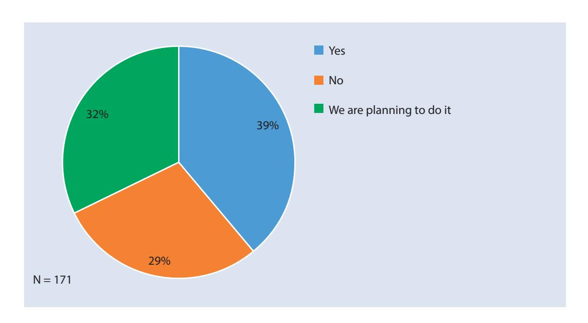

## **3.5** **Communication with, and influence on, ** **external stakeholders**

Most RISP respondents use rankings for marketing or publicity purposes. Unsurprisingly, institutions that are ranked are more inclined to use rankings in their communications, although, perhaps surprisingly, internationally ranked respondents appear less inclined to do so than nationally ranked respondents (Figure 12).

*Figure 12 – Does your institution use its position in rankings for marketing or publicity purposes?*
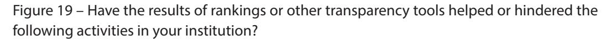

<!-- page 33 -->

RISP respondents use a variety of mechanisms to publicise their ranking position. This can include the website, other promotional material such as social media, press releases and media campaigns, and targeted information sent to partners. Some HEIs refer to their ranking position during public events such as conferences or meetings with potential donors. Different approaches include:

- Reference to a ranking band rather than the exact rank in order to present the best picture and/or reach a wider audience: "The University belongs to the top-x higher education institutions in the world", "X ranks among the world's top-N", or "One of the 300 best universities in the world according to ranking N".
- Reference to the precise ranking position if it is very high: "The University was ranked first in our country in this ranking", "The Institution was ranked 11th".
- Reference, where possible, to information drawn from several rankings to illustrate the geographic status and reputation: "The University is the Xth European university ranked, and Yth in the world, in ranking N", "The University is among the top 100 European universities in five rankings, and among the top 500 in the world in 7 rankings".
- Reference to institutional position compared to other national HEIs: "The University has been ranked by QS, among only 3 other universities from [the same country]".

Prospective students are generally considered as the key user group of rankings, both by ranking organisations and by HEIs. This perception is confirmed by the RISP survey which shows that almost 80% of respondents believe students are the most important stakeholder group influenced by rankings (see also Section 4.3 below). Consequently, as Table 4 shows, potential future students and parents are often targeted in a systematic way. In fact, of all the respondents, 76% advertise their rank in the communication to the student, in one way or another.

*Figure 13 – In your opinion, which of the following groups is/are influenced by rankings in their views, choices or decisions about your institution?*
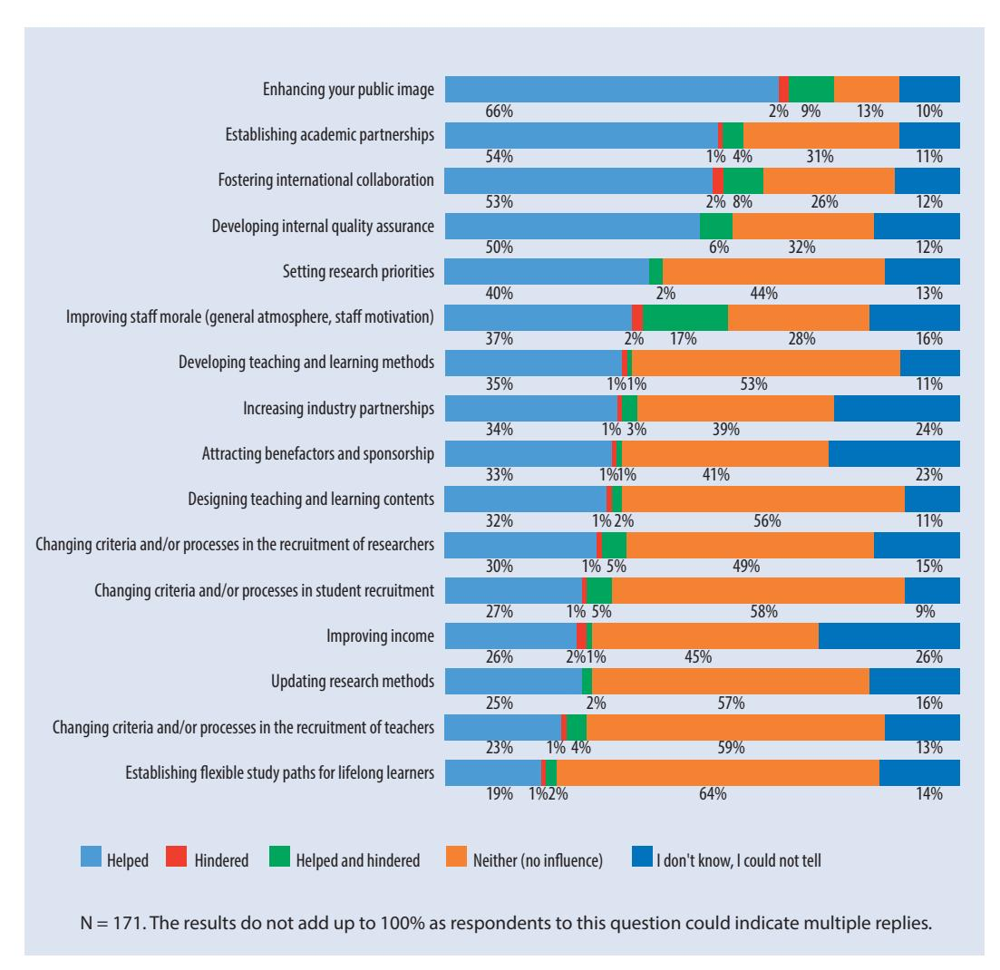

<!-- page 34 -->

N = 171. The results do not add up to 100% as respondents to this question could indicate multiple replies.

In general, RISP respondents believe that the further students travel geographically, the more likely they are to rely on the information provided by the rankings (see Figure 14). Accordingly, one respondent indicated they use their rank only in marketing and publicity material aimed at international students in specific regions where there is a demand. RISP respondents also believe rankings are more important when entering doctoral or Master's level programmes than for undergraduate studies.

*Figure 14 – In your opinion, which group(s) of students are influenced by rankings when choosing their higher education institution? (respondents who believe that prospective students are influenced by rankings)*

<!-- page 35 -->

Other groups, such as partner institutions, benefactors, sponsors and investors, closely followed by the media and regional/local authorities or similar agencies, are targeted occasionally or less systematically. Given the general focus of the HE community on engagement and a "third mission", it is interesting that RISP respondents seem less inclined to communicate with these external stakeholders, especially when many respondents cite rankings as influential to the decisions of these key stakeholder groups (see Figure 13). Only 5% of RISP respondents said rankings did not influence any of the key stakeholder groups. Finally, it should be noted that 82% of RISP respondents advertise their positioning in rankings, in one way or another.

Nationally ranked RISP respondents are more likely to believe that rankings are used by external stakeholders in the context of national competition for more funds and students (Table 5). Compared to all RISP respondents, nationally ranked institutions are more inclined to think that rankings influence the views of the ministry or government authorities, funding bodies, prospective students, parents, or employers. In contrast, internationally ranked respondents are more inclined to believe that rankings influence prospective researchers.

Each column does not add up to 100% as respondents to this question could indicate multiple replies. The number of nationally ranked and internationally ranked institutions does not add up to the number of total respondents, because a number of institutions are ranked in both national and international rankings.

## **3.6** **The role of rankings in collaboration and ** **engagement with stakeholders**

One of the important features of rankings is the way in which they bring visibility to institutions and countries in a very competitive and international higher education marketplace. This is evidenced by the fact that over 60% of RISP respondents said rankings had a positive impact on their institution's reputation.

<!-- page 36 -->

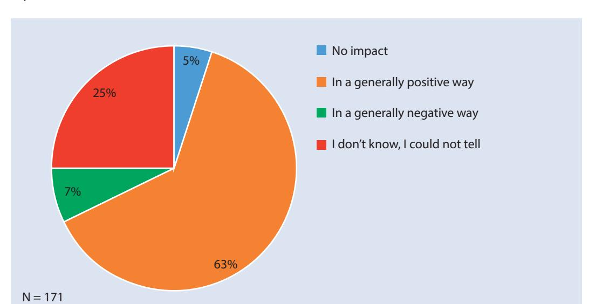
*Figure 15 – In what way do you think the results of rankings affect your institution's reputation?*

This positive outlook is particularly apparent for institutions that are ranked: 69% of ranked RISP respondents say that the impact was positive. In contrast, only 17% of unranked RISP respondents answer that the impact was positive. Instead, the latter group primarily feel there had been no impact (28%) or they did not know (56%). Interestingly, the 7% of all RISP respondents who consider the impact of rankings to be negative, are all ranked.

The fact that rankings are generally perceived as having a positive impact on institutional reputation suggests a strong correlation between rankings and reputation. Disentangling reputation and rankings can be difficult, not least because many rankings rely to a greater or lesser extent on reputation, itself a self-referential and self-perpetuating concept. People's perception of the best university is often based on those universities which are accorded prestige by rankings. Similarly, the OECD has noted that perceptions of quality, even if a correlation is indirect or difficult to establish, are assembled from a wide range of information, including rankings (OECD, 2013, p. 308).

On the other hand, the high percentage of those who considered the impact to be positive, combined with the high percentage of RISP respondents who are ranked, may simply reflect the fact that the RISP survey itself attracted institutions interested in rankings.

## **3.7** **Benchmarking and relations with other ** **institutions**

Rankings are a source of information about other institutions for the majority of RISP respondents, in particular for those RISP respondents that are ranked. While 75% of RISP respondents say that they use rankings to monitor other/peer institutions, this percentage increases to over 80% among RISP respondents that are ranked. RISP respondents who monitor the rank of other HEIs are also more inclined to believe that the results of rankings help enhance their own institution's public image (74% of ranked respondents believe so against 66% of all RISP respondents).

<!-- page 37 -->

There is a close correlation between RISP respondents who monitor other institutions and those that monitor their own position: 93% of RISP respondents who monitor a peer's rank also monitor their own.

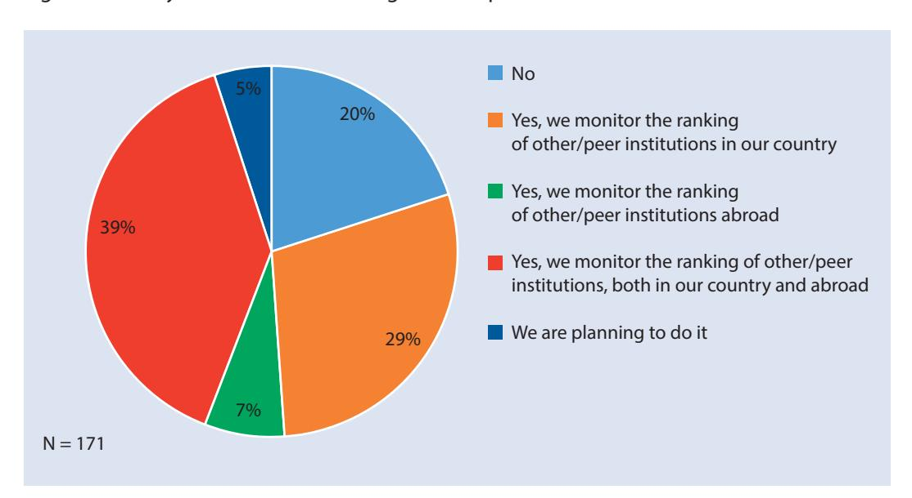
*Figure 16 – Do you monitor the ranking of other/peer institutions?*

Overall, RISP respondents monitor other HEIs' ranking positions primarily for benchmarking purposes. Establishing or maintaining international collaborations also appears as an important source of motivation for monitoring with over 50% of RISP respondents who mention it (see Table 6). RISP respondents who consider the results of rankings for international collaborations are more likely to be ranked.

| Table 6 – What are/would be the reason(s) for monitoring the ranking of other institutions? |
| --- |
| (respondents who monitor the ranking of other/peer institutions or are planning to do so) |

These results confirm that rankings can play a part in aiding or facilitating cooperation between institutions, although the extent to which this happens might vary and the consequences might be different. Rankings are used more often to establish or maintain collaborations with HEIs internationally than with those in one's own country. This result may appear surprising given the high number of institutions that monitor the rank of peer institutions in their home country (see Figure 16). However, on the basis that institutions within the same country are reasonably familiar with each other's profile and performance, rankings serve a purpose internationally where such information is often lacking (see also Section 4.4).

<!-- page 38 -->

## **3.8** **Institutional strategies incorporating ** **rankings**

Sixty per cent of all RISP respondents said rankings do play a part in their institutional strategy (see Figure 17). However, the way in which rankings play a role varies according to different institutions and contexts.

While some RISP respondents are quite specific about the kind of information they are interested in obtaining from rankings, others look into rankings to help plot their general strategic direction. For example, one institution indicated that they only focus on aspects of rankings which relate to student satisfaction, while another said rankings were used in a general manner to inform their overall strategy.

Institutions may seek to improve their ranking position in a general way or to comment on their ambitions using more aspirational language, such as to be "the leading institution in our country", or "among the top-N in Europe". When stating such ambitions, some RISP respondents do not target a particular rank in a particular ranking, but aim to translate their general ambition into a language that can be understood by the university community and external stakeholders. For example, in a country with several national rankings, one comment noted that "we are not targeting to be 10th in National ranking X, but among the ten first institutions in our country in general".

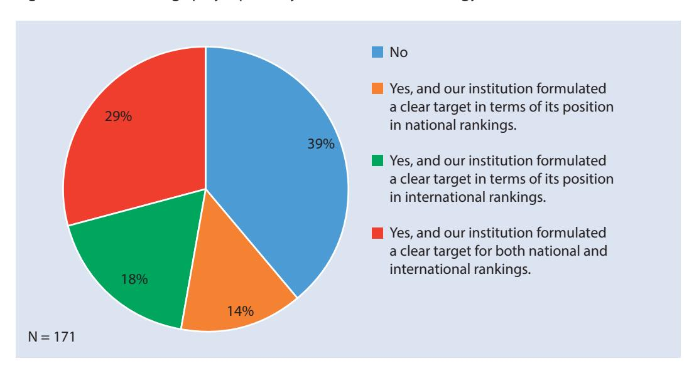
*Figure 17 – Do rankings play a part in your institutional strategy?*

The way HEIs take rankings into account in their institutional strategies may vary according to the institution's profile. For example, unsurprisingly, smaller institutions pay less attention to rankings than larger ones, which corresponds to the fact that smaller institutions are less likely to be ranked as mentioned above in Section 3.1. Thus, while 48% of RISP respondents with less than 10,000 students said rankings do not play any significant role in their institutional strategy, only 30% of institutions with more than 30,000 students said this.

At the same time, being ranked does not necessarily mean that an institution incorporates rankings in their institutional strategy (see Table 7). In fact, 35% of RISP respondents that are internationally ranked say rankings play no role in their strategy. Interestingly, nationally ranked respondents are more likely to say that they have set a clear target for their position in both national and international rankings.

<!-- page 39 -->

The number of nationally ranked and internationally ranked institutions does not add up to the number of total respondents, because a number of institutions are ranked in both national and international rankings.

Thirty-one percent of RISP respondents who do monitor their rank said rankings play no part in their institutional strategy. This suggests that many, while dedicating resources to monitoring their rank, have not thought through what to do with the results of this monitoring in their strategic planning.

Unsurprisingly, RISP respondents who do not monitor their ranking position are at the forefront in claiming that rankings do not play any part in their institutional strategy.14

## **3.9** **Impact on decision-making**

Out of all RISP respondents, 39% have used the results of rankings to inform strategic, organisational, managerial or academic actions, while another third of respondents are planning to do so. Only 29% said rankings have not been used in this way.

*Figure 18 – Has your institution used the results of rankings or other transparency tools to take strategic, organisational, managerial or academic action?*

<!-- page 40 -->

However, when prompted by a list of possible decisions that could be taken, 69% of all RISP respondents identified at least one action that had been influenced by rankings – which is obviously higher than the 39% who indicated that rankings had influenced decisions (see Figure 18). Table 8 presents the range of institutional decisions that have been taken on the basis of ranking results.

N = 171. The results do not add up to 100% as respondents to this question could indicate multiple replies.

Interestingly, 14% of all RISP respondents believe rankings have been influential but could not say definitively how, while 31% of all RISP respondents said that rankings have had no influence on their decisions. Nonetheless, in response to another question, 20% of the latter group said their institution had used rankings to take action. Many RISP respondents acknowledge that some actions identified as responses to rankings would have been taken even if there were no rankings, while in other instances, changes occurred because of a combination of several factors. This highlights the difficulty that lies in disentangling the specific influence of rankings from actions associated with the normal ebb and flow of development and evolution within an institution or across a system. Such difficulties could also emanate from the reluctance of institutions to admit to being influenced by rankings in this way.

Whilst several institutions could provide examples of concrete changes introduced,15 others noted that change was mostly related to a shift in mind-sets. Namely, their view was that rankings contributed to raising awareness about the importance of data collection and benchmarking, and the need to be more reflective.

Monitoring rankings and using the results of rankings to take decisions are often linked: 44% of RISP respondents who monitor their rank have already used the results in their decision-making, and 31% are planning to do so. Ranked respondents are also more likely to use ranking results to take action: 48% of nationally ranked and 47% of internationally ranked respondents said

> ^––––––––––––––––––––––––––––––––––––––––––––––––––––––––––––––––––––––––––––––––––––––––––––––––––––––––––––––––––––––––––––––––––––– 15^ Such as a change of data warehouse, the creation of a new body to streamline data collection against indicators, cooperation for improving resources or facilities, a change in the publication strategy or measures aiming to achieve "greater excellence" in research and/or increase international reputation.

<!-- page 41 -->

that they did so, while 33% of nationally ranked and 27% of internationally ranked plan to do so. Likewise, respondents with an institutional strategy that includes clear goals in terms of their position in rankings are much more likely to have already used the results of rankings to take a decision: 52% of those who have set a target for both national and international rankings have already used rankings to inform decisions while 38% are planning to do so. In contrast, respondents who have set such a target only for national rankings are less likely to have used rankings results, although 42% are planning to do so.

Being ranked (or seeking to improve the institution's rank) in national rankings has a significant impact on institutional behaviour, more so than international rankings. This is probably due to the implications for, *inter alia*, resource allocation. As shown by Table 9, nationally ranked RISP respondents tend to take more decisions in this way than all other respondents.

Each column does not add up to 100% as respondents to this question could indicate multiple replies. The number of nationally ranked and internationally ranked institutions does not add up to the number of total respondents, because a number of institutions are ranked in both national and international rankings.

When asked whether certain activities or developments have either been helped or hindered by rankings, the majority of RISP respondents said rankings and other transparency tools, such as national evaluations or performance-based funding, either helped or had no influence – the latter being the most common answer (Figure 19).

<!-- page 42 -->

Despite well-known criticism from the higher education sector towards ranking methodologies and despite the assertion that rankings do not reflect the multifaceted activities of higher education institutions in an appropriate manner, RISP respondents reported very little negative impact on their institutions caused by rankings (see Figure 15). However, the issue of impact may have been found too complex to be explored through a survey questionnaire. Institutions may identify improvements or deteriorations due to other factors, such as decreasing funds or simply managerial decisions, rather than rankings as such. Moreover, side effects of rankings can be felt as detrimental more than the results of rankings themselves. One institution, for example, identified "unfair reporting" of the institution's rank in newspapers as a negative side effect on their public image.

## **3.10 Choice of indicators**

The choice of indicators used in different rankings has been a contentious issue raised by HEIs and critics of rankings alike. However, when asked, RISP respondents reported to be using, internally and/or reporting to their respective higher education authority, a wide range of indicators which are similar in many respects to those used by the rankings, with some indicators used more often than others. There are only slight differences between indicators used by ranked

<!-- page 43 -->

and non-ranked RISP respondents, although some of these differences are worth noting. For example, indicators counting the number of international staff, Nobel or similar prizes, patents, licences and commercialisation activity, citation impact (and/or other research impact factors), and reputation are more frequently used by ranked than non-ranked respondents. This is hardly surprising as these indicators are also more likely to be internationally comparable and are thus also used by rankings.

Figure 20 provides a list of indicators used across the board by RISP respondents where they all pay attention to at least one of the indicators.

*Figure 20 – In the framework of your strategic planning and internal monitoring of activities, does your institution pay special attention to the following, either at institutional or at faculty level?*
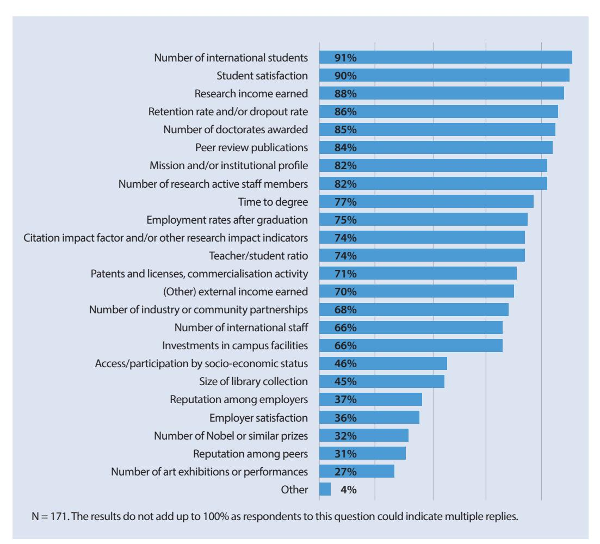

When asked about the indicators used by either the ministry or governmental agencies, there seemed to be some uncertainty expressed by RISP respondents. For example, in 35 of the 39 countries in which HEIs were surveyed, RISP respondents were either unclear about which indicators were used or disagreed with other respondents from their country about national indicators. Institutions within the same country seemed to have different views regarding the purpose of the data collected and/or whether the indicators were used to assess institutional performance. Reasons for this uncertainty regarding indicators could not be further examined in the context of this project.

<!-- page 44 -->

## **4 |** **EXPLORING THE IMPACT ** **OF RANKINGS**

This section draws on the RISP survey, the site visit and the Roundtable to discuss the extent to which rankings do or do not influence institutional behaviour.

## **4.1** **One development among others**

As discussed in Chapter 2, and the RISP project findings confirm this view, there is no unanimity about concepts of "quality", "transparency" or "excellence" – or how they should be assessed or measured. RISP participants demonstrate strong and often divergent views on whether rankings measure quality or simply provide an indication of performance – the latter being an account of given activities whereas the former involves a level of assessment or evaluation. Yet, even as a simple indicator of performance, rankings are limited in the level of information they can provide. While RISP participants did not associate rankings with transparency as such, they recognised that rankings had helped raise awareness about the need for greater transparency. Thus, rankings succeed in putting pressure on institutions to develop institutional research capacity and to communicate what they are doing.

However, given the extent of the changes occurring across higher education at the policy and institutional level, it was often difficult for RISP participants and project partners to isolate and identify the precise role that rankings play in institutional strategies and processes. It was noted that rankings are just one of many developments that have taken place across the higher education landscape over the last decade. In this respect, global rankings are both a cause and effect of higher education change; their arrival coincided with the acceleration and intensification of globalisation of higher education, expanding higher education markets, and requirements for accountability processes. In Europe, the Bologna Process reforms have been accompanied by national structural reforms and the European Research Area (ERA) has introduced changes to the organisation and practice of research. In recent years, the global financial and economic

crisis has impacted on the public funding of higher education and research in a dramatic way, although the severity of the crisis has been uneven across European higher education systems.16 In this context, any impact analysis of one specific phenomenon such as rankings is

"Rankings is not our core business but they are here to stay. We try – with minimum effort – to cope with them."

*RISP respondent*

challenging. Nevertheless, through the various steps of this study, it has become clear that the issue is not so much whether rankings have had an impact on universities but precisely how have they impacted universities.

Rankings' influence on HEIs can be roughly **correlated with the competitiveness of a national ** **higher education sector:** the more competitive the sector, the more attention is paid to rankings and their influence on other stakeholder groups, e.g. students and parents as potential "clients/customers", funding authorities in competing for funds, etc. This is especially noticeable

<!-- page 45 -->

in the case of the UK, where the importance granted to "league tables" as tools embedded in institutional strategy and planning can be directly linked to the increasing competitiveness of the sector since the 2012 reforms in funding. This corroborates what Locke *et al.* (2007, p. 7) anticipated, when they wrote: "it is possible that the influence of 'league tables' will increase further if the cap on tuition fees for full-time undergraduate courses is raised or lifted altogether."

Rankings are also likely to be more associated with hierarchical systems, where some institutions have much higher status than others or where the external quality assurance systems are immature. In the former case, rankings reinforce social capital benefits and in the latter they act as an alternative external quality assurance system. These factors are important in different ways for both domestic and international students and stakeholders, who are seeking some assurance on value for money, the quality of graduates and employment/career opportunities, etc.

Thus, it is crucial to recognise that **rankings can impact in a number of different ways.** They influence national and institutional as well individual academic and student behaviour. While the RISP survey mapped institutional responses which take the form of developing new strategies, the site visits and Roundtable discussions showed that decisions taken or processes introduced within institutions also impact on individuals, and this interplay is not always transparent. For instance, it is uncertain as to whether a researcher might start publishing in English in certain scientific journals because the institutional leadership has highlighted how important this is for improving the institution's ranking position, or because the individual believes that it is better for his/her own career at a time when careers are becoming more internationalised.

## **4.2 Diversity of rankings**

The form and extent of influence can vary according to ranking, and to institutional and national context. This was evident in the way in which RISP Roundtable participants engaged in a lively debate about Figure 7 above which lists the most influential global rankings. The top three rankings (ARWU, THE and QS) are typically considered to be the most influential because they attract media attention – and therefore potentially policy makers' attention. Results of a given country in these major rankings may frequently be referenced in political rhetoric as motivation for undertaking reforms of the system, or an institution may think a given ranking influences student choice. This is why HEIs feel the need to respond accordingly even if these particular rankings are not necessarily found to be the most accurate in terms of methodology or data. Thus, their impact at institutional level is quite often indirect. However, some other rankings – such as specialist, disciplinary and national rankings – can have a more direct influence on the institution given the level of specificity, including at the departmental or field-of-study level. These rankings gain importance because they can provide more useful information for the institution for benchmarking or other purposes, and the institution can more usefully integrate the results in its work.

Although the scope and sample of the RISP study does not permit deep analysis of the role played by rankings in different national systems, it provided some interesting indications regarding the existing differences in attitudes across higher education systems. In some countries, "league tables" are an accepted format, which are embedded within the public and higher education mind set, while in other countries, major global rankings such as ARWU or THE have grown in importance over time. Likewise, in some countries, the most influential national rankings are not produced by a higher education authority but rather by commercial media organisations.

Understanding system-level development and, ultimately, what a ranking is, as distinct from other transparency, accountability and comparability instruments (see Chapter 2) can differ

<!-- page 46 -->

**RANKINGS IN INSTITUTIONAL STRATEGIES AND PROCESSES: IMPACT OR ILLUSION?**

quite considerably within the same country or institution depending upon who is being asked. Sometimes, RISP respondents from within the same system gave conflicting responses to the same questions about the relationship between their national legislative framework and rankings. This suggests a degree of uncertainty about government policy and actions, and also about rankings, what they measure, and how they are compiled.

While challenges remain, discussions over the past decade have contributed to a growing awareness about methodologies used by rankings and their limitations. The survey results discussed in Section 3.2 were confirmed during the site visits and the Roundtable: HEIs are actively examining the different methodologies and combining different sources of information. This was reflected in the discussions about the need to be aware of the diversity of rankings.

Because **there are many different rankings, their results and impact should not be overly ** **generalised**. Nor can the impact of rankings on institutions be understood without considering the institution's own context or the national context, which may, to varying degrees, relate to the overall reforms in the higher education sector discussed above in Section 4.1. National rankings, in particular, tend to provoke institutional actions linked to specific national funding contexts, e.g. promoting teaching and learning or the student experience. This is different from international rankings which are more likely to be linked to research, and issues of prestige and reputation. While the former has a domestic resonance, the latter can help institutions establish or maintain their global reputation.

Therefore, when an institution is analysing the importance of one ranking or another for its activities, it should consider the objective of the ranking, what it measures and whether the indicators are meaningful or useful for the institution's purposes. Does it make sense to align the institution's strategies and policies with a particular ranking? What are the implications of doing so? What are the implications of not doing so? And if the indicators or the weightings change – as they so often do – should the institution respond?

## **4.3 Who is interested in ranking results**

Rankings are often dismissed as a simplistic way for the media or others to write about higher education; complex issues concerning higher education are reproduced as a "league table" to attract public attention. The RISP study, however, provides a far more nuanced picture of those

A recent example of a national project aiming to improve the image of a higher education system through rankings comes from Russia. In Russia, a governmental initiative was launched in 2012 with the aim to enhance Russian universities' global competitiveness. The goal of the project is to enable five Russian universities to be in the top-100 in world university rankings by 2020.

Source: "Making Way to Global University Rankings: Russian Master Plan", *Higher * *Education in Russia and Beyond* (HERB), Issue 1, Spring 2014.

using rankings, both within and outside institutions. In addition to the media, many RISP participants highlight the fact that their respective **higher education ** **authorities and governments** are interested in rankings – not least because doing well in global rankings brings significant national pride and helps position the country as an international player (see discussion in Chapter 2 above). This is considered especially important for attracting international investment and business, as well as international students.

RISP respondents believe that **students, ** **in particular international students,**

<!-- page 47 -->

are ardent users of rankings; the further geographically the students travel, the more likely they would be to use rankings (see Figure 14). This confirms the conclusions of other studies.17 However, the RISP results also suggest that student choice is a complex matter. While global rankings help heighten the visibility of highly ranked universities, this plays only a marginal role in the final choice of study place. Disciplinary rankings may be more important for science students rather than social science or humanities students. Other criteria for choosing an institution are: how strong is the institution's reputation in targeted disciplines of study (and among peers from the same discipline, such as current professors), the location, or the quality of the facilities and the financial conditions. It was repeatedly emphasised that the choice of institution did not rely solely on the institution's rank but on a combination of factors.

According to students and student recruitment officers interviewed, recruitment strategies can differ greatly; domestic students are not addressed in the same way as international students, and prospective undergraduates are usually not concerned with rankings in the same way as graduate students. Tellingly, the one site visit host which specified that it recruits students from the region in which it is located paid the least attention to its rank in its strategic documents: promoting other strengths was more crucial to attract students.

According to RISP data, rankings are a topic of great institutional interest. Amongst those who monitor their rank, the top **institutional leadership** (i.e. rector, board, senate or equivalent) are involved in 85% of cases (see Section 3.3). However, for these institutional leaders, rankings are used selectively when they are useful for the overall strategic view: to plead for a cause externally,

as mentioned above, to underpin or rationalise changes that would be made anyway, to strengthen the institutional image or for benchmarking (see Section 4.4 below).

Despite being criticised regularly for their methodological flaws, even in those institutions or national systems that reject or do not take rankings into account, rankings can act as convenient proxies whenever institutions need to plead their cause in one way or another. When

Leadership of one institution defined their attitude as slightly "schizophrenic": rankings are to be criticised because they cannot serve as a proxy for quality nor capture the complexity of a higher education institution. However, they may contribute to reinforcing the community's identity (especially if the rank is high), and constitute an argument for defending the institution's interests, whenever needed.

HEIs are well-ranked, this can be used to help advocate for additional funds, new partnerships (especially when engaging with HEIs in other world regions), dialogue with industry or attracting potential students. On the contrary, when an HEI is not well-ranked, rankings may be used to help campaign for additional funds in order to improve the institution or the higher education sector in the country.

While rankings are important at leadership level and institutions make some efforts to ensure internal dissemination about the topic (see Section 3.4), they are often perceived quite differently by **the institutional community.** The RISP site visits provided examples of different approaches among the university communities. In some cases, rankings were dismissed in a joking or cynical manner, in other instances, the institution's rank was considered to be a source of great pride or anxiety. Several interviewees amongst the institutional community referred to the leadership's role in promoting rankings. Hence, institutional leaders should consider whether their institutional community adheres to the image of their institution as presented by

> ^––––––––––––––––––––––––––––––––––––––––––––––––––––––––––––––––––––––––––––––––––––––––––––––––––––––––––––––––––––––––––––––––––––– 17^ See Hobson's report (www.hobsons.com/uploads/documents/hobsons_international_student_decision_making.pdf) or the QUEST project results (www.esu-online.org/resourcehandler/30010f4b-c7a9-4827-93a5-84aaaaa91709/).

<!-- page 48 -->

their communication about rankings (if any). This is of particular importance in cases where the institutional community may feel that resources were allocated for the purpose of "maintaining" or "improving" the rank to the detriment of other activities. For instance, during one site visit, staff members expressed concern that too much importance and time was being given to rankings and their impact (or to limiting their impact) rather than devoting attention to other equally, if not more important, national matters. This was raising some concerns about the future amongst staff members.

In one institution visited during the RISP project, the head of communication drew attention to a short promotional video where the high rank is proudly mentioned among the first things characterising the institution. This sense of pride was confirmed during interviews with several other groups at the institution (students and staff ). While this sense of pride cannot be related to the university's rank only, but also to an efficient community-building, most people interviewed thought that, in their interactions with interlocutors outside their university, a high international rank is the easiest and shortest way to "explain how good we are".

Another interviewee said: "We know rankings cannot be totally trusted, but it's always better to show that we are ranked high rather than low".

Further, it should be noted that rankings may also impact on morale at the individual and collective level. Several examples were provided by RISP participants about how rankings increased the sense of pride about one's own institution and the positive feelings that are evoked by achieving a good rank. The opposite is also the case although there was possibly a reluctance to discuss negative effects, as shown in Section 3.9.

In conclusion, rankings are being used by a variety of actors, inside and outside the institutions, for different purposes. Institutional leadership may wish to keep this in mind while analysing what use could be made of rankings as a tool for fostering their strategic management or their communication (to the external world or to their own community).

## **4.4 How rankings are used**

RISP participants repeatedly emphasised that rankings are just one source of information among others. Depending upon the issues at stake, rankings may play a minor to non-existent role. Broadly, the uses of rankings fall into four main categories: i) for information; ii) for benchmarking; iii) for decision-making; and iv) for marketing.

As discussed in Sections 3.4 and 3.5, there is a growing acceptance that rankings, to a certain extent, can help **fill an information gap**, for both internal and external communication. While prospective students are the primary target group, other key stakeholders, such as the media, parents, the ministry, benefactors, employers and institutional partners are all important users of ranking information – and hence key target groups for communicating the results of rankings.

Rankings also provide essential information about one's own institution and about peer institutions. This came up several times in discussions with RISP participants. For institutional leaders, rankings provide "a feel" for other institutions that they might not have acquired otherwise, especially for institutions located abroad and with whom they have not yet engaged.

<!-- page 49 -->

This might explain why so many respondents said they use rankings in developing international partnerships. In the national context, rankings are less important as a tool for developing partnerships because information about other institutions is already available or there are other sources of more reliable information, such as national databases in the Nordic countries and the UK.

As discussed in Section 3.7 above, rankings are important for **benchmarking** purposes. Many RISP participants reported having identified a set of institutions, either nationally or internationally that they considered to be sufficiently similar to their own institution in terms of profile or their closest competitors so as to monitor their rank or, more importantly, their performance in selected indicators. While it is not quite clear how this intelligence is ultimately used, it was said to give institutional leadership some ideas as to how their own HEI is positioned and to consider means of improvement. In this context, some HEIs reported having used the additional, fee-based, services offered by some rankers to get more personalised information and

In Austria there is a national level tripartite working group on rankings established with a view to discussing ranking methodologies and their results collectively and to look together for ways to improve ranking positions of Austrian universities and thus the system as a whole in global rankings. The first outcomes from this working group are expected in winter 2014/2015.

analysis, and having found it quite useful. This raises a discussion of the potential that U-Multirank has to become a tool for benchmarking for institutions. Considering that its set of indicators is more varied than those of other global rankings, some optimism was expressed in this regard. However, at the same time, RISP participants noted that U-Multirank currently faces the same challenges as other rankings, such as the reliability of the data, in particular with regard to its comparability.

A majority of RISP survey respondents reported having used rankings to **inform institutional ** **decision-making** (see Section 3.9). The site visits and Roundtable further clarified the situation behind these figures. It was repeatedly stated that rankings are one source of information amongst others. RISP participants were strongly of a view that no decision should be based solely on ranking results. However, it is also clear that either consciously or sub-consciously rankings do operate in the background when decisions are taken.

Three quarters of respondents to the RISP survey use the rank of their institution in **marketing** material and actions (see Section 3.5). Interestingly enough, those institutions who say that they "always" advertise their rank in communication, were not necessarily better ranked than the respondents on average. Further, the respondents believed that rankings have impacted their institution positively. This is presumably because most of the institutions participating in this study are ranked and rankings provide enhanced visibility, and hence improved reputation. This suggests that being ranked – almost regardless of which position – is more important than not being ranked at all. This can be the value of U-Multirank, which enables all HEIs to be ranked simply by providing the appropriate data.

<!-- page 50 -->

## **4.5 Implications for institutional processes**

RISP participants identified changes in institutional processes under the following four headings: i) mechanisms to monitor rankings; ii) clarification of institutional profile and improvements in core activities; iii) improvement to institutional data collection; and iv) investment in improving institutional image.

Firstly, there is clear evidence that HEIs do pay attention to rankings and have set up **processes ** **and structures to monitor** rankings performance and developments (see Table 3). As stated above in Section 3.3., while these structures may not be completely new, rankings have at least added tasks and sometimes a sense of urgency to an already existing unit. The most typical result is that monitoring or providing information for rankings is combined with quality assurance or management, strategic planning, institutional research or another unit responsible for statistical reporting or the international relations office. In all cases, these units work in close collaboration with the communications office. While quality assurance and rankings are often presented as two opposite ends of the spectrum, almost 50% of RISP respondents believe the results of rankings or other transparency tools have helped develop or improve internal quality assurance processes. None of them think that rankings have hindered them and 32% think they have had no influence.

Secondly, participants said that rankings have inspired them to **be more explicit in defining ** **their core activities and investing in action which will enhance performance.** For example, an institution profiling itself as regional actor feels added pressure to clearly define and communicate its profile in order to explain why it does not appear in global rankings which disproportionately focus on research outputs. Or, an institution that aspires to be researchintensive is investing more to improve its research outputs in order to reach its goal.

Thirdly, rankings have had a vast influence on **institutional data collection and monitoring ** **institutional performance.** In the words of one RISP Roundtable participant: "Rankings prompt you to ask the right questions, even though they by no means give the correct answer." Overall, rankings contribute tools for institutional self-knowledge and planning. They have raised awareness about the importance of identifying appropriate indicators for management purposes, and paying attention to improving data collection, including data-warehousing, annual reporting, performance indicators, etc.

Indeed, all RISP site visit participants said they had invested in data collection by upgrading existing processes and improving data collection for strategic evidence-based management although, once again, these improvements may have happened following a combination of factors.18 The units in charge of implementing these changes have also noticed an increased attention towards reports they produce on institutional data, notably from governance bodies or high-level committee members.

Finally, rankings encouraged HEIs to pay more attention to communication and marketing activities in order to **increase institutional visibility.** This typically involves requiring all researchers to mention their institutional affiliation when publishing research results, developing a new corporate image, improving communication material and organising campaigns or (controversially) developing direct relations with ranking organisations. Even in higher education systems where faculties have traditionally been the main unit of academic affiliation, the fact that global rankings rank institutions as a whole has convinced certain academics to become "part of the ranking game" and to embark on corporate image building.

> ^––––––––––––––––––––––––––––––––––––––––––––––––––––––––––––––––––––––––––––––––––––––––––––––––––––––––––––––––––––––––––––––––––––– 18^ This confirms Locke *et al., *2007: "'league tables' have prompted many institutions to review their data collection and submissions […]. They are now seeking to provide higher quality returns." (p. 6)

<!-- page 51 -->

## **5 |** **CONCLUSION AND ** **RECOMMENDATIONS**

The RISP project is the first pan-European study of the impact and influence of rankings on higher education institutions. The findings should be useful and of value to institutional leaders and national policy makers.

The RISP results show that while many like to criticise rankings and league tables for their methodological flaws and attempts to present complicated matters such as performance or quality of higher education and research in a simple list, institutions almost unanimously do pay attention to rankings. This is so much so that while institutions are often unsure of how rankings are perceived and how much they influence the views of external stakeholders, HEIs themselves have started to use information available from rankings for various purposes. Institutions consider them as a tool of information amongst others. Ultimately, rankings have acted as a "wake-up call" to the higher education community in terms of their competitive position, at national and international level, and the necessity to enhance institutional intelligence and

develop an evidence-base for strategic decision-making.

Cross-national comparisons are an inevitable by-product of globalisation and will intensify in the future. It is crucial that all institutions improve their institutional research capacity so as to be able to provide meaningful, comparative information about institutional performance to the public. As discussed in Chapter 2, many governments are already beginning to place comparative

"Perhaps this is stating the obvious but as the rankings have come to stay, the university needs to find a way to cope with them without losing focus of the *really* important issues related to the quality of the institution and its activities. It also needs to educate itself collectively and its various external stakeholders of what the rankings do and do not tell."

*RISP respondent*

institutional data online for public accessibility. Ultimately, to overcome problems associated with inappropriate indicators used by rankings, should there be an international common dataset on higher education which would facilitate greater and more meaningful comparability? As challenging as it may be to find consensus on such a dataset, it might be worth exploring the possibility.

While this study shows that rankings can be an important ingredient in institutional strategic planning, it is vital that each university has a coherent mission and strategic plan, and stays true to that mission. At the same time, HEIs should understand the limitations of rankings and not let themselves become diverted or mesmerised by them. HEIs should not use rankings to inform resource allocation decisions, nor should they manipulate their reporting of statistical performance data in order to rise in the rankings.

Accordingly, institutional leaders should reflect on a number of key questions grouped together under the headings of the four straightforward questions used by EUA's Institutional Evaluation Programme19 as indicated in Box 3.

<!-- page 52 -->

**RANKINGS IN INSTITUTIONAL STRATEGIES AND PROCESSES: IMPACT OR ILLUSION?**

## Box 3 – Framework for guiding institutional responses to rankings

## **What is your institution trying to do?**

- What are your institution's profile, mission and goals?
- What role does your institution play in the national or regional higher education landscape?
- How much, if any, attention should your institution pay to rankings in this context?
- Considering your institutional profile, which rankings, if any, and which indicators used by them, are most appropriate for your institution?

## **How is your institution trying to do it?**

- What are the key organisational characteristics of your institution, i.e. governance structures and key activities and to what extent are these in line with your mission and goals?
- Has your institution worked out a budget and identified the necessary resources – financial, human and physical – to meet its ambition?
- What changes in your institution's activities or resource allocation would be necessary if you were to improve your position in rankings – and to what extent would this alter its mission?

## **How does your institution know it works?**

- How does your institution assess its performance and which indicators are most/more helpful or meaningful for measuring your institution's success and quality?
- What is your institutional research capacity? In other words what is your institution's capacity to generate comprehensive, high-quality data and information to underpin strategic planning and decision-making?
- What kind of information do you provide to your various stakeholders?
- Is the data collected by the rankings useful in this regard? If so, how is this information used?
- Are you using rankings *only* as part of an overall quality assurance, assessment or benchmarking system and not as a stand-alone evaluation tool?

## **How does the institution change in order to improve?**

- What kind of actions should your institution consider introducing in order to improve its performance with respect to its mission?
- Would other transparency instruments be more useful to help your institution benchmark itself and improve its performance rather than rankings?
- What actions should you take to ensure your key stakeholders potential students and faculty, regional and national policy makers, employers, civil society organisations, etc. – are fully aware of what your institution does and of its contribution to society and the economy?
- Do you engage with the government and the media to explain the limitations of rankings and/or how to interpret them?

<!-- page 53 -->

The RISP project has demonstrated that interpreting ranking results and the impact of rankings on higher education can often be complex due to different contexts and purposes. Thus, rankings should not be considered in a singular or unilateral way. For the same reasons, rankings should not be used as the single source of information or their results be accepted uncritically;

nor should rankings be used as the basis for strategic decision-making in an institution or a higher education system. To do so would represent a serious undermining of institutional autonomy.

Yet, the RISP results also indicate that if used wisely, rankings can be

On the eve of the launch of U-Multirank some universities invited their local media to a discussion on what this new initiative is and how to interpret the information.

part of a strategic approach. They can help stimulate discussion about the role and future of higher education, assessing and measuring performance, maintaining good quality information, publicising and communicating with stakeholders, and helping to modernise and professionalise institutional processes. Rankings have been especially successful in making the higher education community more aware of the existing competition in the field, nationally and internationally. Providing publicly available and meaningful, comparative information about the quality, performance and value of higher education will help strengthen and sustain political and societal commitment – and that is in everyone's best interest.

<!-- page 54 -->

## **APPENDIX: ** **KEY ACTORS IN THE RISP PROJECT**

## **Partner organisations**

The **European University Association (EUA)**, project coordinator, represents and supports higher education institutions in 47 countries across Europe, providing them with a unique forum to cooperate and keep abreast of the latest trends in higher education and research policies. The association has around 850 members, including nearly 800 European universities, over 30 national associations of rectors and about 30 other organisations active in higher education and research.

The **French Rectors' Conference (***Conférence des Présidents d'Université,*** CPU)** represents 81 French universities and 28 other higher education institutions *(Grands établissements and * *Ecoles Normales Supérieures)*. The vast majority of higher education students in France are enrolled in member institutions of the CPU. The CPU is a major stakeholder of French higher education policy, defending the interests of its member institutions in the French and European policy debates.

**Dublin Institute of Technology (DIT)** is one of Ireland's largest HEIs, with over 22,000 students. It combines the academic excellence of a traditional university with professional, career-oriented learning at Bachelor, Master and doctoral levels, preparing graduates for productive leadership roles and global citizenship. Through the work of its Higher Educational Policy Research Unit (HEPRU), DIT has extensive knowledge about trends in higher education policy.

The **Academic Information Centre (AIC)** is a foundation established by the Ministry of Education and Science and the Institute of Mathematics and Computer Science of the University of Latvia. The AIC has the following functions: research in education, particularly higher education; providing information on the basis of that research, on trends and developments in education in Europe and beyond, as well as recognition of qualifications.

<!-- page 55 -->

## **Members of the RISP Steering Committee**

Jean-Pierre Finance, University of Lorraine and CPU, France Ellen Hazelkorn, DIT Markus Laitinen, University of Helsinki, Finland Tia Loukkola, EUA Jean-Marc Rapp, University of Lausanne, Switzerland, Chair Andrejs Rauhvargers, AIC

## **Researchers who conducted RISP site visits**

Jean-Pierre Finance, CPU Andrew Gibson, DIT Ellen Hazelkorn, DIT Jean-François Huon, CPU Andrejs Rauhvargers, AIC Thérèse Zhang, EUA

## **Project coordination at EUA**

Joanne Byrne, Tia Loukkola and Thérèse Zhang

<!-- page 56 -->

## **REFERENCES AND ** **FURTHER READING **

Ederer, P., Schuller, P., and Willms, S., 2008, *University Systems Ranking: Citizens and Society in the * *Age of the Knowledge* (The Lisbon Council, Brussels). Retrieved from www.lisboncouncil.net/publication/publication/38-university-systems-ranking-citizens-andsociety-in-the-age-of-knowledge.html

Editors WM, 2009, "Introduction: A Different Kind of College Ranking",* Washington Monthly, * September/October. Access 26 March 2010, from www.washingtonmonthly.com/college_guide/feature/introduction_a_different_kind_1.php

Erkkilä, T., and Kehm, B. (Eds.), 2014, "Special Issue: Global University Rankings. A Critical Assessment", in *European Journal of Higher Education,* 49 (1), pp. 1-58.

European Student Union, 2013, *Quest for Quality for Students: Survey on Students' Perspectives * (Brussels, ESU).

Hazelkorn, E., 2007, "The Impact of 'league tables' and Ranking Systems on Higher Education Decision-Making", in *Higher Education Management and Policy*, 19(2), pp. 81-115.

Hazelkorn, E., 2011, *Rankings and the Reshaping of Higher Education: The Battle for World Class * *Excellence* (Basingstoke, Palgrave Macmillan).

Hazelkorn, E., 2015, *Rankings and the Reshaping of Higher Education: The Battle for World Class * *Excellence*, 2nd edition (Basingstoke, Palgrave Macmillan, forthcoming).

Institute for Higher Education Policy (IHEP), 2009, *Impact of College Rankings on Institutional * *Decision Making: Four Country Case Studies* (Washington D.C., Institute for Higher Education Policy).

Kehm, B. M., and Stensaker, B. (Eds.), 2009, *University Rankings, Diversity, and the New Landscape of * *Higher Education* (Rotterdam, Sense Publishers).

Lo, W.Y.W., 2014, *University Rankings. Implications for Higher Education in Taiwan *(Singapore, Springer Science+Business Media Singapore).

Locke, W., Verbik, L., Richardson, J. T. E., and King, R., 2008, *Counting what is measured or measuring * *what counts? "League tables" and their impact on higher education institutions in England,* report to HEFCE by the Centre for Higher Education Research and Information (CHERI), Open University, and Hobsons Research, Issues paper April 2008/14 (Bristol, HEFCE).

Marope, P.T.M, Wells, P.J., and Hazelkorn, E. (Eds.), 2013, *Rankings and Accountability in Higher * *Education: Uses and Misuses* (Paris, UNESCO).

McCormick, A.C., and Zhao, C.M., 2005, "Rethinking and Reframing the Carnegie Classification", *Change,* September/October.

<!-- page 57 -->

Myers, L., and Robe, J., 2009, *College Rankings. History, Criticism and Reform. Center for College * *Affordability and Productivity* (Washington D.C., Center for College Affordability and Productivity).

OECD, 2013, *Education at a Glance, OECD indicators *(Paris, OECD). Accessed 11 March 2014, from www.oecd.org/edu/eag2013%20(eng)--FINAL%2020%20June%202013.pdf

O'Meara, K., and Meekins, M., 2012, *Inside Rankings: Limitations and Possibilities *(Boston, New England Resource Center for Higher Education Publications).

Rauhvargers, A., 2011, *Global university rankings and their impact* (Brussels, European University Association).

Rauhvargers, A., 2013, *Global university rankings and their impact. Report II* (Brussels, European University Association).

Saisana, M., and D'Hombres, B., 2008, *Higher Education Rankings: Robustness Issues and Critical * *Assessment. How Much Confidence Can We Have in Higher Education Rankings? *(Luxembourg, Centre for Research on Lifelong Learning (CRELL) of the European Communities).

Shin, J.C., Toutkoushian, R.K., and Teichler, U., 2011, *University Rankings. Theoretical Basis, * *Methodology and Impacts on Global Higher Education *(Dordrecht, Springer).

Sponsler, B.J., 2009, *The Role and Relevance of Rankings in Higher Education Decision-Making * (Washington D.C., Institute for Higher Education Policy).

Tremblay, K., Lalancette, D., and Roseveare, D., 2012, *Assessment of Higher Education Learning * *Outcomes. Feasibility Study Report. Volume 1 – Design and Implementation *(Paris, OECD).

Trow, M., 1974, "Reflections on the Transition from Elite to Mass to Universal Access: Forms and Phases of Higher Education in Modern Societies since World War II", reprinted in M. Burrage (Ed.), 2010, *Martin Trow. Twentieth-Century Higher Education: From Elite to Mass to Universal *(Baltimore, Johns Hopkins University Press), pp. 556-610.

Williams, R., de Rassenfosse, G., Jensen, P., and Marginson, S., 2012-2013, *U21 rankings of national * *higher education systems* (Melbourne, University of Melbourne).

<!-- page 58 -->

**RANKINGS IN INSTITUTIONAL STRATEGIES AND PROCESSES: IMPACT OR ILLUSION?**

<!-- page 59 -->

<!-- page 60 -->

<!-- page 61 -->

**The European University Association (EUA) is the representative organisation ** **of universities and national rectors' conferences in 47 European countries. ** **EUA plays a crucial role in the Bologna Process and in influencing EU policies ** **on higher education, research and innovation. Thanks to its interaction with a ** **range of other European and international organisations EUA ensures that the ** **independent voice of European universities is heard wherever decisions are ** **being taken that will impact on their activities.**

**The Association provides a unique exper tise in higher education and ** **research as well as a forum for exchange of ideas and good prac tice among ** **universities. The results of EUA's work are made available to members and ** **stakeholders through conferences, seminars, website and publications.**

