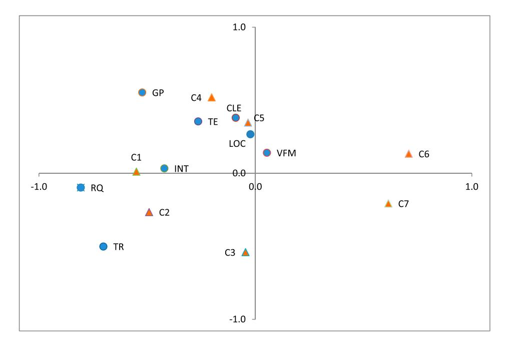
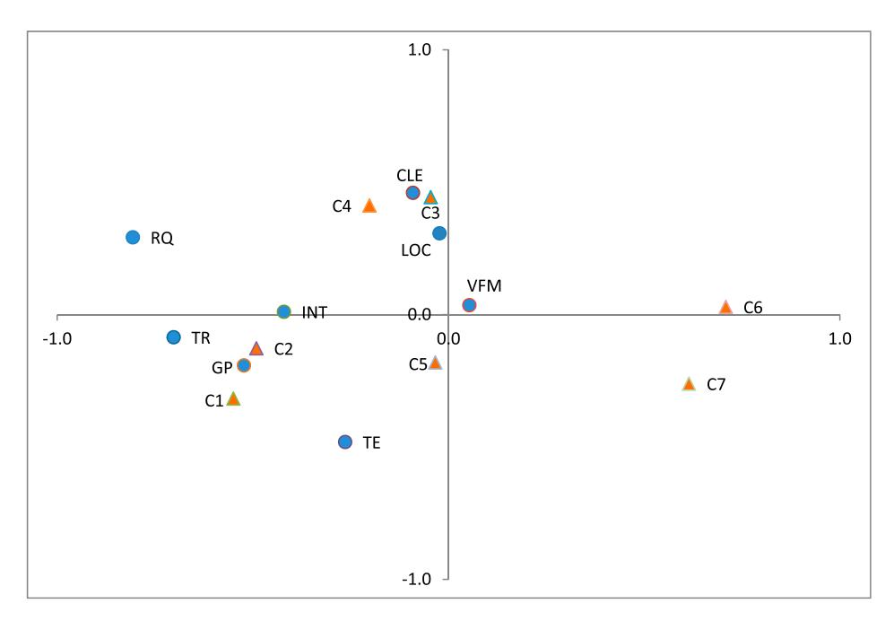

<!-- A1.R23 | source: papers_json/A1.R23/ -->

## **Journal of Marketing for Higher Education**

**ISSN: (Print) (Online) Journal homepage:****[ www.tandfonline.com/journals/wmhe20](https://www.tandfonline.com/journals/wmhe20?src=pdf)**

## **Positioning strategies and rankings in the HE:** **congruence and contradictions**

## **Önder Kethüda**

**To cite this article:** Önder Kethüda (2023) Positioning strategies and rankings in the HE: congruence and contradictions, Journal of Marketing for Higher Education, 33:1, 97-123, DOI: [10.1080/08841241.2021.1892899](https://www.tandfonline.com/action/showCitFormats?doi=10.1080/08841241.2021.1892899)

**To link to this article: **[https://doi.org/10.1080/08841241.2021.1892899](https://doi.org/10.1080/08841241.2021.1892899)

| Image: Calendar icon Published online: 25 Feb 2021. |
| --- |
| Image: Pencil icon Submit your article to this journal Image: External link icon |
| Image: Bar chart icon Article views: 891 |
| Image: Magnifying glass on document icon View related articles Image: External link icon |
| Image: CrossMark logo View Crossmark data Image: External link icon |
| Image: Two documents icon Citing articles: 6 View citing articles Image: External link icon |

<!-- page 2 -->

## RESEARCH ARTICLE

## Positioning strategies and rankings in the HE: congruence and contradictions

Önder Kethüda 🗅

Akcakoca Vocational School, Department of Tourism and Hotel Management, Düzce University, Düzce, Turkey

## ABSTRACT

Positioning strategy and ranking are critical issues in an increasingly competitive higher education landscape. Unless there is conceptual congruence between positioning strategies and rankings, the signals may become diffused and confusing for prospective students. This paper seeks the congruence between positioning strategies and ranking. Since without a validated typology of positioning strategies, such congruence cannot be sought, this paper firstly aims to develop an empirically derived typology of positioning strategies for HEIs. The population consists of HEIs in the UK. Content analysis was used to analyze the WebPages of HEIs to identify positioning bases, and congruence and contradictions between those positionina bases and ranking were identified correspondence analysis. As a result, a new positioning typology consisting of eight bases, which are top of the range, campus life experience, internationalization, teaching excellence, research quality, graduates prospects, location, and value for money, was identified. In conclusion, HEIs are categorized into three different groups as Leaders and Challengers, Followers, and Nichers and Cost Leaders, and recommendations about how to guarantee congruence between positioning strategy and ranking were made. HEIs should choose positioning bases in line with their rankings since congruence strengthens the position in the minds.

## ARTICLE HISTORY Received 13 July 2020 Accepted 8 January 2021

**KEYWORDS **Brand positioning; positioning strategy; university branding; ranking; Signaling theory; information asymmetry

## Introduction

The characteristics of the service provided by HEIs are not easy to observe (Ng & Forbes, 2009) and it is hard for individuals wishing to study at an HEI to compare the service with competing ones (Blankson, 2004). Therefore, there is information asymmetry between HEIs and individuals wishing to study at them. The prospective students and other individuals involved in decision-making use available information as signals to interpret the service characteristics according to signaling theory (Connelly et al., 2011; Erdem & Swait, 1998). Individuals involved in decision making receive two types of information about service characteristics. One is internal, and it refers to information transmitted by a specific HEI. The other is external, and it takes the form of independent information

<!-- page 3 -->

provided by third parties that are independent of the institutions, such as ranking reports. Both internal and external information are signals for prospective students and other individuals involved in decision-making to comprehend the unobservable characteristics of the higher education service (Kirmani & Rao, [2000)](#page-26-0). Therefore, internal and external signals should be designed to establish a competitive position.

Branding activities and precisely positioning are the primary type of internal information (Bunzel, [2007;](#page-24-1) Chapleo, [2005;](#page-25-2) Clark et al., [2019;](#page-25-3) Endo et al., [2019;](#page-25-4) Heslop & Nadeau, [2010](#page-26-1); Opoku et al., [2008](#page-27-1)). Brand positioning ensures that all marketing communication components for an offering support to each other to achieve a unique position (Aaker & Shansby, [1982](#page-24-2); Saqib, [2020)](#page-27-2). Therefore, brand positioning is widely accepted as the core element of branding and marketing activities by both academics (Aaker & Shansby, [1982;](#page-24-2) Hooley et al., [1998)](#page-26-2) and practitioners (Ries & Trout, [1981](#page-27-3)). Evidence indicates that positioning is among the most critical factors for the success of branding and marketing activities. Positioning influences consumer perception, company image, market share, return on investment, and profits (Blankson & Crawford, [2012](#page-24-3); Blankson et al., [2008](#page-24-4)), and it provides firms with a sustainable competitive advantage (Easingwood & Mahajan, [1989)](#page-25-5).

On the other hand, ranking reports by third parties are one of the most critical external information types since they have a significant influence on both managerialism of HEIs (Hazelkorn, [2007](#page-25-6)) and the brand equity of HEIs (Kalafatis et al., [2016)](#page-26-3). Furthermore, although their validity and objectivity are questioned (Lynch, [2015](#page-26-4); Stolz, Hendel, & Horn, [2010)](#page-27-4), ranking reports have a significant impact on prospective students' preferences via enabling comparisons between alternatives. The ranking of HEIs is one of the most valid measures, and it enhances both brand value and reputation of HEIs (Bunzel, [2007;](#page-24-1) Kalafatis et al., [2016)](#page-26-3).

Congruence between signals from both positioning strategy and ranking is essential in harnessing support for harmony with the target student's need. Therefore, one of the focal concerns in the management of HEIs should be the alignment of brand positioning through marketing communications with ranking reports since the brand positioning deliberations that are coherent with the ranking reports have a potential to build strong brands (Blankson, [2004;](#page-24-0) Blankson et al., [2014](#page-24-5); Blankson & Kalafatis, [2007a](#page-24-6)). Unless there is conceptual congruence between positioning strategies and rankings, the signals become diffused and confusing for prospective students.

A review of the literature reveals a paucity of research that assesses the link between positioning strategies and ranking. Although there are papers which have sought congruence between internal signals of positioning strategies in the financial services domain (Blankson, [2004;](#page-24-0) Blankson et al., [2014;](#page-24-5) Blankson & Kalafatis, [2007a)](#page-24-6), papers focusing on congruence between internal and external signals in the lens of brand positioning were not found in the literature. Furthermore, researchers have paid little attention to developing a typology of positioning strategies for HEIs empirically. Çatı et al. ([2016](#page-25-7)) empirically derived a typology of brand positioning strategies through the promotional videos of universities in Istanbul for HEIs. However, the results of the study might not be generalized since the higher education system in Turkey has not adequately succeeded in marketization, which requires liberalization and being demand-driven (Jongbloed, [2003)](#page-26-5).

<!-- page 4 -->

In this context, this study aims to determine whether there is evidence of congruence between positioning strategies and rankings using signals as a logical link. Since without a validated typology of positioning strategies, such congruence cannot be sought, this paper, firstly, aims to develop an empirically derived typology of positioning strategies for HEIs. In the next sections, we explore contemporary literature covering brand positioning and then rationale the necessity of developing an empirically-derived typology of positioning strategies in a marketized higher education system. Then, in the methodology section, how and why some particular HEIs are chosen for the population and the sample, along with the data collection and analyzations processes, were clarified. In the results section, a new typology of positioning strategies for HEIs was identified by content analysis. Then congruencies between those positioning bases and the ranking were sought by correspondence analysis. Finally, discussion, conclusion, suggestions, limitations, and directions for further research are argued.

## Brand positioning

Positioning, which is the core element of branding and marketing activities, has attracted marketers' attention for almost four decades. There have been different understandings of brand positioning in this period. Ries and Trout [(1981](#page-27-3)), who are among the earliest marketers who paid attention to positioning, argued that positioning is not something done to the product, but it is done to the prospect's minds. Ries and Trout [(1981)](#page-27-3) highlighted that positioning had more to do with marketing communication and advertising than other marketing mix elements. On the other hand, Attia and Hooley ([2007](#page-24-7)) highlighted the role of the marketing mix in the process of differentiating customers' perceptions about an offering among its rivals. Kotler and Keller ([2012](#page-26-6)) extended the scope of positioning by referring to it as the process of designing an offering. Finally, modern literature has a consensus that brand positioning includes not only marketing communication or advertising but also other marketing mix elements (Armstrong & Kotler, [2012](#page-24-8); Arnott, [1993;](#page-24-9) DeSarbo et al., [2011](#page-25-8); Fill, [2009](#page-25-9); Hooley et al., [1998](#page-26-2); Palmer, [2012](#page-27-5); Trout & Rivkin, [1996)](#page-27-6). In line with this notion, positioning can be defined as a deliberate, proactive, iterative process by which marketers attempt to create a distinct position in the minds of customers by defining, measuring, modifying, and monitoring consumer perceptions for an offering (Arnott, [1992;](#page-24-10) Fill, [2009](#page-25-9)).

Positioning enables an offering to take possession of a strong purchasing rationale and gives prospective customers a real reason to be perceived as unique among its rivals (Boatswain, [2015;](#page-24-11) Kapferer, [2008)](#page-26-7). In other words, brand positioning aims to differentiate an offering from its rivals by attributes that are favorable to customers. The offering to be positioned might be a product, a brand, or even an organization as well (DeSarbo et al., [2011;](#page-25-8) Fill, [2009;](#page-25-9) Kalafatis et al., [2000)](#page-26-8). However, when it is an organization, brand positioning might be confused with strategic positioning (Dimingo, [1988](#page-25-10)). The difference between brand positioning and strategic positioning comes from the depth of the issues with which they deal. Brand positioning is the essence of branding and marketing activities, and it deals with marketing mix elements (Fuchs & Diamantopoulos, [2010](#page-25-11)) whereas, strategic positioning is the essence of business strategy, and it refers to the competitive market position of a firm against its rivals (Porter, [1996)](#page-27-7). The distinction between those two concepts is vital since

<!-- page 5 -->

this research focuses on developing a typology of positioning strategies for HEIs, which are organizations.

Although brand positioning targets to occupy a distinctive position in customers' minds, the positioning process is initiated by a company's management. To get a good understanding of the nature of positioning itself, distinctions between this process's steps need to be drawn (Fuchs & Diamantopoulos, [2010)](#page-25-11). The first step is to decide on the attribute on which an offering will be positioned by the management of a company. This is called intended positioning. In other words, the intended positioning is how a company wants the brand to be perceived by prospective customers. The second one is actual positioning, and it refers to how a company's offering is reflected and presented to customers through marketing communication practices. Actual positioning stands for the whole of the messages given through integrated marketing mix elements (Blankson & Kalafatis, [2007a)](#page-24-6). The third one is related to a complex set of perceptions, thoughts, beliefs, and impressions that consumers hold for the brand after decoding and interpreting the messages from marketing mix elements. It is called perceptual positioning (Blankson et al., [2014](#page-24-5)).

The congruence between intended, actual, and perceptual positioning influences the positioning strategy's success (Eryigit & Eryigit, [2014;](#page-25-12) Fuchs & Diamantopoulos, [2010](#page-25-11)). In other words, the congruence between the internal signals from advertising and other marketing communication practices increases the likelihood of achieving a targeted position in the mind of customers (Blankson et al., [2014;](#page-24-5) Blankson & Kalafatis, [2007a)](#page-24-6). Therefore, congruence between internal signals like positioning strategy and external signals such as ranking helps create strong HE brands.

## Brand positioning bases

Positioning strategy is a plan and its implication, including identifying an intended position and converting it into an actual and a perceptual position through the marketing mix for an offering. The positioning strategy includes decisions regarding the type of bases used to position an offering and the ways and means to create associations between the offering and that base in targeted customers' minds (Blankson & Kalafatis, [2004)](#page-24-12). Selecting a base as an intended positioning is a critical decision in the positioning process. Because of the importance of choosing an appropriate base in the positioning process, researchers have paid significant attention to identifying and classifying positioning bases. A positioning base consists of a set of attributes similar to each other (Fuchs, [2008)](#page-25-13).

Literature in positioning typology indicates different bases presented in [Table 1.](#page-5-0) Those positioning typologies can be categorized according to their perspectives (managerial or customer), study design (conceptual or empirical), and sectors they have derived. The conceptual positioning typologies may not suit a particular sector and may not represent all favorable attributes to prospective customers. On the other hand, the empiricallyderived positioning typologies reflect the sector's characteristics in that they were derived. Some of the empirically-derived positioning typologies aimed to be generic by collecting data in various sectors (Blankson & Kalafatis, [2004;](#page-24-12) Crawford, [1985](#page-25-14)). On the other hand, some others aimed to derive a new typology in a particular sector like the automobiles (Diwan & Bodla, [2011](#page-25-15)), financial services (Arnott, [1992](#page-24-10); Easingwood &

<!-- page 6 -->

<!-- page 7 -->

MP: Managerial Perspective; CP: Customer Perspective Con.: Conceptual Emp.: Empirical.

Mahajan, [1989;](#page-25-5) Romaniuk, [2001)](#page-27-8), commodity products (Kalafatis et al., [2000](#page-26-8)), durable consumer goods (Kalra & Goodstein, [1998](#page-26-9)), and industrial manufacturing firms (Morgan et al., [2003)](#page-27-10). As shown in [Table 1,](#page-5-0) typologies, either generic or particular in a sector, are quite different from each other. Those differences can be explained by the different thoughts of positioning and sectoral characteristics.

There are typologies identified in service sectors, particularly in the financial service sector (Arnott, [1992](#page-24-10); Easingwood & Mahajan, [1989;](#page-25-5) Romaniuk, [2001](#page-27-8)). Although financial services are similar to higher education service in terms of general service characteristics, directing students' minds, students' active participation in the education process for a significant time are factors differentiating higher education service from financial services (Lovelock, [1983](#page-26-11)). Besides, risk perception and attributes that make the service offering favorable might differ in those two sectors. For example, attributes related to an institution's campus environment and its city can make an institution more favorable (Arambewela et al., [2006](#page-24-14); Kethüda, [2017)](#page-26-12). Although those attributes influence the higher education service's favorability, no positioning typology covering such attributes was found in the literature.

On the other hand, since this paper seeks congruence between positioning strategies and ranking, the typology used in this paper should represent all attributes that make HEIs favorable. These arguments necessitate identifying a new typology of positioning bases, reflecting characteristics of higher education service. Thereby, this paper first derives a new typology of positioning strategies, particularly in the HE sector, based on this research's preceding discussion. It then examines the congruencies of positioning bases with ranking.

## Brand communication and ranking as signals and their congruency

HEIs communicate their brand promises to prospective students by covering the same elements of the traditional marketing mix such as people, promotion, and price and those specific to HE such as program, prominence, prospectus, and premiums (Ivy, [2008](#page-26-13)). HEIs traditionally send recruiters and direct mails to schools, advertise on the press, organize open days on campus, and occur on career fairs (Ivy, [2001](#page-26-14)). Besides, HEIs use prospectuses and newer channels such as websites (Opoku et al., [2008](#page-27-1)) and social media (Peruta & Shields, [2018](#page-27-11)). The brand promises of HEIs, i.e. attributes related to positioning bases, are communicated to prospective students through all marketing media.

Prospective students and individuals involved in the process likely make their preferences by assessing the perceived service quality of HEIs. However, higher education

<!-- page 8 -->

service characteristics are not easy to judge before purchasing and experiencing (Wilkins et al., [2018)](#page-27-12). Signaling theory helps explain how HEIs can shape prospective students' understanding of service characteristics when they are uncertain about service characteristics. Signaling theory provides theoretical insights into how signals from brand communication and other resources influence customer perceptions (Baek & King, [2011](#page-24-15)). HEIs know much more about their services than their prospective students. This differential level of information between HEIs (seller) and prospective students (buyer) creates the problem of 'information asymmetry' (Erdem & Swait, [1998](#page-25-1)). Information asymmetry implies consumer uncertainty about the quality of higher education services provided by HEIs. One possible solution is the use of signals (Baek & King, [2011)](#page-24-15). A signal is defined by Rao et al. [(1999)](#page-27-13) as 'an action that the seller can take to convey information credibly about unobservable product quality to the buyer.' Brand communication (Rutter et al., [2017)](#page-27-14), reputation (Wilkins et al., [2018](#page-27-12)), brand image (Ivy, [2008](#page-26-13)), tuition fees – price (Kethüda, [2020)](#page-26-15), the brand name and advertising expenditures (Rao et al., [1999)](#page-27-13) are signals that particularly useful in higher education characterized by asymmetric information.

This paper focuses on brand communication through particular pages of either Web-Pages or prospectuses on HEIs. Since HEIs control both prospectuses and WebPages, signals on those pages are based on internal information resources. Therefore, the credibility of those internal signals may be questionable for prospective students. The credibility implies that an HEI has the expertise and ability to continually deliver what it promises and be trusted to do so (Erdem & Swait, [2004)](#page-25-16). On the other hand, signals from third parties, i.e. independent of the institutions, might be perceived by prospective students as more credible than internal signals. Third parties' ranking reports are one of the most critical signals for prospective students since enabling comparisons between alternatives in terms of some particular attributes.

Consequently, both internal and external signals enable prospective students to comprehend the unobservable characteristics of the higher education service (Kirmani & Rao, [2000)](#page-26-0). Congruence between internal and external signals increases the signals' credibility, whereas contradictions confuse prospective students. Brand positioning deliberations that are coherent with the ranking reports can build strong brands (Blankson, [2004](#page-24-0); Blankson et al., [2014](#page-24-5); Blankson & Kalafatis, [2007a](#page-24-6)). Therefore, one of the focal concerns in the management of HEIs should be the alignment of brand positioning through marketing communications with ranking reports. This paper seeks to unveil congruence between positioning strategies of HEIs and their rankings, in line with this notion.

## Methodology

## Population and sampling

The population of the research consists of HEIs in the UK. This population was chosen because the UK is one of the countries that have succeeded in commercialization and marketization the most in higher education (Quinlan, [2014)](#page-27-15). Official statistics listed 163 Universities at the time of the research (HESA, [2018](#page-26-16)). Besides, some universities in the UK are small or specialist teaching a limited range of subjects. Guardian University League Table 2018[1](#page-23-0) excludes those small or specialist universities. Furthermore, the

<!-- page 9 -->

league table aims specifically at students trying to choose a university. It does not directly include universities' research scores because of the limited relevance of research scores to students (Friedberg, 2019). Therefore, universities in this widely accepted league table were identified as the population of the research. There were 121 universities in the league table in the year the research was conducted.

The Guardian League Table ranks universities in the UK in terms of eight variables, which are career after six months, value-added score/10, average entry tariff, spend per student/10, student to staff ratio, satisfaction with feedback, satisfaction with course, and satisfaction with teaching. Those variables stand for how much students will benefit from the teaching, whether other students liked the university and the subject, and what their chances are of getting a good job after graduation. Universities are given composite scores benchmarking the first university that has given guardian score/100 and listed based on that score. Consequently, the league table aims to give information about the service's characteristics specifically to students trying to choose a university. Therefore, it is an appropriate external signal to seek a link with positioning strategies since both of them target students.

The sampling was employed since including all of the HEIs in the research population is not feasible. In the sampling process, firstly, HEIs in the population were classified by the cluster analysis to be able to increase the power of the sample to represent the population, similar to Kalafatis et al. (2016). The eight variables and the final scores of HEIs in the League Table were used in cluster analysis to grantee homogeneity into the clusters and heterogeneity across the clusters. Duda/Hart method has been used as a stopping rule. In Duda/Hart method, the balance between large value Je(2)/Je(1) and small values pseudo-T-squared are sought. Results indicated that (Je(2)/Je(1): 0.75 and pseudo-T-squared: 12.29) have indicated that the seven cluster solution is acceptable. Although the number of clusters is the same as the results of the analysis conducted by Kalafatis et al. (2016) via the data belonging to 2015, their compositions are different. Table 3 shows the number of HEIs in each cluster.

One Way ANOVA was conducted, and the results of multiple comparisons were evaluated to understand how well those seven clusters (grouping variable) separated from each other in terms of the variables in the League Table (dependent variables). Table 2 presents a summary of the multiple comparisons between paired clusters in terms of dependent variables. Results indicate that there are significant differences between

<!-- page 10 -->

<!-- page 11 -->

most of the paired cluster in terms of Average Entry Tariff, Guardian Score, and Career after 6 Months; whereas there are significant differences between less than half of the paired clusters in terms of Spend per Student, Satisfaction with Course, Satisfaction with Teaching, Student to Staff Ratio. Furthermore, variables that differ the clusters the least are Satisfaction with Feedback and Value Added Score. Results of variance analysis confirm significant differences between all clusters in terms of at least one of the nine variables used in cluster analysis. This result indicates that HEIs within a cluster have similar attribute profiles and that seven cluster solution is appropriate for the aim of this paper, although prominent similarities between cluster 1 and cluster 2, between cluster 2, cluster 3 and cluster 4, between cluster 3, cluster 4 and cluster 5.

In the sampling process, firstly, the sampling method and number of HEIs to be included in the sample from each cluster were determined. The purposive sampling method was used while choosing HEIs in the process. HEIs, which were thought to represent each cluster the best, were included in the sample. No sampling was applied in cluster 1 since only three universities in it. Six HEIs from each cluster included in the sample except clusters 1 and 6. The sample consisted of 41 HEIs. [Table 3](#page-8-0) shows the names of universities that were involved in the sample from each cluster.

## Documents to analyze

Positioning strategies of HEIs need to be identified to evaluate the congruence between positioning strategy -internal signal- and raking -external signal. Positioning strategies are determined from publications such as advertisements and promotions placed in TV, newspapers, brochures, pamphlets and leaflets, and outdoor posters (Blankson & Kalafatis, [2007b](#page-24-16); Crawford, [1985;](#page-25-14) Çatı et al., [2016;](#page-25-7) Diwan & Bodla, [2011;](#page-25-15) Kalafatis et al., [2014)](#page-26-17). The same approach is applied in this research to develop a typology of positioning strategies.

The pages named 'why to choose us' either on prospectuses or website of selected HEIs were determined as the source to develop a typology of positioning strategies for HEIs. These particular pages of HEIs include favorable and differentiating attributes to convince prospective students to choose them over alternatives. These pages aim to highlight favorable attributes of a university that make it stand out among alternatives in prospective students' eyes. Consequently, pages on both WebPages and prospectuses named 'why to choose us' were determined to be analyzed to derive a typology of positioning strategies for HEIs. Besides, pages named 'why study at X university,' 'reasons to study at X university,' 'choose X,' 'studying at X,' or 'Why X' were accepted equivalent to the pages named 'why to choose us.'

## Data analyses and coding procedure

Four different analyses have been used for data analysis. Firstly, cluster analysis was used to classify HEIs in the population. Then, to understand whether there are significant differences between clusters in terms of dependent each variable used in cluster analysis, One Way ANOVA was conducted, and the results of multiple comparisons were evaluated. Although cluster analysis and One Way ANOVA were conducted in the sampling process, the results of these analyses were evaluated together with the results of correspondence analysis in the results section. Since cluster analysis and One Way ANOVA

<!-- page 12 -->

were elaborated in the sampling process, this section focuses on content analysis and correspondence analysis processes. Content analysis was used to identify a new typology of positioning strategies from the raw data on the pages named 'why to choose us,' and correspondence analysis was used to understand the congruence between positioning strategies and ranking.

Content analysis is widely used in researches on positioning typologies (Blankson & Kalafatis, [2007b](#page-24-16); Crawford, [1985](#page-25-14); Çatı et al., [2016](#page-25-7); Easingwood & Mahajan, [1989;](#page-25-5) Van Rooij & Lemp, [2010](#page-27-16)), branding (Klassen, [2001)](#page-26-18) and studies of higher education marketing (Van Rooij & Lemp, [2010](#page-27-16)). Content analysis is a method for identifying and analyzing patterns (themes) within data to summarize and interpret. Therefore, content analysis has been used to identify attributes and positioning bases. In the process, firstly, texts were read, and some notes were made to get familiarized with the data, and then the coding scheme, including a detailed description and examples of each code, was generated. A pilot coding of a page of a university was done, possible problems were discussed. Coding was undertaken by two researchers independently. Then, the researchers presented the results of their coding to each other, and differences were eliminated after having a consensus to ensure the inter-coder reliability (Schilling, [2006](#page-27-17); Vaismoradi et al., [2013)](#page-27-18). The inductive approach was applied in the process of coding and generating sub-themes and themes. Both semantic and latent meanings were coded in the process. For example, in cases such as universities' giving much information about industry connections implies job opportunities, but it does not directly say it or in cases such as small teaching classes implies teaching quality indirectly.

The congruencies between positioning strategies and clusters of HEIs were identified by correspondence analysis. Correspondence analysis was widely used in studies related to positioning and marketing to uncover and interpret the relationship between multivariate categorical data by generating a graphical representation of the structure in the data (Arambewela et al., [2006;](#page-24-14) Eryigit & Eryigit, [2014;](#page-25-12) Gursoy et al., [2005](#page-25-18); Hoffmann & Franke, [1986](#page-26-19); Ivy, [2001](#page-26-14); Opoku et al., [2008)](#page-27-1). In correspondence analysis, frequencies obtained from the results of the content analysis were used. These frequencies stand for only mentioned attributes, and they represent the positive pole. However, each positioning base should be represented by its two polar points. Therefore, frequencies of nonmentioned attributes of HEIs, i.e. values for opposite poles, were calculated by subtracting numbers of mentioned-attributes from the total number of different attributes for each positioning base. This process is named 'doubling,' and it creates the symmetry between the two poles of each binary variable. The doubled data were used in the analysis instead of the original data. Euclidean distance was performed to measure distances between the profiles because that contingency table violates the assumptions of the Chi-square. The symmetrical normalization method is deployed since similarities and differences between column and rows are equally important (Greenacre, [2007)](#page-25-19).

## Results

## Identifying themes as positioning bases

The codes generated throughout the open coding process were categorized into eight themes, i.e. positioning bases. These positioning bases are Top of the Range, Campus

<!-- page 13 -->

Life Experience, Internationalization, Teaching Excellence, Research Quality, Graduates Prospects, Location, and Value for Money.

## Top of the range

Top of the Range (TR) was generated based on the phrases expressing that a university was one of the UK's top universities and the world. Top of the Range stands for codes related to satisfactory academic ranking, contributions to society, great history, good reputation, and recruiting the best students in a region, country, or the world. Some of the universities specifically mentioned their ranking order in the UK and/or globally, while some others stated the percentages they are in the ranking. Some other universities started their rising speed on the ranking lists or being one of the top universities in specific subjects to express that they are leading HEIs. To indicate that they are one of the top universities, some indicate their contribution to the global economy, solve global challenges, or how good they are at commercializing research and creating spin-out companies. Reputation is also commonly used by universities to show that they are among the leading universities in the country and/or the world. Some universities highlight how long and the successful history they had and the important events they witnessed to show their rooted history. Some examples of the phrases which Top of the Range stands for are as following:

'Consistently placed in the global top 20 in a wide range of world rankings … '

' … in the top 1% of universities worldwide.'

'One of the world's very best universities.'

'Our work has a wider impact on society, generating £7.1 billion for the global economy every year, and supporting more than 50,000 jobs across the UK.'

'One of the top universities in the UK with a rising global reputation.'

'For more than 400 years this university has been changing the world.'

## Campus life experience

Campus Life Experience (CLE) refers to how well the students' environment is on the campus. Campus Life Experience consists of codes related to campus attractiveness, leisure, social, cultural, and entertaining activities held on the campus, and accommodation facilities provided to students. Campus attractiveness stands for different codes associated with campus characteristics (how beautiful, green, historical, modern, etc.), facilities on the campus, the campus's beauty, and the campus's safety and security. The social, cultural, sport, entertaining, artistic, and leisure activities held on the campus enable students to have a good university experience. Besides, the numbers of clubs or unions and the advantages of being close to a city center are other things that enrich the experience students have at a university. Most universities mention their number of student clubs/unions/societies and social environment on the campus. Accommodation facilities provided to students are also evaluated as essential parameters of student life experience on campus. Some universities offer guaranteed accommodation all in their first year while others mention their modern accommodation facilities or how

<!-- page 14 -->

much they invested in accommodation facilities. Some examples of the phrases which Campus Life Experience stands for are as following:

'Historic buildings are juxtaposed against the modern facilities.'

'Award-winning green spaces and innovative architecture … '

'Our campus is in the top ten most beautiful campuses in Britain.'

'We have shops, restaurants, a bar, gym, bank and accommodation all on site.'

'350+ student-led clubs, societies, and projects - one of the largest ranges at any UK universities … '

'We guarantee all first-year students a place in accommodation that's owned, managed or directed by the university.'

## Internationalization

Internationalization (INT) stands for the international environment on the campus and opportunities provided to students for studying, working, researching, interning, and volunteering abroad. The international environment consists of codes related to the number or percentage of international students, the number of different origins of students, the cosmopolitan student community, and the number or percentage of foreign academics. Opportunities for studying, working, researching, interning, and volunteering abroad enrich students' international experience. The collaboration with universities in other countries, the number of international links and partners, student exchange programs, study abroad programs, work abroad programs, overseas work placement, and inter-campus exchange programs for universities with campuses in other countries enables students to have an excellent international experience. Some examples of the phrases which Internationalization stands for are as following:

'Around 41% of our students come from over 145 countries worldwide, and the university has a friendly and cosmopolitan atmosphere.'

' … academic staff from over 50 countries.'

'We have over 400 links with 233 partners in 54 countries around the world … '

'Our students can choose to spend time at a range of partner institutions worldwide, including in Europe, North and South America, Australia, Singapore and Hong Kong.'

'We have 5 campuses and 150 learning partners around the world. You can take advantage of opportunities to transfer your study to campuses … '

## Teaching excellence

Teaching Excellence (TE) refers to how good a university is at teaching. Teaching Excellence consists of codes related to teaching quality, academic support, curriculum flexibility, and interactive learning environment. Teaching quality stands for modern academic resources, modern teaching facilities, small teaching groups, well-structured courses, accredited courses, and qualified lecturers. Besides, teaching quality also stands for how well a

<!-- page 15 -->

university is known for its teaching, ranking a university on teaching quality and rewards for a university granted for its teaching quality. Universities widely highlighted academic support to indicate their teaching excellence. Academic support stands for the quality of academic support, accessibility and friendliness of lecturers, and lecturers' feedback. Some universities highlighted their interactive learning environment provided to students to indicate how good they are at teaching. Interactive learning environment stands for codes related to students' participation in the learning process by practicing or doing research. Enabling students to have flexibility in their curriculum is another way to enhance teaching excellence. Curriculum flexibility stands for the range of the alternatives provided to students regarding degree choice and flexible degree structure. Some examples of the phrases which Teaching Excellence stands for are as following:

'No. 1 for well-structured courses, tuition in small groups, and helpful/interested staff … '

' … education delivered by world-leading experts in outstanding study facilities.'

'The academic skills program provides a study skills support service that enhances the academic skills development of all undergraduates.'

' … achieve your career goals by putting your academic knowledge into practice.'

'From delaying your final degree choice until the end of the first year to tailoring your degree to suit your interest.'

' … education delivered by world-leading experts in outstanding study facilities.'

'Many of our courses are accredited by a wide range of professional bodies in the UK.'

## Research quality

Research Quality (RQ) refers to how much and qualified researches have been conducted at a university. Research Quality consists of codes related to research, percentage of internationally recognized research, research income, ranking for research, reputation for research, research collaborations, quality of academics, and research-led education. Some universities state their ranking and reputation in the research, while others highlight that they are a research-led university and/or a member of 'Russell Group' universities. The phrases 'World-leading research,' 'World-class research,' 'Best research,' 'Cutting-edge research,' 'Research solving global challenges' were commonly used by universities to highlight their research quality. Universities used the names of Nobel laureates with which they have a connection to emphasize the quality of researchers they have. Some universities highlight the importance of learning from academics dealing with significant research. Some universities also indicate their research-led education by stating opportunities that they provided undergraduates to join a research project. Some examples of the phrases which Research Quality stands for are as following:

'This university is one of the world's top research universities, ranked fifth in the UK for research power.'

'The University is a world-class, research-led university, committed to research excellence.'

'More than 50 Nobel Laureates have been linked to this university.'

<!-- page 16 -->

'Education in this university offers you the chance to engage with academics at the forefront of cutting-edge research and to contribute to solving some of our global challenges.'

'You may also have the chance to work alongside them through our Undergraduate Research Opportunities Programme.'

## Graduates prospects

Graduates Prospects (GP) stands for the likelihood of students' employability and/or of being an entrepreneur of students after graduation. Graduates Prospects enables HEIs to differentiate themselves by increasing the likelihood of students' employability or starting their own business after graduation. Graduates Prospects stands for codes related to career support services, skill development programs, work placements, industry connections, the average starting salary after graduation, the employment rate after graduation, graduates' reputation, the ranking for employment, alumni network, and supporting student entrepreneur. Career service by universities aims to help to improve the careers of both students and graduates. Universities also aim to increase their students' employability by skill development programs that organize work placements, internships, training replacements, micro internships, and volunteering activities. Industry connections of universities play a crucial role in skill development activities and enable students to get in touch with the job market. Therefore universities highlight their industry connections, i.e. how close relations they have with the job market, in the name of indicating higher employability after graduation. Universities widely mention average starting salary and employment rate after graduations and gaining reward for employability to indicate how likely students will get a good job after graduation. Some universities state how much their graduates valued, targeted, or sought graduates by employers to indicate the likelihood of getting a job after graduation. Besides, some states support students in starting their own business as entrepreneurs. In contrast, others highlighted their alumni networks, and activities were done to bring together students and graduates, and relations between university and graduates. Some examples of the phrases which Graduates Prospects stands for are as following:

'Our Careers and Enterprise Centre is part of the largest careers service in Europe.'

'Over the past five years, more than 2,300 partner organisations have worked with us to give our students valuable work placements in the UK and abroad.'

'91% of our students are in work/study six months after graduating.'

'Many graduates secure well-paid employment. - £27,000 is the average annual starting salary of our recent graduates.'

'Making a degree at this university is highly valued by employers across the globe.'

'£45,000 given in funding to students 2016/17 to start new or grow existing businesses … '

'Our alumni are spread worldwide with 204 alumni groups in 90 different countries.'

## Location

Location (LOC) refers to creating an association between the university and the attractiveness or advantages of the location. The location stands for the codes related to being at or

<!-- page 17 -->

being close to a major city, natural attractiveness that is close to the campus, having a central location in a city, and some favorable characteristics of small cities. Universities commonly use adjectives like excellent, beautiful, lively, thriving, exciting, stimulating, fantastic, vibrant, inspiring, forward-thinking, cosmopolitan, and modern to describe the city that they are in. Some universities mention their being at or being close to a major city with the phrases mentioned above, while others indicate how big the city is. Universities also use some natural attractiveness like the beach, natural parks, green places, etc., to highlight the favorability of the place they are in. Being at a city center is another attribute that universities use to differentiate themselves by highlighting city life benefits. Some universities in small cities highlighted some advantages of their cities like life quality, safety, young population, student number, etc. Some examples of the phrases which location stands for are as following:

'Our students get to experience life in one of the most vibrant, diverse and exhilarating cities in the world.'

'Located in London, the UK's best University City!'

'We're right at the heart of the UK's best city to live in.'

'The city is the youngest one in Europe, with under-25s accounting for nearly 40% of its population.'

'With over 8,000 acres of parks and open space, it is one of the greenest cities in the UK.'

'Our city has won five Purple Flag Awards for safe and exciting nightlife.'

'The city has regularly been voted as one of the most desirable places to live in the world.'

## Value for money

Value for Money (VFM) targets price-sensitive students, and it stands for providing low costs for students while providing some opportunities to work part-time. Value for Money stands for codes related to competitive fees, fixed and flexible payment, parttime employments provided by a university, low living cost, and return on investment. Competitive fee refers to relatively lower tuition fees from other universities, whereas fixed and flexible payment refers to not changing the tuition fees in the education duration and providing flexible payment plans for students. Some universities provide part-time employment to their students to help their budget while studying, whereas some others hired their students as a paid worker in the framework of work placement for a year. A university highlights salary differences between people who graduated from a university and others to convince students that the value they paid for is worth it. Some examples of the phrases which Value for Money stands for are as following:

'The University offers competitive fees as well as payment options and discounts.'

'The tuition fees are guaranteed to not increase for the entire duration of your course … '

'The city offers a relatively low cost of living, giving you more for your money.'

'Located in the 2nd most affordable student city in the UK.'

<!-- page 18 -->

'All relevant work opportunities on campus are offered to our students first, part of our aim to recycle as much of your fees back to you as possible.'

'Consider this: on average, a graduate earns £500,000 more during their working life than someone who hasn't been to university.'

## The Congruencies between positioning strategies and ranking

The congruencies between positioning strategies and ranking were identified by associations created by correspondence analysis. Correspondence analysis is susceptible to the sample size. Therefore, dividing binary datasets generated through content analysis into 41 HEIs is not reasonable for correspondence analysis. Besides, clusters generated by cluster analysis are in the ranking order. In other words, those clusters from one to seven represent the ranking order. Since the number of a binary dataset for each cluster includes all binary data of the HEIs in that cluster, it will be more appropriate for correspondence analysis. Therefore, clusters of HEIs were used as representatives of ranking instead of using 41 HEIs separately in correspondence analysis.

Results indicate that a three-dimensional solution explains 0.95 percent of the total inertia (percentages of the total inertia of dimensions, respectively, are 0.63, 0.21, and 0.10). Although a two-dimensional solution is acceptable since 0.70 is a threshold value for acceptable reliability, a three-dimensional solution is adopted because omitting dimensions means losing information (Hair et al., [2014](#page-25-20); Janssens et al., [2008](#page-26-20)). Low correlations between the dimensions (−0.03, 0.02, and 0.20) indicate that dimensions are independent. Results are shown in [Table 4](#page-18-0) also indicates that except Internationalization and Location, all positioning bases and clusters have adequate contributions of point of inertia of dimensions - greater than the masses (Greenacre, [2007)](#page-25-19). This result indicates that Internationalization and Location do not play a significant role in any of these three dimensions.

[Figures 1](#page-18-1) and [2](#page-19-0) represent correspondence analysis maps that uncover the associations between positioning bases and ranking clusters. The graphical outputs unveil information about how the positioning bases and the clusters of HEIs are positioned between and against each other (Opoku et al., [2008)](#page-27-1). The first dimension is contributed the most by positioning bases of Research Quality, Top of the Range, Graduate Prospects, and clusters of universities named C1, C2, C6, and C7. Only those positioning bases and clusters are needed to be taken into consideration while interpreting geographical distances according to the first dimension. Regarding the relationship between the ranking clusters, an initial optical analysis reveals that C1 and C2 seem more closely related to each other, and the same applies to C6 and C7. Results of multiple comparisons of One Way ANOVA also indicated prominent similarities between C1 and C2, and between C6 and C7. Based on those results, this dimension is named Leaders and Challengers versus Nichers and Cost Leaders based on the market positions terminology.

In interpreting graphical outputs such as [Figures 1](#page-18-1) and [2](#page-19-0), the distances between row and column variables need to be analyzed very cautiously. The proximity of a particular cluster to a positioning base does not necessarily imply that they have a strong association. However, the angle between clusters and positioning bases provide the

<!-- page 19 -->

Note: Values in bold are those that are greater than the threshold values.

meaning. An acute angle between a cluster and a positioning base means that the two are correlated, whereas an obtuse angle between a cluster and a positioning base indicates less correlation (Hoffmann & Franke, 1986). In this sense, results indicate that Leaders and Challengers, universities with a higher ranking, are generally more associated with positioning bases of Research Quality, Top of the Range, and Graduate Prospects. In contrast, Nichers and Cost Leaders have weak associations with Value for Money.

***Figure 1.** Association between Clusters and Positioning Bases (1th and 2nd Dimensions)*. Note: The triangles represent clusters of HEIs and the circles represent positioning bases.*

<!-- page 20 -->

*Figure 2. Association between Clusters and Positioning Bases (1th and 3rd Dimensions). Note: The triangles represent clusters of HEIs and the circles represent positioning bases.*

The second dimension is contributed the most by positioning bases of Graduates Prospects, Top of the Range, Campus Life Experience, and Teaching Excellence, respectively, and clusters of universities named C3, C4, and C5. This dimension separates C3 with Top of the Range on one side of the figure, from C4 and C5 on the opposite side with Graduates Prospects, Campus Life Experience, and Teaching Excellence. C4 and C5 are closely related to each other. The third dimension is contributed the most by positioning bases of Teaching Excellence and Campus Life Experience and clusters of universities named C1, C3, and C4. This dimension distinguishes C1 with Teaching Excellence from C3 and C4 with Campus Life Experience, as presented in [Figure 2.](#page-19-0) Although Location has contributed to the third dimension as well, its contribution is meager. When the second and the third dimensions are interpreted together, results indicate that C3, C4, and C5 are grouped having associations with Graduates Prospects, Campus Life Experience and Teaching Excellence, whereas C3 is separated from this group in terms of Top of the Range. Those are also consistent with the results of multiple comparisons of One Way ANOVA, which indicated similarities between C3, C4, and C5. Based on those similarities, this group of universities named as Followers in line with the market positions terminology to create simplifications.

To conclude, this study provides evidence that Leaders and Challengers, universities that have a higher ranking, are generally more associated with positioning bases of Top of the Range, Research Quality. In contrast, Followers are more associated with Campus Life Experience. Both Leaders and Challengers and Followers have associations with Graduate Prospects and Teaching Excellence. Results also indicate a weak association between Followers and Location, and between Nichers and Cost Leaders and Value for Money.

<!-- page 21 -->

## Discussion and conclusion

The service characteristics of HEIs are unobservable (Ng & Forbes, [2009)](#page-27-0), and it is hard for students and their families to compare the service of an HEI with competing ones in decision making (Blankson, [2004)](#page-24-0). This situation creates information asymmetry between HEIs and prospective students and their families. To decrease the information asymmetry, HEIs need to send congruent signals to students and their families through internal and external signals. In the context of signaling theory, this paper seeks the congruence between two crucial internal and external signals, i.e. positioning strategies and ranking.

Since there is no widely-accepted typology of positioning strategies in the literature, this research has, firstly, identified an empirically-derived typology of positioning strategies for HEIs. The derived positioning bases are Top of the Range, Campus Life Experience, Internationalization, Teaching Excellence, Research Quality, Graduates Prospects, Location, and Value for Money. Those positioning bases partly match the work of Çatı et al. ([2016](#page-25-7)) in which internationalization, academic achievements, job opportunities after graduation identified as positioning bases. These positioning bases are also partly consistent with those of Judson et al. ([2006](#page-26-21)), who stated that universities might position themselves on enriched college experience or academic success, and those of Lowry and Owens [(2002)](#page-26-22), who gave examples of universities positioning themselves on quality, academic reputation, Location, and beauty and safety of the campus. On the other hand, differences of the positioning typology with either empirically (Çatı et al., [2016)](#page-25-7) or theoretically (Judson et al., [2006](#page-26-21); Lowry & Owens, [2002](#page-26-22)) derived ones justify the necessity of a new empirically-derived one.

This paper's positioning bases have some similarities and differences with widely accepted positioning bases represented in [Table 1](#page-5-0). First of all, Value for Money is related to the low costs of both the service (tuition fee) and the living, whereas Teaching Excellence refers to how good a university is at teaching. Those two positioning bases are related to the core benefits from an HEI, and the cost students need to cover. Therefore, Value for Money and Teaching Excellence are similar to the positioning base of 'price/ quality' identified by Aaker and Shansby ([1982](#page-24-2)). Besides, Value for Money is the same with positioning bases of 'value for money' identified by Blankson and Kalafatis ([2004](#page-24-12)), 'pricing' identified by Kalafatis et al. ([2000](#page-26-8)), 'price' identified by Romaniuk ([2001](#page-27-8)), 'pricecost leadership' identified by Morgan et al. ([2003](#page-27-10)), and 'cost and finance' identified by Diwan and Bodla [(2011)](#page-25-15). On the other hand, Teaching Excellence is similar to positioning bases of 'premium quality / basic quality' by Hooley et al. [(1998)](#page-26-2), 'perceived quality' by (Romaniuk, [2001)](#page-27-8), and 'quality orientation' by Morgan et al. [(2003)](#page-27-10). Furthermore, Top of the Range, which refers to being one of the top universities in the UK and the world, is similar to positioning bases of 'top of the range' identified by Blankson and Kalafatis ([2004](#page-24-12)), and 'leadership' identified by Kalafatis et al. [(2000)](#page-26-8). Top of the Range also includes attracting the very best minds in the world. From this perspective, partly similar to positioning bases of product users identified by Aaker and Shansby [(1982)](#page-24-2), surrogates identified by Crawford ([1985](#page-25-14)), and user type identified by Romaniuk ([2001](#page-27-8)). It also includes reputation, and that is why it can be said that it is also partly similar to the 'reputation of organization' identified by Easingwood and Mahajan [(1989)](#page-25-5). Consequently, similarities between those positioning bases indicate that purchasing value in exchange for low

<!-- page 22 -->

money, having the superior quality, or being one of the bests/tops are the three favorable and differentiating positioning bases in each sector. Therefore, Value for Money, Superior Quality (Teaching Excellence, in this paper), and Top of the Range are the most common positioning bases in the literature. This paper confirms that they can also be pursued in higher education.

Besides, this does not apply to other positioning bases that were identified in this paper. Graduates Prospects stands for students' probability of finding a job after graduation. This positioning base is similar to 'risk: functional, social, and psychological' identified by Burton and Easingwood ([2006](#page-24-13)) in the service sectors and 'risk reduction' identified by Kim and Mauborgne [(2000)](#page-26-10) in a conceptually derived typology. Both of those position bases refer to attributes related to decreasing customers' perceived risk about an offering. The number of positioning bases similar to Graduates Prospects is limited in the literature. The number of positioning bases similar to Graduates Prospects is limited in the literature since customers' perceived risk about an offering is not high enough to differentiate it and increase its favorability among rivals in all sectors. Students have high perceived risks about higher education service that they purchase (Ng & Forbes, [2009](#page-27-0)) since this service's characteristics such as variability, intangibility, requiring high involvement, and long-term nature (Lovelock, [1983)](#page-26-11). Graduates Prospects is the positioning base in which the most number codes were generated along with Teaching Excellence. These results indicate that Graduates Prospects is one of the most prominent positioning bases in higher education, unlike other sectors. Consequently, positioning bases related to risk reduction like Graduate Prospects is essential when customers have high perceived risk in particular service sectors such as higher education.

Additional services provided to customers to create an augmented product were identified as a positioning base. The positioning bases identified by Blankson and Kalafatis [(2004)](#page-24-12), which is 'service,' and by Hooley et al. ([1998](#page-26-2)), which is 'superior service / limited service,' are good examples. Campus Life Quality, which stands for the additional services provided by HEIs, and Internationalization, which stands for students' international experience, are related to the experience students have in the HEIs. Another positioning base is Location, and it stands for creating a strong association between a university and the attractiveness or advantages of a location. The resources connected to being in a major city, e.g. large and diversified workforce and student bodies; transport infrastructures; or being in a countryside, are evaluated as the elements of the organizational images of HEIs (Fumasoli et al., [2019](#page-25-21); Kosmützky, [2012)](#page-26-23). Students' active participation in the education process, spending significant periods of their life in the university campuses and city the university is, long-run nature of higher education service and social interactions (Arambewela et al., [2006](#page-24-14)) increase importance of positioning bases of Campus Life Quality, Internationalization and Locations in higher education sector.

Consequently, those results demonstrate that there convergence or divergence between positioning bases in higher education and other sectors. Campus Life Quality, Internationalization, Location, and Research Quality are the positioning bases specific to the higher education sector, since higher education service characteristics. These results also imply that there is no empirically-derived generic positioning typology that fits all sectors well, although some positioning bases fit in almost all sectors. Therefore, the different product or service characteristics may require modification on existing

<!-- page 23 -->

typologies or developing a new one because those characteristics may influence customer perceptions in terms of favorability and differentiation.

HEIs are categorized into three different groups as Leaders and Challengers, Followers, and Nichers and Cost Leaders based on the results and in line with market position terminology. Results indicate that Leaders and Challengers, which include higher ranking universities, are more associated with Top of the Range and Research Quality than other positioning bases. Followers are more associated with Teaching Excellence, Campus Life Experience, and Location. Furthermore, both Leaders and Followers have congruencies with Graduates Prospects. On the other hand, Nichers and Cost Leaders do not have high congruence with any positioning bases except low congruency with Value for Money. Those results indicate congruencies between positioning bases and the ranking consistent with our theoretical predictions. In other words, the pattern has logical merit and therefore indicates the validity of the derived typology. Besides, these results are in line with the literature (Brooksbank, [1994;](#page-24-17) Hooley et al., [1998](#page-26-2)). Brooksbank ([1994](#page-24-17)) stated that positioning strategy must be developed based on the strangeness of a brand and its competitors' weaknesses. Hooley et al. [(1998)](#page-26-2) argued that positioning strategy must be developed based on the organizational assets and capabilities. Leaders and Challengers' organizational capabilities and strengths enable them to be one of the leading universities and conducting leading research to differentiate themselves. Nichers and Cost Leaders have congruence with Value for Money since they have no strength and capability other than the price to compete. To conclude, positioning strategies followed by HEIs to justify why it should be preferred over alternatives in the eyes of prospective students have generally congruencies with their ranking.

## Managerial implications

This paper has identified congruencies between positioning strategies and ranking in the context of signaling theory. One of the most critical steps in the positioning process is to choose the appropriate positioning base and the appropriate attributes to pursue. This paper has results that lead HEIs on their decisions to choose one. Results provide evidence that different groups of HEIs have pursued different attributes and positioning strategies in terms of ranking. Therefore, HEIs are strongly advised to understand their market position, i.e. Leader, Challenger, Follower, Nicher, or Cost Leader, using rankings as the first step of the positioning process. An HEI can theoretically position itself on any positioning base. However, they should choose positioning bases in line with their rankings since congruence between positioning bases and rankings strengthens the position in the mind of students and their families. The more signals indicate the same attribute from different resources, the more likely to get the desired position in the customer's mind (Blankson et al., [2014;](#page-24-5) Blankson & Kalafatis, [2007a)](#page-24-6). Thereby, congruence between signals from the positioning strategy and ranking helps to form the perception of students and their families about the service's characteristics.

The higher ranking indicates the higher quality of a university in prospective students' eyes since ranking is a signal of unobservable service characteristics. HEIs similar to Leaders and Challengers should emphasize all their attributes related to Top of the Range and Research Quality to strengthen their position and differentiate themselves Followers, Nichers, and Cost Leaders. Besides, Followers should also emphasize their

<!-- page 24 -->

attributes related to Top of the Range and Research Quality but not position themselves on attributes related to those positioning bases since they do not have appropriate organizational assets and capabilities to compete with Leaders and Challengers on those positioning bases. Furthermore, Followers should choose attributes related to Teaching Excellence, and Graduate Prospects, Campus Life Experience in their positioning strategies in line with their strengths, since their ranking signals are not congruent with Top of the Range and Research Quality. Nichers and Cost Leaders should position themselves on attributes related to Value for Money. Location and Internationalization are positioning bases that have not strong congruencies with any particular groups of HEIs. Therefore, Nichers and Cost Leaders can also pursue one of those two positioning bases if they have adequate assets and capabilities.

## Limitations and suggestions for further research

Some limitations need to be taken into consideration while evaluating the generalizability of the results of this paper. First of all, positioning bases were identified based on the information on the universities' WebPages named 'why to choose us.' Some universities aim to highlight the superiorities that make them distinguished from others, whereas others use those pages to give information about their universities. However, in both situations, universities aim to convince students to choose them. The second limitation is related to the population and the sample. The population of the research is limited to the universities ranked in the League Table in the UK. As stated in this paper's methodology section, the League Table does not include small or specialist universities teaching a limited range of subjects.

Although it is a customer-centered phenomenon, brand positioning is initiated by the management of HEIs. Therefore, brand positioning bases were identified based on a managerial perspective. They were evaluated from a customer perspective (i.e. students) by taking benefit of the other research focusing on the factors affecting students' university choice decisions. Although this is a good method to evaluate the importance of positioning bases for universities, it does not indicate each positioning base's relative importance. Therefore, further research focusing on evaluating the effectiveness of those positioning bases from customers (i.e. students) perspective might be valuable to see how well each positioning base can differentiate a university and how favorable each positioning base is. Lastly, congruence between positioning strategy and rankings of an HEI undoubtedly increases the effectiveness of positioning strategies. On the other hand, further research examining the influence of congruence between positioning bases and ranking on students' preferences would be interesting.

## Note

1. [https://www.theguardian.com/education/ng-interactive/2017/may/16/university-league](https://www.theguardian.com/education/ng-interactive/2017/may/16/university-league-tables-2018)[tables-2018](https://www.theguardian.com/education/ng-interactive/2017/may/16/university-league-tables-2018)

## Acknowledgement

The author expresses his gratitude to Prof. Stavros Kalafatis for his guidance throughout the study.

<!-- page 25 -->

## Disclosure statement

No potential conflict of interest was reported by the author(s).

## ORCID

Önder Kethüda [http://orcid.org/0000-0002-7661-2009](http://orcid.org/0000-0002-7661-2009)

## References

- Aaker, D. A., & Shansby, G. J. [(1982)](#page-2-0). Positioning your product. Business Horizons, 25(3), 56–62. [https://doi.org/10.1016/0007-6813(82)90130-6](https://doi.org/10.1016/0007-6813(82)90130-6)
- Arambewela, R., Hall, J., & Zuhair, S. ([2006](#page-6-0)). Factors Influencing Satisfaction postgraduate International students from Asia : Factors Influencing Satisfaction. Journal of Marketing for Higher Education, 15(2), 31–46. [https://doi.org/10.1300/J050v15n02](https://doi.org/10.1300/J050v15n02)
- Armstrong, G., & Kotler, P. [(2012)](#page-3-0). Marketing: An introduction (11th ed.). Pearson Education.
- Arnott, D. C. [(1992)](#page-3-1). Bases of financial services positioning in the personal pension, life assurance and personal equity plan sectors. University of Manchester, Manchester Business School.
- Arnott, D. C. ([1993](#page-3-0)). Positioning: Redefining the concept. Warwick Business School Research. Warwick. Attia, S. T., & Hooley, G. [(2007)](#page-3-2). The role of resources in achieving target competitive positions. Journal of Strategic Marketing, 15(2), 91–119. [https://doi.org/10.1080/09652540701321058](https://doi.org/10.1080/09652540701321058)
- Baek, T. H., & King, K. W. ([2011](#page-7-0)). Exploring the consequences of brand credibility in services. Journal of Services Marketing, 25(4), 260–272. [https://doi.org/10.1108/08876041111143096](https://doi.org/10.1108/08876041111143096)
- Blankson, C. [(2004)](#page-1-0). Positioning strategies and incidence of congruence of two UK store card brands. Journal of Product & Brand Management, 13(5), 315–328. [https://doi.org/10.1108/](https://doi.org/10.1108/10610420410554403) [10610420410554403](https://doi.org/10.1108/10610420410554403)
- Blankson, C., & Crawford, J. C. [(2012)](#page-2-1). Impact of positioning strategies on service firm performance. Journal of Business Research, 65(3), 311–316. [https://doi.org/10.1016/j.jbusres.2011.03.013](https://doi.org/10.1016/j.jbusres.2011.03.013)
- Blankson, C., & Kalafatis, S. P. ([2004](#page-4-0)). The development and validation of a scale measuring consumer/customer-derived generic typology of positioning strategies. Journal of Marketing Management, 20(1–2), 5–43. [https://doi.org/10.1362/026725704773041113](https://doi.org/10.1362/026725704773041113)
- Blankson, C., & Kalafatis, S. P. ([2007a)](#page-2-2). Congruence between positioning and brand advertising. Journal of Advertising Research, 47(1), 79–94. [https://doi.org/10.2501/S0021849907070080](https://doi.org/10.2501/S0021849907070080)
- Blankson, C., & Kalafatis, S. P. ([2007b)](#page-10-0). Positioning strategies of international and multiculturaloriented service brands. Journal of Services Marketing, 21(6), 435–450. [https://doi.org/10.1108/](https://doi.org/10.1108/08876040710818921) [08876040710818921](https://doi.org/10.1108/08876040710818921)
- Blankson, C., Kalafatis, S. P., Chena, J. M. S., & Hadjicharalambous, C. [(2008)](#page-2-3). Impact of positioning strategies on corporate performance. Journal of Advertising Research, 48(1), 106–122. [https://](https://doi.org/10.2501/S0021849908080124) [doi.org/10.2501/S0021849908080124](https://doi.org/10.2501/S0021849908080124)
- Blankson, C., Kalafatis, S. P., Coffie, S., & Tsogas, M. H. ([2014](#page-2-2)). Comparisons of media types and congruence in positioning of service brands. Journal of Product and Brand Management, 23(3), 162– 179. [https://doi.org/10.1108/JPBM-12-2013-0466](https://doi.org/10.1108/JPBM-12-2013-0466)
- Boatswain, M. L. ([2015](#page-3-3)). Decoy Effects in Brand Positioning. Unpublished Phd Thesis, Kingston University, London.
- Brooksbank, R. [(1994](#page-22-0)). The anatomy of marketing positioning strategy. Marketing Intelligence & Planning, 12(4), 10–14. [https://doi.org/10.1108/02634509410060695](https://doi.org/10.1108/02634509410060695)
- Bunzel, D. L. [(2007)](#page-2-4). Universities sell their brands. Journal of Product and Brand Management, 16(2), 152–153. [https://doi.org/10.1108/10610420710740034](https://doi.org/10.1108/10610420710740034)
- Burton, J., & Easingwood, C. ([2006](#page-5-1)). A positioning typology of consumers' perceptions of the benefits offered by successful service brands. Journal of Retailing and Consumer Services, 13(5), 301–316. [https://doi.org/10.1016/j.jretconser.2005.10.001](https://doi.org/10.1016/j.jretconser.2005.10.001)

<!-- page 26 -->

- Çatı, K., Kethüda, Ö, & Bilgin, Y. ([2016](#page-2-5)). Positioning strategies of universities: An investigation on universities in Istanbul. Education And Science, 41(185), 219–234. [https://doi.org/10.15390/EB.2016.](https://doi.org/10.15390/EB.2016.2723) [2723](https://doi.org/10.15390/EB.2016.2723)
- Chapleo, C. [(2005)](#page-2-6). Do universities have "successful" brands? International Journal of Educational Advancement, 6(1), 54–64. [https://doi.org/10.1057/palgrave.ijea.2140233](https://doi.org/10.1057/palgrave.ijea.2140233)
- Clark, P., Chapleo, C., & Suomi, K. [(2019)](#page-2-6). Branding higher education: An exploration of the role of internal branding on middle management in a university rebrand. Tertiary Education and Management, 26, 131–149. [https://doi.org/10.1007/s11233-019-09054-9](https://doi.org/10.1007/s11233-019-09054-9)
- Connelly, B. L., Certo, S. T., Ireland, R. D., & Reutzel, C. R. ([2011](#page-1-1)). Signaling theory: A review and assessment. Journal of Management, 37(1), 39–67. [https://doi.org/10.1177/0149206310388419](https://doi.org/10.1177/0149206310388419)
- Crawford, C. M. [(1985)](#page-4-0). A New Positioning typology. Journal of Product Innovation Management, 2(4), 243–253. [https://doi.org/10.1111/1540-5885.240243](https://doi.org/10.1111/1540-5885.240243)
- DeSarbo, W. S., Park, J., & Rao, V. R. [(2011)](#page-3-4). Deriving joint space positioning maps from consumer preference ratings. Marketing Letters, 22(1), 1–14. [https://doi.org/10.1007/s11002-009-9100-7](https://doi.org/10.1007/s11002-009-9100-7)
- Dimingo, B. E. P. [(1988)](#page-3-5). The fine art of positioning: Sound bite or solid marketing? Journal of Business Strategy, 9(2), 34–38. [https://doi.org/10.1108/eb039211](https://doi.org/10.1108/eb039211)
- Diwan, S. P., & Bodla, B. S. ([2011](#page-4-1)). Development of empirically based customer-derived positioning typology in the automobile industry. Journal of Strategic Marketing, 19(6), 531–550. [https://doi.](https://doi.org/10.1080/0965254X.2011.586716) [org/10.1080/0965254X.2011.586716](https://doi.org/10.1080/0965254X.2011.586716)
- Easingwood, C. J., & Mahajan, V. [(1989)](#page-2-7). Positioning of financial services for competitive advantage. The Journal of Product Innovation Management, 6(3), 207–219. [https://doi.org/10.1016/0737-6782](https://doi.org/10.1016/0737-6782(89)90032-5) [(89)90032-5](https://doi.org/10.1016/0737-6782(89)90032-5)
- Endo, A. C. B., de Farias, L. A., & Coelho, P. S. ([2019](#page-2-6)). Service branding from the perspective of higher education administrators. Marketing Intelligence and Planning, 37(4), 401–416. [https://doi.org/10.](https://doi.org/10.1108/MIP-06-2018-0237) [1108/MIP-06-2018-0237](https://doi.org/10.1108/MIP-06-2018-0237)
- Erdem, T., & Swait, J. ([1998](#page-1-1)). Brand equity as a signaling phenomenon. Journal of Consumer Psychology, 7(2), 131–157. [https://doi.org/10.1207/s15327663jcp0702_02](https://doi.org/10.1207/s15327663jcp0702_02)
- Erdem, T., & Swait, J. [(2004)](#page-7-1). Brand credibility, brand consideration, and choice. Journal of Consumer Research, 31(1), 191–198. [https://doi.org/10.1086/383434](https://doi.org/10.1086/383434)
- Eryigit, C., & Eryigit, M. ([2014](#page-4-2)). Understanding the effectiveness of positioning bases with regard to customer perceptions. Journal of Global Marketing, 27(2), 85–93. [https://doi.org/10.1080/](https://doi.org/10.1080/08911762.2013.864371) [08911762.2013.864371](https://doi.org/10.1080/08911762.2013.864371)
- Fill, C. [(2009)](#page-3-4). Marketing communications: Interactivity, communities and content (5th ed.). Pearson Education.
- Friedberg, J. ([2019, February 6](#page-8-1)). How to use the Guardian University Guide. Theguardian. [https://](https://www.theguardian.com/education/2016/may/23/how-to-use-the-guardian-university-guide-2017) [www.theguardian.com/education/2016/may/23/how-to-use-the-guardian-university-guide-](https://www.theguardian.com/education/2016/may/23/how-to-use-the-guardian-university-guide-2017)[2017](https://www.theguardian.com/education/2016/may/23/how-to-use-the-guardian-university-guide-2017)
- Fuchs, C. [(2008)](#page-4-3). Brand Positioning Through the Consumers' Lens. In Naturwissenschaften. University of Wien.
- Fuchs, C., & Diamantopoulos, A. ([2010](#page-3-6)). Evaluating the effectiveness of brand-positioning strategies from a consumer perspective. European Journal of Marketing, 44(11/12), 1763–1786. [https://doi.](https://doi.org/10.1108/03090561011079873) [org/10.1108/03090561011079873](https://doi.org/10.1108/03090561011079873)
- Fumasoli, T., Barbato, G., & Turri, M. [(2019)](#page-21-0). The determinants of university strategic positioning: A reappraisal of the organisation. Higher Education, 80, 305–334. [https://doi.org/10.1007/s10734-](https://doi.org/10.1007/s10734-019-00481-6) [019-00481-6](https://doi.org/10.1007/s10734-019-00481-6)
- Greenacre, M. ([2007](#page-11-0)). Correspondence analysis in practice (2nd ed.). Chapman & Hall/CRC.
- Gursoy, D., Chen, M. H., & Kim, H. J. ([2005](#page-11-1)). The US airlines relative positioning based on attributes of service quality. Tourism Management, 26(1), 57–67. [https://doi.org/10.1016/j.tourman.2003.08.](https://doi.org/10.1016/j.tourman.2003.08.019) [019](https://doi.org/10.1016/j.tourman.2003.08.019)
- Hair, J. F., Black, W. C., Babin, B. J., & Anderson, R. E. ([2014](#page-17-0)). Multivariate data analysis (7th ed.). Pearson Education.
- Hazelkorn, E. ([2007](#page-2-8)). The impact of league tables and ranking systems on higher education decision making. Higher Education Management and Policy, 19(2), 1–24. [https://doi.org/10.1787/hemp](https://doi.org/10.1787/hemp-v19-art12-en)[v19-art12-en](https://doi.org/10.1787/hemp-v19-art12-en)

<!-- page 27 -->

- HESA. [(2018)](#page-7-2). Higher Education Statistics Agency. [https://www.hesa.ac.uk/support/providers](https://www.hesa.ac.uk/support/providers)
- Heslop, L. A., & Nadeau, J. ([2010](#page-2-9)). Branding MBA programs: The use of target market desired outcomes for effective brand positioning. Journal of Marketing for Higher Education, 20(1), 85–117. [https://doi.org/10.1080/08841241003788110](https://doi.org/10.1080/08841241003788110)
- Hoffmann, D. L., & Franke, G. R. [(1986)](#page-11-2). Correspondence analysis : graphical of categorical data in Marketing research. Journal of Marketing Research, 23(3), 213–227. [https://doi.org/10.1177/](https://doi.org/10.1177/002224378602300302) [002224378602300302](https://doi.org/10.1177/002224378602300302)
- Hooley, G., Broderick, A., & Möller, K. [(1998](#page-2-0)). Competitive positioning and the resource-based view of the firm. Journal of Strategic Marketing, 6(2), 97–116. [https://doi.org/10.1080/09652549800000003](https://doi.org/10.1080/09652549800000003) Ivy, J. [(2001)](#page-6-1). Higher Education Institution image: A correspondence analysis approach. International Journal of Educational Management, 15(6), 276–282. [https://doi.org/10.1108/09513540110401484](https://doi.org/10.1108/09513540110401484)
- Ivy, J. [(2008)](#page-6-2). A new higher education marketing mix: The 7Ps for MBA marketing. International Journal of Educational Management, 22(4), 288–299. [https://doi.org/10.1108/09513540810875635](https://doi.org/10.1108/09513540810875635)
- Janssens, W., Wijnen, K., Pelsmacker, P. D., & Kenhove, P. V. ([2008](#page-17-0)). Marketing Research with SPSS. Pearson Education.
- Jongbloed, B. ([2003](#page-2-10)). Marketisation in higher education, clark's triangle and the essential ingredients of markets. Higher Education Quarterly, 57(2), 110–135. [https://doi.org/10.1111/1468-2273.00238](https://doi.org/10.1111/1468-2273.00238)
- Judson, K. M., Gorchels, L., & Aurand, T. W. [(2006)](#page-20-0). Building a university brand from within: A comparison of coaches' perspectives of internal branding. Journal of Marketing for Higher Education, 16(1), 97–114. [https://doi.org/10.1300/J050v16n01_05](https://doi.org/10.1300/J050v16n01_05)
- Kalafatis, S. P., Ledden, L., Riley, D., & Singh, J. ([2016](#page-2-11)). The added value of brand alliances in higher education. Journal of Business Research, 69(8), 3122–3132. [https://doi.org/10.1016/j.jbusres.2016.](https://doi.org/10.1016/j.jbusres.2016.01.028) [01.028](https://doi.org/10.1016/j.jbusres.2016.01.028)
- Kalafatis, S. P., Riley, D., & Singh, J. ([2014](#page-10-0)). Context effects in the evaluation of business-to-business brand alliances. Industrial Marketing Management, 43(2), 322–334. [https://doi.org/10.1016/j.](https://doi.org/10.1016/j.indmarman.2013.09.002) [indmarman.2013.09.002](https://doi.org/10.1016/j.indmarman.2013.09.002)
- Kalafatis, S. P., Tsogas, M. H., & Blankson, C. [(2000)](#page-3-4). Positioning strategies in business markets. The Journal of Business & Industrial Marketing, 15(6), 416–437. [https://doi.org/10.1108/0885](https://doi.org/10.1108/08858620010349501) [8620010349501](https://doi.org/10.1108/08858620010349501)
- Kalra, A., & Goodstein, R. C. [(1998)](#page-5-2). The impact of advertising positioning strategies on consumer price sensitivity. Journal of Marketing Research, 35(2), 210–224. [https://doi.org/10.2307/3151849](https://doi.org/10.2307/3151849) Kapferer, J. N. [(2008)](#page-3-3). New Strategic brand management (4th ed.). Kogan-Page.
- Kethüda, O. [(2020)](#page-7-3). The mediating role of the price in the relationship between quality and academic attractiveness of higher education. Journal of Higher Education and Science, 10(1), 78. [https://doi.org/10.5961/jhes.2020.369](https://doi.org/10.5961/jhes.2020.369)
- Kethüda, Önder. ([2017](#page-6-0)). Segmenting international student market: An investigation in the United Kingdom. Journal of Higher Education (Turkey), 7(3), 186–196. [https://doi.org/10.2399/yod.17.015](https://doi.org/10.2399/yod.17.015)
- Kim, W. C., & Mauborgne, R. ([2000](#page-5-3)). Knowing a winning business idea when you see one. Harvard Business Review, 78(5), 129–138.
- Kirmani, A., & Rao, A. R. ([2000](#page-2-12)). No pain no gain : critical review literature on signaling product. Journal of Marketing, 64(2), 66–79. [https://doi.org/10.1509/jmkg.64.2.66.18000](https://doi.org/10.1509/jmkg.64.2.66.18000)
- Klassen, M. L. [(2001)](#page-11-3). Lots of fun, not much work, and no hassles: Marketing images of higher education. Journal of Marketing for Higher Education, 10(2), 11–26. [https://doi.org/10.1300/](https://doi.org/10.1300/J050v10n02_02) [J050v10n02_02](https://doi.org/10.1300/J050v10n02_02)
- Kosmützky, A. [(2012)](#page-21-0). Between mission and market position: Empirical findings on mission statements of German higher education institutions. Tertiary Education and Management, 18(1), 57– 77. [https://doi.org/10.1080/13583883.2011.617466](https://doi.org/10.1080/13583883.2011.617466)
- Kotler, P., & Keller, K. L. ([2012](#page-3-7)). Marketing management (14th ed.). Pearson Hall.
- Lovelock, C. H. [(1983)](#page-6-3). Classifying services to gain strategic marketing insights. Journal of Marketing, 47(3), 9–20. [https://doi.org/10.2307/1251193](https://doi.org/10.2307/1251193)
- Lowry, J. R., & Owens, B. D. [(2002](#page-20-0)). Developing a positioning strategy for a university. Services Marketing Quarterly, 22(4), 27–42. [https://doi.org/10.1300/J396v22n04](https://doi.org/10.1300/J396v22n04)
- Lynch, K. [(2015](#page-2-13)). Control by numbers: New managerialism and ranking in higher education. Critical Studies in Education, 56(2), 190–207. [https://doi.org/10.1080/17508487.2014.949811](https://doi.org/10.1080/17508487.2014.949811)

<!-- page 28 -->

- Morgan, R. E., Strong, C. A., & McGuinness, T. [(2003)](#page-5-4). Product-market positioning and prospector strategy. European Journal of Marketing, 37(10), 1409–1439. [https://doi.org/10.1108/030905](https://doi.org/10.1108/03090560310487176) [60310487176](https://doi.org/10.1108/03090560310487176)
- Ng, I. C. L., & Forbes, J. [(2009)](#page-1-2). Education as service: The understanding of university experience through the service logic. Journal of Marketing for Higher Education, 19(1), 38–64. [https://doi.](https://doi.org/10.1080/08841240902904703) [org/10.1080/08841240902904703](https://doi.org/10.1080/08841240902904703)
- Opoku, R. A., Hultman, M., & Saheli-Sangari, E. [(2008)](#page-2-9). Positioning in market space: The evaluation of Swedish universities' online brand personalities. Journal of Marketing for Higher Education, 18(1), 124–144. [https://doi.org/10.1080/08841240802100386](https://doi.org/10.1080/08841240802100386)
- Palmer, A. [(2012)](#page-3-8). Introduction to marketing theory and practice (3rd ed.). Oxford University Press.
- Peruta, A., & Shields, A. B. ([2018](#page-6-4)). Marketing your university on social media: A content analysis of facebook post types and formats. Journal of Marketing for Higher Education, 28(2), 175–191. [https://doi.org/10.1080/08841241.2018.1442896](https://doi.org/10.1080/08841241.2018.1442896)
- Porter, M. E. [(1996](#page-3-9)). What is strategy? Harvard Business Review, 6(1), 61–78.
- Punj, G., & Moon, J. ([2002](#page-5-5)). Positioning options for achieving brand association: A psychological categorization framework. Journal of Business Research, 55(4), 275–283. [https://doi.org/10.1016/](https://doi.org/10.1016/S0148-2963(00)00165-X) [S0148-2963(00)00165-X](https://doi.org/10.1016/S0148-2963(00)00165-X)
- Quinlan, K. M. ([2014](#page-7-4)). Everything for sale? The marketisation of UK higher education. By roger Brown with helen carasso. British Journal of Educational Studies, 62(2), 223–225. [https://doi.org/10.1080/](https://doi.org/10.1080/00071005.2014.905312) [00071005.2014.905312](https://doi.org/10.1080/00071005.2014.905312)
- Rao, A. R., Qu, L., & Ruekert, R. W. ([1999](#page-7-3)). Signaling unobservable product quality through a brand ally. Journal of Marketing Research, 71(2), 258–268. [https://doi.org/10.1509/jmkg.71.4.i](https://doi.org/10.1509/jmkg.71.4.i)
- Ries, A., & Trout, J. [(1981](#page-2-0)). Positioning: The battle for your mind. McGraw-Hill.
- Romaniuk, J. [(2001)](#page-5-6). Brand positioning in financial services: A longitudinal test to find the best brand position. Journal of Financial Services Marketing, 6(2), 111–121. [https://doi.org/10.1057/palgrave.](https://doi.org/10.1057/palgrave.fsm.4770045) [fsm.4770045](https://doi.org/10.1057/palgrave.fsm.4770045)
- Rutter, R., Lettice, F., & Nadeau, J. [(2017)](#page-7-5). Brand personality in higher education: Anthropomorphized university marketing communications. Journal of Marketing for Higher Education, 27(1), 19–39. [https://doi.org/10.1080/08841241.2016.1213346](https://doi.org/10.1080/08841241.2016.1213346)
- Saqib, N. ([2020](#page-2-14)). Positioning – a literature review. PSU Research Review, Ahead-of-Print. [https://doi.](https://doi.org/10.1108/prr-06-2019-0016) [org/10.1108/prr-06-2019-0016](https://doi.org/10.1108/prr-06-2019-0016)
- Schilling, J. ([2006](#page-11-4)). On the pragmatics of qualitative assessment designing the process for content analysis. European Journal of Psychological Assessment, 22(1), 28–37. [https://doi.org/10.1027/](https://doi.org/10.1027/1015-5759.22.1.28) [1015-5759.22.1.28](https://doi.org/10.1027/1015-5759.22.1.28)
- Stolz, Ingo, Hendel, Darwin D, & Horn, Aaron S. [(2010)](#page-2-15). Ranking of rankings: benchmarking twentyfive higher education ranking systems in Europe. Higher Education, 60(5), 507–528. [https://doi.](https://doi.org/10.1007/s10734-010-9312-z) [org/10.1007/s10734-010-9312-z](https://doi.org/10.1007/s10734-010-9312-z)
- Trout, J., & Rivkin, S. ([1996)](#page-3-8). The New positioning. McGraw-Hill.
- Vaismoradi, M., Turunen, H., & Bondas, T. ([2013](#page-11-5)). Content analysis and thematic analysis: Implications for conducting a qualitative descriptive study. Nursing and Health Sciences, 15(3), 398–405. [https://doi.org/10.1111/nhs.12048](https://doi.org/10.1111/nhs.12048)
- Van Rooij, S. W., & Lemp, L. K. ([2010](#page-11-6)). Positioning e-learning graduate certificate programs: Niche marketing in higher education. Services Marketing Quarterly, 31(3), 296–319. [https://doi.org/10.](https://doi.org/10.1080/15332969.2010.486691) [1080/15332969.2010.486691](https://doi.org/10.1080/15332969.2010.486691)
- Wilkins, S., Butt, M. M., & Heffernan, T. ([2018](#page-7-5)). International brand alliances and co-branding: Antecedents of cognitive dissonance and student satisfaction with co-branded higher education programs. Journal of Marketing for Higher Education, 28(1), 32–50. [https://doi.org/10.1080/](https://doi.org/10.1080/08841241.2017.1393785) [08841241.2017.1393785](https://doi.org/10.1080/08841241.2017.1393785)
