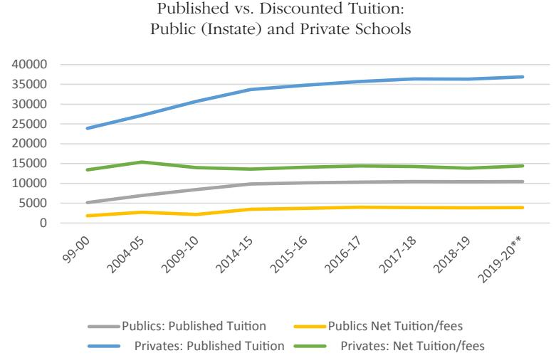

<!-- A1.R36 | source: papers_json/A1.R36/ -->

## Neoliberalism and the Crisis in Higher Education: The Cost of Ideology

*By *Beth Mintz*

Abstract. A number of factors have contributed to the crisis in higher education, including the long-term transformation in funding. In this article, I argue that neoliberalism can explain many of the processes leading to our changing commitment to colleges and universities and the cost increases that this change has produced. A number of neoliberal assumptions firmly rooted in conventional wisdom have contributed to a "student-as-customer" phenomenon, which is, itself, a cost driver. I look at the development of the student as customer as a vehicle for exploring tuition increases. I also examine the tension between education as a public and a private good and the marketization of higher education as crucial drivers of these transformations. In doing so, I emphasize that the student as customer has been created by the changes in the way we think about, organize, and fund education, rather than any fundamental change in young people.

## Introduction

Part of this increased cost [of a college education] is associated with the perverse assumption that students are "customers," that the customer is always right, and what he or she demands must be purchased. Money is well-spent on psychological counselling, but the number of offices that focus on student activities, athletics and athletic facilities, summer job placement and outsourced dining services, to say nothing of the dormitory rooms and suites that only the Four Seasons can match, leads to an expansion of administrators and increased cost of administration. (Cole 2011)

Exchanging pleasantries with a barista at Starbucks one afternoon before COVID-19, I learned that the young woman behind the counter

*Professor emeritus of sociology at the University of Vermont. Co-author of *The * *Power Structure of American Business* (University of Chicago Press 1985) and coeditor of *Corporate Control, Capital Formation, and Organized Networks* (Tokyo: Chou University Press 1996). Email: [Beth.Mintz@uvm.edu](mailto:Beth.Mintz@uvm.edu)

American Journal of Economics and Sociology, Vol. 80, No. 1 (January, 2021).

DOI: 10.1111/ajes.12370

© 2021 American Journal of Economics and Sociology, Inc.

<!-- page 2 -->

was a college student having a great day. When I asked what made it so good, she told me that her classes had been canceled. At the risk of harkening back to a golden age of student engagement that never really existed, faculty around the country have, for a while now, been trying to understand what has happened to undergraduates. Particularly mystifying has been the emergence of the "student-ascustomer" approach to higher education, a result, they have speculated, of popular culture or, perhaps, contemporary childrearing patterns with their emphasis on self-esteem.

Student orientation to higher education has changed dramatically, but this transformation is rooted in the way that we think about, organize, and fund education, rather than any fundamental change in young people. Nevertheless, the outcome of what undergraduates expect as part of the college experience has profound implications for the health of the academy. The student-as-customer development presents a useful vehicle for examining some of the processes that contribute to the crisis in higher education, including rising student debt. Due to the growing view of education as a private rather than a public good, the ways that colleges and universities are funded, and the "marketization" of higher education, students today *are* customers. This situation has contributed to tuition increases. Neoliberal assumptions about privatization, deregulation, and spending cuts in social services have become firmly rooted in conventional wisdom and have driven the public policy that is partly responsible for the rise of the student-as-customer model of higher education.

Beginning with a brief discussion of the rise of neoliberalism, I examine the tension between education as a public good or a private good, exploring how the victory of the latter has contributed to the rise of education as consumerism. I then explore some of the ways in which treating higher education as a commodity has created the student-as-customer phenomenon and how this has contributed to the cost of higher education. I conclude with some implications for understanding higher education in a post-COVID world.

## The Neoliberal Sensibility

It is not clear exactly when liberalism died in the popular imagination, but the death knell was plainly heard when, in the 1988 presidential

<!-- page 3 -->

race, Michael Dukakis was attacked as a spendthrift liberal.^1^ Seven years of the Reagan presidency helped solidify the ascendance of the subsequent paradigm, neoliberalism, with its emphasis on the efficiency of the free market, the need for deregulation and privatization, the reduction of government spending on social services, and the replacement of the concept of "public good" with individual responsibility (Greenwood 2009). By the mid-1990s, these neoliberal assumptions had infiltrated Democratic thought, too, as illustrated by President Clinton's health care reform proposal featuring market competition and personal responsibility and, later, by President Obama's policies marketizing education (Mora and Christianakis 2011).

Neoliberalism equates a state's success with its ability to nurture and sustain the economy (Brown 2003). However, unlike liberalism, it is unconcerned with the contradiction between the right to pursue profits in a capitalist economic system and the ideal of equal opportunity in a democratic society. Thus, while economic freedom is central to traditional liberal philosophy, it is coupled with an understanding that unbridled property rights produce inequality when some people profit at the expense of others. The solution offered in the liberal tradition is a strong government to supervise the economy and public support for those who have not had an equal opportunity to compete. Neoliberalism, on the other hand, assumes that government cannot effectively provide for the needs of its citizens; it also sees public support for the disadvantaged as antithetical to the ethos of personal responsibility.

Over time, neoliberal ideas and practices have structured our economic and political lives, and this shift has had profound implications for social arrangements of varying stripes. Among the institutions shaped by this change is the university, where a number of neoliberalism's fundamental tenets provide a valuable analytic framework for examining the development of the "student as customer." In particular, several elements of neoliberalism have become conventional wisdom:

- the belief in the efficiency of the free market,
- the need to deregulate the economy and privatize the public sector,
- the commitment to tax reduction,

<!-- page 4 -->

- the abandonment of the welfare state, and
- the replacement of the notion of the public good with personal responsibility for one's own welfare.

Those elements of neoliberalism have shaped both public policy and individual action.

Neoliberal assumptions consider a college education as a financial investment for the student and a vehicle for serving the needs and demands of the business community (Saltmarsh 2011). Advocates of neoliberalism also presume that colleges and universities should compete for students as customers in a marketplace and should produce highly trained workers who will enable the nation to compete successfully in a global arena.

Finally, a core value of neoliberalism is efficiency. Market competition is supposed to lead to efficient results. However, the introduction of market logic into higher education has not made it efficient, but instead has contributed to the runaway costs that we see today. Of particular interest here are the ways in which neoliberalism has solidified the rise of the "student as customer" with its attendant costs and consequences.

## The Student as Customer: Public Versus Private Goods

Our nation is at risk. Our once unchallenged preeminence in commerce, industry, science, and technological innovation is being overtaken by competitors throughout the world. (Gardner 1983: 5)

In recent decades, the belief in the importance of economic development as a strategy for maintaining the nation's competitive edge in the global market has framed most discussions about the direction of the American educational system. The National Academies of Science (2005) clearly articulated this vision when it called for a comprehensive federal effort to strengthen the nation's commitment to long-term basic research. At least until the Trump administration, discussions about state and federal education policy focused on the future of schooling. President Obama (2011: 4) summarizes this well:

[We have a responsibility] to invest in the skills and education of our young people. If we expect companies to do business and hire in America,

<!-- page 5 -->

America needs a pool of trained, talented workers that can out-compete anybody in the world.

History confirms that education is an engine of economic success. Goldin and Katz (2008) note, for example, that "the twentieth century was both the American century *and* the Human Capital Century," suggesting that the remarkable strides made during that period were the payoff for investing in universal education.

Underpinning these messages about the importance of school is the assumption that it will, like a rising tide, "lift all boats." More generally, in the United States, ideas about the funding of education turn on whether it is considered a public good—that is, whether the whole community benefits from an educated population. Traditionally, our ideology included the notion that an educated citizenry is crucial for maintaining a democratic society, and that the collective skills and knowledge of a population benefit all.

Today, education is considered a public good when it is viewed as the economic driver discussed above, particularly when its task is to train future workers to fill necessary market positions. This became evident for K–12 with the No Child Left Behind Act of 2001 (NCLB), which favored marketable skills over broad educational outcomes, and perpetuated skill development as the central theme in much of the discourse about schooling in the United States. In higher education, "training for 'employability'" dominates community colleges (Levidow 2002: 227). Their primary charge is now job training rather than preparing students to enter bachelor's degree programs (Kane and Rouse 1999). At four-year institutions, the neoliberal emphasis on marketability of educational skills is reflected in the popularity of majors like business administration and computer science and in the increased funding of STEM at the expense of the humanities. These trends show that the neoliberal vision of the educational system "as [a] production facilit[y] whose primary mission was providing industry with its required human capital" has been realized (Hyslop-Margison and Sears 2006: 1).

But even this limited frame of schooling in the public interest competes with the notion of education as a private good, something pursued by the individual as an investment that will yield a return in

<!-- page 6 -->

the form of future earnings. In the language of the economist, these investments are "human capital," with the profits enjoyed by the individual, rather than the community. Although the potential for personal gain is far from new, in the last few decades, the view of education as a private good and the neoliberal corollary that emphasizes individual responsibility and individual consequences have increasingly framed the discourse of education policy.

The ascendance of this neoliberal view has had a profound impact on the financing of education, in general, and of higher education, in particular. The neoliberal assumptions that beneficiaries of an investment should pay for it, and that education is a private good, help explain the privileging of loans over grants and the systematic defunding of public colleges and universities. All of these beliefs have implications for access to higher education.

Bowles and Gintis (1976) and Bourdieu and Passeron (1979) argue that schools reproduce the class system, but the victory of the neoliberal agenda has intensified the role of education in solidifying advantage. It has institutionalized the gap in access to higher education in new ways, as more low- and middle-income students are either priced out of the academy or trade down in terms of status and prestige. This is consistent with David Harvey's (2005) understanding that increasing social inequality is so central to neoliberalism that it can be viewed as structural. Henry Giroux (2008: 8) suggests that, by defining the public good as private, neoliberal ideology "produces, legitimates, and exacerbates" poverty and disparity.2 More specifically, the emphasis on personal responsibility and the application of market principles to the nonprofit sector has contributed to the public defunding of higher education. This translates into the structural requirement of privileging the affluent, since institutions now survive on those who can pay the bills.

For colleges and universities now must attract high-performing students who can finance a large portion of their tuition or who have access to student loans. Slaughter and Rhoades 2004: (292, 294–295) explain:

Precisely because tuition revenues are an increasingly significant share of institutional revenues, colleges and universities move to attract consumers who have more money and seek to extract as much revenue as possible from them.

<!-- page 7 -->

Crenshaw (2002: 1) adds:

American colleges and universities have become like airlines and hotels, practicing "yield management" to try to maximize the revenue generated by every seat or bed.

Labarree (1997) suggests that the concept of education as a private good, with its emphasis on school as a vehicle for individual social mobility, also has a profound effect on student behavior. Whereas education was formerly based on a model of knowledge acquisition, education is now often seen as a commodity to be used for competitive advantage in the labor market. This has contributed to the ongoing differentiation between elite and non-elite schools, fueling the intense competition for access to the most selective colleges and universities, and reflecting the high-stakes game of maximizing individual educational advantage in an era of "credential inflation" (Collins 1979).

Moreover, when the primary goal of education is merely to earn a credential, the most rational students figure out how little they can do to earn their degree. Menand (2011), for example, notes that, in a society encouraging young people to maximize personal advantage, there is little incentive for broad intellectual development; when given a choice in this context, people will learn only what they need for occupational success. Indeed, empirical evidence suggests that contemporary college students spend less time on academics than previous generations. Arum and Roksa (2011) point out that in the early 1960s, students spent an average of 40 hours a week—a typical work-week—studying and attending classes, but they found that only half of college seniors today, including those from more selective institutions, spend a comparable amount of time on academics. Although some of this may be attributed to the need to work for wages while in school, evidence also suggests that, in traditional-style residential colleges, friendships and social learning are more important to students than academics (Grigsby 2009).

In sum, neoliberalism, with its emphasis on education as a private good, has solidified the rise of students as customers, which helps explain why we are transferring the cost of higher education from the community to the individual. This ideological shift has been used to

<!-- page 8 -->

justify the massive underfunding of higher education (Lewis 2008). The attendant consequences and costs of this will be explored below. Any notion of higher education as a public good that remains salient today is organized around workforce development. The tension between the public and private good plays out as a contradiction between the business interest in subsidized training of future workers, on the one hand, and the ideology that emphasizes higher education as a vehicle for personal gain, on the other.

## The Student as Customer: The Role of the Market

Truckloads of glossy brochures sent to high school students by colleges and universities represent only a small portion of their marketing budgets. Collectively, four-year nonprofit schools (public and private) spend nearly half a billion dollars on advertising each year (Cellini and Chaudhary 2020). Some argue that this is efficient; given imperfect information, it is necessary to match consumers with providers (Mause 2009). But when tuition dollars form the foundation of university revenues, the game changes profoundly.

Marketing is part of the larger process of marketization—the increasing influence of competition and market logic on university cost structures (Williams 1995). Many believe that marketing plays a major role in rising prices (Slaughter and Leslie 1997; Slaughter and Rhoades 2004). Since higher education is highly regulated and subsidized, it is not really a market in the formal sense; however, the United States has the most market-oriented system in the world (Dill 2003). Traditional colleges and universities compete for students, faculty, administrators, research dollars, donations, and endowments, while private forprofit institutions target students who have access to Pell grants and/ or government-subsidized loans. Multiple factors have contributed to this competition, and the rise of the student as customer, again, helps explain why.

Financial aid is an important case in point. In its early days, federal financial aid included a variety of programs designed to meet national educational goals, only some of which were income based (Hannah 1996). This took the form of grants and subsidized loans, distributed to individual colleges and universities for each to allocate to their

<!-- page 9 -->

students. The 1970s brought a change to this practice, resolving an ongoing debate over whether these monies should go to schools or directly to the recipient to take where he or she enrolls (Hannah 1996). With an eye on equal opportunity, transportability by the student won out, assuming that this would provide all needy, qualified students a standardized aid package. This procedure is the foundation for federal financial aid policies today (Hearn 1998; Slaughter and Rhoades 2004). Given the consequences detailed below, however, it did not work out as legislators envisioned.

Fast forward to the 1990s, when, reflecting the neoliberal rhetoric of personal responsibility and belief in education as a private good, loans replaced grants in federal financial aid policy. At the same time, transportability remained, perhaps because it fit so well with the assumption that competition based on the informed choices of students would bring market forces to bear on tuition costs, thus increasing efficiency and quality. But the market did not function in quite that way. Indeed, just a few years later, we see the beginning of a profound shift in campus life that is known as "the amenity wars":

For decades the design trend in college dormitories could be summed up in one word: cheap…. But in recent years that trend has reversed itself, led by cash-rich universities in search of a competitive advantage. At the head of this class is Boston University, which is now building a superdorm at a cost of $100,000 per student, double the national average. The glass-andsteel tower looks less like a rooming house than a sleek yuppie condo, with sweeping views of the Charles River and the Boston skyline. All bedrooms are private, sharing carpeted suites and genuine kitchens—adultsize fridges, built-in microwaves, garbage disposals, the works. (Barnes 1999: 57)

The luxury dorms at Boston University were on the cutting edge of contemporary campus living, soon normalized as other institutions followed. New York University, for example, quickly began a building spree including a $95 million, 16-story dorm, the third in a series that the *New York Times* described as lavish, complete with a state-of-theart health club, a dance studio with a maple suspension floor, a pool, a gym, a juice bar, and a $100,000, two-and-a-half-story, climbing wall (Barnes 1999).

<!-- page 10 -->

To attract students, colleges and universities have followed these leads, trying to keep competitive in the market for enrollments. Today, this is no longer confined to the wealthiest private institutions but is a necessary part of campus life. As the Delta Cost Project notes, these facilities bring students to campus. Moreover, they "are vital parts of institutional marketing, and recruitment strategies and facilities investments play a role in students' enrollment decisions" (Kirshstein and Kadamus 2012: 3). In recent years, campus recreational facilities have been joined by a more general building spree designed to attract students, with less than half of new campus construction taking the form of fancy dining halls and new residential complexes.

These facilities are typically funded through long-term borrowing in the form of bond issues. Between 2002 and 2012, interest payments on this debt increased from $6 billion to $11 billion for four-year public and nonprofit private colleges and universities, a majority of which was for amenity investment (Eaton et al. 2014). As expected, debt levels varied within and across institutional categories, although private (nonprofit) schools typically spend more on average than public ones (Eaton et al. 2014). In 2007, the nonprofit sector of higher education spent 51 cents on consumption amenities for every dollar on academics (Jacob et al. 2018).

The magnitude of this for individual institutions is illustrated nicely by the University of Colorado, which, in 2019, owed approximately $1.5 billion, with 3.6 percent of its annual operating budget going to debt servicing. Bond rating agencies consider this a moderate debt ratio and prudent financial practice, even though the university paid $126.4 million in 2019 in interest charges (University of Colorado 2019), enough to fund a part of the enormous amount of deferred maintenance on the typical university campus. Note that some of these commitments are paid for directly by students where residence fees fund debt servicing. In other cases, such as student unions, the cost is indirect and embedded in operating budgets.

In addition to debt servicing, the expansion of student services has increased expenses in other ways. These include a wide assortment of offices and departments. Universities distinguish between costs directly related to instruction (faculty salaries/benefits and academic department administration); academic support (libraries, academic

<!-- page 11 -->

computing, deans' offices); student services (career counseling, admissions, intramural athletics); and plant and equipment. Over the last few decades, instructional spending as a percentage of total expenses has declined in both the public and private (nonprofit) sectors and in 2017–2018, it accounted for between 27 and 31 percent of four-year schools' budgets, respectively (NCES 2020).

Student services, on the other hand, are growing, as students expect an assortment of items included with their tuition dollars. Those attending colleges with more amenities and services rate the quality of life at their institutions much higher than those at places that spend less (Foubert et al. 1998).

Defined narrowly, about 4.9 percent of spending in public colleges and 8.4 percent of spending in private (nonprofit) four-year institutions is on student services (NCES 2019a, 2019b). There is considerable variation among institutions. Jacob et al. (2018) found that schools targeting high-achieving students invest less in these services, while campuses with a less academically inclined population maximize life-style enhancements. Using a broader measure that includes auxiliary enterprises such as residence halls, food services, and student health services (but not debt servicing), the numbers increase dramatically to 14.6 percent (public) and 17.1 percent (private) spent on student services (NCES 2019b).

These services are not wasted; students use and enjoy what is available. For less selective institutions, this spending may increase graduation and retention rates, although the impact on learning has not been measured (Webber and Ehrenberg 2009). Those campuses trying to raise academic quality may find themselves in a double bind, however, since increasing spending on instruction at the expense of these features may harm enrollment. Precisely when higher education is under increasing scrutiny for academic value added, then, very expensive amenities, including student services and auxiliary enterprises, are necessary components of many college campuses.

Archibald and Feldman (2010) argue persuasively that the cost of highly educated labor, rather than amenities, drives college costs; this is not contradictory, since the growth in student services—no matter how defined—is accompanied by additional personnel to administer these programs. Although many people, including faculty, look to

<!-- page 12 -->

high-level executive compensation to explain the spiraling cost of a college education, the staff who report to the most highly compensated executive are collectively the most taxing (Martin and Hill 2013).

Thus, expanding the scope of amenities from the obligatory climbing wall to include student services broadly conceived demonstrates that student choice has developed into a very expensive competition. The marketization of admissions has not increased efficiency. Instead, it has created a student as customer who selects among enticements that do not advance academic quality or intellectual development.

One irony, then, is that student choice and market efficiency have led to the very expensive amenities and services that continue to drive up tuition and fees.3 A second irony is that students are borrowing to attend universities with ever-increasing sticker prices, and those universities are themselves saddled with rising debt loads to attract their incoming classes.

## The Student as Customer: Market Forces and the Drive for Prestige

Within this status-conscious world of higher education, high tuition may not be a deterrent but an attraction, since it advertises the exclusivity and high standing of the institution. (Labarree 1997: 52)

Princeton, Harvard, and Columbia are number one, two, and three respectively, in *U.S. News & World Report*'s 2021 rankings of national universities. Williams takes top billing among liberal arts colleges, with Amherst and Swarthmore not far behind. The competition among institutions for place in the rankings is intense, and both students (and parents) and colleges and universities take the results very seriously. Indeed, the stakes are extremely high for both groups.

Among upper-middle-class families, prestige has become the centerpiece of college aspiration. Some suggest that, since evaluating a school's educational offering is so difficult, prestige plays a signaling function for the student, substituting for concrete measures of quality and value (Brewer et al. 2002). This may be so, but in the contemporary world, the value of prestige is best understood in terms of differentiation and credentialing. When education is viewed as a vehicle for competitive advantage in a labor market—as a private good—and attending a prestigious college or university is believed to distinguish

<!-- page 13 -->

one from the large pool of college-educated competitors, it is seen as a good investment. In this situation, students pursue prestige as a rational strategy for investment maximization. This explains why the competition for place is so very intense.

For colleges and universities, rankings reflect a drive for prestige that has become a central part of institutional strategy. Often, the competition for tuition dollars drives the attention that schools pay to the *U. S New & World Report* lists. Since these rankings are an important arbiter of college desirability, vying for position is a logical strategy. But the pursuit of prestige contributes to the increasing cost of a college education; so much so that some have called it "a positional arms race" (Frank 2001).

Colleges seek outstanding students because peers are viewed as an important part of the learning process. But they also target accomplished students to increase their prestige rankings, since selectivity is one metric in the rating system. The most highly ranked institutions face no shortage of willing attendees, although competition for the very best and brightest remains intense, given that selectivity accounts for 7 percent of an institution's ranking by *U.S. News & World Report* (2020). This probably explains why an associate dean of admissions at Princeton was once caught hacking into Yale's confidential on-line admissions system (Karabel 2005). Maintaining one's position, even for the most selective schools, remains important since the system is self-reinforcing: perceived quality generates prestige levels. This is apparent in the *U.S. News & World Report* rankings, where undergraduate academic reputation accounts for 20 percent of an institution's total score (Morse and Brooks 2020).

For the many less selective schools, climbing the rankings ladder is a vehicle for increasing prestige and, thus, increasing attractiveness to those most able to pay the tuition bill. Tuchman (2011) suggests that the "prestige seeking" institution is an important development in the landscape of higher education. Brewer at al. (2002) also examine the rise of prestige-seeking institutions.

Attentive institutions have figured out ways to game the system, but once everyone learns the tricks, they no longer differentiate among schools. Indeed, admissions offices have adopted an assortment of practices that have become much too widespread to be unique. A

<!-- page 14 -->

very common—and expensive—case in point is playing off tuition and financial aid to attract high-achieving customers.

The tuition rates posted in college guides and on the websites of institutions of higher learning are sticker prices, but, as in the auto business, few pay full price. When discounts are included, average tuition increases have been much more modest than the formal record indicates: a recent analysis suggests that the actual price paid for college tuition in the 2018–2019 academic year at private nonprofits averaged 55 percent of the published figure, with nearly 82 percent of undergraduates receiving aid (NACUBO 2020). In 2017, four-year schools spent $3 billion on financial aid, up from an inflation-adjusted $1 billion in 2001, with 50 percent of their student bodies receiving a discounted rate (NCES 2020).

Indeed, in recent years, colleges and universities have become major sources of financial aid, a sizable portion of which is meritbased. Termed institutional grants, this is best understood as tuition discounting, and it explains why the average price of attendance is so much less than the sticker suggests. Used as a recruitment mechanism, this practice can cover a large part of the tuition costs for the most attractive students. However, it has become enormously expensive for institutions. In the 2018–2019 academic year, about 28 percent of *all* student aid came directly from individual schools, which collectively spent about $65 billion on this aid, up 78 percent over a 10-year period (College Board 2019b).

Figure 1 compares the growth of published versus net tuition over a 20-year period. The extent to which published tuition increases are offset by discounting, especially for private schools, is most striking. In this group, the 65 percent increase in sticker price averaged a much more modest 9 percent growth in net tuition revenue. Given that average family income over time has remained flat, this increase was felt by students forced to borrow to meet costs. But it was also painful for many institutions. In addition to increases in expenditures over time in wages and salaries, health care, and IT upgrades, schools had to cover interest payments on ballooning long-term debt. Between 2011 and 2018, institutional debt per full-time student equivalent grew by 43 percent (Lundy and Ladd 2020).

<!-- page 15 -->

Figure 1 also demonstrates that public colleges and universities have experienced the highest increase in actual costs; the average published and actual cost of tuition at these institutions for in-state students has doubled over time. This reflects the decline in state appropriations, which, consistent with the neoliberal assumption of education as a private good, effectively transferred the cost of an education from the collective to the individual. Between 2008 and 2018, for example—in the aftermath of the Great Recession—state funding for public colleges and universities shrank by an inflation-adjusted $6.6 billion, with nearly every state shifting costs to students over at least a 25-year period (Mitchell et al. 2019).

Thus, for public colleges and universities, net tuition increases, after institutional aid, help replace the funds cut by state governments that continue to disinvest in higher education. At the same time, shrinking resources bring larger classes, fewer program choices, more adjunct faculty, and enormous amounts of deferred maintenance.

For the wealthier private universities, investment continues to fund cutting-edge facilities, innovative programs, and the aggressive

Figure 1

*Source: College Board (2019a). Inflation adjusted. Public Institutions: In-state tuition. **Estimates.*

<!-- page 16 -->

recruitment of academic stars. But for both sectors, the goal is to pay the bills by maximizing the number of students who pay full tuition, and to do this, schools strive to maintain (or increase) their position in the cutthroat world of academia; the drive for prestige remains intense in both the public and the private sectors. This has played out in enormous sums expended on merit money.

In today's world of high-sticker-price tuition, merit competes with need in allocating institutional aid. Available data suggest that about 40 percent of institutional grant monies in public four-year schools go to high-achieving students (Burd 2020). Upper-middle-class and wealthy recipients are the primary beneficiaries (Bradley and Harris 2010). Grant size tends to increase with income levels (Dillon and Carey 2009). For private institutions, in 2017, 44.5 percent went to students in the highest income quartile (Delisle and Christensen 2019).

This pattern is relatively new: in the early 1990s, the financial aid provided directly by colleges and universities was responsive to both need and merit, but in more recent years, attention to academic achievement has ballooned (Doyle 2010). Originally envisioned as a mechanism to attract students in an increasingly competitive market and to reward hard work in the context of declining scholastic attainment, merit money has developed into a strategy for increasing prestige (McPherson and Schapiro 1998). As Ort (2000: 19) notes, the function of institutional grants has changed over time "from supporting traditional goals of access and choice to recruiting students and maximizing institutional revenues." The drive for selectivity to increase prestige has institutionalized tuition discounting as a strategy for recruiting high-achieving customers, which helps colleges and universities compete in the rankings game. Indeed, as Griffith (2011) found, at least at private universities, merit awards tend to increase when SAT scores fail to keep pace with peer institutions and when a school finds its ranking by *U.S. News & World Report* slipping.

Merit-based aid, although pervasive, is not without controversy. Early critics cautioned against its expansion, arguing that any shortterm advantage would quickly disappear as the competition adopted similar practices and that it would favor wealthy students at the expense of those in need (Baum and Schwartz 1988). As predicted,

<!-- page 17 -->

increasing merit aid has not necessarily been a winning bet. Even early on, the strategy was not an effective way to maximize revenue. As of 2005, at least for private universities, merit aid was accompanied by increased net costs for most schools examined. Although it helped them remain competitive in recruiting high-achieving students, the gains were fairly modest (Griffith 2011).

Since then, the total value of grants to students made by colleges and universities has almost doubled, stretching the resources of all but the wealthiest schools (Scott-Clayton 2017). The impact of these increases seems to vary. For example, merit money is less important in attracting students to more selective institutions, while it helps lesser ranked schools recruit low-income high achievers who could not afford to go to a more prestigious place. Some studies have found that merit money boosts retention (DesJardins et al. 2002; Battaglini 2004). However, other studies by Singell and Stater (2006) and by Gross et al. (2015) suggest that merit money does not affect retention. Thus, schools are financing students who would stay anyway. Other work demonstrates that merit money helps keep high-achieving students in state (Jaquette and Curs 2015).

The drive for selectivity to increase a school's prestige has institutionalized merit money in the form of tuition discounting as a strategy for recruiting customers. As more institutions compete in this way, however, schools must continue tuition discounting to remain competitive, even as the practice becomes less effective in differentiating among schools. Once every institution does it, it becomes a very expensive enterprise. To cover this cost, many colleges and universities have been forced to raise their tuition, shifting costs to less attractive students. This process is akin to cost-shifting in health care, where help for one segment of the population is transferred to others in the form of higher prices. Using merit aid to increase enrollments has contributed greatly to the escalation in tuition costs.

In recent years, merit aid has come to play a dual role in public universities, particularly in flagships, as many have turned to recruiting out-of-state students to counter decreases in state funding. While enrolling high-achieving students contributes to a school's prestige as measured by national rankings, for the public universities, nonresident students also present an opportunity to increase total revenues

<!-- page 18 -->

since they typically pay much higher tuition rates than in-staters. A number of studies have demonstrated that the enrollment decisions of a nonresident student are highly sensitive to institutional grant offers, and public institutions have responded to this: for the 2011–2012 academic year, institutional financial aid for out-of-state students at public research universities averaged $6,843 (compared to $2,160 for residents) but even with this increased discount, net tuition revenue received from nonresidents was about three times more than from state residents (Jaquette and Curs 2015).

Given this differential, high tuition/high aid strategies seem to make sense in this context, so it is not surprising that merit money is used to aid the recruiting effort. But, here again, once everyone has incorporated merit-based financial aid into their recruitment strategies, it becomes less effective in differentiating among institutions. Preliminary research has found that this approach may actually lower tuition revenue (Curs and Singell 2010). State universities have become particularly vulnerable to the market failure of merit grants.

At the same time, it is clear, as early critics warned, that merit money privileges the wealthy; the academic scholarships that have grown at the expense of need-based aid go predominately to upperincome students (Heller 2006; Gross et al. 2015). Award amounts tend to increase with income levels (Dillon and Carey 2009). Families in the bottom 20 percent of the income distribution receive only about $400 more, on average, than those in the highest quintile (College Board 2014). This means that students least likely to get merit money come from populations that have been traditionally underrepresented in higher education. This is associated with a decrease in the proportion of both low-income and African American undergraduates in more selective colleges and universities (Griffith 2009). The current distribution of merit money has also hit public-sector schools especially hard (College Board 2014). Declining need-based aid and the active recruitment of out-of-state students to public schools are practices that have a profound impact on stratification within the academy (Jaquette 2017). Evidence suggests that early fears about the expansion of merit aid seem to be playing out as predicted in a process underscoring David Harvey's (2005) point that neoliberalism and increasing inequality go hand in hand.

<!-- page 19 -->

## The Student as Customer: The Growth of Honors Programs

Recent years have seen a proliferation of programs designed especially for high-achieving students on U.S. campuses. Data on the exact number of schools with these offerings are not readily available, but in the early 2000s, nearly half of all public four-year colleges and universities, and about 11 percent of private universities, had developed some type of honors program (Long 2002). Currently, nearly 900 institutions belong to the National Collegiate Honors Council, the professional association of undergraduate honors programs, and this includes public four-year institutions, private universities, small liberal arts schools, and an assortment of community colleges (National Collegiate Honors Council 2020). But most of the members are large, competitive or very competitive, research institutions (Long 2002).

Honors programs at major universities are typically advertised as cost-effective alternatives to elite schools. Often characterized by enriched classes, better facilities, and enhanced student services, honors programs are part of contemporary enrollment management strategies targeting the most accomplished high school seniors, and institutional patterns of growth suggest that they have developed as a mechanism for attracting high-ability students (Long 2002; Bastedo and Gumport 2003). In this way, they are best viewed as part of a strategy that targets students most likely to increase a school's prestige. This is in keeping with the shift from need-based to merit-based financial aid that has overtaken higher education in recent years. Indeed, as Goodstein and Szarek (2013) suggest, honors programs are particularly promising, since they focus on students with academic records that help bolster the institution's position in the national rankings.

Although systematic data on the cost of honors programs are unavailable, institutional investment varies greatly. The University of Vermont, for example, inaugurated its Honors College in 2006, opening with the completion of a new $35 million residential living complex. The complex—including its debt servicing—is designed to be financially self-sufficient; the cost of construction is borne entirely by the students who live there. The university, for its part, spends about $900,000 directly on the college, most of which goes to administrative salaries. Out of a total operating budget of around $500 million, this

<!-- page 20 -->

is a very modest amount, although in an era of scant resources and large lectures, it would buy eight or ten additional faculty lines. Other costs include staffing small classes, special programs and activities, academic mentoring, and thesis advising, and these begin to add up. The 30 sophomore honors classes a year, each with a maximum capacity of 20, for example, require about six full-time faculty.

Western Carolina University boasts a slightly more ambitious program. Housed in a new $51 million residential facility and supported by a dean and a full-time staff of three, the university increased the number of honors students from 77 to 1,326 over a 15-year period, while raising their admissions standards and boosting the program budget by nearly 600 percent. Underscoring the importance of the program to the school's economic health, Railsback (2012) notes that even with the financial difficulties that the university has faced in recent years, there has been no mention of reducing the honors program's size or cost.

Another example is the expanded Commonwealth Honors College at the University of Massachusetts, which enrolls 3,380 students housed in its new $177 million residential and teaching complex, with a boilerplate honors program description on its webpage:

You will enrich your studies with small, intensive classes where you'll develop enduring ties with faculty members. You'll be challenged in an engaging array of interdisciplinary seminars and courses in your field as well as have opportunities to participate in Community Service-Learning honors courses. (University of Massachusetts 2020)

These examples illustrate that honors programs are part of the landscape of higher education, particularly in institutions with lower selectivity rates that are reaching for students with impressive credentials. Three questions are particularly relevant here: 1) Do honors programs serve their students well? 2) Who is admitted? and 3) Are they cost effective in their role as a recruitment strategy?

Surprisingly, given the many schools that have invested substantial effort and resources in their development, the effectiveness of these programs has not been addressed in as much detail as one might expect. Available data present a mixed portrait of their success. Early research found that students in honors programs were more likely

<!-- page 21 -->

to graduate within four years and with higher GPAs than similarly motivated students who did not participate (Cosgrove 2004; Pritchard and Wilson 2003). One particularly influential study found that by the end of their first year, gains in the cognitive abilities of participating students were modest (Seifert et al. 2007). A larger body of work has looked at retention. Depending on the study, rates of students who remain in honors programs for their entire undergraduate careers ranged from 19 percent to 35 percent (Campbell and Fuqua 2008; Mckay 2009). More recent work has demonstrated that, after controlling for background characteristics, honors education contributes to student success in a number of ways. This success was most pronounced in African American and Latinx populations. Diaz et al. (2019) note, however, that we know little about progress after initial experience. Other studies have found honors students are no more likely than non-honors students to graduate or to remain in their college or university after the first year (Slavin et al. 2008; Cosgrove 2004; Wolgemuth et al. 2007).

These results suggest that honors programs are less impressive than the hyperbole surrounding them. Not surprisingly, given their selection criteria, these programs tend to exclude low-income and minority students (Callahan 2007). Indeed, honors students typically come from white, high-income families, with fathers who disproportionately have graduate degrees (Callahan 2007). But honors programs have flourished in less selective institutions, and it is here where they seem to work well as an educational vehicle: they provide high-achieving, low-income students with heightened academic skills and, therefore, they have the potential to be effective vehicles for social mobility (Galinova 2005).

In spite of their limitations, honors programs in schools of low selectivity may serve as a vehicle for decreasing stratification between institutions (Galinova 2005). Nevertheless, they generally *create* stratification within schools. In more selective places, they sort students by socioeconomic status, enrolling students who are generally more elite than their non-honor peers (Callahan 2007). Indeed, available research suggests that honors courses are often taken by status-conscious students interested in distinguishing themselves from the larger field by

<!-- page 22 -->

acquiring the additional cultural capital that these programs promise (Callahan 2007). The programs have developed into mechanisms attracting high-status enrollees. They also reflect the pattern of stratification in higher education more generally: access is most open in schools of lower selectivity and most gated in more selective places. The advantages of participation are similarly stratified.

Whether they are financially successful for the institution is more difficult to evaluate, given the goal of recruiting students who will increase the school's prestige ranking in the hope of attracting additional students able to pay the bill.

In the same way that the drive for prestige has institutionalized tuition discounting as a requirement of doing business, honors programs are destined to become too widespread to remain effective recruiting mechanisms; here too, when everyone is doing it, it simply becomes another necessity without a financial payback. Given the data on the academic success of honors-program students, many schools would probably have been better off investing in scholastic initiatives targeting increased learning for all.

## Conclusion

A particular set of neoliberal assumptions, including a belief in personal responsibility, an overriding faith in the market, the need for the privatization of public services, and a view of education as job training, have become firmly rooted in conventional wisdom. These ideas have contributed to the rise of "the student as customer" with its attendant costs. The contemporary narrative of education as a private good has solidified this image of students. It helps explain why we are transferring the cost of higher education from the community to the individual. The neoliberal corollary of personal responsibility has provided the ideological shift that justifies the massive underfunding of higher education.

Given neoliberalism's belief in the power of the market, the nonprofit world has increasingly been subject to the rules and processes that drive the private sector. Colleges and universities have responded with practices designed to help them survive marketization and privatization. The organizational imperative to attract students able to

<!-- page 23 -->

pay the bills explains many of the strategies that have been widely adopted, including those designed to aid in the drive for prestige. But many of the practices that were created to distinguish a school from its competitors have been so widely adopted that they have lost their edge. Instead of providing advantage in the competition for revenue, the strategies to attract students have become very expensive necessities. These practices include the construction of luxurious dormitories, the growth of student services, the pervasive tuition discounting that is paralyzing many schools, and even the relatively inexpensive honors college.

These trends raise tuition and fees, and they influence who can afford to attend a four-year institution, thereby affecting the class and racial/ethnic composition of higher education. They also contribute to the high debt loads that students carry. But these trends are especially consequential in what Clawson and Page (2010) describe as the quintessential residential college—where students with backpacks stroll on the quad and where prices have escalated most dramatically.

Archibald and Feldman (2010) suggest that the upscale residential facilities on many of these campuses are consistent with the general upgrading of the U.S. housing stock; in this way they reflect the lifestyles of contemporary students, many of whom might be willing to pay for such improvements. Armstrong and Hamilton (2014) provide a different way of understanding this when they argue that many schools organize the college experience in ways that systematically advantage the affluent. The need to target those most able to pay the bills also structures recruitment efforts in ways that privilege the affluent and raise costs for all students.

In the example of luxurious dorms, the student-as-customer model in higher education imposes a burden on any student who might prefer more modest accommodations to reduce future debt. The studentas-customer model also skews the use of merit-based aid, which is used to recruit high-achieving students as part of a strategy to maximize revenue. The characteristics defined as meritorious are both class-based and racialized. Because of this, merit aid and need-based aid tend to be mutually exclusive. It also explains why the high-tuitionhigh-aid approach to maximizing tuition dollars has led to a decrease

<!-- page 24 -->

in the enrollment of African American and low-income students in four-year colleges and universities. The need to remain competitive with student services and designer programs, such as honors colleges, follows a similar dynamic.

These processes play out in additional ways on college campuses. The economic costs of recruiting a student body that might help raise an institution's rank in the *U.S. News & World Report* listings, for example, are real, but this competition is not limited to students. Colleges and universities compete for reputation with their faculty and with their research dollars, each of which contributes to the overall cost of the education that they provide.

But not all market forces borrowed from the corporate world are prestige- or reputation-based. In trying to understand why tuition is so high, many scholars examine executive salaries; following the lead of the corporate sector, high-level administrator compensation has skyrocketed. Indeed, presidential salaries are reaching record highs, as colleges and universities continue to raise tuition and cut positions. *The Chronicle of Higher Education* reports that in 2019, the highest paid college president of a public institution earned almost $3 million, dwarfed by the $6,283,616 paid to the leader of Bryant University (Bauman et al. 2020).

The proverbial golden parachute is a variation on the same theme. In 2012, Pennsylvania State University's president, fired amid a child-abuse scandal, left with a separation package of about $2.9 million (Stripling 2013). In 2020, after a scandal, Jerry Falwell, Jr. left Liberty University with a $10.5 million settlement (Bailey et al. 2020).

Surely, top salaries pale in comparison to the giants of industry and, although symbolic, relatively few administrators earn these lofty incomes; they account for a very small proportion of an institution's costs. Nevertheless, the reason that these packages are so out of line with faculty compensation is unclear, although one Washington, DC lawyer specializing in presidential contracts argues that golden parachutes and large administrative salaries are often needed to attract qualified candidates (Kiley 2011). One can debate whether this is so, but the striking feature of these packages is the market-based

<!-- page 25 -->

discourse surrounding them—the orthodoxy of the market as the arbiter of academic decision-making.

As Patrick Callan (quoted in Lewin 2009), president of the National Center for Public Policy and Higher Education, notes, however, executive compensation packages reflect "a set of values that is not the way most Americans think of higher education." Indeed, outrage about the high cost of a college degree more generally is quite visible, especially among middle-class families. As a result, proposals for tuition-free higher education are now part of the political landscape. However, to the extent that neoliberal assumptions frame the way Americans think about education—and their world, more generally—meaningful change will remain elusive.

Over the years, we have developed a neoliberal sensibility; that is, some of the major tenets of neoliberalism have become conventional wisdom and many see the world through this lens. This obscures the consequences of neoliberal policies, including the role of the market in the cost escalation within higher education, the limitations of organizing an educational system around workforce development, and the problem with undervaluing a broad education that is a staple of sustaining democracy; equal opportunity is also an increasingly hard sell.

This article has examined some of the institutional practices that have developed in response to the broader neoliberal agenda of marketization and privatization. As suggested, the impact on students is real, both on their pocketbooks and on their view of the educational enterprise. When compared to the conventional wisdom to trust the market, the conclusion is very different: corporatization and marketization are important drivers in tuition cost escalation.

At this writing, colleges and universities throughout the country and the world—are dealing with the financial impact of COVID-19. Many institutions, desperate for their paying customers to return to campus to live in residence halls and use campus amenities, opened schools prematurely (Kaiser 2020). A number quickly returned to distance learning. Even those that managed to stay open are in financial distress, given the defunding of higher education that transferred costs from the collectivity to the individual and the ensuing competition for the best amenities. A recent report on the state of facilities sums this up particularly well:

<!-- page 26 -->

The combination of swollen campus footprints and declining tuition revenues has been aggravated even further by the COVID-19 pandemic, putting many institutions at risk. … Facilities strategies are at the forefront of the industry's race to confront its greatest challenge in generations. (Gordian Research 2020: 1)

Not all will survive. In the spirit of Naomi Klein's (2008) *Shock Doctrine*, some institutions have taken the opportunity to make permanent cuts in faculty, staff, and administrative salaries, while others experience temporary layoffs and provide only online instruction.

As the pandemic threatens to change the world, the question now is what the future of higher education will look like. Burns (2020) suggests that the neoliberal understanding of higher education, with its emphasis on the bottom line, measured by metrics juxtaposing course enrollments and majors, labor costs, and tuition revenue, will reinvigorate the appeal of "massive open online courses" (MOOCs), with their promise of a corporate-mediated answer to perpetual funding crises. This is certainly possible—perhaps probable—but the most likely outcome is a still more bifurcated system of higher education, with a small elite population attending the residential college of old, while a vast majority of students learn from home. It is in this small pocket of elite institutions that tenure may thrive, with these schools competing for the most accomplished researchers, while adjuncts populate most other venues. We can also expect the continuing shrinkage of liberal arts, especially in less-prestigious schools, as the neoliberal function of education as job training becomes even more fully entrenched.

## Notes

1. The term "liberal" has had many meanings historically, and its meaning in the United States differs from the way the term is used in many other countries. In this article, I use it to refer to the principles that provided a broad consensus in U.S. politics from the 1930s through the 1970s. The most fundamental principle of that consensus around liberalism was the belief that government can act in ways that promote the common good by limiting the scope of the market and by providing services that are either universal or targeted to those in greatest need.

<!-- page 27 -->

2. Lipman (2011), quoting Stsephen Haynes, suggests that the cultural politics of race has been central to constructing consent for the neoliberal agenda:

The concepts "public" and "private" are racialized metaphors. Private is equated with being "good" and "white" and public with being "bad" and "Black."

3. It is interesting to note that this market approach to education is alive and well in K–12 policy circles. We see it in the emphasis on student choice that views charter schools as an alternative to traditional public schools, and in the push for portability of funds in the form of vouchers. We might read higher education's experience with the role of transportability in cost escalation as a cautionary tale.

## References

- Archibald, Robert, and David Feldman. (2010). *Why Does College Cost So * *Much?* New York: Oxford University Press.
- Armstrong, Elizabeth, and Laura Hamilton. (2014). *Paying for the Party*. Cambridge, MA: Harvard University Press.
- Arum, Richard, and Josipa Roksa. (2011). *Academically Adrift: Limited * *Learning on College Campuses*. Chicago: University of Chicago Press.
- Bailey, Sarah Pulliam, Susan Svriuga, and Michelle Boorstein. (2020). "Jerry Falwell Jr. Resigns as Head of Liberty University, Will Get $10.5 Million in Compensation." *Washington Post* August 25. [https://www.washington](https://www.washingtonpost.com/education/2020/08/25/fallwell-resigns-confirmed/) [post.com/education/2020/08/25/fallwell-resigns-confirmed/](https://www.washingtonpost.com/education/2020/08/25/fallwell-resigns-confirmed/)
- Barnes, Bradley, and Michael S. Harris. (2010). "Privatization Influences and Strategic Enrollment Management Decisions in Public Research Universities." *College & University* 85(4): 2–9.
- Barnes, Julian E. (1999). "The Way We Live Now: 9–5-99: Salient Facts, Student Housing; Luxury 101." *New York Times* September 5. [http://www.nytim](http://www.nytimes.com/1999/09/05/magazine/the-way-we-live-now-9-5-99-salient-facts-student-housing-luxury-101.html) [es.com/1999/09/05/magazine/the-way-we-live-now-9-5-99-salient-facts](http://www.nytimes.com/1999/09/05/magazine/the-way-we-live-now-9-5-99-salient-facts-student-housing-luxury-101.html)[student-housing-luxury-101.html](http://www.nytimes.com/1999/09/05/magazine/the-way-we-live-now-9-5-99-salient-facts-student-housing-luxury-101.html)
- Bastedo, Michael N., and Patricia Gumport. (2003). "Access to What? Mission Differentiation and Academic Stratification in U.S. Public Higher Education." *Higher Education* 46(3): 341–359.
- Battaglini, Janis K. (2004). *Performance of EAG and GAG Award Recipients * *Based on Length and Amount of Aid*. Annapolis: Maryland Higher Education Commission.
- Baum, Sandra R., and Saul Schwartz. (1988). "Merit Aid to College Students." *Economics of Education Review* 7(1): 127–134.

<!-- page 28 -->

- Bauman, Dan, Tyler Davis, and Brian O'Leary. (2020) "Executive Compensation at Public and Private Colleges." *Chronicle of Higher * *Education* July 17. [https://www.chronicle.com/article/executive](https://www.chronicle.com/article/executive-compensation-at-public-and-private-colleges/?cid2=gen_login_refresh&cid=gen_sign_in#id=table_public_2019)[compensation-at-public-and-private-colleges/?cid2=gen_login_refre](https://www.chronicle.com/article/executive-compensation-at-public-and-private-colleges/?cid2=gen_login_refresh&cid=gen_sign_in#id=table_public_2019) [sh&cid=gen_sign_in#id=table_public_2019](https://www.chronicle.com/article/executive-compensation-at-public-and-private-colleges/?cid2=gen_login_refresh&cid=gen_sign_in#id=table_public_2019)
- Bourdieu, Pierre, and Jean-Claude Passeron. (1979). *Reproduction in * *Education, Society and Culture*. Beverly Hills, CA: Sage.
- Bowles, Samuel, and Herbert Gintis. (1976). *Schooling in Capitalist America: * *Educational Reform and the Contradictions of Economic Life*. New York: Basic Books.
- Brewer, Dominic, Susan Gates, and Charles Goldman. (2002). *In Pursuit of * *Prestige*. New Brunswick, NJ: Transaction Publishers.
- Brown, Wendy. (2003). "Neo-Liberalism and the End of Democracy." *Theory * *and Event* 7(1): 15–18.
- Burd, Stephen. (2020). *Crisis Point: How Enrollment Management and the * *Merit-Aid Arms Race Are Derailing Public Higher Education*. Washington, DC: New America Foundation. [https://www.newamerica.org/educa](https://www.newamerica.org/education-policy/reports/crisis-point-how-enrollment-management-and-merit-aid-arms-race-are-destroying-public-higher-education/) [tion-policy/reports/crisis-point-how-enrollment-management-and-merit](https://www.newamerica.org/education-policy/reports/crisis-point-how-enrollment-management-and-merit-aid-arms-race-are-destroying-public-higher-education/) [-aid-arms-race-are-destroying-public-higher-education/](https://www.newamerica.org/education-policy/reports/crisis-point-how-enrollment-management-and-merit-aid-arms-race-are-destroying-public-higher-education/)
- Burns, Ryan. (2020). "A COVID-19 Panacea in Digital Technologies? Challenges for Democracy and Higher Education." *Dialogues in Human Geography* 10(2): 246–249.
- Callahan, Martha. (2007). *Relative Advantage: Honors Program and * *Stratification in Higher Education*. Doctoral Dissertation. Philadelphia, PA: Temple University.
- Campbell, K. Celeste, and Dale R. Fuqua. (2008). "Factors Predictive of Student Completion in a College Honors Program." *Journal of College Student * *Retention* 10(2): 129–153.
- Cellini, Stephanie Riegg, and Latika Chaudhary. (2020). *Commercials for * *College? Advertising in Higher Education*. Washington DC: Brookings Institution.[ https://www.brookings.edu/research/commercials-for-college](https://www.brookings.edu/research/commercials-for-college-advertising-in-higher-education/)[advertising-in-higher-education/](https://www.brookings.edu/research/commercials-for-college-advertising-in-higher-education/)
- Clawson, Dan, and Max Page. (2010). *The Future of Higher Education*. New York: Routledge.
- Cole, Jonathan. (2011). Quoted in "Not Such a Good Example." *Registrarism* (blog by Paul Greatrix) June 2. [https://registrarism.wordpress.](https://registrarism.wordpress.com/2011/06/02/not-such-a-good-example/#comments) [com/2011/06/02/not-such-a-good-example/#comments](https://registrarism.wordpress.com/2011/06/02/not-such-a-good-example/#comments)
- College Board. (2014). *Trends in Student Aid 2019*. New York: College Board. [secure-media.collegeboard.org/digitalServices/misc/trends/2014-trend](http://secure-media.collegeboard.org/digitalServices/misc/trends/2014-trends-student-aid-report-final.pdf) [s-student-aid-report-final.pdf](http://secure-media.collegeboard.org/digitalServices/misc/trends/2014-trends-student-aid-report-final.pdf)
- . (2019a). *Trends in College Pricing 2019*. New York: College Board. [https://research.collegeboard.org/pdf/trends-college-pricing-student](https://research.collegeboard.org/pdf/trends-college-pricing-student-aid-2020.pdf)[aid-2020.pdf](https://research.collegeboard.org/pdf/trends-college-pricing-student-aid-2020.pdf)

<!-- page 29 -->

- . (2019b). *Trends in Student Aid 2019*. New York: College Board. [https://research.collegeboard.org/pdf/trends-student-aid-2019-full](https://research.collegeboard.org/pdf/trends-student-aid-2019-full-report.pdf)[report.pdf](https://research.collegeboard.org/pdf/trends-student-aid-2019-full-report.pdf)
- Collins, Randall. (1979). *The Credential Society*. New York: Academic Press.
- Cosgrove, John R. (2004). "The Impact of Honors Programs on Undergraduate Academic Performance, Retention, and Graduation." *Journal of the * *National Collegiate Honors Council* 5(2): 45–53.
- Crenshaw, Albert B. (2002). "Price Wars on Campus: Colleges Use Discounts to Draw Best Mix of Top Students, Paying Customers." *Washington Post* October 5: A1.
- Curs, Bradley R., and Larry D. Singell, Jr. (2010). "Aim High or Go Low? Pricing Strategies and Enrollment Effects When the Net Price Elasticity Varies with Need and Ability." *Journal of Higher Education* 81(4): 515–543.
- Delisle, Jason, and Cody Christensen. (2019). *The Merit Aid Illusion*. Washington, DC: American Enterprise Institute. [https://www.aei.org/wp](https://www.aei.org/wp-content/uploads/2019/05/The-Merit-Aid-Illusion.pdf)[content/uploads/2019/05/The-Merit-Aid-Illusion.pdf](https://www.aei.org/wp-content/uploads/2019/05/The-Merit-Aid-Illusion.pdf)
- DesJardins, Stephen L., Dennis A. Ahlburg, and Brian McCall. (2002). "Simulating the Longitudinal Effects of Changes in Financial Aid on Student Departure from College." *Journal of Human Resources* 37(3): 653–679.
- Diaz, Dulce, Susan P. Farruggia, Meredith E. Wellman, and Bette L. Bottoms. (2019). "Honors Education Has a Positive Effect on College Student Success." In *The Demonstrable Value of Honors Education: New Research * *Evidence*. Eds. Andrew J. Cognard-Black, Jerry Herron, and Patricia J. Smith. Lincoln, NE: National Collegiate Honors Councils. [https://digit](https://digitalcommons.unl.edu/nchcmonochap/55) [alcommons.unl.edu/nchcmonochap/55](https://digitalcommons.unl.edu/nchcmonochap/55)
- Dill, David D. (2003). "Allowing the Market to Rule: The Case of the United States." *Higher Education Quarterly* 57: 136–157.
- Dillon, Erin, and Kevin Carey. (2009). *Drowning in Debt: The Emerging * *Student Loan Crisis: Charts You Can Trust*. Washington, DC: Education Sector.[ https://eric.ed.gov/?id=ED505892](https://eric.ed.gov/?id=ED505892)
- Doyle, William R. (2010). "Does Merit-Based Aid 'Crowd Out' Need-Based Aid?" *Research in Higher Education* 51(5): 397–415.
- Eaton, Charlie, Cyrus Dioun, Daniela García Santibáñez Godoy, Adam Goldstein, Jacob Habinek, and Robert Osley-Thomas. (2014). *Borrowing * *Against the Future: The Hidden Costs of Financing U.S. Higher Education*. Merced, CA: University of California, Merced. [http://debtandsociety.](http://debtandsociety.ucmerced.edu/publication/borrowing_against_the_future/) [ucmerced.edu/publication/borrowing_against_the_future/](http://debtandsociety.ucmerced.edu/publication/borrowing_against_the_future/)
- Foubert, John D., Robin Tepper and Daniel R. Morrison. (1998). "Predictors of Student Satisfaction in University Residence Halls." *Journal of College and * *University Student Housing* 37(1): 41–46.
- Frank, Robert. (2001). "Higher Education: The Ultimate Winner-Take-All Market?" In *Exploring the Future of Higher Education*. Eds. Maureen

<!-- page 30 -->

- Devlin and Joel Meyerson. Forum Futures 2000 Papers, Forum Strategy Series, Vol. 3. Annapolis Junction, MD: National Association of College and University Business Officers.
- Galinova, E. V. (2005). "The Construction of Meritocracy Within Higher Education: Organizational Dynamics of Honors Programs at American Colleges and Universities." *Dissertation Abstracts International, A: The * *Humanities and Social Sciences* 66(5): 1709-A.
- Gardner, David P. (1983). *A Nation at Risk: The Imperative for Educational * *Reform*. Washington, DC: National Commission on Excellence in Education, Department of Education.
- Giroux, Henry. (2008). *Against the Terror of Neoliberalism*. Boulder, CO.: Paradigm Publishers.
- Goldin, Claudia, and Lawrence Katz. (2008). *The Race Between Education and * *Technology*. Belknap Press.
- Goodstein, Lynne, and Patricia Szarek. (2013). "They Come But Do They Finish? Program Completion for Honors Students at a Major Public University, 1998–2010." *Journal of the National Collegiate Honors Council* 14(2): 85–104.
- Gordian Research. (2020). *The State of Facilities in Higher Education Highlights * *Trends Further Aggravated by COVID-19 Pandemic*. Greenville, SC: Gordian Research. [https://www.businesswire.com/news/home/20200](https://www.businesswire.com/news/home/20200414005266/en/State-Facilities-Higher-Education-Highlights-Trends-Aggravated) [414005266/en/State-Facilities-Higher-Education-Highlights-Trends-Aggra](https://www.businesswire.com/news/home/20200414005266/en/State-Facilities-Higher-Education-Highlights-Trends-Aggravated) [vated](https://www.businesswire.com/news/home/20200414005266/en/State-Facilities-Higher-Education-Highlights-Trends-Aggravated)
- Greenwood, Davydd J. (2009). "Bologna in America: The Spelling Commission and Neo-Liberal Higher Education Policy." *Teaching and Learning* 2: 1–38.
- Griffith, Amanda L. (2011). "Keeping Up with the Joneses: Institutional Changes Following the Adoption of a Merit Aid Policy." *Economics of * *Education Review* 30(5): 1022–1033.
- Grigsby, Mary. (2009). *College Life Through the Eyes of Students*. Albany, NY: SUNY Press.
- Gross, Jacob P. K., Don Hossler, Mary Ziskin, and Matthew S. Berry. (2015). "Institutional Merit-Based Aid and Student Departure: A Longitudinal Analysis." *Review of Higher Education* 38(2): 221–250.
- Hannah, Susan B. (1996). "The Higher Education Act of 1992: Skills, Constraints, and the Politics of Higher Education." *Journal of Higher Education* 67(5): 498–527.
- Harvey, David. (2005). *A Brief History of Neoliberalism*. Oxford, UK: Oxford University Press.
- Hearn, James. (1998). "The Growing Loan Orientation in Federal Financial Aid Policy: A Historical Perspective." In *Condeming Students to Debt: College * *Loans and Public Policy*. Eds. Richard Fossey and Mark Baleman. New York: Teachers College Press.

<!-- page 31 -->

- Heller, Donald. (2006). "Merit Aid and College Access." Paper presented at the Symposium on the Consequences of Merit-Based Student Aid, Wisconsin Center for the Advancement of Postsecondary Education. Madison: University of Wisconsin. [https://citeseerx.ist.psu.edu/viewdoc/downl](https://citeseerx.ist.psu.edu/viewdoc/download?doi=10.1.1.544.2863&rep=rep1&type=pdf) [oad?doi=10.1.1.544.2863&rep=rep1&type=pdf](https://citeseerx.ist.psu.edu/viewdoc/download?doi=10.1.1.544.2863&rep=rep1&type=pdf)
- Hyslop-Margison, Emery, and Alan Sears. (2006). "Neo-Liberalism, Ideology and Education." In *Neo-Liberalism, Globalization and Human Capital * *Learning: Reclaiming Education for Democratic Citizens*. Eds. Emery Hyslop-Margison and Alan Sears, pp. 1–24. Myrtle Beach, SC: Springer.
- Jacob, Brian, Brian McCall, and Kevin Stange. (2018). "College as Country Club: Do Colleges Cater to Students' Preferences for Consumption?" *Journal of Labor Economics* 36(2): 309–348.
- Jaquette, Ozan. (2017). *State University No More: Out-of-State Enrollment and * *the Growing Exclusion of High-Achieving, Low-Income Students at Public * *Flagship Universities*. Landsdowne, VA: Jack Kent Cooke Foundation.
- Jaquette, Ozan, and Bradley Curs. (2015). "Creating the Out-of-State University: Do Public Universities Increase Nonresidential Freshman Enrollment in Response to Declining State Appropriations?" *Research in Higher * *Education* 56(6): 535–565.
- Kaiser, Zachary. (2020). "School's Back: How the Neoliberal 'Privatization of Risk' Explains the Deadly Decision to Re-Open Campuses." *LSE Impact * *Blog* (London School of Economics) October 8. [https://blogs.lse.ac.uk/](https://blogs.lse.ac.uk/impactofsocialsciences/2020/10/08/schools-back-how-the-neoliberal-privatization-of-risk-explains-the-deadly-decision-to-re-open-campuses/) [impactofsocialsciences/2020/10/08/schools-back-how-the-neoliberal-priva](https://blogs.lse.ac.uk/impactofsocialsciences/2020/10/08/schools-back-how-the-neoliberal-privatization-of-risk-explains-the-deadly-decision-to-re-open-campuses/) [tization-of-risk-explains-the-deadly-decision-to-re-open-campuses/](https://blogs.lse.ac.uk/impactofsocialsciences/2020/10/08/schools-back-how-the-neoliberal-privatization-of-risk-explains-the-deadly-decision-to-re-open-campuses/)
- Kane, Thomas J., and Cecelia Elena Rouse. (1999). "The Community College: Educating Students at the Margin Between College and Work." *Journal of * *Economic Perspectives* 13(1): 63–84.
- Karabel, Jerome. (2005). *The Chosen*. New York: Houghton Mifflin.
- Kiley, Kevin. (2011). "Retreat Rights." *Inside Higher Education* August 4.[ http://](http://www.insidehighered.com/news/2011/08/04/presidents_retreat_packages_rile_faculty_members_politicians) [www.insidehighered.com/news/2011/08/04/presidents_retreat_packa](http://www.insidehighered.com/news/2011/08/04/presidents_retreat_packages_rile_faculty_members_politicians) [ges_rile_faculty_members_politicians](http://www.insidehighered.com/news/2011/08/04/presidents_retreat_packages_rile_faculty_members_politicians)
- Kirshstein, Rita J., and James A. Kadamus. (2012). *Climbing Walls and * *Climbing Tuitions*. Washington, DC: American Institutes for Research. [https://deltacostproject.org/sites/default/files/products/Delta-Cost-Climb](https://deltacostproject.org/sites/default/files/products/Delta-Cost-Climbing-Walls-Climbing-Tuitions.pdf) [ing-Walls-Climbing-Tuitions.pdf](https://deltacostproject.org/sites/default/files/products/Delta-Cost-Climbing-Walls-Climbing-Tuitions.pdf)
- Klein, Naomi. (2008). *The Shock Doctrine*. New York: Picador.
- Labarree, David. (1997). "Public Goods, Private Goods: The American Struggle Over Educational Goals." *American Educational Research Journal* 34(1): 39–81.
- Levidow, Les. (2002). "Marketizing Higher Education: Neoliberal Strategies and Counter-Strategies." In *The Virtual University? Knowledge, Markets, * *and Management*. Eds. Kevin Robins and Frank Webster, pp. 227–248. Oxford: Oxford University Press.

<!-- page 32 -->

- Lewin, Tamar. (2009). "Many Specialists at Private Universities Earn More than Presidents." *New York Times* February 22. [http://www.nytim](http://www.nytimes.com/2009/02/23/education/23pay.html) [es.com/2009/02/23/education/23pay.html](http://www.nytimes.com/2009/02/23/education/23pay.html)
- Lewis, Magda (2008). "Public Good or Private Value: A Critique of the Commodification of Knowledge in Higher Education—A Canadian Perspective." In *Structure of Agency in the Neoliberal University*. Eds. Joyce Canaan and Wesley Shumar. New York: Routledge.
- Lipman, Pauline (2011). "Neoliberal Education Restructuring: Dangers and Opportunities of the Present Crisis." *Monthly Review* 63(3): 114–127.
- Long, Bridget. (2002). *Attracting the Best: The Use of Honors Programs to * *Compete for Students*. Chicago: Spencer Foundation.
- Lundy, Kasia, and Haven Ladd. (2020). *How Institutional Debt Became the * *Other Educational Debt Crisis*. Boston: Ernst and Young LLP (Parthenon). [https://www.ey.com/en_gl/strategy/looming-educational-debt-crisis](https://www.ey.com/en_gl/strategy/looming-educational-debt-crisis)
- Martin, Robert, and Carter Hill. (2013). Measuring *Baumol and Bowen Effects * *in Public Research Universities*. SSRN Working Paper Series. [https://](https://papers.ssrn.com/sol3/papers.cfm?abstract_id=2153122) [papers.ssrn.com/sol3/papers.cfm?abstract_id=2153122](https://papers.ssrn.com/sol3/papers.cfm?abstract_id=2153122)
- Mause, Karsten. (2009). "Too Much Competition in Higher Education?" *American Journal of Economics and Sociology* 68(5): 1107–1133.
- McKay, Kyle. (2009). "Predicting Retention in Honors Programs." *Journal of * *the National Collegiate Honors Council* 10(1): 77–88. [https://digitalcom](https://digitalcommons.unl.edu/cgi/viewcontent.cgi?article=1252&context=nchcjournal) [mons.unl.edu/cgi/viewcontent.cgi?article=1252&context=nchcjournal](https://digitalcommons.unl.edu/cgi/viewcontent.cgi?article=1252&context=nchcjournal)
- McPherson, Michael S., and Morton Owen Schapiro. (1998). *The Student * *Aid Game: Meeting Need and Rewarding Talent in American Higher * *Education*. Ewing, NJ: Princeton University Press.
- Menand, Louis. (2011). "Why We Have College." *New Yorker* June 6: 74–79. (Other version of article: [http://forum.mit.edu/articles/why-we-have](http://forum.mit.edu/articles/why-we-have-college/)[college/](http://forum.mit.edu/articles/why-we-have-college/))
- Mitchell, Michael, Michael Leachman, and Matt Saenz. (2019). *State Higher * *Education Funding Cuts Have Pushed Costs to Students, Worsened * *Inequality*. Washington, DC: Center on Budget and Policy Priorities. [https://www.cbpp.org/research/state-budget-and-tax/state-higher-educa](https://www.cbpp.org/research/state-budget-and-tax/state-higher-education-funding-cuts-have-pushed-costs-to-students) [tion-funding-cuts-have-pushed-costs-to-students](https://www.cbpp.org/research/state-budget-and-tax/state-higher-education-funding-cuts-have-pushed-costs-to-students)
- Mora, Richard, and Mary Christianakis. (2011). "Charter Schools, Market Capitalism, and Obama's Neo-Liberal Agenda." *Journal of Inquiry & * *Action in Education* 4: 93–111.
- Morse, Robert, and Eric Brooks. (2020). "How *U.S. News* Calculated the 2021 Best Colleges Rankings." *U.S. News & World Report*. [https://www.usnews.](https://www.usnews.com/education/best-colleges/articles/how-us-news-calculated-the-rankings) [com/education/best-colleges/articles/how-us-news-calculated-the-rankings](https://www.usnews.com/education/best-colleges/articles/how-us-news-calculated-the-rankings)
- National Academies of Sciences. (2005). *Rising Above the Gathering Storm: * *Energizing and Employing America for a Brighter Economic Future*. Washington, DC: National Academies Press. [https://www.nap.edu/catal](https://www.nap.edu/catalog/11463/rising-above-the-gathering-storm-energizing-and-employing-america-for)

<!-- page 33 -->

- [og/11463/rising-above-the-gathering-storm-energizing-and-employing](https://www.nap.edu/catalog/11463/rising-above-the-gathering-storm-energizing-and-employing-america-for)[america-for](https://www.nap.edu/catalog/11463/rising-above-the-gathering-storm-energizing-and-employing-america-for)
- National Association of College and University Business Officers (NACUBO). (2020). *Before COVID-19, Private College Tuition Discount Rates Reached * *Record Highs*. Washington, DC: NACUBO. [https://www.nacubo.org/](https://www.nacubo.org/Press-Releases/2020/Before-COVID-19-Private-College-Tuition-Discount-Rates-Reached-Record-Highs) [Press-Releases/2020/Before-COVID-19-Private-College-Tuition-Discount-](https://www.nacubo.org/Press-Releases/2020/Before-COVID-19-Private-College-Tuition-Discount-Rates-Reached-Record-Highs)[Rates-Reached-Record-Highs](https://www.nacubo.org/Press-Releases/2020/Before-COVID-19-Private-College-Tuition-Discount-Rates-Reached-Record-Highs)
- National Center for Educational Statistics (NCES). (2019a). "Table 334.10." In *Digest of Educational Statistics*. [https://nces.ed.gov/programs/digest/](https://nces.ed.gov/programs/digest/d19/tables/dt19_334.10.asp) [d19/tables/dt19_334.10.asp](https://nces.ed.gov/programs/digest/d19/tables/dt19_334.10.asp)
- . (2019b). "Table 334.30." In *Digest of Educational Statistics*. [https://](https://nces.ed.gov/programs/digest/d19/tables/dt19_334.30.asp) [nces.ed.gov/programs/digest/d19/tables/dt19_334.30.asp](https://nces.ed.gov/programs/digest/d19/tables/dt19_334.30.asp)
- . (2020). *Sources of Financial Aid*. [https://nces.ed.gov/programs/coe/](https://nces.ed.gov/programs/coe/indicator_cuc.asp) [indicator_cuc.asp](https://nces.ed.gov/programs/coe/indicator_cuc.asp)
- National Collegiate Honors Council (NCHC). (2020). *What Is NCHC?* Lincoln, NB: NCHC, University of Nebraska.[ https://www.nchchonors.org/about-nchc](https://www.nchchonors.org/about-nchc)
- Obama, Barack. (2011). "Remarks by the President to the Chamber of Commerce." *New York Times* February 7: 1–10. [https://www.nytim](https://www.nytimes.com/2011/02/08/us/politics/08obama-text.html) [es.com/2011/02/08/us/politics/08obama-text.html](https://www.nytimes.com/2011/02/08/us/politics/08obama-text.html)
- Ort, Shirley A. (2000). "Federal and State Aid in the 1990s: A Policy Context for Enrollment Management." *New Directions for Student Services* 2000(89): 19–32.
- Pritchard, Mary E., and Gregory S. Wilson. (2003). "Using Emotional and Social Factors to Predict Student Success." *Journal of College Student * *Development* 44: 18–28.[ https://doi.org/10.1353/csd.2003.0008](https://doi.org/10.1353/csd.2003.0008)
- Railsback, Brian. (2012). "Protecting and Expanding the Honors Budget in Hard Times." *Journal of the National Collegiate Honors Council Online * *Archive* Spring/Summer: 33–36 [https://digitalcommons.unl.edu/cgi/](https://digitalcommons.unl.edu/cgi/viewcontent.cgi?article=1340&context=nchcjournal) [viewcontent.cgi?article=1340&context=nchcjournal](https://digitalcommons.unl.edu/cgi/viewcontent.cgi?article=1340&context=nchcjournal)
- Saltmarsh, Sue. (2011). "Economic Subjectivities in Higher Education Self, Policy and Practice in the Knowledge Economy." *Cultural Studies Review* 17(2): 115–139.
- Scott-Clayton, Judith (2017). *Undergraduate Financial Aid in the United * *States*. Cambridge, MA: American Academy of Arts & Sciences.
- Seifert, Tricia A., Ernest Pascarella, Nicholas Colangelo, and Susan G. Assouline. (2007). "The Effects of Honors Program Participation on Experiences of Good Practices and Learning Outcomes." *Journal of College Student * *Development* 48: 57–74.[ https://doi.org/10.1353/csd.2007.0007](https://doi.org/10.1353/csd.2007.0007)
- Singell, Larry, and Mark Stater. (2006). "Going, Going, Gone: The Effects of Aid Policies on Graduation at Three Large Public Institutions." *Policy * *Sciences* 39: 379–403.
- Slaughter, Sheila, and Larry Leslie. (1997). *Academic Capitalism*. Baltimore, MD: Johns Hopkins.

<!-- page 34 -->

- Slaughter, Sheila, and Gary Rhoades. (2004). *Academic Capitalism and the * *New Economy*. Baltimore, MD: Johns Hopkins.
- Slavin, Charlie, Theodore Coladarci, and Phillip A. Pratt. (2008). "Is Student Participation in an Honors Program Related to Retention and Graduation Rates?" *Journal of the National Collegiate Honors Council Online Archive* Fall/Winter: 59–70. [https://digitalcommons.unl.edu/nchcjournal/66](https://digitalcommons.unl.edu/nchcjournal/66)
- Stripling, Jack. (2013). "Farewell Payout to Spanier Made Him Priciest President." *Chronicle of Higher Education* May 12. [https://www.chron](https://www.chronicle.com/article/farewell-payout-to-spanier-made-him-priciest-president/) [icle.com/article/farewell-payout-to-spanier-made-him-priciest-president/](https://www.chronicle.com/article/farewell-payout-to-spanier-made-him-priciest-president/)
- Tuchman, Gaye. (2011). *Wannabe U: Inside the Corporate University*. Chicago: University of Chicago Press.
- University of Colorado. (2019). *Current and Forecasted Debt Payment Ratios * *(FY20–FY25) Annual Report*. University of Colorado. [https://www.](https://www.cu.edu/doc/fy-20-debt-ratio-reportfinalmay19pdf) [cu.edu/doc/fy-20-debt-ratio-reportfinalmay19pdf](https://www.cu.edu/doc/fy-20-debt-ratio-reportfinalmay19pdf)
- University of Massachusetts. (2020). *Honors College*.[ https://www.umass.edu/](https://www.umass.edu/admissions/academic-life/honors-college) [admissions/academic-life/honors-college](https://www.umass.edu/admissions/academic-life/honors-college)
- *U.S. News & World Report*. (2020). "A More Detailed Look at the Ranking Factors." August 17. [http://www.usnews.com/education/articles/2010/08/17/](http://www.usnews.com/education/articles/2010/08/17/methodology-undergraduate-ranking-criteria-and-weights-2011) [methodology-undergraduate-ranking-criteria-and-weights-2011](http://www.usnews.com/education/articles/2010/08/17/methodology-undergraduate-ranking-criteria-and-weights-2011)
- Webber, Douglas A., and Ronald G. Ehrenberg (2009). *Do Expenditures Other * *Than Instructional Expenditures Affect Graduation and Persistence Rates * *in American Higher Education*. Working Paper 15216. Cambridge, MA: National Bureau of Economic Research. [http://www.nber.org/papers/](http://www.nber.org/papers/w15216) [w15216](http://www.nber.org/papers/w15216)
- Williams, Gareth L. (1995). "The 'Marketization' of Higher Education: Reforms and Potential Reforms in Higher Education Finance." In *Emerging Patterns * *of Social Demand and University Reform: Through a Glass Darkly*. Eds. David D. Dill and Barbara Sporn. Oxford: Pergamon Press.
- Wohlgemuth, Darin, Don Whalen, Julia Sullivan, Carolyn Nading, Mack Shelley, and Yongyi (Rebecca) Wang. (2007). "Financial, Academic, and Environmental Influences on the Retention and Graduation of Students." *Journal of College Student Retention* 8(4): 457–475.

<!-- page 35 -->

Copyright of American Journal of Economics & Sociology is the property of Wiley-Blackwell and its content may not be copied or emailed to multiple sites or posted to ^a^ listserv without the copyright holder's express written permission. However, users may print, download, or email articles for individual use.
