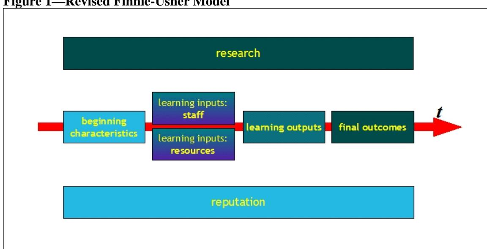

<!-- A1.R46 | source: papers_json/A1.R46/ -->

## **Educational Policy Institute **

## A World of Difference:

A Global Survey of University League Tables

Alex Usher & Massimo Savino

January 2006

<!-- page 2 -->

## The Educational Policy Institute

**The Educational Policy Institute, Inc. (EPI) **is a non-partisan, non-governmental organization dedicated to policy-based research on educational opportunity for all students. With offices in Washington, DC, Toronto, ON, and Melbourne, Australia, EPI is a collective association of researchers and policy analysts from around the world dedicated to the mission of enhancing our knowledge of critical barriers facing students and families throughout the educational pipeline. In addition, EPI has developed extensive partnerships and collaborative arrangements with other leading research and educational organizations, further supporting our mission and ability to conduct policy-relevant research for practical use.

The mission of EPI is to expand educational opportunity for low-income and other historicallyunderrepresented students through high-level research and analysis. By providing educational leaders and policymakers with the information required to make prudent programmatic and policy decisions, we believe that the doors of opportunity can be further opened for all students, resulting in an increase in the number of students prepared for, enrolled in, and completing postsecondary education.

For more information about the Educational Policy Institute, please visit our website at**:** **www.educationalpolicy.org **or contact us at:

## E d u c a t i o n a l P o l i c y I n s t i t u t e

## Virginia Beach

2401 Seaboard Rd, Suite 104 Virginia Beach, VA 23456 (540) 288-2322

## Toronto

20 Maud Street, Suite 300 Toronto ON M5V 2M5 +1 416 848-0215

## Melbourne

147 Wingrove Street Fairfield Victoria 3078 +61 (0) 419 514 232

email: info@educationalpolicy.org

<!-- page 3 -->

## About the Authors

**Alex Usher** is the Vice-President of the Educational Policy Institute. Prior to joining the Institute, he was the Director of Research and Program Development for the Canada Millennium Scholarship Foundation, where he was in charge of Canada's largest-ever research project on access to post-secondary education. He is a native of Winnipeg, Manitoba, and graduate of McGill University and Carleton University. *(ausher@educationalpolicy.org)*

**Massimo Savino **is a Research Associate with the Educational Policy Institute's Toronto office. He holds a BA in political science from McGill University in Montreal as well as an MSc from the London School of Economics.

## **Citation:**

Usher, A., and Savino, M. (2006). *A World of Difference: A Global Survey of University League* *Tables. *Toronto, ON: Educational Policy Institute.

<!-- page 4 -->

## A World of Difference: A Global Survey of University League Tables

Alex Usher and Massimo Savino

Educational Policy Institute

<!-- page 5 -->

## Acknowledgements

Thanks are due first and foremost to Jan Sadlak of UNESCO-CEPES and Jamie Merisotis of the Institute for Higher Education Policy for extending an invitation to one of the authors to the December 2004 meeting of the International Working Group on University Ranking Systems in Washington, DC. Thanks are also due to the participants of that meeting, especially Jesus de Miguel, Hong Shen, David Jobbins and Nian Cai Liu, all of whom were of considerable assistance in helping us to understand the intricacies of the various international ranking systems.

Ron Saunders of the Canadian Policy Research Network and Ross Finnie of Queen's University are also owed a debt of gratitude for bringing EPI into the world of quality measurement. Ken Redd provided illuminating advice on undergraduate programs in the United States and how they might relate to ranking systems there. Tomasz Bednarczyk translated league tables from Poland. Federica Prato of MIUR in Italy was of great assistance in deepening our understanding of contemporary issues in Italian higher education. Long afternoons were profitably and enjoyably spent with Ken Snowdon discussing the ins and outs and pros and cons of ranking systems.

The paper also benefited considerably from helpful comments from a number of people, including David Jobbins, Jan Sadlak, Jamie Merisotis and Kim Steele.

Notwithstanding all this generous assistance, any errors or omissions are entirely those of the authors.

<!-- page 6 -->

## I. Introduction

University rankings or "league tables," a novelty as recently as 15 years ago, are today a standard feature in most countries with large higher education systems. They were originally created over 20 years ago by Bob Morse at the *US News and World Report* in order to meet a perceived market need for more transparent, comparative data about educational institutions. Reviled by critics but popular with parents, copy-cat ranking systems began popping up all over the world, usually shortly after the introduction of or a rapid rise in—tuition fees. Wherever rankings have appeared, they have been met with a mixture of public enthusiasm and institutional unease. There are now two institutional ranking projects which compare institutions on a global basis and another 15 or so which compare them on a national basis. There are also innumerable ranking schemes which look only at particular faculties (e.g., MBA rankings, law and medical school rankings) or particular qualities of universities (e.g., *Yahoo Magazine*'s "most wired" university index, the *Journal of Black Higher Education's* Racial Diversity Ranking).

One of the main causes of institutional unease is the tendency of institutional ranking schemes to use weighted aggregates of indicators to arrive at a single, all-encompassing quality "score," which in turn permits institutions to be ranked against one another. By selecting a particular set of indicators and assigning each a given weight, the authors of these rankings are imposing a specific definition of quality on the institutions being ranked. The fact that there may be other legitimate indicators or combinations of indicators is usually passed over in silence. To the reader, the author's judgement is in effect final.

Intriguingly, however, there is absolutely no agreement among the authors of these indicators as to what indicates quality. The world's main ranking systems bear little if any relationship to one another, using very different indicators and weightings to arrive at a measure of quality. This suggests that the position of certain institutions in their national rankings is largely a statistical fluke—if another country's ranking system were used, a different result might emerge. Yet, that said, certain institutions repeatedly come at the top of the heap regardless of the system of indicators and weights used.

In this document we discuss 19 university league tables and ranking systems from around the world. Sixteen of these are "national" league tables collected from ten countries (Australia, Canada, China, Germany, Hong Kong, Italy, Poland, Spain, the

<!-- page 7 -->

United Kingdom and the United States); three are "international" or "cross-national" league tables. Section II provides a more complete description of these league tables and how they were selected. In Section III, we elaborate on how league tables serve generally as measurements of or judgements on quality, and how rankings relate to assessments of educational quality. Specifically, we look at how the choice of indicator and the weighting attached to each indicator define the nature of "quality."

In Section IV, we examine how rankings and league tables go about the business of collecting data on the indicators chosen for their respective systems. It turns out that strategies for obtaining data differ significantly between ranking systems, largely as a function of the quality of publicly available data and the sophistication of the chosen indicators. Following up on this point, in Section V we take a detailed look at the galaxy of quality indicators used by the existing league tables and ranking systems, according to a seven-category typology based loosely on the "flow" model of educational quality first posited by Ross Finnie and Alex Usher (2005).

This information is then synthesized in Section VI through the construction of a "table of league tables," in order to make a more direct comparison of indicators and weightings. In so doing, we note certain regional and national patterns in the implicit definition of "quality" used by league tables. Section VII explores some of the ramifications of these regional quality definitions and, in turn, what these ramifications mean in terms of university positions compared across different league tables. Finally, in Section VIII, we explore an alternative to the strict "league table" format that is presently the dominant model for institutional rankings. Conclusions are presented in Section IX.

<!-- page 8 -->

## II. What Are University Rankings and League Tables?

University rankings are lists of certain groupings of institutions (usually, but not always, within a single national jurisdiction), comparatively ranked according to a common set of indicators in descending order. With one specific exception, which will be discussed later (Germany's CHE/DAAD rankings), university rankings are presented in the format of a "league table," much as sports teams in a single league are listed from best to worst according to the number of wins and losses they have achieved.**[1](#page-7-0)**

"League tables" are not synonymous with "performance indicators," although the two bear more than a passing resemblance to one other. Performance indicators are usually published by governments or institutions themselves either to show how well an institution (or a system of institutions) does compared to some kind of benchmark or simply for the sake of "transparency." League tables, on the other hand, while similarly compiled and arranged on the basis of indicators, are designed specifically as a comparative measure, pitting institutions against each other.

Another notable aspect of league tables is that they are, for the most part, produced by commercial publishing enterprises. In part, this reflects the fact that rankings share some characteristics with "consumer guides" to various products. Although rankings are not guides to specific institutions, the publishers of individual institutional guides may incorporate rankings data as supplementary material, fleshing out descriptions for the purpose of providing more information to their readers. Rankings are—at least in theory—meant to be an "under the hood" look at a complex product. In many cases, the effort required to collect, collate and analyze the data required to produce the rankings is so great that their production on anything but a commercial basis is probably impossible.

site at [http://adminsrv3.admin.ch/cest/en/](http://adminsrv3.admin.ch/cest/en/)), whose rankings take the name "Champions League," after the prestigious annual UEFA club competition.

> ^1 ^The term stems from UK-based chart listings that were often compared with Premier League professional soccer or football standings in England during the 1990s and can now be found in an extremely wide variety of contexts in Britain today. Examples include the National Health Service's league tables of hospitals and primary care trusts, the Department for Education and Skills' (UK) Achievement and Attainment Tables, Thomson Financial's Debt, Equity and Project Finance tables, and Transport for London's Bus Performance Tables. The link between rankings and football is taken to its logical—if absurd—extreme at the website of the Centre for Science and Technology Studies in Bern, Switzerland (English

<!-- page 9 -->

University ranking systems come in two varieties: institutional ranking systems and sub-institutional ranking systems. They can be conducted either on a national or international scale. National ranking systems are ones in which all or nearly all of a country's universities are measured against one another. This was the original university ranking format—i.e., the type pioneered by the *US News and World Report* in 1981 and which has been widely copied in other countries. In most cases, all universities within a country are compared, although in some cases—notably in Canada (*Maclean's Magazine*) and the United States (*US News and World Report*)—the country's universities are divided up according to certain institutional characteristics and only compared to other institutions with similar characteristics, in effect creating a group of mini-league tables. At present, national-level rankings exist in Australia (the *Melbourne Institute*), Canada (*Maclean's)*, China (*Wuhan*, *Guangdong*, *Education18),* Germany (*CHE/DAAD *rankings), Hong Kong (*Education18*), Italy (*La Repubblica*), Poland (*Rzeczpospolita*), Spain (*Excelencia*), the United Kingdom (the *Times*, the *Guardian*, the *Financial Times *and the *Telegraph, * although the latter two have not been published since 2003 and there do not appear to be plans to re-commence publication of either) and the United States (*US News and World * *Report *and the *Washington Monthly*). All of these ranking schemes are included in this report.

Global institutional ranking systems are a new variation on the older idea of national rankings. There are at present only two of these: the *Academic Ranking of World * *Universities* from Shanghai's Jiao Tong University, first released in 2003, and the *World * *University Rankings *from the *Times Higher Education Supplement* of Britain (henceforth *THES*), first released in November 2004. The first international ranking—albeit not a global one—was actually done by *Asiaweek* in 1997, which ranked the continent's major universities. However, this was discontinued when *Asiaweek* ceased publication in 2000. Again, all three of these ranking schemes are covered in this report.

Beyond institutional rankings, there are also sub-institutional rankings, which compare specific university units against similar ones at other institutions. These rankings are usually national in scope and deal with professional schools such as business, law and medicine. Graduate business schools are also the subject of a number of international rankings from such organizations as the* Economist*, the* Financial Times, *the* Wall Street * *Journal *and *Business Week*. These types of ranking schemes are not covered in this report, on the grounds that there are simply too many of them to analyze in detail. However,

<!-- page 10 -->

we will be examining one variation on the subject-specific ranking system (the CHE/DAAD rankings) at the conclusion of this document, as it seems to point in a very interesting direction.

There are also ranking schemes which focus on specific aspects of university activities. For instance, the* Best American Research Universities* ranks US institutions specifically on their research output, as, in a cruder manner, does the Centre for Science and Technology Studies in Bern, Switzerland, with its international "Champions League" tables. Similarly, *Yahoo* *Magazine* has ranked universities on their "connectivity," and the *Journal of Black Higher Education* has graded them on their ability to integrate students from different backgrounds in its ethnic diversity rankings. Again, these types of ranking systems are excluded because their purposes are much more specific and limited than the general ranking systems which we wish to focus on.

<!-- page 11 -->

## III. How Rankings and League Tables Work

League tables, by their very nature, are meant to boil down the work of entire institutions into single, comparable, numerical indicators. To some, it is precisely this which makes league tables illegitimate: the process of turning the work of hundreds or thousands of people in diverse intellectual enterprises into a single number is often seen as inherently impossible, demeaning or simply wrong. Nevertheless, in order to understand league tables and what they do, it is important to understand the way in which this single number is arrived at. In most (but not quite all) ranking systems, it is a three-part process: first, data is collected on indicators; second, the data for each indicator is scored; and, third, the scores from each indicator are weighted and aggregated.

All rankings systems operate by comparing institutions on a range of indicators. The number of indicators in a ranking system can vary significantly, from five in the simplest case (the *THES World Rankings)* to several dozen in the case of the most complicated (*La * *Repubblica* or *Wuhan*). Specific areas of institutional activity or types of institutional output can therefore be compared across institutions, in much the same manner as is done with performance indicators.

With only a few exceptions (notably, Spain's *Excelencia *rankings), league table systems then take the data on each indicator and turn it into a "score." Usually, this is done by giving the institution with the highest score on a particular indicator a perfect mark of 100 and then awarding lower scores to other institutions based on how close they were to the score of the top institution. For example, if three institutions were being compared on the basis of graduation rates, and one institution had a rate of 80%, a second had a rate of 70% and a third a rate of 60%, the first institution's score would be 100, while the second's would be 87.5 (70/80 = .875) and that of the third institution 75 (60/80 = .75).

Once scores have been derived for each indicator, they are weighted. Nearly all league tables weight their data in a particular manner, giving greater weight to indicators which are believed to be of greater importance. For example, the rate at which faculty obtains research grants might be weighted at 5%—an institution with a score of 100 on this indicator would therefore receive five points towards a total score, while an institution with a score of 80 would only receive four points. The weighted scores from all indicators are then tallied to give a unified final score for each institution.

<!-- page 12 -->

Clearly, the choice of indicators and the weight given to each indicator make an enormous amount of difference to the final output. Indeed, it is no exaggeration to say that when publishers advertise their product as a guide to "the best" institutions, it is the publishers themselves who largely decide the best simply through their choice of indicators and weightings. In effect, the act of choosing a set of indicators and weightings imposes a definition of "quality."

As many previous studies have shown, however, quality in higher education is a highly contested notion. The question of "which university is the best" may legitimately be answered in very different ways according to who is asking the question and what this person is seeking from a university experience. But since most rankings are done for print-based mass-market publications, there can only be a single "answer" to this question—that is, the one provided by the specific choice of indicators and weightings chosen by the publisher. As Eccles (2002) points out, this 'one-size-fits-all' approach usually fails to cater to the interests of non-traditional student populations that may have different interests in finding an appropriate university, such as international students, mature applicants, unusual applicants with alternative classifications, parttime students and non-degree candidates.

Some might see this as indicative of a certain capriciousness in the use of indicators. Yet this is not necessarily the case: there might be very legitimate reasons for using different indicators of quality. For instance, if there was a large public or policy consensus in favour of viewing universities as creators of knowledge, then indicators that measure such things as publications, citations or patents awarded would be appropriate. If, on the other hand, it was held that universities are largely about teaching undergraduates, then indicators which look at graduation rates and the views of undergraduates on the teaching and the learning environment would take on greater significance. The question, really, is whether the differences between ranking systems are in fact reflections of legitimately different points of view or merely of the editors' preferences. This issue, first raised by Dill and Soo (2002) in their examination of Canadian, American, Australian and British ranking systems, will be re-visited in this paper, using a much larger sample of instruments.

<!-- page 13 -->

## IV. The Evidentiary Basis of League Tables — How Data Is Collected

A key issue in the preparation of league tables and rankings is the method by which data is collected. There are basically three sources of data on institutions:

- * *Survey data*. Surveys of the opinions or experiences of various stakeholders can be used to obtain comparable data on different institutions regarding educational quality.
- * *Independent third parties*. Frequently, government agencies will collect and publish data on institutions in their jurisdiction, and this can be used as an objective standard by which to compare institutions. This data is very often financial in nature and is based on administrative data from grant-making bodies.
- * *University sources*. The most complete and most detailed sources of data on universities are of course universities themselves, and they are thus potentially a very rich source of data.

The use of each source of data has pros and cons. Survey data is scientific in the sense that it records observations accurately, but to the extent that it is used to survey employers or opinion-makers on the value of degrees from various institutions, critics might reasonably question the value of such observations, as very few employers or opinion-makers are likely to have detailed views on or knowledge of every institution under scrutiny. Surveys of students and recent graduates are similarly denigrated on the grounds that while they may be able to enunciate their feelings about their own institution, they have no basis on which to compare their institution with others.

Independent third-party administrative data (usually from governments or grantmaking bodies) is generally considered the "gold standard" of comparative data since it is, at least theoretically, both accurate and impartial. The problem is that this data is not (usually) collected for the purpose of compiling league tables but rather as an administrative by-product of ordinary business. As a result, over-reliance on this source of data can lead to a situation where indicators are chosen simply on the basis that data is available rather than because they contribute to a sensible definition of quality—Marc Chun (2003) has memorably compared this situation to that of a drunk who loses his keys in the middle of the street but looks for them directly under the streetlight because

<!-- page 14 -->

the light is better there.

Finally, there is data from universities themselves. In some cases, where important indicators on quality cannot be obtained via surveys or third parties, the authors of ranking schemes will address a questionnaire to institutions themselves and ask for certain pieces of data. The benefit of this approach is that one can—in theory—answer a number of questions about quality that cannot otherwise be answered. The main drawback is that there is absolutely no guarantee that institutions will actually report the data to the ranker on a consistent basis, as all have a clear incentive to manipulate data in a manner which will benefit them. Indeed, at some institutions in the United States, there are staff positions within institutional research offices which require the incumbent to do nothing but provide institutional data to the *US News and World Report *in a favourable light.

The extent to which each ranking system uses each source of data is shown below in Table 1.[2](#page-13-0)

> ^2 ^For more information on how Table 1 was compiled, please see Appendix A.

<!-- page 15 -->

Table 1 shows that surveys are the least frequently used source of data for indicators. Indeed, of all the studies, only Hong Kong's *Education18* rankings come close to having a plurality of indicators come from this source. This measure somewhat underestimates the importance of surveys, however, as it does not account for the weighting given to each indicator in each study. In the *THES World Rankings*, for instance, there is only a single survey (for "reputation"), but it accounts for 40% of the total ranking. Similarly, Canada's *Maclean's* rankings have only one survey-based indicator out of a total of 24, but this one indicator is worth 20% of the final score.

<!-- page 16 -->

Outside North America, third-party sources are by far the most heavily used sources of data: indeed, four of the 18 ranking schemes in this study use them exclusively. Of the remaining 14, third-party sources comprise a plurality of indicators in eight and university sources form a plurality in six. The predominance of data from universities is most understandable in the cases of the *Asiaweek* and* THES* rankings, as their international scope significantly reduces the possibility of third-party sources providing data on a consistent trans-national basis (*Shanghai Jiao Tong*, the third international study in this comparison, solved this problem by relying almost exclusively on research output measures such as scientific publications and citations). In the cases of the *US News and * *World Report*, *Washington Monthly*, *Maclean's, *the *Guardian* and *Rzeczpospolita*, the explanation seems to be that the editors' definitions of "quality" could not be measured using government administrative data. This may indicate a failure of government data collection in these countries, in the sense that information deemed important to quality measurement is not collected on a consistent and centralized basis; alternatively, it may indicate that the rankers' views of what constitutes an indicator of quality is not shared by governments or the higher education community.

<!-- page 17 -->

## V. What League Tables Measure—A Look at the Indicators

## *A Framework for Analysis *

It should come as no surprise to learn that different ranking systems use very different indicators in order to obtain a picture of "quality." In some cases, these differences are clearly due to differing national standards or practices in the way data is collected or reported. In some cases, differences in indicators reflect genuine differences in the definition of "quality;" *Shanghai Jiao Tong*, for instance, uses research-related indicators far more than *THES*; the *Washington Monthly* has explicitly tried to generate indicators on "social responsibility" which do not exist in the *US News and World Report*; and so on. But the sheer number of individual indicators used in ranking systems worldwide runs well into the hundreds, making any kind of comparison grid too large to be useful.

In order to look at indicators (and, in a subsequent section, weightings) in a manageable way, we have tried to categorize them into larger headings, based in part on an existing model of institutional quality. Finnie and Usher (2005), in their proposal for a system of measuring quality in post-secondary education, developed a conceptual framework for quality measurement based on the following four elements:

- *Beginning characteristics*, which represent the characteristics, attributes and abilities of incoming students as they start their programs.
- *Learning inputs, *which come in two main types: o i) *resources, *both financial and material, available to students and faculty for educational ends; ando ii) *staff, *not just in terms of the number of staff, but also the way in which they are deployed to teach and the learning environment they create, as measured by the amount of contact time students have with their teachers, the kinds of exams they face, and so on (sometimes referred to as "pedagogies").
- *Learning outputs* represent the "skill sets" or other attributes of graduates which culminate from their educational experiences, such as critical thinking, analytic reasoning and technical knowledge. They also include records relating to retention and completion.

<!-- page 18 -->

• *Final outcomes *represent the ultimate ends to which the educational system may contribute, including not only such traditional measures as employment rates and incomes but also any other outcome deemed to be important to individuals and society, such as job satisfaction, an appreciation of the finer things in life and being a "good citizen."

As it turns out, these four elements or categories actually encompass the majority of indicators used by the ranking systems covered by this study. However, we will modify the typology in two ways:

- first, by making a clearer distinction between the two type of inputs, henceforth referred to as "learning inputs—resources" and "learning inputs—staff;"and
- second, by including two other sets of indicators, namely "research" and "reputation."

Thus, for the purposes of this study, we will divide quality indicators into seven categories, as shown in Figure 1.

<!-- page 19 -->

## A. Indicators of Beginning Characteristics

"Beginning characteristics" refer to any part of the set of characteristics or abilities of students at the time they begin their studies. Fourteen of the 18 rankings examined in this study use one or more indicators of the beginning characteristics of students to arrive at their definition of "quality." Of these, the *Washington Monthly *puts the most emphasis on these factors, with 33% of the total ranking coming from this class of indicators, but the *Guardian, Education18*, *Asiaweek* and the two other North American surveys also place considerable emphasis on this category.

There are six main indicators used to determine which institutions have students with positive "beginning characteristics."

The most common measure of beginning characteristics is *performance on national * *standardized tests*, with nine surveys using this as a measure. *Education18 *and the *Guardian *put the biggest emphasis on this measure (a weighting of 20%), but it is also used by the *Melbourne Institute* (11%), *Asiaweek *(8.33%), the *US News and World Report * (7.5%), *Netbig *(5.95%), the *Financial Times *(5%), the *Times *(3.3%) and *Wuhan *(0.33%). Because this data is collected and standardized by national bodies, it has the benefit of being seen as a relatively impartial method of determining the relative "strength" of the students entering each institution. Institutions' results can be scored by showing either averages or the percentage of entering students meeting a particular standard.

Canada is an exception to this rule, as its main league table producer—*Maclean's*—uses *secondary school grades* as a means of measuring the "strength" of the student body. This is a second-best solution made necessary by the absence of any national standardized test in Canada (or, indeed, of any provincial standardized tests at the end of secondary school in provinces other than Alberta). The lack of national standardization makes this an undoubtedly inferior indicator, as there is no guarantee that an "A" in one jurisdiction is truly equivalent to an "A" in another jurisdiction.

Another measure of the strength of the student body is the *percentage of incoming * *students receiving (third-party) scholarships*, which is worth 11% of the score in the *Wuhan* survey. One can also approach the issue by *measuring institutional selectivity*. In effect, this method infers the strength of the student body by the proportion of

<!-- page 20 -->

applicants rejected, the theory being that the higher the number of rejected applicants, the stronger the remaining students are—an approach forcefully critiqued by Peck (2003). Normally, this measure is expressed as a straight ratio of acceptances to applications, but it can also be expressed (as it is in *Asiaweek*, which, at 8.5% of the total, puts by far the greatest weight on this measure) as a ratio of enrolments to applications. Within the US, there is some dispute as to what constitutes an offer of admission and whether or not late admissions are included, as noted by Ganeshananthan (2003).

Student bodies are often considered to be strong if the school is able to attract a large number of *international* or *out-of-district* students or if they contain people from *diverse ethnic backgrounds*. A number of league tables use the international student indicator (which, like the selectivity indicator, is arguably as much an indicator of prestige and reputation as it is of student characteristics), although in no case does this indicator account for more than 5% of the total ranking. Only the *Guardian* uses ethnic diversity as a quality indicator, although others—notably the *US News and World * *Report—*display data on this indicator without scoring it for inclusion in the final ranking. At 8%, the *Guardian* puts a somewhat larger emphasis on this indicator in comparison to other league tables which use similar variables.

A very different take on this idea is present in the *Washington Monthly*, which released its first set of *College Rankings* in September 2005. With the declared aim of using an institution's commitment to social mobility as a measure of quality, it uses the percentage of students from low-income backgrounds as an indicator (with *percentage * *of students receiving need-based government (Pell) grants* used as a proxy).

Some measures of "beginning characteristics" relate to the nature of students' "*study * *status.*" Two of the Chinese rankings (*Netbig* and *Wuhan*) use an indicator based on the percentage of the student population who are graduate students (arguably, this is a research ranking, rather than a student one). In Poland's *Rzeczpospolita* league table, the number of graduate students auditing classes is used as an indicator; the assumption is presumably that if people are auditing then the classes must be very attractive. The Italian *La Repubblica* ranks an institution according to the number of part-time students it has; contrary to prevailing North American views on the undesirability of part-time study, the Italian rankings see higher numbers of part-time students in a positive light, as it is evidence that an institution is becoming less rigid in its timetabling and

<!-- page 21 -->

permitting students to juggle both work and study, something which was nearly impossible in that country just a few years ago.

The *Washington Monthly* also has a final category of indicators which reflect students' beginning characteristics, namely their *likelihood of performing community service*, as measured by the percentage of students in the U.S. Peace Corps and Reserve Officer Training Corps (ROTC) and the percentage of students involved in work-study in the community.[3](#page-20-0) Together, these three indicators account for 33% of an institution's total ranking*.*

## B. Indicators of Learning Inputs—Staff

Generally, both the quantity and quality of staff are positively correlated with institutional quality. The problem, of course, is finding useful metrics for each of these factors, especially if one excludes, as we have done here, measures of research performance and research intensity, putting them in a separate category.[4](#page-20-1)

The simplest measure is simply the *number of faculty*, unadjusted for things like size of student body. Most national league tables, however, prefer to use variations on the concept of *faculty/student ratio*. Others try to measure teaching intensity with measures such as *courses per teacher *or* hours spent in class per student *(both in *La Repubblica*). These kinds of measures usually account for between 2-5% of the final rankings, although in some cases (i.e., the *Guardian***), **this figure can be as high as 20%.

Another important way of measuring how faculty resources are deployed is the measure of average class size, which is used only by *Maclean's* and the *US News and World Report*. Ostensibly, the reason for measuring class size is to account in some form for the degree

> ^3 ^Judging by the text that accompanies its rankings, the authors of the *Washington Monthly* rankings would probably disagree with the classification of these measures as "beginning characteristics" since they clearly intend them to be a measure of the *institution's *commitment to community service, rather the students. Our judgement, however, is that in the end the decision to join the Peace Corps or the ROTC rests with the individual student, and the institution, so far as we can tell, does not play a significant role in the enrolment process. Similarly, although institutions are responsible for allocating work-study money, it is, generally speaking, up to the student who qualifies for work-study to find or create a job on his or her own, whether in the community or on campus. On balance, we feel that these indicators can more accurately be said to reflect the inclinations and decisions of the students rather than those of institutions, and hence

> belong in the "beginning characteristic" category rather than the "learning inputs—resources" category. 4 Indeed, the dividing line between "Learning Inputs—Staff" and "Research" is a difficult one to enforce, especially with respect to indicators which attempt to look at the quality of staff by measuring research. Our litmus test is as follows: if the indicator refers to a professor's accomplishments as a researcher (e.g., membership in an academy, some kind of third-party research award), we have included it in the research category rather than the staff category.

<!-- page 22 -->

of attention devoted to actually teaching students. Despite the fact that important research (Gilbert 1995) has cast doubt on class size as a proxy for quality at the institutional level, the use of this indicator appears to be a spillover from the North American debates on class sizes at the primary and secondary levels (see Krueger, Hanushek and Rothstein 2000). Regardless of why the indicators are used, they are extraordinarily important to these two rankings systems, making up 14% and 8% of the *Maclean's* and *US News and World Report's* rankings, respectively.

A number of ranking systems try to look at *staff qualifications* such as the number of PhDs or tenure-track staff employed (*Asiaweek*, *Netbig*, *Education18*, *Maclean's*, the *Washington Monthly*[5](#page-21-0) and the *US News and World Report)*. *Maclean's* goes one step further than other surveys and actually looks at the *proportion of classes taught by tenure-track * *staff*. Others (i.e., *THES)* look at the number of *foreign faculty*, based on the assumption that institutions with higher numbers of foreign staff must be "attracting quality." Still others (i.e., *La Repubblica*) look at the *age structure of the faculty*. Another proxy for institutional quality is the *pay rates for tenured staff*, on the assumption that institutions with higher rates of pay, on average, attract better faculty; this measure has been used both by the *US News and World Report* and *Asiaweek*.

Finally, a number of league tables rank faculty inputs on the basis of *standardized third**party evaluations***.** [6](#page-21-1) *Education18*, the *Financial Times*, the *Times,* the *Guardian* and the *US * *News and World Report* league tables all use some sort of ranking criterion based at least in part on this indicator or variations thereof.

## C. Indicators of Learning Inputs—Resources

Resource inputs—crudely, the amount of current dollars, equipment and books available to students at an institution—are widely considered an important measure of quality. Yet despite the apparent simplicity of counting dollars and measuring assets,

> ^5 ^Only hard sciences and engineering PhDs are considered. No participation from any other subject area counts. 6 Until 1997, the Quality Assessment Agency provided regular Teaching Quality Assessments of each department of each university. Since that date, the TQA has not been updated in a consistent way (participation was in effect made voluntary in 1997.) Since a number of UK league-table producers relied on this data, the end of the TQA led to a reduction in the number of media organizations releasing league tables, from four papers only a few years ago down to the current two (the *Guardian* and the *Times*). Neither the *Daily Telegraph* nor the *Financial Times* have issued university league tables at all in the last two years, and there is no indication that either will be updated in the future.

<!-- page 23 -->

the means by which institutional wealth is measured varies considerably between ranking systems.

There are a number of revenue-based measures of resources. *Maclean's* uses *public * *funding of institutional budgets* as a factor in its analysis; conversely, the *Financial Times* uses the *private funding of institutional budgets* as an indicator of quality. Both *Maclean's* (3% of total score) and the *US News and World Report* (5% of total score) also measure alumni financial support as a measure of quality.

For reasons that are not entirely clear, league tables tend to favour measures of expenditures rather than revenues. The *Guardian* looks at *total institutional * *expenditures* as an indicator. *Institutional expenditure on student services* is used as a measure of institutional quality by both the* Times* and *Maclean's* (counting for 3.3% and 4.3% of total institutional scores, respectively). *Rzezspospolita* does not measure student services expenditures directly, but does measure student services outputs, such as number of student athletes and number of study clubs, which amounts to more or less the same thing. *Maclean's *also gives out 4.33% of its total score based on *institutional * *expenditures on scholarships and bursaries***.**

Various aspects of physical infrastructure are also used as measures of institutional resources, most directly in the case of *La Repubblica*, which bases 3.17% of its total rank on the *number of lecture spaces at an institution*. Rather cryptic measures of "*building * *assets*" are also used by two Chinese ranking systems (*Netbig* and *Wuhan*). Another type of physical infrastructure measured is *available Internet bandwidth*, which was used by *Asiaweek *in its now-defunct rankings. Generally speaking, all of these measures are worth roughly 3% of the total score.

By some distance, the infrastructure indicators most favoured by the compilers of league tables are *library resources*. The *Maclean's* rankings put perhaps the most emphasis on this, with 12% of the total quality mark being taken from various types of library infrastructure measurements (including *acquisitions per year*, *total volumes*, *average * *number of volumes per student* and *yearly library expenditure outside of acquisitions*). *Netbig* and *Education18* also use library volume holdings, while *Asiaweek*, the *Financial * *Times* and the *Times* also use measures of library expenditures outside of acquisitions or computerization of library resources as measures of institutional quality.

<!-- page 24 -->

One important factor to note is that most ranking systems do not normalize their resource and infrastructure measures. That is to say, it is raw spending power or simple size of assets that is usually measured, rather than spending per student/professor or assets per student/professor. As a result, a number of these rankings systems have inbuilt biases towards larger institutions.

## D. Indicators of Learning Outputs

Learning outputs—that is, measurements of educational attainment or of skills/knowledge learned over the course of a baccalaureate degree—should be a basic indicator of institutional quality. Unfortunately, good means of measuring these outputs—like the *National Survey of Student Engagement* (NSSE) and the *College Learning * *Assessment (*CLA*)*—have only recently become available and, for the most part, institutions are still keeping their scores secret. Outside of these measures, only a few very crude indicators are available, which likely explains why learning outputs do not feature especially prominently in most ranking schemes.

The simplest types of measures of learning outputs are those linked to *graduation *and *retention* *rates*. The *US News and World Report, La Repubblica, Maclean's, Wuhan, * *Guangdong *and the *Melbourne Institute *all use undergraduate graduation rates as proxies for quality[7](#page-23-0) ; the latter three also use rates of graduation from Master's programs as indicators. In some cases, the weights on these measures can be very high—in the *Guangdong *rankings, graduation rates account for over 50% of the ranking—but in most cases the weights are 10% or less. Retention rates, commonly meaning the progression rate of first-year students into second year, are accorded less importance. The *US News * *and World Report, Maclean's*, the *Melbourne Institute* and *La Repubblica* all employ retention measures as indicators, but none of them are worth more than 4% of total weighting. Two publications make specific indicators for retention and graduation of international students: *Maclean's* (graduation rates of international students) and the *Melbourne* *Institute *(retention rates of international students). The *Washington Monthly* looks specifically at institutional retention rates adjusted for the participation of lower-income students, and gives higher scores to institutions whose rates significantly exceed their "predicted" values based on SAT scores and number of Pell Grant recipients; the *US *

> ^7 ^Usually, the time-to-graduation is time-delimited, so only those students who graduate in under, for example, six years are counted on these measures. The *Washington Monthly's *measure is designed to serve a slightly different purpose and based on another metric for academic performance using changing graduation rates over time. Please see the section on *Beginning Characteristics* on p. 18.

<!-- page 25 -->

*News and World Report*'s graduation rate performance indicator and the *Guardian*'s "value-added" indicator also score institutions on a real vs. predicted basis).

## E. Indicators of Final Outcomes

Final outcomes are indications of generalized outcomes for students after graduation. Finnie and Usher (2005) state that these outcomes are in theory unlimited (e.g., happiness, good citizenship), but given the somewhat utilitarian justifications for education that are currently in fashion (see Wolf 2000), *employment outcomes* are the most commonly used measure of final outcomes. These are given particular emphasis by the* Guardian* (where employment outcomes are worth 17% of the total score), but are also used by the *Financial Times* (6%), the *Times* (3.3%) and *Wuhan* (0.6%). The *Guardian*, the *Financial Times* and the *Times* are, interestingly, not concerned with employment *per * *se* but with "employment in an area relevant to one's course of studies." The *Guardian*, using data from the Higher Education Statistics Agency (HESA), uses Standard Occupational Classifications to measure the proportion of graduates in professional or white-collar jobs; anyone not in such a job is considered not to be working in an area related to their studies (it is unclear what methodology is used by the *Financial Times* and the *Times*, although we suspect their methods are broadly similar).

The only other measure of final outcomes in use is *percentage of graduates returning for * *additional education*, which is an indicator used by both the *Melbourne Institute* and the *Financial Times.* This is a particularly important indicator for the latter, as it is worth 21% of the final ranking.

The lack of indicators concerning final outcomes is interesting, since most governmentsponsored performance-indicator regimes around the world are very much concerned with such measures, especially with respect to employment. Possibly, this indicates that ranking systems simply do not view education outcomes as relevant measures of educational quality. Alternatively, it may be the case that they simply have not found a reliable indicator of outcomes, or that there are reliable indicators but that there is so little variation between institutions that it makes no sense to rank based on the data.

<!-- page 26 -->

## F. Indicators of Research

Many of the league tables covered in this survey include sections and weightings related to universities' *research* efforts. It is in this field of measurement that we see the greatest diversity of indicators. Presumably, this is because research inputs and outputs lend themselves much more easily to measurement and manipulation than other areas of institutional activity.

Three studies include *research staff *as part of their ranking scheme: *La Repubblica* at 9.52%, the *Melbourne Institute* (4%) and *Wuhan* (0.78%).

*Bibliometrics*—that is, the counting of publications and citations—is one commonly used method of looking at research quality, but it is not universally admired because different disciplines use different means to communicate major advances in knowledge (leading scientists invariably produce large numbers of journal articles; leading social scientists may produce fewer journal articles but instead have one or two long, important monographs—see Hicks 2004). There is also some concern among non-English speaking countries that they are penalized in international rankings because so many of the major journals (notably *Science *and *Nature*) are printed in English. However, the one set of rankings that uses separate indicators to monitor articles published in English and articles published in another language (the *Wuhan *rankings) shows that the two indicators are positively correlated: institutions that have more Chinese publications are also likely to have more English publications, and vice versa.

Several sets of league tables measure *bibliometric* *citations* in various publication indices. The *Shanghai Jiao Tong* and the *THES* rankings both emphasize this category by giving it a weight of 20% of the final total. *Guangdong* also monitors other Chinese universities specifically for *citations in engineering publications* and weights this at 2.9%. Moreover, it tacks on an additional 10.49% for *citations in science-oriented indices* such as the Science Citation Index. The *Shanghai Jiao Tong* rankings are close behind Guangdong at 10% for the same category of scientific citations, while the *Melbourne * *Institute* rates science citations at 6.8% and *Wuhan* at 1.28%. C*itations in social science**oriented indices* (i.e., the Social Science Citation Index, which does not include the humanities) are noted in only two league tables: those of *Shanghai Jiao Tong* (10% of the final weighting) and the *Melbourne Institute* (3.2%). Another way of measuring research

<!-- page 27 -->

impact is to focus specifically on citations in "*highly cited*" publications.[8](#page-26-0) These are given a weighting of 20% by the *Shanghai Jiao Tong* rankings, 5.4% by *Wuhan *and 2% by the *Melbourne Institute*.

The complement of citations is of course *publications*. Listing the number of publications an individual, group, department or whole university releases can act as a weak substitute for citations—weak because simply publishing a paper or monograph is no guarantee that the general public or other researchers will even glance at the work. *Guangdong *gives an 11.79% weighting to *publications in* *science-oriented indices* such as the Science Citation Index from Thomson-ISI. Similarly, 13.6% of *Netbig*'s ranking is based on the same indicator, while the *Melbourne Institute* weights this at 4% and *Wuhan* at 1.46%. *Guangdong* even has a separate category just for measuring *publications in* **Science*** and ***Nature**, although it accords it an almost derisory weighting of .06%. Under *publications in social science-oriented indices*, *Netbig* adds another 8.4% and the *Melbourne Institute* 2% to their final totals. For *publications in other indices* (where the subject indices are undifferentiated), the weighting is 6.6% for *Asiaweek*, 5% for *Education18*, 4.5% for *Guangdong* and 1.45% for *Wuhan*. As for other publications, *Asiaweek* was the only set of rankings to include *research* *monographs*, weighted at 0.33%.

In countries where there are specific third-party evaluations of research output, *academic quality of research* is sometimes used as a research indicator. The *Times *puts a very large 30% weight on this indicator, while the *Financial Times* puts it at 11%.[9](#page-26-1)

*Research awards* are another handy third-party measurement of quality, as the number of international and national awards won by faculty and/or graduates is often considered a useful measure of institutional success. *International research awards* specifically, the number of alumni who have won Nobel Prizes or Fields Medals—are used as an indicator by *Shanghai Jiao Tong* and, at 30%, given enormous weight. This indicator is seen as particularly suspect in some quarters, given that the points are based on where the recipient went to school rather than on where they are or were on the

> ^8 ^The definition of "highly cited" has been standardized for the purposes of comparison by Thomson-ISI, suppliers of the most prominent publication indices.

> ^9 ^The two English guides use the 2001 Research Assessment Exercise (RAE) results from Britain's funding councils, which rank each university using a graduated scale from 1 (bottom) to 5 (top). Melbourne's *International Standing* paper judges academic research quality through the use of the Essential Science Index for both the hard and soft sciences.

<!-- page 28 -->

faculty and that some of the Nobellists propping up institutions' rankings have been dead for nearly a century. *Wuhan* uses similar measures, but only accords them a weight of 1.4%. *National research awards* are more common as a quality indicator, used by *La * *Repubblica* (9.52%), the *Melbourne Institute *(8%), *Wuhan* (7.13%), *Netbig* (4%) and *Guangdong* (1.56%).

*Financial indicators of research *are also very common. *Research budgets* as a factor in the overall assessment of research in universities are covered by the *Financial Times* (9%), *Netbig* (6%) and the *Melbourne Institute (*3.33%). *Wuhan* lists a figure of 1.78% allocated for *total amount of research expenditure*; unfortunately, it is unclear precisely what this research expenditure represents or how it is determined, although it is clearly indicated that it does *not* represent the total number of grants or projects at a university. *Total * *number of research-based grants and projects* is weighted by *Education18* at 15% and *Wuhan* at 9.31%. *Maclean's* devotes 5.5% of its weight to *public-source* *grants *for science and engineering and another 5.5% to those for social sciences and humanities. Similarly, the *Melbourne Institute* gives 6% of its overall weight to public-source grants, making no distinction between areas of study.

In a slightly different vein, *Netbig* (4.6%) and *Wuhan* (2.78%) both list the *number of * *research-based chairs per institution*. Also, *Netbig* (8.6%), *Wuhan* (5.48%) and *La* *Repubblica* (0.95%) all weigh *research-based/affiliated research institutions or centres for * *studies*.

Finally, one can also measure research not simply in terms of the amount of money it generates but also in terms of the amount of future income it will generate. Both *Guangdong* (2.45%) and *Wuhan* (1.93%) measure the *number of patents* *issued* to universities as a quality indicator.

A final way of measuring an institution's research intensity is to look at the range of its course offerings. *Asiaweek *(3%), *Netbig *(6.8%) and *Wuhan *(1.95%) all use the *number of * *doctoral and Master's programs offered* as a proxy for research intensity.

As with physical and financial resources, few if any of the research indicators are normalized to account for institutional size (either by student or faculty numbers). In the world of rankings, bigger almost always means better: an institution with 100 faculty with ten citations apiece will always look worse than an institution with 1001 faculty

<!-- page 29 -->

with one citation each. To the extent that the raw production of knowledge matters, this form of measurement is acceptable. To the extent that rankings are meant to show how well institutions are doing on a like-to-like basis or to show the efficiency of universities, it is plainly inadequate. This should be of particular concern to Chinese policy-makers, whose ranking systems are especially reliant on research-based indicators.

## G. Indicators of Reputation

The final set of indicators for quality ranking schemes is "reputation and peer appraisal." Those rankings systems which use the results of reputation surveys as an indicator do so as an indirect measure of quality, based on the assumption that the employers, academics and academic administrators surveyed have opinions of institutional quality that are informed, up-to-date and impartial. While these assumptions are clearly open to debate, they nevertheless form an important basis for many ranking systems. Another reason for using reputation measures is the paucity of other data available—some countries have few independent measures of teaching effectiveness, university resources or output, and reputation can thus act as a useful surrogate. Reputation rankings are often criticized as simply quantifying the common ignorance of the people being surveyed. However, to the extent that the people being surveyed hold positions which have the potential to affect large numbers of young people and whose positions actually require some knowledge of institutional quality (i.e., officials in charge of graduate admissions, corporate recruiters, etc.), then reputation rankings make sense because they provide useful information for students about the perceived value of the degrees that they could obtain from various universities.

The greatest emphasis on reputation is found in the rankings of *Perspektywy* in Poland and the *Times*, which both accord reputation a weighting of 50% in their overall ranking scheme. *Education18* assigns it almost as much significance, at 40%. The *US News and * *World Report* applies a weight of 25%, followed closely by *Asiaweek* at 20%. Clustering tightly just below these league tables are the trio of the *Melbourne Institute* (17.1%), *Maclean's* (16%) and *Netbig* (15%). The only other study to include reputation is *Wuhan* (11.7%).

<!-- page 30 -->

## How League Tables Construct Quality – Indicator Weightings

*Examining Weighting Schemes *

The previous section took a detailed look at the individual quality indicators used around the world. It found a bewildering array of indicators, with no single indicator in common use around the world. In part, this no doubt reflects differences in the availability of data in different countries; it also, however, highlights serious differences in the definition of quality between various ranking systems.

However, rankings are more than a collection of indicators. Crucially, they are an *aggregation* of indicators; it is therefore important not to simply examine individual indicators, but also to see how they are put together and how each ranking system implicitly defines educational quality through the distribution of its weighting. Although the apparent differences between ranking systems are substantial, it turns out that there are some real and intriguing similarities among particular subsets of league tables.

Table 2, below, shows the differences in the indicators and weightings used by different league table systems. Each row summarizes the distribution of indicator weightings among the seven categories of indicators described in the previous section and adds up to 100%. It is obvious from even the most cursory glance at this table that no two ranking systems are alike and indeed that some have virtually no areas of overlap with one another.

<!-- page 31 -->

<!-- page 32 -->

Despite the vastly different choices of indicators and weightings evident throughout the world, certain patterns do appear when the studies are grouped together geographically. For instance, studies from China—which has four different ranking projects—place much more weight on research indicators than any other studies in the world. In the most extreme case—that of Shanghai Jiao Tong University's *Academic Ranking of World * *Universities*—research performance is worth 90% of the total ranking. This is followed by *Wuhan*, where research measures are worth 48.2% of the final ranking, *Netbig* (45.2%), and *Guangdong* (42.1%). As we have seen, much of this weighting comes from counting papers and citations in bibliometric studies—studies which have a heavy bias towards the hard sciences. With the exception of *Guangdong*, which has a major focus on learning outputs (mostly graduation rates), Chinese systems also put significant emphasis on institutional reputation. In contrast, comparatively little weight is put on either resource inputs or on final outcomes. Whether this is because data on these issues is scarce or because Chinese experts genuinely consider indicators of these types to be unimportant is an open question.

Other regional patterns are also evident. Rankings of UK universities, for instance, completely eschew the use of reputation surveys as a means of determining quality (although *THES *places a 50% weighting on reputation issues). British league tables also put a much higher emphasis than league tables elsewhere on measures of staff and staff quality—on average, they put over 40% of their weighting in this area, as opposed to an average of just 5% in the rest of the world's league tables combined.

The two big North American surveys—*Maclean's* rankings and *America's Best Colleges* by the *US News and World Report*—are virtually identical in the distribution of weighting, except for the fact that the Canadian version puts more weight on resource inputs and the American version puts more weight on learning output (intriguingly, the general category weightings of Italy's *La Repubblica *rankings are very similar in nature to thsoe of *Maclean's* and the *US News and World Report*, even though the specific indicators used are completely different).

Table 2 graphically demonstrates the central premise of this paper: *different ranking * *systems have very different definitions of quality.* The notion of "quality" in higher education is clearly a very malleable one—some observers wish to look at outputs, while others focus on inputs. Among both inputs and outputs, there is very little agreement as to

<!-- page 33 -->

what *kinds *of inputs and outputs are important. Not only is no single indicator used across all ranking schemes, no single *category *of indicators is common either: remarkably, none of the seven basic categories of indicators are common to all university ranking systems.

One of the only previous comparative examinations of league tables (Dill and Soo 2004) concluded, on the basis of an examination of four sets of league tables in four countries, that international definitions of quality were converging. Our findings, based on a larger sample, contradict their result. We acknowledge that part of the reason for the contradiction lies in the fact that we have divided indicators into seven categories instead of four and hence were always likely to find more variation. Methodological differences notwithstanding—and we believe our methodology to be the more refined of the two—the results still conflict. We believe that had Dill and Soo looked at Asian or international ranking schemes, they too would have seen these differences and revised their conclusions.

<!-- page 34 -->

## VII. Consistency of Outcomes across League Tables

One might reasonably conclude from the foregoing analysis that measured institutional quality is not immutable and that an institution's ranking is largely a function of what the ranking body chooses to measure. A possible example in support of this proposition is Queen's University in Kingston, Canada. In its domestic rankings (*Maclean's*), it fares very well because it attracts good students and is reasonably well-endowed and wellfunded. In international rankings, it fares poorly, even compared to other Canadian universities, because its small size puts it at a disadvantage in terms of non-normalized research output measures.

Due to the plethora of ranking systems that have appeared in recent years, one can now test this proposition directly. In most countries, there are at least three separate rankings "observations" made by different national and international ranking systems (those of *THES *and* Shanghai Jiao Tong*, plus one or more domestic rankings). In Appendix C, we show the concordance of ranking measures in five countries for which there are observations of quality available from multiple ranking systems. Generally speaking, what we find is that when there are only a few institutions present and they have multiple observations, the observations are relatively consistent, but when there a large number of multiple observations, the observations are less consistent. In part, this is a statistical artefact—variation *should* increase this way because an increase in the number of observations naturally increases the scope for variability. But this should not obscure the point that these concordances also support the proposition that rankings have an element of capriciousness to them: with a large enough sample, choosing a different set of indicators does indeed create a different set of ordinal rankings, and the choice and weighting of indicators is thus a matter of no small concern. The question from the point of view of this paper is: Does the variation in indicator choice and weighting actually reflect different national views on what constitutes "quality" in an institution? Or does it simply reflect the whims and prejudices of the rankings' authors?

With respect to this question, one should note that, while the observation that rankings are a function of the specific set of indicators and weightings chosen by the their authors is true, it is not the whole story. Certain institutions tend to do well *regardless *of the

<!-- page 35 -->

indicators and weights used to measure them. As the series of tables in Appendix C shows, where we can use multiple ranking schemes to look at the relative scores of institutions in a single country, we find that certain institutions invariably rise to the top: Oxford and Cambridge in the UK; Harvard, Yale, Princeton, MIT and Stanford in the US; Peking and Tsinghua in China; and the University of Toronto in Canada. Even using very different measures, these institutions monopolize the top spots, and it would take a decidedly perverse set of rankings (and arguably this is a fair description of the *Washington Monthly* rankings—the publishers argue that their rankings accurately assess colleges' ability to "serve the country" and promote democratic values, not their ability to provide "post-secondary educational quality") to move them. In other words, regardless of the ranking scheme employed, "top universities" are almost always going to come out as top universities. The variation between rankings occurs lower down the scale; there, even small changes in methodology can change rankings significantly.

This poses a serious problem for interpretation. If institutional ordinal rankings were inconsistent across all ranking schemes, it would be easy to dismiss the whole idea of ranking as some kind of con game, an intellectually worthless exercise designed simply to sell newspapers or magazines. If institutional ordinal rankings were absolutely consistent across all ranking schemes, then we might conclude that there are probably one or two "super" indicators which are driving the overall rankings, with the remainder of the indicators essentially being amusing "chaff" with which to distract readers and to create false differentiations. But neither of these scenarios is true—in fact, what appears to happen is that different ranking schemes provide consistent results for some institutions and inconsistent ones for others. If we were to describe this in experimental terms, we might say that when exposing a group of "subjects" (i.e., institutions) to different "treatments" (i.e., ranking schemes), most subjects behave as expected and display different "symptoms" (i.e., ordinal ranking position) when exposed to different treatments; however, some subjects mysteriously show precisely the same symptoms regardless of the treatment.

The simplest explanation for this is a surprising one: institutional ranking systems don't measure what their authors think they are measuring. Ranking systems' authors believe that each indicator is a reasonable proxy for quality and that, suitably aggregated and weighted, these indicators constitute a plausible, holistic "definition" of quality. What our results here show is that most indicators are probably *epiphenomena* of some

<!-- page 36 -->

underlying quality feature that is not being measured. That is to say, there is actually some "dark matter" or "X factor" exerting a gravitational pull on all ranking schemes such that certain institutions or types of institutions (the Harvards, Oxfords and Tsinghuas of the world) rise to the top regardless of the specific indicators and weightings used. While an in-depth investigation into the search for an "X factor" is beyond the scope of this paper, such a search certainly seems deserving of future research. Our guess, however, is that "age of institution," "faculty size" and "perstudent expenditure" are probably excellent candidates to be these "X factors."

<!-- page 37 -->

## VIII. Rankings without League Tables: The CHE/DAAD Approach

For most of this paper we have been describing league tables—that is, ranking systems that provide a single integrated score that allows an ordinal ranking of entire institutions. However, this is not the only possible approach to university rankings. There is, for instance, no intrinsic reason why indicators must focus solely on institutions; approaches which look at institutions at lower administrative levels (such as departments or faculties) are also possible. Neither is there any intrinsic reason why indicators need to be either weighted or aggregated—they may just as easily be compared in isolation as together. Indeed, some would argue that this is a better way of comparing institutions, and that the abandonment of weighting and aggregating would be a very good step toward shearing ranking schemes of their "one-size-fits-all" approach.

Apart from the dozens of subject ranking exercises (such as MBA rankings) around the world, there are two ranking systems which provide comprehensive departmental-level rankings *across entire universities* (that is to say, they provide separate rankings for each discipline). These two are the *Guardian* (which also synthesizes the data upwards into institutional rankings, which we have explored in the previous two sections) and the CHE/DAAD rankings in Germany. The *Guardian* discipline rankings, which comprise seven indicators, are also effectively "league tables," as scores based on weighted indicators for each discipline allow them to ordinally rank each institution by discipline. Germany's CHE/DAAD rankings, on the other hand, are not league tables, and for that reason are worthy of a closer look.

The CHE/DAAD rankings are issued by the Centre for Higher Education Development, located in Gütersloh, in the state of North Rhine-Westphalia (in the northeast of the country), in conjunction with the DAAD (the German Academic Exchange Service, which serves to assist international students in coming to Germany) and a media partner (currently *Die Zeit*, formerly *Stern*). In terms of data sources, CHE conducts regular surveys of approximately 130,000 students and 16,000 faculty, covering nearly 250 higher education institutes. The student surveys are very extensive and ask a number of questions about both student experiences and student satisfaction. The faculty survey is done in order to generate data for a special indicator known as the "insider's pick" (the

<!-- page 38 -->

survey asks professors to name the three institutions in their field of study that they would recommend to someone as the best places to study). It also has a number of indicators which use independent sources of data. Roughly two-thirds of the indicators are survey based (higher than any of the league tables listed in this study), and the remaining data points all come from third-party sources. The CHE/DAAD rankings do not make use of university-sourced data.

The CHE/DAAD ranking of German university departments differs from traditional league tables in two notable ways. First, as noted above, it does not weight or aggregate individual indicator scores. Each department's data on each indicator is allowed to stand independently, and no attempt is made to rank departments on an ordinal scale. CHE does this because it believes that it is at best meaningless (and at worst actively misleading) to combine widely disparate indicators into a single overall hierarchy.

This stance presents certain difficulties in presenting data in a printed format. Instead of a simple ordinal rank, all indicators must be shown for all institutions, which means that they are somewhat unwieldy and difficult to read. On the other hand, this stance has an enormous advantage when translated to the World Wide Web (available at [http://www.daad.de/deutschland/studium/hochschulranking/04690.en.html)](http://www.daad.de/deutschland/studium/hochschulranking/04690.en.html).

Because CHE does not weight the ratings, it is possible for users themselves to in effect create their own weightings and rankings by selecting a restricted number of indicators and asking the website's database to provide comparative institutional information on that basis.[10](#page-37-0) In so doing, the CHE/DAAD approach effectively cedes the power of defining "quality"—which, as we have seen, is one of the key roles arrogated by the authors of ranking schemes—to *consumers* of the ranking system (i.e., prospective university students and their parents or sponsors).

CHE/DAAD's second unique point is that, even within each indicator, no attempt is made to assign ordinal ranks. Each institution's department in a given discipline is simply classified as being in the "top third," "middle third" and "bottom third" of all institutions with respect to that specific indicator. Schools within each of these three categories are considered qualitatively equal, apparently on the grounds that for many

> ^10 ^To quote from the DAAD website*:* "If you are quite certain of what you want and know the criteria that are particularly important to you, such as library facilities or computer equipment, then try out 'My Ranking.' This allows you to select up to five personal criteria from more than 25 choices, to set the order in which these criteria apply, and to weight the criteria to help you find the most suitable university."

<!-- page 39 -->

indicators, ordinal rankings are relatively spurious since the actual amount by which institutions differ from one another on most measures is quite small. While there is certainly some merit in this observation, this approach does imply concealing data from the user, in the sense that the CHE knows the specific values associated with each institution on each indicator but chooses not to reveal it.

<!-- page 40 -->

## IX. Conclusions

Based on this survey of league tables, we can conclude a number of things, notably:

- 1) There are vast differences between university league tables in terms of what they measure, how they measure it and how they implicitly define "quality."
- 2) Some of these differences appear to be geographic or cultural in nature. There is notable clustering of certain types of indicators and certain types of data sources. Whether this reflects genuine differences in opinion about the definition of what constitutes "quality" in universities or cross-national differences in the collection and availability of data is unclear, although we lean towards the former explanation. The lack of common indicators across countries explains why the large international league tables (*Shanghai Jiao * *Tong* and *THES*) are so reliant on measures of publication outputs and on reputational surveys (respectively), as they are the only indicators that do not rely on governments or institutions to first collect and process the data.
- 3) Very few league tables do a good job of normalizing their figures for institutional size or of using a "value-added" approach to measuring institutions. As a result, they tend to be biased towards larger institutions and those institutions that have good "inputs" (i.e., more money and more talented students).
- 4) Despite major inconsistencies in the methodologies used to rank universities, there is a surprising level of agreement between ranking systems as to which universities in a given country are "the best." To the extent that different methodologies give differing opinions about the quality of an institution, the variance between observations grows as one moves down the ordinal rankings.
- 5) Although the definition of "quality" is contested, league tables by definition impose a "one-size-fits-all" approach to the matter; this is precisely why they are so controversial. As the CHE/DAAD approach shows, however, league tables are not the only way to approach rankings. Indeed, the spread of the World Wide Web provides collectors of institutional data with an opportunity to democratize rankings and put the power of ranking in the

<!-- page 41 -->

hands of the consumer by following an "any-size-fits-all" approach.

As Merisotis (2002) has noted, university rankings are here to stay. As imperfect as they are, they satisfy a public demand for transparency and information that institutions and governments have not been able to meet on their own. Moreover, as higher education becomes more costly for individuals and families, the demand for comparative information on universities will increase. As a means of delivering that information, however, league tables are only in their infancy, and all of them can clearly benefit from greater analysis of the assumptions implicit in their own schemes. This is particularly the case with respect to international league tables, which, as noted above, have a restricted range of possible indicators due to the lack of available cross-national comparative data. To the extent that international ranking schemes are taking on a quality assurance role in the growing international student market, this is a matter of no small import, and suggests that the global higher education community needs to begin to look at how best to collect and report data on institutions so as to permit thoughtful and responsible inter-institutional comparisons.

<!-- page 42 -->

## Appendix A: Detailed Listing of Indicators and their Sources

| **Beginning Characteristics Indicator** | Used By | Source1 |
| --- | --- | --- |
| Incoming grades | Maclean's | University |
| Percentage with grades above a set limit | Maclean's | University |
| US News and World Report | University |  |
| Performance on national standardised tests or benchmarks | *Asiaweek* | University |
| Education18 | 3rd-party : JUPAS |  |
| Financial Times | Government agency / 3rd-party : UCAS |  |
| Guardian University Guide | Government agency / 3rd-party : UCAS |  |
| Melbourne Institute | Government agency / 3rd-party : DEST |  |
| Netbig | National entrance examination board |  |
| Times Good University Guide | Government agency / 3rd-party : UCAS |  |
| US News | University |  |
| Wuhan | *Unknown; presumed government / 3rd-party* |  |
| Student status | La Repubblica | Government agency / 3rd-party : MIUR |
| Admittance : selectivity, general | *Asiaweek* | University |
| Admittance : number of applications to places | *Asiaweek* | University |
| Financial Times | Government agency / 3rd-party : UCAS |  |
| La Repubblica | Government agency / 3rd-party : MIUR |  |
| US News | University |  |
| Beginning Characteristics Indicator | Used By | Source¹ |
| Out-of-locality student percentage | Maclean's | University |
| International student percentages | Financial Times | Government agency / 3rd-party : HESA |
| Maclean's | University |  |
| Shanghai Institute of Educational Science |  |  |
| Times World | University |  |
| Wuhan | Unknown: presumed university |  |
| Undergraduate students among all students : percentages | Netbig |  |
| Wuhan | Unknown: presumed university |  |
| Ethnic diversity in student body | Guardian | University |

> ^1 ^Please see Appendix B for a glossary of the various bodies referenced in this document.

<!-- page 43 -->

| Learning Inputs – Staff Indicator | Used By | Source |
| --- | --- | --- |
| Faculty/student ratio | Asiaweek | University |
| Excelencia | Government agency / 3rd-party : Centro de Investigaciones Sociológicas |  |
| Financial Times | Government agency / 3rd-party : HESA |  |
| La Repubblica | Government agency / 3rd-party : MIUR |  |
| Times Good University Guide | Government agency / 3rd-party : HESA |  |
| Times World | University |  |
| US News | University |  |
| Wuhan | Unknown; presumed university |  |
| Learning Inputs – Staff Indicator | Used By | Source |
| Social science faculty / student ratio | Melbourne | Government agency / 3rd-party : DEST |
| Science faculty / student ratio | Melbourne | Government agency / 3rd-party : DEST |
| Administrative staff / student ratio | Excelencia | Government agency / 3rd-party : Centro de Investigaciones Sociológicas |
| Staff /student ratio (regardless of division) | Guardian | Government agency / 3rd -party : HESA |
|  | Netbig | University ? |
| Course per teacher | La Repubblica | Government agency / 3rd-party : MIUR |
| Per-teacher university spending | Asiaweek | University |
| Faculty pay rates for tenured staff | Asiaweek | University |
|  | US News | University |
| Number of full-time / part time faculty | Netbig | University? |
|  | US News | University |
|  | Wuhan | Unknown; presumed university |
| Faculty with research projects | Wuhan | Unknown; presumed university |
| Class size differentiation | Maclean's | University |
|  | US News | University |
| Classes taught by tenured faculty | Maclean's | University |
| Exchange programmes hosted | La Repubblica | Government agency / 3rd-party : AgNaSoc |
| Number of classes *'actually taught'* | La Repubblica | Government agency / 3rd-party : MIUR |
| % of international faculty (v faculty as a whole) | Times World | University |

<!-- page 44 -->

<!-- page 45 -->

| Learning Inputs – Staff Indicator | Used By | Source |
| --- | --- | --- |
| Aging and staff replacement / churn issues | La Repubblica | Government agency / 3rd-party : MIUR |
| Teaching quality : Faculty performance on standardised 3rd-party tests if given | Education18 | 3rd-party : TLQPR |
| Financial Times | Government agency / 3rd-party : QAA / HESA |  |
| Times Good University Guide | Government agency / 3rd-party : QAA / HESA |  |
| US News | University |  |
| Teaching quality : Performance on '*own metrics*' | Guardian | Survey (cobbled together from QAA scores) |
| Teaching quality : Qualifications for teaching positions (PhDs, Master's, etc.) | Asiaweek | University |
| Education18 | University |  |
| Maclean's | University |  |
| Netbig | University |  |
| US News | University |  |
| Number of doctoral and Master's programmes | Asiaweek | University |
| Netbig | *Unknown; presumed university* |  |
| Wuhan | *Unknown; presumed university* |  |
| Student efforts : Hours spent in class per student | La Repubblica | Government agency / 3rd-party : CNVSU |
| Student efforts: % student participation in exchange projects | La Repubblica | Government agency / 3rd-party : AgNaSoc |

<!-- page 46 -->

| Learning Inputs – Resources Indicator | Used By | Source |
| --- | --- | --- |
| Physical infrastructure : Number of lecture spaces | La Repubblica | Government agency / 3rd-party : MIUR |
| Physical infrastructure : Library : Acquisitions per year | Maclean's | University |
| Physical infrastructure : Library : total volumes | Education18 | University |
| Maclean's | University |  |
| Netbig | *Unknown; presumed university* |  |
| Physical infrastructure : Library : volumes per student | Maclean's | University |
| Physical infrastructure : Library : Yearly expenditures outside of acquisitions | Asiaweek | University |
| Financial Times | Government agency / 3rd-party : HESA |  |
| Maclean's | University |  |
| Physical infrastructure : Internet bandwidth | Asiaweek | University |
| Physical infrastructure : Computerisation of library resources | Asiaweek | University |
| Financial Times | Government agency / 3rd-party :HESA |  |
| Times Good University Guide | Government agency / 3rd-party :HESA |  |
| Funding and financial resources: Public funding total of institutional budget | Maclean's | University |
| Learning Inputs – Resources Indicator | Used By | Source |
| Funding and financial resources: Private funding total (including supporting foundations and charitable organisations) | Financial Times | Government agency / 3rd-party : HESA |
| Funding and financial resources: Alumni support | Maclean's | University |
| US News | University |  |
| Funding and financial resources: Student services | Maclean's | University |
| Times Good University Guide | Government agency / 3rd-party :HESA |  |
| Funding and financial resources: Science grants | Maclean's | University |
| Funding and financial resources: Social sciences and humanities grants | Maclean's | University |
| Funding and financial resources: Expenditure | Guardian | Government agency / 3rd-party : HESA |
| Shanghai Institute of Educational Science |  |  |
| Funding and financial resources: Bursaries and scholarships disbursed by public / private bodies | La Repubblica | Government agency / 3rd-party : MIUR |
| Maclean's | University |  |
| Shanghai Institute of Educational Science |  |  |
| Wuhan | Unknown; presumed university or government agency / 3rd-party |  |
| Funding and financial resources: | La Repubblica | Government agency / 3rd-party : AgNaSoc |
| Learning Inputs – Resources Indicator | Used By | Source |
| Awards (not research awards), subsidised or unsubsidised | Maclean's | University |
| Learning Outputs Indicator | Used By | Source |
| Academic performance | Guardian | Government agency / 3rd-party, plus university (so-called 'value- added' measure) |
| Shanghai Jiao Tong University |  |  |
| Times Good University Guide | Government agency / 3rd-party : HESA |  |
| US News | University |  |
| Graduation rate : Undergraduates only | Guangdong Institute of Management Science | Unknown |
| La Repubblica |  |  |
| Maclean's | University |  |
| Melbourne Institute | Government agency / 3rd-party : DEST |  |
| Wuhan | Unknown; presumed university |  |
| Graduation rate : Master's only | Guangdong | Unknown |
| Melbourne | Government agency / 3rd-party : DEST |  |
| Wuhan | Unknown; presumed university |  |
| Graduation rate : Doctoral students only | Guangdong | Unknown |
| Melbourne | Government agency / 3rd-party : DEST |  |
| Wuhan | Unknown; presumed university |  |
| Learning Inputs – Resources Indicator | Used By | Source |
| Graduation rate : International students | Maclean's | University |
| Type of degree obtained | Financial Times | Government agency / 3rd-party : HESA |
| Retention : 1st to 2nd year | La Repubblica | Government agency / 3rd-party : CNVSU |
| Maclean's | University |  |
| Melbourne Institute | Government agency / 3rd-party : DEST |  |
| US News | University |  |

<!-- page 47 -->

<!-- page 48 -->

<!-- page 49 -->

| Final Outcomes Indicator | Used By | Source |
| --- | --- | --- |
| Work status | Financial Times | Government agency / 3rd-party : HESA |
| Guardian | Government agency / 3rd-party : HESA |  |
| Times Good University Guide | Government agency / 3rd-party : HESA |  |
| Wuhan | Unknown; presumed survey or government agency / 3rd-party |  |
| Further / professional education | Financial Times | Government agency / 3rd-party : HESA |
| Melbourne | Survey / government agency / 3rd-party : DEST |  |

<!-- page 50 -->

| Research Indicator | Used By | Source |
| --- | --- | --- |
| Research staff : numbers or percentage of research personnel (ie, as opposed to teaching staff) | La Repubblica |  |
| Melbourne | Government agency / 3rd-party - there is some suggestion on researchers' part that this data is obsolete : DEST |  |
| Wuhan | Unknown; presumed government agency / 3rd-party |  |
| Academic quality of research | CUAA | Unknown |
| Financial Times | HEFC, Northern Ireland Higher Education Council (NIHEC), SHEFC |  |
| Melbourne | 3rd-party : DEST , ESI (lab & non-lab)/ University - administered survey of postgraduates |  |
| Times Good University Guide |  |  |
| Awards : International | Shanghai Jiao Tong |  |
| Wuhan | Unknown; presumed government agency / 3rd-party |  |
| Awards : National | Guangdong | Unknown; presumed government agency / 3rd-party |
| La Repubblica |  |  |
| Netbig | Government agency / 3rd-party |  |
| Wuhan | Unknown; presumed government agency / 3rd-party |  |
| Awards : Regional (ie, state/provincial or within national borders) | Guangdong | Unknown; presumed government agency / 3rd-party |
| Research Indicator | Used By | Source |
| Citations : Science-oriented indices (i.e., the Science Citation Index; refers to natural sciences, engineering and other related fields) | Guangdong | Unknown; presumed government agency / 3rd-party : CSCD (China), SCI, Nature, Science |
| Melbourne | 3rd-party : Non-lab ESI |  |
| Shanghai Jiao Tong | 3rd-party |  |
| Wuhan | 3rd-party : SCI, CSTPC |  |
| Citations : Social science-oriented indices (i.e., the Social Science Citation Index, and not the humanities) – | Melbourne | 3rd-party : Non-lab ESI |
| Shanghai Jiao Tong | 3rd-party |  |
| Citations : 'Highly cited' (as determined by Thomson- ISI) | Melbourne | 3rd-party : Non-lab ESI |
| Shanghai Jiao Tong | 3rd-party |  |
| Wuhan | 3rd-party : ISI-related indices |  |
| Citations : Other | Asiaweek | 3rd-party |
| Shanghai Jiao Tong | 3rd-party |  |
| Times World | 3rd-party |  |
| Wuhan | 3rd-party : CSTPC, CSSCI, SCI, SSCI & AHCI |  |
| Publications: Nature and Science (not quite the same as 'highly- cited' above) | Guangdong | Unknown; presumed government agency / 3rd-party – Nature and Science |
| Publications: Published papers in science-oriented indices (i.e., the Science Citation Index) | Guangdong | Unknown |
| Melbourne | 3rd-party : Lab ESI |  |
| Netbig | 3rd-party : SCI, Engineering Index |  |
| Wuhan | 3rd-party : CSTPC, SCI |  |
| Research Indicator | Used By | Source |
| Publications: Published in social science-oriented indices (i.e., the Social Science Citation Index) | Melbourne | 3rd-party : Non-lab ESI |
| Netbig | 3rd-party : SSCI |  |
| Publications: Published papers in other indices – | Asiaweek | 3rd-party |
| Education18 | 3rd-party : RGC |  |
| Guangdong | Unknown |  |
| Wuhan | 3rd-party : AHCI and others not described fully |  |
| Publications: Books (other) | Asiaweek | 3rd-party |
| Research budget : including grants | Asiaweek | University |
| Financial Times | Government agency / 3rd-party : RAE 2001 |  |
| Research budget : Expenditure (undefined) | Wuhan | Unknown; presumed survey or university |
| Research budget : Total number of grants and projects | Education18 | 3rd-party : RGC |
| Wuhan | Government agency / 3rd-party : NSF(c) and NSSF(c) |  |
| Patents | Guangdong | Unknown |
| Wuhan | Unknown; presumed government agency / 3rd-party |  |
| Number of research- based chairs per institution | Netbig | Government agency / 3rd-party |
| Wuhan | Unknown; presumed government agency / 3rd-party |  |
| Number of research- based/affiliated research institutions, centres for studies, etc | La Repubblica |  |
| Netbig | Government agency / 3rd-party |  |
| Wuhan | Unknown; presumed university |  |
| Research Indicator | Used By | Source |
| Other output | Guangdong | Unknown |
| Wuhan | Unknown |  |

<!-- page 51 -->

<!-- page 52 -->

<!-- page 53 -->

| Reputation Indicator | Used By | Source |
| --- | --- | --- |
| Among students/graduates | Melbourne | Survey |
| Among academics | Asiaweek | Survey |
| Education18 | Survey |  |
| Netbig | Survey |  |
| Times World | Survey |  |
| US News | Survey |  |
| Wuhan | Survey |  |
| Among general society / business sector / others outside direct connection to university | Education18 | Survey |
| Maclean's | Survey |  |
| Melbourne | Survey |  |
| Wuhan | Survey |  |

<!-- page 54 -->

## Appendix B: Glossary of Third-Party Sources

| Acronym | Full name |
| --- | --- |
| AgNaSoc | National Socrates Agency (Italy) – Socrates is an initiative of the European Union, overseeing projects in primary and secondary education, foreign language training, mature education and higher education, particularly the Erasmus programme |
| AHCI | Arts & Humanities Citation Index (USA) |
| CNVSU | National Committee for the Valuation of the University System (Italy) |
| CORDIS | Community Research & Development Information Service (EU) |
| CRUI | *Conferenza dei Rettori delle Università Italiane*, or the Italian Rectors' Conference (Italy) |
| CSCD | Chinese Science Citation Database (China) |
| CSTPC | China Scientific and Technical Papers and Citations (China) |
| DEST | Department of Education and Training (Australia) |
| EI | Engineering Index (USA) |
| ESI | Essential Science Indicators, Institute of Scientific Information (ISI, USA) *Lab* (as used in the Melbourne Institute report on the International Standing of Australian Universities) refers to the physical sciences and engineering disciplines; *Non-lab* to the social sciences |
| ETF | European Training Foundation (EU) |
| HEFC | Higher Education Funding Council (England, UK) |
| HESA | Higher Education Statistics Agency (USA) |
| ISI | Institute of Scientific Information (ISI) |
| ISTP | Index to Scientific and Technical Proceedings (USA) |
| JUPAS | Joint University Programmes Admissions System (China – Hong Kong SAR) |
| MIUR | Ministry of Instruction for Universities and Research (Italy) |
| MIUR-CINECA | Interuniversity Computation Consortium for Northeastern Italy, part of the Ministry of Instruction for Universities and Research (Italy) |
| NIHEC | Northern Ireland Higher Education Council (Northern Ireland, UK) |
| NSF(c) | National Science Foundation (China) |
| NSSF(c) | National Social Science Foundation (China) |
| QAA | Quality Assurance Agency (UK) |
| RAE | Research Assessment Exercise, followed by year of review (UK; ie., RAE 1999) |
| RGC | Research Grant Committee (China – Hong Kong SAR) |
| SCI | Science Citation Index (USA) |

<!-- page 55 -->

| *Acronym* | *Full name* |
| --- | --- |
| SHEFC | Scottish Higher Education Funding Council (Scotland, UK) |
| SSCI | Social Science Citation Index (USA) |
| TEMPUS | EU programme for the advancement of higher education in Eastern Europe, central Asia, western Balkans and Mediterranean (EU) |
| TLQPR | Teaching and Learning Quality Process Reviews (China – Hong Kong SAR) |
| UCAS | Universities' and Colleges' Admissions Service (UK) |

<!-- page 56 -->

## Appendix C: World League Tables & National Rankings – Some country comparisons[2](#page-55-0)

## Australia

<!-- page 57 -->

| Canada |
| --- |

|  | Institution |  |  |  |  |  |  |
| --- | --- | --- | --- | --- | --- | --- | --- |
| SJTU National Rank | THES National Rank | Maclean's | SJTU v THES | SJTU v Maclean's | Average rank | STD DEV of SJTU rank v average |  |
| 1 | 2 | 1 | Univ Toronto | -1 | 0 | 1.33 | 0.24 |
| 2 | 3 | 4 | Univ British Columbia | -1 | -2 | 3.00 | 0.71 |
| 3 | 1 | 2 | McGill Univ | 2 | 1 | 2.00 | 0.71 |
| 4 | 5 | 8 | McMaster Univ | -1 | -4 | 5.67 | 1.18 |
| 5 | 6 | 6 | Univ Alberta | -1 | -1 | 5.67 | 0.47 |
| 6 | 7 | 7 | Univ Montreal | -1 | -1 | 6.67 | 0.47 |
| 7 | n/a | 14 | Univ Calgary | n/a | -7 | 10.50 | 2.47 |
|  | Institution |  |  |  |  |  |  |
| THES National Rank | SJTU National Rank | Maclean's | THES v SJTU | THES v Maclean's | Average rank | STD DEV of SJTU rank v average |  |
| 1 | 3 | 2 | McGill University | -2 | -1 | 2.00 | 1.00 |
| 2 | 1 | 1 | Toronto University | 1 | 1 | 1.33 | 0.58 |
| 3 | 2 | 2 | University of British Columbia | 1 | 1 | 2.33 | 0.58 |
| 4 | 9 | n/a+ | Waterloo University | -5 | n/a | 6.50 | 3.54 |
| 5 | 4 | 8 | McMaster University | 1 | -3 | 5.67 | 2.08 |
| 6 | 5 | 6 | Alberta University | 1 | 0 | 5.67 | 0.58 |

Indicates multiple entries at the same value

> ^* - ^Member universities of the Université du Québec system do not participate in the Maclean's rankings. Universities are presumed to be national unless otherwise noted.

> ^+ - ^Maclean's classifies these under either *Comprehensive* or *Undergraduate *categories

<!-- page 58 -->

| China |  |  |  |  |  |  |  |
| --- | --- | --- | --- | --- | --- | --- | --- |
| SJTU National Rank | THES World Ranking | Netbig | Guangdong | Wuhan | CUAA | CDGDC | Institution |
| 1 | 2 | 1 | 1 | 1 | 2 | 2 | Tsing Hua Univ |
| 2 | 1 | 2 | 2 | 2 | 1 | 1 | Peking Univ |
| 3 | n/a | 5 | 3 | 4 | 3 | 3 | Zhejiang Univ |
| 4 | 3 | 5 | 15 | 8 | 10 | 5 | Univ Sci & Tech China |
| 5 | 4 | 3 | 6 | 5 | 5 | 7 | Nanjing Univ |
| SJTU v THES | SJTU v Netbig | SJTU v Guangdong | SJTU v Wuhan | SJTU v CUAA | SJTU v CDGDC | Average rank | Standard deviation of SJTU rank v average |
| -1 | 0 | 0 | 0 | -1 | -1 | 1.43 | 0.30 |
| 1 | 0 | 0 | 0 | 1 | 1 | 1.57 | 0.30 |
| n/a | -2 | 0 | -1 | 0 | 0 | 3.50 | 0.35 |
| 1 | -1 | -11 | -4 | -6 | -1 | 7.14 | 2.22 |
| 1 | 2 | -1 | 0 | 0 | -2 | 5.00 | - |

| THES National Rank | SJTU National Rank | Netbig | Guangdong | Wuhan | CUAA | CDGDC | Institution |
| --- | --- | --- | --- | --- | --- | --- | --- |
| **1** | 2 | 2 | 2 | 2 | 1 | 1 | Beijing University |
| **2** | 1 | 1 | 1 | 1 | 2 | 2 | Tsing Hua University |
| **3** | 4 | 5 | 15 | 8 | 10 | 5 | China University Sci & Technol |
| **4** | 5 | 3 | 6 | 5 | 5 | 7 | Nanjing University |
| **5** | 7 | 4 | 4 | 3 | 3 | 4 | Fudan University |
| THES v SJTU | THES v Netbig | THES v Guangdong | THES v Wuhan | THES v CUAA | THES v CDGDC | Average rank | Standard deviation of THES rank v average |
| -1 | -1 | -1 | -1 | 0 | 0 | 1.57 | 0.40 |
| 1 | 1 | 1 | 1 | 0 | 0 | 1.43 | 0.40 |
| -1 | -2 | -12 | -5 | -7 | -2 | 7.14 | 2.93 |
| -1 | 1 | -2 | -1 | -1 | -3 | 5.00 | 0.71 |
| -2 | 1 | 1 | 2 | 2 | 1 | 4.29 | 0.51 |

Indicates multiple entries at the same value

<!-- page 59 -->

## Global University League Tables - Bibliography

**The ***Atlantic Monthly*** (2003).** 'Our First College-Admissions Survey', in the *Atlantic * *Monthly*, November 2003, pp 104-106.

**Confessore, Nicholas (2003). **'What Makes a College Good?' p 104-105.

**Fallows, James (2003). **'The New College Chaos,' p 106.

**Ganeshananthan, VV (2003).** 'The Late-Decision Program', p 116.

**Mathews, Jay (2003).** 'The Bias Question,'p 130.

**Peck, Don (2003)**. 'The Selectivity Illusion,' p 128.

**Centrum für Hochschulentwicklung (CHE, Germany: Berghoff, Sonia; Federkeil, ** **Gero; Giebisch, Petra; Hachmeister, Cort-Denis; Siekermann, Meike; Müller-Böling, ** **Detlef),** 'ForschungsUniversitäten 2004', No 62, 10 February 2005.

**Clarke, Marguerite (2002).** 'Some Guidelines for Academic Quality Rankings,' in *Higher * *Education in Europe*, vol XXVII, no 4, pp 443-459.

**Dill, David D & Soo, Maarja (2004).** 'Is There a Global Definition of Academic Quality? A Cross-National Analysis of University Ranking Systems.' Chapel Hill, NC: Public Policy for Academic Quality background paper, University of North Carolina.

**Eccles, Charles.** 'The Use of University Rankings in the United Kingdom,' in *Higher * *Education in Europe*, vol XXVII, no 4, pp 423-432.

**The ***Economist***. **'The year of listing differently,' 24 September 2005, p81.

**Education18**, Internet URL at http://education18.com/

**The ***Financial Times*. *Financial Times Universities 2003*, 03 May 2003.

**Kelly, Jim**. '**Access: **A gentle break with elitist traditions: Government opts for a benign regulatory framework over quotas,' p 3.

--. '**Admissions policies: **A shining example to the rest: Sheffield has shown how

<!-- page 60 -->

to build a socially inclusive university and is far ahead of the government's agenda,' p 12.

- --. '**How to read the tables: **Large number of criteria provide stability method produces important tool for parents and would-be students,' p 8.
- --. '**London 2nd edition**: Fears that £ 3000 top-up fee could be the norm,' p 7.
- --. '**London 2nd edition: **Review to challenge academic attitudes,' p 7.
- --. '**London 2nd edition school funding**: Headteachers warn of £ 2.5bn black hole,' p 7.
- --. '**Top five confirm their long-held positions**: But Loughborough breeds winners and edges towards the elite,' p 9.
- --. '**Vice-chancellors' survey: **Higher charges seem inevitable Questionnaire provides clear indication of how the market will look in 2006 with most institutions expected to charge an extra £ 3000,' p 2.

**Murray, Sarah**. '**Manchester merger:** A marriage of love: The move to combine was driven by compelling reasons,' p 11.

**Tieman, Ross**. **'Cambridge/MIT: **Change of tack alters emphasis - focus is now on knowledge exchange,' p 10.

**Finnie, Ross & Usher, Alex (2005).** *Measuring the Quality of Post-secondary Education: * *Concepts, Current Practices and a Strategic Plan*. Kingston, Ont.: Canadian Policy Research Networks.

**Gladwell, Malcolm. **'Getting in: the social logic of Ivy League admissions,' *the New * *Yorker,* 10 October 2005, p80.

**The ***Guardian*** (Leach, Jimmy, editor; 2004).** *The Guardian University Guide 2005: What to * *study, where to go and how to get there*. London: Atlantic Books.

**Hicks, Diana (2004)** "The Four Literatures of Social Science" in *Handbook of Quantitative * *Science and Technology Research*, e. Henk Moed., Kluwer Academic.

**Jobbins, David.** 'The Times/The Times Higher Education Supplement – League Tables

<!-- page 61 -->

in Britain: An Insider's View' in *Higher Education in Europe*, vol XXVII, no 4, pp 383-388.

**Krueger, Alan B. and Hanushek, Eric A (2000).** *The Class Size Policy Debate*, Working Paper No 121. Washington DC: Economic Policy Institute.

*Maclean's* (Johnston, Ann Dowsett, editor; 2005). *Maclean's Guide to Canadian Universities * *'05*. Toronto: Rogers Publishing Limited.

**De Miguel, Jesús M.; Sánchez, Jara D.; & Vaquera, Elizabeth (2004).** 'University Ranking in Spain: Methods for Evaluating Public and Private Institutions', Presentation at UNESCO-CEPES Conference, Washington DC.

**Melbourne Institute of Applied Economic and Social Research (Williams, Ross & Van ** **Dyke, Nina; 2004).** *The International Standing of Australian Universities*. Melbourne: University of Melbourne.

**Merisotis, Jamie P (2002a).** 'On the Ranking of Higher Education Institutions', in *Higher * *Education in Europe*, vol XXVII, no 4, pp 361-363.

**Merisotis, Jamie P (2002b).** 'Summary Report of the Invitational Roundtable on Statistical Indicators for the Quality Assessment of Higher/Tertiary Education Institutions: Ranking and League Table Methodologies', in *Higher Education in Europe*, vol XXVII, no 4, pp 475-480.

**Netbig Chinese rankings. **Internet URL at** **[http://www.netbig.com](http://www.netbig.com/)

*Le* *Nouvel* *Observateur*** (2003).** 'Universités le palmarès 2003', *Le Nouvel Observateur*, 13 March 2003.

*Perspektywy*** 2004 University Rankings. **October 2004**. **

**Pike, Gary R** (2004). 'Measuring Quality: A Comparison of US News Rankings and NSSE Benchmarks,' in *Research in Higher Education*, Vol 45 No 2, March 2004, pp 193-208.

**The Princeton Review**. 'America's Best Value Colleges', Internet URL at [http://www.princetonreview.com ](http://www.princetonreview.com/)

**Provan, David & Abercromby, Karen (2000).** University League Tables and Rankings: A Critical Analysis. CHEMS Paper No. 30. London: Commonwealth Higher Education

<!-- page 62 -->

Management Service (CHEMS), Association of Commonwealth Universities.

**Push UK (2004)**. The Push Guide to Universities in the UK. London: Nelson Thornes, 2004.

**La** **Repubblica (2004)**, October 2004.

**Sebkova, Helena (2002).** 'Accreditation and Quality Assurance in Europe,' in *Higher * *Education in Europe*, vol XXVII, no 3, pp 239-247.

**Siwi****ń****ski, Waldemar (2002).** '*Perspektywy* – Ten Years of Rankings,' in *Higher Education * *in Europe*, vol XXVII, no 4, pp 399-406.

*Der* *Spiegel* (22 November 2004: no. 48). 'Where Do the Best Study? Elite Students at German Universities?' Berlin: Der Spiegel, pp 178-200.

**Teixiera, IC; Teixiera, JP; Pile, M; Durão (1997).** 'Classification and Ranking of Higher Engineering Education Programmes and Institutions: The ICT View'.

**Terenzini, Patrick T.; Pascarella, Ernest T. (1994)** '*Living with Myths*' in Change, Jan/Feb 1994, vol 26 issue 1, pp 28-33.

*The Times Good University Guide*** (O'Leary, John; Hindmarsh, Andrew; & Kingston, ** **Bernard. 2004).** *The Times Good University Guide 2005*. Hammersmith, London: Times Newspapers Limited.

**The Washington Monthly (2005).** 'The Washington Monthly College Guide,' Volume 37, number 9, September 2005, pp 24-37.

**Wo****ź****nicki, Jerzy and Morawski, Roman Z (2002).** 'Public and Private Higher Education Institutions – Joint or Separate Evaluation and Rankings: The Polish Perspective' in *Higher Education in Europe*, vol XXVII, no 4, pp 461-466.

**Yonezawa, Akiyoshi; Nakatsui, Izumi; Kobayashi, Tetsuo (2002).** 'University Rankings in Japan' in *Higher Education in Europe*, vol XXVII, no 4, pp 377-382.

<!-- page 63 -->

Copyright 2006
