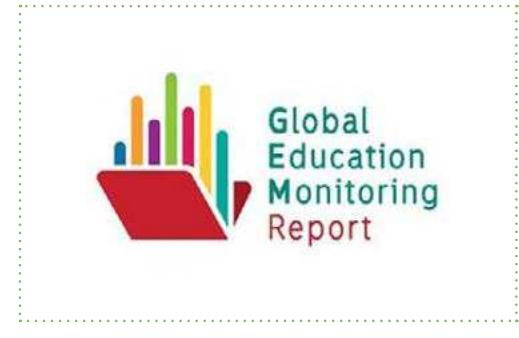
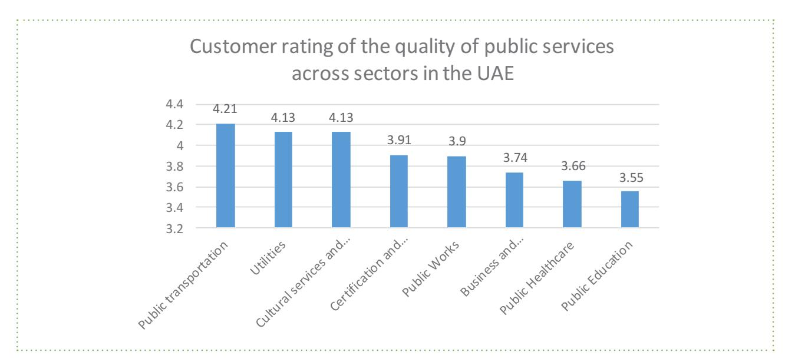
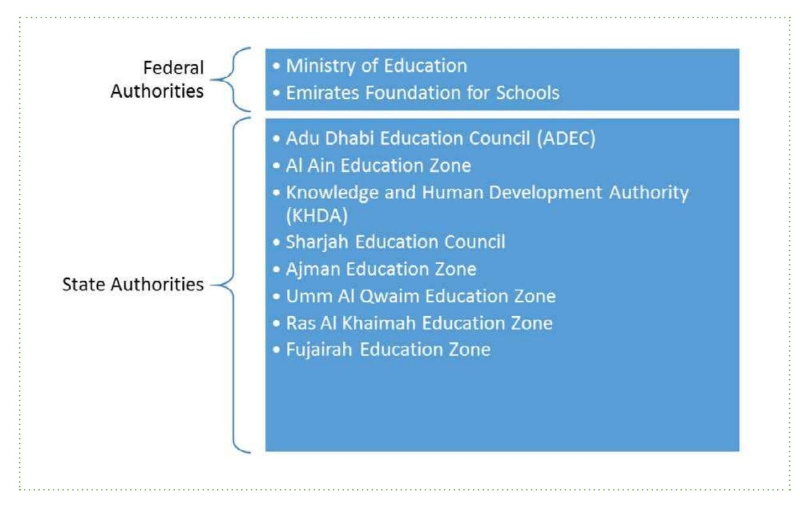
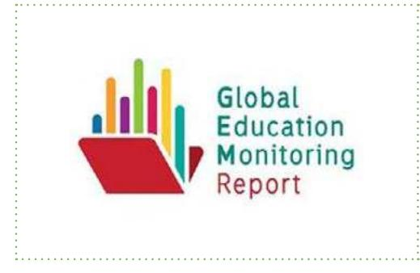
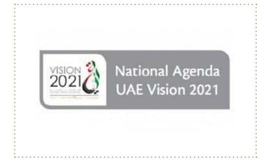
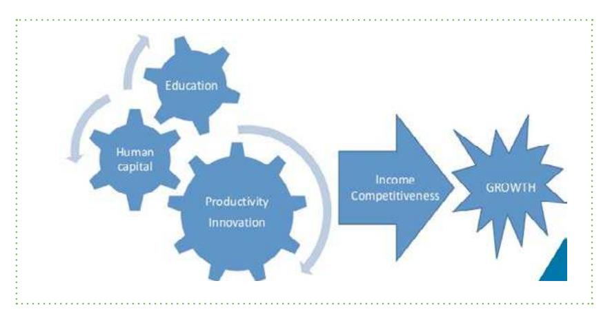
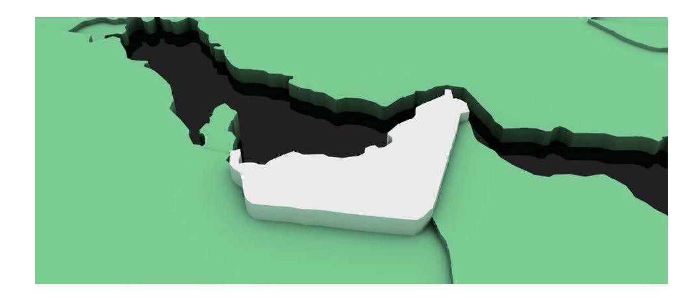
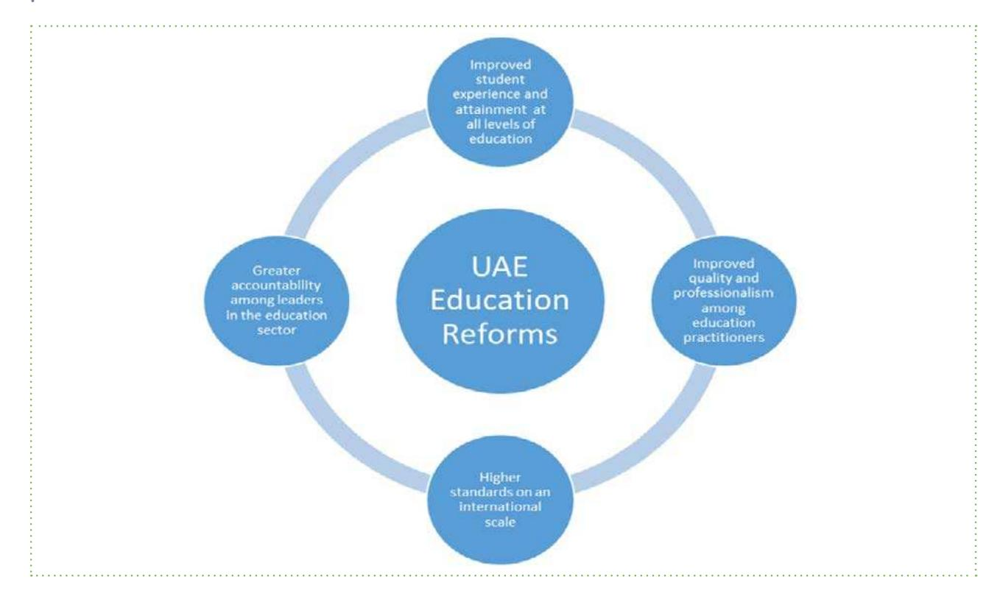
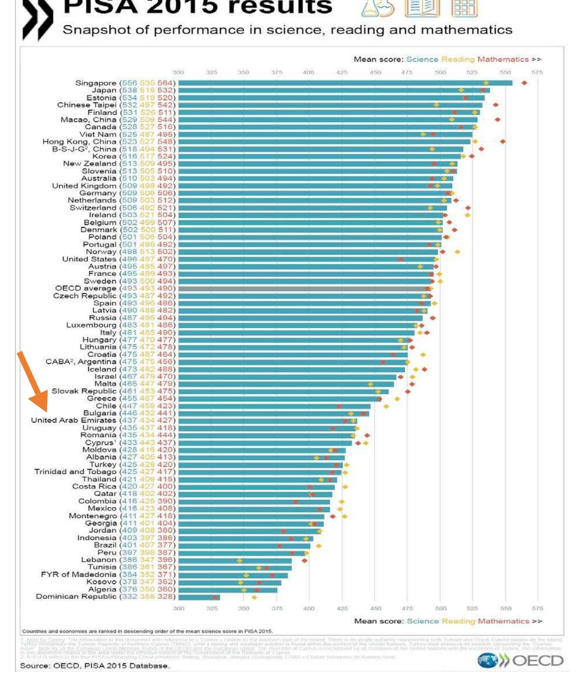
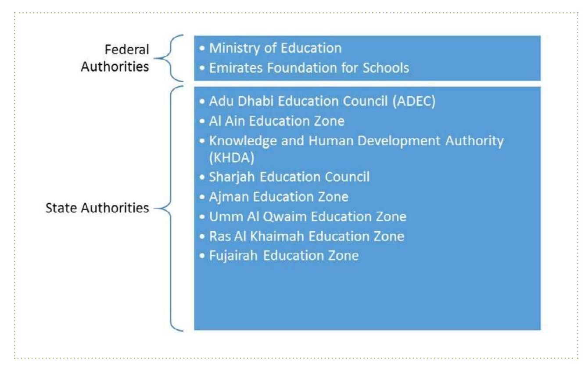

<!-- A1.R47 | source: papers_json/A1.R47/ -->

## **A FERTILE OASIS:** **THE CURRENT ** **STATE OF EDUCATION** **IN THE UAE**

**Dr.Racquel S. Warner & Dr.Guy Jonathan S. Burton**

<!-- page 2 -->

<!-- page 3 -->

منتدى الإمارات للسياسات العامة UAE Public Policy Forum

<!-- page 4 -->

<!-- page 5 -->

## **About Mohammed Bin Rashid ** **School of Government (MBRSG)**

**Launched in 2005 under the patronage of His Highness Sheikh Mohammed Bin Rashid Al ** **Maktoum, UAE Vice President, Prime Minister and Ruler of Dubai as the first research and ** **teaching institution focusing on governance and public policy in the Arab world. The School ** **aims to support good governance in the UAE and the Arab world, and build future leaders ** **through an integrated system offering education and training programs, as well as research ** **and studies.**

**The School's operations are founded on global best practices developed in collaboration ** **with the Kennedy School at Harvard University, and it is considered a unique model for ** **academic institutions in that it focuses on the practical side of governance. The School ** **also collaborates with several government and private institutions both regionally and ** **internationally.**

**The overall design and implementation of training programs is built on the foundation of ** **scientific thought and is inspired by the reality of Arab public administration and with a ** **view to addressing the issues and helping future leaders meet the challenges facing public ** **administration in various parts of the Arab world. The School also organizes international ** **and regional conferences and specialized workshops, and holds forums to facilitate the ** **exchange of ideas and knowledge between Arab region and the world.**

<!-- page 6 -->

<!-- page 7 -->

## **Executive President Note**

**With increased access to vast amounts of knowledge, and with the cultural openness and ** **technological advancements of the twenty-first century, the world has become a small ** **village where the politics and economies of states affect one another. Dubai is no exception ** **with the city's name becoming synonymous with globalization. It is with this in mind that ** **Mohammed Bin Rashid School of Government strives to embed the guidelines set forth by ** **the UAE and to support the vision of its leaders for national growth. By preparing, qualifying ** **and empowering tomorrow's leaders, and by strengthening government capacity in the UAE ** **and the Arab world, our School aims to promote effective public policy through focusing on ** **applied research and engaging the public and private sectors in the development process.**

**Over the 12 years since its establishment in 2005, the School has proved its importance as a ** **unique role model for academic institutions. The School works in close partnership with UAE ** **government departments, combining applied research, training and education programs, ** **and provides a platform for knowledge exchange.**

**In order to achieve its mission, the School adheres to global best practices developed in ** **collaboration with US-based Harvard Kennedy School that prepares leaders for democratic ** **societies and contributes to finding holistic solutions to public problems. Such collaborations ** **have enabled MBRSG to become the first research and teaching institution focused on ** **governance and public policy in the Arab world. In this context, the School has taken on the ** **task of disseminating the UAE's exceptional experience in governance and implementing ** **the vision of His Highness Sheikh Mohammed Bin Rashid Al Maktoum, Vice-President and ** **Prime Minister of the UAE and Ruler of Dubai.**

**Dr. Ali Sebaa Al Marri**

**Executive President** **Mohammed Bin Rashid School of Government**

<!-- page 8 -->

<!-- page 9 -->

## **The Imperative for ** **Education Expansion ** **and Reform**

**Education in the UAE is currently undergoing a period ** **of remarkable reforms. The nation has pursued ** **policies which are in line with not only its neighbors ** **and the wider MENA region, but which have affected ** **most countries around the world. Global education ** **reforms (GERM) are taking place as part of the OECD ** **and UNESCO sponsored initiatives to improve access ** **and the quality of education around the world. Simply ** **put, the past few decades have seen a widespread ** **expansion in the coverage of schools and educational **

**opportunities. Indeed, in examining the MENA region, the World Bank (2014) recently listed ** **a number of achievements experienced by states, including increased access to the point ** **of universal education among both boys and girls (and reduction of the gender gap whereby ** **many girls are now outperforming boys), reduced illiteracy and greater government financial ** **investment.**

**The fervor with which these reforms are being pursued raises questions about what are the ** **objectives of these developments and the reforms associated with them. What do they say ** **about the purpose of education in the country more generally? Is it to socialize children ** **and young people into society, to transmit prevailing norms and values? Is it a largely ** **utilitarian phenomenon, designed to prepare young people for the labor market and the ** **world of work? Alternatively, are the reform goals broader and less material? Is it meant to ** **be transformational, to challenge the prevailing system and build a new world? In examining ** **such questions, it is necessary to study the actions and intentions of the state in question. ** **States use policies to transmit a society's values, knowledge and beliefs. How they do ** **that, tells us much about its power and the relative influence of other actors it encounters, ** **whether they are social, political or economic (Apple 2003, Kivinen and Rinne 2000, Lawton ** **and Gordon 2002).**

**To address these questions, the paper initially examines the state of educational reform in ** **the UAE in two parts. The first section considers the purpose and practice of education and ** **recent trends in global education reform. It notes that despite the increased coverage and ** **opportunities, the intention of such changes have been contested. During the middle decades ** **of the last century, a 'progressive' agenda has arguably accompanied the universalization ** **of education for boys and girls. However, the extent to which this development constituted ** **a transformative or pragmatic objective varied. In the last quarter of the twentieth century, ** **these ideas were challenged by the 'human capital model' of education, which incorporated ** **both market and conservative ideas and goals. While this model has dominated the policy ** **debate into the present, it has been challenged by other, more critical voices concerning ** **the purpose of education. A second section then considers how the situation is further **

<!-- page 10 -->

**compounded by historical legacies in the global South and the MENA/Arab world especially. ** **In particular in this region much of the educational expansion of recent decades has been ** **associated with a Western-oriented 'modernization,' which inherently challenges and ** **undermines local and indigenous forms of knowledge.**

**The paper then explores the character of the recent ** **educational reforms in the UAE and situates them in ** **relation to the perspectives offered in the first section. ** **It considers the role and purpose of education in the ** **UAE and the current reform agenda for education ** **as set out in the UAE's National Agenda 2021. There ** **are four main pillars associated with the plan: to ** **improve students' experience and attainment at all ** **levels; to improve the quality and professionalism ** **among educators; to ensure higher standards at an **

**international level; and to ensure greater accountability within the education sector. Analysis ** **of these pillars is then followed by observations relating to the reforms from education ** **leaders in the UAE who were interviewed for this project. Finally, the paper summarizes ** **some of the main and outstanding challenges facing education reform in the UAE and ** **possible ways forward.**

<!-- page 11 -->

## **Education Expansion in ** **historical and ideological ** **perspective**

**The contemporary drive to expand educational coverage and opportunities has its roots in ** **the nineteenth century. However, in most societies – and especially those in the Arab world ** **and particularly in the Gulf – the significant period was from the middle decades of the last ** **century. Since the mid-1960s there has been a general drive towards education expansion at ** **the primary, secondary and higher levels, as well as pre-schooling and in relation to previously ** **excluded groups. That drive was broadly associated with the 'progressive' moment, which ** **coincided with the rise of significant state and nation-building process in both the global North ** **(also synonymous with the West) and South. The period was defined by the rise of political ** **parties, movements and leaders concerned with advancing the concerns of the subordinate ** **or laboring classes. Miliband (1982, 1989) memorably described this group as the 'have nots'. ** **This was an era saw the construction of more schools, training of more teachers and the ** **production of entitlements to increase access by marginalized groups (Dewey 2007, Whitty ** **1997, Trowler 1998). By 2000, many of these notions had become enshrined in the Millennium ** **Development Goals, which advocated universal primary education and measures to enable ** **marginalized groups to acquire more of it.**

## **Education is not preparation for life;** **Education is life itself.**

## **- John Dewey**

**The progressive move was not uniform though. Within it, there were at least two distinguishable ** **trends: its 'shallow' and 'deep' versions (Burton, 2008). Drawing on the educationalist Paulo ** **Freire's work, 'shallow' progressivism emphasized education as a process of 'banking', ** **in which teachers deposited information into students within a wider context of non****transformation inside and outside the school; the status quo prevailed. By contrast a 'deeper' ** **version assumed education to be a dialogue, in which students not only acquired information ** **and knowledge but applied it in such a way as to change their own immediate and surrounding ** **reality. Here, deep progressive education was associated with transformation of relationships ** **within and beyond the school (Sarup 1982, Freire 1978, 1985).**

**Seen from a broader perspective, this process and its purpose was identified by Cohen ** **(2010: 25) as a largely Western-led project. Since the nineteenth century, the intention by ** **policymakers and educators was to use schooling as a tool to build tolerant societies from the ** **diverse immigrant and native cultures (in the US). That goal continued into the twentieth century, **

<!-- page 12 -->

**but on a global level, with the ** **intention being to build such ** **tolerance at an international ** **level and cross-nationally. At ** **the same time, the process ** **of educational expansion ** **coincided with a debate about ** **the purpose of education had ** **remained constant: whether ** **it was to acquire specific ** **technical skills or for the ** **whole education of the child. **

**Agencies such as the OECD and UNESCO became effective vehicles for this movement.**

**However, a number of factors undermined the rise of this 'progressive' education. Although ** **more children were being educated, the quality of that schooling remained relatively limited. ** **Furthermore, the advance of education was undermined by its growing cost to the public purse ** **and – especially in the global North – growing political opposition to professional teachers' ** **employment demands and organization. By the 1970s, political parties and governments had ** **come to power in North America and Europe who sought to curb their agitation and to reduce ** **the size and role of the state.**

**While the gains of expanded coverage were not rejected, the purpose for which they had been ** **implemented was reconstituted. Increasingly a more conservative and market-led approach to ** **education emerged. From the 1970s and 1980s these elements came to the fore and obscured ** **the gains made by progressivism (Giroux and McLaren 1989, Sarup 1982). Both shared the ** **common belief of education as a utilitarian project to prepare young (and – as the definition ** **of education was expanded to include adult and life-long learning – older) people for work. ** **During the 1980s, this was evident in their greater calls for more vocational training (Moore ** **1987, Fernan 1997). This common objective transcended any differences that were present ** **between them: namely the market-led approach's focus on the individual and conservatives' ** **more communitarian orientation. Whereas market reformers pursued policies that promoted ** **greater choice, competition and diversity in the education sector, conservatives favored ** **government interventions that would maintain societal traditions, morals and order (Whitty ** **1997, Apple 1997, Trowler 1998, Giddens 1998, Manzer 2003). Indeed, although apparently ** **contradictory, both trends complemented each other: market reformers pursuit of a smaller ** **spending role by the state meant and greater diversity and competition in schooling options ** **was aided by conservatives' standards, tests and assessments of students and schools; ** **those which met or exceeded them prospered, those which did not were subject to sanctions ** **(Apple 1997).**

**Despite their initially differing outlooks, the market and conservative strands have coalesced ** **into a singular, general concept: the human capital model. Moreover, that model has persisted ** **into the present and debatably constitutes the prevailing ideological and policy discourse ** **in education today. Indeed, recent analysis of educational objectives and policies have ** **emphasized this approach: Cheng (2010) has argued that unless people gain particular skills ** **and the ability to work in teams, they will not be prepared to compete in the increasingly ** **competitive global economy. Indeed, as recently as 2008, Soguel and Jaccard (2008: 2) ** **could still claim that the main aim of most governments was to expand education to universal ** **coverage and increase student attainment in order to realize greater equality and efficiency – ** **but at the least possible cost to the public purse as possible. At the same time, if government **

<!-- page 13 -->

**needed to invest in education, the investment could justified on the grounds of its 'spillover' ** **effect. Other than direct student attainment, other factors could result, including economic ** **development, reduced poverty, better health, less crime, more tolerance, less extremism and ** **greater political stability (Soguel and Jaccard 2008: 2, Cummings 2010).**

**Alongside the prevalence of the human capital model and its supposed spillover effects, ** **recent decades have seen the phenomenon of globalization affect the education debate. ** **Policymakers around the world, whether in government or in international organizations like the ** **World Bank, OECD and IMF, came to share the same goals. The result was a greater willingness ** **by policymakers to borrow and transplant policies applied in one part of the globe to the other. ** **Sometimes this was done wholesale; in other cases they were redesigned and adapted to suit ** **local circumstances (Spring 2009). Pasi Sahlberg, an influential Finish educator, researcher ** **and policy adviser, has noted a common trend in such reforms, from a standardization of ** **education policies and a focus on core subjects (especially literacy, numeracy and science), ** **to the use of corporate management models and test-based accountability in schools. All of ** **this is underpinned by 'the search for low-risk ways to reach learning goals.' (Sahlberg 2017) ** **In addition, the inputs are subject to evaluation as well, through performance evaluation of ** **teachers. In terms of content, schooling in the human capital model has incorporated more ** **scripted lessons and the learning of languages, especially English, which is seen as way to ** **prepare young people for jobs in a competitive global market (Spring 2009: 16-7).**

**However, the human capital model has not gone unchallenged. Despite the obstacles faced by ** **'progressive' education in the 1970s and 1980s, a critical view of education and its purpose ** **has persisted. Today progressive education advocates emphasize teacher professionalism ** **and autonomy, active learning associated with students' interest and participation in those ** **subjects. The purpose, to which these measures are put, is that of achieving social justice ** **(Spring 2009: 18). Examples of the assumptions implicit in this are present in the analyses ** **offered by Mahbubani (2010) and Cummings (2010). Mahbubani sees the role of education ** **as imparting commonalities and the universality of the human experience in children. Such ** **themes are arguably best served by cultivating enquiring minds that are questioning and given ** **to critical reasoning. Cummings adds to this perspective by noting that many of the 'spillover' ** **effects associated with education might be achieved less with public spending and more with ** **the (re)design of educational infrastructure (schools, curricula, teachers) and technology use ** **as a means to achieving them.**

**While the progressive approach to education can co-exist with some of the developments ** **associated with the (Northern/Western) human capital model, a more challenging analysis is ** **also present. One, associated with post-colonialism and world systems, has drawn on world ** **systems analysis and the separation of the world into a dominant Northern (or Western) core ** **and a subordinate (and more dependent) periphery in the developing South. The asymmetrical ** **relationship between the two is manifested not only materially, between an economically ** **richer North and poorer South, but in the realm of ideas, with organizations like the OECD, ** **World Bank and IMF providing both intellectual credibility and financial influence (Spring ** **2009). In addition, other perspectives – religious and indigenous based – have also contested ** **the prevailing human capital model. Religious education aims to compensate for the oversight ** **of moral and spiritual values within education, while the indigenous model seeks to protect ** **the identities and practices of groups, who see themselves as distinct from the prevailing and ** **dominant Western model (Spring 2009: 19-20).**

<!-- page 14 -->

## **Educational ** **Development in the Arab ** **World**

**The previous section has highlighted the strong association of prevailing educational trends ** **at the global level with the global North and West. This is especially pertinent when considered ** **in relation to the MENA region and the Arab world. In his survey of the educational debate in ** **the region during the first decade of the present century, Abi-Mershed (2010: 2) has noted ** **distinct differences between policymakers and scholars. The former have tended to subscribe ** **to the human capital model of education to promote economic growth and development, the ** **latter more critical of such policies, seeing within them a reconstituted form of (Western) ** **cultural imperialism and neo-colonialism. **

**Three main concerns have vexed Arab educational observers. The first concerned the role ** **of education for development and the relative failure of policies to achieve this to date. Even ** **though earlier reforms had expanded coverage and investment, the failure was due in large ** **part to a mismatch between the content and quality of that education and the surrounding ** **requirements of the domestic and global economy Abi-Mershed (2010: 2-3). The World Bank ** **(2008) noted this in its analysis of Arab education. On one hand, educational expansion has ** **broadened to cover a wider section of the population, including girls – even though it has ** **been of largely poor quality. This has increased the available labor supply. Population growth ** **is set to increase the number of graduates from the school and university sector as well. On ** **the other hand, economic growth across the region has slowed in recent decades compared ** **to the 1960s-70s and has proved unable to accommodate more educated workforce. This ** **observation has prompted recommendations that education reform should occur alongside ** **economic and labor market reforms.**

**The second concern for Arab educational observers was the relationship between education ** **and the Arab nation-state and citizenship. Critics of reform claimed that policymakers' actions ** **have led to education models that mirrored the 'modern' Western model at the expense of ** **local, culturally and historically rich Arab-Muslim forms of education (Abi-Mershed 2010). ** **Indeed, writing about the Gulf and Qatar in particular, Bashshur (2010: 268) has warned ** **against such wholesale adoption of such ideas and practices. He notes that notwithstanding ** **the consensus in favor of reform, the present vertical relationship – in which institutions from ** **the West have taken a lead in designing, shaping and overseeing their branches in the Gulf – ** **needs to be rebalanced in favor of a more horizontal version. Such an approach would result ** **in a relationship, which is mutual and collaborative between local and foreign institutions and ** **actors.**

**The third issue concerns the extent to which education in the Arab world contributed to less ** **extremism and terrorist threats. Among the criticisms made of Arab education has been its poor ** **quality and anti-Western content that has limited young people's economic opportunities and ** **increased frustration (Abi-Mershed 2010: 3-5). The Arab spring was unmistakable evidence ** **of this conundrum. Reformers and policymakers try very hard to strike the right balance to ** **appease the religious majority and the employability demands of industry.**

<!-- page 15 -->

## **Purpose and practice of ** **education in the UAE**

**Moving from the global and regional to the national level, it is clear that the education sector ** **in the UAE has experienced unparalleled growth over the past 20 years and that the UAE has, ** **in one sense, detoured from the historic practice of education in the wider Arab world (See ** **Appendix). The sector has become a key driver in the country's developmental goals. Out ** **of respect and in memory for the late visionary leader His Highness Sheik Zayed Bin Sultan ** **Al Nayhan who said 'the greatest use that can be made of wealth is to invest it in creating ** **generations of educated and trained people', the current leaders of the UAE have allocated ** **more than a third of the national budget to education. According to Meed Middle East in ** **2010, the UAE's spent $2.7 billion on education, representing 22.5 percent of its annual ** **budget (Meeds.com 2016). This figure doubled in 2011 when the allocation for education ** **and social development increased to 46 percent of the federal budget. This tangible action ** **indicates a firm commitment to investing in and developing the education sector. The strong ** **focus on developing the human capital of the UAE in order to meet the UAE 2021 Vision of ** **making the UAE one of the best countries in the world by the time the national celebrates ** **its Golden Jubilee is a recurring theme in education literature. The vision for the population ** **of the UAE to be highly educated and skilled, aligns well with the ambitions for economic ** **competiveness and the progressive brand of education that is being plied as the mechanism ** **through which these educational goals are to be realized.**

**In 2014 Highness Sheikh Mohammed Bin Rashid Al Maktoum, Vice President and Prime ** **Minister of the UAE and Ruler of Dubai announced a mechanism for achieving the UAE ** **Vision 2021 when he announced the UAE National Agenda 2021. The main goal of National ** **Agenda is to develop a first rate education system in which all school will be transformed ** **in smart learning environments. The national Agenda includes eight pillars that will lay **

<!-- page 16 -->

**the foundations for the future development of the UAE. They are education, healthcare, ** **economy, police and security, housing, infrastructure and government services education ** **system. Under the pillar of education, eight empirical indicators will measure the progress ** **of the sector toward the National Agenda. They are:**

- **1. To be among the top 20 countries with highest performance in the Program of International ** **Student Assessment (PISA) test**
- **2. To be among the top 15 countries with highest performance on Trends in International ** **Mathematics and Science Study (TIMSS)**
- **3. The ensure that all schools (public and private) in the UAE have high quality teachers**
- **4. To ensure that all schools (public and private) have highly effective leadership**
- **5. To ensure that 90 percent of students in the ninth grade of public and private schools ** **have a proficiency in Arabic**
- **6. To increase the high school graduation rate to 98 percent among Emirati students**
- **7. To provide early years education to 95 percent of children between age 4 and 5 through ** **public and private preschool provisions**
- **8. To eliminate the need of Emirati students having to complete a foundation programme to ** **qualify them for university entry.**

**Inherent in these indicators is a focus of the country's education reform goals of better ** **preparation of students at all stages of their education, greater accountability among leaders ** **in the sector, higher standards on the international scale and improved professionalism ** **among teachers. There are obvious synergies among the indicators in relation to the focal ** **points of the outlined reforms.**

***Figure 2: Focal points of UAE Education Reform 2016***

<!-- page 17 -->

**While there is some altruism in these goals, it is evident that this huge investment in human ** **capital through prescribed performance indicators in education is expected to yield ** **economic success in an increasingly knowledge–based and competitive world. In January ** **2017, Hussain Ibrahim Al Hammadi, the UAE's education minister, captured this point when ** **he said:**

**We want to move from an economy based on oil to a new economy based on the human ** **knowledge of both nationals and expatriates alike who will use knowledge as a tool to ** **compete and move the country forward… We know there is a continuous change in our ** **world in terms of employment, and that the global trend is that a person will not have one ** **sole job or skill. That is why we have to equip graduates with general and specialized skills ** **so that they can be flexible with their jobs and the requirements of the fourth industrial ** **revolution (Zaatari 2017).**

**Through its active role in defining the national agenda for education reforms, the UAE ** **government is ensuring that the happiness, quality of life, empowerment, dignity, security ** **and self-respect of it people can be achieved. The concerted effort being taken by the ** **UAE government is clearly an attempt at mitigating past failures experienced in the reform ** **of education in the Arab world. The issue of coverage and investment are being closely ** **aligned with content and quality that are being publicly benchmarked against international ** **standards. The provision of education in the UAE has intentionally been moved from the sole ** **domain of government and has become a joint function of the public and private sector. This ** **public private partnership approach has incentivized investment in the sector and resulted ** **in unparelled growth of education provision from early childhood to the tertiary level that ** **was not experience in many other Arab states.**

<!-- page 18 -->

## **Recent trends in ** **education reform in the ** **UAE**

## **1. Improved student experience and attainment at all levels of education**

**National agenda indicators related to Arabic proficiency, high school graduation rates, early ** **childhood provisions and eliminating the need for a foundation year are all geared toward ** **improving the educational experience students have in UAE schools and increasing their ** **levels of attainment. To operationalize these goals there have been a number of recent ** **declarations.**

**Changes to the K-12 curriculum for public schools, designed by the Ministry of Education, ** **were approved by Sheikh Mohammed Bin Rashid Al Maktoum in summer 2016. Updated ** **textbooks, a cohort of English –speaking teachers, and revised subject choices, from grade ** **10 onwards, such as life skills, creative design and thinking, entrepreneurship, technology ** **and health science, form part of the 2016 reforms. These new subjects will complement the ** **existing offerings of Mathematics, science, social studies, Islamic studies and languages. It ** **should be noted, that social studies curriculum has been upgraded to include relevant and ** **contextual information about history, geography, economics and politics because the UAE ** **is keen to avoid exclusion of its history and culture from the education system. There will be ** **an increased frequency of physical education, arts and music. The content of the revised ** **curriculum aligns with international standard and all subjects except English Language will ** **be taught in Arabic up to grade 9. A system of streaming students has been introduced ** **as part of the reforms. Students who are performing to a high standard will be moved to ** **advanced classes in Math and Science disciplines and they will be taught using English ** **as the medium of instruction. Presently, the MOE is working on a curriculum for moral ** **education, which will be piloted in January 2017. The Ministry of education has expressed ** **confidence and optimism that these reforms to the curriculum will 'tackle several issues in ** **the education system in the UAE.' (Yahyaei 2016)**

**One of the pertinent issues that requires tackling is the UAE's performance on International ** **standardized tests such as PISA, TIMMS and Progress of International Reading and Literacy ** **Study (PIRLS). The UAE's participation in these international assessments provides a ** **mechanism for comparison of the education system against international benchmarks. ** **Among regional Arab states, the UAE has often placed at the top for literacy and numeracy ** **benchmarks, however the same cannot be said against international standards. In the 2011, ** **TIMMS report Dubai Ranked 42nd place Grade 4 Mathematics, 43rd in Grade 4 Science ** **and 23rd in Grade 8 Science, out of 63 countries. In the 2015 TIMMS report released in ** **November 2016, the UAE is one of 17 countries to show overall improvement in Math and ** **Science in grades 4 and 8 (TIMSS2015.org 2016). However, the race toward to National **

<!-- page 19 -->

**Agenda goal of ranking in the top 15 countries by 2021 seems like it will be more of a well****paced jog than a sprint. In PIRLS assessment UAE's reading achievement average was ** **439 points of a possible 600, placing the country in between the intermediate to low bands ** **on the international reading scale. In the PISA 2012 report, Dubai ranked 48th place for ** **mathematics, 44th for science and 46th for reading out of 65 countries. The National Agenda ** **goal for 2021 is to be in the top 20 ranked countries. In the most recent round of the PISA ** **test, the results of which were published in December 2016, the UAE as a whole, moved ** **up one place in math, but fell two places in science and reading (Educationjournalme.com ** **2016). By contrast, private schools were performing at or above the average in science and ** **reading and had seen a 3-point increase in math. Notably the latter still remains under the ** **OECD average.**

**A most significant initiative to improve national reading levels was the declaration of 2016 ** **as the Year of Reading based on the directive of the President His Highness Sheikh Khalifa ** **bin Zayed Al Nahyan. Going one-step further to legislate reading into the culture of the ** **UAE, a reading law was passed on November 2016. The rulers of the country see this as ** **a necessary step in achieving the vision of making the UAE a knowledge based economy. ** **His Highness Sheikh Mohammed Bin Rashid Al Maktoum, Vice President and Prime Minister ** **of the UAE and Ruler of Dubai said 'Our goal is for 2016 to be the start of a sustainable ** **cultural change among generations – a change that consolidates the importance of reading, ** **celebrates knowledge and boosts the status of reading.' (UAEcabinet.ae 2016). **

**Improving the student experience and levels of attainment across all levels of education is ** **a fundamental step in achieving the vision of Sheikh Khalifa, who said:**

**[O]ur goal is to prepare generations that work towards excelling and achieving ** **the vision of the UAE, which since its inception has recognized the importance of ** **knowledge, science and culture, and harnessed them in the best interests of the ** **homeland and Emiratis (UAECabinet.ae 2016). **

**All reforms and initiatives to improve experience and attainment the past 5 years have clearly ** **been driven by this national agenda. There are however, still gaps in the focus of school ** **inspection frameworks that are being used to evaluate the quality of education, because they ** **reflect only literacy, numeracy and science metrics based on standardized tests. In order to ** **give a better picture, these frameworks must be revised to include humanities, business and ** **art disciplines. Benchmarking against international standardized tests should not be to the ** **exclusion of proper evaluation of the efforts to develop students with the required problem ** **solving, critical thinking and life skills that will position them to be the labor forces that is ** **required for a knowledge -based economy.**

<!-- page 20 -->

***Figure 3: PISA Caption for 2015***

## **2. Improved quality and professionalism among education practitioners**

**Providing education is a most ubiquitous and costly responsibility of the public sector in ** **modern societies. In the GCC, the private sector will invest Dhs550 billion in the education ** **sector in 2016-17 financial year (Ardent Advisory & Accounting LLC 2016). With a compound **

<!-- page 21 -->

**annual growth rate (CAGR) of 6.3 percent in the private education sector between 2013 and ** **2020, the high level of private sector investment is understandable. A growing population, ** **favorable investment climate, drives growth in the education sector and increasing demand ** **for school places in the UAE. Between 2013 and 2016, student enrolment in private school ** **increased from 225,099 to 295,157 (Oxford Business Group 2016). The large investment ** **from private sector into education underscores the market driven nature of education in ** **the UAE. Altruism aside, investors expect a return on their investment and so school and ** **universities operate using a business model. In the UAE, which is branded as 'the most ** **developed education market in the region', the government has set up a model of public ** **private partnership for the delivery of education to a high standard. The federal budget ** **allocation for education was 20.5 percent for 2016-17, which amounts to Dhs25.2 billion ** **(UEAcabinet.ae 2016). According to Oxford Business Group (2016), Dubai will require 53 ** **new schools by 2020 and Abu Dhabi will require 44. The Abu Dhabi Education Council (ADEC) ** **reported in 2015 that private schools in Abu Dhabi earned close to Dhs3 billion in profit over ** **the preceding four years. Investment in private schools in Abu Dhabi between 2010 and 2015 ** **reached Dhs2.3 billion between 2010-2015. Besides the huge profits, another direct result ** **of these massive joint investments in education is the employment opportunity for teachers ** **and administrators who play a pivotal role educational effectiveness and by extension, the ** **economic success of schools.**

**Measuring teacher quality in order to determine educational effectiveness has been a ** **sensitive and elusive topic in the literature (Cheng 1996, Mortimore 1991, Sammons 1996). ** **Historically, researchers have not sought to significantly correlate teacher quality with ** **student outcomes, especially in jurisdictions where education is a public service. Most of ** **these researchers studying educational effectiveness focused on equitable distribution of ** **resources, retention rates, academic achievements and infrastructure (Rowe 2003). While ** **these factors for educational effectiveness have not been ignored in the UAE, the governance ** **model in the education sector has adopted a Total Quality Management (TQM) approach to ** **monitor and measure the quality of the service being provided. Teacher quality has been ** **brought under the spotlight and the annual round of school inspections undertaken by the ** **Knowledge and Human Development Authority (KHDA) in Dubai and ADEC in Abu Dhabi for ** **example, forces an outcomes-driven agenda. The overarching belief is that the quality of ** **education offered will not exceed that of the quality of the educators. The results from the ** **school inspections have shown a link between teacher quality, instructional effectiveness ** **and educational effectiveness. In the private schools where the curriculum requires student ** **engagement strategies and a holistic learning framework, the results are characteristically ** **better, than in the public schools where rote learning and memorization are the salient ** **instructional approach. **

**The fallout from teachers who are not properly equipped to explore pedagogies of engagement ** **are dire (Tapscott 1998, Prensky 2005, Claxton 2007). The UAE National Agenda requires all ** **public and private schools to operate to the same level of professionalism and effectiveness, ** **in order to ensure that the 2021 targets are met. Engaging learners who lack the required ** **motivation to learn is one of the biggest challenges educators face (Willms 2003). In a study ** **conducted in high schools across America, Cothran and Ennis (2000) reported that between ** **25 and 66 percent of learners suffer from disengagement. In the UAE, a study done by Booz ** **and Company revealed that **

<!-- page 22 -->

**lack of well-trained teachers, outdated teaching methods, curricula that are ** **neither relevant nor innovative, limited use of technology in the classroom, and ** **little in the way of academic advice or career counseling are contributing to the ** **mismatch between the outputs of the GCC's education system and the needs of the ** **employment market (Arabiangazette.com 2013).**

**Of note, Singapore, which was at the top of the PISA tables in 2016, credits its consistent ** **performance to a cadre of well trained teachers who are the top five percent of graduates ** **from the centrally controlled National Institute of Education (BBC.com 2016). Learners today ** **want to be in social constructivist environment, where meaning is negotiated, where they ** **are given space to be creative and innovative, where they can interact with their peers, be ** **connected to technology and explore the world in an authentic way. In a study by Dunleavy ** **and Milton (2009) students identified three characteristics of an ideal learning environment:**

- **1. Collaborative learning with peers and others in the community**
- **2. Drawing on expert resources **
- **3. The opportunity for extended conversation beyond the classroom about their ** **study. (p.10)**

**The new curriculum adopted in Abu Dhabi schools facilitate this type of learning but teachers ** **have to be trained in order to make the transition to this learning environment. Over the ** **summer of 2016, the Ministry of Education has invested significant amounts of government ** **resources to the professional development of teachers. The Ministry of Education in Abu ** **Dhabi is planning to train 10,000 public school teachers within the next five years. By ** **2020, they hope to reach 90 percent level of Emiratization in the public education sector ** **(UAEInteract.com 2016) Initiatives from Abu Dhabi Education Council such as Tanmia and ** **Tamkeen are all effort geared toward the provision of appropriate professional development ** **for school leaders and teacher in 21st century pedagogical strategies. Teachers in the ** **public school system are contractually required to complete a minimum of 30hours of ** **professional development. These initiatives provide the required context in which the in****service professional development can be done. **

**A less binding, but equally effective professional development initiative launched in the ** **emirate of Dubai by the KHDA in 2012 is the What Works program. Conceptually underpinned ** **by the theory of appreciative inquiry (Cooperrider and Srivastva 1980), What Works is ** **an initiative that encourages collaboration among school leaders and teacher who come ** **together and share best practices across multiple curricular structures. The goal of this ** **exchange is professional development which will improve student learning outcomes (KHDA ** **2016).**

**Going a step further to ensure the achievement of the National Agenda goal of a first rate ** **education system, the Ministry of Education announced in May 2016, a five-year plan to have ** **all teachers in the UAE federally licensed by 2021.This unified licensing system was proposed ** **in 2014, but was not activated. The National Qualifications Authority (NQA), the Ministry of ** **Education, the Abu Dhabi Education Council, Knowledge and Human Development Authority **

<!-- page 23 -->

**(KHDA), Abu Dhabi Centre for Technical and Vocational Education and Training, and the ** **Institute of Applied Technology will be coordinating efforts to implement the teacher license ** **system. This new requirement is intended to improve the overall professional competence ** **and quality of teachers in the classrooms. Teachers will require a minimum of a bachelors ** **degree to be considered for this license. So far 750 teachers from public school have started ** **the pilot program and will complete the examination by 2017 (ADEC 2016).**

## **3. Higher standards on an international scale**

**As part of the economic diversification strategy of the past decade, the UAE has established ** **and marketed itself as an educational hub for the region. The Emirate of Dubai has led this ** **agenda as a commercially viable global city in which there are multi-facetted educational ** **opportunities for investment and study across all spectrums of the education dimension****kindergarten to university. The Dubai International Academic City and Dubai Knowledge ** **Park are two examples of education free-zones that were established to attract investment ** **in education institutions at the post-secondary level and to promote Dubai as an educational ** **hub. Surveys of students studying in the free-zones indicate that only 5.8 percent are ** **Emiratis (KHDA 2015). Dubai has clearly succeeded in becoming a preferred destination for ** **international students, from the MENA region and the Indian subcontinent, seeking quality ** **education. The education sector attracts high quality professional talent because of the ** **superlative infrastructure, evidence of innovation and visionary approach the leadership of ** **the emirate has taken in developing the sector. Dubai's position as an international center ** **for education contribute over US$3 billion to the economy each year (Altamont Group, 2016). **

**Despite the position of Dubai as an education hub, the UAE's ranking on the World Economic ** **Forum (WEF) Global Competitiveness Index fell from 12 to 17 out of 114 countries in 2015. ** **The assessment of the new category of enrolment in higher education and training in the ** **index as of 2015, negatively affected the country's ranking. This is because large majorities ** **of Western expatriates still prefer to send their children back to their home countries for ** **tertiary education, as they do not yet have full confidence in the system here. The UAE is ** **working very hard to address this perception by inviting leading universities to set up off ** **shore branch campuses in the UAE.**

**New York University (NYU), Paris Sorbonne, Heriot Watt, University of Wollongong, Middlesex ** **University, London School of Economics, Manchester Business School, Amity University are ** **just a few of the international institutions that have branches in the academic free zones. ** **Strict quality assurance standards are monitored by the KHDA and ADEC to ensure that ** **these institutions are the same standard of education that would be delivered on the home ** **campus. Local university provisions are licensed and accredited by the Commission for ** **Academic Accreditation (CAA) and the National Qualifications Authority (NQA) oversees ** **the standards of the programs being offered. After 10 years of operation, the CAA received ** **recognition from the International Network for Quality Assurance Agencies in Higher ** **Education (INQAAHE) for following best practices.**

<!-- page 24 -->

## **4. Greater accountability among leaders in the education sector**

***Figure 4: Quality of public service across different sectors in the UAE***

**In January 2016, the UAE government announced the unification of the Ministry of Higher ** **Education and the Ministry of Education. The new ministry will have a Ministers of State ** **for education and one for Higher Education. This not a surprising development because in ** **the UAE National brain-storming session that was held 2013, customer ranking of public ** **education was 3.55 on a 1 to 5 scale, the lowest among public sector entities as shown ** **in figure 4 (Salem, 2014). The international ranking of the sector on the World Economic ** **Forum Global Competiveness Report was 49 (Ibid). **

**The government has promised to make necessary changes to improve the education ** **provision. The consolidation of all education ministries aims to centralize the governance ** **structure of the full education spectrum in the country, from early childhood to tertiary, and ** **to increase quality, efficiency and innovation in the sector. The unified Ministry of education ** **is be better able to focus on aligning educational policies with present and future needs ** **among the various sectors in the UAE, in order to achieve the vision of being a knowledge ** **based economy. It is felt that this unification will also to bring greater accountability to ** **those in charge of each division within the ministry. A Higher Council of Education and ** **Human Resources was established to bring federal and private tertiary institutions being ** **under the control of the Ministry of Education and an autonomous management authority, ** **the Emirates Foundation for Schools, was given remit over public schools. The Minister of ** **Education welcomed the decision as one that would align the educational ethos of lifelong ** **learning across all sectors of education from nursery to university and create a smoother ** **transition for students from one level to the next. In essence, the consolidation has modelled ** **the increased level of accountability that is expected among leaders in the education sector. ** **This change reflects the ultimate direction of the UAE leaders, which is that public sector ** **ministries should be functioning more in the area of governance and delegating management ** **functions to other entities such as KHDA and ADEC.**

**The KHDA and ADEC have focused on empowering school leaders as a pivotal component ** **in education reforms for the past 5 years. Extant research supports this focus on leadership **

<!-- page 25 -->

**as being essential to school development (Leithwood & Riehl 2003, Hallinger & Heck 1996). ** **Some researchers purport that**

**Outstanding leadership has invariably emerged as a key characteristic of outstanding ** **schools. There can no longer be doubt that those seeking quality in education must ** **ensure its presence and that the development of potential leaders must be given ** **high priority. (Beare, Caldwell & Millikan 1992: 99)**

**In critical theory, educational leadership posit that it is the type of influence that a school ** **leader exerts among the staff to activate their agency, shape their practice, define their roles ** **and articulate their values within the context of institution's educational goals and vision ** **(Bush 2008, Busher 2006). The influence that leaders have over the practice of teaching ** **guarantees whole school development and educational effectiveness. School leaders are ** **intermediaries between national education goals and their immediate school contexts. ** **They have the responsibility of operationalizing, the national agenda in their institutions by ** **effectively getting buy in from teachers, parents and students. In the context of the UAE ** **school leaders are the drivers of the reform agenda and they have to adapt and align with ** **the policy directions of the National Agenda. Gill (2003) also suggests that the leadership ** **in such a context of reform requires vision and strategy in order to empower, motivate and ** **inspire those who are affected by the change. Implementation of reforms has always been ** **the bane of school principals in the UAE, but it was not until 2002 when the focus shifted ** **toward more accountability that many school leaders actually started to respond positively ** **to implementing the national reforms. This lack of accountability has plagued many Arab ** **education systems. Principals were measured based on their administrative skills, without ** **any accountability for the academic effectiveness of the school (Barber, Mourshed & Whelan ** **2007).**

**The UAE sought to break the cycle with the increased investment in education and the ** **setting up of public private partnerships in 2009 that sought to address the quality of school ** **leadership. An initiative called the Professional Standards for Principals became part ** **of the strategic plan for improving education in Abu Dhabi. Similarly, in Dubai the KHDA ** **implemented standard for school leadership as part of its School Inspection program. These ** **new standard of accountability expanded the metrics of evaluation of school principals to ** **include teaching and learning competence, community engagement, and strategic planning. **

**This increased level of accountability has been implemented with professional development ** **programs and collaboration among schools. Principals have to learn to navigate the ** **cultural and traditional beliefs about education in their communities while at the same time ** **implement the reform agenda that the new curriculum requires. Some have to reconcile ** **the negative sentiments towards Western models of education within their institutions and ** **placate the dissenting voices, which cry out against acculturation and dilution of traditional ** **Arab style education. The success of their schools are riding on their ability to close that ** **gap. Increased monitoring, reporting and inspections have added to the administrative load ** **of school principals but all this is designed to ensure that the UAE breaks the cycle of poor ** **reform implementation that has plagued Arab education for decades.**

<!-- page 26 -->

## **Perceptions of UAE ** **Education Policies and ** **its Reform Agenda**

**Having considered both the ideological direction of education policy and the reform process ** **in the UAE to date, it is critical to get a perspective from those working in the education ** **sector. As part of the data gathering for this paper, education leaders involved in strategic ** **planning and policy advice both inside and outside the government, as well as education ** **consultants, researchers, principals and managers at some of the country's leading schools ** **were interviewed.**

**In general, the respondents expressed support for the path being taken and summarized the ** **objectives of education in terms which aligned with the model of contemporary human capital ** **development. An emphasis is made on the 'contemporary' dimension in that it combined ** **both traditionally progressive notions of developing the inner worth and value of the student ** **alongside the more practical economic considerations of the job market. For example, one ** **respondent stated that the educational purpose of the UAE's schools and universities should ** **be 'To provide the highest possible outcomes for each student so that they can follow their ** **dreams anywhere in the world'. Another said that they should focus on the development of ** **employment and entrepreneurial skills alongside soft skills; 'Globally competitive and locally ** **relevant education' was seen as important.**

**The paper's authors invited respondents to distinguish between whether reforms sought to ** **cultivate a child/student's inner talents or to prepare them for the world of work explicitly. One ** **respondent proffered that 'The two are indivisible. The world of work for our students cannot ** **be quantified or imagined. Their skills to live in a world which is defined by ambiguity and ** **uncertainty is the secret for success…clearly the aim is to inspire and to enable young people ** **to desire to learn'.**

**Another respondent shared the same vision, but presented it in more practical terms ** **with the reforms 'Aligning student's aptitudes and innate abilities with the community and ** **national needs for human resources. So, really it does not have to be either/or. Both aspects ** **of developing students' talents – and preparing them [for] real life can and must co-exist in ** **schools/universities.'**

**When it came to the specific education reforms set out by the UAE government, the respondents ** **who replied acknowledged that the purpose was to prepare students for them to participate ** **in the national and global economy. How this might be realized would be through the use of a ** **suitable curriculum, 'highly qualified teachers', 'feedback and involvement' from industry and ** **the community, internships and 'real life projects'.**

<!-- page 27 -->

**The respondents recognized government agencies as the principal means of managing ** **the reforms, especially through the Dubai School Inspections Board (DSIB) and the use of ** **measurable Key Performance Indicators. The concept of earned autonomy whereby schools ** **which had attained 'outstanding' or 'very good' results to be subject to fewer inspections was ** **welcomed by one respondent, although another respondent said that the Board's inspectors ** **needed to understand better concepts like the Middle Years Programme in the International ** **Baccalaureate curriculum. In addition, one respondent suggested that the process of ** **'accountability' in education was dominated by agencies like the DSIB and KHDA and needed ** **to be opened up; another respondent felt that greater use of community feedback should ** **be used while another said that 'Attention must be paid to implementation details, objective ** **assessments and consistency over the years…' In realizing these goals, standardization was ** **targeted for criticism in at least two responses. One wanted to see 'less standardized testing. ** **This is reducing the instructional time when teachers can inspire their students' while another ** **said that 'The ideals [of the UAE reforms] are noble. However, the outcomes continue to be ** **underpinned by standardized testing which has been proved time and time again in the leading ** **countries (Finland) to have no worth.'**

**Finally, respondents were asked what was helping or preventing the UAE from reaching the ** **educational goals set out in the reforms. One said that 'The ambition of the UAE is admirable ** **and should be followed to their conclusion. The goals are lofty. However, if you don't aim high ** **you are never going to achieve anything.' By contrast, another claimed that several factors ** **were holding the UAE back educationally. They included a 'lack of continuity in educational ** **leadership', 'lack of parental involvement', insufficient spending in the education sector, 'too ** **many profit-oriented schools and universities' and a 'lack of qualified and experienced national ** **faculty continually engaged in educational development. [While] Nationals in top leadership is ** **essential [it's not] sufficient. Grassroots teachers are the ones who actually get it done.'**

<!-- page 28 -->

## **Locating UAE Education ** **Policy and Possible ** **Future Directions**

**The previous sections examined the parameters of education ideology globally and ** **regionally. Attention was then given to the 2021 National Agenda in the UAE and the four ** **main dimensions for education. Added to this, were the observations made by educational ** **leaders about the reforms and the purpose of education that were derived from the qualitative ** **data collected for this paper. In this concluding section, the primary dimensions of UAE ** **education reforms are analyzed in relation to educational ideology and a few limitations and ** **challenges associated with them, as well as recommendations for the future are made**

**Broadly put, it seems evident that the reforms as laid out and perceived by educational leaders ** **in the UAE are in line with the global trend towards greater human capital development. This ** **is evidenced in the UAE Vision 2021, where education and human capital development are ** **given significance as the main driving forces toward a diversified knowledge-based economy ** **and the observations by interview respondents that stress the importance of preparing ** **students to enter the world of work, albeit one which constitutes an uncertain future. This ** **is not an uncommon approach and countries like Finland, Singapore and China have been ** **known to employ this policy guideline to boost their economic competitiveness. In the UAE, ** **strands of both market and conservative forces are at work here. In relation to market****related forces, the most obvious is the substantial increase in private provision of schooling ** **– which was greeted with some skepticism from at least one of the interview respondents. ** **Globally, the private versus public school dichotomy is a well know phenomenon. However, ** **in the UAE this contrast is magnified in terms of number, investment, expenditure and ** **achievement. The reforms and results being experience in the private sector education ** **need to be transferred and replicated in the public sector education system, if the human ** **capital goals for 2021 and the foreseeable future are to be realized. Private interests are ** **also reflected in the growth of higher education institutions in the UAE. Their rise has in ** **turn attracted students, faculty and researchers as well as contributing substantially in ** **financial terms towards the national economy. The facilitation of growth in private education ** **provisions is for very practical reasons, since arguably the public sector cannot provide ** **sufficient coverage. From the 1980's, increasingly the ownership as well as the investment ** **in schools and universities came from the private sector. Privatization redefined the role of ** **the government primarily to a regulatory one and organizations like KHDA and ADEC were ** **developed to serve this function. The education sector was attractive to investors because ** **of the stable and predictable rates of returns caused by the steady growth in the population ** **of the UAE. This new model of privately owned and publicly regulated institutions emerged ** **and proliferated even during the economic crisis of 2008 (Helm 2010). This upward trend ** **in private sector education growth has not however deterred the government from their ** **continued efforts to reform public sector education and over Dhs300 billion will be invested ** **in the sector by 2021.**

<!-- page 29 -->

**Arguably, beyond private providers, private or market interests can be seen elsewhere in ** **the National Agenda reforms. This includes the use of international rankings that may serve ** **as indicators to signal the relative achievement of the education system as a whole, as well ** **as individual institutions within it. To this, the reforms directed at improving teacher quality ** **and professionalism is also seen as one way of improving (private) schooling's appeal. ** **Taken in context, there are definite strides toward a more progressive model of education in ** **the recent reforms that have been announced. The ministry of education has been explicit ** **in their desire to move away from traditional rote learning pedagogy to a more holistic and ** **engaging model that will be criterion reference rather than norm reference. Again, the ** **private sector has championed this reform through teacher training that is being provided by ** **organization like, the TELLAL Institute (Teacher Learning and Leadership for All). They are ** **optimizing the apprenticeship model, coupled with the use state of the art, smart learning ** **technologies to retool teachers in how to make the teaching and learning space one that is ** **conducive to learning. One of the principals at the TELLAL Institute proposed, 'TELLAL is a ** **schools-led, schools-situated model of teacher [and] learning which has proven to work very ** **effectively elsewhere. Our conversations with education regulators in the UAE have shown ** **how the apprenticeship model of teacher training has enormous potential for teachers here, ** **especially Emirati teachers.' (Rush, cited in GEM Education.com 2016) Admittedly, this is a ** **venture associated with private education providers, but because that sector makes up the ** **majority of the stakeholder in education, their progressive reforms should be acknowledged ** **as a positive step toward attaining the National Agenda goals.**

**While the more 'modern' teaching content, techniques and associated resources inside and ** **outside the classroom are still geared towards preparing today's students for the workplace, ** **there is a lot more active learning, collaboration and quality teaching and learning that ** **is taking place. Some of the respondents to the survey in this study expressed a wish for ** **more practical teaching which accommodated concerns outside the classroom, including ** **in the community. Additionally, the What Works initiative focuses on technical solutions to ** **deliver results but should go further to challenge the prevailing ideology associated with ** **today's education reforms. The progressive dimension of the current reforms associated ** **with improved teacher quality is a critical focal point to achieving the UAE National Agenda. ** **The Agenda goals are certainly not in the frame of earlier efforts from the 1970s-80s which ** **were more concerned with the output. What is now evident is that the process of education ** **is the only way to guarantee the proper outputs. The expenditure on training, human capital ** **development, encouraging agency among teachers and students and physical resources to ** **ensure quality education are commendable progressive strides.**

**Arguably, there are still bastions of tradition routed in the current paradigm of UAE ** **education policy. As well as the market-oriented approach, conservative elements of ** **education ideology can also be perceived in relation to the reforms. This is to be expected as ** **the UAE seeks to pass on cultural and traditional values to the youth. The tension between ** **traditional values and the new wave of change must be delicately balanced. The most ** **obvious and recent example of the balancing act, is the forthcoming MOE curriculum for ** **moral education alongside the more holistic, critical pedagogy approach. Since morality is ** **a traditional concern, it is expected to serve as a socializing and moderating tool for young ** **people while they are being exposed to a wider array of critical content. Here the tensions ** **present in education are revealed, in which it can be seen in two ways: 'The first relates to ** **maintaining a social stability and the other tends to usher in social change.' (Mathew 2017).**

<!-- page 30 -->

**Overseeing the process of reform, there is expected more professional and effective ** **leadership. This is to be achieved through the development of educational leadership that ** **will realize the implementation of these reforms and provide a seamless transition across ** **the different modes of education. The Rulers of the UAE through ADEC and KHDA have tried ** **to model a more participatory and transformational model of leadership in the education ** **sector which is supposed to give voice to all stakeholder in a flattened organizational ** **structure. In principle teachers, students and parents are able to effect meaningful change ** **by exercising their agency.**

**Beyond the UAE, there is a top down perspective of leadership, that has been prominent within ** **Arab education, and a hierarchical chain of command has contributed to the disconnect ** **between the aspirations of policymakers and the reality of inappropriate or inadequate ** **education to date. Additionally, it has meant that some Arab education systems have echoed ** **Western models, most tellingly in the hierarchical relationship that exists between foreign ** **universities and their branches in the GCC. In the UAE, there is an increasing sense that ** **there is not a more equitable, horizontal relationship present. This is evident both in the ** **literature as well as by the interview respondents, who emphasized the role of government ** **in overseeing the reform agenda. The top-down approach of governance in the UAE ** **education sector offers a macro-level perspective of the challenges facing the education ** **system. It enables a strategic overview to be possible, through which broad objectives can ** **be proposed. **

**However, successful education systems like Finland have preferred a bottom-up approach ** **that offers different insights. Bottom-up can come from several different sources. One is to ** **approach the education system through the eyes of practitioners like school principals and ** **teachers. Another would be the guardians of those within the education system, such as ** **parents. Another would be the students themselves. The bottom-up approach to education ** **reform fosters sustainable and 'deep' educational change that is driven by a common social ** **vision among key stakeholders. If applied in the UAE, this approach to reform would not ** **necessarily reject much of the National Agenda reforms, but it might address them in slightly ** **different manner. For example, need for more responsive and differentiated learning with ** **teachers engaged and available outside the class would be accepted by both progressive and ** **human capital development advocates, but with a contrasting approach. Rather than training ** **being mandated from the government, teachers would opt to access in service training to ** **fill the professional development gaps they identify upon reflection and collaboration with ** **others. The latter skills of reflective and collaborative practice among practitioners, may ** **well be preparing young people to enter the changing work environment of the national and ** **global economy. The desired outcome of well- trained and highly qualified teachers would ** **be achieved but though a different mechanism of need identification. Whichever path to ** **teacher quality that is taken will have implications. Adopt a 'shallow' progressive approach ** **(e.g. the 'banking' version observed by Freire) and the outcome may not be too dissimilar ** **to today. Conversely, an assertive progressive approach – especially of a 'deep' version ** **– might equip those young people to not only operate within the parameters of today, but ** **to critique, challenge and carve out a place for themselves in a world that we cannot yet ** **imagine. The latter model is a fertile oasis for progressive possibilities in the UAE education ** **sector.**

**Along with the progressive education agenda that the UAE is pursuing, a pertinent question **

<!-- page 31 -->

**to ask for the future is how the reforms align with the United Nations Education goals for ** **the future. The Incheon declaration of 2015 requires governments to 'Ensure inclusive ** **and equitable quality education and promote lifelong learning opportunities for all' (World ** **Education Forum 2015). The global education agenda is part of the 17 UN Sustainable ** **Development Goals that make up the Agenda 2030 for sustainable development. In principle, ** **the UAE through its compulsory education law for up to secondary education has made ** **access to education a reality for all UAE nationals and expatriates. The challenge however ** **arises in terms of inclusivity and equitable quality. UAE public schools, for the most part, ** **remain more populated with Emiratis. Conversely, there is an increasing number of Emiratis ** **attending private schools in a quest for better education. Some private fee paying school ** **have become models of inclusivity and diversity but there still remain institutions that only ** **cater to specific nationalities because of the curriculum offered or the historic association ** **of these school with particular nationalities. The cost of education in the UAE is another ** **compounding factor that could challenge the equitable access to quality education for all. ** **The promotion of lifelong learning opportunities requires a paradigm shift of education ** **being a 'means to an end', being an 'end' in and of itself.**

<!-- page 32 -->

## **Conclusion**

**As the UAE balances its aspiration for a more progressive education system with the ** **market driven need for human capital development, the country is writing a new narrative ** **in education reform for the GCC. Added to this, is the global agenda for a sustainable model ** **of education that offers equity for all. The literature related to progressive education has ** **not definitively declared a mutual exclusivity between education reforms that embrace ** **progressive ideals and developing the human capital resources within a country. The UAE's ** **model of progressive reforms is perhaps the testing ground for such symbiosis. Some critics ** **would argue that it is the same brand of market driven economic at play in the education ** **sector, but given the UAE's ability to chart new territory in many areas, it is safe to say that ** **the results of these reforms are already being evidenced. Fewer schools and universities ** **adhere to traditional education models and the majority of institutions, private and public, ** **are facilitating the education of well rounded, teachable, socially well adjusted, culturally ** **and environmentally aware students who will function in a knowledge based economy to ** **make the UAE economically competitive on an international scale. In negotiation terms, this ** **would be seen as a win/win situation for the government and the other stakeholder in the ** **education sector. Human capital development will take place at the desired rate, education ** **stakeholders will be satisfied and the UAE will attain its National Agenda goals for education.**

**A cautionary note must however be struck, as the assurance of quality and achievement of ** **outcomes, should be verified at frequent intervals. Inspection and regulatory frameworks ** **used to measure education in the UAE require alignment with the reforms and should ** **be an eclectic mechanism that does not preference one curricula over the other. UAE's ** **participation in international benchmarking schemes for the education sector is a good ** **starting point, but must be supported with locally derived evaluation framework as well. ** **Ultimately, a confidence in the success of the education sector in meeting the goals of the ** **UAE society should become the litmus test for success. Attempting to mimic or import other ** **models from successful countries' could lead to derailment of the reform process. Creating ** **contextually relevant indices against which to check the veracity of the education sector in ** **meeting the national agenda goals is an urgent requirement. Finally, the UAE government ** **must facilitate open dialogue between the stakeholders in the education sector and industry ** **to ensure that graduates at all levels are meeting the expectation of the next level of their ** **exposure in the system whether from primary to secondary, secondary to higher education or ** **higher education to industry. This role cannot be divested to the private sector, as inevitably ** **good governance in any society requires active participation and meaningful engagement ** **from governmental entities.**

<!-- page 33 -->

## **References**

**Arabian Gazette. 2016. Student Engagement – The Missing Link in the GCC's Education ** **Reform Strategy. Available at http://www.arabiangazette.com/student-engagement-gcc****education-reform-strategy-20130903/ [Accessed 15 November 2016]**

**Abi-Mershed, O. 2010. Introduction: the politics of Arab educational reforms. In Trajectories ** **of Education in the Arab World: Legacies and challenges. Osama Abi-Hershed, ed. London: ** **Routledge. 1-11.**

**Apple, M. 1997. Conservative Politics and National Curricula. In The Politics, Sociology and**

**Economics of Education, R. Farnen & H. Sunker, eds. Basingstoke: Macmillan.**

**Ardent Advisory and Accounting LLC. 2015. GCC Education Sector:A Frowing opportunity. ** **Available at http://www.ardentadvisory.com/images/GCC%20Education%20Sector%20** **Report.pdf [Accessed 14 November 2016]**

**Barber, M., Mourshed, M. & Whelan, F. 2007. Educational reform should focus on outcomes, ** **not inputs. The McKinsey Quarterly, Special Edition (4): 39-47.**

**Bashshur, M. 2010. Observations from the edge of the deluge: Are we going too far, too fast ** **in our educational transformation in the Arab Gulf? In Trajectories of Education in the Arab ** **World: Legacies and challenges. Osama Abi-Hershed, ed. London: Routledge. 247-272.**

**BBC.com. 2016. Pisa test: Singapore top in global education ranking. Available at www.bbc.** **com/news/education-38212070 [Accessed 25 January 2017].**

**Beare, H., Caldwell, B., & Millikan, R. 1992. Creating an excellent school. London: Routledge.**

**Burton, G. 2008. A Textbook for the Left? Providing a Framework for Left-Wing Education ** **Policies in Latin America. Revista Enfoques Educacionales, 10(1): 19-43.**

**Bush, T. 2008. Theories of educational leadership and management. London: Sage ** **Publications.**

**Busher, H. 2006. Understanding educational leadership: People, power and culture. New ** **York: Open University Press. **

**Cheng, K.I. 2010. Education for All, but for What? In International Perspectives on the Goals ** **of Universal Basic and Secondary Education, Joel Cohen and Martin Malin, eds. London: ** **Routledge 43-65.**

**Cheng, Y.C. 1996. School effectiveness and school-based management. London: The Falmer ** **Press.**

**Claxton, G. 2007. Expanding young people's capacity to learn. British Journal of Educational ** **Studies. 55(2): 1-20. **

<!-- page 34 -->

**Cohen, J. 2010. Goals of Universal Basic and Secondary Education. In International ** **Perspectives on the Goals of Universal Basic and Secondary Education, Joel Cohen and ** **Martin Malin, eds. London: Routledge. 3-39.**

**Cothran, D. J., & Ennis, C. D. 2000. Building bridges to student engagement: Communicating ** **respect and care for students in urban high schools. Journal of Research and Development ** **in Education, 33(4): 106-117.**

**Cummings, W. 2010. What Will Be the Near-Future Goals of Education? In International ** **Perspectives on the Goals of Universal Basic and Secondary Education, Joel Cohen and ** **Martin Malin, eds. London: Routledge. 73-79.**

**Dewey, J., 2007. The democratic conception in education. In Philosophy of education: An ** **Anthology, R. Curran, ed. Oxford: Blackwell.**

**Dunleavy, J. & Milton, P. 2009. What did you do in school today? Exploring the concept of ** **Student Engagement and its implications for Teaching and Learning in Canada. Toronto: ** **Canadian Education Association (CEA), 1-22.**

**Navdar, P. 2016. Dubai's private schools improve PISA scores, while UAE averages fall. ** **Educationjournalme.com, 7 December. Available at http://www.educationjournalme.** **com/news/dubai's-private-schools-improve-pisa-scores,-while-uae-averages-fall_111389 ** **[Accessed 5 February 2017]**

**Fernan,R. 1997. Summary/Conclusion: The Future as Seen from the Present'. In The Politics, ** **Sociology and Economics of Education. R. Farnen & H. Sunker, eds. Basingstoke: Macmillan.**

**Freire, P. 1978. From "Pedagogy of the Oppressed". In Studies in Socialist Pedagogy. ** **T.M.Norton & B. Ollman, eds. London: Monthly Review Press.**

**Freire, P. 1985. The Politics of Education. Trans. D. Macedo. Massachusetts: Bergin and ** **Garvey Publishers.**

**Giddens, A. (1998). The third way: The renewal of social democracy. Cambridge: Polity Press**

**Gill, R. 2003. Change management - or change leadership? Journal of Change Management, ** **3(4): 307-318.**

**Giroux, H. and McLaren, P. 1989. Introduction: Schooling, cultural policy, and 1989 the ** **struggle for democracy. In Critical pedagogy, the state, and the cultural struggle, H. Giroux ** **and P. McLaren, eds. Albany: State University of New York Press.**

**Hallinger, P. & Heck, R. (1996). The principal's role in school effectiveness: A review of ** **methodological issues. In The international handbook of educational leadership and ** **administration, In K. Leithwood, ed. Dordrecht, Netherlands: Kluwer.**

**Helm, D. 2010. Infrastructure and infrastructure finance: The role of the government and ** **the private sector in the current world, EIB Papers, 15(2). Available at http://www.eib.org/** **attachments/efs/eibpapers/eibpapers_2010_v15_n02_en.pdf [Accessed 18 December ** **2016]**

**Kivinen, O. & Rinne, R. 2000. State, Governability and Education: The Nordic Experience. In ** **Sociology of Education: Major Themes. Vol. 4. S. Bell, ed. London: Routledge Falmer.**

<!-- page 35 -->

**Lawton, D. & Gordon, P. 2002. A History of Western Educational Ideas. London: Woburn ** **Press.**

** Leithwood, K. A., & Riehl, C. 2003. What we know about successful school leadership. ** **Philadelphia, PA: Laboratory for Student Success, Temple University.**

**Manzer, R. 2003. Education Regimes and Anglo-American Democracy. London: University ** **of Toronto Press**

**Mahbubani, K. 2010. Goals of Universal Primary and Secondary Education in the 21st ** **Century. In International Perspectives on the Goals of Universal Basic and Secondary ** **Education, Joel Cohen and Martin Malin, eds. London: Routledge. 66-72.**

**Mathew, A. 2017. Education for human excellence. Gulf News, 14 January. http://gulfnews.com/** **your-say/your-view/education-for-human-excellence-1.1961705 [Accessed 25 January 2017]**

**Mcilhone, M. 2016. Booming Education Sector Creates Opportunities, Alternative ** **Investments across the Middle East. ArabBrains.com. Available at http://arabbrains.** **com/2016/09/05/booming-education-sector-creates-opportunities-alternative-investments****across-middle-east/ [Accessed 14 November 2016]**

**MeedsMiddleEast.com. 2016. UAE Outlook 2016, Available at www.meeds.com [Accessed ** **September 20 2016]**

**Miliband, R. 1982. Capitalist Democracy in Britain. Oxford: Oxford University Press.**

**Miliband, R. 1989. Divided Societies: Class Struggle in Contemporary Capitalism. Oxford: ** **Clarendon Press.**

**Moore, R. 1987. Education and the Ideology of Production, British Journal of Sociology of ** **Education, 8 (2): 227-242.**

**Mortimore, P. 1991. School effectiveness research: Which way at the crossroads? School ** **Effectiveness and School Improvement, 2 (3), 213-229.**

**Oxford Business Group. 2016. The Report Dubai: 2016. Available at http://www.** **oxfordbusinessgroup.com/uae-dubai-2016/education [Accessed 14 Novemberb2016]**

**Prensky, M. 2005. Engage me or enrage me. EDUCASE Review, 40(5): 61–64.**

**Rowe, K. J. 2003. School and teacher effectiveness: Implications of findings from the ** **Australian and international evidence-based research. In Crises in Australian education. B. ** **Shedvin, ed.. Melbourne, Vic: University of Melbourne Press.**

**Salem, F. 2014. From majilis to hashtag: Engaging citizens through social media. Dubai, ** **Governance and Innovation Program, Mohammed Bin Rashid School of Government.**

**Sammons, P. 1996. Complexities in the judgement of school effectiveness. Educational ** **Research and Evaluation, 2(2): 113-149. **

**Sahlberg, P. 2017. Global Educational Reform Movement is Here! pasisahlberg.com https://** **pasisahlberg.com/global-educational-reform-movement-is-here/ [Accessed 25 January ** **2017]**

<!-- page 36 -->

**Sarup, M. 1982. Education, State and Crisis. London: Routledge.**

**Soguel, N. and Jaccard, P. 2008. Introduction: Governance and Performance of Education ** **Systems. In Governance and Performance of Education Systems. Nils Soguel and Pierre ** **Jaccard, eds. Dordrecht: Springer. 1-10.**

**Spring, J. 2009. Globalization of Education: An Introduction. London: Routledge.**

**Tapscott, D. 1998. Growing up digital: the rise of the Net generation. New York: McGrawHill. **

**TIMMS AND PIRLS. 2016. TIMSS 2015 and TIMSS Advanced 2015 International Results. ** **IEA's TIMSS & PIRLS International Study Center at Boston College. Available at http://** **timssandpirls.bc.edu/ [Accessed 30 November 2016]**

**Trowler, P. 1998. Education Policy. Eastbourne: Gildredge Press.**

**UAECabinet.ae. 2016. Khalifa directs National Reading Law; Mohammed approves strategy… ** **Ten-Year National Reading Strategy is backed by a Dh100 million fund. Available at http://** **www.uaecabinet.ae/en/details/news/khalifa-directs-national-reading-law-mohammed****approves-strategy-ten-year-national-reading-strategy-is-backed-by-a-dh100-million-fund ** **[Accessed 14 November 2016]**

**UAE Interact .com. 2016. Education. Available at http://www.uaeinteract.com/society/** **education.asp [Accessed 4 December 2016]**

**Van Damme, D. 2014. The role of education and skills in promoting inclusive growth. ** **Organisation for Economic Co-operation and Development (OECD). Available at http://www.** **slideshare.net/OECD/global-parliamentary-network-the-role-of-educations-and-skills-in-pr ** **[Accessed 2 February 2017]**

**Whitty, G. 1997. School Autonomy and Parental Choice: Consumer rights versus citizen ** **rights in education policy in Britain. In Education, Autonomy and Democratic Citizenship. D. ** **Bridges, ed. London: Routledge.**

**Willms, J. D. 2003. Student Engagement at School: A Sense of Belonging and Participation. ** **Results from PISA 2000. Paris: Organization for Economic Co-operation and Development ** **(OECD). Available at http://www.unb.ca/crisp/pdf/0306.pdf. [Accessed 12 October 2016] **

**World Bank. 2008. The Road Not Travelled: Education Reform in the Middle East and North ** **Africa. Washington DC: World Bank.**

**World Bank. 2014. Education in the Middle East and North Africa. Brief. 27 January. http://** **www.worldbank.org/en/region/mena/brief/education-in-mena [accessed 4 October 2016] **

**World Education Forum. 2015. Incheon Declaration, Education 2030: Towards inclusive and ** **equitable quality education and lifelong learning for all. Available at: http://en.unesco.org/** **world-education-forum-2015/incheon-declaration [Accessed 18 January 2017]**

**Al Yahyaei, H. 2016. Education reforms put UAE pupils on track for better learning. The ** **National, 30 August 30. Available at http://www.thenational.ae/uae/education/education****reforms-put-uae-pupils-on-track-for-better-learning [Accessed 8 November 2016]**

**Zaatari, S. 2017. Education vital for switch to knowledge-based economy. Gulf News, 10 ** **January. http://gulfnews.com/news/uae/education/education-vital-for-switch-to-knowledge****based-economy-1.1959679 [Accessed 25 January 2017]**

<!-- page 37 -->

## **Appendix**

## **UAE Education Timeline**

**The Abu Dhabi Education Council (ADEC), the Knowledge and Human Development ** **Authority (KHDA) and the UAE Ministry of Education are the primary entities that address ** **education reform in the UAE. The mandate of these public sector entities has always been ** **grounded in the various federal strategies announced by the government. In an attempt to ** **chronicle the development of the education sector, a document analysis was conducted to ** **create this chronological list that captures as many information points as possible to reflect ** **the development of the education sector in the UAE. While this timeline is not exhaustive, ** **it seems to reflect that the agencies entrusted with the education of the UAE have been on ** **a constant quest to hone the strategies in order to meet to goals. The following diagram ** **captures the various entities that play a key role in governance of education at the federal ** **and state level**

***Figure 5: Entities Responsible for Education***

**1952: Few formal schools in the country.**

**1960s and 1970s: A school building program expanded the education system. **

**1970: No Higher Education institution in the UAE**

<!-- page 38 -->

**1970: Four tier system of education was established covering 14 years of education. **

**Kindergarten: Age level from: 4 to 5 years old**

**Primary: Length of program in years: 6; Age level from: 6 to 12 years old**

**Preparatory: Length of program in years: 3; Age level from: 12 to 15 years old**

**Secondary: Length of program in years: 3; Age level from: 15 to 18 years old**

**Certificate/diploma awarded: Secondary School Leaving Certificate**

**Technical Secondary School: Length of program in years: 6: Age level from: 12 to 18 years ** **old**

**Certificate/diploma awarded: Technical Secondary Diploma**

**1971: Ministry of Education is established. Late president and Founder of UAE, HH Sheikh ** **Zayed Bin Sultan Al Nahyan made education a key national priority**

**1976: Ministry of Higher Education and Scientific Research (MOHESR) is established. It ** **houses NAPO (the National Admissions and Placement Office) which provides admissions ** **and placement services for the federal institutions of higher education, as well as the CEPA ** **(Common Educational Proficiency Assessment) which assesses the English and Math skills ** **of MOHESR applicants to higher education.**

**1976: The first tertiary institution, UAE University, was founded in Al Ain. **

**1988: Higher colleges of Technology was founded by Federal Decree .The system of the ** **Higher Colleges of Technology is a community of approximately 20,000 students and 2,000 ** **staff based on 17 campuses throughout the United Arab Emirates (UAE) – the largest higher ** **education institution in the UAE**

**1996: Centre of Excellence for Applied Research and Training (CERT), the commercial arm ** **of the HCT was founded. The Centre. It offers courses in a variety of fields and provides ** **professional development and lifelong learning opportunities for the UAE, the Gulf region.**

**1998: Zayed University was founded. The colleges were modelled on the US community ** **college system and grew over the years to an institution that comprises 17 colleges across ** **the country, with more than 20,000 students between them**

**2000: The Commission for Academic Accreditation (CAA) is established as the Federal ** **Government's Quality Assurance Agency with responsibility for promoting educational ** **excellence in higher education institutions in the UAE. CAA offers licensure of universities ** **and accreditation of individual programs, consistent with international standards.**

**2001: Cabinet decision made to exclude expatriate students from government schools**

**2001: The CAA developed its first Standards for Licensure and Accreditation. These have ** **subsequently been revised, with the fifth edition published in 2011.**

**2000: Sheikh Mohammed bin Rashid IT Education Project (ITEP) was launched. The UAE ** **has placed a high priority on IT education across all levels of education. ITEP provides ** **technology enhanced courses in high schools in Dubai and Abu Dhabi.**

**2000: Ministry of Education and Youth launches Vision 2020, a series of five-year plans ** **designed to introduce advanced education techniques and improve innovative skills and ** **the self-learning abilities of students. Up to the year 2020. Education 2020 Strategy **

<!-- page 39 -->

**2000: A Planning, Development and Evaluation Office is established to implement Vision ** **2020 in schools. The National Centre for the Development of Curriculum and Methodology ** **reviews curricula and developments in educational methodology. All developments take ** **place within the Strategy's framework.**

**2001: Emiratization rate in education sector is 41 percent. The goal is to 90 per cent by 2020, ** **in order to ensure that the Islamic principles and traditions of the UAE are maintained.**

**2001: The Ministry of Education and Youth's updates Vision 2020 project with nine new ** **proposals **

**2001: The Ministry of Education and Youth introduces major Cabinet approved changes in ** **the educational system in public schools to extend compulsory education from nine years to ** **completion of elementary education. **

**2002: Ministry of Education and Youth (MoE) indicates a switch from instruction-oriented ** **education to self-education, along with a comprehensive programme for student care, ** **covering their social, psychological and career needs. **

**2002: As part of the Vision 2020 strategy an enhanced curriculum for mathematics and ** **integrated science was introduced at first grade level for the 2003/2004 academic year in all ** **government schools.**

**2003: Dubai Knowledge Village, the first education freezone is established in Dubai. ** **DKV has been a very successful initiative, providing expats with many tertiary level study ** **opportunities. Before DKV was launched, university level education was very limited and ** **most expats (and nationals) sent their children to colleges overseas after finishing secondary ** **school. **

**2005: The Abu Dhabi Education Council (ADEC) was established . ADEC is the educational ** **authority for the emirate of Abu Dhabi which includes the city of Al Ain, and towns in the ** **Western Region (or Al Gharbiya). **

**2005: Dubai Education Council (DEC) was established by the UAE President HH Sheikh ** **Khalifa bin Zayed Al-Nahyan in accordance with Law No. (24)**

**2006: Dubai International Academic City (DIAC) was established to expand on success of ** **the Dubai Knowledge Village and to provide more space for addition campuses. The intention ** **was for Academic City to be a base for schools, colleges and universities, while Knowledge ** **Village will house training institutes and educational service organisations. **

**2006: As part of its overall plans to improve the quality of the public education sector in Abu ** **Dhabi Emirate, ADEC launched a Public Private Partnership (PPP) with the participation of ** **30 kindergartens and primary schools from the public sector in 2006. **

**2006: ADEC piloted Library Upgrade Project is to develop and transform traditional school ** **libraries into 21st century Learning Resource Centers (LRCs).**

**2006: Abu Dhabi established the Masdar Institute of Science and Technology – an ** **independent, graduate level, research driven institute in collaboration with MIT**

**2006: Cabinet rescinds decision to exclude expatriates from attending public schools. ** **Commencing in the academic year 2006/07, admission for expatriate students will be based ** **on merit and fees will be levied. **

**2006: Nationalization of Education plan is announced. The goal is to 90 per cent by 2020, in ** **order to ensure that the Islamic principles and traditions of the UAE are maintained.**

<!-- page 40 -->

**2006: KHDA was founded; by decree of HH Sheikh Mohammed bin Rashid Al Maktoum (Vice ** **President and Prime Minister of the UAE, and the Ruler of Dubai**

**2007: Madares Al Ghad is launched to provide a modern curriculum with textbooks for ** **English, Math and Science which have English as the medium of instruction**

**2007: Abu Dhabi Vocational Education and Training Institute (ADVETI) was established ** **and has seven (7) entities: Al Jazirah Institute of Science and Technology in Abu Dhabi, Al ** **Jaheli Institute of Science and Technology in Al Ain, Baynounah Institute of Science and ** **Technology in Western Region, Al Reef Institute of Logistics and Applied Technology in ** **Al Shahama, Sharjah Institute of Science & Technology in Sharjah, Secondary Technical ** **School (STS) and Vocational Education Development Center (VEDC).**

**2007: Dubai Schools Inspection Bureau (DSIB) was founded **

**2006-2007: approximately 650,000 students were enrolled at 1,256 public and private ** **schools. About 60 percent of all students attend public schools.**

**2008: First round of school inspection by Dubai School Inspection Bureau**

**2008: The University Quality Assurance International Board (UQAIB, not UQAB) was ** **established by the Knowledge and Human Development Authority Dubai (KHDA) to assess ** **and license universities operating in the education free zones in Dubai. **

**2008: ADEC became the supervising body of the Abu Dhabi Educational Zone (ADEZ), taking ** **over the role from the UAE Ministry of Education.**

**2008: ADEC develops Abu Dhabi Educational Policy Agenda.**

**2008: Ministry of Education established the Department of Special Education to promote ** **the rights of students with special needs and ensures that they have access to the same ** **educational opportunities as students in regular education. **

**2008: ADEC launched the future schools project.**

**2009: The Ministry of Education in collaboration with the Centre for British Teachers ** **Education Trust (CfBT) developed an accreditation process to bring public and private ** **schools in the UAE up to international standards. The aim is to have all school accredited ** **by 2017.**

** 2009: ADEC in partnership with Musanada (Abu Dhabi General Services Company) ** **announces the Abu Dhabi Future Schools project as part of the ADEC 10 year Strategic Plan ** **to improve education infrastructure in the emirate. **

**2009: The UAE first participated in PISA through Dubai's involvement.**

**2010: His Highness Sheikh Mohammed bin Rashid Al Maktoum, Vice President and Prime ** **Minister of the UAE and Ruler of Dubai, launched the 'UAE Vision 2021.'**

**2010: the New School Model of education was introduced in all KG and Grade 1-3 classes ** **in government schools in Abu Dhabi. This model is based on a student-centered learning ** **approach, where students learn in a resource and technology-rich environment, within ** **modern teaching facilities. **

**2010: Abu Dhabi Education Council (ADEC) unveiled the Abu Dhabi Higher Education ** **Strategic Plan that will raise Abu Dhabi's higher education system to international standards ** **and develop an innovation-based, knowledge producing society. **

<!-- page 41 -->

- **2010: The CAA has licensed a total of 66 institutions and has accredited 479 Programs.**
- **2001: Emiratization rate in education sector is 41 percent.**
- **2010: Ministry of Education outlines its new 10 x 10 x 10 strategy to address current ** **challenges and prepare Education in the UAE for the future.**
- ** 2010: Abu Dhabi Education Council (ADEC) launched the Schools Master Plan project as ** **part of the Educational Policy Agenda to ensure that all school-aged children have access ** **to high quality education in the Emirate of Abu Dhabi. The Master Plan concerns a ten year ** **period, from 2011 to 2020, and integrates both the private and the public schools sectors in ** **the Emirate of Abu Dhabi.**
- **2010: ADEC launched Kafa'ah to make ADEC the best we can be, so that education in ** **Abu Dhabi is the best it can be. It embodies a desire to look far beyond conventional good ** **operational and financial management. **
- **2011: New accreditation policy for private schools (non-government schools) in Abu Dhabi ** **is announced. Requirements will include: established leadership, and effective Board ** **of Trustees ensuring implementation of administration best practices. Minimum grade of ** **'good' attained in overall performance, and minimum 'satisfactory' grade in all assessment ** **categories.**
- **2011: UAE Vision 2012 is launched to establish a knowledge-based economy that is ** **diversified. The government commits to investing heavily in education and focusing on ** **mutually beneficial partnerships.**
- **2011: The New School Model was expanded to include Grade 4.**
- **2012: New School Model extended to include Grade 5. The NSM will be rolled out to additional ** **grades in future years. **
- **2012: MOE and the Telecommunications Regulatory Authority in collaboration with the ** **Office of the Prime Minister established an integrated e-learning platform in order to shape ** **a new learning environment in government schools.**
- **2012: Mohammed bin Rashid Smart Learning Program is established, as an essential part of ** **government strategy to enhance the education ecosystem. The Dh1 billion programme was ** **introduced in four stages over five years, covering all government schools. The objective is ** **to provide every student with a smart tablet and access to high-speed 4 G networks by 2017.**
- **2012: There are 102 higher education institutions in the UAE.**
- **2012: The Higher Education iPad Initiative was officially launched by His Highness Shaikh ** **Mohammad Bin Rashid Al Maktoum, Vice-President and Prime Minister of the UAE and Ruler ** **of Dubai. The initiative, which saw 14,800 iPads distributed in 17 campuses belonging to the ** **three UAE Federal Higher Education institutions.**
- **2012: Abu Dhabi Education Reform: The Road to 2030 is launched. With education on top ** **agenda, the government, in alliance with the private sector and the corporate world, has ** **pledged an unwavering resolve to transform the region into a knowledge-based society and ** **has charted down progressive, sustainable plans to carry this out by way of the Abu Dhabi ** **Economic Vision 2030. **
- **2012: The Abu Dhabi Education Council (ADEC) initiated privatization of the education ** **sector, which continues to be a lucrative revenue stream that contributes significantly to ** **the GDP growth. **

<!-- page 42 -->

**2012: ADEC launched Irtiqa'a, a program to monitor and benchmark performance quality in ** **Abu Dhabi schools.**

**2012: KHDA launched What Works, a unique initiative to help transform Dubai's private ** **education sector through collaboration. With the support of private schools in Dubai and ** **local community partners.**

**2013: As a collaborative initiative among MOE, SEHA Ambulatory Health Services, Du and the ** **United Nations Children's Fund (UNICEF) the school health education projects launched in ** **public school. The project aimed to increase awareness of the benefits of a healthy lifestyle ** **in UAE students. **

**2013: Enterprise student Information system (eSIS) is launched in all Abu Dhabi school**

**2013: ADEC launched license application system online**

**2013: ADEC initiates the Schools master plans to identify the demand and supply gaps in ** **public and private schools in the emirate of Abu Dhabi. It represents a 10 year students ** **forecast in line with the UAE national and expatriate population growth across different ** **regions in the emirate.**

**2014: Ministry of Higher Education and Scientific Research's launched a new strategic ** **plan for higher education. The strategy is designed to help achieve the ministry's vision ** **of developing a knowledge-based society and to improve higher education and scientific ** **research.**

**2014: Ministry of Education (MOE) developed Education 2020 to implement government ** **policy. Education2020 is a series of ambitious five-year plans designed to bring significant ** **qualitative improvement in the education system, especially in the way teachers teach and ** **students learn. **

**2014: A teachers' charter sets out the principles of conduct in the classroom as well as ** **outlining the moral and ethical role of teachers.**

**2014: Tamkeen is launched under the umbrella of the KHDA to provide training and ** **vocational rehabilitation for people with visual impairments, and to develop their skills and ** **expertise to enable effective integration into various work environments.**

**2014: H.H. Sheikh Mohammed Bin Rashid Al Maktoum, Vice President and Prime Minister of ** **the UAE and Ruler of Dubai, launched the UAE National Agenda as an extension to achieve ** **the UAE Vision 2021. The United Arab Emirates Vision 2021 has education as its foundation, ** **both explicitly and implicitly. **

**2015: In line with UAE Vision 2021, highest federal budget allocation to of 21 per cent, or ** **Dh9.8 billion, of the 2014 federal budget. Dh6 billion of this is allocated to improving general ** **education and Dh3.8 billion on academic excellence programs in local universities.**

**2015: Creation of the Emirates Foundation for Schools to manage all public schools in the ** **UAE**

**2015: The UAE Cabinet adopted a range of new measures to: **

- **I. remove the foundation year at university and develop subjects at secondary school ** **level to match university requirements;**
- **II. make teaching a more attractive option, with career progression and incentives; **
- **III. establish a licensing system, similar to that in western countries, for those who want **

<!-- page 43 -->

**to become teachers;**

- **IV. iv. establish a new system for evaluating and ranking universities; **
- **V. v. introduce assessment of education performance at nurseries;**
- **VI. vi. remove the requirement for students to choose between science and arts streams ** **early in secondary school.**

**2015: KHDA released the first unified UAE School Inspection Framework. The framework ** **has been designed to support the inspection of the full range of schools in the UAE that ** **provide education to students from the early years to the end of secondary education.**

**2015: KHDA given regulatory jurisdiction to license training institutions in Dubai.**

**2015: KHDA introduced the UAE National Agenda Parameter, which requires all schools ** **to participate in international and external benchmarking assessments on an annual basis ** **other than TIMSS and PISA, and use them to monitor their progress in meeting their individual ** **UAE National Agenda targets.**

**2015: Abu Dhabi Education Council's new Arabic and Islamic studies requirements 'My ** **Identity' programme, which seeks to strengthen the feeling of national identity among ** **Emirati students. The Teachers' Charter involves the same concepts and it will be signed by ** **faculty staff in schools and universities.**

**2015: UAE Teachers charter is announced. The aim of the charter is to instil these ethical ** **values in the education system and to ensure curricula does not contain any insinuation or ** **indication of discrimination, violence or hate.**

**2015: 1.1 million students enrolled in education institutions in the UAE from early childhood ** **to tertiary level.**

**2015: Total of 283 schools were transformed to smart schools, this includes 1,760 classes, ** **6,349 teachers and 34,513 students.**

**2015: Dubai Knowledge Village renamed Knowledge Park.**

**2015: KHDA launches Parent- School contract to ensure that both schools and parents are ** **aware of their duties and responsibilities towards each other and towards their children ** **based on agreed terms and conditions laid out in the contract.**

**2015-2016: 694 schools in Dubai and Abu Dhabi.**

**In Abu Dhabi 255, schools are public and 187 are private.**

**In Dubai 79 schools are public and 173 are private.**

**2015-2016: Schools in Dubai were evaluated on how well they were promoting innovation ** **during the DSIB inspection cycle.**

**2016: On the directives of President His Highness Sheikh Khalifa bin Zayed Al Nahyan, the ** **UAE Cabinet has approved the declaration of 2016 as the UAE Reading Year. The Cabinet ** **issued directives to start preparing an integrated national literacy strategy and a framework ** **to produce a reading generation and establish the UAE as the capital of cultural and ** **knowledge content. **

**2016: National Reading Law is enacted as part of the National Policy for Reading in the UAE ** **. Key elements of the initiatives under the Policy include changes in the educational system, **

<!-- page 44 -->

**curricula and the evaluation of schools and institutions of higher education to address the ** **imbalance in the decline in reading rates.**

**2016: The ministries of Education and Higher Education were merged. One minister will be ** **supported by two ministers of state. The Ministry of Education will now supervise all levels ** **of learning, from nurseries to higher education. A higher council of education and human ** **resources was created.**

**2016: Emirates Foundation for Schools was announced as the governing body to manage ** **public schools and give it the authority and independence to run all public schools, Emirates ** **Foundation for Schools will be run by an independent board of directors and will be ** **accountable to the government for achieving national targets in education.**

**2016: The Ministry of Education have designed a brand new Physical and Health Education ** **curriculum to meet the individual needs of each student and will be implemented in all ** **government schools from January 2017. The objective is to empower young Emirati students ** **to take ownership of their physical education, health and wellbeing to ensure a future ** **generation of healthy, motivated, highly educated Emiratis.**

**2016: A new Moral education initiative was introduced to school curriculums as part of a ** **directive from Sheikh Mohammed bin Zayed, Crown Prince of Abu Dhabi. The initiative ** **aims to instill ethical values among UAE school students and to promote such concepts as ** **tolerance, respect and community participation.**

**2016: New textbooks to support revised curriculum distributed in public schools in UAE.**

**2016: Dubai private schools achieve PISA international average in Science and Reading.**

**2016: There are 511 private schools in the UAE. This is country with the highest number of ** **English-medium international schools in the world. (Research data from The International ** **Schools Consultancy (ISC).**

**2016: Out of the 149 schools inspected, there are currently 16 outstanding and 13 very good ** **schools.**

**2016: New KHDA initiative announced to allow Dubai schools with an 'Outstanding' or ** **'Very Good' rating to opt out of the annual DSIB inspections if they choose a 'differentiated ** **inspection' based on self-evaluation and sharing excellence with other schools.**

**2017: MOE outline new strategic plan to develop an innovative Education System for a ** **knowledge and global competitive society,that includes all age groups to meet future labor ** **market demand, by ensuring quality of the ministry of education outputs, and provision of ** **best services for internal and external customers.**

## **Sources**

**Information for this timeline of education reforms in the UAE, specifically Abu Dhabi & Dubai, ** **was retrieved from the following sources:**

- ** Abu Dhabi Education Council, Abu Dhabi Statistic Centre, Dubai Statistical Centre, Gulf ** **News**
- ** Knowledge and Human Development Authority, Ministry of Education (UAE), The ** **International Schools Consultancy, The National Newspaper, UAE cabinet, UAE Interact**

<!-- page 45 -->

<!-- page 46 -->

<!-- page 47 -->

<!-- page 48 -->

## www.uaepublicpolicyforum.ae

