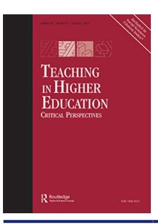

<!-- A1.R50 | source: papers_json/A1.R50/ -->



## **Teaching in Higher Education**


**Critical Perspectives**

**ISSN: (Print) (Online) Journal homepage:****[ www.tandfonline.com/journals/cthe20](https://www.tandfonline.com/journals/cthe20?src=pdf)**

## **Value for money and the commodification of** **higher education: front-line narratives**

**L. C. Wilkinson & M. D. Wilkinson**

**To cite this article:** L. C. Wilkinson & M. D. Wilkinson (2023) Value for money and the commodification of higher education: front-line narratives, Teaching in Higher Education, 28:2, 406-422, DOI: [10.1080/13562517.2020.1819226](https://www.tandfonline.com/action/showCitFormats?doi=10.1080/13562517.2020.1819226)

**To link to this article: **[https://doi.org/10.1080/13562517.2020.1819226](https://doi.org/10.1080/13562517.2020.1819226)

Published online:14 Sep 2020.Submit your article to this journalArticle views:1873View related articlesView Crossmark data
CrossMarkCiting articles: 5View citing articles

<!-- page 2 -->


## Value for money and the commodification of higher education: front-line narratives

L. C. Wilkinson oa and M. D. Wilkinson b

<sup>a</sup>School of Education, University of Sheffield, England; <sup>b</sup>School of Education and Social Sciences, University of Hull, England

## **ABSTRACT **

This paper provides a critical interrogation of government-led reform of higher education (HE) in England. Its focus is marketisation, and in particular, the concepts of 'value for money' (VFM), teaching excellence, and students as educational consumers. Hitherto, research on VFM in HE has been largely quantitative in nature and primarily focussed on student perceptions. This qualitative research study contributes to existing knowledge, by comparing the perceptions of students and university lecturers in the social sciences. Undertaken at a Northern university between 2017 and 2019, it highlights key concerns around changing student expectations, managerialism and the potential instrumentalisation of learning and teaching. The issues explored here lend themselves to a broader based study across different types of Higher Education Institutions (HEIs) and different cognate areas.

## **ARTICLE HISTORY **

Received 25 June 2019 Accepted 31 August 2020

## **KEYWORDS **

Value for money; teaching excellence; marketisation; consumerism; managerialism

Over the past thirty years neoliberal reforms have marketised higher education (HE). Institutions currently operate within a regulatory framework that emphasises the notion of competition between HEIs:

competition for status and resources in research and scholarship; competition between institutions to attract students; competition between students to gain the most sought-after places in institutions; competition in international student market and for corporate-financed consultancy work; and the often compelling contest between institutional 'brands' for ranking and prestige (Marginson 2013, 357).

Whilst traditionally competition between HEIs has centred around academic reputation and ranking within league tables, within a marketised framework they also compete for limited resources. This is proclaimed to 'produce a more effective, efficient and equitable higher education system' (Naidoo and Jamieson 2005, 270). It also dictates that those institutions performing below standard will have to improve in order to attract customers.

The key measurement of effectiveness in this regard centres around the much-contested concept of the provision of 'value for money,' (VFM) for students, as introduced by the Browne Review into HE (BIS 2011). This was subsequently extended and formalised

<!-- page 3 -->

by the Department for Education in 2017, through key institutional performance data, enshrined within the Teaching Excellence Framework (TEF) (Tomlinson 2018).

This two-year exploratory study was undertaken from the perspective that the marketisation of HE has been a top-down process couched in the seemingly inalienable paradigm that free-market approaches (competition, consumerization, VFM) are both effective and intrinsically desirable. The intention was to interrogate those perspectives and their impacts by exploring lived experience, through the narrative accounts of the academic staff and students who bestride the front-line interface between provision and recipience of HE services. The study is based on in-depth interviews with lecturers and students at a pre-1992, medium-sized university in the North of England. The university in question was identified as one of many that had been through a period of constant flux over the previous decade, as the university authorities had imposed a top-down self-pronounced 'change agenda' in relation to both institutional structures and academic provision, in response to government guidance but also as a process of 'streamlining' services and maximising cost-effectiveness.

The article begins by considering the ideas of VFM, marketisation, and consumer orientation and their enactment in UK HE. A brief account of the relevant policies is presented, followed by a precis of the broad criticism of this policy development. Following a brief account of the methodology pursued, the paper then presents the initial findings of the study, providing contemporary insights into how VFM in HE is perceived. It concludes by affirming that both staff and students have accepted and embraced elements of VFM, but that in a fluid HE environment, both cohorts have significant concerns about the potentially negative outcomes of the current direction of travel. A case is then made for a broader based study that can encompass a range of factors that were beyond the scope of this research.

## Value for money and the marketisation of higher education

In England, the Dearing Report (1997) argued that, as students and graduates were direct beneficiaries of HE study, so they should make some contribution towards the cost of their education. Whilst the report recommended income contingent loans, to be repaid when graduates exceeded an earnings threshold, in 1998, the then New Labour government introduced £1000 upfront tuition fees - this the beginning of a slippery slope to today's ceiling of £9,250 standard undergraduate fees, that the majority of English universities now charge. Indeed, all but three English HEIs charged tuition fees of £9,250 for at least some of their courses under the first year of the teaching excellence framework (TEF) in 2017/18 (Havergal 2016).

Thereafter, HEIs have become increasingly commercialised, competing for resources, their customer base and for market position (Browne 2010; BIS 2011; Millican 2014; Naidoo and Williams 2015; Bunce, Baird, and Jones 2016; Tomlinson 2017). In addition, HEIs have been consistently reminded of 'the need to ensure that students, graduates and the taxpayer all receive value from their investment' (BIS 2015a; BIS 2016; DFE 2019, 1). Recent reforms in England have been underpinned with the asserted intention of replacing a traditionalist, unresponsive and elitist system by promoting teaching excellence and a HE experience that prepares students for the world of work in a dynamic globalised

<!-- page 4 -->


knowledge economy, (BIS 2009; BIS 2016) whilst at the same time, providing them with increased choice and VFM (BIS 2011).

In 2004, the Higher Education Funding Council for England (HEFCE 2004) identified 3 core elements to VFM. They were:

```
Economy ... ('doing things at best price')
Efficiency ... ('doing things the right way')
effectiveness ... (doing the right things').
```

For their part, BIS (2015b, 18) relate VFM directly to quality and employability, which frames the concept squarely within market driven policy frameworks:

Students expect better value for money; employers need access to a pipeline of graduates with the skills they need; and the taxpayer needs to see a broad range of economic and social benefits generated by the public investment in our higher education system.

However, customer value is an elusive concept, raising questions as to common understandings of the term 'VFM' (Woodall, Hiller, and Resnick 2014; Bunce, Baird, and Jones 2016; Tomlinson 2018). Again, the concept has not become fully embedded in pedagogic practice and the wider student experience. The 2019 Advance HE/Hepi Annual Student Experience Survey revealed a slight improvement in student perceptions of their having received 'good' or 'very good' VFM, from their course, to 41%, from the previous year of 38%, but this remains significantly lower than the 53% approval rating when £9000 fees were introduced in 2012 (Neves and Hillman 2019, 10). Again, although slightly improved on previous years, some 29% of respondents considered their course was 'poor' or 'very poor' VFM - a significant increase on the 2012 figure of 18% (Ibid). Not surprisingly, VFM continues to be a major concern for HEIs (Millican 2014; Woodall, Hiller, and Resnick 2014; Bunce, Baird, and Jones 2016; Tomlinson 2018).

The recent industrial action across many HEIs and the advent of the coronavirus crisis has seen the trend reverse, with perceptions of receiving VFM from courses reducing to 39%, whilst 31% of respondents considered their course was 'poor' or 'very poor,' (Neves and Hewitt 2020, 11) suggesting that satisfaction levels have been adversely impacted by dislocation of teaching and precipitous moves to online provision. Students expressed annoyance at paying the previously designated level of fees under circumstances of considerably diminished provision, one bemoaning: 'Because of strikes and Coronavirus there has been a massive gap in my learning,' another, 'Only being at university for 2 months and having to leave by mid-March due to Covid 19 & still having to pay the 9 grand for tutoring fees' (Neves and Hewitt 2020, 15).

It should be expected, in an increasingly commodified education system where students are posited as active consumers, bearing a considerable financial burden by way of fees and living expenses, (Richardson et al. 2017; Bushi 2018; Tomlinson 2018; Academics Anonymous, The Guardian, March 20 2019) for them to have concerns around VFM, both in terms of the quality of teaching and support, and of facilities provided, both academic and recreational. Studies suggest that some have expectations of automatic academic success by way of achieving a degree at the end of their period of study i.e. that this is something they have paid for, and not necessarily something that is conditional on their academic efforts (Naidoo and Jamieson 2005; Van der Velden 2013).

<!-- page 5 -->

For their part, some academics consider VFM, in an increasingly instrumentalised teaching environment where narrowly defined, measurable, employability-related outcomes take precedence over the pursuit of knowledge and 'learning for learning's sake.' They question how it connects with their own understanding of added value and their personal contribution to learning gain (the distance travelled in terms of knowledge, skills, and personal development made by students) i.e. those intrinsic, but perhaps less measurable elements that academics provide that enhance the learning experience via knowledge creation, creativity and innovation (Naidoo and Jamieson [2005](#page-17-0); Mavelli [2014](#page-16-0)). McMillan and Cheney [(1996](#page-16-0), 1), in an analysis of the marketisation of HE in the United States, identified that the student as consumer metaphor 'inappropriately compartmentalises the educational experience as a product rather than a process'. Therefore, the application of consumer principles can contradict traditional values of HE. They also highlight that if students adopt a consumer orientation to their studies it is likely to inform their behaviours and may have a negative impact on their learning experience and diminishes from the ethos of students studying for intellectual reward and personal transformation. These concerns are explored by Naidoo and Jamieson ([2005,](#page-17-0) 267) who argue that the consumer framework could 'threaten innovation and academic standards' and lead to more passive and instrumental teaching and learning, particularly if the professional academic culture is restructured to comply with consumer demands.

These concerns are shared by Molesworth, Nixon and Scullion who assert that marketisation has propagated students seeking to 'have a degree rather than be learners' ([2009,](#page-16-0) 277). This suggests divergent student approaches – those who approach learning for personal development and those who approach it as a product which is necessary 'to have' to succeed in a precarious and highly competitive labour market (Molesworth, Nixon, and Scullion [2009)](#page-16-0).

Marketisation and the rise in tuition fees have led academic staff to fear that a less collegial type of engagement with students may become prevalent (Naidoo and Jamieson [2005](#page-17-0); Molesworth, Nixon, and Scullion [2009](#page-16-0); Van der Velden [2013)](#page-17-0), not least because their own understandings of VFM and student as consumer may differ from the views of an increasingly demanding student body. Academic focus on VFM has traditionally been around curriculum development, programme content and the quality of teaching, assessment and feedback. However, as clearly evidenced in recent years, in the Guardian academic blog Academics Anonymous (AA), they are being increasingly pressured by the rapidly changing nature of academic work and institutional demands around student satisfaction. This relates to the academic content and the quality of teaching practice, but also to a whole host of additional factors, some internal (such as timetabling and facilities), some external (such as rising student expectations, rising fees, student debts and the desire for enhanced career opportunities), that may be unrealistic or beyond their control. Indeed, a considerable number of these are specifically itemised in the annual Hepi/Advance HE Survey under the heading Factors influencing perceptions of value! (Neves and Hewitt [2020](#page-17-0), 14)

As concerns regarding the 'McDonaldizing' of HE continue (Hayes and Wynyard [2016](#page-16-0)), as academic staff are increasingly subject to 'scrutiny and surveillance' (AA, The Guardian, July 20 [2018)](#page-15-0), some consider the unrestrained 'competition fetish in UK Higher Education' (Watermeyer and Olssen [2016,](#page-17-0) 201) to pose a threat to the nature of academic work, their autonomy as educators and their professional status. Further, that

<!-- page 6 -->


it erodes collegial academic work relations (Beckmann, Cooper, and Hill 2009; Williams 2016; Smyth 2017; Page 2019; Weinstein et al. 2019; Maisuria and Helmes 2020). Meanwhile, the increasing casualisation of the academic workforce epitomises a more general race to the bottom in staff terms and conditions (AA, The Guardian, February 17 2017; Loveday 2018). Casual staff at McDonalds may actually expereince better job security and greater levels of fairness and consistency than casual academics:

Despite being educated and skilled, casual academics endure human resource management practices that are in deficit on all counts compared to the management of McDonald's crew. (Nadolny and Ryan 2015, 153)

The marketisation of HE has generated various markers of value and indictors of success which are now published with the stated intention of aiding consumer choice and supporting quality enhancement (Browne 2010; Page 2019). This includes the publication of Key Information Sets (KIS), introduced in response to the reforms outlined in the 2011 Government White Paper 'Students at the Heart of the System,' (BIS 2011) that provide standardised information about undergraduate courses and that facilitates comparison across HEIs. These provide data on the nature of assessments; student contact hours and graduate employment data (from the Destination of Leavers from Higher Education survey (DLHE)). They also include details on student satisfaction levels, as drawn from the National Student Survey (NSS), a voluntary appraisal undertaken by final year undergraduates, with the online publication of results.

Such data is used to assess the performance of HEIs and also to provide marketing opportunities. For example, HEIs showcase their student satisfaction scores in their recruitment literature to attract prospective students. In the name of 'student voice' and quality assurance, students are increasingly being asked to engage in a range of activities, from participation in staff/student committees, to the evaluation of their experiences at both programme and module level, to completing the NSS. Those NSS results are core metrics used to calculate TEF awards at institutional level.

The stated intention of the TEF was to measure and assess the quality of teaching (Strang et al. 2016). Whilst some welcome these reforms, asserting that for too long universities have focussed on research at the expense of teaching, many are sceptical, claiming that the TEF metrics fail to assess the quality of learning and teaching in the round (Vieru 2017). Others argue that the TEF and the NSS 'are devoid of real meaning for students when making choices about .... which university to apply to' and that they are 'widely acknowledged to be spurious indicators of excellence.' They nonetheless acknowledge that 'the centrality of the TEF and NSS in the life of the academic cannot be overstated' (Maisuria and Helmes 2020, 58). These purported indicators of excellence and VFM are further enshrined in the publication of HEI league tables via the *Times Good University *Guide (UK) and the Guardian University Guide (UK), and again, these have major reputational impact in the sector (Dill and Soo 2005).

Academic staff and students have shared interests, in that both wish the student experience to be a positive and rewarding one and one that encourages and facilitates academic excellence. Both welcome increased student engagement in quality enhancement activities, through staff/student committees, representation on wider institutional bodies, etc. It is equally important that perceptions around VFM, as with other factors impacting on academic life, are also based around common understandings.

<!-- page 7 -->

Questions remain, however, on how VFM will be delivered by the TEF reforms. Equally, on how these concepts are going to be interpreted and received by staff and students. It is this key area of concern that this research interrogates.

## Methodology

The primary aim of this exploratory case study was to examine the perceptions of lecturers and students on issues relating to VFM, to explore these in great depth, as a potential prelude to a larger scale study. By use of in-depth interviews, it sought to compare their views on the meaning of VFM and on the impact of policy reform on HE. A qualitative, narrative approach was utilised in order to 'create a sense of feel and place,' (Sikes [2005,](#page-17-0) 79) to facilitate the active engagement of participants, allowing them to express their emotional relationship with their academic experience and to construct their own meanings and priorities:

With narrative, people strive to configure space and time, deploy cohesive devices, reveal identity of actors and relatedness of actions across scenes. They create themes, plots, and drama. In so doing, narrators make sense of themselves, social situations, and history. (Bamberg and McCabe [1998:](#page-15-0) iii)

This approach facilitated both an exploration of their lived experiences and for them to be considered in the wider societal context (Charmaz [2006](#page-16-0)).

The study participants comprised eight lecturers, each employed in the Social Sciences at the same Northern university for several years and eight undergraduates in their second year of study. It was considered important to recruit students who had been in the system for some time, as this would facilitate for relatively experienced front-line personal narratives. All participants were recruited, via purposive sampling, by email request. They were all recruited from the same institution and Faculty, to assist with the generation of a collective 'story' in addition to their individual narratives.

Informed consent was sought, and participants were free to withdraw at any point. They were also guaranteed anonymity of themselves and their institution. Each interview was approximately one hour in length, to a semi-structured topic guide. This provided a framework within which the interviews could be guided, to ensure that all topics considered crucial to the study were covered (Scott and Usher [2011;](#page-17-0) Wellington [2015](#page-17-0)), but that also ensured that participants were free to discuss issues that had meaning and were of core significance to them (Bell [2010;](#page-15-0) Cohen, Manion, and Morrison [2011](#page-16-0); Wellington [2015](#page-17-0)).

Following preliminary discussions, participants were asked the following trigger question (Wellington [2015)](#page-17-0): 'Would you like to start by talking about your experiences in higher education?' The intention being to facilitate a naturalistic encounter, encouraging participants to feel at ease and respond freely. This acted as a 'launch-pad' for the rest of the interview.

The following thematic areas were explored and developed: (i) educational experiences, biographies and future interests; aims and expectations of HE; academic support provision and wider aspects of the student experience; (ii) the accuracy, the value, and impact of NSS and other processes for evaluating student experience; (iii) attitudes towards fees; VFM and students as educational consumers; (iv) issues relating to the commodification of

<!-- page 8 -->


HE from both a local/institutional context; (v) participant reflections upon wider societal discourses on HE.

Throughout the analytical process, themes were developed as a framework to compare participant responses. This iterative process involved a categorical analysis, coding according to themes which emerged from data analysis of the initial interview sessions. This was further developed as the research process progressed, through a 'constant comparative method' of enquiry making comparisons throughout the research process and at each stage of the analysis (Charmaz 2006). In this way, the participants were provided an element of agency in the framing of the research findings. The core themes emerging were gradually configurated into the four findings sub-sections as presented.

Being an exploratory study, it was of necessity, small in scale and limited in scope. It provides an insight into the perceptions of stakeholders at an individual HEI. As we shall see, however, these perspectives do correlate with data in a number of other empirical studies

## **Providing 'value for money' **

Not unexpectedly, VFM was an issue of concern for students. They shared similar views to academic staff on how VFM could be characterised, expecting to benefit from a range of module choices and assessments. They indicated that they were provided with such. However, whilst lecturers made clear that there had been a concerted effort to increase the number and vary the form of assessments, they also bemoaned a rationalisation process within their institution that was reducing the module choices available. Axing modules at short notice was, they felt, impacting adversely on the student experience. One recounted:

I felt really bad for them because they were short-changed. They were sold this superb course that actually, by the time they got here, it wasn't superb. Eventually one of them said 'What is going on? Because this is not what we thought it was going to be'. And then they all said they were feeling 'sold short."

## Another explained:

Do students prefer less choice? Well, no. They want choice, they want more options but of course that is expensive. They don't want fewer options. But if you question that, you are told by the university that the students want something else. So it becomes that managerialism is the 'truth' of the student experience which means that you get managed into particular ways of being.

Another lecturer brought up the subject of litigation, referring to the recent case of a student awarded compensation for being provided with what had been termed a 'mickey mouse degree' at another university. He mused on the possibility of an avalanche of such claims.

Secondly, respondents pointed to the need to provide appropriate physical resources. Academic staff described how this expectation had translated into 'a huge building investment' at the university to attract students in a 'competitive educational environment' and asserted that this was a calculated response by the institution to 'student expectations

<!-- page 9 -->

changing'. Students focussed on library resources, access to computers, printers and study areas:

The amount of money that we have to pay to come to university, to get value for money we need the right resources and information to help us get our degree. Trying to get essential books out without buying them is an issue. It's costing me too much. The problem is access to learning resources, books, [and we have] printers that don't always work.

Pastoral care and the provision of wider support services were a third theme central to VFM. Students highlighted examples of excellent support by specific lecturers. However some, and particularly those research active, were less easy 'to get hold of'. One student was extremely frustrated at the lack of responsiveness or support on a module in which he had been struggling: 'every time I went to see him during office hours he wasn't free and he didn't reply to my emails'. In addition to academic support, both lecturers and students pointed to wider support structures being 'crucial,' citing counselling, careers advice and support in obtaining work placements, etc. Specialist support provision around religion, ethnicity and disability had been extremely helpful.

Fourthly, mirroring the Hepi/Advance HE Survey (2020, 14) poor value was largely linked to tuition fees and the cost of living - indeed, the financial cost of university education was considered significant by all - the cost of fees but also the cost of academic materials and the general costs of living. Students clearly linked VFM to the overall costs of the academic experience. Two had been managing their studies whilst also coping with the demands of paid employment, and both had sought financial support from the university.

A fifth consideration raised was that to provide VFM universities should recognise the increasingly diverse nature of the student body and accordingly provide more flexible provision for 'non-traditional students'. As one lecturer explained:

... particularly mature students, or students with disabilities or simply students who have difficulties with the timetabling. We should have far more respect. We have rigid timetables and how is that person-centred provision? It is not! If students can't attend a lecture, then as a matter of course it should be available on-line for them to access.

The sixth theme raised by both lecturers and students was 'contact hours.' Again, as also reflected in the Hepi/Advance HE Survey (2020, 14), where dissatisfaction with the levels of tuition time is frequently indicated by 'poor value rating,' although student respondents to this study attested to being personally happy with the amount of contact teaching they also indicated that several of their peers felt they should be receiving greater levels of direct tuition. Lecturers also indicated that student expectations had increased in this regard, and that this was associated with the cost of the degree programme:

Thinking about conversations I have had with my students, where they talk about contact time, it can be translated as 'I want value for money.'

The seventh theme focussed on lifestyle. One student indicated that his expectations from the university included the provision of opportunities for an active social life, such as sports and recreation.

Asked to provide an overall assessment of the provision they had received, all students indicated that they received VFM, particularly with regards to the quality of learning and teaching provision, but that they nonetheless felt there were areas where more could be

<!-- page 10 -->


provided. This again reflected an underpinning theme that their concern was not so much the quality of provision received but rather what they considered to be excessive fees, indeed, for some, that fees were attached to educational provision.

## Students as educational consumers

As Molesworth, Nixon, and Scullion (2009), Tomlinson (2017) and others have found, respondents to this study indicated that the rise in tuition fees had generated a fundamental change in the relationship of students to their education. They considered themselves educational consumers and made numerous references to the cost of their fees and how that linked to their expectations: 'the amount of money we have to pay...'; 'if we are paying £9,000 ... '. Some made clear that this was not a welcome development:

I am a consumer. Yes. Most definitely. I regard the degree as a commodity. The university is an academic institution but today it is also having to be run like a business. But I don't agree with this and I don't agree with tuition fees.

They did not, however consider themselves to be 'buying a degree', they recognised and indeed emphasised their position as 'autonomous' learners, responsible for their own motivation and academic achievement.

Lecturers imparted that student expectations around 'rights and entitlements' had changed significantly with the introduction of higher fees. Students were increasingly displaying 'service-user attitudes' and there had been a rise in those prepared to challenge decisions, including grades awarded and summative feedback. There had been an unwelcome growth in formal complaints where students, as one put it: 'don't think that they are getting what they have paid for'. For some, this was tempered by the knowledge of the financial costs that students were shouldering:

The fact that I know that they are paying £9,000 a year means that I feel an obligation to help in every way that I can. If anything, it has increased my inclination to be supportive.

Lecturers and students raised a number of other issues in relation to changes in funding and the rise of fees, including: an increase in students suffering from stress and anxiety due to financial concerns; impacts on academic performance and on health of having to both study and work; the exclusionary impact of fees in relation to working class communities. The funding regime was also adversely impacting the university itself. One lecturer asserted:

the introduction of tuition fees has suddenly begun to bite and the pact with the devil is coming into fruition - that big picture is about right-wing politics and economics and it screws students and it screws workers. The small picture is about how that plays out in the institution ... there is a flat panic about money and financial survival.

## **Attitudes to Learning **

Whilst students emphasised the importance of obtaining a degree and acquiring the requisite knowledge to pursue their desired careers, their approach to learning was equally

<!-- page 11 -->

driven by an internal motivation for self-development and a desire to 'pro-actively' engage with the process of learning. As one explained,

I didn't come here to just get a degree or get a job. I came here to broaden my horizons. The library is amazing. I've never had this before. None of my family have ever had this.

For their part, lecturers, whilst also relating how students actively engaged with their academic discipline, tended to confirm concerns raised by Naidoo and Williams (2015) and Tomlinson (2016) about the commodification and instrumentalization of the academic sphere - they were increasingly encountering those who 'are more focussed on employment' and who were 'passive' learners:

I think they are less interested in process and knowledge. I think they are interested in output. So, I think they want the qualification at the end and that is quite different to saying that they want the education that is involved in getting the qualification.

One identified a difference in the attitudes to study of 'the traditional eighteen-year-old' and 'older students', in that mature students were 'much more prepared to put in the work'. A similar view was expressed by one of the mature students who believed that many of the younger students on his course expected 'spoon-feeding':

There are those who expect to have everything handed to them at university and those who go out and get it ... you have some students on one side and some on the other. Stressing autonomy to the younger ones is important.

Lecturers also expressed concern at the increasing number of students who were struggling with self-directed study and the concomitant escalation of student support needs and expectations. Course contact hours had increased to meet those demands. There had been a considerable rise in students requesting one-to-one academic tutorials and support via email. Student respondents confirmed this, asserting that since they were paying for their education, lecturers should make themselves available outside of the classroom for advice and support.

## Marketisation, managerialism and measuring student satisfaction

All lecturers expressed concerns about increased managerialism and the marketisation of academic programmes. They emphasised the imperative of HE remaining independent of overt government control and direction:

So, I think marketisation is a disaster. It's restrictive. It's putting ideology before academia, and intellectual and academic freedom is at risk. And it is quite simply wrong.

They held the government's VFM and 'student choice' agenda to be driving this process and expressed concern that this could be detrimental to the student experience in the long term.

Reflecting similar concerns as those voiced in the Guardian's Academics Anonymous blog, (AA, The Guardian, February 23 2018) and the Times Higher Education (AA, Times Higher Education, March 20 2020) academic respondents to this study bemoaned that managerialism had 'massively increased the workload.' They were aggrieved that much of the additional responsibilities involved administrative tasks that were not

<!-- page 12 -->


'student facing'. These developments had significantly reduced the time and space available to actively engage with research.

Another negative development had been academic staff reductions through 'rationalisation', resulting in remaining staff members being responsible for an increasing number of students, both in terms of teaching loads and supervision. This had also contributed to module retrenchment and as previously covered, thus had limited student choice.

Whilst increased workloads had not stopped them meeting responsibilities to, or maintaining relationships with students, this was only achieved by frequently working beyond and outside of their contractual hours. Not surprisingly, this had negatively affected their work-life balance and, for some, their health.

Echoing the work of Nadolny and Ryan (2015) and Loveday (2018), staff criticised a 'creeping casualisation' agenda, manifesting itself in temporary and part-time contracts:

they say come and do this course for eight months, so you never get continuity of service and you never get any rights. You get work every year, but they always manage to make it so that there is a two months gap between contracts.

For those with responsibilities, the uncertainty and lack of security was particularly troublesome:

Of course, that's a different kettle of fish when you're in your forties and you've got kids at school and all the rest of it than when you're twenty-five.

There were also worries about a sector-wide tendency, encouraged by the Research Excellence Framework (REF) process, to move teaching and research staff on to teaching only contracts, which it was held, posed a threat both to status and to employment terms and conditions. These findings mirror fears and concerns about changes to working practices expressed by UK academics in a recent major study commissioned by Research England, including being pressured to change job titles, contracts and even the focus of their research in order to conform to the expectations of the REF (Weinstein et al. 2019).

Lecturers also recounted a growing emphasis on generating and measuring improvements in student satisfaction and the use of metrics to demonstrate 'customer value.' Student survey data was now instrumental in the marketing of their programmes and was considered key to attracting student applications:

They are important to us and this can be shown in the way that we bend over backwards to try and get positive outcomes from student surveys.

Conversely, students asserted that they had not referred to NSS data when choosing where to study. Whilst one had explored information about modules on the course programme, cost related issues had been the most important factor, specifically the cost of rent and the cost of living in the area: 'it is one of the cheapest places to live'.

All lecturers and several students challenged the intrinsic value of the NSS, questioning both the validity of statistics generated and their efficacy in relation to improving teaching practice. Lecturers believed most students displayed only a passing interest in quality assurance processes - as evidenced by the limited number who completed module evaluation forms, and the 'various inducements' required to encourage completion of the NSS questionnaire. Further, that both module evaluation and NSS statistics could be impacted

<!-- page 13 -->

negatively by a small number of students who might respond to circumstances beyond a lecturer's control, for instance having been penalised for late arrival of an essay or for plagiarism, or for having an assignment extension request rejected. Responses might reflect inconvenient timetabling or inappropriate teaching spaces – there being little lecturers could do to compensate for this:

So, in terms of them providing an accurate reflection of academic practice or academic excellence I think they are generally a waste of time.

For their part, students could not point to any positive outcomes by way of teaching practice or administrative bureaucracy as a result of engaging in institutional quality assurance processes, including module evaluations: 'I don't see how we could benefit when the evaluations are done at the end of the module!'

The introduction of the TEF had raised additional concerns. Students felt it might be used as 'an excuse' to raise tuition fees. Lecturers raised similar concerns:

If the fact that I'm providing excellence as an educator gives the government an excuse to hit the students with £15,000 or £20,000 in fees, it would be time to find a different profession.

They also pointed to increasing pressures to collect institutional data, to measure and evaluate teaching and assessment performance, yet another addition to a framework of increasingly burdensome quality assurance processes, both for external and internal review. Whilst not opposed in principle, there was a perception that the academic profession was being constantly challenged and undermined.

Every lecturer raised concerns over the accuracy of the TEF metrics. Nonetheless, some welcomed the fact that it may re-direct attention towards teaching excellence and away from what they perceived as an over-emphasis on research outputs which they considered to be to the detriment of both academic staff and students:

I think there are far too many academics whose primary concern is publication and the REF, and their secondary concern, way down on their list of priorities, is the students and their teaching. So, if it changes that balance, then I think it is a good thing.

They spoke of exhaustion, one of 'constantly running behind a permanent revolution', which another likened to being 'on a tidal wave of constant change.' This necessitated keeping abreast of the introduction of new technologies both inside and out the lecture theatre, where sometimes the driver appeared to be 'technology for the sake of it' rather than visibly enhanced processes or pedagogic improvement.

Change was also driven by the sheer range of government initiatives, all of which they had to familiarise themselves with, all of which were perceived as potentially bearing threats as well as benefits – the latest being the Knowledge Exchange Framework, (Research England [2019](#page-17-0)) which was still very much an unknown entity.

Maisuria and Helmes ([2020)](#page-16-0) and Smyth [(2017](#page-17-0)) have documented what they relate as the 'detrimental reality' in an increasingly 'toxic university' environment. Lecturer respondents to this study expressed their deep frustration at deteriorating staff morale, relating that entrenched disillusionment and alienation had led to high levels of turnover. Those leaving included some 'really good, well-established, ambitious people,' whilst those remaining were finding it difficult to marry increasing workloads to their desired pedagogic approach:

<!-- page 14 -->


As it stands now, I can't be the kind of educator that I want to be in that system and that structure and those processes ... Some of it is the practical stuff of having the meaningful time outside of admin. to think ... If I want to be an effective educator then I need to have the space in which to practice that in its broadest sense - which means having the meaningful time to prepare for it and to think about the kind of educator I want to be.

All lecturers agreed that these difficulties were not confined to particular HEIs, but were sector wide.

It's just a question of degree. The situation in UK universities is grim and it might be less grim in some places than in others but it's still going to be grim.

In similar vein to Page's findings (2019, 5) all lecturers participating in this research exhibited a distinct sense of loss in relation to times past:

A yearning for those pre-neoliberal days when academics could pursue knowledge without the alienating effects of commodification, self-marketing and the perpetual task of maintaining employability.

Students were not best served by these circumstances:

I feel like I'm letting people down. Here are people paying obscene amounts of money to be there and they really deserve something good! Most of them are really young and they are starting out on this potentially amazing journey of lifelong learning and I want them to have something really good to set them on their way .... But we're just not given that space.

The pace of change had at times been extremely challenging for students, arriving to a particular regimen and routine only to find it changing year on year:

We are genuinely good at supporting students with learning differences, but it's a nightmare - just the changes in software ... moving from one technology to another is so, so difficult when you have a learning difference- and there are so many changes, the pace of change, not just in terms of software but processes, the pace is so fast. A lot of it is based online now, rather than paper based, and I know that people with dyslexia find it really difficult.

Again, it was felt that these circumstances could only impact adversely on NSS statistics. Not surprisingly, student responses tended to focus on their current situation and considered the positive and negative experiences of the academic environment from that very individualised, snapshot perspective, whereas lecturers considered the picture in historical and institutional context and with an eye to future prospects. For the latter, optimism remains in short supply. Despite some positive elements, for instance, the proposed restoration of maintenance grants for lower income students and the Augar Review recommendations (2019) for reductions in fees to a ceiling of £7,500, these have done little to ease concerns about the long-term financial stability of the sector. There were particular concerns about the future of the social sciences, the humanities and the arts, about foundation year courses, those courses with poor retention and those with poor graduate outcomes. Those concerns mirrored those of the University and College Union, who predicted 'real term cuts of 11% over the next three years ... a loss of around £2.3bn,' and criticised the Review's call for universities to achieve efficiencies and redesign their business models as 'a euphemism for increased workloads, casualisation and student to staff ratios.' (UCU 2019, 6).

The contributions of both staff and students in this study indicate that whilst students continue to present as active learners, they nonetheless are increasingly identifying themselves as educational consumers, and consequently their expectations of the academic

<!-- page 15 -->

service provided have changed. There is a clear emphasis on the cost of their education and on VFM. However, it is also clear, as Bunce, Baird, and Jones (2016) have counselled, it is problematic in these circumstances for universities to accept government rhetoric and direction as the last word on this issue because there are growing concerns that the commodification of education has the potential to pose a risk to academic standards, and as this study has highlighted, to academic staff and student well-being.

## **Conclusion **

This study has provided insights into how the changing policy landscape has impacted on lecturers and students within one cognate area of a Northern HEI. From this, there are firm indications that the reform agenda has fostered an environment that is having a major impact on how each cohort situates HE and relates to it both as a concept and as an academic community. Students are clearly both perceiving of themselves and presenting themselves as educational consumers who pay for a service and expect that service to be delivered. Those expectations have been raised as fees have increased. However, it is also clear that beyond this, students hitherto have given little thought as to how these factors relate to quality assurance processes. That this has led to changes in student expectations may be no bad thing and there are obvious benefits to improving consumer choice, empowering students, providing increased spaces for their 'voice', and improving the quality of learning and teaching. For their part, lecturers acknowledge the financial costs borne by students and consider their demands with regards to quality of provision as legitimate, welcoming processes that are seen both to provide them with VFM and promote teaching excellence. In those respects, both groups have bought into and accept the legitimacy of VFM as a fundamental component of evaluating HE provision. However, at the same time lecturers indicate that the process of change is undermining treasured educational practice and ethos, whilst creating a 'perfect storm' of stresses and strains that is impacting adversely on themselves and in some instances also on the student body. Students also exhibit some unease at the consumerist direction of travel. Whilst these are initial findings of a two-year study, they do tend to confirm concerns raised in previous studies and they raise the fundamental question: is the gain worth the pain? There were worrying signals from academic respondents to this study that the wheels are spinning so rapidly that they are in danger of coming off the cart.

## Areas for future research

Hitherto, the main body of work around staff and student experiences of the changing nature of HE has been largely survey based, quantitative in nature, and primarily student focussed (Freeman 2013). The contribution of this research is that it is qualitative in nature and that it compares and contrasts the perceptions and experiences of lecturers and students. The study proved extremely effective in eliciting the views of the research participants and a wealth of relevant data was generated. It is likely, however, that a greater variability of stakeholder perceptions would be obtained were the research expanded to include respondents from different types of HEIs and across cognate areas.

Secondly, the findings of this study illustrated the need to consider the potential impacts of a range of social variables, for instance, additional factors such as paid

<!-- page 16 -->

20 [Image: A circular icon depicting a stylized head]

employment, parenthood or caring responsibilities. As highlighted by the findings of the 2019 Student Academic Experience Survey, demographic factors, such as age, gender, disability, ethnicity could also be explored in more depth, as could the experience of international students. (Neves and Hillman 2019, 10-29).

Thirdly, a broader-based study would have the potential to identify the efficacy (or otherwise) of differing institutional approaches to the TEF and other government driven agendas for HE.

Finally, responses to the coronavirus crisis have brought new considerations in to play. Not least, in that it has provided an impetus for alternative forms of delivery that may well be sustained post-crisis and that may have long-term impacts on staff /student relationships, but also because of the potential impact on how students configure VFM in their interface with HEIs and with the learning process more generally (Matthews 2020; Neves and Hewitt 2020).

## Disclosure statement

No potential conflict of interest was reported by the author(s).

## **ORCID **

L. C. Wilkinson http://orcid.org/0000-0002-0947-8372

## References

Anonymous Academic. 2017. "I want to make a difference in academia - but I'm drowning." The Guardian, February 17.

Anonymous Academic. 2018. "I'm an academic, and I feel underpaid and over-monitored." The Guardian, July 20.

Anonymous Academic. 2018. "Lecturing in a UK university is starting to feel like working for a business." The Guardian, February 23.

Anonymous Academic. 2019. "My struggling students desperately need maintenance grants back." The Guardian, March 20.

Anonymous Academic, 2020. "Why I had to quit." Times Higher Education, March 20.

Augar, P. 2019. Independent Panel Report to the Review of Post-18 Education and Funding. London: Crown /HMSO.

Bamberg, M. G. W., and A. McCabe. 1998. "Editorial." Narrative Inquiry 8 (1): iii-iiv.

Beckmann, A., C. Cooper, and D. Hill. 2009. "Neo-liberalization and Managerialization of 'Education' in England and Wales - a Case From Reconstructing Education." Journal of Critical Educational Policy Studies 7 (2): 311-345.

Bell, J. 2010. Doing Your Research Project; a Guide for First-Time Researchers in Education, Health and Social Science. 5th ed. Maidenhead: Open University Press.

BIS. 2009. Higher ambitions: The future of universities in a knowledge economy. Retrieved from http://www.bis.gov.uk/assets/biscore/corporate/docs/h/09-1447-higher-ambitions.pdf.

BIS. 2011. Students at the Heart of the System. London: UK Government: Department for Business, Innovation and Skills.

BIS. 2015a. Speech: Teaching at the Heart of the System. London: UK Government: Department for Business, Innovation and Skills.

BIS. 2015b. Fulfilling our Potential: Teaching Excellence, Social Mobility and Student Choice. (Cm 9141). London: UK Government: Department for Business, Innovation and Skills.

<!-- page 17 -->


BIS. [2016.](#page-2-0) Success as a Knowledge Economy: Teaching Excellence, Social Mobility and Student Choice. London: UK Government: Department for Business, Innovation and Skills.

Browne, J. [2010.](#page-2-0) Securing a Sustainable Future for Higher Education: An Independent Review of Higher Education Funding and Student Finance. London: HMSO.

Bunce, L., A. Baird, and S. Jones. [2016](#page-2-0). "The Student-as-Consumer Approach in Higher Education and its Effects on Academic Performance." Studies in Higher Education 42 (11): 1958–1978. [doi:1080/03075079.2015.1127908](https://doi.org/null).

Bushi, R. [2018](#page-3-0). "Student Money Survey, 2018: Results". Save The Student. Accessed 22 June 2019. [https://www.savethestudent.org/money/student-money-survey-2018.html](https://www.savethestudent.org/money/student-money-survey-2018.html).

Charmaz, K. [2006.](#page-6-0) Constructing Grounded Theory: A Practical Guide Through Qualitative Analysis. London: Sage.

Cohen, L., L. Manion, and K. Morrison. [2011.](#page-6-0) Research Methods in Education. 7th ed. Abingdon: Routledge.

Dearing, R. [1997.](#page-2-0) Higher Education in the Learning Society: Report of the National Committee of Inquiry Into Higher Education. London: HMSO.

DFE. [2019.](#page-2-0) Government Response to the Education Select Committee Report: Value for Money in Higher Education. London: Department for Education.

Dill, D., and M. Soo. [2005.](#page-5-0) "Academic Quality, League Tables, and Public Policy: A Cross-National Analysis of University Ranking Systems." Higher Education 49: 495–533. [doi:10.1007/s10734-](https://doi.org/10.1007/s10734-004-1746-8) [004-1746-8](https://doi.org/10.1007/s10734-004-1746-8).

Freeman, R. [2013.](#page-14-0) "Student Engagement in Practice: Ideologies and Power in Course Representation Systems." In Student Engagement Handbook, edited by E. Dunne, D. Owen, and D. Bingley, 145–162. Beaverton: Emerald Group Publishing Limited.

Havergal, C. [2016.](#page-2-0) Almost all universities confirm £9,250 tuition fees for 2017-18. Times Higher Education, September 6. [https://www.timeshighereducation.com/news/almost-all-universities](https://www.timeshighereducation.com/news/almost-all-universities-confirm-ps9250-tuition-fees-2017-18)confi[rm-ps9250-tuition-fees-2017-18.](https://www.timeshighereducation.com/news/almost-all-universities-confirm-ps9250-tuition-fees-2017-18)

Hayes, D., and R. Wynyard. [2016](#page-4-0). "Chapter 7: The McDonaldization of Higher Education Revisited." In Routledge Handbook of the Sociology Higher Education, edited by J Cole and A Furlong, 74–84. London and New York: Routledge.

HEFCE. [2004](#page-3-0). Accountability and Audit: HEFCE Code of Practice, Annex J Introduction: 6 June 2004/27 [https://dera.ioe.ac.uk//5846/2/04_27ann.pdf.](https://dera.ioe.ac.uk//5846/2/04_27ann.pdf)

Loveday, V. [2018.](#page-5-0) "The Neurotic Academic: Anxiety, Casualisation, and Governance in the Neoliberalising University." Journal of Cultural Economy 11 (2): 154–166. [doi: 10.1080/](https://doi.org/10.1080/17530350.2018.1426032) [17530350.2018.1426032.](https://doi.org/10.1080/17530350.2018.1426032)

Maisuria, A., and S. Helmes. [2020.](#page-5-0) Life for the Academic in the Neoliberal University. London: Routledge. Marginson, S. [2013](#page-1-0). "The Impossibility of Capitalist Markets in Higher Education." Journal of Education Policy 28 (3): 353–370. [doi:10.1080/02680939.2012.747109](https://doi.org/10.1080/02680939.2012.747109).

Matthews, D. [2020.](#page-15-0) OECD education head: pandemic disruption should mean lower fees. Times Higher Education, June 22. [https://www.timeshighereducation.com/news/oecd-education](https://www.timeshighereducation.com/news/oecd-education-head-pandemic-disruption-should-mean-lower-fees)[head-pandemic-disruption-should-mean-lower-fees](https://www.timeshighereducation.com/news/oecd-education-head-pandemic-disruption-should-mean-lower-fees).

Mavelli, L. [2014.](#page-4-0) "Widening Participation, the Instrumentalization of Knowledge and the Reproduction of Inequality." Teaching in Higher Education 19 (8): 860–869. [doi:10.1080/](https://doi.org/10.1080/13562517.2014.934352) [13562517.2014.934352](https://doi.org/10.1080/13562517.2014.934352).

McMillan, J., and G. Cheney. [1996.](#page-4-0) "The Student as Consumer: The Implications and Limitations of Metaphor." Communication Education 45 (1): 1–15. [doi:10.1080/03634529609379028](https://doi.org/10.1080/03634529609379028).

Millican, J. [2014.](#page-2-0) "Higher Education and Student Engagement: Implications for a new Economic era." Journal of Education & Training 56 (7): 635–649. [doi: 10.1108/ET-07-2014-0077.](https://doi.org/10.1108/ET-07-2014-0077)

Molesworth, M., E. Nixon, and R. Scullion. [2009.](#page-4-0) "Having, Being and Higher Education: the Marketisation of the University and the Transformation of the Student Into Consumer." Teaching in Higher Education 14 (3): 277–287. [doi:10.1080/13562510902898841](https://doi.org/10.1080/13562510902898841).

Nadolny, A., and S. Ryan. [2015.](#page-5-0) "McUniversities Revisited: a Comparison of University and McDonald's Casual Employee Experiences in Australia." Studies in Higher Education 40 (1): 142–157. [doi:10.1080/03075079.2013.818642](https://doi.org/10.1080/03075079.2013.818642).

<!-- page 18 -->


- Naidoo, R., and I. Jamieson. [2005.](#page-1-0) "Empowering Participants or Corroding Learning? Towards a Research Agenda on the Impact of Student Consumerism in Higher Education." Journal of Education Policy 20 (6): 276–281. [doi:10.1080/02680930500108585.](https://doi.org/10.1080/02680930500108585)
- Naidoo, R., and J. Williams. [2015.](#page-2-0) "The Neoliberal Regime in English Higher Education: Charters, Consumes and the Erosion of the Public Good." Critical Studies in Education 56 (20): 208–223. [doi:10.1080/17508487.2014.939098](https://doi.org/10.1080/17508487.2014.939098).
- Neves, J., and R. Hewitt. [2020.](#page-3-0) Student Academic Experience Survey 2020. Advance HE / Higher Education Policy Institute.
- Neves, J., and N. Hillman. [2019.](#page-3-0) Student Academic Experience Survey 2019. Advance HE / Higher Education Policy Institute.
- Page, D. [2019.](#page-5-0) "The Academic as Consumed and Consumer." Journal of Education Policy. [doi:10.](https://doi.org/10.%2010.1080/02680939.2019.1598585) [10.1080/02680939.2019.1598585](https://doi.org/10.%2010.1080/02680939.2019.1598585).
- Research England. [2019.](#page-12-0) Knowledge exchange framework (KEF) Accessed 24 2019 [https://re.ukri.](https://re.ukri.org/knowledge-exchange/knowledge-exchange-framework/) [org/knowledge-exchange/knowledge-exchange-framework/.](https://re.ukri.org/knowledge-exchange/knowledge-exchange-framework/)
- Richardson, T., P. Elliot, R. Roberts, and M. Jansen. [2017.](#page-3-0) "A Longitudinal Study of Financial Difficulties and Mental Health in a National Sample of British Undergraduate Students." Community Mental Health Journal 53 (3): 344–352. [doi:10.1007/s10597-016-0052-0.](https://doi.org/10.1007/s10597-016-0052-0)
- Scott, D., and R. Usher. [2011](#page-6-0). Researching Education: Data Methods and Theory in Educational Enquiry. 2nd ed. London: Continuum.
- Sikes, P. [2005.](#page-6-0) "Storying Schools: Issues Around Attempts to Create a Sense of Feel and Place in Narrative Research Writing." Qualitative Research 5 (1): 79–94. [doi:10.1177/1468794105048657](https://doi.org/10.1177/1468794105048657).
- Smyth, J. [2017.](#page-5-0) The Toxic University: Zombie Leadership, Academic Rock Stars, and Neoliberal Ideology. London: Palgrave Macmillan.
- Strang, L., J. Belanger, C. Manville, and C. Meads. [2016.](#page-5-0) Review of the Research Literature on Defining and Demonstrating Quality Teaching and Impact in Higher Education. York: Higher Education Academy.
- Tomlinson, M. [2016.](#page-10-0) "The Impact of Market-Driven Higher Education on Student-University Relations: Investing, Consuming and Competing." Higher Education Policy 29: 149–166. [doi:10.1057/hep.2015.17](https://doi.org/10.1057/hep.2015.17).
- Tomlinson, M. [2017](#page-2-0). "Student Perceptions of Themselves as 'Consumers' of Higher Education." British Journal of Sociology of Education, [doi:10.1080/01425692.2015.1113856](https://doi.org/10.1080/01425692.2015.1113856).
- Tomlinson, M. [2018](#page-2-0). "Conceptions of the Value of Higher Education in a Measured Market." Higher Education 75 (4): 711–724. [doi:10.1007/s10734-017-0165-6](https://doi.org/10.1007/s10734-017-0165-6).
- UCU. [2019](#page-13-0). The Augar review of post-18 education and funding. University and College Union. Accessed 24 June 2019. [https://www.ucu.org.uk/media/10290/The-Augur-review](https://www.ucu.org.uk/media/10290/The-Augur-review%E2%80%94where-UCU-stands-Jun-19/pdf/The_Augar_Review___Where_UCU_stands.pdf)—where-[UCU-stands-Jun-19/pdf/The_Augar_Review___Where_UCU_stands.pdf.](https://www.ucu.org.uk/media/10290/The-Augur-review%E2%80%94where-UCU-stands-Jun-19/pdf/The_Augar_Review___Where_UCU_stands.pdf)
- Van der Velden, G. [2013](#page-3-0). "Staff Perceptions of Student Engagement." Chap. 5 in Student Engagement Handbook. Bingley: Emerald Group Publishing Limited.
- Vieru, S. [2017.](#page-5-0) "Students: boycott survey to stop cynical plan to raise fees." The Guardian, June 5. Accessed 6 June 2017. [https://www.theguardian.com/education/2017/jan/05/students](https://www.theguardian.com/education/2017/jan/05/students-boycott-survey-to-stop-cynical-plan-to-raise-fees)[boycott-survey-to-stop-cynical-plan-to-raise-fees](https://www.theguardian.com/education/2017/jan/05/students-boycott-survey-to-stop-cynical-plan-to-raise-fees).
- Watermeyer, R., and A. Olssen. [2016](#page-4-0). "'Excellence' and Exclusion: The Individual Costs of Institutional Competitiveness." Minerva 54: 201–208. [doi:10.1007/s11024-016-9298-5.](https://doi.org/10.1007/s11024-016-9298-5)
- Weinstein, N., J. Wilsdon, J. Chubb, and G. Haddock. [2019](#page-5-0). The Real-Time REF Review: A Pilot Study to Examine the Feasibility of a Longitudinal Evaluation of Perceptions and Attitudes Towards REF 2021. Cardiff University and The University of Sheffield: Research England.
- Wellington, J. [2015](#page-6-0). Educational Research: Contemporary Issues and Practical Approaches. 2nd ed. London: Bloomsbury.
- Williams, J. [2016](#page-5-0). "The HE White Paper could bring 'Ofsted tyranny' to universities." Times Higher Education. October 25. [https://www.timeshighereducation.com/blog/he-white-paper-could](https://www.timeshighereducation.com/blog/he-white-paper-could-bring-ofsted-tyranny-universities)[bring-ofsted-tyranny-universities.](https://www.timeshighereducation.com/blog/he-white-paper-could-bring-ofsted-tyranny-universities)
- Woodall, T., A. Hiller, and S. Resnick. [2014.](#page-3-0) "Making Sense of Higher Education: Students as Consumers and the Value of the University Experience." Studies in Higher Education 39 (1): 48–67. [doi:10.1080/03075079.2011.648373](https://doi.org/10.1080/03075079.2011.648373).
