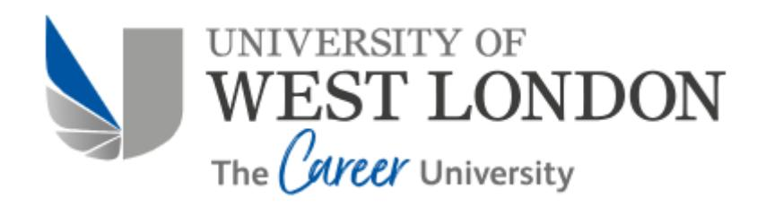
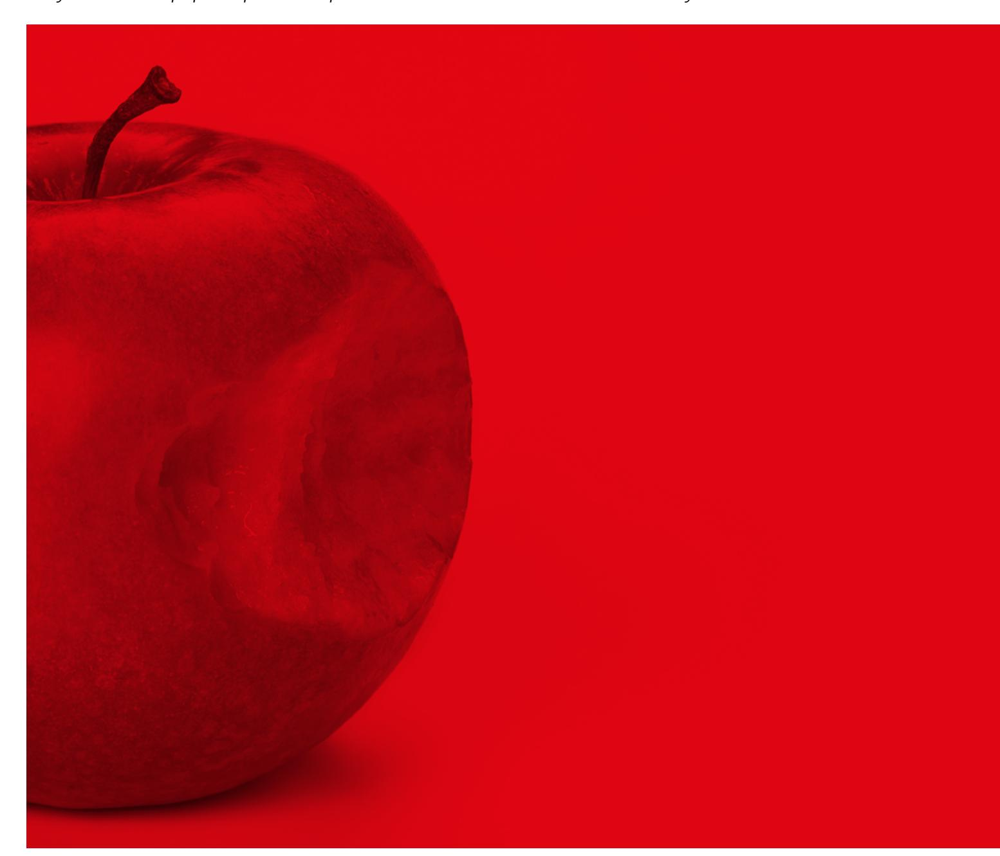
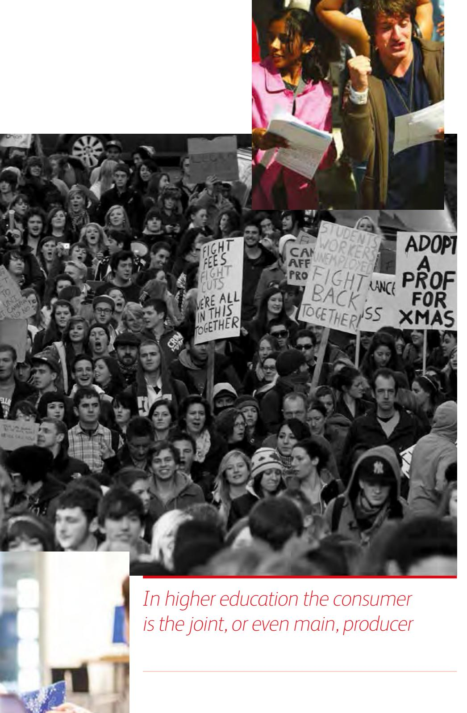
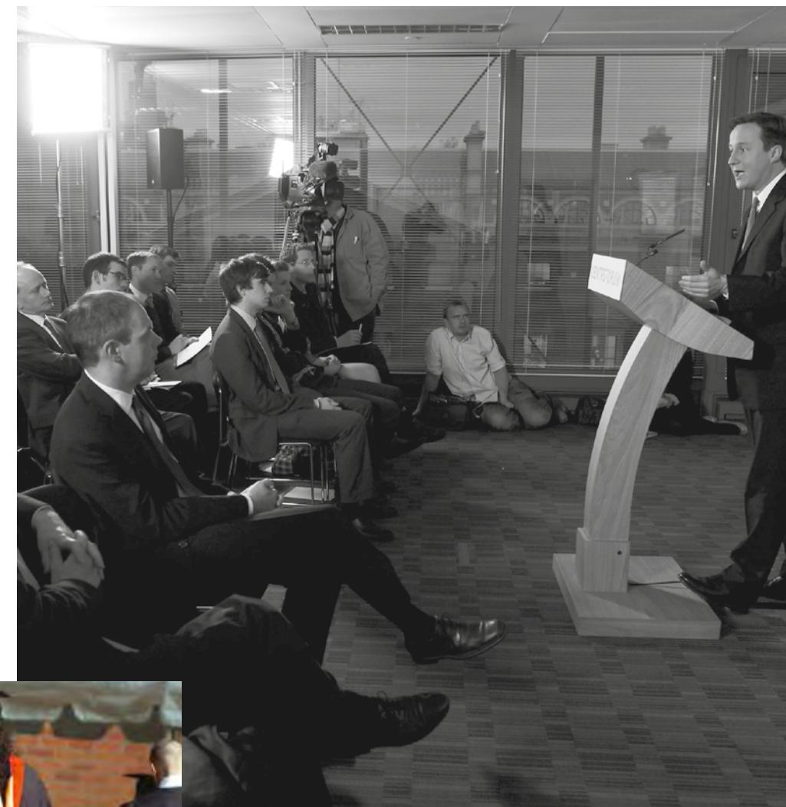

<!-- A2.R07 | source: papers_json/A2.R07/ -->

## **UWL REPOSITORY**

## **repository.uwl.ac.uk**

The marketisation of higher education: issues and ironies

**Brown, Roger (2015) The marketisation of higher education: issues and ironies. New Vistas, 1 (1). ** **pp. 4-9. ISSN 2056-9688 **

**This is the Published Version of the final output.**

**UWL repository link: **https://repository.uwl.ac.uk/id/eprint/3065/

**Alternative formats**: If you require this document in an alternative format, please contact: [open.research@uwl.ac.uk](mailto:open.research@uwl.ac.uk)

## **Copyright**:

Copyright and moral rights for the publications made accessible in the public portal are retained by the authors and/or other copyright owners and it is a condition of accessing publications that users recognise and abide by the legal requirements associated with these rights.

**Take down policy**: If you believe that this document breaches copyright, please contact us at [open.research@uwl.ac.uk ](mailto:open.research@uwl.ac.uk)providing details, and we will remove access to the work immediately and investigate your claim.

<!-- page 2 -->

Roger Brown | Liverpool Hope University, UK

## THE MARKETISATION OF HIGHER EDUCATION: ISSUES AND IRONIES

Higher education has been subject to a gradual process of marketisation since the early 1980s. This paper explores the paradoxes inherent in a market-driven HE system

<!-- page 3 -->

*Attempts to marketise higher education * *have been accompanied by a number * *of other moves to reform higher * *education in a corporate direction'*

arketisation is defined as the attempt to put the provision of higher education on a market basis, where the demand and supply of student education, academic research and other university activities are balanced through the price mechanism. The article begins with some definitions, and concludes with some thoughts about the best means of combining 'market' and 'non-market' (Wolf, 1993) coordination. M

## **The background**

UK, and especially English, higher education has been subject to a gradual process of marketisation since the early 1980s. The main steps were the abolition of the remaining subsidy for overseas students' fees in 1980; the separation of funding for teaching and research, and the introduction of selective research funding, in 1986; the introduction of 'top-up' loans for student support in 1990; the abolition of the 'binary line' between universities and polytechnics in 1992; the introduction of 'top-up' tuition fees of £1,000 in 1998; the changes in the rules for university title in 2004 to enable institutions without research degree awarding powers to obtain a university title; and the introduction of 'variable' fees of £3,000 in 2006.

Under the present Coalition Government in England this process has been consolidated and accelerated. The maximum full-time undergraduate tuition fee was increased from £3,375 to £9,000 in 2012. At the same time, the block grant to institutions to meet the costs of teaching has been reduced so that by 2015 only a small group of subjects receive direct subsidies. In parallel, there has been a progressive deregulation of funded full-time undergraduate places, so that in 2015 there are no limits on the number of students universities can enrol. Finally, market entry rules have been relaxed so that private universities and colleges are now offering a small but significant proportion of under- and postgraduate courses. There are now three privately owned universities: BPP University, Regents University, and the University of Law. Nearly £1bn is being spent on the education of students at private institutions compared with only £104m as recently as 2011-12 (for a detailed account of these changes and the background to them, see Brown with Carasso, 2013).

These attempts to marketise higher education have been accompanied by a number of other moves to reform higher education in a corporate direction. These include the remodelling of university governing bodies on corporate lines, and the development of sector-wide performance indicators (Brown, 2012a and b).

In parallel, there has been a progressive privatisation of the funding of higher education, with an increasing proportion of the costs being borne privately. By 2011, according to the Organisation for Economic Cooperation and Development (OECD), only Chile and Korea amongst member countries had a higher share of private expenditure on institutions than the UK's 69.8 per cent (this compares with 23.2 per cent in 2006 and 11.3 per cent in 2000) (OECD, Education at a Glance, 2014: Table 3.2). The 2012 reforms will of course increase the private share still further.

## **The rationale**

The rationale for these reforms has three main components.

First, it is believed that the best use of resources is obtained where universities interact directly with students as customers, rather than with the Government or a Government agency acting on students' behalf. The argument here is that 'students know best' and if they are empowered to act as consumers, institutions will either have to respond to their needs and preferences or lose custom. Second, as the system expands, its costs increase, especially as higher education has relatively limited scope to increase its efficiency. Because of real or perceived limits on the ability and willingness of taxpayers to fund a greatly enlarged system, a private contribution is necessary if quality is to be maintained. Third, many of the benefits of higher education – such as higher wages, more satisfying jobs, better health and longevity – accrue to students/graduates as individuals. It is therefore only fair that they should contribute a reasonable share of the costs (Williams, 1995). It should incidentally be noted that conventional theories of the market assume a number of buyers and sellers: the term 'quasimarket' denotes the supply of collective services on market lines where the state remains the principal direct purchaser (Le Grand and Bartlett, 1993).

<!-- page 4 -->

Academic research is a good example.

Before moving on, it may be worth emphasising that some important public, 'non-market' features remain. Entry to the market – access to degree awarding powers and university title – remains restricted, albeit not as much as before. Prices – fulltime tuition fees – are still controlled, and limited to a maximum of £9,000, at least until 2015. Loans for fees and maintenance are still subsidised whilst a significant number of students are receiving maintenance grants, bursaries, fee remission and other forms of financial support. University research remains heavily subsidised. It also seems highly probable that, given the overall future funding situation for higher education, student number controls will be re-imposed after the general election. Finally, price competition in full-time undergraduate education remains limited: almost all higher education institutions are charging the full £9,000 fee for all or some of their courses. So, with the extensive and continuing public financial support for both tuition and maintenance, isn't what we are seeing really 'business as usual'?

However, there are already many areas of higher education that are subject to market disciplines (part-time and postgraduate education, staff remuneration especially in connection with research, the raising of finance, and so on). It is also not necessary to have a full economic market to generate market-like behaviour, as the respected US economist W.J. Baumol demonstrated many years ago in relation to market entry barriers in conventional markets. Finally, whilst it is certainly true that extensive private funding does not preclude the supply of public goods, a significantly higher level of private contributions is bound to lead to greater resistance to the levels of taxation needed to safeguard those wider public benefits.

Let us now turn to the main purpose of this article. The main ironies of the marketisation of higher education concern value for money; system effectiveness; information and consumer choice; quality; and the role of the state.

*Almost all higher education institutions * *are charging the full £9,000 fee for * *all or some of their courses. So, with * *the extensive and continuing public * *financial support for both tuition and * *maintenance, isn't what we are seeing * *really 'business as usual'?*

## **Value for money**

Unfortunately, the arguments for marketisation, and the evidence underpinning those arguments, are rarely presented with such specificity or in such detail as the arguments against. If marketisation is considered on its own terms, and not simply as a cover for class or special interests and/or as an attempt to divert attention away from prolonged underfunding – both of them highly respectable arguments, but not considered here – then the case for it must be about increasing 'value for money' for stakeholders. This will be secured through greater competition both reducing costs and raising quality. And there can be little doubt that some degree of competition does increase efficiency, responsiveness and, more arguably, innovation.

But it is also clear that too much competition can be damaging, not only to other aspects of higher education (see below), but also to the central aim of better resource use itself. This arises mainly from the inevitable and unavoidable tendency, through price competition in what is essentially a positional market characterised by competition for status, for prices to rise to what the market will bear. The US private 'not for profit' colleges and the English private schools are classic instances (Brown, submitted for review). In both instances, the providers charge far more than is necessary to provide a good education, whilst the American private colleges create a 'price umbrella' that means that other institutions also charge far more than they need to, leading to wholesale price inflation and welfare losses (Dill, 2007). A further significant source of waste is increasing expenditure on things like marketing and branding, glitzy halls of residence and the like, all designed to attract students. In other words, some competition leads to better use of resources, but too much undoes the advantages of increased competition in the first place. This is the central and crucial irony of marketisation in higher education.

<!-- page 5 -->

**© University of West London**

## **System effectiveness**

There is great difficulty in comparing the effectiveness of different university systems, not least because of the absence of any valid and reliable means of assessing and comparing the effectiveness of university teaching (see below). However it does appear that those systems that have a high degree of marketisation, and its associate, privatisation, are generally less effective than those that favour less competition and more public funding: the Scandinavian countries, Canada, The Netherlands (Gerritsen, 2008; Li et al., 2011). There may be parallels here with school systems and health care.

## **Information and consumer choice**

It is cardinal to the whole notion of an economic market that both producers and consumers have access to reliable information about price, availability and product quality. But in higher education the consumer is also joint, or even main, producer. Equally important, however, is the risk that, unless it is carefully controlled, competition leads to rationalisation and an actual reduction in diversity and consumer choice, at programme, subject and institutional levels. *Everything for Sale?* (Brown with Carasso, 2013) charted the demise of the specialist institutions – the colleges of education, the medical schools, the art and design colleges. We can expect to see – indeed, are already beginning to see – some rationalisation of subjects, as institutions find it increasingly difficult to justify continuing cross-subsidies to keep subjects and programmes going for which there is little evident market appetite. This again parallels the situation in the US (Blanchflower, 2014). There must also be some rationalisation of institutions, though how that will be accomplished, by whom, and with what resources, is far from clear.

## **Quality**

The Coalition Government believes that market competition will lead to improved quality because providing institutions have greater incentives to offer better programmes to their students. However, marketisation necessarily turns higher education into an economic good, and this in itself is inimical to the broader liberal notion of higher education being about the intellectual (and moral) development of the individual that many in higher education still cling to. It leads institutions to focus on what are at best proxies for quality, such as student surveys, at the expense of things that really make for learning gains, such as more professional assessment. It also threatens academic self-regulation, which remains the best, as well as the cheapest, form of regulation. Even before the higher fee, there were a number of cases where academic judgements were overturned by managers concerned about the potential impact on institutional revenues or on customer reactions (Brown with Carasso, 2013). The Bedfordshire case, where it is alleged that students sponsored by Saudi Arabia were given greater lenience than other students in complying with local assessment regulations, is a recent instance (Matthews, 2014). There may be many more instances, including more grade inflation, as competition really bites.

<!-- page 6 -->

## **The role of the state**

The final irony concerns the role of the state. Before the mid-1980s, even though nearly all the cost of UK higher education was borne by the state, there was very little official engagement with higher education. Although it could be draconian with individual institutions, the University Grants Committee (UGC) operated with a very high degree of freedom from both Whitehall and Westminster. So, in a slightly different way, did the corresponding coordinating body for the so-called 'public sector' of higher education, the National Advisory Board (NAB). Indeed this degree of freedom was to be the two organisations' undoing when the Thatcher (and successive governments of all parties) sought greater 'responsiveness' from the universities to its reform agenda.

Although UK universities still enjoy a high degree of autonomy compared with many other publicly funded organisations, as well as with universities in many other countries, there can be little doubt that there has been a considerable increase in the degree of state control over UK higher education. This control is exercised through agencies – the funding councils that succeeded to the UGC and the NAB – that are closely monitored and controlled by the Government. So whereas markets elsewhere are seen to need less state regulation, in higher education they are seen to need more!

*Whereas markets elsewhere are seen * *to need less state regulation, in higher * *education they are seen to need more!*

<!-- page 7 -->

The problem in higher education is not that one party has information that the other party lacks, but that no one has, or can have, the necessary information about quality, not least because higher education is a 'post-experience good'

## Conclusion

These then are some of the ironies and paradoxes that attend the attempt to put the supply of higher education on a market basis. They are certainly not confined to the UK (Brown, 2011) or indeed to higher education. But in higher education at least they result mainly from two constraining

The first, and most crucial, is the information problem. For many years, economists have acknowledged the risk of market failure owing to 'information asymmetry' – the case where one party to an economic exchange has relevant market information that the other party does not. It is customary to think of the producer/supplier as having the advantage here, but there are instances where the boot is on the other foot, as in insurance (hence the 'excess'). However the problem in higher education is not that one party has information that the other party lacks, but that no one has, or can have, the necessary information about quality, not least because higher education is a 'post-experience good' (Weimer and Vining, 1992). This means that the information that is really needed is only available long after it can be of any use. William Goldman's famous saying about Hollywood – 'nobody knows anything' - comes to mind here.

The second is the existence of significant externalities, and in particular the fact that the benefits of higher education are not confined to the individual student/graduate. The most comprehensive attempt so far to identify and measure these wider benefits (McMahon, 2009) estimates that the social, non-private benefits – such things as higher education's contribution to democracy and human rights; reduced economic inequality; or lower welfare, medical and prison costs – amount to just over half the total benefits. Even the present Government has recognised this by maintaining some direct subsidy of so-called 'strategic and vulnerable subjects' — such as medicine, engineering and modern foreign languages – that would struggle if left entirely to market competition.

So what, finally, are the best ways of obtaining the benefits of competition without the detriments?

There are five key requirements:

- 1. Market participation should be controlled through a system of institutional accreditation covering governance, management, finance, use of resources and educational quality. Peer-review should play a central role in this process. No provider that is not eligible for charitable status should be able to obtain degree awarding powers or university title.
- 2. Teaching should be funded through a mixture of institutional block grants and tuition fees, with the latter capped at 50 per cent of the cost. Institutional resourcing differentials should be controlled, with minimum and maximum levels of funding per student. Maintenance grants and national scholarships should be available for poorer students, with all students having access to subsidised loans for both tuition and maintenance.
- 3. Quality should be monitored by a single, system-wide regulatory agency accountable to Parliament. Institutional and departmental review processes supervised by the agency should ensure minimum standards of student learning achievement and academic practice. The agency should have the power to de-accredit any provider that consistently fails to meet good standards of governance, management or academic practice.
- 4. Research should continue to be subsidised through the funding and research councils. It should only be funded selectively where there is a special case for doing so, for example, where it is relatively expensive to conduct. Research quality, and links between research, teaching and other university activities, should be monitored through the institutional and departmental reviews.
- 5. There needs to be a mechanism for monitoring the impact of market competition and taking action where needed to deal with market failure. This should include identifying providers or activities in need of subsidy or support because of their wider contribution to the benefits of higher education, and promoting and facilitating institutional collaboration both as a means of controlling costs and as a way of extending educational opportunities (Brown, 2014).

## References

Baumol, W.J. (1982) Contestable Markets: An Uprising in the Theory of Industry Structure. *The American Economic *Review 72 (1): 1-15

Blanchflower, D. (2014) Changing the pattern. Degree trends at Dartmouth College make a fascinating case study as more students choose majors that lead to highly paid jobs, leaving some faculties with dwindling classes and too many staff. Times Higher Education 28 August 2014: 36-39

Brown, R. (ed.) (2011) Higher Education and the Market. New York and London: Routledge.

Brown, R. (2012a) The corporatisation of university governance. London: University of West London. http://www.uwl.ac.uk/ instil/research/Occasional_pages.jsp

Brown, R. (2012b) The development of system-wide performance indicators. London: University of West London. http://www.uwl.ac.uk/instil/research/Occasional_pages.jsp

Brown, R. (2012c) The Myth of Student Choice. VISTAS: Education, Economy and Community. London: University of West London

Brown, R. (2014) *The Future Coordination of English Higher Education Institutions*. Paper presented at the Higher Education Better Regulation Group (HEBRG) Symposium on the Future of Higher Education Regulation in the UK. London, March 2014

Brown, R. (Submitted for review) Do we really want a private sector of schooling?

Brown, R. with Carasso, H. (2013) Everything for Sale? The Marketisation of UK Higher Education. London and New York:

Dill. D. (2007) Will market competition assure academic quality? An analysis of the UK and US experience. In D.F. Westerheijden, B. Stensaker and M.J. Rosa (eds.) Quality Assurance in Higher Education: Trends in Regulation, Translation and Transformation. Dordrecht: Springer

Gerritsen, J. (2008) The real Shanghai Jiao Tong winners. *University World News* 31 August 2008 http://www._ universityworldnews.com/article.php?story=2008082815 0333316 (accessed 25 March 2009)

Le Grand, J. and Bartlett, W. (1993) Quasi-Markets and Social Policy. Basingstoke: Macmillan

Li, M., Shankar, S. and Tang, K.K. (2011) Why does the USA dominate university league tables? *Studies in Higher Education *36 (8): 923-937

McMahon, W.W. (2009) Higher Learning, Greater Good: The Private and Social Benefits of Higher Education. Baltimore: The Johns Hopkins University Press

Matthews, D. (2014) Sponsored Saudi cohort gets exam exceptions: QAA to study claims of special treatment for group

at Bedfordshire. Times Higher Education, 28 August: 6-7 ganisation for Economic Cooperation and Development (2014) Education at a Glance. Paris: OECD

Weimer, D.L. and Vining, A.R. (1992) Policy Analysis: Concepts and Practice Englewood Cliffs. NJ: Prentice Hall

Williams, G. (1995) The 'marketisation' of higher education: reforms and potential reforms in higher education finance. In D. D. Dill and B. Sporn (eds.) Emerging Patterns of Social Demand and University Reform: Through a Glass Darkly. Oxford: Pergamon Press

## About the author

Roger Brown is Emeritus Professor of Higher Education Policy at Liverpool Hope University, and Visiting Professo and co-opted member of the Board of Governors at the University of West London

## Kevwords

marketisation, quality, information, privatisation, choice
