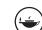
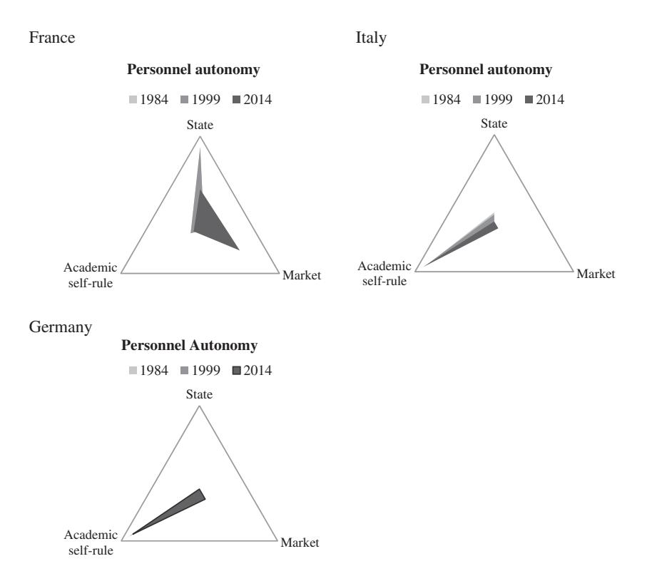
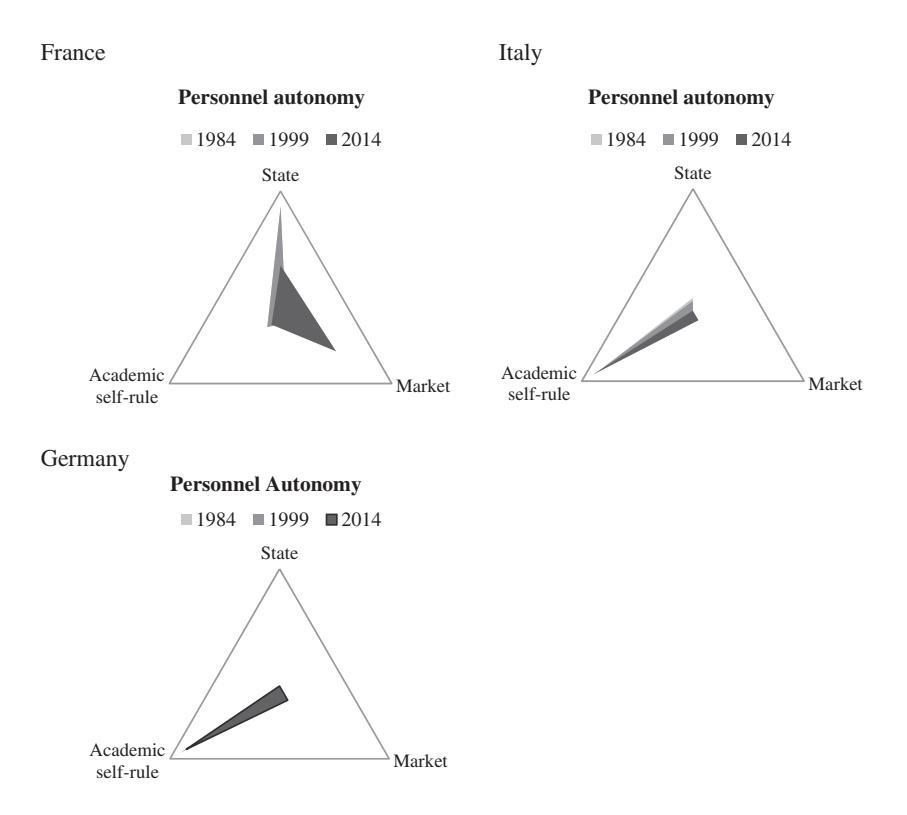

<!-- A2.R13 | source: papers_json/A2.R13/ -->

OPEN ACCESS

## **Higher education governance in France, Germany, and Italy: ** **Change and variation in the impact of transnational soft ** **governance**

Michael Dobbins[a](#page--1-0) and Christoph Knill[b](#page--1-1)

a Education Policy, Fachbereich Gesellschaftswissenschaften, Institut für Politikwissenschaft, Goethe-Universität Frankfurt am Main, Frankfurt am Main, Germany; bGeschwister-Scholl-Institut für Politikwissenschaft, Lehrstuhl für Empirische Theorien der Politik, Ludwig-Maximilians-Universität München, München, Germany

## ABSTRACT

There is a consensus that transnational soft governance has unleashed the forces of change in higher education. However, individual national HE systems are still anchored in country-specic regulatory regimes, which reect national-historical, institutional, and cultural developments. Against this background, three crucial questions guide our study: How does the state react to transnational pressures for change? How is transnationally inspired policy change 'digested' by the preexisting country-specic governance structures? And to what extent have national HE systems converged on a common governance model? To address these questions, we conduct a multilevel comparative analysis of developments in Germany, France, and Italy. We rst break down the concept of higher education governance into sub-dimensions and derive concrete policy indicators for three historically embedded governance ideal types. Drawing on historical institutionalism and institutional isomorphism, we explore how historical legacies and transnational communication have impacted policy pathways over the past 30 years. We graphically illustrate the policy trajectories using our 'governance triangles', which encompass the balance of power between multiple actors, including the state and universities, university management and the academic profession, and external stakeholders.

## KEYWORDS

Higher education governance; historical institutionalism; isomorphism; Germany; France; Italy

## **1. Introduction**

In particular from the 1990s onwards, European higher education (HE) systems have been increasingly confronted with fundamental reform pressures. A series of interrelated challenges such as the emergence of the knowledge society, unsatisfactory economic growth, the perceived unattractiveness of European universities, educational expansion, and, simply stated, globalization led to an increased consensus that new dynamics must be injected into European HE. ese challenges were reinforced by the global rise of managerial reform

<!-- page 2 -->

ideas associated with New Public Management as well as a general crisis of public nance and hence structural underfunding of universities.

Facing powerful domestic veto players and vested academic interests, national executives took a 'transnational detour' to increase outward legitimacy pressures on domestic HE systems (Martens & Wolf,[ 2006](#page--1-2)). Launched in 1999, the Bologna Process created a regime of transnational so governance primarily based on voluntary mechanisms of communication and information exchange. As a loosely coupled system for the exchange of expertise, know-how, and the promotion of concrete principles and policy strategies, Bologna has become a means of mainstreaming HE activities toward similar overarching policies. Consequently, national HE systems were increasingly challenged to demonstrate their legitimacy in the context of an emerging transnational governance platform. is development was reinforced by parallel attempts to compare the performance of HE systems through rankings and benchmarking. Along these lines, the European Commission, which became increasingly engaged in HE policy, has explicitly promoted entrepreneurial management, funding diversication, as well as closer university–industry ties (European Commission, [2006](#page--1-3)). Moreover, the Bologna Process has spawned a highly stakeholder-oriented model of transnational governance focusing on the inclusion of multiple stakeholders such as national rectors' conferences, student unions, and governmental actors. us, it is plausible to assume that Bologna may radiate normative pressures for national governments to embrace policies aimed at more competition, entrepreneurialism, and multi-stakeholdership as well.

Despite an increasing consensus that so governance processes at the European and international levels are impacting national governance arrangements (Amaral, Musselin, Neave, & Maasen,[ 2009;](#page--1-4) Dobbins,[ 2011](#page--1-5)), it is also generally acknowledged that individual HE systems are embedded in country-specic coordinative regimes, which reect national-historical, institutional, and cultural peculiarities. Presently, we still have limited knowledge on the actual eect of transnational reform pressures on these institutionally highly embedded systems. Against this background, three crucial questions will guide the present analysis. How have HE systems reacted to transnational pressures for change and modernization? How is transnationally inspired policy change 'digested' through embedded preexisting country-specic governance arrangements? And, to what extent are national HE systems converging to a common (market-oriented) governance model?

To address these questions, we explore developments in the three large Western European HE countries – Germany, Italy, and Franc[e1](#page--1-6) – which essentially gave the initial impetus to the Bologna Process. We focus on these three countries because their HE systems display a strong variation with regard to institutionalized patterns of HE governance. While Germany has a strong tradition of academic oligarchy and self-regulation, France is characterized by a much stronger role of centralist state intervention. Italy, by contrast, combines elements of both the German and the French systems. Given this variation, the three countries can be considered particularly interesting cases to analyze potential convergence eects emerging from transnational reform pressures. Drawing on two competing theoretical strands – historical institutionalism and institutional isomorphism – we explore how historical

> ^1^ The United Kingdom was also one of the four initiators of the Bologna Process. However, it initially did not perceive the Bologna Process as a lever for domestic policy change, rather as a platform for other European systems to converge on the British HE model (Hoareau, [2009](#page--1-7); Witte, [2006)](#page--1-8). Therefore, and for reasons of space, we do not address HE policy developments in the United Kingdom.

<!-- page 3 -->

institutions and processes of transnational communication have shaped changes in HE governance. In the following, we rst present our analytical framework. We then compare dierent aspects of HE governance for the three countries under study, before concluding with a general discussion of our ndings.

## **2. Theoretical considerations and framework of analysis**

From the perspective of sociological institutionalism, the promotion of transnational reform models leads us to assume that models of HE governance will converge across countries. According to theories of *institutional isomorphism* (DiMaggio & Powell,[ 1991](#page--1-9)), strong external legitimacy challenges compel national HE systems to embrace norms and structures of other HE systems that are perceived as successful in their organizational environment. Instead of developing own solutions, organizations aim to enhance their legitimacy through policy emulation. Accordingly, the quest for legitimacy (and not eciency) is the main driver of domestic reforms. As a consequence, the Bologna Process and parallel patterns of benchmarking support the expectation of converging national HE systems toward transnationally promoted external policy models. Yet, this expectation of Bologna-induced convergence rests on the assumption that transnational reform pressures constitute the main source of legitimacy for national HE organizations. Regarding the Bologna Process and the countries under study, this assumption bears high plausibility, as their governments were among the initiators of the process and thereby deliberately attempted to overcome national reform opposition by creating a transnational governance platform.

Yet, legitimacy concerns might not be the only factor aecting national policy responses. As emphasized by *historical institutionalists,* policy developments are strongly conditioned by embedded legacies and structures (Hall & Taylor,[ 1996)](#page--1-10). Global trends may be 'digested' dierently in varying contexts, depending on underlying interest constellations and institutional opportunity structures. As a consequence, the speed and direction of national reforms might vary across countries. Rather than convergence, distinctive national reform trajectories may be observed.

Our three case studies serve to reect such diversity in preexisting historical institutions. Despite its heterogeneous federal structure, German HE heavily draws on Humboldt's tradition of academic self-rule and the inseparable link between teaching and research. Originally rooted in the tradition of academic freedom and autonomy (Gieysztor, [1992](#page--1-11), p. 108), by contrast, French HE experienced a phase of all-embracing nationalization and the abolishment of university self-administration in the sixteenth and seventeenth centuries. Under Napoléon, universities essentially became teaching institutions entrusted with the realization of state political and ideological objectives (Neave, [2001,](#page--1-12) p. 37), while specialized institutions for the formation of national elites (*grandes écoles*) were established. Until the 1960s, French HE was characterized by two seemingly paradoxical phenomena: state-centeredness and structural compartmentalization. Universities as overarching institutions essentially did not exist, while individual faculties were the main decision-making units. Although universities were declared autonomous institutions in 1984, they remained under the supervision of the education ministry (Chevaillier, [2007)](#page--1-13) and were not granted additional legal or nancial self-management capacities. Finally, Italian HE is also historically marked by a high degree of top-down state steering (Esposti & Geraci, [2010](#page--1-14)). Similar to the French system, Italian universities were overshadowed by the compartmentalized faculties and only

<!-- page 4 -->

became autonomously operating collective actors over the past few decades. However, the Italian HE system also resembles elements of the German system, in particular with regard to its powerful professoriate (Clark, [1977)](#page--1-15). Italy hence reects a paradoxical combination of a quasi-feudalistic chair system and a strong state bureaucracy, the latter of which has oen also traditionally been headed by powerful chairholders or at least subject to their inuence through parliament.

Returning back to our theoretical perspective, we are thus confronted with two contradictory expectations regarding the eects of transnational reform pressures on the extent of cross-national HE policy convergence: either the steadfastness of historical path dependencies or transnationally induced policy change. We argue that the question whether isomorphic eects or national path dependencies might prevail depends on the relative strength of both factors within certain policy dimensions. On the one hand, transnational reform pressures are not of equal relevance for all aspects of national HE policies. On the other hand, the institutional stickiness of national HE arrangements may vary from issue to issue. For instance, personnel policies might be less subject to such pressures than funding matters due to the attachment of the former to the national civil service.

## *2.1. Analytical conceptualization of HE governance*

In order to juxtapose these historical constellations with purported transnationally promoted trends toward the marketization of HE policy and measure the direction and degree of national reforms, we dene three ideal types of HE governance – *academic self*-*rule, * *state*-*centered model, and marketized model* (see also Clark, [1983](#page--1-16); Olsen, [2007)](#page--1-17).[2](#page--1-18) We then break down their varying characteristics into three key governance dimensions: *general * *HE arrangements, nancial governance, and personnel autonomy*. ese inextricably linked dimensions bear specic features according to the historical steering tradition, which enable us to systematically trace country-specic developments.

## *2.1.1. General HE arrangements*

We begin with general HE arrangements, which are closely related to the allocation of procedural autonomy (Berdahl,[ 1990](#page--1-19)) and balance of power between the state, university management, and the professoriate. Specically, who bears the greatest thrust of decision-making, to what extent is decision-making driven by entrepreneurial considerations, and which actors assume the most signicant controlling functions in HE? And who regulates relationships between the university and society?

e constitutive logic of a *state*-*centered HE system* is that universities function as utilitarian institutions to meet national priorities (Olsen, [2007](#page--1-17)). e state directly coordinates all or most procedural matters, including admission requirements, the nomination of academic personnel and, in some cases, even curricula and examinations. University governance is largely framed by uniform legislation in combination with nationally standardized

> ^2^ Olsen [(2007](#page--1-17)) also puts vision of universities as representative democracies based on principles of direct democracy and large-scale student participation through which universities actively strive to enhance democracy in society in general. However, elements of student sovereignty, egalitarianism, and democracy can also be found in the three other models in various ways. The concept of the university as a direct democracy impacted HE reforms after 1968 and influenced other governance systems without fully establishing itself as a broadly practiced model.

<!-- page 5 -->

employment regulations. University autonomy and self-management are restricted by the strong interventionist capacities and administrative control of the state. University managers are largely subservient to the state bureaucracy and ministerial guidelines, while the ministry exerts unilateral process-oriented quality control over internal university aairs. Research and education are seen as being closely in line with national industrial and technological demands, whereby ties between universities and industry are generally mediated by ltering through national government (see Neave, [2003,](#page--1-20) p. 145).

e main organizational *leitmotiv* in academic self-rule arrangements is frequently described by skeptical observers as 'academic oligarchy', emphasizing weak university management, strong academic self-regulation by the professoriate, in particular regarding study and research proles (de Boer & Goedegebuure, [2003](#page--1-21), p. 215), and a compartmentalized system of academic chairs. Ideally, the model is based on a state–university partnership, governed by principles of corporatism and collective agreement. On the one hand, academic 'oligarchy' is synonymous with the self-regulation of academic aairs by the scientic community via academic senates at the institutional level in concert with external self-governing bodies (Clark, [1983](#page--1-16), p. 140). On the other hand, the state limits academic self-governance through diverse planning and nancial laws. Self-governance thus takes place within broader, state-dened constraints, while professors hold the status of civil servants.

Unlike their counterparts, 'marketized' universities essentially operate as economic enterprises within and for regional or global markets (Marginson & Considine,[ 2000)](#page--1-22) and permanently compete for human capital and nancial resources. University management is generally separated from academic management and entrusted with signicant institutional leadership capacities. is enables universities management to autonomously regulate its own institutional parameters, strategically design structures and study programs, while oen aligning them with socioeconomic demands. Marketization, however, by no means implies the complete detachment of the state, as the government generally denes broader HE policies to promote competition and transparency for the 'consumers' of education products. Another notable feature of market-based models is the direct impact of business and commerce on HE policy-making as 'co-agenda-setters'. In state-centered and academic self-rule models, such forms of regional and economic cooperation also may exist, but tend to be coordinated by the state or individual academics.

## *2.1.2. Financial governance*

In state-centered systems, the state maintains control over funding and generally allocates itemized or earmarked funds at its discretion. Hence, institutions have little freedom to use funds independently. In academic self-rule constellations, universities are also highly nancially dependent on the state, which limits their scope for strategic investments. Based on collective agreements, the state does however tend to grant institutions broader discretion in the expenditure and allocation of funds than in state-centered constellations. In most cases, some funds are allocated for specic purposes, and others le to the discretion of institutions. ird-party research funds are generally procured by high-ranking academics, which in turn increase professorial control over funds. Marketized systems tend to integrate entrepreneurial and investment culture into funding policy (Estermann & Nokkala,[ 2009](#page--1-23)). ey are characterized not only by sti competition over state and non-state funds but also a greater diversity of funding sources (de Boer & Goedegebuure,[ 2003](#page--1-21)). Marketization generally entails a shi toward lump-sum and performance-based university funding (oen

<!-- page 6 -->

at a reduced level), which in turn enhances the exibility of university management, while also exerting pressures to procure more external funding.

## *2.1.3. Personnel autonomy*

Personnel autonomy comprises authority over human resource management and the degree of involvement of academics in strategic decision-making processes, i.e. the separation of academic and administrative-strategic management (Estermann & Nokkala, [2009](#page--1-23)). In state-centered arrangements, decisions over recruitment, rewarding, and sanctioning of personnel remain in the realm of governments. e idea of a 'community of scholars' is much more visible in academic self-rule models as researching academics play the dominant role in personnel recruitment. In market-oriented approaches, authority over the selection of academic and high-level personnel is at least partially transferred away from the 'academic' 'oligarchy' to university management, which generally has greater means to sanction or dismiss 'unproductive' academics (Table 1).

Despite the static nature of the indicators, these three non-mutually exclusive ideal-type models are suciently broad to distinguishably trace national policy change, while reecting both current trends (e.g. marketization; stakeholder governance) as well as the historical foundations of European universities. We now examine how the interplay between transnational pressures for change and historical institutions has shaped the HE governance trajectory. Instead of carrying out individual country case studies, we focus on developments within the three governance dimensions in Germany, Italy, and France. We trace policy developments between three benchmark years – 1984, 1999, and 2014. e timeframe of analysis thus spans three decades during which the rst major HE reforms were initiated in Western Europe to the phase of Europeanization with the kick-o of the Bologna Process in 1990 on to the most recent phase, which reects the preliminary outcome of the recent heavy reform activity.

## **3. Empirical analysis**

To take stock of the reform output in the three countries under study, we aligned each countr[y3](#page--1-24) with one of our three ideal types for each of the above-described indicators. e data were gathered from a structured questionnaire completed by at least eight HE policy-makers and experts per country. e respondents included ministerial representatives, top-ranking HE researchers, and university management representatives, who were addressed on the basis of their privileged access to inside knowledge, participation in the policy process, and/or their involvement in HE networks. In the questionnaire, we explicitly requested respondents to outline developments over the last three decades by identifying the main decision-makers and/or balance of power for all indicators. To increase the reliability of the ndings, we compared and contrasted the provided data with HE legislation, policy documents, and secondary literature. We also conducted several in-depth interviews with

> ^3^ The German case is challenging because the individual *Länder* (states) are responsible for HE and, in particular since the 2006 Federalism Reform, have pursued their own version of university reform. However, the HE systems of the 16 Länder are rooted in the same Humboldtian ideal type and most recent reforms generally have moved in the same direction of constrained marketization, albeit at different speeds. Therefore, we focus on overarching developments that apply to most or all *Länder,* while providing scattered references to divergent *Länder* reforms. For reforms in the German *Länder*, see Kamm and Köller [(2010)](#page--1-25), Keller and Dobbins ([2015)](#page--1-26).

<!-- page 7 -->

HE policy experts in each country in order to complement and validate our empirical ndings. is ensured a reliable assessment of the correspondence of the status quo with each governance indicator in each country over three time periods.

## *3.1. Comparative analysis of developments in general HE arrangements*

How has the balance of power between university management, the state, and academic community evolved over the past 30 years? In France, the transnationalization of HE provided a clear isomorphic stimulus to the overhaul of the institutional parameters of HE (Baty, [2010](#page--1-27); Musselin,[ 2009](#page--1-28)). In reaction to the Bologna Process, the state pushed to 'managerialize' university governance structures with the *loi de modernisation universitaire*, which was based on the principles *autonomie des enseignements* (teaching autonomy) and *autonomie * *de gestion* (administrative autonomy) (Witte,[ 2006)](#page--1-8). However, the reform failed amid bitter resistance from student unions, who – alluding to historically entrenched principles of statism and educational equality – argued that universities would be exploited by enterprises and become a tool for labor market training (Interview Student Union Representative

<!-- page 8 -->

2011). Hence, the isomorphic pressures from Bologna were initially insucient to topple the historically embedded governance tradition. However, French HE was soon rattled by another byproduct of internationalization: its very poor performance in university rankings.[4](#page--1-24) is fed into concerns over the human capital potential of the HE system (see Aghion & Cohen, [2004)](#page--1-29) and increased the perception of France as a HE laggard. As reected by the many references to international competition and the below-average performance of French universities (MESR 2007), the Sarkozy government increasingly regarded itself as a catalyst for the isomorphic emulation of the governance models of HE policy 'forerunners', (Sarkozy, [2007)](#page--1-11).

e resulting 2007 Law on the Freedoms and Responsibilities of Universities (*Loi relative * *aux libertés et responsabilités des universités,* LRU) constituted a breach with the state-centered steering tradition. Its centerpiece is a smaller *conseil d'administration* (administrative council), which now consists of 20 to 30 members (instead of previously 60), approx. 40% of whom are lecturing researchers. On the one hand, this enhanced the position of the academic profession (Musselin,[ 2009,](#page--1-28) 195), a trend reinforced by a recent law (2013) requiring universities to partner or merge with non-university research institutes and coordinate joint research activities. On the other hand, in line with the market-oriented paradigm, the *conseil * *d'administration* now also must include external stakeholders, of which at least one is to be head of a leading enterprise (LRU 2007, Art. 7; Aust & Crespy,[ 2009](#page--1-30)).

As an additional sign of isomorphic alignment with Anglo-Saxon HE systems, the LRU reform allocates more powers to university presidents. Elected for four years by the *conseil * *d'administration* (Article 6), the president is responsible for implementing four-year performance contracts (*contractualisation*), coordinating third-party relations and monitoring the allocation of governmental and private funding. e *conseil d'administration* essentially merges academic representation and management functions into one institution, while transferring extensive authority to university presidents over the employment and promotion of academic sta (LRU 2007, Art. 19).

As for quality assurance, a shi toward the market-oriented paradigm kicked in even earlier. e Bologna Process not only inspired the creation of a new quasi-governmental agency (AERE[S5](#page--1-31) ), but also new market-oriented instruments aimed at reinforcing the research mission of French universities. Specically, the evaluation agency heavily relies on external evaluation including international members and increasingly applies *ex post,* i.e. output-oriented criteria such as bibliometric evaluations of academic publications (see Musselin & Paradeise,[ 2009,](#page--1-32) p. 37). e 2013 HE law also introduces the *ex ante* state accreditation of HE institutions. While a reform-adverse movement called *Sauvons la Recherche* vehemently opposed the reforms, the Sarkozy government's rhetoric over global legitimacy and visibility served to garner the support of many academics with close ties to the ministerial bureaucracy (Soulé,[ 2007)](#page--1-33).

Contrary to France, general HE arrangements in Germany have experienced more 'constrained' marketization within historical parameters. Fears of lagging behind in the global

> ^4^ Only one French university (*Paris*-*Sud*) ranked among the top 100 in the 2003 Shanghai ranking, while French university departments also were far behind their American and Northern European competitors in the 2007 department-based Shanghai ranking. No university ranked among the top 100 in the *Times Higher Education* ranking (Dalsheimer & Despréaux, [2008](#page--1-34), p. 8).

> *Agence d'évaluation de la recherche et de l'enseignement supérieur*. The 2013 HE Law (Loi n°2013-660) replaced it with the *Haut conseil de l'évaluation de la recherche et de l'enseignement supérieur.*

<!-- page 9 -->

race for educational excellence, knowledge, and innovation loomed high over German education policy-makers (Toens,[ 2009;](#page--1-35) Wissenschasrat,[ 2000)](#page--1-26). Faced with drop-out rates, dwindling state funding, and long study duration, the German Government seemed unable to reform and modernize the system from above without support of the *Länder.* However, Bologna quickly placed policy change in the context of a broader European and global endeavor of remodeling HE. What essentially then transpired in Germany was a large-scale eort to balance global pressures for change with preexisting structures. For example, a series of institutional innovations partially inspired by foreign models – such as university councils (*Hochschulräte*), target agreements (*Zielvereinbarungen*), new quality assurance schemes – have been injected into preexisting HE arrangements, but are restrained from fundamentally transforming HE governance. For example, university councils (*Hochschulräte*) were established in most German *Länder* to allow external representatives to exert control over university management (*Rektorat* or *Präsidium*) and academic senates (see Hüther, [2009](#page--1-36) for dierent *Länder*-specic types of *Hochschulräte*). However, there is little evidence that their new co-decision rights have uprooted collegial, professor-dominated university governance structures (Hüther, [2009)](#page--1-36).

Already introduced in the late 1990s in some German *Länder*, target agreements (*Zielvereinbarungen*) have rapidly expanded over the past decade. Like the French *contractualisation* procedure, these multi-annual negotiated pacts between the *Länder* and HE institutions break with the tradition of hierarchical decrees (Schimank,[ 2006](#page--1-10)). However, they still uphold the legitimate interest of the state in steering the system (Ziegerle, [2002,](#page--1-22) p. 111) by setting 'production goals' for universities to meet, e.g. new research specializations, fewer 'drop-outs', the expansion of quality management, and study program accreditation (Wilkesmann & Würmseer, [2009)](#page--1-37). ese output agreements have inevitably strengthened university management. However, their impact is constrained by the lack of sanction mechanisms for non-compliance with objectives in most *Länder*. University management is also still heavily constrained by the academic community. Even in such cases in which university management was overtly strengthened, it still operates within loosely coupled systems, in which operative power has historically primarily been concentrated in the professorial chairs and faculties and channeled upwards through academic senates. us, the historically strong senates, in which professors clearly still hold the majority of seats and votes, have extensive authority over the distribution of personnel and resources among departments as well as the decisions concerning research, teaching, and the appointment of professors (Kaulisch & Huisman, [2007;](#page--1-38) Interview Ministry of Education, Science and Culture, Rhineland-Palatinate, February 2012).

However, the states (*Länder*) – like the French central government – can by no means be written o as key decision-makers. To eectively promote overarching reforms within the structurally fragmented, bottom-heavy system, they have refrained from a strategy of top-down imposition of administrative structures or 'system design' as in France. Instead, they have increasingly sought to encourage developments from within universities by allying themselves with university management. Hence, in most *Länder* structural development is increasingly the task of individual universities. One particularly striking example of this is *Hochschulfreiheitsgesetze* (University Freedom Laws) of North Rhine-Westphalia (2006) and Saxony (2012), which legally dene universities as self-administrating bodies and place far-reaching autonomy over personnel, nancial, and organizational manners in university management (*Präsidium*) (Heinz & Horst, [2011)](#page--1-39).

<!-- page 10 -->

Quality assurance is an additional reection of these new multilateral forms of governance. Germany has signicantly expanded *ex ante* accreditation of study programs. e rst milestone in this direction was the establishment of the Accreditation Council (*Akkreditierungsrat*) in 1998 in order to secure minimal standards in teaching and research as well as the labor market relevance of study programs. Despite its central position in German quality assurance networks, the Accreditation Council can be seen as the result of a power struggle between the Federal Government and *Länder* in which the *Länder* prevailed (Serrano-Velarde, [2008)](#page--1-40). us, the central body does not accredit study programs itself, rather authorizes six decentralized and largely non-prot agencies to accredit programs. e new accreditation can be viewed as both *ex ante* and *ex post*, as the original accreditation is followed up on by re-accreditation aer several years. At the same time, many *Länder* have pushed for the expansion of internal evaluation as part of the target agreements (*Leistungsvereinbarungen*) (König,[ 2006)](#page--1-41). us, there is a strong argument that quality assurance has entered a phase of over-complexity through which the dierent quality assessments may send contradictory signals (Teichler, [2003)](#page--1-36).

Contrary to Germany's attempts to consistently balance isomorphic change with historical settings, developments in general HE arrangements in Italy reveal a nonlinear pattern. Earlier than France or Germany, Italy had experimented with British-style New Public Management reforms in the late 1980s (Moscati,[ 2001)](#page--1-14). e state withdrew from the detailed regulation of the university bureaucracy, granting academics more autonomy pegged with greater accountability. In addition to the transfer of extensive nancial and personnel autonomy to universities (see below), the state required universities to established so-called *nuclei * *di valutazione,* which conduct internal performance evaluations under the supervision of a national coordination agency (Berning, [2002](#page--1-42)). Italy had partially aligned itself with the marketized paradigm already before Bologna was launched.

e state doubled-down on this paradigmatic shi in the early 2000s. Regarding university structures, university governing boards known as the *consigli di amministrazione* (administrative council) were strengthened to counterbalance powerful academic senates and incorporate external members into decision-making (rather similar to the German case) (Boo, Dubois, & Moscati, [2008](#page--1-43)). However, and contrary to the French *conseil * *d'administration*, the Italian *consigli di amministrazione* initially remained academicdominated bodies (Interview Italian University Professor 2015). e professoriate strategically mobilized to capture the administrative councils to the extent that they could hardly be distinguished from academic senates in terms of composition and function. Demands for entrepreneurial governance structures hence resulted in the duplication of already existing academic-dominated institutions (Capano,[ 2008](#page--1-44); Moscati,[ 2012;](#page--1-45) Interview Italian university researcher 2015) to the detriment of external stakeholders (Donina, Meoli, & Paleari,[ 2015)](#page--1-46). us, by 2010, Italy had actually to some extent fallen back into academic oligarchy, as attempts at isomorphic alignment with managerialist structures were either strategically exploited to reinforce historical institutions or simply withered away in the entrenched collegial institutions.

However, we observe a deviation from this trend regarding quality assurance. While the foundations were already laid in the 1990s with the establishment of *nuclei di valutazione* and a national quality assurance body (CNVRU), the Bologna Process fostered the deeper institutionalization of multilateral quality assurance (Capano & Piattoni, [2009)](#page--1-47). Striking here is the apparent isomorphic orientation toward with the French quality assurance body

<!-- page 11 -->

AERES. Like its French counterpart, a new Italian evaluation agency – ANVU[R6](#page--1-48) – conducts *ex ante* and *ex post* accreditation of study programs together with international experts, while also heavily drawing on bibliometric and peer review data to compile bi-annual university 'report cards' and allocate performance-based bonuses to institutions.

More recently, university decision-making has also swung back somewhat toward the marketized paradigm. e 2010 Gelmin[i7](#page--1-31) law introduced important changes in this regard by dierentiating the functions of the senate and *consiglio di amministrazione.* While the *consiglio* assumes nancial and strategic management, the senate deals exclusively with pedagogical and substantive issues (Art. 2h; Art. 2n; 2o) (see Donina et al.,[ 2015)](#page--1-46). Contrary to France, the law maintains the academic senate as a core governing body. Moreover, the Gelmini law reduces rectors' terms to six years (Art. 2d), which may inadvertently make him/her less willing to exert strategic leverage and seek confrontation with academic peers. ese circumstances – combined with substantial public budget cuts – constrain the leadership capacities of Italian rectors compared to French university presidents (Table 2).

Our ndings can be graphically illustrated using Clark's triangle of HE coordination (Clark, [1983)](#page--1-16), which enables us to conceptualize the shis in the triangular relationship between the state, market, and academic community. Our ideal types are based on the assumption that HE systems have three core centers of gravity – the academic 'oligarchy', the state, and the market, i.e. as reected in entrepreneurial institutional leadership and the diusion of competitive instruments into HE governance. is 'multiple-triangle' approach is based on our qualitative codings of the indicator- and country-specic results over three time periods, which we then aggregated to measure the distance to each three ideal types. is approach has the advantage that the triangles not only reect shis in authority, but also the changing unilateral, bilateral, or multilateral nature of governance. A thin, arrowlike triangle, for example, depicts the dominance of one ideal type and set of actors and/ or institutions, while a larger triangle reects more multilateral governance constellations (Illustration [1)](#page--1-49).

A closer look at the triangles underlines the dierent patterns of general change for the three countries under study. We see that France recently experienced 'policy punctuation' with historical traditions, leading to both a shi in the institutional balance of power toward university management (market-oriented model). e larger size of the triangle also reects the increasingly multilateral nature of policy-making. Specically, the strengthening of university research mission and ensuing realignment with the Humboldtian tradition have bolstered the position of the academic community, while external stakeholders have taken a prominent position in university governance. However, the state still bears responsibility for the structural design of the system as a whole, in particular through the *contractualisation* instrument. us, developments in France can be described as state-driven isomorphic change in multiple directions, i.e. toward the marketized and academic self-rule models. Germany, by contrast, has been more of a 'drier' when it comes to general HE arrangements. As reected in the illustration, essentially no policy change took place between 1984 and 1990. Facing tremendous pressures to uphold the international competitiveness of

> ^6^ *Agenzia Nazionale di Valutazione del sistema Universitario e della Ricerca.*

> Official name of law: *Norme in materia di organizzazione delle Università, di personale accademico e reclutamento, * *nonché delega al Governo per incentivare la qualità e l'ecienza del sistema universitario.*

<!-- page 12 -->

its system, Germany has more recently oscillated toward the marketized paradigm, while upholding crucial elements of its Humboldtian tradition. Aer moving toward the marketized ideal type in the 1990s, Italy fell somewhat back into the 'Humboldtian' corner in the 2000s. In an attempt to managerialize university governance, numerous Italian Governments

<!-- page 13 -->

***Illustration 1. **Changes in general HE arrangements in comparison.*

promoted 'university autonomy' as a tool for stimulating educational entrepreneurialism and innovation. However, this autonomy largely 'landed' in the hands of the professoriate, resulting in more unilateral and 'bottom-heavy' internal university governance in the 2000s. However, assuming the successful implementation of the Gelmini reform package, Italy roughly falls in line with Germany on this dimension. Hence, our central nding for general HE arrangements is moderate convergence toward the market-oriented model (albeit more sluggish in traditionally Humboldtian systems) as well as increasingly multilateral governance constellations.

## *3.2. Comparative analysis of developments in nancial governance*

Similar developments can be observed here. Again, we nd that France has moved away from the state-centered funding tradition on three crucial issues – the funding approach, mode of allocation, and strategic investments – while the state remains the main source of funding. Student and academic groups clinging to the historically entrenched notion of educational equality vehemently pushed back against governmental proposals to introduce study fees and grant universities full autonomy over admissions (McKenzie,[ 2009,](#page--1-46) p. 56). As a concession to these groups, the state scrapped its plans to introduce study fees and instead signicantly increased governmental funding[,8](#page--1-31) while granting universities more autonomy

> ^8^ The funds were partially procured by the sale of EDF stocks (*Enérgie de France*). Altogether, the state expenditure for universities was increased by 50% (from 10 to 15 billion Euros).

<!-- page 14 -->

over funding allocation (Schraeder, [2008](#page--1-50)). Contrary to the previous line-item budgeting process, the nal 2007 LRU Law introduced global, lump-sum funding, thus bringing France in line with the market-oriented ideal type. Regarding the funding approach, the state has reinforced the output orientation of funding, by increasingly linking funding allocation to performance criteria laid down in the *contractualisation* procedure. Contract-based state funds are now only divided into three broad categories – operating costs, personnel expenditures, and investment expenditure (LRU 2007: Art. L. 712-9), leaving universities extensive nancial leeway. Moreover, the 2007 law grants universities the power to procure third-party funds (Estermann, Nokkala, & Steinel,[ 2011)](#page--1-28).

Germany has taken a similar pathway to France in this dimension and again demonstrates a pattern of restrained isomorphic marketization through the accommodation of new policies within historical arrangements. e preexisting tradition of competitive research funding has been reinforced, in particular with the *Exzellenzinitiative*, [9](#page--1-18) while most universities have boosted eorts to attract private sector funds. Importantly, the amount of third-party funding attracted by universities (in 2009 approx. 16% of university budgets; Bogumil & Heinze,[ 2009)](#page--1-51) has become an important performance criterion for output-based funding, both through the target agreements as well as the *Exzellenzinitiative.* us, successful universities are essentially rewarded twice or more for performance.

By the mid-2000s, most *Länder* also promoted indicator-based funding to reward HE institutions. For example, the largest state North Rhine-Westphalia uses the number of graduates (50% weighting), completed doctorates (10% weighting), and acquired thirdparty funds (40% weighting) (Wilkesmann & Würmseer, [2009,](#page--1-37) p. 37) as a basis for performance-oriented funding. However, the output-based component is still relatively low and generally hovers around 5% in most *Länder*. By now though, nearly all German universities receive lump-sum funds (*Globalhaushalte*) (Bogumil et al., [2013)](#page--1-52). However, they are more constrained than their French counterparts. While universities in some *Länder* (e.g. Berlin, Brandenburg, Lower Saxony, and North Rhine-Westphalia) are essentially autonomous in the allocation of funds (opening/closing faculties, study programs, etc.), institutions in most *Länder* still must draw up a spending proposal subject to ministerial approval.

In any case, all *Länder* are moving toward the market-oriented ideal type, but at dierent speeds and with dierent instruments. Like in France though, tuition fees have remained politically toxic. Aer 2005, CDU-led Baden-Württemberg, Bavaria, Hamburg, Hesse, Lower Saxony, North Rhine-Westphalia, and Saarland introduced xed fees of €500 per semester. Yet, every single one of these states has recently abolished tuition fees, in particular as a result of changes in government (with CSU-led Bavaria following sui[t10)](#page--1-53). us, partisan preferences and a widespread ideological conviction that university studies should be free (Garritzmann,[ 2015)](#page--1-54) have pulled Germany somewhat back to the traditionally state-centered Humboldtian funding model.

Italy introduced global budgets and performance-based funding in the 1990s (Esposti & Geraci,[ 2010,](#page--1-14) p. 113; Moscati,[ 2001)](#page--1-14), while universities were authorized to levy moderate

> ^9^ Multi-annual program funded by the Federal Government (75%) and *Länder* (25%) aimed at promoting top-class research on the basis of three lines of funding (*Förderlinien*): research schools for young scientists and PhD candidates, 30 so-called Clusters of Excellence that link universities with research institutes and businesses, the selection of Universities of Excellence on the basis of their 'future concepts' to promote top-level research (see Hartmann,[ 2010)](#page--1-50).

> ^10^The CSU (Christian Social Union) is the conservative sister party of the CDU, which only campaigns in Bavaria.

<!-- page 15 -->

tuition fees[.11](#page--1-53) However, performance-based funding was reversed in the 2000s over fears of potential disadvantages to Southern Italian universities, only to be recently reintroduced by the 2010 Gelmini law. Specically, the law denes 30% as a comparatively high benchmark for performance-oriented funding, but this new policy has not yet been fully implemented. Hence, universities still receive the main bulk of funding based on objective data such as the number of students, while the state is gradually implementing variable amounts based on quality indicators. Regarding strategic investments, the situation is also somewhat paradoxical. Legislation aligns Italy with north-western European systems, authorizing universities to undertake their own strategic investments, but in many instances, they do not make use of this autonomy. ey rather tend to overinvest in academic personnel, while undertaking relatively few non-personnel investments such as technology centers, external cooperation, and entrepreneurial activities (Capano, [2008](#page--1-44); see below). In other words, international trends were to some extent exploited to strengthen the clout of powerful academics (Table 3, Illustration[ 2](#page--1-55)).

Overall, we see a strong shi away from historical funding models and convergence toward 'constrained' marketized arrangements. Italy was among the rst continental European countries to introduce lump-sum funding and tuition fees in the 1990s. Germany and France took signicant leaps toward the market-based paradigm during the Bologna phase and have actively implemented lump-sum funds and (limited) output-based funding formula, which are negotiated through the French *contractualisation* process and German *Zielvereinbarungen* (target agreements), respectively. While some German *Länder* have given preference to lump-sum arrangements (e.g. Lower Saxony), others have prioritized the development of sophisticated performance indicators (Rhineland-Palatinate).

## *3.3. Comparative analysis of personnel autonomy*

Driven by a desire to keep pace with globally top performing universities (Sarkozy,[ 2007](#page--1-11)), France has clearly aligned itself with the marketized paradigm here. Personnel decision-making has been transferred to university presidents, who now exert stronger authority over sta employment than German or Italian university managers (LRU, Art. 19, 2007). e LRU law also states that university presidents must no longer be academics, although most generally still are. It is important to note, however, that promotion procedures for some assistant, associate, and full professors are still subject to state competitions (*concours*) and the civil servant status of many high-ranking academics restricts the personnel autonomy of university presidents (European University Institute [EUI],[ 2014)](#page--1-56). Nevertheless, university management now may create or terminate many academic positions without state approval and negotiate contracts no longer bound to state-regulated salary levels.

Compared to France, policy change has been limited in Germany, as scattered new measures have largely been accommodated within existing paradigms. Hard decision-making authority generally still is vested in the professoriate. However, professorial dominance has been somewhat soened. e ministries of some *Länder* have turned over professorial appointment procedures to universities (e.g. Hessen; North-Rhine Westphalia). Unlike the French case though, the appointments are generally still taken by the professoriate in consultation with the senate and faculty dean (Eurydice,[ 2008)](#page--1-57), and not by university management.

> ^11^These fees could not exceed 20% of the state's share of funding.

<!-- page 16 -->

***Illustration 2. **Changes in financial governance in comparison.*

<!-- page 17 -->

Academic management is also still embedded in the academic self-rule tradition. Contrary to France, where academic and administrative management have been consolidated into the *conseil d'administration* with a strong external stakeholder presence, the participation of academic sta in administrative management in Germany remains high.

In Italy, the ministry typically organized centralized appointment procedures (*concorsi*) for full and assistant professors (Berning,[ 2002](#page--1-42), 56). In the early 2000s however, universities were empowered to decide when state *concorsi* take place. is created incentives for universities to initiate as many *concorsi* as possible despite lacking state funds to accommodate their own personnel. anks to previously introduced lump-sum budgets, universities in turn used funds specied for so-called 'entrepreneurial activities' to appoint their own candidates to professorships (Interview IT-2; Capano, [2008](#page--1-44)). e state cracked down on this development with the recentralization of appointments in the 2000s. However, amid budget cuts, many aspiring researchers lost their status as university researchers (*ricerca**tori*) in 2006. To prevent them from migrating abroad, many universities began to appoint the *ricercatori* to professorships with their investment funds (Capano, [2008](#page--1-44)), leading to a 50% increase in the number of full professors since 1998 (CNVSU,[ 2009](#page--1-58); Esposti & Geraci, [2010](#page--1-14), 118) and reinforcing the widespread practice of in-house appointments (CNVSU, [2009](#page--1-58)). However, the Gelmini law now externalizes professorial appointments to panels of state-appointed academics from other universities, before individual universities may then choose among candidates deemed eligible. us, universities no longer can fully manage recruitment processes according to own priorities (Donina et al.,[ 2015](#page--1-46)). Like in Germany, rectors who generally chair the *consiglio* are still exclusively recruited from academic ranks and – contrary to France and Germany – subject to six-year term limits. erefore, they may be less interested in acquiring management skills if forced to return to their academic positions (Table 4).

e illustrations show considerable divergence. Germany and Italy, the two countries historically more closely aligned with the academic self-rule tradition, have largely resisted

<!-- page 18 -->

***Illustration 3. **Changes in personnel autonomy in comparison.*

change in this area. e narrow triangles reect the dominant role that leading academics play in appointing professors, who are generally still tenured in both countries. Academic senates remain the strongest governing bodies, while Italian administrative councils (*consigli * *di amminstrazione*) have only more recently been functionally dierentiated from the academic senates. In Germany, there have also been manifest eorts to separate administrative and academic management, e.g. through the creation of *Hochschulräte* (administrative councils) and greater external stakeholder participation. Despite regional and university-specic variations, hard decision-making authority is generally still unilaterally vested in the professoriate to the extent that personnel decisions are still the result of 'bottom-up' steering by the professoriate through academic senates. In marked contrast, France has broken with its historical personnel policies despite the close attachment to public service, as authority over the recruitment of high-ranking sta has been vested in university management. University presidents are now free to set salary levels and employment conditions of academic sta, which in turn has signicantly reduced the leverage of the academic collegium and state over personnel decisions (Illustration [3)](#page--1-59).

## **4. Conclusions**

Our empirical ndings reveal a mixed pattern of convergence and divergence. While general HE governance as well as nancial governance is characterized by a pronounced common movement toward the market-oriented model, we observe a less consistent picture regarding

<!-- page 19 -->

personnel autonomy. Moreover, the countries strongly vary in their reform patterns. While France seemed to have departed from its dominant state-centric model, Germany basically undertook incremental adjustments without altering its orientation toward the Humboldtian ideal type. Italy's course can be classied as somewhat more erratic, however, with the net result again reecting an incremental rather than fundamental departure from the status quo.

How can these developments be interpreted in theoretical terms? Our empirical analysis suggests three central arguments this regard. First, part of the observed variation in convergent shis across dierent governance aspects can simply be traced to the fact that not all of these aspects have been equally subject to transnational governance pressures. As a result, the similarity across countries increased in particular for those aspects in which transnational legitimacy pressures were most pronounced, namely: general management principles as well as more entrepreneurial nancial governance. is led, for example, not only to shis in the thrust of decision-making, but also to new multi-stakeholder constellations based on shared governance.

Second, national governance arrangements are characterized by dierent degrees of institutional stickiness and hence more or less resilient to transnational reform pressures. is holds true in particular for many aspects related to personnel matters. Due to their embeddedness into general national civil service laws, the latter turned out to be more sticky and resilient to transnational reform challenges, whereby France constituted a remarkable exception here.

ird, the extent to which we observe convergent national changes that entail departures from institutional paths is substantially aected by the compatibility of transnational reform pressures with preexisting national arrangements. Our dierent country 'stories' show that the degree of change in response to transnational legitimacy pressures strongly depends on the national capacity to digest these challenges within existing arrangements. In the German case, transnational legitimacy pressures were absorbed by the existing governance structures. In France and Italy, by contrast, there was a more pronounced clash between the strong presence of the state and the need to adopt more competitive arrangements. e fact that France succeeded in departing from its tradition and Italy seems to be stuck in a constellation of meandering and muddling through can largely be explained by dierent national reform capacities. While in France, the existence of a strong bureaucracy and the state's ability to mobilize high-ranking academics facilitated swi reforms, even in personnel policy, this development in Italy has been impeded by the continuous 'wrestling' between strong academic veto players and a still strongly involved state bureaucracy.

Fourth, it should be noted that national reform strategies might not always be easily attributed to national path dependencies or transnational legitimacy pressures, but rather constitute two sides of the same coin. It is well conceivable and shown in particular by the German reform developments that national changes can constitute responses to transnational legitimacy pressures without departing from historical pathways. Path-dependent shis hence need not stand in way of incorporating transnational models in order to ensure the legitimacy of HE arrangements. In extreme cases, it even seems conceivable that national policy-makers respond to transnational pressures with merely formalistic adjustments that leave well-established practices unchanged. is pattern of decoupling (Brunsson & Olsen, [1993](#page--1-60)), however, can hardly be observed in our cases under study. is reinforces general interpretations of the Bologna Process as a deliberately established platform that gives national policy-makers additional leverage for overcoming domestic opposition to reforms.

<!-- page 20 -->

## **Disclosure statement**

No potential conict of interest was reported by the authors.

## **References**

- Aghion, P., & Cohen, É. [(2004](#page--1-61)). *Education et Croissance*. Paris: La documentation française.
- Amaral, A., Musselin, C., Neave, G., & Maasen, P. ([2009)](#page--1-62). *Europeanisation and the governance of * *higher education and research*. Dordrecht: Springer.
- Aust, J., & Crespy, C. ([2009](#page--1-63)). Napoléon renversé ? Institutionnalisation des Pôles de recherche et d'enseignement supérieur et réforme du système académique français [Napoleon knocked down? Institutionalization of "Poles of Research and Higher Education" and the reform of the French academic system]. *Revue française de science politique,* *59*, 915–938.
- Baty, P. [(2010,](#page--1-34) September 17). La France témoigne d'une véritable foi en son enseignement supérieur [France - witness true faith in its higher education system]. *Le Monde*.
- Berdahl, R. ([1990)](#page--1-64). Academic Freedom. *Autonomy, and accountability in British Universities', in Studies * *in higher education,* *19*, 151–164.
- Berning, E. [(2002)](#page--1-65). *Hochschulen und Studium in Italien* [Institutions of higher education and studies in Italy]. München: Bayerisches Staatsinstitut für Hochschulforschung und Hochschulplanung.
- de Boer, H., & Goedegebuure, L. ([2003](#page--1-66)). New rules of the game? Reections on governance, management, and systems change. In J. File & L. Goedegebuure (Eds.), *Real-time systems* (pp. 207–234). Enschede: Logo CHEPS.
- Boo, S., Dubois, P., & Moscati, R. ([2008](#page--1-67)). Changes in University Governance in France and Italy. *Tertiary Education and Management,* *14*, 13–26.
- Bogumil, J., & Heinze, R. (Eds.). [(2009](#page--1-68)). *Neue Steuerung von Hochschulen: Eine Zwischenbilanz* [New steering of higher education institutions: interim results]. Berlin: Sigma.
- Bogumil, J., Burgi, M., Heinze, R., Gerber, S., Gräf, I.-D., Jochheim, L., Schickentanz, M., & Wannöel, M. [(2013)](#page--1-69). *Modernisierung der Universitäten. Umsetzungsstand und Wirkungen neuer * *Steuerungsinstrumente* [Modernization of universities: state of implementation and impacts of new steering instruments]. Berlin: Edition sigma.
- Brunsson, N., & Olsen, J. P. [(1993](#page--1-70)). *e reforming organization*. London: Routledge.
- Capano, G. [(2008](#page--1-71)). Looking for serendipity: e problematical reform of government within Italy's Universities. *Higher Education,* *55*, 481–504.
- Capano, G., & Piattoni, S. ([2009](#page--1-72)). *'Building up the European Higher Education Area:' e struggle * *between common problems, 'shared goals' and national trajectories*. Paper presented at ECPR Joint Sessions of Workshops, Lisbon.
- Chevaillier, T. ([2007](#page--1-73)). e changing role of the state in French higher education. In D. Westerheijden & S. Schwarz (Eds.), *Accreditation and evaluation in the european higher education area* (pp. 159–174). Dordrecht: Springer.
- Clark, B. [(1977)](#page--1-74). *Academic power in Italy. Bureaucracy and oligarchy in a national university system*. Chicago, IL: University of Chicago Press.
- Clark, B. [(1983)](#page--1-75). *e higher education system*. Berkeley: University of California Press.
- CNVSU. ([2009](#page--1-76)). Decimo rapporto sullo stato del sistema universitario [Tenth report on the state of the university system]. Retrieved February 7, 2013, from[ http://www.indire.it/lucabas/lookmyweb/](http://www.indire.it/lucabas/lookmyweb/templates/up_files/Bologna_promoters//Doc/Padova%2016Marzo2010/Rapporto_2009_def[1].pdf) [templates/up_les/Bologna_promoters//Doc/Padova%2016Marzo2010/Rapporto_2009_def[1].](http://www.indire.it/lucabas/lookmyweb/templates/up_files/Bologna_promoters//Doc/Padova%2016Marzo2010/Rapporto_2009_def[1].pdf) [pdf](http://www.indire.it/lucabas/lookmyweb/templates/up_files/Bologna_promoters//Doc/Padova%2016Marzo2010/Rapporto_2009_def[1].pdf)
- Dalsheimer, N., & Despréaux, D. [(2008)](#page--1-77). Les classements internationaux des établissements d'enseignement supérieur [International rankings of institutions of higher education]. *Éducation * *et Formation,* *78*, 151–173.
- Dill, D. (1997). Higher education markets and public policy. *Higher Education Policy,* *10*, 167–185.
- DiMaggio, P., & Powell, W. [(1991)](#page--1-78). e iron cage revisited. In W. Powell & P. DiMaggio (Eds.), *e * *new institutionalism in organizational analysis* (pp. 63–82). Chicago, IL: Chicago University Press.
- Dobbins, M. [(2011)](#page--1-79). *Higher education policies in Central and Eastern Europe: Convergence towards a * *common model?* Basingstoke: Palgrave.

<!-- page 21 -->

- Donina, D., Meoli, M., & Paleari, S. ([2015)](#page--1-80). Higher education reform in Italy: Tightening regulation instead of steering at a distance. *Higher Education Policy,* *28*, 215–234.
- Esposti, M. D., & Geraci, M. ([2010)](#page--1-81). irty years of higher-education policy in Italy: Vico's Ricorsi and beyond? *Bulletin of Italian Politics,* *2*, 111–122.
- Estermann, T., & Nokkala, T. ([2009)](#page--1-82). *University autonomy in Europe. Exploratory study*. Brussels: European University Association.
- Estermann, T., Nokkala, T., & Steinel, M. ([2011](#page--1-83)). *University autonomy in Europe: e scorecard*. Brussels: European University Association.
- European University Institute. [(2014)](#page--1-84). France: Academic Career Structure. Retrieved November 13, 2014, from [http://www.eui.eu/ProgrammesAndFellowships/AcademicCareersObservatory/](http://www.eui.eu/ProgrammesAndFellowships/AcademicCareersObservatory/AcademicCareersbyCountry/France.aspx#RequirementsforPositions) [AcademicCareersbyCountry/France.aspx#RequirementsforPositions](http://www.eui.eu/ProgrammesAndFellowships/AcademicCareersObservatory/AcademicCareersbyCountry/France.aspx#RequirementsforPositions)
- European Commission. [(2006](#page--1-85)). Delivering on the modernisation agenda for universities: Education, research and innovation – Communication from the commission to the council and the European parliament.[ http://ec.europa.eu/education/higher-education/doc1320_en](http://ec.europa.eu/education/higher-education/doc1320_en). (consulted 12.09.2009).
- Eurydice. ([2008](#page--1-86)). *Higher education governance in Europe: Policies, structure, funding and academic * *sta*. Brussels: Eurydice European Unit.
- Garritzmann, J. [(2015)](#page--1-87). Attitudes towards student support: How positive feedback-eects prevent change in the Four Worlds of Student Finance. *European Journal of Social Policy* (online rst), *25*(2), 139–158.
- Gieysztor, A. [(1992](#page--1-88)). Chapter 4: Management and resources. In D. Ridder-Symoens (Ed.), *A history * *of the university in Europe': Volume 1 – Universities in the middle ages* (pp. 118–143). Cambridge: Cambridge University Press.
- Hall, P., & Taylor, R. ([1996](#page--1-89)). Political science and the three new institutionalisms. *Political Studies,* *44*, 936–957.
- Hartmann, M. ([2010](#page--1-90)). Die Exzellenzinitiative und ihre Folgen [e Initiative of Excellence and its consequences]. *Leviathan,* *38*, 369–387.
- Heinz, M., & Horst, T. [(2011)](#page--1-91). Freiheit der Wissenscha und Selbstverwaltung der Universität. Zur Frage der Verfassungskonformität des ,Hochschulfreiheitsgesetzes' Nordrhein-Westfalen [Freedom of knowledge and self-administration of universities: on the issue of the compliance of the university freedom law with the constitution]. In C. Krijnen, C. Lorenz, & J. Umlauf (Eds.), *Wahrheit oder Gewinn – Über die Ökonomisierung von Universität und Wissenscha*. (pp. 114–137) Würzburg: Verlag Königshausen & Neumann.
- Hoareau, C. ([2009](#page--1-92)). *Does deliberation matter? e impact of the Bologna process on attitudes and policies * *in European higher education* (PhD thesis). London School of Economics and Political Science.
- Hüther, O. ([2009)](#page--1-93). Hochschulräte als Steuerungsinstrumente [University councils as steering instruments]. *Beiträge zur Hochschulforschung 2/2009*.
- Kamm, R., & Köller, M. ([2010](#page--1-94)). Hochschulsteuerung im deutschen Bildungsföderalismus [Higher education governance in German educational federalism]. *Schweizerische Zeitschri für * *Politikwissenscha,* *16*, 649–686.
- Kaulisch, M., & Huisman, J. ([2007)](#page--1-95). *Higher education in Germany*. Twente: CHEPS.
- Keller, A., & Dobbins, M. ([2015](#page--1-96)). Das Ringen um autonome und wettbewerbsfähige Hochschulen: Der Einuss von Parteipolitik, skalpolitischem Problemdruck und historischen Vermächtnissen auf die Hochschulpolitik der Bundesländer [e struggle for autonomous and competitive universities: the inuence of partisan politics, scal pressure and historical institutions on the higher education policies of the German federal states]. *Beiträge zur Hochschulforschung* 2015/2, 28–55.
- König, K. ([2006)](#page--1-97). Verhandelte Hochschulsteuerung: 10 Jahre Zielvereinbarungen zwischen den Bundesländern und ihren Hochschulen [Negotiated higher education governance: 10 years of target agreements between the federal states and their higher education institutions]. *die Hochschule,* *2*, 34–54.
- Marginson, S., & Considine, M. [(2000](#page--1-98)). *e enterprise university: Power, governance and reinvention * *in Australia*. Cambridge: Cambridge University Press.
- Martens, K., & Wolf, K. D. ([2006](#page--1-99)). Paradoxien der Neuen Staatsräson. Die Internationalisierung der Bildungspolitik in der EU und der OECD [Paradoxes of the new raison d'état: the internationalization of education policies in the EU and the OECD]. *Zeitschri für Internationale * *Beziehungen,* *13*, 145–176.

<!-- page 22 -->

- McKenzie, Z. [(2009)](#page--1-100). *Higher education reform in France: Some lessons for the Australian experience* (Working Paper). Paris: Fondation pour l'Innovation Politique.
- Moscati, R. [(2001](#page--1-101)). Italian university professors in transition. *Higher Education,* *41*, 103–129.
- Moscati, R. [(2012)](#page--1-102). University governance in changing European systems of higher education. In A. Curaj, P. Scott, L. Vlasceanu, & L. Wilson (Eds.), *European higher education at the crossroads* (pp. 599–611). Dordrecht: Springer.
- Musselin, C. ([2009)](#page--1-103). e side eects of the Bologna process on institutional settings: e case of France. In A. Amaral, C. Musselin, G. Neave, & P. Maasen (Eds.), *Europeanisation and the * *governance of higher education and research* (pp. 181–205). Dordrecht: Springer.
- Musselin, C., & Paradeise, C. ([2009)](#page--1-104). France: From incremental transitions to institutional change. In C. Paradeise, E. Reale, I. Bleiklie, & E. Ferlie (Eds.), *University governance: Western European * *perspectives* (pp. 21–49). Dordrecht: Springer.
- Neave, G. ([2001](#page--1-105)). e European dimension of higher education. In J. Huisman, P. Maassen, & G. Neave (Eds.), *Higher education and the nation state: e international dimension of higher * *education* (pp. 13–73). Amsterdam: Pergamon.
- Neave, G. [(2003)](#page--1-106). e Bologna declaration: Some of the historic dilemmas posed by the reconstruction of the community in Europe's system of higher education. *Educational Policy,* *17*, 141–164.
- Olsen, J. [(2007](#page--1-107)). e institutional dynamics of the European University. In P. Maassen & J. Olsen (Eds.), *University dynamics and European integration* (pp. 25–54). Dordrecht: Springer.
- Sarkozy, N. ([2007](#page--1-108)). *Lettre de Mission de M. Nicolas Sarkozy adressée à Mme Valérie Pécresse, 5 July * *2007 – Pécresse 2007* [Mission Letter by Mr. Nicolas Sarkozy addressed to Ms. Valérie Pécresse] [Online]. Retrieved December 3, 2013, from [http://www.collectif-papera.org/spip.php?article601](http://www.collectif-papera.org/spip.php?article601)
- Schimank, U. ([2006)](#page--1-109). Zielvereinbarungen in der Misstrauensfalle [Target agreements in the suspicion trap], *die Hochschule,* *2*, 7–17.
- Schraeder, H. [(2008](#page--1-110)). *Die Universitätsreform in Frankreich ein gelungener Auakt* [e university reform in France - a successful start]. Berlin: Forschungsinstitut der Deutschen Gesellscha für Auswärtige Politik.
- Serrano-Velarde, K. [(2008](#page--1-111)). *Evaluation, Akkreditierung und Politik Zur Organisation von * *Qualitätssicherung im Zuge des Bolognaprozesses* [Evaluation, Accreditation and Policy-Making: On the organization of quality assurance in the course of the Bologna Process]. Wiesbaden: VS-Verlag.
- Soulé, V. ([2007)](#page--1-112). Valérie Pécresse, inexible, défend sa loi sur tous les fronts, Libération, 24 November 2007 [An unwielding Valérie Pécresse defends her law on every front]. Retrieved March 10, 2014, from [http://www.liberation.fr/france/2007/11/24/valerie-pecresse-inexible-defend-sa-loi-sur](http://www.liberation.fr/france/2007/11/24/valerie-pecresse-inflexible-defend-sa-loi-sur-tous-les-fronts_107037)[tous-les-fronts_107037](http://www.liberation.fr/france/2007/11/24/valerie-pecresse-inflexible-defend-sa-loi-sur-tous-les-fronts_107037)
- Teichler, U. [(2003](#page--1-113)). Die Entstehung eines superkomplexen Systems der Qualitätsbewertung in Deutschland [e origins of a super-complex system of quality assurance in Germany]. In H.-D. Daniel, U. Teichler, & E. Mayer(Eds.), *Die neue Veantwortung der Hochschulen* (pp. 213–215). Bonn: Lemmens.
- Toens, Katrin [(2009](#page--1-114)) e Bologna Process in German Educational Federalism. *German Politics*, (18)2, 246–264.
- Wissenschasrat ([2000)](#page--1-115) *Beschäigungssystem Hochschulausbildung Studienreform: Stellungnahme * *und Empfehlungen*. [Employment system - higher education - study reform: opinion and recommendations]. Köln: Wissenschasrat.
- Wilkesmann, U., & Würmseer, G. [(2009](#page--1-116)). Lässt sich Lehre an Hochschulen steuern? Auswirkungen von Governance-Strukturen auf die Hochschullehre [Can teaching at universities be regulated? Eects of governance structures on university teaching]. *die Hochschule,* *2*, 33–46.
- Witte, J. ([2006)](#page--1-117). *Change of degrees and degrees of change: Comparing adaptations of European higher * *education systems in the context of the Bologna process* (Dissertation). Universiteit Twente. CHEPS, Enschede.
- Ziegerle, F. [(2002](#page--1-118)). Reformansätze und Perspektiven der Hochschulsteuerung in Deutschland [Reform approaches and prospects for higher education governance in Germany]. *Beiträge zur * *Hochschulforschung,* *24*, 106–121.
