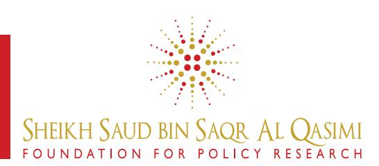

<!-- A2.R14 | source: papers_json/A2.R14/ -->

## **POLICY** **PAPER**

Policy Paper No. 33 September 2019

## **EXECUTIVE SUMMARY**

The United Arab Emirates (UAE) currently pursues an Education Hub strategy that aims at increasing higher education and research capacities and aligning these with its economic priorities for achieving advantages in the global economy. This strategy presently leaves the UAE in a position of playing "catchup" and fosters higher education as a business, making it less accessible to the public and social mobility harder. The foundation of this current strategy is a strong focus on the geographic and physical elements of creating a Hub, which narrows its scope and impact. To exploit the already created capacities and decisions made, the current strategy's focus and impact should be broadened by creating an accessible cultural space for education and research. This might, over time, lead to the formation of a reputed location for higher education and research by virtue of academic vigor that, importantly, also embodies the UAE's uniqueness and needs.

## **Education Hub Strategy and ** **Policy in the United Arab ** **Emirates: Creating a Cultural ** **Space for Higher Education ** **and Research **

*Marvin Erfurth, University of Muenster*

## **Introduction**

Higher education is center stage in current debates about competitiveness in the global economy. In such debates about economic competitiveness, key players such as international organizations, but also governmental agencies and consultancies, argue that aligning higher education and academic research, as undertaken by universities or research institutes, closely with a country's economic interests is the key to success (Heitor, 2016). Most often, these players advise calibrating the alignment between higher education, research, and a country's economy, as defined by such economic interests, hoping that it might lead to short- to medium-term monetary gains in the industrial and service sectors (Etzkowitz, 2008). For instance, the economic interest might be to steer the local financial industry towards becoming a global pioneer in the adoption of a new technology, which is why universities are asked to produce appropriately trained graduates in a short period of time.

One outcome of these global debates is that in Southeast, East, and West Asia in particular, they materialize in the form of country-projects typically called 'Education Hubs' – a phenomenon appearing in regional policymaking since the mid-1990s and originating from Singapore (Knight, 2014). From a policy perspective, Hubs can be seen as large-scale, country-wide projects to catch up with, or even surpass, established international student locations such as the UK or the US in their higher education and research capacities. Also, one shared target across multiple Hubs is to align these capacities with local or regional commercial interests, such as matching skills between education and industry needs to thrive economically.

Among a small number of countries, such as Hong Kong, Qatar, and Singapore, the United Arab Emirates (UAE) is currently also adopting a Hub strategy for its higher education and research sectors, with Abu Dhabi, Dubai, and Ras Al Khaimah as particularly relevant emirate-level players (Fox & Al Shamisi, 2014). Concerning efforts made, the UAE can be proud of its recent achievements in higher education provision. However, there are two problematic aspects one can see across Hub countries, which are also very relevant for the UAE and Ras Al Khaimah context. First, the close alignment of higher education and research with commercial interests is believed to produce an economical cutting edge, but most often results in a continuance in catch-up positions, chasing or copying models implemented elsewhere. Hence, while

<!-- page 2 -->

needs of other places might be reflected in those copied models, they do not necessarily align with the specific needs of the UAE or Ras Al Khaimah. Second, the current educational environments created in Hubs generate a tendency to view higher education as a profitable business for those who can afford it. This conflicts with a view of providing educational opportunities for everyone with the necessary grit and ability, seeing education as an enabler for individuals to pursue their talents and dreams, also for the benefit of the whole society as is the nation's stance laid out in its major policies and agendas.

To realize the vision of the UAE as an Education Hub – a globally reputed location for higher education and research by virtue of academic vigor with an impact on the country – current education and social policy should move beyond a narrow focus on geographic and physical elements of an Education Hub, and should attempt to create an accessible cultural space in which great ideas, knowledge, and research are being produced and exchanged.

This paper will substantiate this claim by, first, offering some background and contextual information about Education Hubs as a concept, as well as its relevance to the UAE and Ras Al Khaimah. Second, it briefly evaluates the status quo of higher education research related to Hubs as a phenomenon, and reviews relevant policymaking in the UAE. Third, as this policy paper is a component of a larger comparative project between the UAE and Singapore, it will present theories and a brief overview of the methodology adopted in relation to this larger project. Fourth, it will argue for the development of a coherent strategy for social and economic progress by considering locally relevant education and research based on the UAE's needs as central and suggests at least three components such a strategy should encompass.

## **Education Hubs as a Concept and ** **its Relevance to the UAE and Ras Al ** **Khaimah Contexts**

It is challenging to trace the idea of creating Hubs – including implications and issues caused by such creations – back to one specific origin, as the concept nowadays floats around in many different discourses, places, and fields. The idea of a Hub boils down to the meaning of a central node within a global or regional network that is equipped with a particular pull factor (Barabási, 2016). Concerning education, those ten to twenty countries labeling themselves as Education Hubs are usually already known as hubs in other areas such as business, finance, or air travel. In these specific countries, one can observe some more or less deliberate political decisions to model their local higher education systems after foreign areas that are particularly successful in importing and exporting higher education (such as the US, UK, or Australia) – and giving this 'modeling after' the label Education Hub.

However, deriving from conversations with policymakers in Singapore in particular, the creation of an Education Hub is described to be less about replicating the number and reputation of universities of other economically and academically exceptionally competitive areas such as Boston or Silicon Valley in the US. Constructing a Hub is more about replicating the impact that an area like Silicon Valley is having on the local, regional, and global economy – but in a different geographical area such as West and East Asia, with sometimes similar, but sometimes also different means; and, in the case of the countries mentioned, through the vehicle of a Hub.

The source of the two observed, problematic aspects regarding higher education policy, which, as elaborated above, can be seen across Hubs, and also in the UAE – a continuance in catch-up positions, and commercializing education instead of making it more easily accessible – might originate from the fact that education policy in these Hub countries appears to be different from others. In Hubs, higher education is being embedded in larger geostrategic projects. Because these larger projects bear geostrategic elements, higher education policy is being related to wider, global (economic, social, cultural, political) affairs, the center point of which is most often economic, regional, or industrial policy instead of education.

This somewhat odd center point for an educational project then yields implications for conventional higher education policy and governance. Bottom line: what this means is that rationales for governing higher education might shift from social or educational categories (such as accessibility, affordability, equity, quality, mobility, open research, progress, and so forth) to economic categories such as revenue generation, the production of patentable, non-open research and knowledge, as well as economic competitiveness.

## **Higher Education Research about ** **Hubs and related Policymaking in the ** **UAE**

In the case of the UAE, a current, larger project of which higher education is an essential component is the achievement of its* Vision 2021*, a nation-wide policy that was launched between 2010 and 2014 and describes the targets which should be met by the nation's Golden Jubilee. The strategy states that the "UAE will enhance its pivotal role as a regional business hub whose essential infrastructure and institutions provide a gateway linking our neighbourhood to the world, serving as a role model for the region." (United Arab Emirates, 2014) Furthermore, an "excellent standard of infrastructure and utilities will satisfy the fundamental needs of citizens and businesses while also boosting our nation's economic competitiveness as a leading global hub." (United Arab Emirates, 2014) Though the UAE is described as a hub

<!-- page 3 -->

for business and innovation, higher education implicitly appears as a veiled enabler for the achievement of the strategy in several sections, such as, for instance, theme three (United in Knowledge), elements one (Harness the Full Potential of National Human Capital) and three (Knowledge-Based and Highly Productive Economy). To strengthen this argument, the slogan accompanying this theme also is: "A Competitive Economy Driven by Knowledgeable and Innovative Emiratis."1

The UAE can be proud of its recent achievements in higher education provision, especially when comparing past and present educational opportunities and capacities. The number of educational institutions and offerings residents can choose from alone has increased in high numbers (Fox & Al Shamisi, 2014; Ridge, Kippels, & ElAsad, 2017). The implementation of a strategy with the scale and scope of *Vision 2021*, however, bears some complex challenges, not least regards coordination. Amidst this complexity, we currently see two Hub models emerging across different emirates. On the one hand, Abu Dhabi pursues a lighthouse + periphery model. For instance, one finds NYU Abu Dhabi as a shining example in higher education, or the Cleveland Clinic in the health sector, and then peripheries around those lighthouses one could group further into multiple tiers. On the other hand, Dubai pursues a zone model + infrastructure. One of the reasons why the zone model in Dubai has particular success though is the fact that the emirate built multiple infrastructures around it in combination with its geographical position and global reputation.

Other emirates currently aim at replicating either one of these two basic models, such as how Ras Al Khaimah is currently attempting to build a physical education Hub based on Dubai's zone model. In all the mentioned emirates, education and research are basically run as marketplaces – though to different degrees. Perhaps more driven by competition in zones in Dubai, perhaps more curated in Abu Dhabi, perhaps rather sealed in Sharjah as it has not opened up its education sector to outside players to the same degree as other emirates, and so forth.

Against this backdrop, one could argue that the mentioned complexity is a cause, but also an effect of different, rather loosely coordinated, ways to implement *Vision * *2021* across the UAE by virtue of pursuing different Hub strategies. Implications of this are that one can observe a fair degree of competition, but also reticence in single emirates' strategies, which, however, makes coordination, oversight, or transparency for good policymaking much harder. It also creates a competitive space which hinders a positioning of the UAE as one Hub that takes advantage of each emirate's resources and strengths. In addition,

there is very little research available on the topic that policymakers could make use of, and even less research which is specific to individual emirates as locales or specific implications affecting people, universities, or schools. Improved coordination, oversight, transparency, and research might nonetheless be the elements needed to not only facilitate the realization of *Vision 2021*, but to also improve higher education policymaking across the UAE.

In academia, comparative and international higher education scholars began studying the phenomenon of Education Hubs as part of internationalization processes in the early-2000s (Knight, 2003, 2004, 2006, 2012; Altbach & Knight, 2007; de Wit, 2009, or for a newer account, see Kosmützky & Putty, 2016). Existing educational research on the topic can be grouped along four main themes: (1) changing university teaching and research in times of increasing economic and technological interdependency worldwide, (2) changing flows of international students and academics, and more recently (3) the emergence of university-branches in multiple countries, as well as (4) emerging for-profit providers within the field potentially altering its institutional structure.

Knight (2014) systematized the coexisting, complex, and highly diverse institutional developments in higher education along what she identifies as three generations of internationalization in higher education, gradually moving from cooperation to competition over time. From this lens, she emphasizes the emergence of student, talent, and knowledge-innovation hubs as a new, third generation of internationalization processes in higher education, and in doing so marks a critical transition point of the field. Though identifying hubs as a new phenomenon in contemporary higher education research provided unique and valuable insights to the field, the analytical frameworks used leave questions this social phenomenon raises unanswered, and it remains vastly understudied – especially empirically.

## **Research and Theory**

This paper is connected to a larger project exploring higher education's centrality in contemporary global, regional, and local discourses, the analytical potential of contemporary theory formation to understand it, and related implications for higher education policy and governance this creates. The project investigates Singapore and the UAE (Abu Dhabi, Dubai, and Ras Al Khaimah) to understand more about the Education Hub phenomenon as different manifestations of the recent centrality of higher education in global discourses and its effects on local policymaking.

> ^ ^As the space and scope of this particular paper is rather limited, more elaborate work on this topic can be found in Erfurth, M. (2019). International Education Hubs as Competitive Advantage: Investigating the Role of the State as Power Connector in the Global Education Industry. In M. Parreira do Amaral, G. Steiner-Khamsi, & C. Thompson (Eds.). (2019). *Researching the Global Education Industry – * *Commodification, the Market and Business Involvement* (pp. 181-202). London: Palgrave.

<!-- page 4 -->

## **Methodology**

This investigation is based on an analysis of policy documents, as well as 20 semi-structured, on-site interviews with academics, policymakers, and experts conducted in September and November of 2018. This data is analyzed by adopting a discursive research approach (Fairclough, 1992; Wodak, 2004; Wodak & Fairclough, 1997), and uses the theoretical approach of cultural political economy for data analysis (Sum & Jessop, 2013). Though the format and purpose of this policy paper does not allow for a comprehensive discussion of the methodology adopted, it rests on the work of other scholars and their contributions to the area of policy studies in the field of comparative and international education.

Two particularly relevant research strands here are Global Education Policy research (Mundy et al., 2016), as well as Global Education Industry research (Verger at al., 2016; Parreira do Amaral et al., 2019). These research strands focus on globalizing discourses, agendas, and actors in the study of education policy to investigate the various implications of changing contextual conditions in which education policy currently evolves, such as the influence of intricate relationships between domestic and foreign actors on national education policy (Marginson, 2016; Verger, 2016; see also Ball, Junemann, & Santori, 2017).

## **Findings**

In aggregate, the data gathered indicates that Education Hubs are on the one hand produced discursively in global and local debates, strategies, and so forth. On the other hand, they are also produced as physical, existing structures in countries such as the UAE or Singapore as the outcome of the larger geostrategic projects of which they are a part of. There is dialogue about Abu Dhabi, Dubai, and Ras Al Khaimah – or the entire UAE – as Education Hubs, but there are also economic zones for education that are being created, universities being built, revenue being generated, teachers and researchers being employed, and so forth. In this mix of dialogue and creation of physical infrastructure, policymaking in the UAE, as well as in Ras Al Khaimah, is increasingly authored by diverse actors in multiple locales at the same time, sometimes working in Singapore and the UAE, and particularly business-driven environments for providing higher education are prevailing.

In both locales, geographical and physical elements are the foundation of current strategies and policies related to the Education Hub phenomenon. While this might be called the material part of an Education Hub, the conceptual part receives much less attention in the UAE compared to the relatively greater focus it receives in Singapore. In the case of Singapore, this conceptual part describes what desired types of education contribute to what type of social and economic development, and

how this can be achieved over time. It also elaborates on the role of society, from the youth to the old, as the key to success, and denotes perseverance, hard work, and a curiosity for learning throughout life as desired character traits in individuals. This will potentially allow it to stay competitive in the global economy in the long term, linking back again to education and research. By virtue of developing this conceptual part sufficiently, Singapore aims at cultivating academic research of highest standard, though mainly in the sciences, and aspires to leverage research produced into new products and services catering to pockets of excellence in industries and services it has built over time.

Though there are particular challenges associated with this route deserving of further discussion, the data gathered points in the direction that Singapore has particular success in establishing itself as a global destination for higher education and research because it pays attention to such a conceptual part – which, in essence, is meant with the creation of a cultural space for higher education and research. This should not be understood as in opposition to a physical space/ infrastructure, but rather as a necessary part that completes it, without which it does not function well, or at least not to its fullest potential. While the following section offers recommendations for policymaking, it elaborates this claim further by also elaborating a few model ideas about how the creation of such a cultural space might be achieved.

## **Recommendations**

The deliberations above show that the UAE's current strategy and approach for achieving its Education Hub vision is characterized by a fair degree of competition between the emirates and hampered by a lack of oversight, transparency, and coordination. Because of such existing challenges, this section will advise for the development of a coherent strategy for social and economic progress for the UAE, which should be much more cooperative between the emirates, taking advantage of each emirate's resources and strengths, and reflecting individual needs, characteristics, and strategies.

This more cooperative strategy for social and economic progress should reflect the existing and emerging needs of the UAE by considering locally relevant education and research as central. As an add on, such an approach might also result in what economists would call a unique selling point for the UAE as an international destination for learning and research as it would reflect its uniqueness to a much higher degree compared to current approaches of importing models from other places. This coherent strategy should be based on an assessment of gaps in the existing educational and research systems, should clearly define the Hub's purpose, and should carefully balance local needs and international agendas.

<!-- page 5 -->

## **Development of a Coherent Strategy for ** **Achieving Social and Economic Progress**

An Education Hub – as a higher education and research space – arguably has a material and a conceptual part. The material part has been summarized as physical and geographical elements above, which are relatively easy to identify and measure. However, in the first section of this paper, the reason to build a Hub was described as an attempt to replicate the impact of areas such as Boston or Silicon Valley. Despite the material part, the impact that these spaces have is very much about the indicated conceptual component.

Though the Boston area is a geographic space densely populated with education and research institutions, one could argue that the lifeblood of this space is the hearts and minds living there, doing science, being educated, and the somewhat 'invisible pipelines' existing between universities, corporations, ministries, and so forth. The cultivation of such hearts and minds, but also the creation of somewhat invisible pipelines is kind of what the purpose of the rather challenging, conceptual part of an Education Hub in the UAE should be. But this conceptual part needs to be created, curated, and well-funded to generate opportunities for researchers and scientists to meet and exchange ideas such as in areas like Boston or Silicon Valley.

In order to develop this conceptual part (further) and to exploit the progress which has already been made, the development of a comprehensive strategy for social and economic development for the country and the region by government and policymakers, reflecting the perspectives of all Emirates, might be very favorable – may it be called a Hub or not.

One crucial component of this comprehensive strategy would then, in turn, be a coherent model of the educational system and its place in achieving social and economic progress as one of this strategy's components. A potential achievement of such a coherent model, laying the foundation for a Hub as a cultural space, would be a greater transformative effect on the country and the region by building educational capacities and cultivating a spirit of science, education, and research. In order to develop a comprehensive strategy for social and economic development, such a strategy could encompass the following three components as possible points of departure: (1) assessment of gaps, (2) definition of the hub's purpose for the country, and (3) finding a balance between local needs and international agendas.

## *Assessment of Gaps *

A glimpse at Singapore's development as an education and research Hub shows that its leadership made some very deliberate choices in the 1990s regarding what type of cultural evolution through education and research they were aiming for. Adopting an iterative approach, the country and its leadership decided, first, that they wanted

to create a hub as an appropriate means for achieving such an evolution. Second, they inferred that this decision to create a Hub for education and research is about adding something to its existing system that has not been there before, and which purposefully filled identified gaps/weaknesses.

The outcome of these assessments the Singaporean government made, and the iterative approach for which they decided for achieving social and economic progress – to achieve a potentially transformative effect through education and research – was to predominantly focus on developing and improving its own, local universities, and, when needed, to partner with foreign knowledge partners the country began to host. A distinct for-profit sector for higher education, which developed as an outcome, seems to be linked to short-term revenue generation by catering to quite specific target groups rather than to a long-term achievement of social and economic progress.

Because experiences have sometimes been undesirable, rigorous quality assurance mechanisms and oversight for the private for-profit sector have been implemented, in combination with greater discrimination, regarding who is allowed to participate in this business, preventing families and their children from being deceived, though such cases still occur from time to time. A deliberate decision like the one described, purposefully hosting external partners to address identified gaps, however, is only possible based on previous, rigorous assessments.

The iterative steps that might follow from such an assessment then require taking an ideological position about the future direction and purpose of higher education for the country, especially regarding the Hub as a cultural space for education and research. For instance, one current challenge in relation to the diversification of economies in many countries is scarce knowledge about how such diversification impacts everyday life in societies, such as in the UAE context. Here, disciplines such as the social sciences and humanities could contribute massively to the country's development, though both disciplines are currently underdeveloped in comparison to other regional (and non-regional) comparators.

As one example of a current gap in higher education and research which might be identified through a gapsassessment, this would allow inferring an iterative approach to address it. A pressing question would then, for instance, be what type of education and research might be desired in the medium- to long-term to generate such knowledge about the social and cultural impact of economic diversification on the UAE's society? Should such questions also be addressed by researchers who have been raised in Emirati society, knowing its ins and outs? If yes, how long does it take to 'generate' these researchers – by, at the same time, allowing for the fact that they might choose a different profession after all because they have other talents as well?

<!-- page 6 -->

Inferring from this little thought experiment, the creation of a Hub as a cultural space, which is (then) part of a coherent model/strategy for the creation of a positive, transformative effect on the country through cultivating education and research, is a process which might take at least one or two full education cycles from primary to tertiary education – which, in numbers, is 15 to 30 years, and stresses the importance of carefully making assessments and decisions needed today.

## *Definition of the Purpose of the Hub*

Developing and cultivating a cultural space for education and research that is new in character and that adds additional value in form of a medium- to long-term transformative effect for the country might also arguably be achieved without the creation of a Hub – neither as a geographical/physical space, nor as a cultural space, or both of these combined. Disputably, the goal of a mediumto long-term improvement of the local higher education and research landscape would be possible by adopting development strategies we see in other countries that do not identify themselves as a Hub. Hence, what are the reasons for deliberately creating a Hub for education and research, and what then is this Hub's purpose?

At the moment, educational offerings for non-nationals in the UAE are offered at comparable market prices and forms as one can find in other locations, and they are rather general in character. While this is arguably enough to run it as a profitable business in the short-term, questions remain regarding what attracts knowledge and research partners, but also students and potential future knowledge-workers, to the UAE as an education and research Hub in a knowledge-based economy. What, in the case of the UAE, creates somewhat of a (pulling) Hub effect?

One possible point of departure for answering the above questions could be an analysis of what graduates and research the country specifically requires relative to its emerging and existing needs. Educational offerings could then be aligned with those needs, and offerings might be provided in much more specialized forms in contrast to rather general ones at the undergraduate and graduate level today (across the UAE). This would also make clearer how coming to the UAE for such specialized forms of education – as one potential pull factor – might benefit future graduates, as they could see early on how they might potentially leverage their education into a next opportunity in the country, increasing their chances of employability.

Nonetheless, this transition period would then require the allocation of necessary resources, and it should be a separate assessment whether offering these specialized forms of education should be organized as a free marketplace, or whether they should rather be subsidized to a great extent. Creating more forms of public education as the public would also potentially be

one of the medium- to long-term beneficiaries would be a possibility, making education more inclusive for people no matter their background.

## *Balancing Local Needs and International * *Agendas*

In the international higher education landscape, trends can be glamorous. From time to time, international agendas emerge, of which internationalization as a contemporary means to an end might be one example. A pressing question here is how the shimmer of adopting those agendas locally – for instance, hosting a high number of reputed foreign knowledge partners that provide their renowned educational offerings – correlates with local needs.

This applies to the UAE as a country, but also to individual emirates such as Abu Dhabi, Dubai, or Ras Al Khaimah pursuing international strategies. Finding a reasonable balance between the pursuit of international agendas and addressing emerging or existing local needs in the process of creating a Hub for education and research appears as a particularly complicated challenge. A starker focus on local needs and assessing how those can be best addressed in cooperation with foreign knowledge partners would be beneficial not only for the mediumto long-term development for the country, but also for generating somewhat of a Hub-effect elaborated above. By virtue of doing that, the outcome might be particularly specialized forms of education and research in contrast to general forms that can instead be found in numerous other geographical spaces as a standard outcome of adopting international agendas.

In essence, the bigger picture of adopting a Hub strategy in the UAE, which commonly entails partnering with foreign knowledge partners that predominantly originate from the Anglo-Saxon world, arguably also involves adopting a platform for the advancement of western-style higher education. If intended, this also means carefully inserting this platform into the already existent cultural (education and research) spaces in the UAE.

One chief benefit for the adoption of such a platform through the creation of a Hub in the long-term would, again, if intended, ideally be the application of westernstyle critical thought and analysis, as well as associated ways of truth-finding, to help address local needs. The arguably new, created cultural space one would then call a Hub would be somewhat of a blend of existing and new styles of higher education, research, and reasoning, which perhaps might best be described as a mosaic of different styles of thought and intellectuality. Perhaps, a positive transformative effect for the country might be achieved by this, and a genuine Hub effect created, as a particularly interesting and cognitively inspiring cultural space might pull researchers and so forth in – which then ideally correlates with addressing local needs.

<!-- page 7 -->

## **Conclusion**

Against the information provided in this paper, current policy and strategy in higher education create challenges for contemporary and future higher education development in the UAE. Though enormous efforts are being made and recent successes can be celebrated, a strong focus remains on geographic and physical aspects for the transformation of the UAE into an Education Hub. Nonetheless, evidence based on the data gathered suggests that complementing these geographic and physical aspects with a cultural space for higher education and research would be beneficial for achieving a long-term transformative effect for the country, and for using past, present, and future resources effectively.

Because such a cultural space might take two to three decades to create, current policy choices in higher education should be reviewed now. They determine the future success of decisions that have been made already (such as in *Vision 2021*), which is why considering the development of a coherent strategy for achieving social and economic progress for the UAE, with higher education as a crucial component, is important.

Because empirical research in and about education and policy in the UAE is rare, the presented paper also only provides a brief insight into a distinct set of policy implications for higher education. Though this also means the scope of the elaborated research is limited, future research by other scholars about contemporary issues and challenges in education in the UAE and Ras Al Khaimah is much needed, also about the Education Hub phenomenon and its policy implications.

## **References**

- Altbach, P. G., & Knight, J. (2007). The Internationalization of Higher Education: Motivations and Realities. *Journal of Studies in International Education, 11*(3/4), 290–305.
- Ball, S. J., Junemann, C., & Santori, D. (2017). *Edu.net. Globalisation and Education Policy Mobility*. London: Routledge.
- Barabási, A.-L. (2016). *Network Science*. Cambridge: Cambridge University Press.
- de Wit, H. (2009). Measuring success in the internationalisation of higher education: an introduction. *In EAIE * *Occasional Paper: Vol. 22. Measuring success in the internationalization of higher education* (pp. 1–8).
- Etzkowitz, H. (2008).* The Triple Helix. University-Industry-Government. Innovation in Action.* New York: Routledge.
- Fairclough, N. (1992).* Discourse and Social Change.* Cambridge: Polity Press.
- Fox, W. H., & Al Shamisi, S. (2014). United Arab Emirates' Education Hub: A Decade of Development. In J. Knight (Ed.), *International Education Hubs. Student, Talent, Knowledge-Innovation Models* (pp. 63–80). Dordrecht: Springer.
- Heitor, M. (2016).* Open the box in times of uncertainty: Fostering networks of opportunity through collaborative * *laboratories and learning landscapes, together with global research networks*. Retrieved from https://www. oecd.org/sti/PolicyPaper_Keynote_Heitor-with%20cover.pdf
- Knight, J. (2003). Updating the Definition of Internationalization. *International Higher Education, 33*, 2–3.
- Knight, J. (2004). Internationalization Remodeled: Definition, Approaches, and Rationales. *Journal of Studies in * *International Education, 8*(1), 5–31.
- Knight, J. (2006). Internationalization: Concepts, Complexities and Challenges. In J. J. Forest & P. G. Altbach (Eds.),* International Handbook of Higher Education. Part One: Global Themes and Contemporary Challenges. * Dordrecht: Springer.
- Knight, J. (2012). Student Mobility and Internationalization: trends and tribulations. *Research in Comparative * *and International Education, 7*(1), 20–33.
- Knight, J. (2014). *International Education Hubs. Student, Talent, Knowledge-Innovation Models*. Dordrecht: Springer.
- Kosmützky, A., & Putty, R. (2016). Transcending Borders and Traversing Boundaries: A Systematic Review of the Literature on Transnational, Offshore, Cross-Border, and Borderless Higher Education. *Journal of Studies in * *International Education, 20*(1), 8–33.
- Marginson, S. (2016). The Global Construction of Higher Education Reform. In K. Mundy, A. Green, B. Lingard, & A. Verger (Eds.),* The Handbook of Global Education Policy* (pp. 291–311). Chichester: John Wiley & Sons, Ltd.
- Mundy, K., Green, A., Lingard, B., & Verger, A. (Eds.). (2016).* The Handbook of Global Education Policy*. Hoboken: John Wiley & Sons.

<!-- page 8 -->

- Ridge, N., Kippels, S., & ElAsad, S. (2017). *Education in Ras Al Khaimah and the United Arab * *Emirates*. Retrieved from https://cdn2.hubspot.net/hubfs/5081768/File-22220185854.pdf?__ hssc=78953035.1.1566649307362&__hstc=78953035.56ff79c1748eca6ce84ec86846b2188c15620 54986586.1566339788566.1566649307362.5&__hsfp=3686452268&hsC taTracking=fd933dc1-2360- 4f8e-b7a8-ac983d78489b%7C712996c0-910b-4165-b4d8-649e56d014c3
- Sum, N.-L., & Jessop, B. (2013). *Towards a Cultural Political Economy. Putting Culture in its Place in Political * *Economy*. Cheltenham: Edward Elgar.
- Parreira do Amaral, M., Steiner-Khamsi, G., & Thompson, C. (Eds.). (2019).* Researching the Global Education * *Industry – Commodification, the Market and Business Involvement*. London: Palgrave.
- United Arab Emirates (2014).* Vision 2021. United in Ambition and Determination*. Retrieved May 23, 2019, from https://www.vision2021.ae/docs/default-source/default-document-library/uae_vision-arabic. pdf?sfvrsn=b09a06a6_6
- Verger, A., Lubienski, C., & Steiner-Khamsi, G. (Eds.). (2016). *The Global Education Industry*. New York: Routledge.
- Wodak, R., & Fairclough, N. (1997). Critical Discourse Analysis. In T. A. van Dijk (Ed.), *Discourse as Social * *Interaction* (pp. 258–284). London: SAGE Publications Ltd.
- Wodak, R. (2004). Critical Discourse Analysis. In C. Seale, G. Gobo, J. F. Gubrium, & D. Silverman (Eds.), *Qualitative Research Practice* (pp. 197–213). London: SAGE Publications Ltd.

Marvin Erfurth is a Ph.D. Candidate in Comparative and International Education at the University of Muenster, Germany, who focuses on Education Policy and the Economics of Education.

The Sheikh Saud bin Saqr Al Qasimi Foundation for Policy Research Policy Paper Series is designed to disseminate ongoing research to individuals and institutions interested in the development of public policy in the Arab world. Findings and conclusions are solely those of the authors and should not be attributed to the Sheikh Saud bin Saqr Al Qasimi Foundation for Policy Research.

## **The Sheikh Saud bin Saqr Al Qasimi ** **Foundation for Policy Research**

## Developing Research, Supporting Minds

Based in the emirate of Ras Al Khaimah, the Sheikh Saud bin Saqr Al Qasimi Foundation for Policy Research is a non-profit foundation that was established in 2009 under the patronage of His Highness Sheikh Saud bin Saqr Al Qasimi, United Arab Emirates Supreme Council Member and Ruler of Ras Al Khaimah. The Foundation has three broad functions:

- to inform policymaking by conducting and commissioning high quality research;
- to enrich the local public sector, especially education, by providing educators and civil servants in Ras Al Khaimah with tools to make a positive impact on their own society; and
- to build a spirit of community, collaboration, and shared vision through purposeful engagement that fosters relationships among individuals and organizations.

Visit **www.alqasimifoundation.com** to learn more about our research, grants, and programmatic activities

