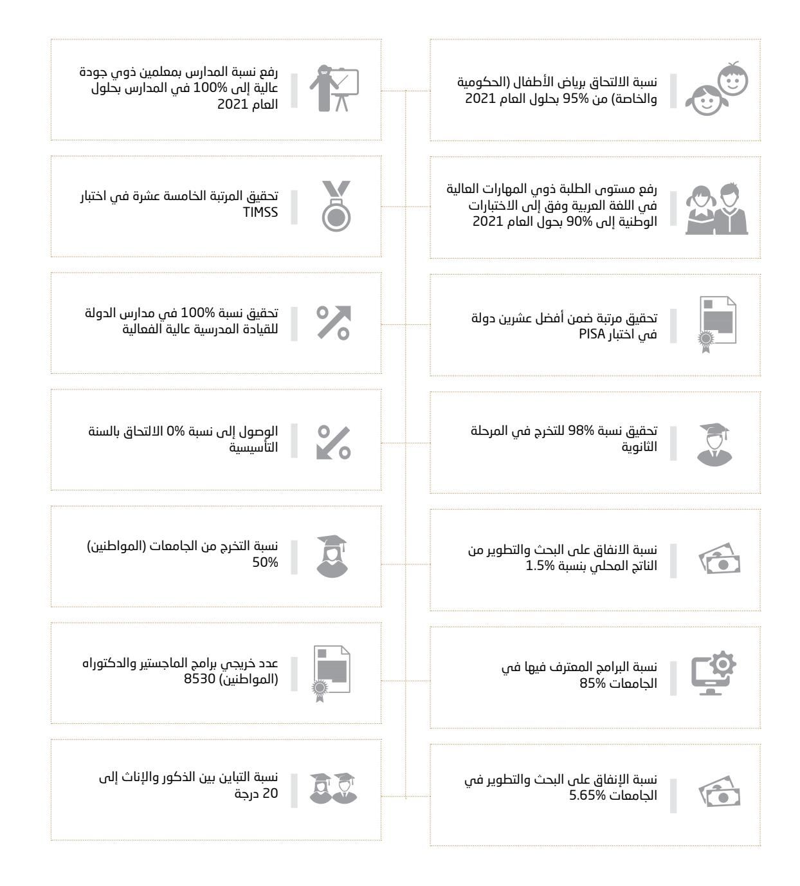
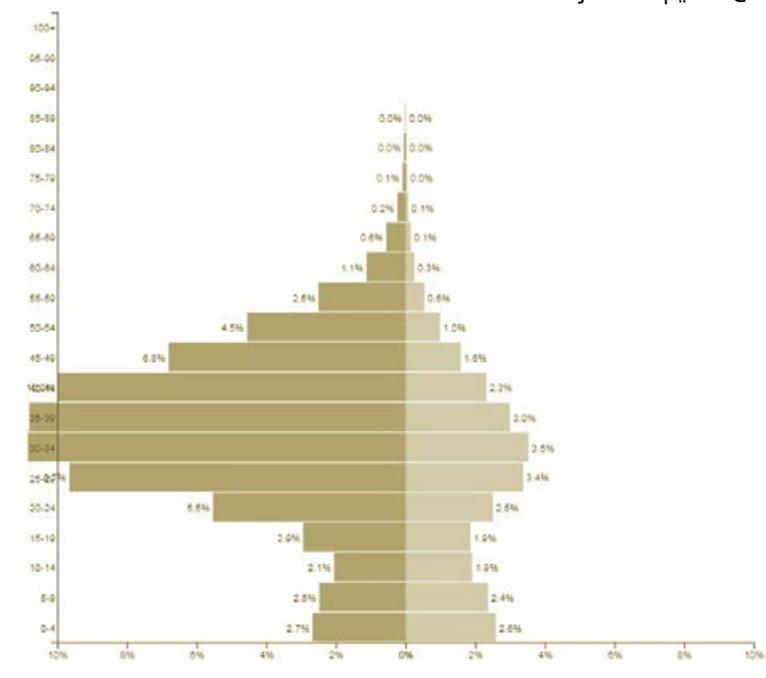
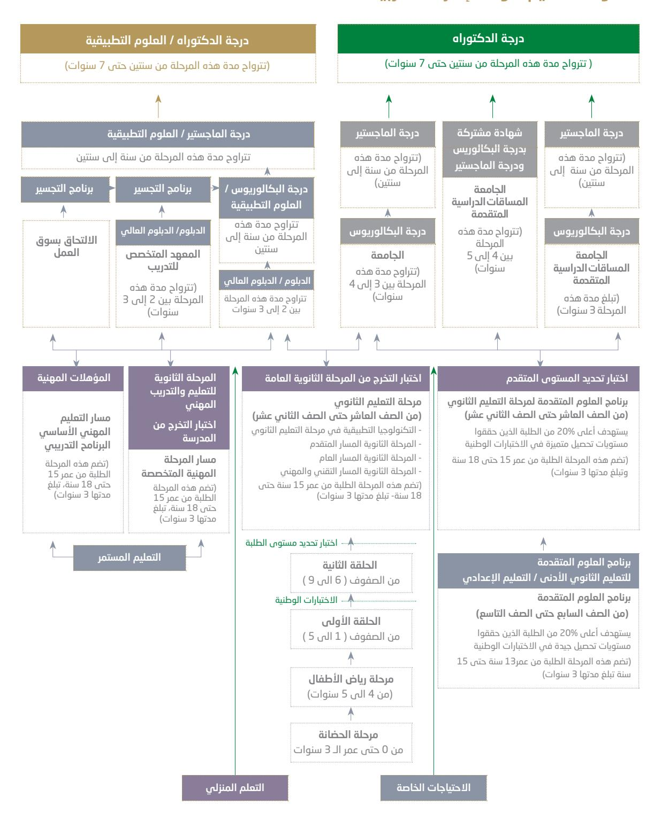

فــي دولــة الإمـــارات العـربيـــة المتحـــدة

الطبعــة الأولـى

<!-- page 2 -->

أعـد اإلطـار العـام لسياسـات التعليـم فـي دولـة اإلمـارات العربيـة المتحـدة مـن قبـل الفريـق المشـكل بموجـب قـرار وزاري رقـم 624 لسـنة ،2017 وتـم عرضـه علـى كافـة المرجعيـات والمعنييـن والشـركاء للتغذيـة الراجعـة والتحسـين والتطويـر قبيـل اعتمـاده بموجب القنـوات الدسـتورية والقانونية فـي دولـة اإلمـارات العربيـة المتحـدة.

<!-- page 3 -->

7مقدمة عامة8مؤشرات الأجندة الوطنية المتعلقة بالنظام التعليمي9توجهات إعداد إطار سياسات النظام التعليمي في دولة الإمارات العربية المتحدة11النظام التعليمي في دولة الإمارات العربية المتحدة: الرؤية والقيم والأهداف الاستراتيجية12تحليل الوضع: للتعليم العام والتعليم العالي13منظومة التعليم في دولة الإمارات17نصوص السياسات ومجالاتها ومفرداتها, قطاع التعليم العام18المجال الأول: بنية النظام التعليمي24المجال الثاني: المناهج والتقييم27المجال الثالث: الطلبة في التعليم العام27- القيد والقبول28- الأنشطة والرعاية الطلابية30- الرعاية الاجتماعية30المجال الرابع: التربية الخاصة (أصحاب الهمم والموهوبين والمتفوقين)33المجال الخامس: الكادر التعليمي والإداري37المجال السادس: الإنفاق على التعليم وتمويله38المجال السابع: تكنولوجيا المعلومات والاتصالات وأمن المعلومات والتعلم الذكي42المجال الثامن: بيانات التعليم43المجال التاسع: التعليم الخاص48المجال العاشر: ضمان الجودة49المجال الحادي عشر:49- العيادات المدرسية وخدمات الصحة المدرسية50- المقاصف المدرسية والغذاء المدرسي51- النقل المدرسي والمواصلات المدرسية53نصوص السياسات ومجالاتها ومفرداتها, قطاع التعليم العالي54المجال الأول: بنية النظام التعليمي63المجال الثاني: الحوكمة66المجال الثالث: المناهج والتقييم69المجال الرابع: الطلبة في التعليم العالي69- القيد والقبول71- الأنشطة والرعاية الطلابية73- البعثات الدراسية74المجال الخامس: أصحاب الهمم (ذوي الإعاقة)74المجال السادس: هيئة التدريس ومعاونوهم77المجال السابع: البنية التحتية (المرافق والتجهيزات ومصادر التعلم)78المجال الثامن: الإدارة المالية والتمويل79المجال التاسع: الشراكة المجتمعية80المجال العاشر: سياسة التعليم المستمر المتكامل80المجال الحادي عشر: البحث والتطوير82المجال الثاني عشر: ضمان الجودة83المجال الثالث عشر: ترخيص مؤسسات التعليم العالي واعتماد البرامج الأكاديمية

مسـرد المصطلحات

## 🔳 قــائمـة المحتويات

<!-- page 4 -->

## **مقدمة عـامة**

ّ كان قيـام االتحـاد فـي دولـة اإلمارات العربية المتحدة انطالقة لنهضة تعليمية شـاملة تؤسـس لتوسـع كمي ونوعي فـي الخدمـات التعليميـة، وخلال 60 ً عامـا خطـت دولـة اإلمـارات العربيـة المتحـدة خطـوات ثابتـة واثقـة متسـارعة تحـددت فيهـا مالمـح التنميـة والتعليـم والرفـاه فـي بلـد تتجـه بوصلـة القيـادة والشـعب فيـه نحـو مسـتقبل عنوانـه ِّ اقتصـاد قـوي وعمـاده قـدرات بشـرية إماراتيـة شـابة تنقـل اإلمـارات إلـى مصـاف دول العالـم المتقدم، فبيـن افتتاح المدرسـة القاسـمية فـي إمـارة الشـارقة عـام ،1953 والمدرسـة األحمديـة فـي إمـارة دبـي عـام 1955 ، ومدرسـة النهيانيـة االبتدائيـة للبنيـن كأول مدرسـة نظاميـة فـي اإلمـارات فـي عـام 1959 ّ ، وإنشـاء أول جامعـة اتحاديـة عـام 1977 ومـا تلـى ذلـك مـن انتشـار للمدارس والجامعـات والمعاهد ومؤسسـات التعليم المهني والتقنـي إلى إطالق »مئويـة اإلمـارات 2071« فـي عـام 2017 ٍ قصـة تنميـة بشـرية شـاملة ومتكاملـة برعايـة ودعـم مـن قيـادة أولـى أولوياتهـا االسـتثمار فـي اإلنسـان اإلماراتـي.

ديسـمبر مـن عـام 1971 ّ تأسسـت الـوزارات االتحاديـة، ومنهـا آنـذاك وزارة التربيـة ومنـذ إعلا ّ ن قيـام االتحـاد فـي 2 والتعليـم والشـباب التـي تولـت مسـؤولية اإلشـراف علـى التعليـم فـي مراحلـه المختلفـة حيـث كان إللزاميـة التعليـم ّ ومج ّ انيتـه أثـر كبيـر فـي انتشـار التعليـم فـي الدولـة، والتحـاق الذكـور واإلنـاث بمراحلـه كافـة، وكان التعليـم أولـى ً أولويـات الشـيخ المؤسـس، زايـد الخيـر، رحمـه اهلل، الذي خاطب شـعبه ناصح ّ ا موجًه ًّ ا محبـا »لقد آن لنا أن نسـتعيد عزتنا ومجدنـا، ولـن يكـون ذلـك بالمـال وحـده، ومـا لـم يقتـرن المـال بعلـم يخطـط لـه، وعقـول مسـتنيرة ترشـده؛ فـإن مصيـر المـال إلـى اإلقلال والضيـاع. إن أكبـر اسـتثمار للمـال هـو اسـتثماره فـي خلـق األجيـال مـن المتعلميـن والمثقفين«، ومـن هنـا حافظـت القيـادة الرشـيدة على هـذا النهج في إيلاء قطاعات التنميـة االجتماعيـة واالقتصاديـة والتعليمية والصحيـة عنايـة بالغـة فرصـدت الموازنـات مـن عائـدات النفـط، وتبنـت البرامـج نوعيـة الطابـع، واسـتقطبت النخبـة من الخبـرات العربيـة واألجنبيـة وابتعثـت اإلماراتييـن إلـى أفضـل الجامعـات العالمية كخطوة تأسيسـية لبنـاء دولة تتصدر ً عالمي ً ـا انطالقـا مـن أدائها وفق مؤشـرات التنافسـية العالمية، والتنمية البشـرية، والرخاء العالمي، وجـودة أداء النظام التعليمـي، والتـوازن بيـن الجنسـين، وريـادة األعمال.

وجـاءت رؤيـة اإلمـارات 2021 ّ كخطـوة اسـتثنائية لتعلـن أن االتحـاد، والعمـل والجهـد، والمـوارد، والخطـط سـتوجه ّ جميعهـا؛ حتـى تكـون دولـة اإلمـارات العربيـة المتحدة ضمـن أفضـل دول العالم بحلـول اليوبيل الذهبـي لالتحاد، حيث ً اسـتندت الرؤيـة علـى أن اإلماراتييـن متحـدون في المسـؤولية والمصيـر والمعرفة والرخـاء، وكان التعليـم كونه هدفا ً ووسـيلة- فـي قلـب هـذه الرؤيـة كم ً ـا ونوعـا، مـن حيـث التحـول الكامـل فـي أنظمـة التعلـم والتعليـم وممارسـاتهما بحيـث تكـون جميـع المـدارس والجامعـات مجهزة، وجميع الطلاب مزودين باألجهـزة واألنظمة الذكية التي تسـتخدم المناهج والمشـاريع واألبحاث المناسـبة، ومضاعفة االسـتثمار خالل السـنوات القادمة؛ لتعزيز االلتحاق برياض األطفال، ثـم وضـع طلبتنـا ضمـن أفضل طلبـة العالم في اختبـارات تقييم المعرفة والمهـارات في القـراءة والرياضيات والعلوم، ورفـع نسـبة التخـرج مـن المرحلـة الثانويـة بمـا يتناسـب مـع المعـدالت العالميـة، وذلـك كلـه من مـن خالل تعزيـز جميع ً المـدارس بقيـادات ومعلميـن جميعهـم مرخصيـن وفقـا للمعاييـر الدولية وأن يكـون طلبتنا فيهـا متقنين للغـة العربية.

<!-- page 5 -->

## مؤشرات األجندة الوطنية المتعلقة بالنظام التعليمي

*شكل :1 مؤشرات ومستهدفات األجندة الوطنية ضمن رؤية اإلمارات 2021 للنظام التعليمي في دولة اإلمارات العربية المتحدة*

تعمل وزارة التربية والتعليم على تحقيق مؤشرات األجندة الوطنية المتعلقة بالنظام )النظام التعليمي( لرؤية دولة اإلمارات العربية المتحدة 2021

خلال األعـوام ،2017-2015 اتخـذت الحكومـة مجموعـة مـن اإلجـراءات والقـرارات المتعلقـة بالنظـام التعليمـي في دولة اإلمـارات العربيـة المتحـدة كخطـوة أساسـية للتحول مـن االقتصاد الذي يعتمـد على النفـط وصناعاته والقطاعـات التقليدية إلـى اقتصـاد المعرفـة الـذي يعتمـد علـى توليـد المعرفة ونقلهـا، وتوظيفهـا، واالبتكار وريـادة األعمـال، كما يلي:

- .1 دمـج وزارتـي »التربيـة والتعليـم« و«التعليـم العالـي« فـي وزارة واحدة، وبإدارة ثالثـة وزراء يتولون مهـام التخطيط للتعليـم وإدارتـه مـن مرحلـة الطفولـة حتـى إتمـام كافـة مسـتويات التعليـم العالـي؛ لتوحيـد الجهـود والسياسـات، وترشـيد المـوارد الماليـة والبشـرية، وتجسـير الفجـوة بيـن مخرجـات التعليـم العـام والعالـي ومتطلبات سـوق العمل.
- .2 تطويـر نمـوذج وطنـي شـامل للمدرسـة، يتسـم بمواصفـات قياسـية عالميـة المسـتوى أطلـق عليـه »المدرسـة اإلماراتيـة« يهـدف إلحـداث تحـول جـذري فـي شـكل التعليـم فـي الدولـة ومخرجاتـه بكافـة مكوناتـه وعناصـره األكاديميـة، وغيـر األكاديميـة وخططـه الدراسـية ومناهجـه ومسـاراته التعليميـة )عـام، متقـدم، نخبـة( حيـث تتنـوع الخيـارات المتاحـة أمـام الطالـب؛ ممـا يضمـن االنتقـال السـلس والمـرن والمفتـوح بيـن المسـارات.
- .3 قـرار توحيـد النظـام التعليمي على مسـتوى الدولـة فيما يتعلق بالنظم والسياسـات والمسـارات التعليمية والمناهج والتقييـم واالمتحانـات، ثـم تعميم نموذج »المدرسـة اإلماراتية« على مسـتوى الدولة.

تأتـي وثيقـة السياسـة العامـة لنظـام التعليـم فـي دولة اإلمـارات العربيـة المتحدة لتكـون بمثابـة خارطة الطريـق التي تحدد مالمـح النظـام التعليمـي وتوجهاتـه ومخرجاتـه من منظومة الموارد البشـرية بمسـتوياتها فـي التعليم العـام والعالي، وتعد ً هـذه الوثيقـة مرجع ً ـا مسـتقرا لكافـة العامليـن فـي قطـاع التعليـم العـام والعالـي فـي الدولـة خلال السـنوات )-2017 2021(، كمـا تضـع اإلطـار العـام الـذي ينبغـي على كافة المؤسسـات التعليمية، ومـزودي الخدمات التعليميـة في القطاع العـام والخـاص االلتـزام بـه فيمـا يتعلـق بسياسـات إدارة وحوكمـة النظـام التعليمـي، والجـودة، والتميـز، والـكادر التدريسـي واإلداري، والمناهـج، والتقييـم، والطلبـة، والرعايـة االجتماعيـة، والبيئة والصحة والسلامة، وتوظيـف تكنولوجيا المعلومات واالتصـاالت فـي التعليـم، والبحـث والتطويـر، حيـث يتـرك الجانـب التطبيقـي والمسـتوى التشـغيلي للجهـات والمؤسسـات المعنيـة لتنظيمهـا باسـتصدار اللوائـح المناسـبة ضمـن اإلطـار العـام الـوارد في هـذه الوثيقة.

وبموجـب قـرار وزاري رقـم )624( لسـنة ،2017 فقـد قـام بإعـداد هـذه السياسـة فريـق عمـل مختـص ومتنـوع الخبـرات يمثل وزارة التربيـة والتعليـم، ودائـرة التعليـم والمعرفـة، وجامعـة اإلمـارات، وجامعـة الشـارقة، وكليـات التقنيـات العليـا، ومركـز أبوظبـي للتعليـم والتدريـب المهنـي والتقنـي، والمركـز اإلقليمـي للتخطيـط التربوي، والهيئـة الوطنية للمؤهلات، كما قام الفريـق بالتشـاور مـع المؤسسـات الوطنيـة األخـرى فـي مجـاالت السياسـات المختلفة.

وتتنـاول وثيقـة سياسـة النظـام التعليمـي في دولة اإلمـارات العربية المتحدة مسـتوى السياسـات االسـتراتيجية العليا حيث ً تحـدد التوجهـات العامـة للنظـام التعليمـي بكافـة عناصـره؛ لتكـون مرجعية وإطـار ً ا عاما للسياسـات التربوية التـي توجه عمل الـوزارة، وتضمـن تحقيـق رؤيتهـا مـن خلال سياسـات واضحـة ومحـددة وموثقـة تعكـس رؤيـة الـوزارة، وتسـاعد فـي تشـكيل الخطـط االسـتراتيجية والتنفيذيـة فـي ضـوء التحـوالت الجديدة بحيـث تضع الوزارة أمام مسـار تطويري واضـح ومحدد وموثق يعكـس مأسسـة عملها.

## موجهات إعداد إطار سياسات النظام التعليمي في دولة اإلمارات العربية المتحدة

ً يأتـي إطـار سياسـات النظـام التعليمـي فـي دولـة اإلمـارات العربيـة منسـجما مـع توجهات دولـة اإلمـارات العربيـة المتحدة واسـتراتيجياتها وخططهـا وسياسـاتها المتعلقـة بتنميـة المـوارد البشـرية فـي الدولـة، وضمـان تحقيـق التنميـة المسـتدامة ً والرفـاه للمجتمـع اإلماراتـي اقتصادي ً ـا وصحي ً ـا وثقافي ً ـا وبيئي ً ـا وتعليمي ً ا ومعرفيا، كمـا أن محتويات هذه الوثيقة من سياسـات التعليـم العـام والتعليـم العالـي تسـتند إلـى المعـارف والخبـرات المتراكمـة لـوزارة التربيـة والتعليـم فـي هـذا المجـال، ومن أبـرز هـذه الموجهات:

<!-- page 6 -->

- دستور دولة اإلمارات العربية المتحدة، وهو على رأس الموجهات في خضم العمل على هذه الوثيقة،
- وخاصـة مـا ورد فـي البـاب الثانـي منـه، والمتعلـق بالدعامـات االجتماعيـة واالقتصاديـة األساسـية لالتحـاد، فقـد حـددت المـادة 17 دور التعليـم وأهميتـه ومكانتـه فـي الدولـة بالنـص: »التعليـم عامـل أساسـي لتقـدم المجتمـع، وهـو إلزامـي فـي مرحلتـه االبتدائيـة ومجانـي فـي كل مراحلـه داخل االتحـاد، ويضع القانـون الخطط الالزمة لنشـر التعليـم وتعميمـه بدرجاتـه المختلفـة، والقضـاء علـى األميـة«، كمـا تناولـت المـادة 18 مـا يتعلـق بالتعليـم الخاص، ً وتركـت ألحـكام القانـون تنظيمـه بالنـص: »يجـوز لألفـراد والهيئات إنشـاء المـدارس الخاصـة وفقا ألحـكام القانون، علـى أن تخضـع لرقابـة السـلطات العامـة المختصـة وتوجيهاتهـا«. أما في الثقافة اإلماراتية المنبثقة من تاريخ دولة اإلمارات العربية المتحدة واألمة اإلسالمية والعربية
- والشـعب اإلماراتـي فـي عمقـه العربـي واإلسلامي بوجـه خـاص واإلنسـاني بوجـه عـام، فقـد كان التركيـز فـي كافـة مراحـل التعليـم ومسـتوياته وأشـكاله علـى إكسـاب الطلبـة المهـارات والكفايـات والمعـارف واالتجاهـات التـي مـن شـأنها إعـداد اإلنسـان اإلماراتـي المتمثل في سـلوكه وفكـره لتلك المرتكـزات ضمن مفاهيـم المواطنة العالميـة التـي تحاكـي روح العصـر، وتحافـظ علـى أصالـة دولـة اإلمـارات العربيـة المتحـدة.
- وجاءت مبادرة حكومة اإلمارات الذكية في 2013 لتعزز الحاجة الماسة واألهمية القصوى للتعليم النوعي المعتمـد علـى التكنولوجيـا واالبتـكار فـي إدارة الخدمـات الحكوميـة الذكيـة في دولة اإلمـارات العربيـة المتحدة، حيـث تهـدف المبـادرة إلـى تطويـر الخدمـات الحكوميـة وتحقيـق جـودة حيـاة عاليـة لمواطنـي دولـة اإلمـارات والمقيميـن علـى أرضهـا، مـن خلال الشـبكة اإللكترونيـة االتحاديـة ومركـز االبتـكار الرقمـي لحكومـة اإلمـارات الذكيـة، ومتجـر تطبيقـات الحكومـة الذكيـة.
- وجاء رأس المال البشري أحد ممكنات تحقيق منظومة التميز الحكومي من حيث أهمية االستثمار فيه، واسـتدامته ورفـع كفاءتـه وإنتاجيتـه، وقـد أقـر مجلـس الـوزراء الموقر هـذه المنظومـة لتمكين الجهـات الحكومية مـن تحقيـق الرفاهيـة والسـعادة للمواطنيـن، وتحقيـق متطلباتهم وتوقعاتهم فـي الحصول على خدمـات حكومية بمسـتوى سـبع نجـوم، وبأعلـى درجـات الكفـاءة والفعاليـة، ودعـم التوجهـات الحكوميـة فـي مجـال االبتـكار بمـا يحقـق للدولـة ميـزة تنافسـية ومكانـة رائدة.
- وفي السياسة العليا للعلوم والتكنولوجيا واالبتكار التي تهدف إلى تحقيق رؤية اإلمارات 2021 في ً جعـل الدولـة ضمـن أكثـر الـدول ابتكارا على مسـتوى العالم بحلـول اليوبيل الذهبـي لالتحاد من خلال التركيز على سـبعة قطاعـات رئيسـة لقيـادة االبتـكار على مسـتوى الدولة، هي: الطاقـة المتجـددة، والنقل، والصحـة، والتعليم، والتكنولوجيـا، والميـاه، والفضـاء، حيث وجهت السياسـة من يخططـون للتعليم ويديرونه إلى »تشـجيع االبتكار في التعليـم مـن خلال تزويـد الطلبـة بمهـارات القـرن الحـادي والعشـرين كالتفكيـر النقـدي وحـل المشـكالت واإلبـداع واالبتـكار والمثابـرة والقـدرة علـى التكيـف، وغيرهـا، باإلضافـة إلنشـاء مختبـرات ابتـكار فـي المـدارس والجامعـات لتشـجيع االختراعات«.
- الخطة االستراتيجية الوطنية للقراءة التي تهدف لوضع أسس حب االطالع والمعرفة والتعلم المستمر لجميـع المواطنيـن والمقيميـن مـن خلال التركيـز على ترسـيخ ثقافة القـراءة ضمن العائلـة والطلبـة والعاملين، فقد تبنـت )6( أهـداف و )34( مبـادرة اسـتراتيجية كان ترسـيخ القـراءة مـن خلال النظـام التعليمي إحداهـا؛ وذلك لكونه عام ً لا ً رئيسـيا فـي خلـق عـادة القـراءة لـدى المجتمـع عبـر تعزيز القـراءة في المنهـاج الدراسـي، باإلضافـة إلى خلق الفـرص لألنشـطة االختياريـة التـي تـروج للقـراءة ضمـن مختلـف المراحـل التعليميـة شـاملة التعليـم العالـي. ويدعـم ذلـك تطويـر القـدرات البشـرية لمشـرفي القـراءة، مثـل: المعلمين ومشـرفي المكتبـات باإلضافة إلـى تطوير مصادر التعلـم والمكتبات.
- االستراتيجية الوطنية لألمومة والطفولة 2021-2017 التي أطلقتها سمو الشيخة فاطمة بنت مبارك، وأقرهـا مجلـس الـوزراء الموقـر النسـجامها مـع رؤيـة اإلمـارات 2021 مـن حيـث توفير حيـاة صحية، ونظـام تعليمي مميـز ورفيـع وأسـلوب حيـاة متكامـل لألطفـال، وأصحاب الهمـم، حيث سـتوحد االسـتراتيجية الجهود، وتنسـق بينها

لحمايـة الطفولـة ورعايـة األطفال من أصحـاب الهمم، وتوفير كل اإلمكانيات والوسـائل لرعايتهـم وحفظ حقوقهم وتحقيـق أوجـه النمـو الشـامل والمتـزن لهم في المجـاالت المعرفية والنفسـية والصحيـة واالنفعالية.

- ركزت االستراتيجية الوطنية لتمكين الشباب على التعليم والتكنولوجيا كممكنات لدعم الشباب في دولة اإلمارات العربيـة المتحـدة، وتهـدف االسـتراتيجية إلـى تحديـد السياسـات واإلجـراءات وخطـط العمـل التـي تـؤدي إلـى تمكيـن الشـباب، وإتاحـة الفـرص أمامهـم كـي يكونـوا مسـاهمين نشـطين علـى المسـتويات كافـة، واالهتمـام ُ بكافـة المجـاالت التـي ت ُّهمهـم، مثـل: التعليـم، والتدريـب، والتوظيـف، والعمـل التطوعـي، والتعامـل مـع التقنيات، واإلسـهام فـي تنميـة المجتمـع.
- كان التعليم المحور الثاني من أربعة محاور استندت عليها مئوية اإلمارات 2071 التي أطلقها مجلس الوزراء الموقـر لتوجـه عمـل الحكومـة؛ لتعزيـز سـمعة الدولـة وقوتهـا الناعمـة، وضمـان وجـود مصـادر متنوعـة لإليـرادات ً الحكوميـة بعيـد ّ ا عـن النفـط، باإلضافة إلى االسـتثمار في التعليم الـذي يركز على العلـوم والتكنولوجيا المتقدمة، ّ ويرس ّ ـخ القيـم األخالقيـة واالحترافيـة والمهنيـة فـي المؤسسـات التعليميـة، ويخـرج عقـوًل منفتحـة علـى تجـارب الـدول المتقدمـة، ويركـز علـى التكنولوجيـا المتقدمـة، وبنـاء منظومة قيـم أخالقيـة إماراتية في أجيال المسـتقبل، ورفـع مسـتوى اإلنتاجيـة فـي االقتصـاد الوطنـي، وتعزيـز التماسـك المجتمعي.
- جاءت القيم واالتجاهات التي وجهت اإلطار العام لسياسات التعليم في دولة اإلمارات العربية المتحدة، ومنهـا تبنـي مـادة التربيـة األخالقيـة منسـجمة مـع أهـداف البرنامـج الوطنـي للتسـامح وأركانـه السـبعة، وهـي: اإلسلام، والدسـتور اإلماراتي، إرث زايد واألخالق اإلماراتية، والمواثيق الدولية، واآلثار والتاريخ، والفطرة اإلنسـانية، والقيـم المشـتركة، حيـث يتضمـن البرنامـج مجموعة مـن المواثيـق المرتبطة بالمواطـن والمقيم والمعلـم والطالب والموظـف، وجميعهـا تهـدف إلـى تعزيـز التسـامح والتعايـش، وقبـول اآلخـر واحتـرام التنـوع الثقافـي، ونبـذ العنف والتطـرف والعنصرية.
- وفي استراتيجية اإلمارات الستشراف المستقبل التي تهدف إلى تعزيز مكانة الدولة كوجهة للمستقبل مـن خلال المنصـات العالميـة الموجـودة فيهـا عبـر امتالكهـا للرؤيـة والمرونـة والمبـادرة والقـدرة االسـتباقية الناجحـة والمسـتدامة لالكتشـاف ومواجهـة التحديـات المسـتقبلية، وقـد جـاء التعليم أحـد أهم القطاعـات الحيوية ً لالسـتراتيجية، وبشـكل أكثـر تحديـدا استشـراف مسـتقبل التعليـم والمـدارس فـي العالـم، والتحديـات والتحـوالت المسـتقبلية والمهـارات المطلوبـة، كمـا اعتبـرت العمليـات المنظمـة والمنتظمـة والهادفـة فـي بناء القـدرات أحد ممكنـات نجـاح الدولـة فـي تحقيـق االسـتراتيجية وأهدافهـا.
- أطلقت وزارة التربية والتعليم االستراتيجية الوطنية للتعليم العالي 2030 ضمن أعمال االجتماعات السنوية لحكومـة دولـة اإلمـارات فـي ،2017 وترتكـز علـى تزويـد الطلبة بالمهـارات الفنيـة والعملية ليكونـوا منتجيـن وقادرين على دفـع عجلـة االقتصـاد فـي القطاعيـن الحكومـي والخاص، وليشـاركوا بفاعليـة في مسـارات األبحاث وريادة األعمال وسـوق العمـل، وقـد حـددت االسـتراتيجية )33( مبـادرة أساسـية من ضمنها مبادرة إطـار الجودة الوطني، الهادفة إلـى تطوير معايير ّ وطنيـة مرنـة وقـادرة علـى فهـم االحتياجـات المحليـة والنمـاذج البديلـة، مـع وضـع نظـام فعـال لضبـط الجـودة. وشـفافية تصنيـف المخرجـات، مـن خلال تطويـر آليـة لتصنيـف كافـة المؤسسـات حسـب مقاييـس أساسـية للجـودة، وإطلاق مجلـس للقطـاع الخـاص، لتنظيـم مسـاهمة سـوق العمـل، وتحديـد احتياجـات التوظيـف، ثـم توفير الدعـم لألبحاث.

## النظام التعليمي في دولة اإلمارات العربية المتحدة: الرؤية والقيم واألهداف االستراتيجية

إن الوصـول لتعليـم ابتـكاري لمجتمـع معرفـي ريـادي عالمـي ذي تنافسـية عالميـة يشـمل كافـة المراحـل العمريـة، ويلبـي احتياجـات سـوق العمـل المسـتقبلية هـو الرؤية التـي تتطلع وزارة التربيـة والتعليم إلـى تحقيقها في دولة اإلمـارات العربية المتحـدة، وذلـك مـن خلال ضمـان جـودة مخرجـات وزارة التربيـة والتعليـم، وتقديـم خدمـات متميـزة للمتعامليـن الداخلييـن والخارجييـن، وقـد تبنـت الـوزارة مجموعـة مـن سـت قيـم متنوعـة لتؤطر سـلوكات ومبـادئ العاملين فـي الـوزارة والمتمثلة فـي المواطنـة والمسـؤولية، ومبـادئ وقيم اإلسلام، وااللتزام والشـفافية والمشـاركة والمسـاءلة والتكافـؤ والعدالة، ثم العلـوم والتكنولوجيا واالبتكار.

<!-- page 7 -->

وبشكل أكثر تحديدًا، تسعى وزارة التربية والتعليم في دولة الإمارات إلى تحقيق الأهداف الاستراتيجية التالية:

- 1. ضمان تعليم متكافئ بما في ذلك التعليم ما قبل المدرسة. 2. تحقيق كفاءة متميزة للهيئات القيادية والتعليمية.
- 3. ضمان جودة وكفاءة وحوكمة الأداء التعليمي والمؤسسي. 4. ضمان بيئات تعليمية آمنة وداعمة ومحفزة للتعلم.
- 5. استقطاب وتأهيل الطلبـة للالتحـاق بمؤسسـات التعليـم العالـي داخـل الدولـة وخارجهـا بما يتناسـب مـع احتياجات ســــة، العما ،. 6. تعزيز قدرات البحث العلمى والابتكار وفق معايير تنافسية عالمية.7. ضمان تقديم كافة الخدمات الإدارية وفق معايير الجودة والكفاءة والشفافية. 8. ترسيخ ثقافة الابتكار في بيئة العمل المؤسسي.

## تحليل الوضع: للتعليم العام والتعليم العالى

يصل إجمالي عدد السكان في الدولة إلى 9 ملايين و270 ألفًا يتوزعون من حيث الأعمار توزيعًا غير منتظم بشكل طبيعي، وتزداد الكثافة السكانية في الفئات العمرية الشبابية حتى عمر 49 سنة على حساب الفئات العمرية في مراحل ما قبل الشباب، وتتركز الكثافة السكانية في هذه الفئات لصالح الذكور. تبدأ الإعداد في الارتفاع من عمر 15 سنة، وهو العمر الذي يتمكن فيه الفرد من الالتحاق بسوق العمل، وبالتالي يزيد من احتمالية الطلب غير المخطط له على التعلم بعد عمر 15 سنة، ولا سيما التعلم غير النظامي والمهني؛ لتتناسب مهارات الأفراد مع متطلبات سوق العمل. أما من حيث توزيع السكان في الدولة بحسب الجنسية، فإن %82 هم من غير المواطنين؛ مما يؤدي إلى زيادة الطلب على دراسة مناهج مختلفة ومتنوعة.

يتكون النظام التعليمي في دولة الإمارات العربية المتحدة من مستويين التعليم العام والتعليم العالي، ولكل منهما غاياته التي تنسجم من الأهداف العامة للنظام التعليمي وتوجهات الدولة وخططها الاستراتيجية، حيث يتضمن التعليم العام مرحلة التعليم ما قبل المدرسي، والتعليم الأساسي والتعليم الثانوي، ويتضمن التعليم المهني والتقني، في حين يتضمن التعليم العالي مرحلة التعليم ما بعد الثانوي غير الجامعي، ومرحلة التعليم الجامعي، إضافة إلى التعليم غير النظامي الذي يتضمن التعليم المستمر.

*شكل 2: توزيع السكان في الإمارات العربية وفق العمر والجنس*

12

## منظومة التعليم لدولة الإمارات العربية المتحدة

*شكل 3: منظومة التعليم (العام والعالي والمستمر) في دولة الإمارات العربية المتحدة*

<!-- page 8 -->

في مسـتوى التعليم العام، الذي يشـمل التعليم من مرحلة رياض األطفال حتى الصف الثاني عشـر، حققت الدولة إنجازات كبيـرة علـى صعيـد تعميـم التعليـم األساسـي والثانوي حيث وصل عـدد المدارس إلى 1288 مدرسـة تشـكل الحكومية منها ،54% وتشـرف وزارة التربيـة والتعليـم علـى 47% مـن هـذه المـدارس في حين تشـرف دائرة التعليم والمعرفـة في إمارة أبو ظبـي علـى 36% وهيئة المعرفـة والتنميـة البشـرية فـي إمـارة دبـي على 14% ومركـز أبوظبـي للتعليم والتدريـب المهني والتقنـي علـى ،3% كمـا يوجـد فـي الدولـة سـبعة مراكـز للتعليـم المسـتمر بواقـع مركـز فـي كل إمـارة. ويـدرس فـي هذه المـدارس مليـون و100 ً ألـف طالـب وطالبـة يتوزعـون توزيع ً ـا متسـاوي ً ا تقريبا بحسـب جنس الطالـب )الذكور واإلناث(، يشـكل اإلماراتيـون 35% مـن إجمالـي الطلبـة علـى مقاعد الدراسـة منهم 35% في مـدارس خاصة.

وقـد بلغـت معـدالت االلتحـاق اإلجماليـة والصافيـة فـي الحلقـة األولـى والثانيـة )التعليـم األساسـي( معدالت عاليـة ولكن ال زالـت معـدالت االلتحـاق فـي المرحلـة الثانويـة دون المسـتوى المطلـوب، ومـا تـزال هنـاك نسـبة من التسـرب ترتفـع كلما تقدمـت المرحلـة التعليميـة، وهـي بيـن الذكـور أعلـى منهـا فـي اإلنـاث، ولكافـة المراحـل التعليميـة، أمـا مـن حيـث مسـار التعليـم )عـام، متقـدم( فيلتحـق ثالثـة أربـاع الطلبـة اإلماراتييـن بالمسـتوى العـام، إضافـة إلى انخفـاض التحاقهم بالمسـتوى ً المتقـدم فـإن جـزءا مـن الملتحقيـن بهـذا المسـار فـي الصـف العاشـر )33%( يتحولـون للمسـار العـادي فـي الصـف الحـادي عشـر )29%( والثانـي عشـر )28%(.

تشـهد دولة اإلمـارات العربيـة المتحـدة وجود معظم الطوائف المعروفة في العالم من خالل وجود 200 جنسـية يعيشـون ً علـى أرضهـا، ويتطلـب هـذا التنـوع السـكاني الديموغرافي تنوعا مماثًلا في المناهج التـي يقدمها النظـام التعليمي والتي يصـل عددهـا 17 ً منهاجـا تقدمهـا المـدارس الخاصـة للطلبـة علـى اختلاف جنسـياتهم، وخلفياتهـم اللغويـة والثقافيـة حيـث تلـزم الـوزارة المـدارس الخاصـة بتدريـس التربيـة اإلسلامية واللغـة العربيـة والدرسـات االجتماعيـة والتربيـة الوطنيـة، وتـدرس وزارة التربيـة والتعليـم المنهـاج اإلماراتـي الـذي يعتبـر الطالـب محـور العمليـة التعليميـة، ويركـز علـى تعزيـز الهويـة الوطنية ومفاهيـم االقتصـاد المعرفـي، ومهـارات القـرن الحادي والعشـرين والثـورة الصناعيـة الرابعة والـذكاء االصطناعي من خالل ِّ مناهـج أل ً فـت محليـا هـي التربية اإلسلامية واللغة العربية والدراسـات االجتماعية والتربية البدنية والصحيـة والفنون البصرية والموسـيقية، وأخـرى تمـت مواءمتهـا من أفضل المناهج العالميـة، وهي الرياضيات والعلوم واللغـة اإلنجليزية، والمجموعة الثالثـة التـي اسـتحدثت ضمـن قـرارات التحـول بالنظـام التعليمـي، وتشـمل إدارة األعمال والعلـوم الصحية، وعلـوم الكمبيوتر والتصميـم والتكنولوجيـا والتصميـم اإلبداعـي، واالبتـكار، والتربية األخالقية، ومهـارات الحياة. وتواجه المناهج تحــديات في القـدرات والهيـاكل الموجـودة إلدارة عمليـات تطويـر المناهـج وتجريبهـا ومتابعـة تنفيذهـا، كمـا أن طـول العـام الدراسـي والوقـت الـذي يقضيـه الطلبـة فـي التعلـم فـي البيـت والمدرسـة فـي دولـة اإلمـارات العربيـة المتحـدة مـا زالـت أعلى من مثيالتهـا في بعـض الدول.

يتـم تقييـم تعلـم الطلبـة فـي كافـة مراحـل التعليـم وضبـط جـودة النظـام التعليمـي فـي اإلمـارات مـن خلال مجموعـة من التقييمـات الوطنيـة )اختبـار اإلمـارات القياسـي والتقــــويم المسـتمر فـي الغرفـة الصفيـة(، والدوليــــــة واسـعة النطــــاق )التوجهـات الدوليـة فـي العلـوم والرياضيـات TIMSS، والبرنامج الدولي لتقييـم التعلم PISA، واالختبـار الدولي لقياس مدى التقـدم فـي مهـارات القـراءة PIRLS)، حيـث تجمـع نتائـج التقييمـات الوطنيـة والدوليـة علـى وجـود فجـوات فـي التحصيـل بحسـب الجنـس لصالـح اإلنـاث، وفجـوات بحسـب المدرسـة لصالـح المـدارس الخاصـة، وفـروق فـي التحصيل بحسـب الجنسـية لصالـح الطلبـة غيـر اإلماراتيين.

وتنفق الحكومة على التعليم العام بسخاء حيث زادت موازنة الوزارة باألرقام المطلقة بمقدار 22% في السنوات األخيرة، ً وتتنبى الوزارة إصالح ً ا ماليا للوصول إلى توازن بين اإلنفاق على النفقات الجارية التي تشكل 96% من موازنة الوزارة لصالح اإلنفاق على تطوير التعليم ورفع جودته وتحسين كفاءة النظام التعليمي ودعم االبتكار واإلبداع والفنون والعلوم والتعلم الذكي.

أما فيما يتعلق بقطاع التعليم العالي، فقد أنشأت الحكومة مؤسستين لتعزيز مفاهيم الجودة وممارسات الحوكمة الرشيدة، األولى مفوضية االعتماد األكاديمي في عام 2000 كوحدة تابعة لوزارة التعليم العالي والبحث العلمي، وهي الجهة االتحادية التي تقوم باالعتماد المؤسسي لمنح الترخيص لمؤسسات التعليم العالي، واالعتماد البرامجي، وقد خضعت المفوضية إلى التقييم الخارجي للمعايير واإلجراءات التي تطبقها، وبناء عليه حصلت كأول مؤسسة في الشرق األوسط

على االعتراف الدولي من الشبكة الدولية لهيئات ضمان الجودة في التعليم العالي، أما الثانية فهي الهيئة الوطنية للمؤهالت التي أنشئت بموجب مرسوم اتحادي رقم 1 لسنة 2010 لوضع ضوابط ومعايير مؤهالت التعليم العالي والعام ٍ لمواكبة التقدم العلمي والتكنولوجي ومتطلبات التنمية ٍ والتدريب التقني والفني والمهني وتطويرها بشكل مستمر االقتصادية واالجتماعية في الدولة.

فـي عـام 2016 وصـل عـدد الطلبـة المسـجلين فـي قطـاع التعليـم العالـي فـي دولـة اإلمـارات العربيـة المتحـدة إلى 140 ألـف طالـب وطالبـة بزيـادة تصـل إلـى 300% خلال 16 ً عام ً ـا، وذلـك انسـجاما مـع الزيـادة المضطـردة فـي عـدد السـكان، والنمـو المتحقـق فـي المسـتويات االقتصاديـة وعالـم األعمال، ويـدرس هؤالء الطلبة في 106 مؤسسـة تعليـم عال، يتلقى 25% ً منهـا دعم ً ـا حكوميـا، وقـد سـاهمت مؤسسـات التعليـم العالـي غيـر االتحاديـة (الخاصـة( سـواء التابعـة للحكومـات المحليـة أو القطـاع الخـاص فـي توفيـر فـرص التعليـم العالـي، حيث تبلغ نسـبة الطلبـة الملتحقين بالمؤسسـات غيـر االتحادية نحـو 67% مـن إجمالـي طلبـة مؤسسـات التعليـم العالـي المرخصـة من الـوزارة، في حيـن أن نسـبة الطلبـة المواطنين 42% مـن إجمالـي الملتحقيـن بهـذه المؤسسـات، وتبيـن إحصائيـات إعـداد الدارسـين في مؤسسـات التعليـم العالي بالدولـة زيادة نسـبة اإلنـاث علـى الذكـور، وخاصـة فـي الجامعـات االتحاديـة التـي تبلـغ نسـبة اإلناث بهـا .74%

يمثـل عـدد الطلبـة المسـجلين فـي برامج الدراسـات العليـا، ومعظمهم غيـر متفرغين للدراسـة، في المؤسسـات المرخصة من الـوزارة نحـو 8.4% مـن إجمالـي عـدد الطلبـة المسـجلين، يلتحق غالبيتهـم في برامـج إدارة األعمال بواقـع 47 % من إجمالي طلبـة الماجسـتير، ويزيـد عـدد اإلنـاث المواطنـات فـي برامـج الماجسـتير والدكتـوراه عـن عـدد الذكـور بواقع ،55% ومـا زالت ً هنـاك حاجـة لتوجيـه برامـج الدراسـات العليـا كم ً ـا ونوع ً ـا؛ لتصبـح أكثـر انسـجاما مـع خطـط الدولـة الحديثـة وتوجهاتهـا نحـو االقتصـاد المعرفـي وأولوياتهـا المتعلقـة بالعلـوم والفضـاء والهندسـة والطـب والـذكاء االصطناعـي وعلـوم الفضـاء ضمن أفضـل المعاييـر العالمية.

وعلـى الرغـم مـن الـدور الدسـتوري لـوزارة التربيـة والتعليـم فـي اإلشـراف علـى كافـة المؤسسـات التعليميـة بالدولـة إال أن بعـض اإلمـارات توسـعت فـي إنشـاء مناطـق حـرة تعليميـة حيـث يبلـغ عـدد المؤسسـات غيـر المرخصـة العاملـة فـي هذه المناطـق 32 مؤسسـة، وتحظـى دولـة اإلمـارات العربيـة المتحـدة بأكبـر عـدد لفـروع الجامعـات األجنبيـة في بلـد واحد على مسـتوى العالم، وعلى الرغم من مسـاهمة ذلك في مؤشـرات التنافسـية العالمية من خالل نسـبة الدارسـين غير المواطنين ً )األولـى عالميـا( إال أن هنـاك تحديـات تتعلـق بضمـان الحـد المطلـوب مـن جـودة مسـتويات التعلـم فـي فـروع الجامعـات األجنبيـة، ومشـاركتها بفعاليـة فـي تحقيـق المؤشـرات الوطنية.

ولمواكبـة زيـادة إعـداد مؤسسـات التعليـم العالـي، ونسـب االلتحـاق، وطبيعـة التغيـرات فـي متطلبـات سـوق العمـل ازداد عـدد البرامـج األكاديميـة المعتمـدة مـن قبـل مفوضية االعتمـاد األكاديمي في الـوزارة، ويتوقع أن يصـل عددها إلى 1100 برنامـج مـع نهايـة عـام ،2017 وتمثـل برامـج إدارة األعمـال نحـو 26 % ، وزادت نسـبة برامـج الهندسـة والعلـوم والتقنيـات )STEM )لتصـل إلـى 39 ً % مـن إجمالـي عـدد البرامـج حاليـا، ومازالـت بعـض البرامـج ذات الطبيعـة النظريـة )STEM-Non ) تسـتقطب نسـبة كبيـرة مـن الطلبـة بمـا قـد ال يتسـق مـع احتياجـات سـوق العمـل، وتشـجع الدولـة اسـتخدام التقنيـات فـي التعليـم، وخاصـة التعليـم اإللكترونـي، مـع االلتـزام بتطبيـق المعاييـر الخاصـة بذلـك ضمـن معاييـر الترخيـص واالعتمـاد.

أمـا بالنسـبة لبرامـج كليـات التربيـة، فـإن إجمالـي عـدد الطلبـة فـي كافـة البرامـج األكاديميـة قليـل، ومعظمهم مـن اإلناث بنسـبة 90% وهنـاك نقـص كبيـر فـي المعلميـن الذكـور المواطنيـن، ويلتحـق معظـم اإلنـاث بالبكالوريـوس إلعـداد معلـم الحلقـة األولـى؛ ممـا يترتـب عليـه نقـص فـي معلمـي المـواد( الحلقتيـن الثانيـة والثالثـة(، كمـا أن هنـاك غيـاب لبرامـج فـي بعـض المجـاالت النوعيـة (التربيـة الفنيـة، التربيـة البدنيـة).

ولطبيعـة الدولـة الديموغرافيـة واألنشـطة االقتصاديـة ذاتهـا التـي أشـرنا إليهـا فـي التعليـم العـام فهنـاك تنـوع كبيـر فـي األنظمـة التعليميـة المطبقـة فـي الجامعـات )النظـم األكاديميـة: أمريكـي، اسـترالي، بريطانـي، عربـي، فرنسـي، هنـدي(، ورغـم أهميـة محافظـة األنظمـة المختلفـة علـى خصائصهـا وقواعدهـا األساسـية، إال أن مـن الضـروري وجود قاعـدة وطنية مشـتركة يتعيـن علـى جميـع المؤسسـات االلتـزام بهـا مـن خلال تطبيـق "معاييـر الترخيـص واالعتمـاد«، والوفـاء بمـا تفرضـه مواصفـات المسـتويات المختلفـة للمؤهلات المحـددة مـن قبـل » المنظومـة الوطنيـة للمؤهلات".

<!-- page 9 -->

## **قطــاع التعليـــم العـــــام**

**نصوص السـيــاسـات ومجاالتها ومفرداتها**

<!-- page 10 -->

## السياسة االستراتيجية

يتألـف النظـام التعليمـي مـن مسـتويات تعليميـة تنتظـم فـي سلسـلة مـن المراحـل التعليميـة المتتابعـة التـي تبنـى علـى ً بعضهـا بعض ً ـا بمـا يوفـر أساس ً ـا سـليما للتربيـة المتكاملـة للطالب، ولـكل منها أهدافهـا ونتاجاتهـا التعلمية الخاصة المشـتقة مـن األهـداف الكبـرى للنظـام التعليمـي، ولـكل منهـا إطـار زمنـي محـدد يعبـر عنـه بعـدد مـن السـنوات يمثـل طـول المرحلة ً ترتبـط بنظيـر مقابـل مـن عمـر المتعلـم كمـا تقابـل كل مرحلة مسـتوى محددا فـي المنظومـة الوطنية للمؤهلات في دولة اإلمـارات العربيـة المتحـدة يناظـر التصنيـف الدولـي المعياري للتعليـمISCED.

## 1.1 مجال السياسة: بنية النظام التعليمي/ مستويات النظام التعليمي

### 1.1.1 المجال الفرعي: مستويات النظام التعليمي

#### 1.1.1.1 يتألف النظام التعليمي من المستويات اآلتية:

- التربية ما قبل المدرسة. التعليم األساسي. التعليم الثانوي.
- التعليم ما بعد الثانوي
- التعليم العالي غير الجامعي.
- التعليم العالي قصير المدى. التعليم الجامعي.

#### 1.1.1.2 تصنف المؤسسات التعليمية من حيث مراحلها في مستوى التعليم العام إلى األنواع التالية:

- مرحلة الحضانة، ومدتها ثالث سنوات على األكثر.
- مرحلة رياض األطفال، ومدتها سنتان على األكثر.
- مرحلة التعليم األساسي، ومدتها ثماني سنوات. مرحلة التعليم الثانوي، ومدتها أربع سنوات.

## أهداف السياسة

- .1 ً توفير نطاق شامل متكامل لمراحل التعليم يشمل مدى واسعا من العمر )سن الوالدة –التعليم العالي(. .2 توفير فواصل في النظام التعليمي تتناسب والفئات العمرية وقدرات الطلبة. .3 تخصيص الموارد البشرية والمالية لمستويات النظام التعليمي. .4 توفير إطار فعال للحوكمة في مراحل التعليم..5 توفير إطار لقياس الجودة لمخرجات التعليم في نهاية كل مرحلة تعليمية. .6 توفير أساس لالنتقال، ومعادلة الشهادات.

## 1.2 مجال السياسة: بنية النظام التعليمي/ مراحل التعليم العام

### 1.2.1 المجال الفرعي: مرحلة التربية ما قبل المدرسة

1.2.1.1 تشمل مرحلة التربية ما قبل المدرسة )مستوى 0 على نظام ISCED ( أي شكل من أشكال الرعاية والتعليم المنظمـة المقدمـة لألطفـال منـذ الـوالدة وحتـى نهايـة عامهـم الخامـس بمـدة ال تقـل عـن ثلا ً ث سـاعات يوميـا،

وهـي علـى مسـتويين: يشـمل المسـتوى األول المدى العمـري لألطفال من الـوالدة حتى نهاية السـنة الثالثة من **المجال األول: بنيـة النظام التعليمـي** العمر)مسـتوى 01 علـى نظام ISCED)، ويشـمل المسـتوى الثانـي المدى العمري لألطفال مـن الرابعة حتى نهاية الخامسـة مـن العمر (مسـتوى 02 على نظـام ISCED )

#### 1.2.1.2 تكون أشكال الرعاية والتعليم في مرحلة التربية ما قبل المدرسة وفق التصنيفات اآلتية:

- الحضانة )0- 3 سنوات(.
- مركز التعليم المبكر )6-0 سنوات(.
- روضـة األطفـال ) 4- 5 سـنوات(: وتشـمل المسـتوى 1 ويقبـل فيـه مـن يكمـل الرابعـة مـن عمـره في 31 ديسـمبر مـن العـام الـذي يتـم قيـده فيـه، والمسـتوى 2 ويقبـل فيـه مـن يكمـل الخامسـة مـن عمـره فـي 31 ديسـمبر مـن العـام الـذي يقيـد فيه. خدمات الرعاية المنزلية.

#### 1.2.1.3 التربية والتعليم في مرحلة التربية ما قبل المدرسة غير إلزامية.

- 1.2.1.4 ً توفر الوزارة في حدود إمكاناتها التعليم مجانا في مرحلة التربية ما قبل المدرسة.
- 1.2.1.5 ً تشكل المعايير النمائية اآلتية أساسا لتنظيم أشكال الرعاية والتعليم في هذه المرحلة، بما يسهم في النمو المتكامل للطفل، ويحقق التوقعات الخاصة بما على األطفال تعلمه، وما يجب أن يكونوا قادرين عليه:
- ً تطويـر مهاراتهـم االجتماعيـة؛ ليحققوا تطور ً ا شـخصي ً ا ونفسـيا يجعلهم يتحلـون بالثقة بأنفسـهم ويتعلمون التعاون والمشـاركة والتعاطـف مـع اآلخريـن، ويطـورون مهـارات اللعـب لديهـم، ويتعلمـون احتـرام البالغيـن والتحـاور والتعامـل معهـم.
- تطويـر مهـارات التـآزر والتـوازن والخفـة واللياقـة مـن خلال تطويـر عضالتهـم الكبيـرة والصغيـرة. كمـا يوفـر لهـم أنشـطة تربـط الجانـب األيمـن واأليسـر مـن الدمـاغ لتطويـر مهاراتهـم العقليـة. كمـا يتعلمـون العـادات الصحيـة وأهميـة الحفـاظ علـى أجسـامهم.
- امتلاك األطفـال مهـارات تسـاعدهم علـى االسـتقاللية، ورعاية أنفسـهم ومتعلقاتهـم كما يبـدؤون بتعلم عواقب تصرفاتهـم واإلحسـاس باإلنجـاز والفخـر عنـد الحديـث عـن عملهم. كمـا يتعلمون كيفيـة التعبير عن الشـعور باالنتماء إلـى أسـرة صغيـرة وعائلـة ممتـدة ومدينة ووطن وعالم كبيـر ويتعلمون التصرفـات المقبولة فـي كل دائرة انتماء. كمـا يتعلمـون وصف أنفسـهم، وطرائـق اختالفهم والتقائهـم باآلخرين.
- تعلـم الطرائـق المختلفـة للتعبيـر عـن أنفسـهم ومشـاعرهم مـن خلال الفـن والحـرف والموسـيقى والحـركات اإليقاعيـة، ولعـب األدوار.
- ً اكتسـاب األطفـال المهـارات اللغويـة األساسـية مـن تعبير عن أفكارهم ومشـاعرهم شـفويا، والبـدء بتعلم مهارات قبـل القـراءة، وقبل الكتابة واالسـتماع واتباع اإلرشـادات.
- تعلـم المهـارات الرياضيـة األساسـية مـن تصنيـف وقيـاس وعـد، والتعامـل مـع ااألشـكال والرمـوز وبنـاء وتصميـم، وتعلـم كيفيـة استكشـاف العالـم مـن حولهـم، وطرائـق البحث عـن المعلومـات اسـتجابة لتسـاؤالتهم العديدة من خلال خطـوات مبسـطة للطريقـة العلميـة. كمـا يتعلـم األطفـال كيفيـة التخطيـط المشـترك لمشـاريع تتناسـب مع اهتماماتهـم، وفهمهـم للواقـع.
- 1.2.1.6 تحدد سياسة المناهج معايير التعلم والنواتج الفرعية المتوقعة لهذه المرحلة كما تحدد سياسة التقييم المعايير األدائية، وأشكال التقييم.
- 1.2.1.7 تصدر الوزارة اللوائح التنظيمية التي تحدد أطر التأسيس والترخيص والحوكمة لمؤسسات التربية والتعليم في مرحلـة التربيـة مـا قبـل المدرسـة والقواعـد التـي تنظـم القيـد والقبـول فيهـا، وشـروط ومؤهلات العامليـن فيهـا، والمعاييـر الخاصـة ببرامجهـا ومناهجهـا، ورسـوم خدماتها، والبنيـة التحتية الماديـة والتكنولوجية واألمن والسلامة والصحـة والتغذيـة، وأطـر الرقابـة والتقييـم لهـا، وجـداول المخالفـات والعقوبـات بحقهـا وإجـراءات التظلم.

<!-- page 11 -->

## أهداف السياسة

- .1 توفير بيئات وخبرات مادية ونفسية واجتماعية وتربوية منظمة ومتوازنة ومناسبة جماعية وفردية. .2 ً اإلسهام في النمو المتكامل لألطفال جسمي ً ا وعقلي ً ا وانفعالي ً ا واجتماعيا..3 توجيه عمليات بناء المناهج وموارد التعلم وأشكال التقييم المناسبة لهذه الفئة العمرية.
- .4 ترسيخ االنتماء للوطن والتسامح والقيم منذ الصغر من خالل التركيز على اللغة والهوية واألخالق.

## 1.3 مجال السياسة: مراحل التعليم العام

### 1.3.1 المجال الفرعي: مرحلة التعليم األساسي

- 1.3.1.1 تشمل مرحلة التعليم األساسي الصفوف من األول إلى الثامن موزعة على حلقتين: األولى: تمتد من الصف األول إلى الرابع، والثانية تمتد من الصف الخامس إلى الثامن. 1.3.1.2 يقبل الطالب في السنة األولى من مرحلة التعليم األساسي إذا أتم السنة السادسة من عمره في نهاية ديسمبر من العام الدراسي الذي يقبل فيه.
- 1.3.1.3 ال يفصل الطالب من التعليم قبل إتمام الخامسة عشرة من عمره، ويستثنى من ذلك من كانت به حالة صحية ً خاصة بناء على تقرير من اللجنة الطبية المختصة. 1.3.1.4 تناظر الحلقة األولى من مرحلة التعليم األساسي المستوى 1 في نظام ISCED كما تناظر الحلقة الثانية من التعليم األساسي المستوى 2 في نظام ISCED.
- 1.3.1.5 ً تحدد هذه المرحلة أهم سمات الطالب التي تعمل على إعداد المواطن إعداد ً ا متوازن ً ا؛ ليصبح قادرا على أن:
- ً يلم إلمام ً ا واعي ً ا بتاريخ اإلسالم ومبادئه وشعائره وقيمه، ويتمثلها خلق ً ا ومسلك ً ا مراعيا قواعد السلوك االجتماعي وتقاليد مجتمعه وعاداته وقيمه الحميدة.
- يتقن المهارات األساسية للغة العربية بحيث يتمكن من استخدامها بسهولة ويسر، ويتقن المهارات األساسية للغة أجنبية واحدة على األقل.
- يعرف الحقائق والوقائع األساسية المتعلقة بتاريخ دولة اإلمارات العربية المتحدة واألمة اإلسالمية والعربية والشعب اإلماراتي في عمقه العربي واإلسالمي بوجه خاص واإلنساني بوجه عام، ويعي الحقائق األساسية المتعلقة بالبيئة الطبيعية والجغرافية اإلماراتية والعربية والعالمية. يحب وطنه، ويعتز به، ويحب أسرته ومجتمعه، ويتحمل المسؤوليات المترتبة عليه تجاههم.
- يتعامل مع األنظمة العددية والعمليات الرياضية األساسية واألشكال الهندسية، ويستخدمها في الحياة العملية، ويستوعب الحقائق والتعميمات العلمية األساسية، وأسسها التجريبية، ويستخدمها في تفسير الظواهر الطبيعية وحل المشكالت باستخدام منهجية علمية عمادها المالحظة وجمع البيانات وتنظيمها وتحليلها وتوظيفها.
- يدرك أهمية تكنولوجيا المعلومات واالتصاالت والمعرفة في التنمية الذاتية، ويحسن استخدامها في االتصال والتواصل. يحرص على لياقته البدنية والصحية وسالمة بيئته ونظافتها وجمالها وثرواتها. يتذوق الجوانب الجمالية في الفنون المختلفة، ويعبر عن ميوله الفنية الخاصة.
- يقوى على أداء مهارات حرفية تتناسب وقدراته وميوله، ويسعى لتنميتها، ويعزز في نفسه احترام العمل اليدوي باعتبار أن العمل وظيفة أساسية في الحياة االجتماعية.
- يعبر عن مواهبه وقدراته الخاصة وجوانب اإلبداع لديه، وينمي نفسه ويسعى للتعلم مدى الحياة متمثًل قيم الجد والعمل والمثابرة واالعتماد على النفس في اإلنجاز وتحقيق القدرة الذاتية.
- يتمثل صفات ومبادئ المواطنة العالمية في تقبل الذات واحترام اآلخرين وتقدير أهمية التنوع واالختالف في التنمية المستدامة.

- 1.3.1.6 التعليم األساسي تعليم إلزامي ومجاني في المدارس الحكومية.
- 1.3.1.7 ً يتم اختيار بعض الطلبة في ضوء شروط خاصة تتعلق بتفوقهم األكاديمي في القدرات الرياضية والعلمية بدءا من )نهاية الحلقة األولى( أو الصف السابع لاللتحاق بمسار« النخبةASP « ليكملوا التعليم األساسي والثانوي فيه.
- 1.3.1.8 تحدد سياسة المناهج معايير التعلم والنواتج الفرعية المتوقعة لهذه المرحلة كما تحدد سياسة التقييم المعايير األدائية وأشكال التقييم. 1.3.1.9 ً يجوز وفق الئحة تنظيمية خاصة تسريع الطلبة المتفوقين أكاديميا باختصار عدد السنوات الدراسية الالزمة ً إلنهاء الطالب المتفوق أكاديميا مرحلة التعليم األساسي بمدة ال تتجاوز سنتين دراسيتين.
- 1.3.1.10 تصدر الوزارة اللوائح التنظيمية التي تحدد أطر التأسيس والترخيص والحوكمة للمؤسسات التعليمية الخاصـة فـي هـذه المرحلـة والقواعـد التي تنظم القيـد والقبول فيها وشـروط ومؤهالت العاملين فيهـا والمعايير الخاصـة ببرامجهـا ومناهجهـا ورسـوم خدماتهـا والبنيـة التحتيـة الماديـة والتكنولوجيـة واألمـن والسلامة والصحـة والتغذيـة وأطـر الرقابـة والتقييـم لها وجـداول المخالفـات والعقوبـات بحقها وإجـراءات التظلم.

## أهداف السياسة

- .1 توجيه عمليات بناء المناهج الدراسية وسياسات تقييم الطلبة. .2 توجيه عمليات تخصيص الموارد.
- .3 توفير أساس لعمليات الرقابة والتقييم للوحدات المدرسية.

### 1.3.2 المجال الفرعي: مرحلة التعليم الثانوي

- 1.3.2.1 تشمل مرحلة التعليم الثانوي الصفوف من التاسع إلى الثاني عشر وهي تناظر المستوى 3 في نظام ISCED. 1.3.2.2 ً تكون مسارات التعليم الثانوي التي يلتحق الطالب بأي منها وفقا لقدراته وميوله، على النحو اآلتي: أ. مسار التعليم الثانوي العام الذي يقوم على قاعدة ثقافية عامة وثقافة أكاديمية.ب. مسار التعليم الثانوي المتقدم الذي يقوم على قاعدة ثقافية عامة وقاعدة علمية متخصصة.
- ج. مسـار »النخبـة« وهـو مسـار ممتـد مـن مرحلـة التعليـم األساسـي يبـدأ التحـاق الطلبـة به مـن الصف السـابع )أو نهايـة الحلقـة األولـى( ويقـوم على قاعـدة علميـة متقدمة. 1.3.2.3 تضع الوزارة األسس والقواعد المنظمة لتوزيع الطلبة لمسارات التعليم وآليات االنتقال بينها. 1.3.2.4 تهدف هذه المرحلة إلى تكوين المواطن القادر على أن :
- يسـتخدم لغتـه العربيـة فـي تعزيـز قدرتـه علـى االتصـال وتنميـة ثقافيـة العلميـة واألدبية ومراعـاة مقومـات البناء اللغـوي الصحيـح للغـة وتـذوق فنونهـا، ويتقـن لغـة أجنبيـة واحدة علـى األقل.
- يتكيـف مـع المتغيـرات البيئيـة الخاصة بوطنـه وأبعادها الطبيعية والسـكانية واالجتماعية والثقافيـة، ويعمل على حسـن اسـتثمارها وصيانتها، و تحسـين إمكانياتها وتطويرها.
- ً يكـون ذاتـا ثقافية مسـتمدة من حضارة وتراث دولـة اإلمارات العربية المتحدة وأمته فـي الماضي والحاضر ويدرك ً ضـرورة االنفتـاح الواعـي علـى الحضـارة العالميـة واإلسـهام فيهـا ويتفاعـل إيجابـا مـع البيئـة الثقافيـة الخاصـة بمجتمعـه، ويعمـل علـى تطويرها.
- يعـي أهميـة األسـرة وتماسـكها ودورها في الحيـاة االجتماعية، ويعي القضايـا والتحديات الدوليـة، ويدرك أهمية التفاهـم الدولي والسلام القائم علـى الحق والعدل.
- يعـزز ثقتـه بنفسـه وتقديـره إلنسـانية اإلنسـان واحترامـه لكرامـة اآلخريـن وحرياتهـم، ويحتـرم اختالفهـم ويسـتخدم العقـل فـي الحـوار والتسـامح فـي التعامـل واألدب فـي االسـتماع.

<!-- page 12 -->

- يسـتوعب مبادئ العقيـدة اإلسلامية وأحـكام شـريعتها وقيمهـا، ويتفهـم مـا فـي األديـان السـماوية األخـرى من قيـم ومعتقدات.
- يسـعى إلـى تقـدم وطنـه ورفعتـه واالعتـزاز بـه والحـرص علـى المشـاركة فـي حـل مشـكالته، وتحقيـق أمنـه واسـتقراره ويـؤدي واجباتـه نحـوه ويتمسـك بحقوقـه. يستوعب المفاهيم والعالقات الرياضية والمنطقية ويستخدمها في حل المشكالت.
- يتقصـى مصـادر المعرفـة والمعلومـات ويتقن العمليات المتصلة بجمعها وتخزينها ومعالجتها وطرائق االسـتفادة منها، ويسـعى إلنتاج المعرفة.
- يسـتوعب حقائـق العلـم المتجـدد وتطبيقاتهـا، ويتمكن من اختبـار صحتها بالمنهـج العلمي السـليم ومعرفة دورها فـي صنع التقدم اإلنسـاني.
- ينمـي نفسـه بالتعلـم الذاتـي والتعليـم المسـتمر مـدى الحياة و يحافـظ على البيئـة ونظافتها واسـتدامة مواردها وينمي إمكانياتهـا وثرواتها. يستوعب المعلومات والقواعد الصحية المتعلقة بالنمو الجسمي والنفسي المتوازن ويمارسها. يتذوق العمل الفني، ويعبر عن ميوله الفنية في إنتاج أعمال فنية ايجابية في مستوى قدراته وإمكانياته. يسعى إلى تحقيق متطلبات تأهيله المهني واستقالله االقتصادي، ومقومات االكتفاء الذاتي. يظهر في سلوكه المواطنة الحقة وقيم المجتمع اإلماراتي والقيم اإلنسانية النبيلة. 1.3.2.5 التعليم الثانوي تعليم غير إلزامي، ولكنه مجاني في المدارس الحكومية.
- 1.3.2.6 تحدد سياسة المناهج معايير التعلم والنواتج الفرعية المتوقعة لهذه المرحلة كما تحدد سياسة التقييم المعايير األدائية وأشكال التقييم.
- 1.3.2.7 يتقدم الطلبة في الصف األخير من مرحلة التعليم الثانوي في المدارس المطبقة لمناهج الوزارة إلى امتحان عام.
- 1.3.2.8 تصدر الوزارة اللوائح التنظيمية التي تحدد أطر التأسيس والترخيص والحوكمة للمؤسسات التعليمية الخاصة في هـذه المرحلـة والقواعـد التـي تنظـم القيـد والقبـول فيهـا وشـروط ومؤهلات العامليـن فيهـا، والمعاييـر الخاصـة ببرامجهـا ومناهجهـا ورسـوم خدماتهـا والبنيـة التحتيـة الماديـة والتكنولوجيـة واألمن والسلامة والصحـة والتغذية وأطـر الرقابـة والتقييـم لهـا، وجـداول المخالفـات والعقوبـات بحقهـا، وإجـراءات التظلم.

## أهداف السياسة

- .1 تمكين الطالب من مواصلة التعليم العالي أو االلتحاق بسوق العمل. .2 ً توفير تنوع في الخيارات المتاحة للطالب وفقا لميوله وقدراته. .3 توفير انتقال سلس ومرن بين المسارات.
- .4 توجيه عمليات بناء المناهج الدراسية أو اختيار موارد التعلم للمرحلة.
- .5 توجيه عمليات تقييم الطلبة ال سيما في إنهاء مرحلة التعليم الثانوي. .6 توفير أساس لتخصيص الموارد..7 توجيه عمليات الرقابة والتقييم المدرسي.

## 1.4 مجال السياسة: التعليم المهني والتقني

## السياسة االستراتيجية

توفـر الـوزارة برامـج التعليـم المهنـي والتقنـي كالمسـار التخصصـي والتعليـم المسـتمر المتكامـل، والبرامـج المطروحـة فـي معهـد أبوظبـي للتعليـم المهنـي بعـد إنهـاء مرحلـة التعليم األساسـي بما ينسـجم مـع المنظومـة الوطنية للمؤهلات، حيث ً تقـدم هـذه البرامـج المتنوعـة منهجـا ً علميـا ً عمليـا ً متناسـقا بمـا يضمـن مخرجـات تعليميـة ومهـارات عمليـة تواكـب تحديـات التعليـم العالـي ومتطلبـات سـوق العمـل فـي القـرن الحـادي والعشـرين والثـورة الصناعيـة الرابعـة، كمـا تتبـع هـذه البرامج

اسـتراتيجية التعليـم والتعلـم فـي ترسـيخ مبـدأ تطبيـق المعرفة النظرية وتنميـة المهـارات العملية، وبما يضمن مسـتقبل واعد للطلبـة الذيـن يمتلكـون المهـارات التطبيقيـة والعمليـة للمسـاهمة في بنـاء مجتمع االقتصـاد المعرفي في دولـة اإلمارات العربيـة المتحدة.

### 1.4.1 المجال الفرعي: التعليم المهني والتقني النظامي

- 1.4.1.1 يلتحق الطلبة ببرامج التعليم المهني والتقني بعد استكمال متطلبات النجاح في الصف الثامن األساسي ولمـدة أربـع سـنوات فـي تخصصـات إدارة األعمـال، دراسـة تصميـم األزيـاء، وتكنولوجيـا المعلومـات، والسـياحة والسـفر، واالعالم التطبيقي، والخدمات اللوجسـتية/إدارة سلسـلة التوريد، والرعاية الصحية واالجتماعية، والهندسـة الكهربائيـة، والهندسـة الميكانيكية. 1.4.1.2 تحدد سياسات المناهج والمقررات الخاصة بهذه البرامج وسياسة التقييم بالتعاون مع مجلس اعتماد ومنح المؤهالت المهنية وبما يكافئ ويعادل المؤهالت العالمية المعتمدة. 1.4.1.3 تحدد سياسة القيد والقبول الشروط الخاصة بااللتحاق بهذه البرامج.1.4.1.4 تحدد سياسات معادلة الشهادات الشروط الخاصة لإليفاء بشروط المعادلة بالتعاون مع مجلس اعتماد ومنح المؤهالت المهنية 1.4.1.5 تحدد الوزارة معايير ضبط الجودة لهذه البرامج بما ينسجم مع المنظومة الوطنية للمؤهالت.
- 1.4.1.6 تقدم شهادة اإلمارات للتعليم التطبيقي »إمكال« للطلبة خيار استكمال الشهادة الثانوية مع التركيز على التعلـم التطبيقـي والتخصصـي والتـي تـم تصميمهـا إلعطـاء الطلبة برنامـج المواد األساسـية الذي يعمـل بالتوازي مـع المؤهلات المهنيـة المعتمـدة. وتدعـم شـهادة اإلمـارات للتعليـم التطبيقـي »إمـكال« أربعـة مجـاالت إنمائية موضحـة أدنـاه، حيـث ال تهـدف الشـهادة فقـط إلـى تخريـج طلبـة جاهزيـن للعمـل ولكـن إلنتاج أعضـاء أكثـر فعالية فـي المجتمع: التطور الشخصي القراءة والكتابة والحساب المهارات المرتبطة بسوق العمل المهارات التطبيقية

## أهداف السياسة

- .1 توفير فرص التعلم والتدريب مدى الحياة.
- .2 المساهمة في بناء مجتمع االقتصاد المعرفي.
- .3 رفد سوق العمل اإلماراتي بخريجين مهنيين تقنيين. .4 تنظيم سوق العمل اإلماراتي..5 ضمان جودة برامج التعليم المهني والتقني.
- .6 تقديـم مجموعـة مـن المـواد العمليـة والتخصصيـة التـي توفـر مـدى واسـعا مـن االختياريـة للطلبـة بمـا يتوافـق مـع مهاراتهـم وقدراتهـم.
- .7 حصـول الطلبـة علـى اعتمـاد عـدد مـن السـاعات الدراسـية لمرحلـة مـا بعـد التعليـم الثانـوي ممـا يسـهم فـي تقليـل الفتـرة الزمنيـة للدراسـة فـي الكليـات والمعاهـد الفنيـة العليـا.

<!-- page 13 -->

## 1.5 مجال السياسة: التعليم المستمر المتكامل )التعليم غير النظامي(

## السياسة االستراتيجية

توفـر الـوزارة برامـج غيـر نظاميـة ضمـن » برنامـج التعليـم المسـتمر« لفئـات مـن المجتمـع ممـن لم تتوفـر لهم فـرص االلتحاق بالتعليـم لتجاوزهـم عمـر التمـدرس، أو تسـربهم مـن التعليـم المدرسـي، أو الراغبيـن باسـتكمال تعليمهـم بعـد انقطاعهـم عـن ً التعليـم المدرسـي، ويشـمل التعليـم المسـتمر برامـج محـددة كل منهـا موجـه لفئـة محـددة ويتطلـب مسـتوى محـددا مـن المؤهلات والشـروط.

### 1.5.1 المجال الفرعي: التعليم المستمر المتكامل

#### 1.5.1.1 يشمل التعليم المستمر المتكامل البرامج اآلتية:

- برامـج محـو األميـة )تـوازي الصـف األول إلى الصف السـابع ،ويهدف إلى االسـتمرار في تقديم البرامـج الموجهة إلى ً محـو أميـة الكبـار واليافعيـن الذيـن لـم تتـح لهـم فـرص التعلـم سـابقا أو الذين تسـربوا مـن المـدارس، ولم يتقنـوا أصًل كفايـات اللغـة وأساسـياتها أو الحسـاب أو الذيـن ارتـدوا لصفوف األمية. المسار األكاديمي ) من الصف الثامن إلى الصف الثاني عشر(. المسار المهني) من الصف الثامن إلى الصف الثاني عشر( ويتضمن مساقات هندسية و تجارية وصحية.
- برامـج الدراسـة المنزليـة )الدراسـة الذاتيـة(، وهـو موجـه للجميـع، ويعتمـد الطالب في دراسـته على ذاتـه ويقتصر دور ً الـوزارة علـى تقديـم خدمـات دعـم التعلم واإلرشـاد وتقديم االختبـارات الفصلية، وال يتطلـب حضور ً ا مباشـرا إلى مراكز التعليم المسـتمر باسـتثناء تقديـم االختبارات. 1.5.1.2 تحدد سياسة المناهج موارد التعلم والمقررات الخاصة بهذه البرامج كما تحدد سياسة التقييم محكات ومعايير األداء المتوقعة وأشكال التقييم المعتمدة. 1.5.1.3 تحدد سياسة القيد والقبول الشروط الخاصة بااللتحاق بهذه البرامج.
- 1.5.1.4 تحدد سياسة معادلة الشهادات الشروط الخاصة لإليفاء بشروط المعادلة والشروط الخاصة باالنتقال بين هذه البرامج.

## أهداف السياسة

- .1 تقديم البرامج الموجهة إلى محو أمية الكبار واليافعين الذين لم تتح لهم فر ً ص التعلم سابقا.
- .2 توفير البرامج التعليمية للذين تسربوا من المدارس، ولم يتقنوا أصًل كفايات اللغة وأساسياتها أو الحساب. .3 إتاحة فرص التعليم للذين ارتدوا لصفوف األمية.

## **المجال الثاني: المناهج والتقييم**

## السياسة االستراتيجية

توفـر الـوزارة مناهـج دراسـية لكافـة المـواد والصفـوف الدراسـية إمـا بتأليفهـا أو مواءمـة سالسـل عالميـة، وتسـتند كافـة المناهـج إلـى أهـداف النظـام التعليمـي واألهـداف الخاصـة بالمراحـل الدراسـية وكذلـك معاييـر التعلـم الوطنيـة التي تحدد التوقعـات المجتمعيـة لسـمات الطالـب اإلماراتـي المحـددة فـي اإلطـار الوطنـي الموحـد لمعاييـر المناهـج والتقويـم، كمـا توفـر الـوزارة منظومـة متكاملـة لتقييـم أداء الطلبـة بمـا يضمـن الوقوف على مسـتويات تحقـق معايير التعلـم الوطنية في إطـار نمـوذج المدرسـة اإلماراتية.

## 2.1 المجال الفرعي: معايير التعلم الوطنية

ُتعـد الـوزارة معاييـر ومؤشـرات تعلـم وطنيـة موحـدة لكافـة الصفـوف والمـواد الدراسـية، كمـا تعمـل علـى مراجعـة هـذه المعاييـر والمؤشـرات فـي ضـوء المسـتجدات المحليـة والعالميـة.

## أهداف السياسة

- .1 توجيه عمليات بناء المناهج الدراسية واختيار الموارد التعليمية. .2 توجيه اختيار المناهج الدراسية في المدارس الخاصة.
- .3 إيجاد تناغم واتساق في خبرات التعلم المقدمة في مؤسسات التعليم العام.

## 2.2 المجال الفرعي: بناء المناهج الدراسية

يكـون بنـاء المناهـج الدراسـية وتطويرهـا بواحـدة أو أكثـر مـن األسـاليب اآلتيـة: التأليـف، أو الترجمـة والمواءمـة لبعـض السالسـل العالميـة، أو مزيـج مـن التأليـف والمواءمـة.

## أهداف السياسة

- .1 توفير مرونة في آليات بناء المناهج بما يكفل جودتها.
- .2 ضمان الربط المستمر بين معايير التعلم الوطنية والمناهج.
- .3 توجيه عمليات التحديث والتطوير المستمر في المناهج.

## 2.3 المجال الفرعي: الخطة الدراسية

ً تـوزع الخطـة الدراسـية للمباحـث المختلفـة وفـق معاييـر تتعلـق بـأوزان المـواد الدراسـية وأهميتها اسـتنادا إلى اإلطـار العام للمناهـج والتقييـم بحيـث يخصـص مـا ال يقـل عـن 60% مـن الخطـة الدراسـية للمـواد األساسـية وهي: اللغـة العربيـة واللغة اإلنجليزيـة والرياضيـات والعلوم.

## أهداف السياسة

- .1 اإلسهام في تحقيق معايير ونواتج التعلم الوطنية.
- .2 ضمان امتالك الطلبة لمستويات عالية من المهارات والكفايات في المواد األساسية. .3 االستثمار األمثل للموارد البشرية من المعلمين. .4 توجيه عمليات التقييم المدرسي.

## 2.4 المجال الفرعي: مدة اليوم الدراسي وعدد الحصص

تحـدد اللوائـح التنفيذيـة فـي بدايـة العـام الدراسـي مدة اليوم الدراسـي للطلبـة والـكادر اإلداري والتعليمي لكافـة المراحل ً والمسـارات الدراسـية بحيـث يشـمل ذلـك: بـدء وانتهـاء اليـوم الدراسـي للطلبـة، فتـرات اسـتقبال المعلميـن للطلبـة صباحـا، والوقـت المخصـص لكافـة األنشـطة التعليميـة، وفتـرات مرافقـة المعلمين للطلبة خـارج الفصول الدراسـية عند انتهـاء اليوم ً الدراسـي، وفتـرات االسـتراحات. كذلـك تحـدد عـدد الحصـص التي يتوجـب على المعلمين تدريسـها أسـبوعيا والمهـام األخرى ً التـي يمكـن تكليفهـم بها أسـبوعيا.

## أهداف السياسة

- .1 ضمان انتظام العمليات المدرسية
- .2 التخطيط األمثل للخدمات المدرسية.
- .3 توفير األساس إلعداد الجداول الدراسية.

## 2.5 المجال الفرعي: الواجبات الدراسية المنزلية

تضـع الـوزارة آليـة لتخطيـط الواجبـات الدراسـية المنزليـة بما يضمن مسـاهمتها فـي دعم وتعزيـز تعلم وتطوير قـدرات الطلبة

<!-- page 14 -->

ً ومالئمتهـا للفئـات العمريـة المختلفـة، واسـتنادها علـى احتياجـات الطلبـة، وجودتهـا وحجمهـا بحيـث ال تشـكل عبئـا علـى الطلبـة ويتـم إدراجهـا ضمـن تقاريـر إنجـازات الطلبـة، كمـا تلتـزم الـوزارة بوضع آليـة لمتابعة التـزام الهيئـات التدريسـية بتطبيق الواجبـات والتزامهـا باإلجـراءات والتعليمـات الصـادرة بهذا الشـأن.

## أهداف السياسة

- .1 ضمان التخطيط الهادف للواجبات الدراسية المنزلية.
- .2 المساهمة في دعم وتعزيز تعلم الطلبة من خالل الواجبات الدراسية المنزلية كأداة تستخدم لهذا الغرض.

## 2.6 المجال الفرعي :التقويم المدرسي

يتكـون العـام الدراسـي مـن عـدد مـن األيـام الدراسـية ال يقـل عـن 180 ً يوم ً ـا دراسـيا بمـا فـي ذلـك أيـام االمتحانـات موزعـة علـى ثالثـة فصـول دراسـية، ويـداوم المعلمـون والهيئـات اإلداريـة في المـدارس قبـل دوام الطلبـة بمدة ال تقل عن أسـبوع، وذلـك فـي الفصـول الثالثة.

## أهداف السياسة

- .1 ضمان تحقيق المعايير ونواتج التعلم لكل مرحلة تعليمية. .2 تنظيم الخطة الدراسية ومواعيد االختبارات..3 تنظيم برامج التهيئة والتدريب للمعلمين.

## 2.7 المجال الفرعي: معايير التقييم الوطنية

ُتعـد الـوزارة معاييـر تقييـم ومؤشـرات أداء الطلبـة لكافـة المباحث ولجميع الصفوف والمسـارات الدراسـية فـي ضوء اإلطار العـام لمعاييـر التعلـم؛ وذلـك لضمـان تحقيـق معاييـر التعلـم ونواتجها. كما تعمـل الوزارة علـى مراجعة المعايير والمؤشـرات فـي ضـوء المسـتجدات التـي تطرأ علـى منظومة التقييم المسـتمر لتعلـم الطلبة.

## أهداف السياسة

- .1 توجيه استراتيجيات التقييم وأشكاله وأدواته. .2 توفير أساس لضمان جودة تعلم الطلبة.
- .3 ّ المساهمة في تحسين جودة عمليات التعليم والتعلم.

## 2.8 المجال الفرعي: تقييم الطلبة

### 2.8.1 يتخذ تقييم الطلبة أشكاًل عديدة، هي:

- التقييـم المسـتمر للطلبـة: وهـي االسـتراتيجيات واألدوات التـي يقـوم بهـا المعلـم بصورة مسـتمرة ودوريـة للتحقق مـن نواتـج التعلم لـدى الطلبة. االختبارات المدرسية: وهي االختبارات التكوينية التي يعدها المعلم لتقييم أداء الطلبة بصورة دورية. االختبارات المركزية: وهي االختبارات الختامية التي تجريها الوزارة لطلبة المدارس مع نهاية الفصول الدراسية.
- االختبـارات القياسـية )امسـات(: وهـي االختبـارات التـي يتـم تطبيقهـا علـى الصفـوف: ،1 ،4 ،6 ،8 ،10 12 بهـدف التحقـق مـن امتالكهـم للمعـارف والمهـارات الالزمـة لالنتقـال السـلس بين المراحل الدراسـية ومؤسسـات التعـــليم المخـــتلفة ) مؤسسـات الطفولـة المبكـرة والتعليـم العـام والتعليـم العالـي(. االختبارات الدولية: والتي يتم تطبيقها على الطلبة لغاية التحقق من امتالكهم للمهارات التنافسية الدولية.2.8.2 تحدد الوزارة في بداية كل عام دراسي أوزان التقييم المستمر واالختبارات المدرسية واالختبارات المركزية للمواد الدراسية والتي تعتمد كأساس لحساب عالمات الطالب الفصلية والنهائية.

## أهداف السياسة

- .1 ضمان قياس النتاجات التعلمية المنشودة. .2 تنظيم عمليات التقييم وشموليته.
- .3 ضمان مواءمة أشكال التقييم لمستويات األداء.
- .4 تحقيــق مبــدأ تكافــؤ الفــرص بيــن الطلبــة مــن خــال إيجــاد اســتراتيجيات وأدوات تقييــم متنوعــة تراعــي الفــروق الفرديــة بيــن الطلبــة.

## 2.9 المجال الفرعي: الشراكات في تطوير المناهج وتقييم الطلبة

تعمـل الـوزارة علـى بنـاء شـراكات فاعلـة مـع القطـاع الخـاص داخـل الدولـة، ودور النشـر العالميـة المتخصصـة فـي تطويـر المناهـج وبنـاء اختبـارات قيـاس تعلـم الطلبـة وتحصيلهـم، و لها فـي ذلك تنظيـم االتفاقيات ومذكـرات التفاهـم التي تمكن الـوزارة مـن بنـاء مناهـج وكتب دراسـية تحقـق معايير التعلـم الوطنية بالصورة الفضلى مـن ناحية، وتطوير االختبارات وإنشـاء بنـوك األسـئلة التـي تقيـس نواتـج التعلـم و التوقعـات الخاصـة بالمعاييـر األدائيـة المرتبطـة وغيـر المرتبطـة بمناهـج دراسـية محـددة مـن ناحيـة أخـرى، كمـا للـوزارة أن توظـف خبراتهـا وخدماتهـا ومنتجاتهـا نتيجـة هـذه الشـراكات بمـا يحقـق الفائـدة الماليـة وغيـر الماليـة لهـا علـى أن يتـم ذلـك وفـق القواعـد واألصـول التعاقديـة المعمـول بها.

## أهداف السياسة

- .1 تشجيع التعاون والشراكة مع القطاع الخاص والمؤسسات التعليمية الوطنية واألجنبية.
- .2 توسيع قاعدة االستفادة من الخبرات المتقدمة في القطاع الخاص والمؤسسات التعليمية األجنبية.
- .3 تمكين الوزارة من استرداد جزء من كلفة مناهجها واختباراتها من خالل تسويقها للمؤسسات التعليمية األخرى. .4 التأسيس للدخول إلى العالمية في جودة الخدمات والمنتجات التربوية.

## **المجال الثالث: الطلبة في التعليم العام** **)القيد والقبول واألنشطة والرعاية الطالبية واالجتماعية(**

## **3.1**** مجال السياسة: القيد والقبول**

## السياسة االستراتيجية

تتولـى وزارة التربيـة والتعليـم توفيـر بيئة تعليميـة آمنة وداعمة للطلبة تعزز المسـؤولية واالحترام والتميـز األكاديمي، وذلك مـن خلال تنظيـم قبـول وتسـجيل الطلبـة وانتقالهـم بيـن المـدارس ومتابعـة حضـور وغياب الطلبـة وتعزيـز انضباطهـم وإدارة سلوكهم.

## 1.1 المجال الفرعي: سياسة قبول وتسجيل وانتقال الطلبة

توفـر الـوزارة فرصـة التعلـم للطلبـة فـي سـن التعليـم اإللزامـي، ويتضمـن ذلـك تسـجيلهم في أقرب روضة أو مدرسـة حسـب التوزيـع الجغرافـي للمناطـق السـكنية المعتمـدة، وتحـدد الالئحـة التنظيميـة سـن القبـول وفئات التسـجيل والشـروط العامة للتسـجيل ومواعيـد التسـجيل ومسـتندات القبـول. كما توفر الـوزارة خيارات تعليميـة متعددة لجميع الطلبة فـي جميع مراحل التعليـم العـام، ويحـق للطالـب االنتقـال مـن مدرسـة إلـى أخـرى سـواء داخـل الدولـة أو خارجهـا بنـاء علـى طلـب ولـي األمر، ً وطبقـا للضوابـط المنصـوص عليها فـي الالئحـة التنفيذية..

<!-- page 15 -->

## أهداف السياسة

- .1 إتاحة فرص متكافئة في الحصول على تعليم عالي الجودة لجميع الطلبة وتحقيق العدالة في الخدمات التربوية.
- .2 توجيـه المناطـق التعليميـة والمـدارس وأوليـاء األمـور بشـأن المتطلبـات المتعلقـة بقبـول الطلبـة وتسـجيلهم فـي المراحـل المختلفـة.
- .3 تحديـد متطلبـات القبـول )سـن القبـول، مواعيـد التسـجيل، الشـروط العامـة للتسـجيل، فئـات التسجيل،المسـتندات والوثائـق الثبوتيـة، متطلبـات االنتقـال(.

## 1.2 المجال الفرعي: سياسة إدارة سلوك الطلبة

تؤكـد المؤسسـة التعليميـة علـى حـق كافـة الطلبة في تلقـي التعليم من خالل توفيـر بيئة تعليمية آمنة ومشـجعة ومحفزة علـى التعليـم والتعلـم وخاليـة مـن السـلوكيات السـلبية التـي تعيـق العمليـة التعليميـة. وتحـدد الالئحـة التنفيذيـة اإلجراءات الالزمـة لتعزيـز مبـادئ وممارسـات السـلوك اإليجابي والمتميـز واإلدارة الحكيمة للسـلوكيات السـلبية، مثـل: )التنمر والعنف واإلسـاءة للطلبـة واالسـتخدام السـيئ لوسـائل التقنيـة الحديثـة وغيرهـا من الظواهر السـلوكية السـلبية(، كما تحـدد الالئحة التنفيذيـة متطلبـات تطبيـق درجـة السـلوك للطلبـة مـن الصف الرابع حتـى الصف الثاني عشـر.

## أهداف السياسة

- .1 اإلسهام في تعزيز القيم الجوهرية لمجتمع دولة اإلمارات العربية المتحدة.
- .2 تعزيز مبادئ وممارسات السلوك اإليجابي المتميز داخل المجتمع المدرسي.
- .3 توفير أساليب واضحة للعاملين في الميدان التربوي للتعامل مع سلوكيات الطلبة وفق أسس ومعايير تربوية مناسبة. .4 ضمان البيئة التربوية والتعليمية المناسبة للطلبة وجميع العاملين بالمدارس.

## 1.3 المجال الفرعي: سياسة الحضور والغياب

ً ينبغـي علـى جميـع الطلبـة الحضـور إلـى المدرسـة، وااللتـزام بالمواعيـد فـي كل يـوم دراسـي وفقـا للتقويـم المدرسـي المعتمـد؛ وذلـك لالسـتفادة القصـوى مـن الفـرص التعليميـة المتاحـة لهـم، وتحـدد اللوائـح التنظيميـة متطلبـات الحضـور والغيـاب واإلجـراءات التأديبيـة للغيـاب المتكـرر بعـذر أو دون عـذر.

## أهداف السياسة

- .1 تعزيز أهمية الحضور الجيد في المدرسة، وتوعية الطلبة بتأثير الغياب على التحصيل العلمي.
- .2 تشجيع الطلبة على الحضور المنتظم والمنضبط لالستفادة من البيئة المدرسية ومواردها.

## **3.2**** مجال السياسة: األنشطة والرعاية الطالبية**

## السياسة االستراتيجية

توفـر وزارة التربيـة والتعليـم رعايـة متكاملـة لكافـة فئـات الطلبـة مـن مرحلـة ريـاض األطفـال حتـى نهايـة التعليـم الثانـوي، ً تشـمل رعايتهـم أكاديمي ً ـا وصحي ً ـا وجسـدي ً ا ونفسـي ً ا واجتماعيا من خالل أنشـطة هادفـة ومخططة ومتنوعة تراعـي الفروقات بيـن الطلبـة، وتسـاعدهم علـى تطويـر قدراتهـم وميولهـم، والمواءمـة بيـن األصالـة والحداثـة للحفاظ علـى الهويـة الوطنية لديهـم وسـمات المواطنـة العالميـة، وتعزيـز قيـم التسـامح وبـث اإليجابيـة وروح الريـادة واالبتـكار وحـب القـراءة لديهـم بما يحافـظ علـى خصوصيتهـم وسـريتهم وتميزهـم، وكذلـك االرتقـاء بالمهـارات المهنيـة ذات األهميـة فـي االقتصـاد العالمـي للمسـاهمة فـي إنتـاج المعرفـة وتدويرهـا، وتعزيـز موقـع الدولـة علـى مؤشـرات التنافسـية العالمية.

### 3.2.1 المجال الفرعي: األنشطة الطالبية

تنظـم الـوزارة مجموعـة متنوعـة مـن األنشـطة الطالبية المخططـة والداعمة ألهـداف المناهـج الدراسـية وتوقعاتها بصورة مسـتمرة طـوال العـام، بحيـث تكـون متاحـة لكافـة فئات الطلبـة، وتعنى بكافـة جوانب نموهم، وتسـاعدهم على اكتشـاف

قدراتهـم وإطالقهـا وتطويرهـا وتنميـة ميولهـم، وتعمـل كذلـك علـى تعزيـز قيـم الثقافـة اإلماراتيـة، وبـث اإليجابيـة وروح الريـادة واالبتـكار وحـب القـراءة لديهم.

## أهداف السياسة

- .1 تعزيز التوجهات االستراتيجية للدولة، وقيم الثقافة اإلماراتية. .2 تطوير كافة جوانب النماءات غير األكاديمية لدى الطلبة. .3 المساهمة في إيجاد نظام تعليمي رفيع المستوى. .4 المساهمة في تحقيق رؤية المدرسة اإلماراتية.

### 3.2.2 المجال الفرعي: اإلرشاد المهني واألكاديمي

ً توفر الوزارة إرشاد ً ا أكاديمي ً ا ومهنيا للطلبة في كافة المراحل، بما فيهم خريجي الثاني عشر الذين أنهوا متطلبات الخدمة الوطنية، والطلبة الذين توقفوا عن الدراسة لمدة ال تزيد عن ثالث سنوات، وتعمل الوزارة كذلك على التنسيق بين طلبة الثاني عشر ومؤسسات التعليم العالي في الدولة؛ إلرشاد الطلبة حول معايير ومتطلبات القبول الخاصة بمؤسسات التعليم العالي. كما توفر الوزارة برامج إرشاد للطلبة حول احتياجات سوق العمل من كفاءات ومهارات، وتعريفهم بالخيارات الوظيفية المتاحة لهم، وذلك من خالل برامج دورية مستمرة عبر مجموعة من قنوات التواصل مع الطلبة.

## أهداف السياسة

- .1 توفير إرشاد أكاديمي للطلبة يضمن انتقالهم السلس لمراحل التعليم العالي. .2 توفير إرشاد مهني للطلبة يضمن رفد سوق العمل المحلي باحتياجاته.
- .3 توفير إرشاد مهني يضمن التحاق الطلبة بالتخصصات التي تتناسب وقدراتهم وميولهم. .4 توفير متابعة وتقييم لكافة برامج اإلرشاد األكاديمي والمهني.

### 3.2.3 المجال الفرعي: العمل الطالبي التطوعي

تتولـى الـوزارة تكريـس ثقافـة العمـل التطوعـي لـدى الطلبـة مـن خلال إدراج سـاعات تطـوع إلزاميـة للمراحـل الدراسـية المختلفـة، والتخطيـط لمبـادرات ترسـخ العمـل التطوعـي وتوعيـة الطلبـة بأهميـة العمـل التطوعـي، وتحفيزهـم لتنميـة روح المشـاركة المجتمعيـة لديهـم، وتعزيـز انتمائهم لوطنهم ومشـاركتهم الفاعلة فـي بناء المجتمع، والوعي بالقضايا اإلنسـانية ً ومحـركات التغييـر، وتعزيـز قيـم العمـل التطوعـي لديهـم، وتمكيـن المتطوعيـن وصقـل قدراتهـم بمـا ينعكـس إيجابـا علـى ً العمـل التطوعـي، كمـا توفـر فرصـا متنوعـة ومتاحـة للجميـع للمشـاركة فـي األنشـطة التطوعيـة الفرديـة والجماعيـة داخـل مؤسسـات التعليـم وخارجهـا بحيـث يصبـح التطـوع ممارسـة حضاريـة يقـوم بهـا الطلبـة، كمـا تتولـى الـوزارة توفيـر سـجالت ببيانـات المتطوعيـن، وتقييـم العمـل التطوعـي بصـورة دوريـة.

## أهداف السياسة

- .1 تكريس ثقافة العمل التطوعي وقيمته لدى الطلبة، وتعزيز انتمائهم لوطنهم. .2 تمكين المتطوعين، وصقل قدراتهم..3 توفير كوادر بشرية مؤهلة للمشاركة الفاعلة في المجتمع..4 توفير تقييم ألثر البرامج التطوعية على المتطوعين وعلى المجتمع.

### 3.2.4 المجال الفرعي: المهارات العملية للطلبة

توفـر الـوزارة مجموعـة متنوعـة من برامج التدريب العملي المهني المتاحة لكافة الطلبة في اإلجازات الرسـمية لمؤسسـات التعليـم العـام والعالـي لتأهيلهـم للتنافـس والمشـاركة في احتياجات سـوق العمل الحالية والمسـتقبلية والتعـرف إلى بيئة العمـل الواقعيـة، وتعطـي الطلبـة الفرصـة لتحديـد اختياراتهـم، كمـا تعمـل الـوزارة كذلـك علـى التنسـيق مـع المؤسسـات الحكوميـة والخاصـة العاملـة فـي هـذا المجـال لتوفيـر فـرص التدريـب العملـي للطلبـة، وتقـوم الـوزارة بتقييـم أثـر البرامـج التدريبيـة علـى تطويـر مهـارات الطلبـة العملية.

<!-- page 16 -->

## أهداف السياسة

- .1 تطوير المهارات العملية المهنية لدى الطلبة ، وإعدادهم للحياة المستقبلية، ولسوق العمل. .2 رفد سوق العمل بالكفاءات الالزمة التي تحقق النمو االقتصادي وريادة األعمال. .3 توفير متابعة وتقييم ألثر البرامج التدريبية على تطوير مهارات الطلبة.

## **3.3**** مجال السياسة: الرعاية االجتماعية**

## السياسة االستراتيجية

ً تلتـزم المؤسسـة التعليميـة بحمايـة الطالـب مـن جميع أنواع اإلسـاءة واإلهمال واالسـتغالل والتنمر طبقـا للقوانين االتحادية والمحليـة ذات الصلـة. وتقـوم المؤسسـات التعليميـة بتوفيـر بيئـة مدرسـية آمنـة و خالية من العنـف بكافة أشـكاله اللفظية والنفسـية والجسـدية والجنسـية مـن خلال اتخـاذ اإلجـراءات والتدابيـر الوقائيـة لحمايـة الطفـل وتطبيـق إجـراءات اإلبلاغ عن الحـاالت المشـتبه تعرضهـا لإلسـاءة ورصـد الحـاالت وتوفيـر الحمايـة وتعزيـز القـدرات المدرسـية الالزمـة للتعامـل مـع حـاالت اإلسـاءة للطفـل و حمايتـه والعمـل المنسـق مـع الجهـات المعنيـة األخرى من خلال المسـؤولية المجتمعية المشـتركة.

### 3.3.1 المجال الفرعي: الرعاية االجتماعية

تلتـزم المؤسسـات التعليميـة بواجباتهـا تجـاه حمايـة األطفـال بكافة فئاتهـم من كافة أنواع اإلسـاءة واإلهمال واالسـتغالل ً والتنمـر طبقـا للقوانيـن االتحاديـة والمحليـة ذات الصلـة. وتقـوم المؤسسـات التعليميـة بتوفيـر بيئـة مدرسـية آمنـة وخاليـة مـن العنـف بكافـة أشـكاله اللفظيـة والنفسـية والجسـدية والجنسـية مـن خلال اتخـاذ اإلجـراءات والتدابيـر الوقائيـة لحمايـة األطفـال داخـل المدرسـة وأثنـاء مشـاركتهم فـي األنشـطة المدرسـية داخـل المدرسـة وخارجهـا، وأثنـاء اسـتخدام وسـائل النقـل المدرسـي، واسـتخدام وسـائل التقنيـة الحديثـة داخـل المدرسـة. كمـا تطبـق المؤسسـات التعليميـة إجـراءات اإلبلاغ عـن الحـاالت المشـتبه تعرضهـا لإلسـاءة، ورصـد الحـاالت ألغـراض الدراسـة والبحـث والمعالجـة. وتقـوم المؤسسـة بتوفيـر الحمايـة للحـاالت وتعزيـز المهـارات والقـدرات المدرسـية الالزمـة للتعامـل مع حاالت اإلسـاءة للطفـل، وحمايتـه، والتأكد من صالحيـة العامليـن فـي الميـدان التربـوي مـن حيـث الحالـة الجنائيـة، والعمل المنسـق مـع الجهـات المعنية األخـرى من خالل المسـؤولية المجتمعيـة المشـتركة.

## أهداف السياسة

- .1 اتخاذ التدابير الوقائية المدرسية لحماية الطفل.
- .2 سرعة اإلبالغ واالستجابة لحاالت االشتباه لإلساءة للطفل.
- .3 تقديم أوجه الحماية والدعم االجتماعي لحاالت اإلساءة للطفل.
- .4 تعزيز السلوك اإليجابي، وبناء عالقات مدرسية اجتماعية إيجابية مناهضة للعنف. .5 تعزيز مبدأ التسامح بين أفراد المجتمع المدرسي.
- .6 رفع كفاءة العاملين في الميدان التربوي في مجال حماية الطفل والوقاية من التنمر.

## **المجال الرابع: التربية الخاصة**

**)أصحاب الهمم والموهوبين والمتفوقين(**

## **4.1**** مجال السياسة )أصحاب الهمم(**

## السياسة االستراتيجية ألصحاب الهمم

ً توفـر وزارة التربيـة والتعليـم فرصـا متكافئـة لتعليـم الطلبـة أصحـاب الهمـم )ذوي اإلعاقـات وصعوبـات التعلـم( مـن مرحلـة ريـاض األطفـال حتـى نهايـة التعليـم الثانـوي فـي أقـرب مؤسسـة تعليميـة )روضة أو مدرسـة( لسـكنهم من خلال توفير بيئة

تعلـم داعمـة تلبـي احتياجاتهـم التعليميـة، وتتناسـب مـع قدراتهـم، كمـا تحـدد نطـاق الخدمـات والبرامـج والخطـط المقدمة لهـم فـي ضـوء أفضـل الممارسـات العالميـة، وبمـا يتفـق مـع التشـريعات المحليـة والدوليـة لضمـان االسـتغالل األقصـى لطاقاتهـم وتمكينهـم مـن المشـاركة فـي البرامـج الدراسـية، ومنحهـم الفـرص للتقـدم المسـتمر بمـا يتناسـب مـع قدراتهـم، واالنخـراط فـي المجتمـع.

### 4.1.1 المجال الفرعي: قبول وتسجيل الطلبة أصحاب الهمم )ذوي اإلعاقات وصعوبات التعلم(

يتـم قبـول وتسـجيل الطلبـة أصحـاب الهمـم مـن مرحلـة ريـاض األطفـال حتـى نهايـة التعليـم الثانـوي فـي أقـرب روضـة أو مدرسـة لمـكان سـكنهم وفـق التوزيـع الجغرافـي للمناطـق السـكنية المعتمـدة، وذلـك بعـد تشـخيص الطلبـة فـي المراكـز المعتمـدة مـن قبـل الـوزارة لهـذا الغـرض، واعتمـاد تقريـر األهليـة، ويتـم قبولهم إمـا بدمجهم فـي الصفوف العاديـة، أو في فصـول تربيـة خاصـة حسـب اشـتراطات تحددهـا الـوزارة، ويكـون الدمـج هـو االعتبـار األول هنـا، وتعمـل الـوزارة علـى تحديـد المسـارات التعليميـة البديلـة لهـذه الفئـة مـن الطلبـة عنـد صعوبة مواصلـة المسـار األكاديمي وفـق الخطة التربويـة المعدة لـكل طالـب، وذلـك بعـد تقييـم الحالـة، واعتمـاد تقريـر التقييـم مـن قبـل فريـق التربيـة الخاصـة بمراكـز دعـم التربيـة الخاصة.

## أهداف السياسة

- .1 توفير بيئة تعلم داعمة تلبي احتياجات وطموحات وقدرات الطلبة أصحاب الهمم. .2 تحقيق مبدأ تكافؤ الفرص في التعليم..3 المساهمة في إيجاد نظام تعليمي رفيع المستوى.

### 4.1.2 المجال الفرعي: دعم أصحاب الهمم )ذوي اإلعاقات وصعوبات التعلم(

تلتـزم الـوزارة بالتخطيـط لتقديـم رعايـة إضافيـة خاصـة لكافـة الطلبـة أصحـاب الهمـم تدعـم تطـور كافـة جوانـب شـخصيتهم ّ وتحسـن اسـتقالليتهم مـن خلال منهـاج ثـري بالخبـرات التعليميـة التـي تناسـب احتياجاتهـم وقدراتهـم، وخطـط تعلـم فرديـة، وتوفيـر الكـوادر المؤهلـة لتقديـم الدعـم لهـم، وتزويـد المـدارس بالمصـادر والتجهيـزات الالزمـة ومنحهـم الفـرص للتقـدم المسـتمر بمـا يتناسـب مـع قدراتهـم، واسـتخدام اسـتراتيجيات اسـتباقية لتعزيـز السـلوك اإليجابـي، وتشـجيع أوليـاء األمـور والمجتمـع المحلـي علـى المشـاركة الفعالـة فـي دعـم هـذه الفئـات. وكذلـك متابعـة تقديـم الدعـم لهـم.

## أهداف السياسة

- .1 تحقيق مبدأ تكافؤ الفرص في التعليم.
- .2 تقديم الدعم المناسب ألصحاب الهمم، وتحفيزهم بما يتناسب مع توجهات الدولة.
- .3 ضمان االستغالل األمثل لطاقات أصحاب الهمم كمكون أساسي في المجتمع. .4 المساهمة في إيجاد نظام تعليمي رفيع المستوى.

### 4.1.3 المجال الفرعي: دمج أصحاب الهمم )ذوي اإلعاقات وصعوبات التعلم(

تلتـزم الـوزارة بدمـج الطلبـة أصحـاب الهمـم مـن مرحلـة ريـاض األطفـال حتـى نهايـة التعليـم الثانـوي فـي صفـوف الطلبـة العادييـن مـن خلال توفيـر بيئـة تعلـم داعمـة تلبـي احتياجاتهـم التعليميـة فـي المـدارس، وتقديـم فـرص تعليميـة تتناسـب مـع احتياجاتهـم فـي فصـول دراسـية مناسـبة ألعمارهـم، وقريبـة مـن مسـاكنهم، وتزويـد المـدارس بكافـة المصـادر البشـرية والماديـة الالزمـة، وإشـراك أوليـاء أمورهـم فـي إعداد خططهـم الفردية، ومتابعـة كافة إجـراءات دمجهم وقيـاس فعاليتها.

## أهداف السياسة

- .1 توفير بيئة تعلم داعمة تلبي احتياجات وطموحات وقدرات الطلبة أصحاب الهمم.
- .2 ضمـان دمـج الطلبـة أصحـاب الهمـم فـي المـدارس مـع أقرانهـم؛ ممـا يسـهل دمجهـم فـي المجتمـع، وتفاعلهم مع اآلخرين مسـتقبًل. .3 تحقيق مبدأ تكافؤ الفرص في التعليم بحيث يحصل كل فرد على حقه في التنمية. .4 المساهمة بإيجاد نظام تعليمي رفيع المستوى.

<!-- page 17 -->

### 4.1.4 المجال الفرعي: تقييم أداء أصحاب الهمم )ذوي اإلعاقات وصعوبات التعلم(

ً تعمـل الـوزارة علـى تقييـم أداء الطلبـة أصحـاب الهمـم بنـاء على الخطـط الفرديـة المعدة لهم، ووفـق توصيات فريـق التربية الخاصـة فـي إدارة التقويـم واالمتحانـات، وتعمـل علـى توفير التعليمـات التي تمنح لهـذه الفئة من الطلبة كافة التسـهيالت والمصـادر والتقنيـات التـي تمكنهـم من إظهـار أقصى قدراتهم خلال التقييم.

## أهداف السياسة

- .1 ضمان انسجام بيئة التعلم مع احتياجات وطموحات وقدرات الطلبة أصحاب الهمم.
- .2 ضمان حصول الطلبة أصحاب الهمم على المستويات المناسبة من المعرفة والمهارات التي تؤهلهم للحياة والعمل. .3 المساهمة في إيجاد نظام تعليمي رفيع المستوى.

### 4.1.5 المجال الفرعي: إصدار الشهادات المدرسية للطلبة أصحاب الهمم )ذوي اإلعاقات وصعوبات التعلم(

تمنـح الـوزارة الطلبـة أصحاب الهمم شـهادات مدرسـية توضح أن الشـهادة الممنوحـة لهم هي وفق الخطـة التربوية الفردية، وتكـون إمـا بالتعديـل –فـي حـال تـم تعديـل المنهـاج الدراسـي ليناسـب قـدرات الطالـب أو التكييـف فـي حـال إجـراء بعـض المواءمـات البسـيطة فـي المنهـاج لتتناسـب مـع قـدرات الطالـب،- وترفـق صـورة معتمـدة مـن الخطـة الفرديـة ضمـن ملف الطالـب كمرجـع لألهـداف التـي حققهـا الطالب مـن الخطة.

## أهداف السياسة

- .1 ضمان سهولة انتقال الطلبة أصحاب الهمم بين المراحل التعليمية والمسارات بسالسة. .2 ضمان الحوكمة الرشيدة في عمليات وزارة التربية والتعليم. .3 تحقيق مبدأ تكافؤ الفرص في التعليم.

## **4.2**** مجال السياسة: الموهوبين والمتفوقين **

## السياسة االستراتيجية

ً توفـر وزارة التربيـة والتعليـم فرصـا متكافئـة ومتنوعـة ومسـتمرة للطلبـة الموهوبيـن والمتفوقيـن للكشـف عنهم فـي مراحل عمريـة مبكـرة، وتضمـن توفيـر بيئة تعلم داعمة تلبي احتياجاتهم التعليمية، وتتناسـب مع قدراتهم في ضوء أفضل الممارسـات العالميـة، وبمـا يتفـق مع التشـريعات المحلية والدولية لضمان االسـتغالل األقصـى لطاقاتهم.

### 4.2.1 ّ المجال الفرعي: تعرف الطلبة الموهوبين والمتفوقين

ُت ً حـدد الـوزارة أسس ّ ـا ومعاييـر لتعـرف الطلبـة الموهوبيـن والمتفوقيـن مـن قبـل المختصيـن فـي هـذا المجـال، واألدوات والمقاييـس المقننـة المعتمـدة لهـذا الغـرض، وتعمـل كذلـك علـى ضمـان وجـود اإلجـراءات الكافيـة والفعالـة لتعرفهـم مـن خلا ً ل: تطويـر المقاييـس واألدوات التـي تقيـس بصـدق وثبـات، واسـتناد ً ا إلـى معاييـر مقننـة وطنيـا للموهبـة والتفـوق يقـوم بهـا اختصاصيـون مؤهلـون ومرخصـون، وتعمـل الـوزارة مع شـركائها على إعـداد قاعدة بيانـات عن الطلبـة الموهوبين والمتفوقيـن فـي الدولـة، ومتابعـة أحـدث الممارسـات العالميـة فـي مجـال الموهبـة والتفـوق لتطوير وتحديـث النظم في هـذا المجال.

## أهداف السياسة

- .1 تحديد الموهوبين والمتفوقين من الطلبة.
- .2 ضمان سالمة إجراءات وأدوات تشخيص الموهوبين والمتفوقين.
- .3 المساهمة في إيجاد نظام تعليمي رفيع المستوى في الدولة. .4 توفير رعاية وتعليم منصف وشامل يراعي احتياجات الطلبة.

### 4.2.2 المجال الفرعي: دعم الطلبة الموهوبين والمتفوقين

- 4.2.2.1 تعمل الوزارة على توفير برامج وإجراءات لرعاية الطلبة الموهوبين والمتفوقين تدعم تطور كافة جوانب موهبتهـم وتفوقهـم خلال إجـراءات التسـريع األكاديمـي وبرامج إثرائيـة منظمة وهادفـة تزود الطلبـة الموهوبين والمتفوقيـن بخبـرات عميقـة ومتنوعـة فـي موضوعـات محددة تفوق مـا يعطى لبقيـة الطلبة. 4.2.2.2 ً يجوز وفق الئحة تنظيمية خاصة تسريع الطلبة المتفوقين أكاديميا باختصار عدد السنوات الدراسية الالزمة ً إلنهاء الطالب المتفوق أكاديميا مرحلة التعليم األساسي بمدة ال تتجاوز سنتين دراسيتين.
- 4.2.2.3 تضع الوزارة البرامج االثرائية الخاصة بالموهوبين والمتفوقين بما من شأنه التركيز على جوانب التفوق والموهبة لديهـم، وتعمـل علـى تقييـم هـذه البرامـج وتطويرهـا باسـتمرار، وكذلـك توفيـر برامـج إرشـادية تسـاعد هـذه الفئـة مـن ّ الطلبـة علـى التكيـف، وبرامـج للعامليـن معهـم، وألوليـاء األمـور لتطويـر أسـاليب فعالـة فـي التعامـل معهـم، وتلبية احتياجاتهـم وتنميـة قدراتهـم، وتوعيـة المجتمـع بأهميـة برامـج الموهبـة، وتعزيـز مكانـة الموهوبيـن فـي المجتمـع.

## أهداف السياسة

- .1 توفير فرص وبرامج متنوعة للموهوبين والمتفوقين.
- .2 توفير بيئة تعلم داعمة تلبي احتياجات الطلبة الموهوبين والمتفوقين وتحفزهم. .3 رفد الدولة بموارد بشرية متميزة تساعد في تحقيق التنمية المستدامة.

## **المجال الخامس: الكادر التعليمي واإلداري**

## **5.1**** مجال السياسة: الكادر التعليمي واإلداري**

## السياسة االستراتيجية

تطبـق الـوزارة أنظمـة واليـات تعـزز السـلوك المهنـي اإليجابـي والممارسـات المؤسسـية المهنيـة وبيئـة العمـل التـي تحقق اإلنتاجيـة واألداء المتميـز والسـعادة للعامليـن فـي الـوزارة, وتنسـجم مـع سياسـة التوطيـن .

### 5.1.1 المجال الفرعي: سياسة الئحة السلوك المهني والوظيفي للعاملين

يلتـزم العاملـون فـي قطـاع التعليـم بقيـم وأخالقيات أساسـية فـي مختلف جوانـب عملهم، وينبغـي أن تنعكس هـذه القيم واألخلا ّ ق علـى سـلوكياتهم، وعليهـم أن يلتزمـوا بالقيـم التراثيـة والثقافيـة لدولـة اإلمـارات العربيـة المتحـدة، ويتمثلوهـا ً شـخصي ً ا ومهني ّ ـا بسـلوكيات وأخالقيـات قائمـة على النزاهـة واالحتـرام، والعدالة وااللتـزام، وعليهم أن يمـدوا أواصر التعاون والتواصـل مـع جميـع األطـراف المعنيـة علـى أسـس مهنيـة تضمـن دعـم التعلـم وتعزيـزه ممتثليـن للمتطلبـات التشـريعية والقانونية.

## أهداف السياسة

- .1 توفير مرجعية محددة وواضحة توضح الواجبات والحقوق لكل المعنيين في العملية التربوية. .2 توفير بيئة تعليمية آمنة لجميع العاملين في النظام التعليمي..3 ترسيخ القيم اإليجابية التي تعكس ثقافة المجتمع اإلماراتي.

### 5.1.2 المجال الفرعي: سياسة اإلحالل الوظيفي

تطبـق الـوزارة وبشـكل تدريجـي اإلحلال الوظيفي للعاملين فيها وذلك من خالل تحديد الوظائف الرئيسـية واإلشـرافية ضمن الوحـدة التنظيميـة، ويتـم تمكيـن المواطنيـن العامليـن بالمهـارات والكفايـات المطلوبـة ضمـن خطـة تهـدف إلـى تهيئتهـم

<!-- page 18 -->

إلشـغال تلـك الوظائـف فـي ضـوء اإلحلال، علـى أن يتم اسـتقطاب بعض الكفاءات السـتكمال تلبيـة االحتياجـات المطلوبة.

## أهداف السياسة

- .1 التطوير المستمر والمتواصل للكوادر الوظيفية.
- .2 إتاحة فرص التدرج والترقي الوظيفي العادل للجميع. .3 تحفيز العاملين للوصول إلى التميز في األداء. .4 رفع نسبة التوطين.
- .5 التخطيط الجيد لعملية توفير الموارد البشرية ذات الكفاءة.

## **5.2**** مجال السياسة: الكادر التعليمي**

## السياسة االستراتيجية

تولـي الـوزارة أهميـة بالغـة للمعلـم لـدوره المحـوري فـي تحقيـق أهـداف النظـام التعليمـي، ولهـا فـي سـبيل ذلـك تبنـي سياسـات فاعلـة فـي اسـتقطابهم وتعيينهـم وترخيصهـم المهني بما يضمن نوعيـة فائقة من المعلمين، وتوفر لهم مسـارات محـددة للتـدرج الوظيفـي وبرامـج للتنميـة المهنيـة تلبـي احتياجاتهم و نموهم المهنـي، ويتم تقييمهم وفـق محكات أدائية مرتبطـة بتعلـم طلبتهـم وكفاءاتهـم الفنيـة التخصصيـة والبيداغوجيـة، وتوفـر لهـم بيئـات تعليميـة ومدرسـية تمكنهـم مـن ممارسـة دورهـم وفـق نصـاب تعليمـي محـدد في إطـار مـن المسـؤولية المهنيـة و األخالقية.

### 5.2.1 المجال الفرعي: استقطاب وتعيين المعلم

ً يعين في وزارة التربية والتعليم )معلما( كل من يكون حاصًل على الشهادة الجامعية األولى في التخصص المطلوب كحد أدنى، إضافة إلى الشروط الواردة في قانون الموارد البشرية، ويتم تعيين واستقطاب الكفاءات وفق آلية محددة ومعلنة ووفق الشواغر المطلوبة، على أن يخضع المتقدم للتعيين الختبارات تراعي التمكن من التخصص والكفاءة التربوية وسمات شخصية محددة، وكذلك لفترة تجربة وفق ما هو مقرر في الالئحة التنفيذية لقانون الموارد البشرية االتحادية.

## أهداف السياسة

- .1 استقطاب الكفاءات المتميزة للمساعدة في تحقيق رؤية وزارة التربية والتعليم. .2 ضمان جودة أداء المعلم.
- .3 ضمان تحقيق مستويات عالية من الجودة في الممارسات التعليمية التعلمية.

### 5.2.2 المجال الفرعي: سياسة ترخيص المعلمين

ً تطبـق الـوزارة نظامـا لترخيـص المعلميـن وفـق مهنيـة احترافيـة تسـتند إلـى معاييـر التعليـم المهنيـة الوطنيـة، ويشـترط ً فيمـن يـزاول مهنـة التدريـس أن يحصـل علـى اإلجـازة المهنيـة للتعليـم بحيـث ينخـرط المعلمـون وفق ً ـا لمسـارات محـددة تبعا لمؤهالتهـم وخبراتهـم التعليميـة بنشـاطات وإجـراءات الترخيـص المعتمدة على المسـتوى الوطني؛ ليكون التعليم ممارسـة مهنيـة ترتبـط مباشـرة بجـودة ونوعيـة األداء التدريسـي الصفـي والمدرسـي؛ ممـا يسـهم فـي تحسـين نوعيـة تعلـم الطلبـة.

## أهداف السياسة

- .1 ً إيجاد المعلم المؤهل أكاديمي ً ا، والمتدرب مهنيا، والحريص على أن يتطور باستمرار مسايرة لروح العصر. .2 تجويد نوعية األداء التدريسي الصفي والمدرسي؛ مما يسهم في تحسين نوعية تعلم الطلبة. .3 ً ممارسة مهنة التعليم من قبل من يمتلك المعايير المهنية، ويطبقها فعليا. .4 رفع نسبة التوطين.

### 5.2.3 المجال الفرعي: سياسة العبء التدريسي للمعلم )نصاب المعلم (

يكون نصاب المعلم األسبوعي )24( حصة في جميع مدارس التعليم العام ولجميع المراحل التعليمية وجميع المواد الدراسية.

## أهداف السياسة

- .1 تحقيق استثمار أفضل في الموارد البشرية.
- .1 ضمان توفير األعداد الكافية والمناسبة من المعلمين في الميدان التربوي.

### 5.2.4 المجال الفرعي: سياسة الترقية والتدرج الوظيفي

- 5.2.4.1 ً تطبق الوزارة نظاما متكامًل للتدرج الوظيفي المرحلي وفق مسار محدد يضمن الترقية المتدرجة مع الحفاظ علـى مزايـا ماديـة محـددة، ومتوافقـة مـع األنظمـة واللوائـح وخاصـة نظـام ترخيـص المعلميـن بمـا يضمـن جاذبيـة مهنـة التدريس.
- 5.2.4.2 يحدد مسارات المعلمين المهنية والمجموعات الوظيفية ضمن إطار عام للكفاءات الفنية لجميع وظائف المجال التعليمـي فـي الـوزارة، وتتـم ترقيـة المعلميـن ضمـن مسـتويات متسلسـلة تبـدأ بمعلـم مبتـدئ إلـى معلـم، ومن ثم معلـم ممـارس ليصـل فـي النهايـة إلـى معلـم خبيـر وذلـك وفـق شـروط وضوابـط محـددة تصـدر فـي نظـام التـدرج الوظيفـي، بحيـث تشـتمل تلـك الضوابـط حصـول المعلـم علـى المؤهـل الجامعـي علـى األقـل كحـد أدنـى.

## أهداف السياسة

- .1 االحتفاظ بخبرات المعلمين وتوظيفها في مجال التدريس.
- .2 تحفيز المعلمين على تنمية قدراتهم المهنية واألكاديمية. .3 تهيئة البيئة التنظيمية المناسبة للمعلمين..4 تحسين مستوى أداء العاملين في الميدان التربوي.

### 5.2.5 المجال الفرعي: سياسة تقييم األداء

ً يتم تقييم المعلم سنويا وفق السياسات والضوابط واإلجراءات الواردة في الدليل االسترشادي لنظام إدارة األداء لموظفي الكادر التعليمي، ويتم تقييم المعلم وفق خمسة معايير تتضمن تحقيق النصاب، وتحسين نتائج الطلبة، وحضور ساعات التدريب المخصصة، وساعات التطوع، إضافة إلى عدد المقترحات االبتكارية التي تكون قابلة للتطبيق في النطاق المدرسي، ويضاف إلى ذلك جملة الكفايات الفنية المعتمدة وفق نظام إدارة األداء الوظيفي.

## أهداف السياسة

- .1 ً ضمان جودة أداء المعلم بما ينعكس على نمو الطلبة معرفي ً ا وأكاديميا. .2 التركيز على تحسين أداء الطلبة وتطورهم..3 تحقيق التطوير والتحسين المستمر في أداء المعلم. .4 تعزيز العمل التطوعي واالبتكار.

### 5.2.6 المجال الفرعي: سياسة التدريب والتنمية المهنية

ً تحـدد احتياجـات التدريـب لبرامـج التنميـة المهنيـة للمعلميـن بنـاء علـى الوصـف الوظيفـي، ونتائـج تقييـم األداء واحتياجـات التدريـب والتطـورات العالميـة فـي التعليـم، وتوفـر الـوزارة برامـج تنميـة مهنيـة محـددة للمعلـم تصـب فـي تطويـر أدائـه المهنـي ويتـم تنفيذهـا مـن قبـل جهـات تعتمدهـا الـوزارة ويتوجـب علـى المعلـم اإللتـزام بحضـور التدريـب البالـغ بحـد أدنـى مقـداره )100 ً ( سـاعة تدريبيـة سـنويا.

## أهداف السياسة

- .1 توفير برامج تدريب متخصصة وفق المسارات الوظيفية.
- .2 المواءمة بين االحتياجات التدريبية وخطة التنمية المهنية للمعلم .
- .3 المواءمة بين عمليات التدريب والتنمية المهنية المستدامة والمستجدات العالمية في مجال التعليم.

### 5.2.7 المجال الفرعي: النقل والندب

<!-- page 19 -->

يجـوز نقـل المعلـم مـن وظيفتـه إلـى وظيفة أخرى شـاغرة شـريطة عدم المسـاس بالدرجـة والراتـب اإلجمالي للمعلـم ماعدا العلاوات، ويجـوز بقـرار مـن معالـي الوزيـر أو مـن يفوضـه نـدب المعلـم إلـى وظيفـة شـاغرة، وغـاب عنهـا شـاغلها، وينقـل المعلمـون نقًلا ً خارجيـا )بيـن المناطـق التعليميـة( وذلـك وفـق معاييـر محـددة تتضمـن جمـع شـمل األسـرة، التبـادل بيـن المعلميـن، الحـاالت المرضيـة، الظـروف اإلنسـانية، الزيـادات التـي تفرزهـا المـدارس، وينقـل المعلمـون وفـق معاييـر محـددة تعتمـد علـى المؤهـل العلمـي، الشـروط الصحيـة، االسـتعدادات الشـخصية، تقييـم المعلـم.

## أهداف السياسة

- .1 توفير الخيارات المناسبة للمعلمين بما يضمن تلبية رغباتهم.
- .2 إعادة توزيع الموارد البشرية بما يحقق االستخدام األمثل. .3 ضمان تطبيق قانون الموارد البشرية االتحادي.

## **5.3**** المجال: الكادر اإلداري**

## السياسة االستراتيجية

تتبنـى الـوزارة أنظمـة وآليـات موجهـة السـتقطاب وتعييـن كـوادر بشـرية كفـؤة حسـب حاجتها، و لهـا في سـبيل ذلك تبني سياسـات فاعلـة فـي دعمهـم بفـرص تنميـة مهنيـة تمكنهـم مـن أداء أدوارهـم علـى نحـو أفضـل، وذلـك بتبنـي سياسـات لإلحلال الوظيفـي وإعـداد قيـادات الصـف الثانـي، وترقيتهـم وفـق إدارة عمليـات األداء بأسـاليب حديثـة.

### 5.3.1 المجال الفرعي: سياسة إعداد القيادات / إعداد قيادات الصف الثاني

ً توفـر الـوزارة فرصـا لتطويـر أداء الكفـاءات الوطنيـة مـن الفئـة اإلشـرافية لديهـا وتأهيلهـم لتولـي مناصـب قياديـة مسـتقبًل ضمـن منظومـة شـاملة مـن اآلليـات واإلجـراءات والمهـارات الوظيفيـة والفنيـة تكـون معلنـة للعامليـن إلتاحـة الفـرص المتكافئـة للجميـع

- 5.3.1.1 توفر الوزارة برامج تدريب مهنية وتاهيل اثناء الخدمة تصب في تطوير أداء المعلم المهني . 5.3.1.2 تكون برامج التدريب وتنمية المهنيةعلى النحو التالي:.1 رنامج التهيئة للمعلمين الجدد ومدته )20( ساعة تدريبية تسبق ممارسة التدريس.
- .2 برنامج تدريب اثناء الخدمة ومدته )100( ساعة تدريبية سنويا يتم تنسيقه من جهات تعتمدها الوزارة .3 برنامج تاهيل العلمي والتالبوي لمستوى الدبلوم المهني والماجستير والدكتوراة

## أهداف السياسة

- .1 ً توفير قيادات مؤهلة تأهيال ً عاليا ذات كفاءة؛ لتولي المناصب القيادية. .2 تحسين أداء قطاع التعليم..3 االرتقاء بالقدرات اإلدارية والفنية والقيادية للكوادر الوطنية. .4 تحفيز الكوادر الوطنية على التطور الذاتي.

### 5.3.2 المجال الفرعي: سياسة تقييم األداء

ً تتبنـى الـوزارة نظام ً ـا شـفاف ً ا تشـاركيا لتقييـم أداء العامليـن يأخـذ باالعتبـار األهـداف الفرديـة، ودرجـة تحقيقهـا والكفـاءات الفنيـة والمهنيـة المحـددة، وتصـب نتائـج هـذا النظـام في تطوير قـدرات العامليـن، وتسـكينهم وترقياتهم وعمليـات اإلحالل الوظيفـي. وتطبـق االجـراءات الفنيـة وفـق أنظمـة الهيئـة االتحاديـة للمـوارد البشـرية المطبقـة علـى كافـة العامليـن فـي الحكومـة االتحادية.

## أهداف السياسة

.1 تحقيق التطوير المستمر ألداء العاملين في المؤسسات التعليمية بما يضمن تحقيق رؤية الوزارة وأهدافها.

- .2 تطوير الخطط الفردية المرتبطة بتقييم األداء الفردي لإلداريين.
- .3 تعرف أصحاب اإلنجازات من الموظفين التخاذ القرارات بترقيتهم وتعزيزهم.

### 5.3.3 المجال الفرعي: سياسة الدرجات العلمية واإلجازات الدراسية لموظفي المدارس الحكومية

تتيـح الـوزارة للعامليـن فرصـة لاللتحـاق ببرامـج الدراسـات العليـا داخـل الدولة وخارجهـا في سـبيل تطوير رأس المال البشـري، ويمنـح الموظـف إجـازة دراسـية مدفوعـة الراتـب بنظـام التفرغ الكامـل داخل الدولـة أو خارجهـا بغرض الحصـول على مؤهل أعلـى مـن الـذي يمتلكـه لمدة تسـاوي مدة برنامج التعليـم المعتمد، وتطبق اإلجـراءات الفنية وفق أنظمـة الهيئة االتحادية للمـوارد البشـرية المطبـق على كافـة العاملين في الحكومـة االتحادية.

## أهداف السياسة

- .1 تحقيق التطوير المستمر ألداء العاملين في المؤسسات التعليمية. .2 ً تحفيز العاملين وحثهم على تطوير أنفسهم أكاديمي ً ا ومهنيا.
- .3 ضمان اكتساب القيادات الشهادات الدراسية المتوائمة مع متطلبات القيادة.

### 5.3.4 المجال الفرعي :المسؤوليات واألعباء الوظيفية لمديري المدارس

يشـرف مديـر المدرسـة ويتابـع شـؤون الطلبـة وكافة الشـؤون األكاديمية والخدمات المدرسـية بمـا يضمن فعالية المدرسـية ً فـي تحقيـق عمليـة تعلـم وتعليم الطلبـة وذلك وفقـا للهيكل المدرسـي المطبق.

يضمـن مديـر المدرسـة الفعاليـة المدرسـية فـي تحقيـق عمليـة التعلـم والتعليـم وتطـور الطلبـة مـن خلال األشـراف علـى المدرسـة وتابعـة شـؤون الطلبـة وكافـة الشـؤون األكاديميـة والخدمـات المدرسـية وفقـا للهيـكل المدرسـي المعتمـد.

## أهداف السياسة

- .1 ضمان تحقيق بيئة مدرسية إيجابية وفاعلة، وعالقات مهنية حسنة بين العاملين فيها.
- .2 ضمان وصول الطلبة لمستويات أداء ونمو تتناسب مع قدراتهم ورغباتهم وميولهم.
- .3 بناء عالقات وشراكات مع المجتمع المحلي؛ لضمان تفاعل وتواصل األهالي مع المدرسة والعاملين فيها.

## **المجال السادس: اإلنفاق على التعليم وتمويله**

## السياسة االستراتيجية

ً تطبـق الـوزارة مبـدأ الموازنـة الموجهة بالنتائج بتبني مداخـل ومنهجيات إلعداد موازناتها وتوزيـع المخصصات وفقا ألولويات الـوزارة التـي تعكـس أهدافهـا وخططهـا، ويسـهل ذلـك سـد الفجـوة فـي كلفـة الطالـب بيـن جميـع المناطـق بمـا يراعـي مبـادئ اقتصاديـات التعليـم لتمكيـن الـوزارة مـن مراقبـة التقـدم فـي تحقيـق النواتـج المطلوبـة، وتزيـد الـوزارة حصتهـا مـن اإلنفـاق علـى المشـاريع التطويريـة مـن خلال تحقيـق وفـر فـي الموازنـة باتبـاع آليـات توظيف أمثـل للمـوارد البشـرية وإعادة ً توزيـع المـدارس بمـا يعمـل عـن االسـتغناء عـن مباني مدرسـية غيـر مالئمـة تربويا.

## 6.1 المجال الفرعي: استخدام الموارد البشرية بفعالية

تطبق الوزارة أفضل الممارسـات لمنظومة الموارد البشـرية من خالل اسـتقطاب واختيار الموارد البشـرية الكفؤة واالحتفاظ ً بهـم، وتطويـر قدراتهـم ومهاراتهـم وتحفيزهـم وتقييمهـم أدائهـم بنـاء علـى أهـداف فرديـة مسـقطة علـى كل موظـف ومرتبطـة باألهـداف االسـتراتيجية ذات أوزارن نسـبية محـددة قابلـة للقيـاس والتقييم بمـا يضمن تحقيق الفعاليـة في األداء ويتـم توظيـف نتائـج التقييـم في بنـاء خطط التحسـين الفردية وتطويـر األداء.

<!-- page 20 -->

## أهداف السياسة

- .1 تحقيق االستخدام األمثل للموارد البشرية.
- .2 توفير أساس وقاعدة لتخصيص الموارد بما يتناب مع أولويات الوزراة وخططها التطويرية. .3 اإلسهام في تحقيق رؤية الوزارة و مستهدفات األجندة الوطنية.

## 6.2 المجال الفرعي: إشغال المدارس والمنشآت والمرافق والبنى التحتية

تحـرص الـوزارة علـى توفيـر مبـان مدرسـية تحقـق شـروط ومتطلبـات عمليـات التعلـم والتعليم واألمـن والسلامة وذلك وفق منهجيـة وأدوات الخريطـة المدرسـية لتلبيـة االحتياجـات الحاليـة والمسـتقبلية مـن المبانـي، وبمـا يحقـق الكفـاءة التشـغيلية واالسـتخدام األمثـل لتلـك المبانـي. ويتـم إعـادة توزيـع المـدارس بمـا يضمـن االسـتخدام األمثـل للمبانـي المدرسـية ويدعـم تحقيـق تعلـم الطلبة.

## أهداف السياسة

- .1 تحقيـق مسـتويات جيـدة مـن اإلشـغال للمـدارس بما يحقق االسـتخدام األمثـل للمباني المدرسـية وما يتعلـق بها من نفقـات جارية. .2 توفير مبان بمواصفات عالمية كمكون أساسي من البيئة التعلمية الجيدة.

## 6.3 المجال الفرعي: اإلدارة المالية ووحدة اإلنفاق

تقـوم الـوزارة بـإدارة ميزانيتهـا وتحديـد أولويـات اإلنفـاق وفـق األولويات الوطنيـة من خالل ربـط جميع المبـادرات باألهداف والمؤشـرات الوطنيـة واالسـتراتيجية، وتحديـد المبـادرات واألنشـطة لتحقيـق تلـك األولويـات، ويتـم تخصيـص المـوارد الماليـة والبشـرية حسـب دورة التخطيـط االسـتراتيجي المعتمـدة، وتلتـزم جميـع القطاعات واإلدارات باإلنفاق حسـب مـا هو مخطط ً سـنوي ً ا، وتتـم عمليـة اإلنفـاق دوريـا وفـق تقاريـر تحدد نسـب اإلنجاز.

## أهداف السياسة

- .1 إدارة الموارد المالية الخاصة بوزارة التربية والتعليم بكفاءة وفعالية.
- .2 تحديد أولويات اإلنفاق بما يضمن تحقيق األهداف االستراتيجية للوزارة.
- .3 ضمان تطبيق مبدأ الموازنة الموجهة بالنتائج بصورة مؤسسية قائمة على منهجيات علمية محددة.

## **المجال السابع: تكنولوجيا المعلومات واالتصاالت وأمن ** **المعلومات والتعلم الذكي**

## **7.1**** مجال السياسة: تكنولوجيا المعلومات واالتصاالت وأمن المعلومات في الوزارة**

## السياسة االستراتيجية

توفـر وزارة التربيـة والتعليـم خدمـات االتصـاالت وتقنية المعلومات للعامليـن فيها يخدم مجاالت عملهم نحـو تحقيق أهداف الـوزارة ضمـن بيئـات ابتكاريـة ابداعيـة تعـزز مبادئ الحكومـة اإللكترونيـة والمجتمع المعرفـي، وتلتزم الـوزارة بتأمين وحماية سـرية المعلومـات ونزاهتهـا وتوافرهـا لمزاولـة األعمـال اليوميـة والعمليـات التقنيـة وفقـا للتعليمـات الصـادرة عـن جهـات االختصـاص فـي دولـة اإلمـارات العربيـة المتحدة، كمـا توفر وزارة التربيـة البنية التحتيـة التكنولوجية الكافية والمناسـبة في إطـار آمـن ومقنـن بما يعـزز التفاعلية والتشـاركية واالبتكار والتنافسـية.

### 7.1.1 المجال الفرعي: ضبط ممتلكات الوزارة وعمليات شراء أنظمة المعلومات

- 7.1.1.1 الجهة الوحيدة في الوزارة المصرح لها والمسؤولة عن شراء وتركيب أنظمة المعلومات - بما فيها من أجهزة ومعـدات وبرمجيـات – هـي إدارة تقنيـة المعلومـات، وال يصـرح لغيرها القيـام بأية عمليات شـراء أو تركيب أو تعديل أو صيانـة علـى أنظمـة المعلومات تحت طائلة المسـائلة اإلداريـة والجزائية.
- 7.1.1.2 إن جميع عمليات شراء األنظمة الجديدة أو شراء أجزاء لألنظمة الموجودة حاليا يجب أن تخضع لسياسات نظام إدارة أمـن المعلومـات المعتمـدة فـي الـوزارة وكذلـك ألفضـل الممارسـات فـي مواصفـات تقنيـة المعلومـات واألنظمـة.
- 7.1.1.3 يحظر استخدام أي نوع من أنواع وسائط تخزين المعلومات القابلة للنقل على شبكة المعلومات في الوزارة باسـتثناء مـا هـو مذكـور فـي البنـد الثانـي مـن هـذه الوثيقـة. وتطبـق هـذه السياسـة علـى جميـع أنـواع وسـائط تخزيـن المعلومـات التـي يمكـن توصيلهـا علـى شـبكة الـوزارة أو أجهـزة الحاسـوب المكتبيـة أو أي جهـاز حاسـوب للـوزارة عـن طريـق وصلات الشـبكات أو الناقـل المتسلسـل العـام )USB )أو الموجـات تحـت الحمـراء )Infrared )أو أمواج الراديو أو بطاقات ذاكرة الحاسـوب الشـخصي )PCMCIA )أو أية وسـيلة اتصال خارجية أخرى تسـمح بانتقال المعلومـات ونقلهـا مـن وإلى شـبكة الـوزارة. 7.1.1.4 يسمح فقط لألشخاص المصرح لهم من ادارة تقنية المعلومات والمسؤولين عن عمليات تثبيت وصيانة وإزالة البرمجيات في الوزارة استخدام وسائط تخزين المعلومات القابلة للنقل في إطار تأدية مهامهم الوظيفية.

## أهداف السياسة

- .1 مراقبـة وضبـط ممتلـكات وزارة التربيـة والتعليـم مـن أنظمـة معلومـات واألجهزة والمعـدات الخاصة بتلـك األنظمة لضمـان أفضـل المسـتويات التقنيـة لهـا بما يحقق أهدافها من دعم ألنشـطة الـوزارة وتطلعاتها وحمايـة لمعلوماتها وملكيتهـا الفكرية.
- .2 التحكـم وضبـط البرمجيـات المسـتخدمة فـي الـوزارة والتأكد من أنهـا تطابق متطلبـات أمن المعلومات فـي الوزارة ومتطلبـات العمل.
- .3 حماية الشـبكة في الوزارة من نشـر البرمجيات التخريبية والفيروسـات، والتي تؤدي إلى تخريب شـبكات المعلومات أو ضيـاع المعلومـات أو ضياع اإلنتاجية على هذه األنظمة.

### 7.1.2 المجال الفرعي: أمن المعلومات في بيئة العمل

- 7.1.2.1 يجب توفير الحماية الحسية )Protection Physical )لمواقع العمل الحساسة داخل الوزارة والتي يتم فيها جمع أو معالجـة أو تخزيـن المعلومـات والبيانـات ووثائـق الـوزارة المهمـة بهـدف حمايـة مثـل تلـك المواقـع مـن دخـول األشـخاص غيـر المصـرح لهـم واطالعهـم علـى معلومـات الـوزارة.
- 7.1.2.2 يجب توفير الحماية الحسية لمواقع معالجة المعلومات بما فيها مراكز البيانات )Centers Data )ومواقع أجهزة خـوادم الشـبكات )Room Server )وغـرف االتصـاالت )Rooms Communications )بهـدف حمايـة مثـل تلـك المواقـع مـن الدخـول غيـر المصـرح به ومـن العبث ومن تسـريب المعلومات. الحماية الحسـية تشـمل ضبـط الدخول إلـى مواقـع العمـل عـن طريـق أبـواب محـددة ال يسـتطيع فتحهـا سـوى األشـخاص المصـرح لهـم. يمكـن اسـتخدام تقنيـات إلكترونيـة للتحكـم فـي هـذه األبـواب وتسـجيل عمليـات الدخـول والخـروج ومراقبـة الحركـة مـن خاللهـا.

## أهداف السياسة

- .1 حمايـة معلومـات الـوزارة وملكيتهـا الفكريـة مـن المخاطـر مثـل حصـول التسـريبات المحظـورة للمعلومـات أو ضياع المعلومـات او حـدوث عمليـات تخريبيـة تضر بنشـاط الوزارة وسـمعتها.
- .2 تأميـن الحمايـة الضروريـة لمواقـع معالجـة المعلومـات بمـا فيهـا مراكـز البيانـات )Centers Data )ومواقـع أجهـزة خـوادم الشـبكات )Room Server )وغـرف االتصـاالت )Rooms Communications )لضمـان اسـتمرارية عمـل أنظمة المعلومـات فـي الـوزارة والتـي تدعـم أنشـطة الـوزارة وتسـاعدها علـى تحقيـق أهدافهـا وتطلعاتها.

<!-- page 21 -->

- .3 حمايـة مواقـع الـوزارة ومعلوماتهـا مـن المخاطـر التـي قـد تنتـج مـن عمليـة دخـول غيـر مصـرح بـه ممـا من شـانه أن يتسـبب بفقـدان هـذه المعلومـات أو جـزء منهـا أو إفشـاؤها أو العبـث فيهـا بشـكل يمـس مصالـح الـوزارة الحيوية.
- .4 ضمـان أمـن وسلامة عمـل الـوزارة وضبـط متطلبـات الدور الحيـوي لها فـي خدمة المجتمـع والذي يتطلـب التعامل مـع الجمهـور ومتلقـي خدماتهـا والمورديـن والمتعاقديـن معهـا والمتابعيـن لمصالحهم بمـا يحقق الفائـدة ويضمن تحقيق أهـداف الـوزارة ورؤيتها.

### 7.1.3 المجال الفرعي: سياسات حماية المعلومات

- 7.1.3.1 أنظمة المعلومات واالتصاالت في الوزارة وما يساندها من معدات وبنية تحتية هي ملك للوزارة والتي وفرتهـا لموظفيهـا بغـرض تأديـة مهامهـم الوظيفيـة لتحقيـق مصلحـة العمـل، ويجـب علـى جميـع الموظفيـن المحافظـة علـى هـذه األنظمـة والتقيـد بمبـادئ االسـتخدام األمثـل والسـليم لهـا.
- 7.1.3.2 تشمل أنظمة المعلومات في الوزارة أجهزة الحاسوب ومعدات الشبكات والبنية التحتية وأنظمة االتصاالت والتراسـل والبرمجيـات والتطبيقـات والبيانـات والمعلومـات المخزنـة عليهـا ووثائـق الـوزارة وسـجالتها والبريـد اإللكترونـي والصوتـي
- 7.1.3.3 تصنف الوزارة جميع بياناتها ومعلوماتها ووثائقها حسب أهميتها وحساسيتها وقيمتها للوزارة. يجب على جميع مالكـي البيانـات والمعلومـات والوثائـق تصنيـف ممتلكاتهم بالشـكل المناسـب حسـب سياسـات أمـن المعلومات المعتمـدة فـي الـوزارة، ويتـم تصنيـف بيانـات ومعلومـات ووثائـق الوزارة حسـب أهميتهـا وقيمتها.
- 7.1.3.4 يجب أن يتم استخدام برامج وتطبيقات لحماية أنظمة المعلومات وشبكات الوزارة من البرمجيات التخريبية والفيروسـات، ويجـب اعـداد هـذه التطبيقات بحيث توفـر الحماية القصـوى لمعلومات الـوزارة وأنظمتها. كما يجب توعيـة المسـتخدمين إلجـراءات الحمايـة المطبقـة علـى أنظمة الوزارة ضـد البرمجيـات التخريبية والفيروسـات للتأكد مـن فهمهـم واتباعهم لمبادئ االسـتخدام اآلمـن لتلك األنظمة
- 7.1.3.5 توفر الوزارة خدمة البريد اإللكتروني لموظفيها ألغراض تأدية العمل. يجب على جميع مستخدمي هذه الخدمة االلتزام بسياسات االستخدام األمثل للبريد اإللكتروني.

## أهداف السياسة

- .1 تطبيـق مبـادئ االسـتخدام األمثـل ألنظمـة المعلومـات لتقليـل المخاطـر التـي تتهـدد تلـك األنظمـة ورفـع الكفـاءة واإلنتاجيـة عليها.
- .2 تصنيـف المعلومـات يرشـد موظفـي الـوزارة إلـى أهميـة المعلومـات التـي بيـن أيديهـم وضـرورة حمايتهـا مـن التسـريب والضيـاع والعبـث.
- .3 حمايـة أنظمـة معلومـات الـوزارة مـن البرمجيـات المخربـة والفيروسـات التـي تتهـدد أنظمـة المعلومـات وشـبكات المؤسسـات.
- .4 اتبـاع مبـادئ االسـتخدام األمثـل لخدمـة البريـد اإللكترونـي وااللتـزام بسياسـات أمـن المعلومـات المعتمـدة فـي الـوزارة لتقليـل مخاطـر هـذه الخدمـة وتحقيـق أقصـى فائـدة منهـا، وحمايـة سـمعة الـوزارة وأفرادهـا من المسـائلة والتبعـات قانونيـة التـي تضـر بمصلحـة العمـل. .5 تحقيق االستغالل األمثل لموارد الوزارة، وضمان عدم تسريب او فقدان معلومات الوزارة القيمة وأسرارها.

## **7.2**** مجال السياسة: التعلم الذكي وتوظيف تكنولوجيا المعلومات واالتصاالت في التعليم**

## السياسة االستراتيجية

توظـف وزارة التربيـة والتعليـم حلـوًل ذكيـة وأدوات مبتكـرة لتكنولوجيـا المعلومـات واالتصـاالت فـي عمليـات التدريـس والتقييـم ممـا مـن شـأنه تحفيـز البيئـة التعلميـة ألن تكـون تفاعليـة ابتكاريـة مسـتدامة ومرنـة تلبـي حاجـات الطلبـة فـي

التعلـم والنمـو المعرفـي علـى اختلاف مسـتوياتهم وقدراتهـم وفئاتهم، وذلك ضمن لوائـح وتعليمات تضمـن الوصول اآلمن والعـادل مـن قبـل الطلبـة، وتمكـن المؤسسـات التعليميـة ألن تكـون نـواة لمجتمـع معرفـي.

### 7.2.1 المجال الفرعي: برنامج محمد بن راشد للتعلم الذكي و توظيف تكنولوجيا المعلومات

ً تتبنـى وزارة التربيـة تطبيـق وتطويـر برنامـج الشـيخ محمـد بـن راشـد للتعلم الذكي على مسـتوى الدولـة وتضع نظام ً ـا وإطارا لتطبيـق ورصـد وتقييـم ممارسـات التعلـم الذكـي وآثـاره علـى تعلـم الطلبـة ونموهـم المعرفـي، كمـا تلتـزم بتوفيـر تغذيـة راجعـة دوريـة ومنتظمـة لقواعـد البيانـات ذات الصلـة فـي وزارة التربيـة والتعليـم.

## أهداف السياسة

- .1 تطويـر بيئـة للتعليـم باسـتخدام التعلـم التفاعلـي الذكـي وتطويـر أداء الطلبـة مـن خلا ً ل تمكينهـم تقنيا بمـا يتوافق مـع المعاييـر العالمية
- .2 ضبـط توزيـع األجهـزة والمعـدات التقنية علـى الطلبة والمعلميـن والمدارس وتسـخير تقنية المعلومـات واالتصاالت لتمكيـن الهيئـة التعليميـة مـن قياس مخرجـات ومهـارات التعليم بشـكل أكثر دقه . .3 النهوض بجودة التعليم، وإرساء أسس التحول لمجتمع معرفي ذكي.
- .4 التدقيـق والمسـاهمة فـي التطويـر علـى البرنامـج فـي المـدارس المشـاركة وتيسـير التواصـل الفعـال بيـن عناصـر العمليـة التعليميـة والمجتمـع لالسـتفادة القصـوى مـن المـوارد المتاحـة

### 7.2.2 المجال الفرعي: المحتوى التعليمي الرقمي

توفـر وزارة التربيـة محتـوى تعليمـي رقمـي متنـوع للمتعلميـن علـى اختلاف قدراتهـم وخلفياتهـم ومسـاراتهم التعلميـة بما يتيـح لهـم فرصـة الوصـول اآلمـن والعـادل لمصـادر التكنولوجيـا مفتوحة المصـدر وأدواتهـا المتعـددة الحلول، وذلك لتسـهيل تطبيـق منحـى التعلـم اإللكترونـي المتمـازج وأسـس التربيـة اإلعالميـة والمعلوماتيـة فـي عمليـات التعلـم والتعليـم والنمـو ً المعرفـي والتعلـم المسـتمر وفقـا لنتاجـات التعلـم الوطنيـة لـكل مرحلـة تعليمية.

## أهداف السياسة

- .1 النهوض بجودة التعليم ومراعاة الفروق الفردية عبر توفير محتوى تعليمي يناسب القدرات والمستويات التعلمية المختلفة. .2 تحفيز الطاقات البشرية والمؤسسية باتجاه العلوم والتكنولوجيا واالبتكار .
- .3 تشجيع اإلبداع والتواصل وتبادل الخبرات التعليمية بين المجتمعات المدرسية كأساس لبناء مجتمع معرفي ذكي. .4 تحقيق رؤية وأهداف وزارة التربية والتعليم في الوصول لنظام تعليمي تنافسي قائم على اقتصاد المعرفة.

### 7.2.3 المجال الفرعي: التدريس

تراعـي وزارة التربيـة تعييـن معلميـن يمتلكـون المهارات األساسـية فـي تكنولوجيا المعلومـات واالتصاالت، كمـا توفر برامج التنميـة المهنيـة والبرامـج التقنيـة المناسـبة التـي تمكـن المعلميـن مـن اسـتخدام منحـى التعلـم المتمـازج وتطبيـق مفاهيم ً االبتـكار واإلبـداع وأسـس التربيـة اإلعالميـة والمعلوماتيـة فـي الممارسـات التدريسـية وفقـا لنتاجـات التعلـم الوطنيـة لـكل مرحلـة تعليمية.

## أهداف السياسة

- .1 تأهيل المعلمين لمواكبة التغيرات في التعليم والتقييم في زمن تكنولوجيا المعلومات واالتصاالت. .2 النهوض بجودة التعليم، وإرساء أسس التحول لمجتمع معرفي ذكي.
- .3 تطبيـق منحـى التعلـم المتمـازج ومفاهيم االبتكار واإلبداع وأسـس التربيـة االعالمية والمعلوماتية في الممارسـات التدريسية.

<!-- page 22 -->

### 7.2.4 المجال الفرعي: الرصد والتقييم

ً تطـور وزارة التربيـة نظام ً ـا وإطـارا لرصـد وتقييم ممارسـات التعلم المتمازج وآثـاره على تعلم الطلبة ونموهـم المعرفي، كما تلتـزم بتوفيـر تغذيـة راجعـة دورية ومنتظمة لقواعـد البيانات ذات الصلة فـي وزارة التربية والتعليم.

## أهداف السياسة

- .1 ضبط نوعية مخرجات النظام التعليمي عبر عمليات رصد وتقييم منتظمة وهادفة. .2 صنع القرار التربوي المعتمد على البيانات واألدلة

## **المجال الثامن: بيانــات التعــليم**

## السياسة االستراتيجية

ً تهيـئ الـوزارة نظامـا متكامًلا لبيانـات التعليـم بمصـادر داخليـة وخارجيـة يوجه سياسـات التعليم وعمليـات التخطيـط والموارد ويتسـم بالتكامليـة والحداثـة، وتوفـر الـوزارة لهـذا النظـام متطلبـات فعاليتـه ال سـيما فـي جوانب البيئـات الممكنة مـن موارد بشـرية وبيئـات تقنيـة قـادرة علـى جمـع وتنظيـم وعـرض البيانـات، وسلامة نظـام البيانـات بحيـث تضمـن هيكليـة البيانـات والعمليـات الموضوعـة وجـود نظـام إدارة معلوماتيـة فاعـل وجـودة البيانات من حيث قـدرة النظام على جمـع، وتخزين وإنتاج معلومـات فـي وقتهـا، وعلـى نحـو دقيـق وتوظيـف البيانـات فـي صناعـة القرار.

## 8.1 المجال الفرعي: البيئات الممكنة

توفـر الـوزارة المتطلبـات الكفيلـة بنظـام بيانـات متكامـل مسـتدام من بنيـة تحتية وموارد بشـرية ونظـم تقنيـة وتحليلية وأطر حوكمـة واضحـة ومعلنة.

## أهداف السياسة

- .1 ضمان اإليفاء بمتطلبات إنشاء نظام متكامل مستدام لبيانات التعليم. .2 توفير أساس لتخصيص الموارد البشرية والمالية الالزمة.

## 8.2 المجال الفرعي: سالمة النظام

تحـدد الـوزارة علـى نحـو دقيق نطاق بيانـات التعليم من خالل تحليل دقيق لمتطلبات اشـتقاق السياسـات وتنفيذها ومراقبتها وتقييمهـا كمـا تضـع القواعـد الفنيـة السـليمة لهندسـة البيانـات وتركيبهـا، وتوفـر بشـكل علني الخدمـات التـي يتيحها نظام البيانات.

## أهداف السياسة

- .1 ضمان شمولية نظام البيانات لعناصر البيانات الالزمة.
- .2 توفير األساس السليم لبناء نظام بيانات مستند إلى احتياجات سياسات التعليم ومراقبتها وتطويرها وتقييمها. .3 توجيه العمليات الفنية لهندسة البيانات وتركيبها وعناصرها وتنظيمها.

## 8.3 المجال الفرعي: جودة البيانات

تعـد الـوزارة أدلـة إجرائيـة واضحـة توجـه عمليـات نظـام البيانـات ومنهجيـات جمعهـا وتنظيمهـا وتخزينهـا وتحليلهـا ونشـرها وتحديثهـا ومسـؤوليات الوحـدات التنظيميـة المختلفـة فـي مراحـل النظـام المختلفـة.

## أهداف السياسة

- .1 ضمان جودة البيانات وحداثتها.
- .2 وضع المنهجيات السليمة لتحليل البيانات ونشرها. .3 توفير إطار حوكمة واضح ومحدد للبيانات.

## 8.4 المجال الفرعي: توظيف البيانات

تعمـل الـوزارة علـى خلـق ثقافـة توظيـف بيانـات التعليـم ومخرجـات نظـام البيانـات فـي مسـتويات صناعـة القـرار المختلفـة وعمليـات توجيـه السياسـات واشـتقاق بدائلهـا وتقييـم آثارهـا.

## أهداف السياسة

- .1 ضمان توظيف البيانات في توجيه النظام التعليمي.
- .2 توظيف البيانات في التطوير والتحسين وتقييم السياسات والبرامج.
- .3 بناء القدرات في مجاالت تحليل البيانات واشتقاق بدائل السياسات.

## **المجال التاسع: التعليم الخاص **

## السياسة االستراتيجية

تكفـل الـوزارة لقطـاع التعليـم الخـاص مسـاحة واسـعة مـن العمـل بمـا يعـزز ويدعـم أداء وتميـز القطـاع، وذلك ضمـن ضوابط محـددة تحقـق معاييـر التعلـم الموحـدة للطلبـة وتضمـن مسـتويات عادلـة مـن التعليم، مـع المحافظـة على الهويـة الوطنية ً لدولـة اإلمـارات. وتتـم عمليتـا التقييـم والرقابـة للمـدارس الخاصة وفقـا لمعايير محـددة ومعتمدة وضوابط وشـروط واضحة ومعلنـة مـن قبـل الـوزارة وعلـى مسـتوى الدولة بمـا يكفـل تحقيق فـرص التعليم الجيـد والمنصـف للجميع.

## 9.1 المجال الفرعي: سياسة التراخيص المؤسسية

تمنـح الـوزارة الترخيـص للمـدارس والمعاهـد التدريبية وفق شـروط ومتطلبات محـددة تتضمن الجوانـب األكاديمية واإلدارية ومواصفـات المبانـي ومـا تتضمنـه مـن شـروط الصحـة واألمـن والسلامة، وال يجـوز ألي شـخص تشـغيل أي منشـأة تعليمية دون الحصـول علـى رخصـة مـن الـوزارة علـى أن تخضـع عمليـة ترخيص المؤسسـات التعليميـة الخاصـة لقانون التعليـم الخاص والئحتـه التنفيذية.

## أهداف السياسة

- .1 توفير أفضل الممارسات في التعليم الخاص من حيث جودة الخدمات المقدمة وبيئة التعلم. .2 توفير وتوحيد جميع المتطلبات المناسبة للبيئة التعلمية ولجميع الطلبة.
- .3 تنظيم العملية التعليمية في القطاع الخاص لضمان انسجام مستوياتها مع رؤية الوزارة وقيمها وأهدافها.

## 9.2 المجال الفرعي: سياسة الرقابة على مدارس القطاع الخاص

تطبـق الـوزارة أدوات رقابيـة تضمـن امتثـال المـدارس الخاصـة بكافـة أنواعهـا للسياسـات والنظـم واللوائـح وقواعـد العمـل المحـددة مـن قبـل الـوزارة بمـا يضمـن جـودة مدخلات التعليـم وعملياتـه ومخرجاتـه ضمـن مجـاالت رقابيـة محـددة، ويعـد ً هـذا االمتثـال شـرط ً ا أساسـيا لبقـاء المدرسـة الخاصـة واسـتمرارها، وتشـمل تلـك المجـاالت الرقابية: ضمـان جاهزيـة المدارس الخاصـة السـتقبال العـام الدراسـي، تدريـب وتطويـر المعلميـن، الهويـة الوطنيـة ومراعـاة ثقافـة المجتمـع المحلـي، الرعايـة والصحـة والسلامة، الهيئـة اإلدارية والتدريسـية، المبانـي والمرافق المدرسـية، إدارة المعلومات والبيانات المدرسـية، مراعاة

<!-- page 23 -->

مبـادئ السـلوك المهنـي، تنفيـذ السياسـات واللوائـح المعتمـدة، االمتحانـات والتقييم المسـتمر، سلامة األطفـال ورعايتهم. ً ويتـم اعتمـاد معاييـر التعلـم الوطنيـة أساسـا لمكونات التقييـم على نواتج التعلم المدرسـي فـي المدارس الخاصـة، وتطبيق االختبـارات الوطنيـة والدوليـة علـى المـدارس الخاصـة المطبقـة لمنهـاج الـوزارة، وتلتـزم المدرسـة الخاصـة بتسـهيل دخـول القائميـن علـى تنفيـذ عمليـة الرقابـة عليها.

## أهداف السياسة

- .1 حوكمة أداء المدارس الخاصة.
- .2 ضبط المدارس الخاصة بما يتواءم مع توجهات الوزارة.

## 9.3 المجال الفرعي: سياسة تقييم أداء المدارس الخاصة

يتـم تقييـم المـدارس الخاصـة وفـق معاييـر موحـدة تضعهـا الـوزارة وتطبقهـا علـى جميـع المـدارس الخاصـة ويتم نشـر نتائج التقييـم فـي تقاريـر دوريـة، وتلتـزم المـدارس الخاصـة بإجـراء التصحيحـات الـواردة فـي التقريـر خلال مهلـة تضعهـا الـوزارة، وفـي حالـة لـم يتـم ذلـك يتـم فـرض جـزاءات إداريـة تصـل إلـى تقييـد الرخصـة وإلغائهـا وإغالقهـا، وتلتـزم المدرسـة بتسـهيل دخـول القائميـن علـى عمليـة التقييـم لتنفيـذ مهامهـم.

## أهداف السياسة

- .1 رفع جودة أداء المدارس الخاصة وتحسين البيئة التعليمية التعلمية. .2 توفير فرص تعليمية متكافئة وجيدة لجميع الطلبة.

## 9.4 المجال الفرعي: سياسة العقوبات والمخالفات للمدارس الخاصة

تلتـزم المـدارس الخاصـة بمـا يصـدر عـن الـوزارة مـن نظـم ولوائح، وفي حـال مخالفتها لتلـك النظـم واللوائح يتم فـرض جزاءات إداريـة تشـمل إنـذارات كتابيـة وفرض سلسـلة من الجـزاءات التصاعدية وصوًل إلى تقييـد الرخصة وإلغائها وإغالق المؤسسـة فـي حـاالت المخالفات القصـوى أو المتكررة.

## أهداف السياسة

- .1 ضمان امتثال جميع المدارس الخاصة لألنظمة والتعليمات الصادرة من الوزارة. .2 ضمان تحقيق فرص التعليم العادلة والجيدة لجميع الطلبة.

## 9.5 المجال الفرعي:سياسة عدد أيام التمدرس في المدارس الخاصة

تخضـع المـدارس الخاصـة لتقويـم موحـد يوضـح بدايـة ونهايـة العـام الدراسـي للطلبـة، ويتكـون العـام الدراسـي مـن ثالثـة فصـول دراسـية ال تقـل عـدد أيامهـا الدراسـية عـن ) 180 ً ( يوم ً ـا دراسـيا، ويتـم منـح هامـش مـن المرونـة فـي دوام المـدارس ً الخاصـة ذات المناهـج األجنبيـة بفـارق ال يتجـاوز أسـبوعا فـي بدايـة العـام ونهايتـه للهيئـات اإلداريـة والفنية والطلبـة، وذلك بعـد اعتمـاد السـلطة المعنيـة بالتعليـم فـي اإلمـارة، وتصـدر الـوزارة اللوائـح والتعليمـات التـي تحـدد أيـة مسـتجدات تتعلـق بـدوام المـدارس.

## أهداف السياسة

- .1 تنظيم عملية دوام الطلبة في جميع مدارس الدولة.
- .2 ضمان حصول الطلبة على وقت معياري مناسب لتحسين فرصهم التعليمية.

## 9.6 المجال الفرعي: سياسة الرسوم المدرسية

تلتـزم المـدارس الخاصـة بالرسـوم المدرسـية التـي تـم اعتمادهـا مـن قبـل وزارة التربيـة والتعليـم عنـد منحهـا الرخصـة، وال يتم زيـادة الرسـوم مـن قبـل المدرسـة الخاصـة أو فـرض أيـة رسـوم إضافيـة علـى أنشـطتها إال بموافقة الـوزارة.

## أهداف السياسة

- .1 تنظيم عملية التعامل مع الزيادات في الرسوم المدرسية.
- .2 ً تجنب عشوائية زيادة الرسوم المدرسية، والذي ينعكس سلبا على أولياء األمور واستقرار الطلبة في المدارس.

## 9.7 المجال الفرعي: سياسة المناهج الدراسية

تطبـق المدرسـة الخاصـة المنهـاج الـذي تـم اعتمـاده مـن قبل الـوزارة عنـد منحها الرخصـة، وال يتم إضافـة أية مناهـج تعليمية إضافيـة إال بعـد أخـذ موافقـة الـوزارة، علـى أن يتـم تضميـن اللغـة العربيـة والتربيـة اإلسلامية والعلـوم االجتماعيـة ضمـن منهاجهـا، وفـي حـال طبقـت المدرسـة الخاصـة منهـاج الـوزارة فيجـب عليهـا أن تلتـزم باللوائـح والمعاييـر المطبقـة فـي المـدارس الحكوميـة.

## أهداف السياسة

- .1 تحقيق نواتج تعلم محددة ومخطط لها لجميع الطلبة.
- .2 تعزيز الهوية الوطنية وترسيخ ثقافة الدولة في المؤسسات التعليمية الخاصة.
- .3 تعزيز اللغة العربية وتمكين جميع الطلبة من امتالك المهارات األساسية في اللغة العربية.

## 9.8 المجال الفرعي: سياسة التقييم واالمتحانات

تلتـزم المدرسـة الخاصـة التـي تطبق منهـاج الوزارة باللوائح والتعليمـات الخاصة بالتقييم واالمتحانات الصـادرة من الوزارة، أما المؤسسـات التعليميـة التـي ال تطبـق منهـاج الـوزارة فال يجـوز لها تطبيق أيـة لوائح أو إجـراءات خاصة بالتقييـم واالمتحانات إال بعـد أخذ موافقة الـوزارة عليها.

## أهداف السياسة

- .1 ضمان اتساق أدوات التقييم واالختبارات وقياسها لنتائج التعلم المقصودة على المستوى الوطني. .2 ضبط نوعية مخرجات التعليم في نظام التعليم في دولة اإلمارات العربية المتحدة.

## 9.9 المجال الفرعي: سياسة معادلة الشهادات المدرسية

تعـد الشـهادات الدراسـية الصـادرة عـن المدرسـة الخاصـة التـي تطبـق منهـاج الـوزارة معادلـة للشـهادات الدراسـية الصـادرة عـن المدرسـة الحكوميـة، ويتـم تصديقهـا وفـق اإلجـراءات التـي تحددهـا الـوزارة فـي هـذا الشـأن. أما الشـهادات المدرسـية الصـادرة عـن المـدارس التـي ال تطبـق منهـاج الـوزارة فتتم معادلتهـا وفق اإلجـراءات واللوائـح التنفيذية الصادرة عـن الوزارة.

## أهداف السياسة

- .1 حوكمة جودة التعليم في المدارس الخاصة.
- .2 تطبيق معايير موحدة لمعادلة الشهادات.

## 9.10 المجال الفرعي: سياسة األنشطة المدرسية

تلتـزم المـدارس الخاصـة بإعـداد برنامـج متكامـل لألنشـطة المدرسـية واإلرشـاد الطالبـي والرعايـة الصحيـة واالجتماعيـة ًـا للضـــوابط والقواعـد التـي تحـــددها الالئحـة التنفيذيـة التـي تصـدر عـن الـوزارة، وتلتـزم المدرسـة الخاصـة والنفسـية، وفقــ بالتقيـد باألنشـطة والفعاليـات التـي تقررهـا الـوزارة، والحصـول علـى الموافقـات المسـبقة مـن الـوزارة أو الجهـة التعليميـة علـى جميـع األنشـطة واالحتفـاالت الالصفيـة.

## أهداف السياسة

- .1 ضمان تحقيق نمو شامل متوزان للطلبة ضمن معايير وزارة التربية والتعليم. .2 تعزيز مفاهيم ومعايير التعلم ومساعدة الطلبة بامتالكها.
- .3 ضمان جودة البرامج اإلرشادية والفعاليات واألنشطة المدرسية المقدمة للطلبة ومالءمتها لخطة الوزارة وأهدافها االستراتيجية.

<!-- page 24 -->

## 9.11 المجال الفرعي: سياسة إدارة سلوك الطلبة

تلتـزم المـدارس الخاصـة بالئحـة سياسـة إدارة سـلوك الطلبـة الصـادرة من الـوزارة، ولها أن تضيـف لوائح إضافية تتعلـق بإدارة سـلوك الطلبـة خاصـة بهـا علـى أال تتعـارض مـع مـا ورد في الئحة سياسـة إدارة سـلوك الطلبـة الصادرة عـن الوزارة.

## أهداف السياسة

- .1 توفير البيئة التعلمية الفعالة واآلمنة للطلبة والمعلمين.
- .2 ضمان حسن إدارة السلوك الطالبي وفق مداخل تربوية تنسجم مع القيم المعتمدة في وزارة التربية والتعليم.

## 9.12 المجال الفرعي: سياسة التعيين

- 9.12.1 ً يشترط فيمن يعين معلما في المدراس الخاصة أن يكون حاصًل على الدرجة الجامعية األولى كحد أدنى في التخصص المطلوب إضافة إلى مؤهل تربوي ال تقل مدته الدراسية عن سنة واحدة.
- 9.12.2 يتم التعيين في المدارس الخاصة وفق إجراءات معلنة ووفق الشواغر التعليمية القائمة على أن تتم موافقة وزارة التربية والتعليم على اإلجراءات والشواغر. 9.12.3 يخضع المتقدم للتعيين في المدارس الخاصة إلى اختبارات ومقابالت تركز على عناصر الكفاءة العلمية والبيداغوجية. 9.12.4 تعرض نتائج المتقدمين للتعيين على الوزارة للمراجعة والموافقة.

## أهداف السياسة

- .1 ضبط نوعيةالتعليم في المدارس الخاصة من خالل نوعية المعلمين الذين يتم تعيينهم. .2 ً تنظيم سوق العمل المتعلق بقطاع التعليم الخاص انسجاما مع قوانين الدولة.

## 9.13 المجال الفرعي: سياسة ترخيص المعلمين

- 9.13.1 يشترط فيمن يزاول التدريس في المدارس الخاصة أن يكون حاصًل على اإلجازة المهنية من قبل الوزارة.
- 9.13.2 ً يمنح من يعين معلما في المدارس الخاصة بعد صدور هذه الالئحة مدة ال تتجاوز السنتين للحصول على اإلجازة المهنية.
- 9.13.3 تضع الوزارة القواعد واألسس لمعادلة شهادات اإلجازة المهنية الصادرة من دول أخرى على أال تتم معادلة أي إجازة مهنية للتعليم إال إذا كانت مقترنة باختبارات ومسار ترخيص محدد تديره جهة خارجية مستقلة.

## أهداف السياسة

- .1 ضمان انسجام منظومة المعلمين في التعليم الخاص مع تلك المتبعة في وزارة التربية والتعليم. .2 ً تنظيم سوق العمل المتعلق بقطاع التعليم الخاص انسجاما مع قوانين الدولة.

## 9.14 المجال الفرعي: سياسة النصاب التدريسي وبيئة العمل

- 9.14.1 ال يزيد نصاب المعلم األسبوعي من حصص التدريس في المدارس الخاصة عن النصاب المحدد للمعلم في المـدارس الحكوميـة، إال بمبـررات تقبلهـا الوزارة وتسـتند إلـى طبيعة المنهاج ونـوع المادة الدراسـية وأعداد الطلبة في الشـعب. 9.14.2 تدخل األعمال اإلشرافية وأعمال رعاية ودعم الطلبة وما يكلف به المعلم خارج عبئه التدريسي في نصابه من التدريس وتحسب على أساس نصف ما يكلف به من ساعات إشرافية، و أعمال رعاية ودعم وإدارية أسبوعية. 9.14.3 توفر المدرسة الخاصة بيئة عمل مناسبة للمعلم لممارسة دوره، وتوفر له المتطلبات التربوية الالزمة.

## أهداف السياسة

- .1 توفير بيئة التعلم والتعليم المناسبة واإليجابية في المدارس الخاصة.
- .2 ً تنظيم سوق العمل المتعلق بقطاع التعليم الخاص انسجاما مع قوانين الدولة.

## 9.15 المجال الفرعي: سياسة األجور واالمتيازات المالية

- 9.15.1 تنظم المدرسة الخاصة عقود عمل ال تقل عن سنة شمسية مع العاملين لديها كما تسري على العاملين في المدارس الخاصة األحكام الواردة في قانون العمل والعمال. 9.15.2 يحدد العقد امتيازات المعلم المالية وحقوقه و واجباته وإجراءات التقاضي.
- 9.15.3 ال يجوز فصل المعلم، أو إنهاء عقده أثناء العام الدراسي، أو قبل انتهاء عقده إال إذا ارتكب مخالفة تحددها قوانين الدولة السارية المفعول.

## أهداف السياسة

- .1 ضمان انسجام منظومة المعلمين في التعليم الخاص مع تلك المتبعة في وزارة التربية والتعليم. .2 ً تنظيم سوق العمل المتعلق بقطاع التعليم الخاص انسجاما مع قوانين الدولة.

## 9.16 المجال الفرعي: سياسة التنمية المهنية

- 9.16.1 توفر المدرسة الخاصة برامج مهنية للمعلمين فيها شريطة أن تقترن هذه البرامج بموافقة الوزارة المسبقة.
- 9.16.2 ال تقل الساعات التدريبية السنوية المعتمدة للمعلم في المدارس الخاصة عن مثيالتها في المدارس الحكومية.
- 9.16.3 ً تخصص المدرسة الخاصة في موازنتها السنوية بند ً ا خاصا للتنمية المهنية للمعلمين والعاملين فيها ال يقل ما يخصص فيه عن 1% من موازنة المدرسة.

## أهداف السياسة

- .1 ضبط نوعية التعليم في المدارس الخاصة من خالل نوعية برامج التنمية المهنية المقدمة للمعلمين في القطاع الخاص. .2 ً تنظيم سوق العمل المتعلق بقطاع التعليم الخاص انسجاما مع قوانين الدولة.

## 9.17 المجال الفرعي: سياسة تقييم أداء المعلم

9.17.1 تعلـن المدرسـة الخاصـة فـي بدايـة كل عـام دراسـي عن سياسـتها الخاصـة بتقييم المعلمين لديها شـريطة أن تشـمل معاييـر تقييـم أداء المعلـم فـي حدهـا األدنـى علـى جـودة إنجـازات الطلبـة األكاديميـة وجـودة عمليـات التدريـس وجـودة السـلوك المهنـي للمعلم.

## أهداف السياسة

- .1 ضبط نوعية التعليم في المدارس الخاصة من خالل نوعية المعلمين الذين يتم تعيينهم. .2 ً تنظيم سوق العمل المتعلق بقطاع التعليم الخاص انسجاما مع قوانين الدولة.

## 9.18 المجال الفرعي: سياسة مدونة السلوك المهني

- 9.18.1 يكون للمدرسة الخاصة مدونة معلنة لسلوك العاملين المهني فيها تحدد أطر العالقات بين العاملين أنفسهم وعالقاتهم مع طلبتهم وأولياء األمور والمجتمع بعامة.
- 9.18.2 تستند مدونة السلوك المهني للمدارس الخاصة إلى مدونة السلوك المهني للعاملين في التعليم الصادرة عن الوزارة على أنه يجوز للمدرسة الخاصة إضافة ما يحقق رؤيتها ورسالتها.

<!-- page 25 -->

9.18.3 في جميع الحاالت، يجب أن تراعي مدونة السلوك المهني ثقافة الدولة ودينها وتراثها وعاداتها، تحدد مستوى العالقـة المهنيـة مـع الطلبة والتزامات المعلم ال سـيما في اإلنصاف والمسـاواة والعدالة في سـلوكه التدريسـي ورعايته لطلبته.

## أهداف السياسة

- .1 توفير بيئة تعلم وتعليم ايجابية ومناسبة في المدارس الخاصة تنسجم مع معايير وزارة التربية والتعليم. .2 ً تنظيم سوق العمل المتعلق بقطاع التعليم الخاص انسجاما مع قوانين الدولة.

## **المجال العاشر: ضمان الجودة**

## السياسة االستراتيجية

ً تطبـق الـوزارة منظومـة متكاملـة لضمـان جـودة الخدمـات التعليميـة، تشـمل إطـار ً ا محـددا لتقييـم المؤسسـات التعليميـة والرقابـة عليهـا وفـق معاييـر وطنيـة لهـا أدوات وإجـراءات محـددة وذات دوريـة معلنـة، وتتخـذ هـذه المنظومـة شـكلين رئيسـيين همـا: الرقابـة، والتقييـم.

## 10.1 المجال الفرعي: الرقابة

- 10.1.1 تمتثـل كافـة المؤسسـات التعليميـة الحكوميـة والخاصـة بمختلـف مراحلها وأشـكالها للسياسـات والنظـم واللوائح وقواعـد العمـل المحـددة مـن قبلهـا، وذلـك مـن خالل قيـام الـوزارة بتطبيـق منظومـة رقابية متطـورة ومتوافقة مـع أفضل الممارسـات العالميـة تتضمـن مجموعـة مـن المعاييـر والضوابـط واإلجـراءات المنظمـة للعمليـات الرقابيـة، وبمـا يشـمل المجـاالت التالية: إدارة المؤسسة التعليمية والعاملين. المبنى والمرافق التعليمية. الخدمات التعليمية والتربوية. البيئة والصحة والسالمة المهنية. الشراكة المجتمعية.10.1.2 تتعدد أنواع الزيارات الرقابية على المؤسسات التعليمية بحسب طبيعة الظروف واألهداف والغايات المنوطة بها، وتشمل الزيارات الدورية المخطط لها، والزيارات المفاجئة ذات األهداف المحددة.10.1.3 توجه عمليات الرقابة منهجيات وضوابط ومدونات للقواعد السلوكية والمهنية تضمن بمجملها سالمة إجراءات الرقابة ومهنيتها وعدالتها ومصداقيتها وفق الشواهد واألدلة المتوفرة. 10.1.4 تتنوع األدوات الرقابية المستخدمة بحسب نوع وهدف الزيارة الرقابية، وتتكون األدوات الرقابية إجماًل من االستمارة الرقابية، والتقارير الرقابية الدورية والختامية، وتقارير ضمان الجودة، والخطط التصحيحية.
- 10.1.5 تلتزم الوزارة بتطوير عمليات الرقابة بكافة أنواعها وأدواتها، وتعمل على تحديثها بشكل دوري لتضمين المسـتجدات والتعديلات المسـتحدثة علـى األنظمـة واللوائـح والقوانيـن والسياسـات التعليميـة بهـدف تجويـد وتحسـين النظـام الرقابـي والوصـول إلـى رصـد دقيـق وموثـوق وعـادل للمؤسسـات التعليميـة المسـتهدفة. 10.1.6 ً تلتزم الوزارة بتقييم مهارات فرق الرقابة دوريا من حيث امتالكهم للمهارات والخبرات الفنية المطلوبة التي تؤهلهم للوصول لالستنتاجات الصحيحة والدقيقة.

## أهداف السياسة

- .1 ضمان امتثال المؤسسات التعليمية للسياسات واللوائح المقررة.
- .2 تطوير الخدمات التعليمية، وضمان تلبيتها الحتياجات كافة الطلبة والمعنيين بالعملية التعليمية.
- .3 تعزيز الشفافية والمساءلة بما يضمن زيادة درجة رضا الطلبة وأولياء األمور والهيئات اإلدارية والتدريسية.

## 10.2 المجال الفرعي: التقييم

ً تطبـق الـوزارة إطـارا لتقييـم المؤسسـات التعليميـة، يشـمل معايير تضمن الجودة األساسـية فـي التعليم، ويتضمـن كل معيار مجموعـة مـن مؤشـرات األداء، ووصـف توضيحي مفصـل لعناصر الجودة يقدم توجيهات وإرشـادات وافية تهتـدي بها عملية ً التقييـم المؤسسـي بمـا يضمـن جـودة التقييم كمـا توفر أساس ً ـا موضوعيا للمؤسسـة التعليمية لبناء خططهـا التطويرية.

- 10.2.1 تضمن وزارة التربية والتعليم في الرقابة والتقييم المدرسي اإلجراءات والعمليات التي تتسم بالدقة والموضوعية والشفافية مع توفير قاعدة بيانات مرجعية تساعد اإلدارات والمدارس في إعداد خطط واستراتيجيات دقيقة.
- 10.2.2 تتمحور عمليات التقييم المدرسي حول ستة معايير أداء أساسية ذات مستويات أداء واضحة، وتشمل: تحصيل الطلبـة، وتطـور الطلبـة الشـخصي واالجتماعـي، ومهـارات اإلبـداع، والتدريـس والتقييـم، والمناهـج، وجوانـب دعـم الطلبـة ورعايتهـم، واإلرشـاد النفسـي واألكاديمـي، والقيـادة واإلدارة المدرسـية.
- 10.2.3 ينفذ عمليات التقييم المدرسي مقيمون تربويون تحت إشراف وزارة التربية والتعليم التي تضمن تأهيلهم المسـتمر والتزامهـم بإطـار معاييـر الرقابـة والتقييـم المدرسـية فـي دولـة اإلمـارات العربيـة المتحـدة مـن خلال عمليـات ضبـط الجـودة المسـتمرة. 10.2.4 تلتزم المدارس واإلدارات المعنية في الوزارة في عمليات التقييم الذاتي والتخطيط للتطوير وفق إطار معايير الرقابة والتقييم المدرسية في دولة اإلمارات العربية المتحدة.10.2.5 تزود وزارة التربية والتعليم المدارس بتقارير مفصلة عن نتائج عمليات التقييم التي تمت فيها، والتي تتضمن جوانب القوة في المدرسة للبناء عليها، وجوانب القصور لمعالجتها.

## أهداف السياسة

- .1 ضمان تحقيق جوانب الجودة األساسية في التعليم.
- .2 توفير مرجعية أساسية للتطوير والتحسين المدرسي.
- .3 توفير معلومات عن أداء المدارس لترشيد خيارات أولياء األمور.
- .4 تشكيل حالة من التنافسية اإليجابية بين المدراس لتطوير أدائها.

## **المجال الحادي عشر: الخدمات المدرسية )العيادات المدرسية ** **وخدمات الصحة، المقاصف المدرسية والتغذية المدرسية، والنقل المدرسي(**

## **11.1**** مجال السياسة: العيادات المدرسية وخدمات الصحة المدرسية**

## السياسة االستراتيجية

تقـوم المؤسسـات التعليميـة بتعزيـز أنمـاط الحيـاة الصحيـة للطلبـة مـن خلال بنـاء بيئة مدرسـية صحيـة وآمنة وتوفيـر عيادات مدرسـية مجهـزة حسـب المعاييـر المعتمـدة، وتقديـم برامج التثقيـف الصحي.

49

<!-- page 26 -->

### 11.1.1 المجال الفرعي: البيئة المدرسية الصحية

تقـوم المؤسسـات التعليميـة بتوفير بيئة مدرسـية صحيـة وتعزيز أنماط الحيـاة الصحية للطلبة واالسـتجابة لالحتياجات الصحية المتنوعـة لجميـع الفئـات، وبنـاء شـراكات مجتمعيـة فعالـة لتعزيـز صحـة الطلبـة مـن خلال توفيـر عيـادات مدرسـية مجهـزة ًطبي ً ـا وفقـا للمواصفـات والمعاييـر واالشـتراطات الفنيـة والصحيـة ذات الصلـة، وتوفيـر طاقم عمل تمريضـي مؤهل ومرخص لتقديـم خدمـات الرعايـة الصحيـة المدرسـية الوقائيـة والعالجيـة المنسـقة والمتكاملـة )الدوريـة والطارئـة( وبرامـج التثقيـف الصحـي وذلـك علـى أعلـى مسـتويات الجـودة فـي الخدمـات والتميـز فـي تقديـم الرعايـة مـع الحفـاظ علـى احتـرام وتقديـر حقـوق وخصوصيـة المعنيين.

## أهداف السياسة

- .1 تقديم برامج وخدمات صحية مدرسية منسقة ومتكاملة ومتوافقة مع المعايير. .2 تشجيع أفراد المجتمع المدرسي على تبني نمط حياة صحي وسليم. .3 الكشف المبكر عن األمراض والتحويل للتدخل العالجي المبكر ..4 الوقاية من األمراض المزمنة عن طريق تخفيض نسبة السمنة.

## **11.2** **ّ مجال السياسة: المقاصف المدرسية والغذاء المدرسي**

## السياسة االستراتيجية

تعـزز المؤسسـات التعليميـة أنمـاط الحيـاة الصحيـة للطلبـة مـن خلال توفيـر مواد غذائيـة صحية ذات جـودة عاليـة بالمقاصف المدرسـية، و تشـجيع الطلبـة علـى تنـاول الغذاء الصحي المتوازن من خلال البرامج التثقيفية الغذائية، كما تلتزم المؤسسـات التعليميـة بجميـع المواصفـات واالشـتراطات الفنيـة المتعلقـة بمعاييـر األغذيـة الصحيـة ومرافـق المقصـف المدرسـي والعمليـات اإلداريـة والتشـغيلية والعامليـن بالمقاصـف لضمـان تحقيـق أعلـى معاييـر السلامة والجـودة الغذائيـة.

### 11.2.1 المجال الفرعي: الغذاء الصحي

تقـوم المؤسسـات التعليميـة بتعزيـز أنمـاط الحيـاة الصحية لدى الطلبة من خالل توفير غذاء مدرسـي صحـي ومتنوع ومتوازن مـع االلتـزام بأعلـى معاييـر السلا ً مة الغذائيـة. كمـا تقـوم بتوعيـة الطلبـة وتثقيهـم غذائيـا بفوائـد الغـذاء الصحـي المتـوازن، ودوره فـي النمـو العقلـي والجسـدي السـليم، والوقايـة مـن األمـراض وتحسـين التحصيل الدراسـي مـن خالل برامـج تثقيفية متنوعة.

## أهداف السياسة

- .1 تعزيز أنماط الحياة الصحية من خالل تعديل السلوك الغذائي للطلبة. .2 الوقاية من األمراض المزمنة من خالل الغذاء الصحي.

### 11.2.2 المجال الفرعي: المقاصف المدرسية

تقـوم المؤسسـات التعليميـة بتوفيـر مرافـق لمقاصف مدرسـية متطابقة مـع المواصفات واالشـتراطات الوطنيـة للمقاصف المدرسـية، وتقـوم بااللتـزام بأعلـى معاييـر األغذيـة الصحيـة والسلامة والجـودة فـي عمليـات إدارة المقاصـف المدرسـية شـامًل عمليـات تخزيـن المـواد الغذائيـة، ونقلهـا وتداولهـا وتحضيرهـا. كما تلتـزم المؤسسـات التعليمية بتدريـب العاملين في المقاصـف المدرسـية علـى معاييـر وإجـراءات السلامة والجـودة الغذائيـة، وعلى حصـول المقصـف المدرسـي والعاملين به علـى كافـة التراخيـص والتصاريـح المطلوبـة مـن الجهـات المنظمـة للغذاء.

## أهداف السياسة

- .1 توفير مرافق لمقاصف مدرسية متطابقة مع المواصفات الوطنية.
- .2 توفير كادر عمل مرخص ومدرب على إجراءات السالمة والجودة الغذائية. .3 االلتزام باالشتراطات الوطنية لألغذية الصحية وسالمة الغذاء

## **11.3**** مجال السياسة: النقل المدرسي والمواصالت المدرسية**

## السياسة االستراتيجية

تقـوم المؤسسـات التعليميـة بتوفيـر وسـائل نقـل مدرسـي آمنـة ومنتظمة ذات جـودة عالية للطلبـة من وإلى المدرسـة -بما فـي ذلـك للطلبـة ذوي الهمـم- تحت إشـراف تربوي مناسـب. وتلتزم المؤسسـات التعليميـة بتطابق خدمات النقل المدرسـي مـع كافـة القوانيـن والتنظيمـات والمعاييـر واالشـتراطات المتعلقـة بالنقل المدرسـي االتحادية والمحلية مع مراعاة سلامة الطلبـة كأولويـة قصـوى، وبنـاء الكفـاءة التشـغيلية للخدمـة، وسـعادة المتعامليـن واالسـتدامة البيئيـة فـي نمـوذج تقديـم الخدمة.

## أهداف السياسة

- .1 توفير وسائل نقل مدرسي آمنة ومنتظمة.
- .2 رفع الكفاءة التشغيلية لنموذج النقل المدرسي إلى المستوى المثالي. .3 بناء تجربة نقل مدرسي متميزة وذات جودة عالية وجاذبة. .4 ضمان عنصر االستدامة البيئية في النقل المدرسي.

<!-- page 27 -->

## قطـاع التعليــم العـالي

نصوص السيئاسات ومجالاتها ومفرداتها

<!-- page 28 -->

## **المجال األول: بنيـة النظام التعليمـي**

## السياسة االستراتيجية

ً يتكامـل نظـام التعليـم العالـي مـع نظـام التعليـم العام في إطـار منظومة المراحـل التعليمية التـي تبنى علـى بعضها بعضا، وبمـا يرفـد المجتمـع بكـوادر مؤهلـة تأهيًلا ً سـليما متكامًل يخدم كافـة قطاعات المجتمـع. يتكون نظام التعليـم العالي من ً مراحـل تقابـل كل مرحلـة منهـا مسـتوى محددا فـي المنظومة الوطنيـة للمؤهالت في دولـة اإلمارات العربيـة المتحدة.

اللغة المستخدمة في التعليم: تستخدم اللغة اإلنجليزية واللغة العربية بشكل أساسي في نظام التعليم العالي.

## 1.1 المجال الفرعي: بنية نظام التعليم العالي

### 1.1.1 مراحل نظام التعليم العالي

تنقسم مراحل التعليم العالي إلى األنواع التالية التي تلي الحصول علي الثانوية العامة:

| مستوى المنظومة الوطنية للمؤهلات | عدد الساعات المعتمدة | عدد السنوات | المرحلة |
| --- | --- | --- | --- |
| الخامس | 60 ساعة معتمدة فأكثر | سنتان | الدبلوم |
| السادس | 90 ساعة معتمدة فأكثر | 3 سنوات | الدبلوم العالي |
| السابع | 121 - 180 ساعة معتمدة حسب التخصص | 4 - 6 سنوات | البكالوريوس |
| الثامن | 24 - 52 ساعة حسب التخصص | 1 - 2 سنة | دبلوم دراسات عليا |
| التاسع | 30 ساعة معتمدة فأكثر | 2 - 3 سنوات | الماجستير |
| العاشر | 54 ساعة فأكثر | 3 - 5 سنوات | الدكتوراه |

### 1.1.2 مؤسسات التعليم العالي

تصنف مؤسسات التعليم العالي في دولة اإلمارات العربية المتحدة إلى:

- مؤسسـات اتحاديـة )جامعـة اإلمـارات وجامعـة زايـد وكليـات التقنيـة العليـا، وكليـة الدفـاع الوطنـي ، وأكاديميـة اإلمـارات للدبلوماسـية(. مؤسسات خاصة مملوكة للحكومات المحلية. مؤسسات خاصة مملوكة ألفراد.

### 1.1.3 المنظومة الوطنية للمؤهالت

يتميـز نظـام التعليـم فـي دولـة اإلمـارات العربيـة المتحدة بوجود نظـام المؤهالت الوطنيـة QFEmirates الذي تأسـس في عـام 2010 ويعـد سياسـة وطنيـة لـكل المؤهلا ً ت بـدءا مـن التعليـم العـام إلـى التعليـم العالـي )بما فيـه التعليـم الجامعي والمهني(.

يشـتمل نظـام المؤهلات الوطنيـة علـى عشـرة مسـتويات، ويربـط بيـن المـدارس ومؤهلات التعليـم المهنـي والتعليـم ً الجامعـي؛ ليكـون نظام ً ـا وطني ً ـا واحـدا، يتيـح االنتقـال بسـهولة مـن مسـتوى دراسـي إلـى آخـر، ومـن مؤسسـة إلـى أخـرى .

## أهداف السياسة

- .1 تنظيم مراحل وتخصصات التعليم العالي.
- .2 توفير أساس لتسلسل مراحل التعليم العالي في إطار المنظومة التعليمية. .3 ضمان تحقيق مخرجات كل مرحلة من مراحل التعليم العالي.

## 1.2 المجال الفرعي: مراحل نظام التعليم العالي / مرحلة الدبلوم

- 1.2.1 يقبل الطالب في مرحلة الدبلوم إذا حصل على شهادة الثانوية العامة أو ما يعادلها حسب التخصص.
- 1.2.2 تلتزم المؤسسات التعليمية بشروط القبول المعتمدة من الوزارة ومفوضية االعتماد األكاديمي، كما تحدد أية شروط إضافية. 1.2.3 تناظر مرحلة الدبلوم المستوى الخامس في المنظومة الوطنية للمؤهالت.1.2.4 تهدف هذه المرحلة إلى تحقيق المخرجات اآلتية والمنصوص عليها في المنظومة الوطنية للمؤهالت:

## المعرفة

- معرفـة شـاملة ومتخصصـة ضمـن المجال الواسـع للعمـل أو التخصـص، وتتضمن معرفـة بالمفاهيم األساسـية النظرية والمجـردة مـع تعمق ملحـوظ في بعـض المجاالت.
- فهـم واسـع للمعرفـة والنظريـات ذات الصلـة فـي مجـاالت العمـل أو التخصصـات المعنيـة، مـع معرفـة باألنظمـة والمعاييـر والمبـادئ واإلجـراءات ذات الصلـة.
- معرفـة فـي مجـال أسـاليب جمـع واسـترجاع المعلومات واألسـاليب الفنيـة المنطقية في حل المشـاكل والمسـتقاة مـن مصـادر متنوعة. إدراك مصادر المعرفة الحالية واستيعاب المفاهيم من المجاالت ذات الصلة.
- التعلم على فهم و/أو إنتاج نصوص مترابطة تغطي مجاالت غنية مقتبسة من مجموعة من المعلومات والسياقات. ً قدرة حسابية تشمل نطاقا من العمليات والتمثيالت والسياقات الرياضية.

## المهارات

- مهـارات فنيـة وإبداعيـة ومفاهيميـة مناسـبة لحـل مجموعـة كبيرة من المشـاكل المتصلـة بمجال العمـل أو التخصص، والتـي تشـتمل علـى نطـاق شـامل مـن المهـارات المعرفيـة والعمليـة المتخصصـة المالئمـة لتشـخيص وتنفيـذ حلـول للمشـكالت المجـردة والمألوفـة وغيـر والمألوفـة ضمـن مجـال العمـل أو التخصص.
- اسـتخدام األسـاليب واألدوات المالئمـة السـترجاع المعلومـات وكذلـك األسـاليب الفنيـة المتصلـة بمجـال العمـل أو التخصص. مهارات شاملة في مجال االتصاالت وتكنولوجيا المعلومات لتقديم وشرح ونقد القضايا المعقدة.
- مهـارات القـراءة والكتابـة لفهـم و/أو إنتـاج نصـوص مترابطـة تغطـي مجـاالت معقـدة مـن بيـن نطـاق متنـوع مـن المعلومـات. مهارات حسابية الختيار وتطبيق وإعادة إنتاج وإيصال مجموعة من اإلجراءات والتمثيالت والسياقات الرياضية.

## االستقاللية والمسؤولية

- القـدرة علـى تحمل المسـؤولية لتنسـيق تطبيق األسـاليب المالئمة إلجـراءات العمل المعقدة ومصـادر التعلم بما في ذلـك قيـادة فـرق العمل ضمن نشـاط تقني متخصص أو مسـاند. القدرة على التنسيق و/أو اإلشراف في سياقات عمل أو تعلم روتينية ومألوفة وبعض السياقات غير المألوفة.
- القـدرة علـى تصميـم العمليـات التقنيـة أو التصميميـة ضمـن سـياقات روتينيـة ومألوفـة وغيـر روتينيـة وضمن سـياقات متعـددة فـي آن واحـد مـع توفيـر الدعـم إن لـزم األمر. القدرة على التعبير عن وجهة نظر شخصية ذاتية ضمن سياق من فهم العالقات االجتماعية الثقافية.

## االندماج في السياق

- القدرة على العمل بشكل ذاتي في سياقات تقنية وتنسيقية، ودعم المهام المساندة مع وجود التوجيه واإلرشاد. ً القدرة على العمل سواء بشكل مستقل أو بالتنسيق مع مجموعات متعددة.

<!-- page 29 -->

- القدرة على تحمل المسؤولية عن تنسيق تطوير األفراد والمجموعات. القدرة على مراجعة وتطوير األداء الذاتي وأداء اآلخرين.

## التطوير الذاتي

- القدرة على تقييم مستوى تعليمه الشخصي بنفسه، وتحديد االحتياجات التعليمية في بيئة مألوفة.
- القدرة على تحمل المسؤولية عن التعلم، وتخطيط تعلمه الذاتي ضمن بيئة مضبوطة وغير مألوفة. القدرة على استيعاب ومراعاة المعايير األخالقية.

## أهداف السياسة

- .1 تنظيم مراحل وتخصصات التعليم العالي.
- .2 توفير أساس لتسلسل مراحل التعليم العالي في إطار المنظومة الوطنية للمؤهالت.
- .3 توحيـد المعاييـر الخاصـة باعتمـاد المؤهلات مـن قبـل مؤسسـات التعليـم والتدريـب الحكوميـة والخاصة المسـؤولة عـن إصـدار هـذه المؤهالت. .4 ضمان تحقيق مخرجات كل مرحلة من مراحل التعليم العالي.
- .5 مسـاعدة المؤسسـات التعليميـة علـى بنـاء برامجها األكاديمية بما ينسـجم مع حاجـات الطلبة وقدراتهـم ومتطلبات سـوق العمل وأولويات الدولـة واهتماماتها.

## 1.3 المجال الفرعي: المجال الفرعي: مراحل نظام التعليم العالي / مرحلة الدبلوم العالي

- 1.3.1 يقبل الطالب في مرحلة الدبلوم إذا حصل على شهادة الثانوية العامة أو ما يعادلها حسب التخصص.
- 1.3.2 تلتزم المؤسسات التعليمية بشروط القبول المعتمدة من الوزارة ومفوضية االعتماد األكاديمي، كما تحدد أية شروط إضافية.. 1.3.3 تناظر مرحلة الدبلوم العالي المستوى السادس في المنظومة الوطنية للمؤهالت.1.3.4 تهدف هذه المرحلة إلى تحقيق المخرجات اآلتية والمنصوص عليها في المنظومة الوطنية للمؤهالت:

## المعرفة

- معرفـة متخصصـة مرتكـزة علـى الحقائـق، وفهـم لحـدود مجـال العمـل أو التخصـص، تشـتمل علـى مجموعـة واسـعة ومترابطـة مـن المعـارف والمفاهيـم، مـع تعمـق فـي فهـم المبـادئ والمفاهيـم األساسـية.
- فهـم واسـع للمعرفـة والنظريـات ذات الصلـة فـي مجـاالت العمـل أو التخصصات المعنيـة، وفي حـال كان المطلوب ً شـخص ً ا مسـاعدا، فينبغـي أن يكـون تخصصـه ذا صلـة فـي المجـال، مـع معرفـة باألنظمـة والمعاييـر والمبـادئ واإلجـراءات ذات الصلـة.
- معرفـة فـي مجـال أسـاليب جمـع واسـترجاع المعلومات واألسـاليب الفنيـة المنطقية في حل المشـاكل والمسـتقاة مـن مصـادر متنوعة. االعتياد على مصادر المعرفة الحالية واستيعاب المفاهيم من المجاالت ذات الصلة.
- التعلـم علـى فهـم و/أو إنتـاج نصـوص مترابطـة تغطـي مجـاالت غنيـة ومتنوعـة ذات صلـة مـن بيـن نطـاق واسـع مـن المعلومـات. ً قدرة حسابية تشمل نطاقا من العمليات والتمثيالت الرياضية التي تستخدم عبر نطاق واسع من السياقات.

## المهارات

- مهارات فنية وإبداعية ومفاهيمية متخصصة مالئمة لحل المشكالت المعقدة المتصلة بمجال العمل أو التخصص
- نطـاق شـامل مـن المهـارات المعرفيـة والعمليـة المتخصصـة المالئمـة لتخطيـط وتنفيـذ الحلـول للمشـاكل المتنوعـة

- والطارئـة وغيـر المألوفـة ضمـن مجـال العمـل أو التخصـص.
- اختيار واستخدام األدوات واالستراتيجيات البحثية المالئمة المتصلة بمجال العمل أو التخصص.
- مهـارات متقدمـة فـي االتصـاالت وتكنولوجيـا المعلومـات لتقديـم وشـرح ونقـد القضايـا المعقـدة ذات الروابـط المشـتركة.
- مهـارات القـراءة والكتابـة لفهـم و/أو إنتـاج نصـوص مترابطـة تغطـي مجـاالت معقـدة ومتنوعة من بين نطاق واسـع مـن المعلومات.
- مهـارات حسـابية الختيـار وتطبيـق وتقييـم وإيصال مجموعة واسـعة من اإلجـراءات والتمثيالت ضمن نطاق واسـع من السياقات الرياضية.

## االستقاللية والمسؤولية

- القـدرة علـى تحمـل مسـؤولية تطويـر طرائق مالئمـة في إدارة إجـراءات العمل المعقـدة ومصادر التعلـم، مما يتضمن القـدرة علـى قيـادة فـرق العمـل في أداء نشـاط تقنـي أو متخصص مع القليل مـن الدعم.
- القـدرة علـى اإلشـراف علـى العمليـات التقنيـة أو اإلشـرافية أو التصميميـة ضمن سـياقات متنوعة وغيـر متوقعة وغير مألوفـة وذات نطاق واسـع. ً القدرة على العمل بفاعلية باعتباره متخصصا أو ضمن قيامه بأدوار قيادة فريق العمل.
- ً القـدرة علـى التعبيـر عـن وجهـة نظـر شـخصية ذاتيـة تعكـس المشـاركة مـع المجتمـع عمومـا وضمـن إطـار مـن فهـم للعالقـات االجتماعيـة الثقافيـة.

## االندماج في السياق

- القـدرة علـى العمـل بشـكل ذاتـي بالكامـل فـي سـياقات تقنيـة وتنسـيقية، وأن يتبنـى مهـام مسـاندة مـع وجـود التوجيـه واإلرشـاد.
- القـدرة علـى تحمـل المسـؤولية إلعداد وتحقيق النتائـج المرجوة من المجموعة، والمسـؤولية عن اإلشـراف على عمل اآلخرين. القدرة على تحمل المسؤولية عن اإلشراف على تطوير األفراد والمجموعات. القدرة على المشاركة في عالقات النظراء مع ممارسين مؤهلين، وعلى قيادة مجموعات متعددة.

## التطوير الذاتي

- القـدرة علـى تقييـم مسـتوى تعليمـه الشـخصي بنفسـه، وتحديـد االحتياجـات التعليميـة ونقـاط الضعـف فـي مجـال التعلـم ضمـن البيئـات المألوفـة وغيـر المألوفـة. القدرة على اتخاذ زمام المبادرة للتعامل مع االحتياجات التعلمية والعمل بشكل مستقل وضمن مجموعات تعلم. القدرة على دعم ومراعاة المعايير األخالقية.

## أهداف السياسة

- .1 تنظيم مراحل وتخصصات التعليم العالي.
- .2 توفير أساس لتسلسل مراحل التعليم العالي في إطار المنظومة الوطنية للمؤهالت.
- .3 توحيـد المعاييـر الخاصـة باعتمـاد المؤهلات مـن قبـل مؤسسـات التعليـم والتدريـب الحكوميـة والخاصة المسـؤولة عـن إصـدار هـذه المؤهالت. .4 ضمان تحقيق مخرجات كل مرحلة من مراحل التعليم العالي.
- .5 مسـاعدة المؤسسـات التعليميـة علـى بنـاء برامجها األكاديمية بما ينسـجم مع حاجـات الطلبة وقدراتهـم ومتطلبات سـوق العمل وأولويات الدولـة واهتماماتها.

<!-- page 30 -->

## 1.4 المجال الفرعي: مراحل نظام التعليم العالي / مرحلة البكالوريوس

- 1.4.1 يقبل الطالب في السنة األولى من مرحلة البكالوريوس إذا حصل على شهادة الثانوية العامة أو ما يعادلها حسب التخصص.
- 1.4.2 تلتزم المؤسسات التعليمية بشروط القبول المعتمدة من الوزارة ومفوضية االعتماد األكاديمي، كما تحدد أية شروط إضافية. 1.4.3 تناظر مرحلة البكالوريوس المستوى السابع في المنظومة الوطنية للمؤهالت.1.4.4 تهدف هذه المرحلة إلى تحقيق المخرجات اآلتية والمنصوص عليها في المنظومة الوطنية للمؤهالت:

## المعرفة

- ٌ معرفـة واقعيـة ونظريـة متخصصـة، وفهـم لنطـاق العمـل أو التخصـص، مـع شـمول مجموعـة واسـعة ومترابطـة مـن المعـارف والمفاهيـم، واقتـران ذلـك بالتعمـق الجوهـري فـي المبـادئ األساسـية والمفاهيـم النظريـة.
- فهـم للمعرفـة والنظريـات فـي المجـاالت المتصلـة بالعمـل أو التخصـص، وفـي حـال التخصصـات المهنيـة، فهـم باألنظمـة والتعليمـات والمعاييـر والقوانيـن ذات الصلـة.
- ٌ فهـم َ لألسـلوب الدقيـق إلنشـاء وبنـاء مجموعـة نظاميـة ومترابطـة من المعـارف والمفاهيم المكتسـبة مـن مجموعة مـن المصادر. ٌ فهم شامل للتحليل الدقيق ولألنظمة واألساليب البحثية، وتقييم األساليب الفنية لحل المشكالت.
- التعـرف الجيـد علـى المصـادر الحاليـة والحديثـة للمعرفـة و األبحـاث العلميـة، مـع دمـج للمفاهيـم الخاصـة بمجـاالت خارجية.

## المهارات

- المهـارات الفنيـة اإلبداعيـة والتحليليـة المالئمـة لحـل المشـكالت المتخصصـة باسـتخدام عمليات إجرائيـة وقائمة على ُ األدلـة والبراهيـن وذلـك فـي مواقـف وحـاالت متوقعـة وجديـدة تتضمـن ابتـكار واسـتدامة حجـج وبراهيـن مرتبطـة بمجـال المعرفـة أو التخصـص. تقييم واختيار وتطبيق األساليب أو اإلجراءات المالئمة في عمليات البحث والتقصي إليجاد حلول. تقييم وتطبيق األدوات واإلستراتيجيات البحثية المالئمة المرتبطة بمجال المعرفة أو التخصص.
- ً مهـارات متقدمـة ومتطـورة جـدا لتكنولوجيـا االتصـاالت والمعلومـات بهـدف تقديم وشـرح وتحليل القضايـا المعقدة وغيـر المتوقعة.

## االستقاللية والمسؤولية

- ّ إمكانيـة تبنـي المسـؤولية لتطويـر أسـاليب مبتكـرة ومتقدمـة بهـدف تقييـم وإدارة اإلجـراءات والعمليـات المعقـدة وغيـر المتوقعـة، وكذلـك تقييـم وإدارة مـوارد التعلـم.
- إمكانية إدارة العمليات الفنية أو اإلشرافية أو المتعلقة بالتصاميم ضمن مواقف غير متوقعة وغريبة ومتقلبة )متغيرة(.
- يمكنـه، كفـرد، العمـل بشـكل إبداعـي وفعـال فـي قيـادة الفريـق، وفـي إدارة المواقـف، من خالل ممارسـة أنشـطة فنيـة ومهنية.
- يمكنـه التعبيـر عـن وجهـة نظـر شـخصية ذاتيـة، وقبـول المسـؤولية تجـاه المجتمـع ككل، وفيمـا يتعلـق بالتقاليـد والعالقـات االجتماعيـة الثقافيـة.

## االندماج في السياق

القـدرة علـى العمـل بـكل اسـتقاللية فـي السـياقات الفنيـة واإلرشـادية والتكيـف مـع األدوار الوظيفيـة المسـاعدة بأقـل توجيه.

- القـدرة علـى تحمـل المسـؤولية تجـاه وضـع وتحقيـق المخرجـات الفرديـة أو الجماعية باإلضافـة لمهـارات إدارة العمل الفـردي أو اإلشـراف علـى اآلخريـن فـي حـال التخصـص فـي مجـال عمل وفـرع مـن المعرفة.
- القـدرة علـى المشـاركة مـع النظـراء فـي العمـل مـن المتخصصيـن وأصحـاب الكفـاءات العاليـة باإلضافة لقيـادة فرق العمـل المركبـة والمعقدة. القدرة على تحمل مسؤولية اإلدارة والتطور الوظيفي واإلرشاد المباشر لألفراد والمجموعات .

## التطوير الذاتي

- القـدرة علـى التقييـم الذاتـي وتحمـل المسـؤولية تجـاه المشـاركة فـي األداء الوظيفـي، باإلضافـة إلـى السـعي الـدءوب لتحقيـق التطـور الوظيفـي والتعلـم المسـتمر.
- القـدرة علـى إدارة مهـام العمـل علـى المسـتوى الشـخصي والمهنـي وفـي سـياقات تعلـم معقـدة وغيـر مألوفـة ً أحيانا. القدرة على المساهمة والمراقبة فيما يتعلق بالمعايير األخالقية.

## أهداف السياسة

- .1 تنظيم مراحل وتخصصات التعليم العالي.
- .2 توفير أساس لتسلسل مراحل التعليم العالي في إطار المنظومة الوطنية للمؤهالت.
- .3 توحيـد المعاييـر الخاصـة باعتمـاد المؤهلات مـن قبـل مؤسسـات التعليـم والتدريـب الحكوميـة والخاصة المسـؤولة عـن إصـدار هـذه المؤهالت. .4 ضمان تحقيق مخرجات كل مرحلة من مراحل التعليم العالي.
- .5 مسـاعدة المؤسسـات التعليميـة علـى بنـاء برامجها األكاديمية بما ينسـجم مع حاجـات الطلبة وقدراتهـم ومتطلبات سـوق العمل وأولويات الدولـة واهتماماتها.

## 1.5 المجال الفرعي: مراحل نظام التعليم العالي / مرحلة دبلوم الدراسات العليا

- 1.5.1 يقبل الطالب في السنة األولى من مرحلة الدبلوم إذا حصل على شهادة البكالوريوس أو ما يعادلها حسب التخصص. 1.5.2 تلتزم المؤسسات التعليمية بشروط القبول المعتمدة من الوزارة ومفوضية االعتماد األكاديمي، كما تحدد أية شروط إضافية. 1.5.3 تناظر مرحلة البكالوريوس المستوى الثامن في المنظومة الوطنية للمؤهالت.1.5.4 تهدف هذه المرحلة إلى تحقيق المخرجات اآلتية والمنصوص عليها في المنظومة الوطنية للمؤهالت:

## المعرفة

- معرفة متطورة ومتخصصة وفهم ناقد لحقل التخصص أو العمل وعالقته بالمجاالت األخرى.
- فهم شامل لطرائق النقد المتعلقة ببناء منظومة مترابطة من المعرفة والنظريات المكتسبة من مصادر تعلم مختلفة.
- معرفـة شـاملة بمسـتجدات البحـث العلمـي والتطـورات المعاصـرة فـي مجـال التخصـص أو العمـل ومـدى تأثيـر تلـك المسـتجدات علـى الجانبيـن النظـري والتطبيقـي لهـذا المجـال.

## المهارات

- مهارات حل المشكالت وتطبيقاتها في حقل التخصص مع القدرة على دمج مجموعة متنوعة من المعارف من حقول تخصص مختلفة بهدف حل المشكالت المعقدة وغير المتوقعة والمبهمة عن طريق توظيف القدرات الذهنية بكفاءة واستقاللية.
- تحديد المصادر المناسبة للحصول على المعلومات وتوظيف أساليب التحليل في عمليات تقصي الحقائق بهدف

59

<!-- page 31 -->

## المعرفة

- معرفـة شـاملة وعلـى درجـة عاليـة مـن التخصـص فـي مجـال العمـل والتخصـص الدراسـي والممارسـة المهنيـة، مـع القـدرة علـى التمييـز بيـن مختلـف حقـول المعرفـة، ممـا يشـمل المفاهيـم األساسـية والتطـورات المعاصـرة. معرفة متقدمة في مبادئ وطرائق البحث التطبيقي.
- وعـي وإدراك مبنـي علـى النقـد فـي القضايـا المعرفيـة كأسـاس للتفكيـر اإلبداعـي، مـع تضميـن العمليات المناسـبة فـي الوصـول إلـى المعرفـة والطـرق المعاصـرة فـي إنتـاج المعرفة. مخزون معرفي واسع ومفصل في التطورات المعاصرة في مجال العمل أو التخصص.

## المهارات

- مهـارات متقدمـة فـي البحـث والتحليل والتقييـم واالبتكار في القضايـا المعقدة والمعلومات والمفاهيم واألنشـطة المرتبطـة بمجال العمل.
- مهـارات اسـتحداث وتطويـر جوانـب جديـدة مـن المعرفة واإلجـراءات العملية مع القـدرة على االسـتفادة من معارف فـي مختلـف المجـاالت باسـتخدام مهـارات عاليـة في دمج المعـارف واإلبداع الخلاق باإلضافة إلى القـدرات الذهنية العاليـة والمسـتقلة فـي مجال العمل أو حقـل المعرفة.
- مهـارات متقدمـة فـي حـل المشـاكل بهـدف تحليل القضايـا عالية التعقيـد في ظل قلـة المعلومات المتاحـة، وتطوير حلـول ومقترحـات خالقـة في مجـال العمل وحقـل المعرفة.
- مهـارات تخطيـط بهـدف تطويـر وتشـغيل مشـاريع ضخمـة أو أنشـطة مقارنـة )ممـا يشـمل مـدى واسـع مـن التعدديـة والتعقيـد( مـع انتقـاء طرائـق البحـث المناسـبة للوصـول إلـى اسـتنتاجات علميـة وعقالنيـة.
- مهـارات اتصـال وتقنيـة معلومـات علـى قـدر عـال مـن التقـدم والتخصـص بهـدف التقديـم والشـرح والنقـد فـي قضايا شـديدة التعقيد.

## االستقاللية والمسؤولية

- القـدرة علـى األداء باسـتقاللية ومسـؤولية فـي نطـاق إدارة الممارسـات المهنيـة والعمـل واألنظمـة واإلجـراءات أو مجـاالت التعلـم عاليـة التعقيـد وغيـر المتوقعة أو مألوفة، مما يتطلب اسـتحداث أسـاليب إسـتراتيجية والوصول لحلول بطرائـق ممنهجة. القدرة على تحمل قدر عال من المسؤولية في مجال التحكم بالعمليات واألنظمة. القدرة على تحليل تقييم العادات والعالقات االجتماعية والثقافية والعمل على بناء ونشر هذه العالقات.

## االندماج في السياق

- القدرة على أخذ المبادرة وإدارة النشاطات المهنية مما يشمل بيئة العمل عالية التعقيد.
- القدرة على تحمل مسؤولية قيادة األداء االستراتيجي وتطوير أداء فريق عمل من المتخصصين.

## التطوير الذاتي

- القـدرة علـى التقييـم الذاتـي وتحمـل مسـؤولية المشـاركة في إثـراء المعرفـة والممارسـة الخاصة بمجـال العمل مما يشـمل التعامـل مـع سـياق تعلمـي على قـدر عال مـن التعقيد.
- القـدرة علـى تهيئـة وتنفيـذ المزيـد مـن االتسـاق واالسـتمرارية في التعلم مع استشـعار عـال ألهمية هذه االسـتمرارية فـي تحقيق التطـور الذاتي.
- القـدرة العاليـة علـى إدارة القضايـا األخالقيـة شـديدة التعقيـد بصـورة متسـقة ومترابطـة ممـا يحقـق الوصـول إلـى قـرارات مدروسـة وعادلـة وصائبـة.

- الوصول إلى نتائج وإيجاد حلول للمشكالت.
- االنتقاء بدقة وعناية ألساليب البحث المناسبة واستراتيجياته األمثل في حقل التخصص.
- مهارات اتصال وتقنية معلومات على درجة عالية من التقدم والتطور بهدف عرض وشرح ونقد مواضيع شديدة التعقيد.

## االستقاللية والمسؤولية

- القـدرة علـى تحمـل مسـؤولية تصميـم وتطويـر طرائـق مبتكرة فـي إدارة وتقويـم إجـراءات العمل المعقـدة والتنظيم ومصـادر التعلـم، ممـا يتضمـن القـدرة علـى قيـادة وإدارة فـرق العمل فـي أداء مهام وظيفيـة أو تقنيـة باإلضافة إلى القـدرة علـى العمل بصـورة فردية.
- القـدرة علـى طـرح اآلراء والتعبيـر عـن النظـرة الشـخصية إلى العالم بشـمولية واسـتقاللية مـع تحمل المسـؤولية فيما يخـص المجتمـع بصـورة عامة والقضايـا االجتماعيـة والثقافية بصـورة خاصة.

## االندماج في السياق

- القدرة على إدارة األنشطة المهنية التي قد تكون على قدر من التعقيد.
- القدرة على تحمل مسؤولية قيادة األداء االستراتيجي لفريق عمل أو من خالل األداء الفردي.
- القـدرة علـى التنسـيق فـي التعامـل مـن النظـراء مـن ممارسـين متخصصيـن فـي مجـال العمل مـع القدرة علـى قيادة فـرق عمـل فـي ظـروف مختلفـة ومعقدة. القدرة على أخذ المبادرة ودعم إدارة التطور الوظيفي وما يصاحبها من أنشطة إشرافية.

## التطوير الذاتي

- ً القدرة على التقييم الذاتي وأخذ مسؤولية المساهمة في الممارسة المهنية في إطار عمل معقد وأحيانا غير مألوف.
- القدرة على التقييم الذاتي وأخذ مسؤولية رفع اسم حقل العمل أو مجال الدراسة بصورة مستمرة وتحسين مدى اإلقبال عليه. القدرة على القيادة في تطبيق المعايير األخالقية والمساهمة في نشرها.

## أهداف السياسة

- .1 تنظيم مراحل وتخصصات التعليم العالي.
- .2 توفير أساس لتسلسل مراحل التعليم العالي في إطار المنظومة الوطنية للمؤهالت.
- .3 توحيـد المعاييـر الخاصـة باعتمـاد المؤهلات مـن قبـل مؤسسـات التعليـم والتدريـب الحكوميـة والخاصة المسـؤولة عـن إصـدار هـذه المؤهالت. .4 ضمان تحقيق مخرجات كل مرحلة من مراحل التعليم العالي.
- .5 مسـاعدة المؤسسـات التعليميـة علـى بنـاء برامجها األكاديمية بما ينسـجم مع حاجـات الطلبة وقدراتهـم ومتطلبات سـوق العمل وأولويات الدولـة واهتماماتها.

## 1.6 المجال الفرعي: مراحل نظام التعليم العالي / مرحلة الماجستير

- 1.6.1 يقبل الطالب في مرحلة الماجستير إذا حصل على شهادة البكالوريوس أو ما يعادلها حسب التخصص.
- 1.6.2 تلتزم المؤسسات التعليمية بشروط القبول المعتمدة من الوزارة ومفوضية االعتماد األكاديمي، كما تحدد أية شروط إضافية. 1.6.3 تناظر مرحلة الماجستير المستوى التاسع في المنظومة الوطنية للمؤهالت.1.6.4 تهدف هذه المرحلة إلى تحقيق المخرجات اآلتية والمنصوص عليها في المنظومة الوطنية للمؤهالت:

60

<!-- page 32 -->

## االندماج في السياق

- ابتكار وإدارة إجراءات معقدة في مجال العمل.
- القـدرة علـى القيـادة وتحمـل المسـؤولية الكاملـة في مجـال التطويـر والتوظيف االسـتراتيجي في األداء الشـخصي للعمـل وألداء فريـق مـن المتخصصين. ابتكار وتوظيف قدرات ذات صلة بقيادة مجموعة من المتخصصين أو النظراء في بيئة عملية متخصصة.

## التطوير الذاتي

- القدرة على نقد وتحليل مستوى التعلم في مجال متخصص والمساهمة في تطويره.
- القـدرة علـى النقـد الذاتي ولعب دور قيادي في المشـاركة في إثراء المعرفة المتخصصة واألخالقيات والممارسـات المهنيـة في سـياق تعلمي غيـر مألوف أو متوقع.
- القـدرة العاليـة علـى إدارة القضايـا األخالقيـة شـديدة التعقيـد بصـورة متسـقة ومترابطـة ممـا يحقـق الوصـول إلـى قـرارات مدروسـة وعادلـة وصائبـة.

## أهداف السياسة

- .1 تنظيم مراحل وتخصصات التعليم العالي.
- .2 توفير أساس لتسلسل مراحل التعليم العالي في إطار المنظومة الوطنية للمؤهالت.
- .3 توحيـد المعاييـر الخاصـة باعتمـاد المؤهلات مـن قبـل مؤسسـات التعليـم والتدريـب الحكوميـة والخاصة المسـؤولة عـن إصـدار هـذه المؤهالت. .4 ضمان تحقيق مخرجات كل مرحلة من مراحل التعليم العالي.
- .5 مسـاعدة المؤسسـات التعليميـة علـى بنـاء برامجها األكاديمية بما ينسـجم مع حاجـات الطلبة وقدراتهـم ومتطلبات سـوق العمل وأولويات الدولـة واهتماماتها.

## **المجال الثاني: الحوكمة**

## السياسة االستراتيجية

تتولـي الـوزارة التخطيـط العـام للتعليـم العالي فـي الدولة وتحديـد أنواعه ومسـتوياته ومجاالتـه وتوزيعاتـه الجغرافية، في ضـوء احتياجـات التنميـة الشـاملة. وتقـوم الـوزارة فـي شـأن ذلـك بالترخيـص بإنشـاء مؤسسـات التعليـم العالـي فـي الدولـة والتنسـيق بيـن هـذة المؤسسـات لتحقيـق التكامـل بينها فـي التخصصات والدرجـات العلمية التـي تطرحها، وكذلك التنسـيق فـي سياسـات قبـول الطلبـة بما يتسـق مـع احتياجات المجتمع وخطـط التنمية البشـرية واالقتصادية بالدولـة. وتقوم الوزارة بوضـع المعاييـر الخاصـة باالعتمـاد المؤسسـي والبرامجـي والتطوير المسـتمر لها وفـق التطورات العالمية فـي مجال ضمان الجـودة واالعتمـاد األكاديمـي، بمـا يضـع جامعـات الدولة فـي مراكز متقدمـة في التصنيـف الدولي للجامعـات وبما يحقق الرؤيـة المسـتقبلية فـي أن تكـون الدولـة هـي الرائـدة فـي المنطقـة فـي مجـال التعليـم العالـي، كمـا يحقـق ذلـك دعـم االقتصـاد القائـم علـى المعرفة.

كمـا تتولـي الـوزارة متابعـة أداء مؤسسـات التعليـم العالـي بالدولـة ومـدى التزامهـا بمعايير الجـودة المعتمـدة ، كما تقوم بتقييـم مؤسسـات التعليـم العالـي وتصنيفهـا بنـاء علـى معاييـر ومؤشـرات للأداء بهـدف التوعيـة المجتمعيـة، واالرتقـاء بمسـتوى أداء المؤسسـات التعليميـة.

تتولـي الـوزارة وضـع السياسـة العامـة للبعثـات والمنـح والمسـاعدات الدراسـية، واإلشـراف علـى تنفيذهـا بمراعـاة حاجـة المجتمـع والتخصصـات التـي توفرهـا مؤسسـات التعليـم العالـي بالدولـة.

## أهداف السياسة

- .1 تنظيم مراحل وتخصصات التعليم العالي.
- .2 توفير أساس لتسلسل مراحل التعليم العالي في إطار المنظومة الوطنية للمؤهالت.
- .3 توحيـد المعاييـر الخاصـة باعتمـاد المؤهلات مـن قبـل مؤسسـات التعليـم والتدريـب الحكوميـة والخاصة المسـؤولة عـن إصـدار هـذه المؤهالت. .4 ضمان تحقيق مخرجات كل مرحلة من مراحل التعليم العالي.
- .5 مسـاعدة المؤسسـات التعليميـة علـى بنـاء برامجها األكاديمية بما ينسـجم مع حاجـات الطلبة وقدراتهـم ومتطلبات سـوق العمل وأولويات الدولـة واهتماماتها.

## 1.7 المجال الفرعي: مراحل نظام التعليم العالي / مرحلة الدكتوراة

- 1.7.1 يقبل الطالب في مرحلة الدكتوراه إذا حصل على شهادة الماجستير أو ما يعادلها حسب التخصص.
- 1.7.2 تلتزم المؤسسات التعليمية بشروط القبول المعتمدة من الوزارة ومفوضية االعتماد األكاديمي، كما تحدد أية شروط إضافية. 1.7.3 تناظر مرحلة لدكتوراه المستوى العاشر في المنظومة الوطنية للمؤهالت.1.7.4 تهدف هذه المرحلة إلى تحقيق المخرجات اآلتية والمنصوص عليها في المنظومة الوطنية للمؤهالت:

## المعرفة

- معرفـة شـاملة، عميقـة، ومتكاملـة فـي الجانـب الوظيفـي لمجـال التخصـص مـع القـدرة علـى التمييـز بيـن الجوانـب المهنيـة المتعـددة فـي مختلـف مجـاالت العمـل و التخصـص.
- اسـتحداث جوانـب جديـدة مـن المعرفـة، مصدقـة بحكـم نخبـة مسـتقلة مـن المتخصصيـن وفقـا للمعاييـر الدوليـة المعتمـدة، وذلـك مـن خلال البحـث العلمـي أو الدراسـة المسـتفيضة، ممـا يسـاهم فـي تطويـر مجـال العمـل أو التخصـص.

## المهارات

- اإلتقـان التـام لعـدد كبيـر مـن المهـارات والقـدرات، ممـا يشـمل البنـاء والتقويـم والتخطيـط والتحليـل، بهـدف إثـراء وتطويـر المعرفـة الحاليـة أو اسـتحداث جوانـب معرفيـة جديـدة.
- مهـارات متقدمـة فـي تطويـر حلـول خالقـة للمشـاكل الحرجـة فـي البحـث العلمـي باسـتخدام قـدرات ذهنيـة عاليـة المسـتوى ومهـارات متخصصـة مبتكـرة واسـتقاللية فـي األفـكار.
- مهـارات اتصـال وتقنيـة معلومـات علـى مسـتوى عالـي ودرجـة كبيرة مـن التخصص بهدف عرض وشـرح ونقد مسـائل شـديدة التعقيـد فـي مجـاالت مختلفـة أمـام جمهـور مـن األكاديمييـن المتخصصيـن أو الخبـراء أو النظـراء أو غيـره من أنمـاط الجمهـور المتخصص.

## االستقاللية والمسؤولية

- التصـرف بقـدر كبيـر مـن المسـؤولية واإلبـداع واالسـتقاللية واإللمـام المعرفـي والنزاهـة المهنيـة بصـورة متواصلـة وعلـى قـدر عـال مـن االلتـزام بهـدف تطويـر واسـتحداث أفـكار وإجـراءات وأنظمـة جديـدة فـي بيئـة عمـل أو تعلم غير مألوفـة ومليئـة بالتحديـات. القدرة التامة على تحمل المسؤولية الكاملة في التحكم بالعمليات واألنظمة. قيادة الفعاليات المتعلقة ببناء ونشر العادات الثقافية والعالقات االجتماعية.

<!-- page 33 -->

كمـا تتولـي الـوزارة التنسـيق بيـن مؤسسـات التعليـم العالـي والجهـات الحكوميـة والخاصـة لتطويـر ودعـم أنشـطة البحـث العلمـي بمـا يحقـق أهـداف التنميـة الشـاملة.

تطبـق المؤسسـة التعليميـة مبـادئ اإلدارة الرشـيدة عـن طريـق مجموعة مـن القوانين والنظم والقـرارات والهيـاكل اإلدارية التـي يجـرى مـن خاللهـا إدارة المؤسسـة التعليميـة والرقابـة عليهـا بمـا يعمـل علـى تحقيـق الجـودة والتميـز فـي األداء، مـع االسـتخدام األمثـل للمـوارد المتاحـة، وبمـا يضمن العدالة والمسـاءلة والشـفافية والنزاهـة وتعزيز الثقـة والمصداقية وتوازن المصالـح بيـن كافـة األطـراف ذات العالقة.

## 2.1 المجال الفرعي: اإلطار العام لحوكمة المؤسسة التعليمية

- 2.1.1 يتولى إدارة شؤون المؤسسة مجلس أمناء، ورئيس تنفيذي ومعاونوه، باإلضافة إلى مجموعة من المجالس واللجـان حسـب طبيعـة عملهـا لتنفيـذ األعمـال واتخـاذ القـرارات. ويشـارك فـي عضويتهـا ذوي العالقـة المباشـرة مـن أعضـاء هيئـة التدريـس واإلدارييـن والطلبة.
- 2.1.2 يكون للمؤسسة هيكل تنظيمي يبين صالحيات الوحدات األكاديمية واإلدارية داخل المؤسسة والعالقات بينهـا، وبمـا يتناسـب مـع طبيعـة عمـل المؤسسـة والبرامج التعليميـة التي تقدمها واألنشـطة المسـاندة لهـا. على أن تتوفـر للمؤسسـة التعليمية االسـتقاللية األكاديمية.
- 2.1.3 تضع المؤسسة التعليمية سياسات وإجراءات توضح األطر المنظمة لعمل المؤسسة وصناعة قراراتها، بحيث تتوافـق سياسـات المؤسسـة مـع رؤيتهـا ورسـالتها وقيمهـا وأهدافهـا. ويتـم مصادقـة جميـع السياسـات مـن قبـل مجلـس أمنـاء المؤسسـة التعليميـة. 2.1.4 تلتزم جميع وحدات المؤسسة بتطبيق السياسات بعد المصادقة عليها، وتوثق وتحفظ جميع سياسات المؤسسة في جهة واحدة تتبع الرئيس التنفيذي للمؤسسة.

## أهداف السياسة

- .1 ضمان وجود نظام مؤسسي إلدارة المؤسسة التعليمية يحقق مستويات جيدة من الحوكمة. .2 تطبيق نظام شامل وموثق لتطوير ومراجعة السياسات في كافة وحدات المؤسسة. .3 ضمان التزام كافة وحدات المؤسسة بتطبيق نظام موحد.
- .4 تحسين جودة اإلجراءات والخدمات في المؤسسة عبر ضمان التطبيق المنهجي للعمليات.

## 2.2 المجال الفرعي: مجلس األمناء

- 2.2.1 يكون للمؤسسة التعليمية مجلس أمناء من أصحاب الخبرة والكفاءة من األكاديميين وغيرهم من الممثلين لجهـات المجتمـع. ويعـد المجلـس أعلى سـلطة في المؤسسـة وله أن يقرر السياسـات ويتخذ القرارات مـن أجل ضمان كفاءة األداء. 2.2.2 يختص مجلس األمناء باإلشراف على تحقيق رسالة المؤسسة وأهدافها وجودة مخرجاتها التعليمية واالستدامة المالية، وتنفيذ خطتها االستراتيجية، كما يمارس مهمة الرقابة على جميع عملياتها.2.2.3 تحدد سياسة مجلس األمناء متطلبات التمثيل الواجب توافرها في مجلس األمناء، ومدة العضوية، وتشكيل اللجان الفرعية التابعة له، واجتماعاته، وآلية عمل المجلس.2.2.4 تلتزم المؤسسة التعليمية بالقيام بتقييم ذاتي منتظم لفاعلية مجلس األمناء وذلك فيما يتعلق بدوره القيادي، والقيام بمسؤولياته األساسية، وطريقة عمله، ومساهمات أعضائه. 2.2.5 ال يتدخل المجلس أو أي من أعضائه في األعمال التنفيذية للمؤسسة. 2.2.6 يراعى مبدأ عدم تضارب المصالح في كل قرارات وأعمال المجلس.

## أهداف السياسة

- .1 تحديد دور المجلس في إدارة شؤون المؤسسة التعليمية.
- .2 ضمان مالءمة تركيبة المجلس وعضويته لرسالة المؤسسة.
- .3 التأكد من اتخاذ القرارات االستراتيجية بشكل جماعي، وفق أفضل الممارسات المتبعة. .4 إجراء تقييم ذاتي لفاعلية المجلس في االضطالع بمسؤولياته.

## 2.3 المجال الفرعي: الرئيس التنفيذي للمؤسسة

يكـون للمؤسسـة رئيـس تنفيـذي متفـرغ مـن أصحـاب الخبـرة والكفـاءة األكاديميـة واإلداريـة يتـم تعيينـه وتقييـم أدائـه مـن قبـل مجلـس األمنـاء، ويتولـى إدارة شـؤونها العلميـة واإلداريـة والمالية ويشـرف على تنفيـذ لوائحها وقراراتهـا، وتحدد لوائح المؤسسـة شـروط تعيينه.

## أهداف السياسة

- .1 تحديد دور الرئيس التنفيذي في إدارة شؤون المؤسسة التعليمية.
- .2 ضمان تطبيق معايير مؤسسية واضحة في تعيين وتقييم الرؤساء التنفيذيين.

## 2.4 المجال الفرعي: التخطيط االستراتيجي

- 2.4.1 تضع المؤسسة التعليمية خطة استراتيجية طويلة ومتوسطة وقصيرة األمد، تتضمن آليات تحقيق أهدافها وقياسها، على أن تشمل كافة مكونات المؤسسة وتأخذ في االعتبار األهداف االستراتيجية للدولة.
- 2.4.2 ً تعتمد الخطة االستراتيجية للمؤسسة وتعديالتها من مجلس أمنائها، كما يقدم الرئيس التنفيذي للمؤسسة تقريرا ً دوريا إلى مجلس األمناء عن التقدم الذي تحرزه المؤسسة في تنفيذ الخطة االستراتيجية.

## أهداف السياسة

- .1 وجود خطط موثقة ذات عناصر ومخرجات محددة.
- .2 ّ ضمـان اسـتخدام المؤسسـة ووحداتهـا إلطـار فعـال للتخطيـط االسـتراتيجي والتأكيـد علـى التزامهـا بالمتطلبـات األساسـية لوضـع الخطـط واعتمادهـا وتنفيذهـا وتقييمهـا وتعديلهـا.

## 2.5 المجال الفرعي: التدقيق الداخلي للفاعلية المؤسسية

- 2.5.1 تلتزم المؤسسة التعليمية بإجراء مراجعة دورية لجميع نتائج مؤشرات األداء ومدى تحقيق أهدافها.
- 2.5.2 يغطي التدقيق كافة الوحدات والبرامج واألنشطة بصورة مستمرة، وذات مصداقية، ويكون فعاًل ً ونظاميا ً ومالئمـا، ويتـم دمجـه فـي البنـاء اإلداري والحوكمة، وفـي التخطيط المؤسسـي ووضع الميزانية وبمـا يدعم التطوير المستمر لألداء.

## أهداف السياسة

- .1 إجراء عمليات التقييم الداخلي لدعم المؤسسة التعليمية في تحقيق رسالتها. .2 التحقق من وجود اإلجراءات المناسبة لدعم الوحدات في تحقيق أهدافها. .3 التحقق من نشر ثقافة الجودة عبر المؤسسة..4 التوافق مع المعايير العالمية والوطنية لضمان الجودة. .5 ضمان التطوير المستمر لألداء بناء على نتائج التقييم

65

<!-- page 34 -->

## 2.6 المجال الفرعي: إدارة المخاطر

ً تضـع المؤسسـة خطـة شـاملة لتحديـد المخاطـر المتوقعـة وآليات التعامل معهـا حال حدوثها ضمانا لحسـن وكفـاءة التعامل مـع المخاطـر والتحديـات والحفاظ على اسـتمرارية المؤسسـة ومصداقيتها.

## أهداف السياسة

- .1 وجود خطة شاملة للتعامل مع المخاطر.
- .2 نشر ثقافة استشراف المخاطر والتغلب عليها بأفضل الطرائق.

## **المجال الثالث: المناهج والتقييم**

## السياسة االستراتيجية

تتولـي الـوزارة التنسـيق بيـن مؤسسـات التعليـم العالـي فـي الدولـة بشـأن البرامـج التعليميـة التـي تطرحهـا بمـا يضمـن تكاملها والوفاء باحتياجات المجتمع، وتعمل المؤسسـات التعليمية على توافق البرامج والخطط الدراسـية مع المسـتجدات الوطنيـة واإلقليميـة والعالميـة وتنميـة المعـارف والمهـارات العلميـة والمهنيـة المتقدمـة والقـدرات االبتكاريـة وأن يتـم تطويرهـا بشـكل مسـتمر وفـق أحـدث المعاييـر واألسـس العالميـة فـي تصميـم وتطويـر المناهـج بمـا يسـمح باالسـتخدام المتكامـل والمتزايـد ألسـاليب التعلـم الذكـي وبمـا يتماشـي مع احتياجـات مجتمع اإلمـارات الحاليـة والمسـتقبلية المعرفية والتنمويـة وبمـا يسـاهم فـي إعـداد الخريـج المنتمـي لوطنـه والمتمكـن والمعـد للتعايـش بفاعليـة فـي المجتمـع العالمي. ً وتشـكل الشـراكة مـع مؤسسـات المجتمـع المختلفـة محـور ً ا أساسـيا فيمـا يخـص المسـاهمة الفعالـة فـي كل مـن تصميـم وطـرح البرامـج التعليميـة والمسـاهمة فـي تمويلهـا وتقييـم ومالءمتهـا الحتياجـات سـوق العمـل والتطويـر المسـتمر لهـا وطـرح وتفعيـل الفـرص التدريبيـة للطلبـة.

## أهداف السياسة

- .1 بنـاء جيـل متمكـن مـن أدوات التميـز واالبتـكار ومعـارف المسـتقبل وممـارس للمهـارات المتقدمـة، متمسـك بقيمـه وهويتـه الوطنيـة، وقـادر علـى إيجـاد الحلـول للمشـكالت التـي تواجهـه.
- .2 تخريـج أجيـال مـن المتخصصيـن والمحترفيـن فـي القطاعـات الحيويـة؛ ليكونوا لبنة رئيسـة فـي بناء اقتصـاد معرفي، وليشـاركوا بفاعليـة فـي مسـارات األبحاث وريـادة األعمال وسـوق العمل.

## 3.1 المجال الفرعي: سياسة البرامج التعليمية

- 3.1.1 تعمل المؤسسات التعليمية على أن تكون البرامج التعليمية التي تطرحها متوائمة مع أهدافها االستراتيجية ورسـاالتها التعليميـة، وأن تلبـي احتياجـات المجتمـع التنمويـة ومتطلبـات سـوق العمـل، وأن تصـاغ مخرجـات تعلمهـا بشـكل يتوافـق مـع ويغطي مجـاالت المنظومـة الوطنية للمؤهلات اإلماراتية ومتطلبات ممارسـة المهـن المختلفة وأن تحقـق معاييـر االعتمـاد التـي تضعهـا الوزارة.
- 3.1.2 تعمل المؤسسات التعليمية على أن تكون البرامج التعليمية التي تقدمها متوافقة مع االتجاهات العالمية باإلضافـة الـي توجهـات الدولـة المسـتقبلية بمـا فـي ذلـك صناعـة الفضـاء ومجـال الـذكاء االصطناعـي واالقتصـاد المبنـي علـي المعرفـة، وأن يراعـي ذلـك فـي تصميمهـا وتحديثهـا وآليـات تطويرهـا ومخرجاتهـا التعلميـة وطرائـق تدريسـها وتقييمهـا ووسـائل تقييـم أداء الطلبـة، ومصـادر التعلـم بكافـة أنواعهـا.
- 3.1.3 تعمل كافة المؤسسات التعليمية وبصفة خاصة على ضمان تحقيق برامجها لمخرجاتها التعليمية والتعلمية ً المسـتهدفة مـع بنـاء قـدرات االبتـكار وريـادة األعمـال وممارسـات االسـتدامة وأن يشـكل ذلـك مكون ً ـا أساسـيا مـن مكونـات خبـرات الطلبـة التعليميـة.

## أهداف السياسة

- .1 ضمان تحقيق رسالة المؤسسة.
- .2 ضمان التطوير المستمر للبرامج بما يتوافق مع أحدث االتجاهات األكاديمية العالمية.
- .3 التأكد من مالءمة قدرات ومعارف الخريجين لمتطلبات سوق العمل والمنظومة الوطنية للمؤهالت.

## 3.2 المجال الفرعي: سياسة الخطط الدراسية

- 3.2.1 يتم تصميم الخطط الدراسية للبرامج التي تطرحها المؤسسات التعليمية ومساقاتها ووحداتها التعليمية بشكل ً يتيـح للطالـب تعلم ً ـا متدرج ً ـا وتراكميـا مـن الفهـم إلـى التطبيـق ثـم إلـى تكامـل المعرفـة ، وذلـك بشـكل يتوافـق مـع مخرجـات هـذه البرامـج، وأن تتشـكل هـذه الخطـط مـن مجموعـة متكاملـة مـن مسـاقات التعليـم العـام ومسـاقات المداخـل والمسـاقات المتقدمـة واالختياريـة التـي تحقق فـي مجملها المعـارف والمهارات والكفايـات التي يتطلبها سـوق العمـل فـي التخصـص المعنـي باإلضافـة إلـى مسـاقات توفـر للطالـب الخبـرة الميدانيـة المطلوبة.
- 3.2.2 تعمل المؤسسة التعليمية على أن تكون مساقات الخطط الدراسية ووحداتها ومخرجاتها التعلمية مصممة بشكل يتلاءم مـع االتجاهـات العالميـة مـع توافقهـا فـي نفـس الوقـت مـع المنظومـة الوطنية للمؤهلات. وبصفـة خاصة تتضمـن أنشـطة تطويـر الخطـط الدراسـية التواصل المسـتمر مـع أصحـاب المصلحة الرئيسـيين لضمان فاعليـة ومالءمة التطويـر فـي تمكيـن الخريجيـن مـن الحصـول على فـرص عمل.

## أهداف السياسة

- .1 التحقيق الفعال لألهداف والمخرجات التعليمية للبرامج األكاديمية.
- .2 ضمان التوافق بين قدرات الخريجين وإمكاناتهم وبين المتطلبات الوظيفية والمهنية.
- .3 ضمـان وجـود خطـة أكاديمية وملف لكل برنامج ومسـاق يشـتمل علي المخرجـات التعليمية وآليـات التعلم والتعليم والتقويم والنتائج، واسـتخدامها في التطوير المسـتمر.

## 3.3 المجال الفرعي: سياسة تقييم أداء الطلبة

- 3.3.1 يتم تقييم أداء الطلبة من خالل استخدام وسائل تقييم متنوعة وعادلة وموضوعية وبشكل دوري لقياس درجة تحقيقهم لمخرجات المساقات ومستوى المعارف والمهارات التي اكتسبوها من خالل دراستهم لها.
- 3.3.2 كما تكون وسائل تقييم أداء الطلبة مناسبة لمخرجات التعلم المستهدفة ومتوافقة مع أنماط التعلم المختلفة وتتماشى مع االتجاهات المعاصرة. 3.3.3 يتم نشر وسائل تقييم أداء الطلبة وإعالنها لهم.

## أهداف السياسة

- .1 ً التحقق من مستويات تحصيل الطلبة للمخرجات التعليمية وفقا للمعايير المرجعية المعاصرة.
- .2 التأكـد مـن مالءمـة وفاعليـة اسـتراتيجيات التدريـس ونوعية المصـادر والمـوارد التعلمية المتاحة فـي تحقيق أهداف الخطط الدراسـية. .3 التتبع الزمني لجودة أداء البرامج والخطط الدراسية ووضع األساليب التقويمية لتصحيح مسارها.

## 3.4 المجال الفرعي: سياسة التعلم الذكي

3.4.1 تضع الوزارة المعايير الخاصة باعتماد البرامج التي تتضمن استخدام التعلم الذكي بما يتوافق مع المعايير ً المتعارف عليها دوليا.

<!-- page 35 -->

- 3.4.2 تعمل المؤسسات التعليمية على تطوير خططها الدراسية بما يسمح باستخدام التعلم الذكي كمكون متكامل من مكوناتها وبما يتوافق مع األهداف العامة لبرامجها التعليمية.
- 3.4.3 تضع المؤسسات التعليمية السياسات والقواعد المناسبة لتدعيم التعلم الذكي وتحديد آليات تطويره وصيانته ووضع الخطط التدريبية المناسبة الستخدامه من قبل أعضاء هيئة التدريس والطلبة.

## أهداف السياسة

- .1 ضمان االستخدام المتكامل والمتنوع ألساليب التعلم الذكي في الخطط الدراسية.
- .2 توفير البنية األساسية والتدريبية الالزمة لضمان االستخدام األمثل والمستدام ألساليب التعلم الذكي. .3 ضمان اكتساب الطلبة مهارات التعلم مدي الحياة.

## 3.5 المجال الفرعي: سياسة االبتكار

- 3.5.1 تعمل المؤسسة التعليمية على نشر ثقافة االبتكار بين أعضاء هيئة التدريس والطلبة والعاملين ودعمها بالسياسات والحوافز والجوائز المناسبة.
- 3.5.2 تعمل المؤسسات التعليمية علي إدماج المهارات االبتكارية والمتقدمة بشكل متكامل في مساقات الخطة الدراسـية كلمـا أمكـن ذلـك. وبصفة خاصة تشـجع المؤسسـات التعليمية البحـوث الطالبية ذات الجانـب االبتكاري مع إدراجها ضمن المسـاقات المناسـبة في الخطط الدراسـية.

## أهداف السياسة

- .1 تدعيم الفكر االبتكاري والمهارات المتقدمة لدي الطلبة طوال فترة دراستهم.
- .2 ضمان تأصيل ثقافة االبتكار وتكاملها مع بيئة العمل المؤسسية وإكسابها لمختلف العاملين.

## 3.6 المجال الفرعي: سياسة الدراسات العليا

- 3.6.1 تقوم المؤسسات التعليمية التي تطرح برامج للدراسات العليا بالتأكد من توافق هذه البرامج مع مستويات البرامج العالميـة المناظـرة وبصفـة خاصـة مـا تتضمنـه مـن مكـون بحثـي وفكـري وبشـكل يحقـق متطلبـات المسـتويات المناظـرة فـي المنظومـة الوطنيـة للمؤهلات. 3.6.2 ً تضع المؤسسة التعليمية خطة لزيادة إعداد خريجي هذه البرامج وخاصة برامج الدكتوراة،حيثما كان ذلك مناسبا. 3.6.3 تعمل المؤسسات التعليمية على ربط مخرجات برامجها للدراسات العليا مع متطلبات سوق العمل وفرص التوظيف فيه. 3.6.4 تقوم المؤسسات التعليمية بوضع وتنفيذ السياسات واإلجراءات التي تنظم العمل البحثي وأخالقياته، 3.6.5 تحدد المؤسسات التعليمية الشروط والقواعد الخاصة بأطروحات الماجستير والدكتوراه،
- 3.6.6 تحدد المؤسسات التعليمية اآلليات التي تضمن التمويل المستدام للبحوث التي يقوم بها الطلبة وأعضاء هيئة التدريس.

## أهداف السياسة

- .1 ضمـان اكتسـاب طلبـة الدراسـات العليـا المعـارف والمهـارات المتقدمـة التـي تمكنهـم مـن اإلضافـة إلـى المخزون المعرفـي للمجتمـع وتبـوء مناصـب قياديـة فيه.
- .2 ضمـان تمكيـن طلبـة هـذه البرامـج من المشـاركة بفاعلية في تطويـر القدرة اإلنتاجيـة للدولة والقيام بـدور رائد في تطويرمسـارات األبحاث وريادة األعمال. .3 زيادة خريجي الدراسات العليا من المواطنين وخاصة حملة الدكتوراة.

## **المجال الرابع: الطلبة في التعليم العالي )القيد والقبول، ** **واألنشطة والرعاية الطالبية، والبعثات الدراسية(**

## **4.1**** مجال السياسة: القيد والقبول**

## السياسة االستراتيجية

ً تسـعى الـوزارة إلـى تفعيـل دور الطالـب فـي العملية التعليميـة بحيث يكون محورا لها، كما تسـعي إلى تعزيـز مجتمع يحترم حقـوق الطلبـة وواجباتهـم، ويوفـر بيئـة آمنة لهم، وتؤكد علـى أهمية تفعيل دور الطالب فـي خدمة مجتمعه.

### 4.1.1 المجال الفرعي: قبول الطلبة وتسجيلهم

- 4.1.1.1 تقوم الوزارة بالتنسيق في قبول الطلبة في التخصصات المختلفة بما يتسق مع احتياجات سوق العمل وخطط التنمية البشرية المستقبلية.
- 4.1.1.2 ً تحدد المؤسسة التعليمية أعداد الطلبة الذين يمكن قبولهم طبقا إلمكانيات المؤسسة ورسالتها وأهدافها، وبمـا تضعـه الـوزارة مـن موحهـات فـي شـأن ذلـك، كمـا تحـدد طريقـة التقديـم للقبـول بالمؤسسـة والمسـتندات المطلوبـة ونظامهـا التعليمـي وشـروط قبـول الطلبـة فـي البرامـج المختلفـة والفصـل الـذي تـم قبولهـم فيـه ومواعيـد التسـجيل ومـدة الدراسـة بالبرامـج المختلفـة وأسـس الدراسـة فيهـا ومتطلبـات وتقديـرات التخـرج ولغـة التدريـس فـي البرامـج المختلفـة وتكلفـة الدراسـة وشـروط التحويـل للمؤسسـة.
- 4.1.1.3 تلتزم المؤسسة التعليمية بإعالم الطلبة بكافة المعلومات المتعلقة باللوائح والسياسات والمتطلبات األكاديميـة للبرامـج وفعاليـات التقويـم الجامعـي والعـبء األكاديمـي والتغييـرات التـي تطـرأ علـى الوضـع األكاديمـي لهـم وطرائـق تقويمهـم.
- 4.1.1.4 تقدم المؤسسة التعليمية لطالبها اإلرشاد األكاديمي الضروري. كما تلتزم المؤسسة بمراعاة أية شروط أخرى تضعها الوزارة.

## أهداف السياسة

.1 ضمـان وضـوح نظـم قبـول وتسـجيل الطلبـة وكل مـا يتعلـق بنظـام الدراسـة فـي المؤسسـة بشـكل يتوافـق مـع المبـادئ والمعاييـر التـي تتلاءم مع البرامـج التعليمية والرسـالة التعليمية للمؤسسـة في ظل الشـفافية والفاعلية المطلوبتيـن.

### 4.1.2 المجال الفرعي: االنتظام في الدراسة

- 4.1.2.1 تلتزم المؤسسة التعليمية بإعالم الطلبة بسياساتها الخاصة بحضور المحاضرات والدروس العملية في المساقات المسـجلين بهـا، وتحـدد سياسـة المؤسسـة بوضـوح الحـد األقصـى لعـدد مـرات الغيـاب عـن الـدروس المسـموح به، كمـا توضـح هـذه السياسـة فـي المنهـاج الدراسـي لكل مسـاق.
- 4.1.2.2 توضح المؤسسة التعليمية في سياساتها القواعد الخاصة بأنواع الغياب وتعويض غياب المحاضرات واالمتحانات والشروط الالزمة لقبول أعذار الغياب.

## أهداف السياسة

- .1 ضمـان وجـود نظـام يوضـح للطلبـة قواعـد حضـور المحاضـرات والـدروس العمليـة وتأثيـر غيابهم على سـير دراسـاتهم ومشـاركتهم فـي االمتحانات. .2 المساهمة في رفع مستوى أداء الطلبة من خالل انتظامهم في أنشطة التعلم.

<!-- page 36 -->

### 4.1.3 المجال الفرعي: انتقال الطلبة

تحـدد المؤسسـة التعليميـة شـروط انتقـال الطالـب مـن البرنامـج الـذي يـدرس فيـه إلـى برنامـج آخـر، وكذلـك شـروط قبـول الطلبـة المنتقليـن مـن مؤسسـة أخـرى، بمـا فـي ذلـك الحـد األقصـى مـن السـاعات المعتمـدة المسـموح بحسـابه للطالـب، ً وذلـك وفق ُ ـا لألسـس واإلجـراءات التـي يقرهـا مجلـس األمنـاء، وبمـا يتسـق مـع المعاييـر التـي تضعهـا الـوزارة.

## أهداف السياسة

.1 ضمـان وضـوح شـروط وإجـراءات انتقـال الطلبـة سـواء مـن برنامـج آلخـر داخـل المؤسسـة، أو االنتقـال للمؤسسـة التعليميـة مـن مؤسسـة أخـرى.

### 4.1.4 المجال الفرعي: النجاح والرسوب

تحدد المؤسسة التعليمية النظم واإلجراءات المتعلقة بالدرجات بما في ذلك نظام توزيع درجات المساقات، والحدود الدنيا والقصوى لتقديرات الطلبة في المساقات، والمعدل الفصلي والتراكمي، والدرجات في مساقات البرنامج التأسيسي إن ُ وجد، والدرجات في المساقات المعادة واختبارات التحدي، ودرجات المساقات المحتسبة من مؤسسات تعليمية أخرى، وكيفية االطالع على الدرجات، والتظلمات المتعلقة بها وآلية تغييرها، وطريقة االحتفاظ بسجالت الدرجات.

## أهداف السياسة

.1 ضمـان سـير نظـام الدرجـات بطريقـة تضمـن الشـفافية وتتوافـق مـع المعاييـر والمبـادئ والنزاهـة األكاديميـة والتوقعـات التـي تناسـب الرسـالة التعليميـة والبرامـج التعليميـة.

### 4.1.5 المجال الفرعي: تسرب الطلبة

تقوم المؤسسة التعليمية بالقيام بدراسات دورية عن نسب تسرب الطلبة وأسباب التسرب وكيفية عالجه.

## أهداف السياسة

- .1 ضمان االستخدام األمثل لموارد المؤسسة.
- .2 تالفي التأثير السلبي لتسرب الطلبة على سمعة المؤسسة. .3 رفع نسب استبقاء الطلبة ومعدل إتمام الدراسة.

### 4.1.6 المجال الفرعي: إدارة سلوك الطلبة

- 4.1.6.1 تلتزم المؤسسة التعليمية باتخاذ اإلجراءات الالزمة لضمان أن يتقيد الطلبة بقواعد وسياسات المجتمع األكاديمي، وأن يحترمـوا حقـوق الطلبـة اآلخريـن وأعضاء هيئة التدريس والعاملين في اسـتخدام مرافق المؤسسـة والمشـاركة في برامجها. 4.1.6.2 تحدد المؤسسة بوضوح آليات وقواعد استخدام الطلبة لوسائل التواصل االجتماعي اإللكتروني بما ال يتعارض مع سياسات وقيم مجتمع دولة اإلمارات.
- 4.1.6.3 تنشر المؤسسة دليًل يغطي كافة جوانب ضمان النزاهة األكاديمية ومراقبة سلوك الطلبة والتقيد بنظم وقوانيـن حقـوق الملكيـة الفكريـة المعمـول بهـا فـي الدولـة، علـى أن يوضـح الدليـل تفاصيـل السـلوك القويـم وواجبـات وحقـوق الطلبـة وماهيـة المخالفـات وتوابعهـا وآليـة التظلـم، كمـا يتضمـن الدليـل جوانـب النزاهـة األكاديميـة وحقـوق التأليـف والنشـر وتوابـع الغـش فـي اقتبـاس األعمـال.
- 4.1.6.4 يلتزم جميع الطلبة والهيئات الطالبية بأن تقوم بأنشطتها بطريقة متوافقة تحقق الحفاظ على بيئة فكرية وثقافيـة تفضـي إلـى التنميـة الشـخصية والوعـي الناقـد، وبمـا يتوافـق مـع قوانيـن الدولـة، وسياسـات وإجـراءات المؤسسـة.

4.1.6.5 تلتزم المؤسسة بتوضيح اإلجراءات التأديبية لتجاوزات السلوك التي تقع داخل حرم المؤسسة التعليمية أو في فعاليـات ترعاهـا المؤسسـة. ويراعـى أن تكـون الجـزاءات التأديبيـة لسـوء السـلوك مبنيـة علـى اإلجـراءات التأديبيـة الخاصة بالمؤسسـة.

## أهداف السياسة

- .1 اإلسهام في تعزيز القيم الجوهرية لمجتمع دولة اإلمارات العربية المتحدة.
- .2 نشر ثقافة األمانة العلمية والنزاهة األكاديمية وتهيئة البيئة التربوية والتعليمية المناسبة لجميع الطلبة.
- .3 شـفافية ووضـوح كافـة جوانـب االنضبـاط الطلبـةي والنزاهـة األكاديميـة، وتعريـف الطلبـة بحقوقهـم وواجباتهـم وباألنظمـة والتعليمـات الخاصـة بالسـلوك. .4 التقيد بحقوق التأليف والنشر.
- .5 ً تحديـد المخالفـات الطالبيـة )سـواء أكانـت أكاديميـة أم غيـر أكاديميـة( وهـي التـي تـؤدي إلـى أن يكـون الطالـب عرضـة للجـزاءات التأديبيـة.
- .6 ضمان اتباع السياسات واإلجراءات الالزمة التي تضمن حقوق الطلبة، وترسخ العدالة في التعامل مع المخالفات الطالبية.

### 4.1.7 المجال الفرعي: سجالت الطلبة

- 4.1.7.1 تحدد المؤسسة التعليمية قواعد إعداد وحفظ سجل أكاديمي رسمي لكل طالب يتم قبوله فيها، بحيث يحتوي على كل ما يتعلق بمسيرته األكاديمية. 4.1.7.2 تحدد المؤسسة التعليمية طريقة حفظ السجالت والملفات والوثائق في مكان آمن مجهز بنظم وقاية ضد الحريق والمخاطر األخرى، وكذلك طرائق حفظ نسخ ورقية وإلكترونية في مكان آخر.
- 4.1.7.3 يعتبر سجل الطالب شامًل ً ودائما وتحتفظ به المؤسسة إلى أجل تحدده في نظمها. و يعكس هذا السجل ً الدراسـي ملخصـا عـن بيانـات الطالـب األكاديميـة والوضـع األكاديمي له خالل مسـيرته الدراسـية والدرجـة العلمية الممنوحـة لـه. ويعـد السـجل وثيقة رسـمية صادره عن المؤسسـة.
- 4.1.7.4 ً يمثل نظام معلومات الطلبة مصدر ً ا رسمي ً ا موثوقا لبيانات الطلبة األكاديمية. تحدد المؤسسة الجهة المخولة إلدارة وحفـظ وتعديـل نظـام معلومـات الطلبـة. كمـا تحـدد المؤسسـة تحديـد هويـة مـن لـه حـق االطلاع علـى سـجالت الطلبـة والشـروط المخولـة لذلـك، مـع مراعـاة عـدم الكشـف عـن أيـة بيانـات خاصـة بالطلبـة إال لمـن لديـه الحـق فـي الحصـول علـى تلـك البيانـات وبموافقـة الطالـب، مـع توفـر اإلثبـات المناسـب.

## أهداف السياسة

- .1 ضمـان أن البيانـات األكاديميـة للطلبـة فـي المؤسسـة التعليميـة، بمـا فـي ذلـك حفـظ البيانـات اإللكترونيـة، تعامل بشـكل نزيـه وفعـال بمـا يتوافـق والمبـادئ والمعاييـر والتوقعـات التـي تتلاءم مـع الرسـالة التعليمية للمؤسسـة. .2 ضمان سرية وخصوصية بيانات ووثائق الطلبة وعدم الكشف عنها إال لمن هو مخول لهم ذلك.
- .3 ضمـان عـدم تعديـل أو تغييـر البيانـات إال فـي الحـدود المسـموح بهـا، مـع توفـر األسـباب والصالحيـات للقيـام بذلـك ًطبقـا لإلجـراءات المعتمدة. .4 ضمان عدم فقد السجالت والبيانات مع توفر النسخ اإلضافية.

## **4.2**** مجال السياسة: األنشطة والرعاية الطالبية**

## السياسة االستراتيجية

توفـر المؤسسـة البيئـة التعليميـة المناسـبة التـي تعمـل علـى تعزيـز االنتمـاء وتنميـة الثقـة بالنفـس والمواهـب واإلبداعـات وتهيئـة البيئـة النفسـية للطالـب وتقديـم فـرص التعليـم المناسـبة للقـدرات واالحتياجـات المعرفيـة والمهاريـة والحفاظ على ً سـرية المعلومـات الخاصـة بالطالـب. كمـا توفـر المؤسسـة رعايـة متكاملـة للطلبـة صحي ً ـا وجسـمي ً ا ونفسـي ً ا واجتماعيـا مـن

71

<!-- page 37 -->

خلال برامـج ترعاهـم وتدفـع بتطويـر قدراتهـم وإمكاناتهـم وميولهم، وتشـمل برامج رياضية وصحيـة وتغذوية وعلمية. وتنشـر المؤسسـة السياسـات واإلجـراءات المتعلقـة باألنشـطة الطالبيـة فـي دليـل الطالـب والوثائـق األخـرى وتضمـن وصولهـا لجميـع الطلبة.

### 4.2.1 المجال الفرعي: األداء األكاديمي والنجاح الطالبي

- 4.2.1.1 تنشر المؤسسة التعليمية قواعد حساب اإلنذارات األكاديمية والتعامل مع الطلبة المنذرين.
- 4.2.1.2 يتم استخدام تحليالت أداء لكل دفعة من حيث تقييم معدالت بقاء الطلبة وتخرجهم في البرامج األكاديمية وعلى مستوى المؤسسة والمعدالت الفصلية والتراكمية كأساس لتحسين تلك المؤشرات.
- 4.2.1.3 تلتزم المؤسسة التعليمية بتطبيق قواعد اإلنذارات األكاديمية واستخدام اآلليات المناسبة للتعامل مع تلك الحاالت.

## أهداف السياسة

- .1 وجود دليل يتضمن قواعد حساب اإلنذارات األكاديمية والتعامل مع حاالت اإلنذار األكاديمي. .2 مساعدة الطلبة على تخطي اإلنذارات..3 تحسين فرص النجاح الطالبي، ومعدالت بقاء الطلبة في الدراسة وتخرجهم.

### 4.2.2 المجال الفرعي: اإلرشاد الطالبي

- 4.2.2.1 تنشر المؤسسة التعليمية دليال يوضح جوانب اإلرشاد الطالبي التي تتضمن النواحي األكاديمية والشخصية والنفسـية والمهنيـة للطالـب، وتهـدف إلـى المسـاهمة فـي بنـاء الشـخصية المتكاملـة للطالـب، وتحقيـق التـوازن ً فـي شـخصيته مـن جميـع الجوانـب سـواء أكانـت نفسـية أم اجتماعيـة أم عقليـة أم انفعاليـة أم مهاريـة.
- 4.2.2.2 تنظم المؤسسة برامج إرشادية وتعريفية للطلبة الجدد عند التحاقهم بها، وكذلك للطلبة المستمرين عند الحاجة. توفر المؤسسة مرشدين أكاديميين للطلبة لمساعدتهم في إنجاز خططهم الدراسية وتخطي أية عقبات. 4.2.2.3 توفر المؤسسة مرشدين نفسيين مؤهلين للتعامل مع الحاالت التي تستدعي ذلك.4.2.2.4 تنظم المؤسسة برامج وأنشطة توجيه وظيفي ومهني للطلبة لمساعدتهم في فهم متطلبات قطاعات األعمال والتواؤم معها.

## أهداف السياسة

- .1 وجود دليل يتضمن مجاالت اإلرشاد الطالبي، وآليات تنفيذها.
- .2 تنفيذ برامج تعريفية وإرشادية تضمن إحاطة الطلبة بنظم المؤسسة.
- .3 مساعدة الطلبة على تخطي الصعاب التي قد تواجههم أثناء الدراسة.
- .4 إكمال الطلبة للخطط الدراسية والتخرج في الوقت المناسب دون تأخير. .5 مساعدة الطلبة على التأهل لاللتحاق بالعمل المناسب بعد التخرج.

### 4.2.3 المجال الفرعي: النشاط الطالبي

تنشـر المؤسسـة دليلا يوضـح جوانـب النشـاط الطالبـي التـي تتضمـن األنشـطة الثقافيـة واالجتماعيـة والفنيـة والتقنيـة والرياضيـة والعمـل التطوعـي بطريقـة تتناسـب مـع جميـع الطلبـة، وتعمـل علـى اكتشـاف مواهبهـم وتنمـي مهاراتهـم وتكسـبهم المعـارف المختلفـة التـي تبنـي شـخصياتهم فـي بيئـة آمنـة تتيـح لهـم التكيـف والتوافـق مـع الحيـاة الجامعيـة ً والمجتمـع، ويسـهم فـي تطويـر الطلبـة سـلوكي ً ا ومعرفي ً ا ووجدانيـا. وتعزيز انتمائهم كمـا يتضمن الدليل ضوابـط المطبوعات والمنشـورات الخاصـة بالطلبـة وآليـات اإلشـراف عليهـا، والحفـاظ علـى جودتهـا.

## أهداف السياسة

- .1 ً إعـداد الطالـب إعـداد ً ا سـليما مـن النواحـي الفكريـة والجسـمية واالجتماعيـة مـن خلال ممارسـة األنشـطة فـي مختلـف المجـاالت. .2 ربط األنشطة التي يمارسها الطالب بالمواد العلمية التي يدرسها وترجمتها إلى أفعال وسلوكيات إيجابية. .3 نشر الوعي الرياضي، والثقافة الرياضية والتعاليم الصحية بين الطلبة.
- .4 تعزيز المهارات الحياتية والقيادية والثقة بالنفس وغرس روح المبادرة والشعور بالمسؤولية واالنتماء لدى الطلبة. .5 تنمية المشاركة والعمل بروح الفريق لدى الطلبة..6 المشاركة في تكوين شخصية الطالب، واكتشاف قدراته ومواهبه وتنميتها
- .7 التفاعـل الواعـي مـع التطـورات الحضاريـة العالميـة ومياديـن المعرفـة اإلنسـانية واالسـتفادة مـن مصادرهـا وفـق تقاليـد المجتمـع.

### 4.2.4 المجال الفرعي: الخدمات الطالبية

يتضمـن دليـل الطالـب الخدمـات التـي توفرهـا المؤسسـة للطلبـة، مثل: خدمـات الرعايـة الصحية، والسـكن الطالبـي، والمنح، والمسـاعدات الماليـة، وغيرهـا، وكيفيـة االسـتفادة من تلـك الخدمات.

## أهداف السياسة

- .1 التوعية بالخدمات التي توفرها المؤسسة للطلبة.
- .2 تشجيع الطلبة على االستفادة من الخدمات التي توفرها المؤسسة.
- .3 مساعدة الطلبة المحتاجين على االستمرار في الدراسة من خالل المنح والمساعدات المالية.
- .4 تشجيع الطلبة على تحقيق التفوق األكاديمي والرياضي والثقافي وغيره من خالل تكريم المتفوقين.

## **4.3**** مجال السياسة: البعثات الدراسية**

## السياسة االستراتيجية

تتولـى الـوزارة التنسـيق بيـن جهـات االبتعـاث المختلفـة، كمـا تتولـى إدارة شـؤون البعثـات والمسـاعدات الدراسـية داخـل الدولـة وخارجهـا للمبتعثيـن مـن خاللهـا، وتتابـع شـؤون الموفديـن، كمـا تشـكل اللجـان المتخصصة القتـراح السياسـة العامة للبعثـات بمـا يحقـق الصالـح العـام ووفـق متطلبات الجهـات اإلدارية وخطـط التنمية، ووضع شـروط اإليفاد، وتقديـر النفقات للبعثـات والمسـاعدات الدراسـية، واقتـراح مشـروع الالئحـة الماليـة، واقتـراح المعاييـر واألسـس التـي يتـم بموجبهـا اختيـار المرشحين.

## أهداف السياسة

- .1 تزويـد الجهـات المختلفـة بالدولـة بالعناصر العلميـة والفنية والتقنية، وتوفيـر المهارات التي تحتـاج إليها في مختلف المجاالت. .2 رفع المستوى العلمي والثقافي ألبناء الدولة.

### 4.3.1 المجال الفرعي: معادلة الشهادات

تتولـى الـوزارة معادلـة الشـهادات الصـادرة عن مؤسسـات التعليم العالـي خارج الدولة. وتحـدد الوزارة شـروط المعادلة مثل وضـع المؤسسـة المانحـة للشـهادة ومدة الدراسـة ومدة االنتظـام واإلقامة في بلد الدراسـة.

## أهداف السياسة

.1 التأكـد مـن صحـة المؤهـات ومـدى مطابقتهـا للمعاييـر المطبقـة مـن قبـل الـوزارة وكذلـك المعاييـر المتعـارف ً عليهـا عالميـا.

<!-- page 38 -->

## **المجال الخامس: أصحاب الهمم )ذوي اإلعاقة(**

## السياسة االستراتيجية

توضـح المؤسسـة آليـات االعتـراف بحق األشـخاص من أصحـاب الهمم في إكمـال التعليم الجامعي واتخـاذ جميع اإلجراءات الالزمـة لضمـان إكمـال تعليمهـم العالـي وتيسـير وصـول األشـخاص مـن أصحـاب الهمم إلـى المنشـآت والخدمـات المتعلقة باألنشـطة الصفيـة والالصفيـة وتقديـم الدعـم واالستشـارات لألشـخاص ذوي اإلعاقـة، وكذلـك احتـرام خصوصيـة األشـخاص مـن أصحـاب الهمـم وااللتـزام بسـرية المعلومـات والبيانـات الخاصة بهم.

## أهداف السياسة

- .1 تعزيـز وتأميـن حقـوق الطلبـة مـن أصحـاب الهمـم، وحصولهـم علـى نفـس الفـرص التعليميـة المتوفـرة لنظرائهـم األصحـاء.
- .2 توفيـر البيئـة المؤهلـة لضمـان تمتـع األشـخاص ذوي اإلعاقـة فـي الجامعـة بجميع حقوقهـم المقررة فـي القوانين االتحاديـة ذات الصلة والتشـريعات.
- .3 ّ دمـج األشـخاص مـن أصحـاب الهمـم بمجتمـع الجامعـة، ومسـاعدتهم علـى التكيـف مـع الحيـاة الجامعيـة، ودعمهم ليكونـوا عناصـر فاعلـة فيه. .4 احترام خصوصية أصحاب الهمم ، والتزام سرية المعلومات والبيانات التي يقدمونها.
- .5 الوصـول إلـى تحقيـق الدمـج الشـامل لفئـة أصحـاب الهمـم فـي المجتمـع علـى كافـة المسـتويات الصحيـة، واالجتماعيـة، والتعليميـة، والبيئيـة، وضمـان تكافـؤ الفـرص لهـم فـي جميـع مجـاالت الحيـاة.

## **المجال السادس: هيئة التدريس ومعاونوهم**

## السياسة االستراتيجية

تعمـل مؤسسـات التعليـم العالـي علـى اسـتقطاب كـوادر مؤهلـة مـن أعضـاء هيئـة التدريـس ومعاونيهـم مؤهليـن تأهيًلا ً جيـدا وبإعـداد كافيـة للوفـاء بحاجـة التخصصـات المختلفـة فـي البرامج التـي تقدمها المؤسسـة واألنشـطة والخدمات التي تحتاجهـا لتحقيـق رسـالتها، وبمـا يتناسـب مـع مسـتوى وطبيعـة البرامـج التعليميـة المقدمـة، وبمـا يحافـظ علـى االلتـزام بالمعاييـر التـي تضعهـا الـوزارة المحـددة لألعبـاء التدريسـية ألعضـاء هيئـة التدريـس.

تلتـزم المؤسسـة التعليميـة بوضـع ونشـر السياسـات واإلجـراءات الخاصـة باسـتقطاب وتعييـن هيئـة التدريـس ومعاونيهـم، والتنميـة المهنيـة لهـم، والتقييـم العـادل ألدائهـم، وترقيتهـم، ومحاسـبتهم وتظلمهـم، وتحديـد اختصاصاتهـم الوظيفيـة وحقوقهـم وواجباتهـم وأنصبتهـم التدريسـية التـي تمكنهـم مـن أداء وظائفهـم الرئيسـية فـي التدريـس والبحـث العلمـي وخدمة المجتمع، مع نشـر هذه السياسـات واإلجراءات بشـفافية في دليل الموارد البشـرية للمؤسسـة التعليمية، كما توفر المؤسسـة التعليميـة لهـم البيئـة المناسـبة والمـوارد التـي تمكنهـم مـن أداء واجباتهـم.

## أهداف السياسة

- .1 ضمان استقطاب أفضل الكوادر البشرية الالزمة لتحقيق مستوى تعليمي متميز. .2 توفير اللوائح المنظمة لحقوق وواجبات أعضاء هيئة التدريس ومعاونيهم.

## 6.1 المجال الفرعي: تعيين هيئة التدريس ومعاونيهم

- 6.1.1 تضع الوزارة األطر العامة للمؤهالت العلمية التي تلتزم مؤسسات التعليم العالي باتباعها في تعيين أعضاء هيئة التدريس ومعاونيهم، بما يتناسب مع مستويات وطبيعة البرامج التي يقومون بالتدريس فيها.
- 6.1.2 تضع المؤسسة التعليمية وتطبق سياسة وإجراءات تعيين الكوادر البشرية من أعضاء هيئة التدريس ومعاونيهم واإلدارييـن بمـا يشـمل تحديـد احتياجات الوظائف في التخصصات المختلفة، واإلعالن عنها بالطرائق المناسـبة، واختيار المرشـحين واسـتقطاب المتميزيـن وفـق معاييـر وإجـراءات شـفافة وعادلـة تضمـن تعييـن الكفـاءات المؤهلـة بمـا يتناسـب مـع الرتبـة العلميـة والمؤهـل العلمـي والخبـرة المهنيـة، وبمـا يحقـق التنوع فـي الخلفيـة التعليميـة والثقافية. 6.1.3 تضع المؤسسة التعليمية سلم الرواتب والبدالت والمزايا المخصصة ألعضاء هيئة التدريس بما يضمن استقطاب واستبقاء العناصر المؤهلة تأهيًل ً جيدا. 6.1.4 تحدد المؤسسة التعليمية نظام التعاقد وفترة التجربة، وتضع السياسات الخاصة بتجديد وإنهاء التعاقد.

## أهداف السياسة

- .1 تطبيـق نظـم وإجـراءات عادلـة وشـفافة تضمـن تعييـن واسـتبقاء أفضـل الكـوادر المؤهلة مـن أعضاء هيئـة التدريس ومعاونيهم.
- .2 ضمـان الشـفافية والعدالـة فـي تطبيق مؤسسـات التعليم العالي لنظـم وإجراءات التعاقد مع أعضـاء هيئة التدريس ومعاونيهم.

## 6.2 المجال الفرعي: أعضاء هيئة التدريس في برامج الدراسات العليا

تلتـزم المؤسسـات التعليميـة التـي تطـرح برامـج للدراسـات العليـا بوضع شـروط وقواعد خاصة السـتقطاب وتعييـن وتوظيف أعضـاء هيئـة تدريـس هـذه البرامـج وتقييم أدائهم بما يناسـب طبيعتها ومخرجاتهـا التعليمية وطرائق تدريسـها ويحقق تفردها عـن الشـروط والقواعـد المناظـرة ألعضـاء هيئة تدريس برامـج المرحلـة الجامعية األولى.

## أهداف السياسة

- .1 ضمـان اسـتقطاب النوعيـة المتميـزة مـن أعضـاء هيئة التدريـس القادرين على تحقيـق مخرجات برامج الدراسـات العليا ِواإلشـراف بكفاءة على بحـوث طلبتها.
- .1 ضمـان التطويـر المهنـي المباشـر ألعضـاء هيئـة تدريـس المرحلـة الجامعيـة األولـى عن طريـق مشـاركتهم العمل مع أعضـاء هيئـة تدريـس برامـج الدراسـات العليـا، ومـا يترتـب علـى ذلك من نقـل الخبـرات القياديـة والمهنية.

## 6.3 المجال الفرعي: ترقية أعضاء هيئة التدريس

تحـدد المؤسسـة التعليميـة الرتـب العلميـة ألعضـاء هيئـة التدريـس وشـروط التعييـن فـي كل منهـا، كمـا تضـع المؤسسـة ً السياسـة الخاصـة بمتطلبـات وإجـراءات ترقيـة أعضاء هيئة التدريس وتظلمهم بما يتسـق مـع المعايير المتعـارف عليها عالميا، واألطـر العامـة التـي تضعهـا الـوزارة فـي هذا الشـأن.

## أهداف السياسة

.1 تطبيق معايير وإجرءات ترقية أعضاء هيئة التدريس تتسق مع المعايير العالمية المتعارف عليها.

## 6.4 المجال الفرعي: التنمية المهنية ألعضاء هيئة التدريس ومعاونيهم

- 6.4.1 تضع المؤسسة التعليمية، وتنفذ سياسة وبرنامج للتنمية المهنية ألعضاء هيئة التدريس بناء على دراسة االحتياجات الفعلية لهم، بما يدعم القيام بوظائفهم ومسؤولياتهم التعليمية والبحثية. 6.4.2 تخصص المؤسسة التعليمية الميزانية المناسبة لهذة البرامج.

75

<!-- page 39 -->

- 6.4.3 تقوم المؤسسة التعليمية بالتقييم الدوري لفاعلية برامج التنمية المهنية.
- 6.4.4 تقوم المؤسسة التعليمية بإعداد وتنفيذ برامج إرشادية ألعضاء هيئة التدريس الجدد والمؤقتين.

## أهداف السياسة

- .1 ضمان التطوير المستمر في معارف ومهارات أعضاء الهيئة التدريسية بما يرفع كفاءة العملية التعليمية. .2 دعم األنشطة البحثية ألعضاء هيئة التدريس..3 توفير الدعم الكافي ألعضاء هيئة التدريس الجدد.

## 6.5 المجال الفرعي: تحديد األعباء الوظيفية والتدريسية

تضـع المؤسسـة التعليميـة السياسـة الخاصـة بتحديـد األعبـاء الوظيفية والتدريسـية ألعضاء هيئـة التدريس في الرتـب العلمية المختلفـة وكذلـك أعضـاء هيئـة التدريـس المؤقتيـن، بمـا يتسـق مـع معاييـر الترخيـص واالعتمـاد التـي تضعهـا الـوزارة، وبمـا يحقـق رسـالة المؤسسـة التعليميـة والبحثيـة وخطتها اإلسـتراتيجية.

## أهداف السياسة

- .1 ضمان توفر الوقت المناسب ألنشطة التطوير المهني ألعضاء هيئة التدريس. .2 دعم األنشطة والبرامج البحثية في المؤسسة التعليمية.

## 6.6 المجال الفرعي: تقييم أداء أعضاء هيئة التدريس ومعاونيهم

- 6.6.1 تضع المؤسسة التعليمية سياسة للتقييم الدوري ألعضاء هيئة التدريس بصورة عادلة وشفافة بناء على معايير ومحـكات واضحـة، بمشـاركة الطلبـة واألقـران والرؤسـاء األكاديميين، وبما يشـمل تقييـم أدائهم التدريسـي والبحثي واإلرشـادي ودورهـم فـي خدمة مجتمـع المؤسسـة التعليميـة والمجتمع عامة،
- 6.6.2 تقوم المؤسسة التعليمية بتعميم ونشر سياسة تقييم األداء وتعميمها على جميع أعضاء هيئة التدريس. ويشمل التقييـم كافـة أعضـاء هيئـة التدريـس المعينيـن والمؤقتيـن والزائريـن، مـع إعلام عضـو هيئـة التدريـس بنتائـج التقييـم لالسـتفادة منهـا بمـا يحقـق التطويـر المسـتمر ألدائهـم.

## أهداف السياسة

- .1 ضمان العدالة والشفافية في تقييم أداء أعضاء هيئة التدريس ومعاونيهم. .2 التطوير المستمر ألعضاء هيئة التدريس بناء على نتائج تقييم أدائهم.

## 6.7 المجال الفرعي: مساءلة وتظلم أعضاء هيئة التدريس ومعاونيهم

- 6.7.1 تضع المؤسسة التعليمية السياسة التي تحدد السلوك الوظيفي ألعضاء هيئة التدريس ومعاونيهم بما يتسق مع رسـالة وسياسـة المؤسسـة التـي تمكنهـم مـن أداء وظائفهـم وبمـا يضمـن التزامهـم بالتقاليـد واألعـراف المجتمعيـة لدولـة اإلمـارات العربيـة المتحـدة.
- 6.7.2 تضع المؤسسة التعليمية سياسة وإجراءات مساءلة أعضاء هيئة التدريس ومعاونيهم المخالفين لمعايير السلوك الوظيفـي، بمـا يضمـن العدالـة والشـفافية في إجـراءات التحقيق واتخـاذ القرارات الخاصـة بالعقوبـات الموقعة على المخالفيـن. كمـا تضـع المؤسسـة سياسـة وإجـراءات التظلم مـن القرارات التـي يتم اتخاذها بشـأن العقوبـات الموقعة. 6.7.3 تضع المؤسسة التعليمية سياسة وإجراءات التعامل مع الشكاوى التي يقدمها أعضاء هيئة التدريس ومعاونيهم بشأن األمور الفردية أو المؤسسية.

## أهداف السياسة

- .1 وجود نظم عادلة وشفافة تضمن واجبات وحقوق أعضاء هيئة التدريس ومعاونيهم. .2 تحقيق التزام أعضاء الهيئة التعليمية بالتقاليد واألعراف المجتمعية للدولة.

## **المجال السابع: البنية التحتية )المرافق والتجهيزات ومصادر التعلم(**

## السياسة االستراتيجية

تلتـزم المؤسسـة التعليميـة بتوفيـر المرافـق والتجهيـزات ومصـادر التعلم المناسـبة بمـا يمكنها من تحقيق رسـالتها في طرح برامجهـا التعليميـة والبحثيـة وخدمـة األنشـطة الطالبيـة، ويشـمل ذلـك العـدد المناسـب مـن القاعـات الدراسـية والمختبـرات والـورش وتجهيزاتهـا، والتحديـث المسـتمر لهـا. كما تراعي المؤسسـة في مرافقهـا وتجهيزاتها عناصر االسـتدامة والمحافظة علـى البيئـة، وتراعـي معاييـر األمـن والسلامة، وتوفـر الحمايـة ضد المخاطـر التي قـد تواجه البنيـة التحتية للمؤسسـة، وتوفر خدماتهـا ألصحـاب الهمـم. كمـا توفـر المؤسسـة التعليمية مصادر التعلم المناسـبة من المكتبـات والبنية التحتيـة اإللكترونية بمـا يتناسـب مـع نوعيـة البرامـج التعليميـة التـي تقدمها، وكذلـك من خالل المشـاركة في شـبكة »العنكبـوت« التي تحقق التواصـل بيـن المؤسسـات التعليميـة فـي الدولة، وتدعم أنشـطتها التعليميـة والبحثية.

## أهداف السياسة

- .1 توفير البنية التحتية الالزمة لتنفيذ برامج وأنشطة المؤسسة. .2 ضمان التطوير والتحديث المستمر للبنية التحتية.
- .3 تحقيق عناصر االستدامة واألمن والسالمة في مرافق وتجهيزات المؤسسة التعليمية لجميع مستخدميها.

## 7.1 المجال الفرعي: المرافق والتجهيزات

- 7.1.1 يكون لدى المؤسسة التعليمية مرافق مناسبة تفي بحاجة البرامج األكاديمية التي تقدمها من قاعات مجهزة بتقنيـات التعلـم الذكـي، والمختبـرات والـورش المجهـزة باألجهـزة والمعـدات الحديثـة، والمرافـق الخاصـة باألنشـطة الطالبيـة الالمنهجيـة. 7.1.2 تراعي المؤسسة التعليمية في مرافقها إجراءات األمن والسالمة لمستخدميها من الذكور واإلناث. 7.1.3 تضمن المؤسسة التعليمية توفير اإلمكانيات الالزمة ألصحاب الهمم.
- 7.1.4 تضع المؤسسة التعليمية خطتها االستراتيجية للتطوير المستمر لمرافقها وتوفير الكوادر البشرية المؤهلة إلدارتها وصيانتها، وتخصص الميزانيات الالزمة لذلك.

## أهداف السياسة

- .1 دعم البيئة التعليمية للمؤسسة من خالل توفير المرافق والتجهيزات والتقنيات الحديثة.
- .2 توفير الدعم الالزم لكافة مستخدمى مرافق وتجهيزات المؤسسة التعليمية من أصحاب الهمم. .3 توفير المرافق والتجهيزات الداعمة لألنشطة الالصفية للطلبة.

## 7.2 المجال الفرعي:مصادر التعلم

- 7.2.1 تضع المؤسسة التعليمية سياسة تضمن من خاللها توفير مصادر التعلم المناسبة للوفاء بحاجة برامجها التعليمية، ويشـمل ذلـك وجـود مكتبـة إلكترونيـة يمكـن الوصـول لمحتوياتهـا مـن خـارج المؤسسـة. كما توفـر البرامج اإلرشـادية لمسـتخدميها مـن أعضـاء هيئـة التدريـس والطلبة. 7.2.2 تخصص المؤسسة التعليمية ميزانية مناسبة تضمن التحديث والتطوير المستمر لمراكز مصادر التعلم ومحتوياتها وخدماتها، 7.2.3 توفر المؤسسة التعليمية الكوادر المؤهلة للعمل في مراكز مصادر التعلم مع التطوير المستمر ألدائهم.

## أهداف السياسة

.1 ضمـان توفيـر مصـادر التعلـم الحديثة والشـاملة لمتطلبـات البرامـج التعليمية التـي تقدمها المؤسسـة، وبصفة خاصة المكتبـة اإللكترونيـة التـي يمكـن الحصـول على خدماتها مـن مواقع خارج المؤسسـة.

<!-- page 40 -->

- .2 ضمان تحقيق التطوير المستمر في مصادر التعلم وخدماتها.
- .3 توفير الدعم الالزم للتنمية المهنية العاملين في مراكز مصادر التعلم بما يخدم الطلبة وأعضاء هيئة التدريس والباحثين.

## 7.3 المجال الفرعي: تقنيات المعلومات

- 7.3.1 توفر المؤسسة التعليمية البنية التحتية اإللكترونية لتقنيات المعلومات من التجهيزات والبرامج الحاسوبية التي تدعـم كافـة مرافق المؤسسـة وأنشـطتها التعليمية بما يدعم اكتسـاب المهارات المتقدمـة والتعلم الذكي، وتطبيق برامـج الـذكاء االصطناعـي في أنشـطتها التعليمية والبحثية واإلدارية والمالية، وأنشـطة الدعم الطالبي. 7.3.2 تضع المؤسسة التعليمية سياستها للتطوير المستمر في البنية اإللكترونية، وبما يضمن حماية البيانات وتخزينها، وتوفير الكوادر البشرية المؤهلة الالزمة لتشغيلها ودعم مستخدميها.

## أهداف السياسة

- .1 دعم أنشطة التعلم الذكي والمهارات المتقدمة وتطبيق برامج الذكاء االصطناعي في البرامج التعليمية. .2 توفير البيئة التقنية الداعمة ألنشطة المؤسسة المالية واإلدارية عمال على زيادة فعاليتها. .3 تحقيق التطوير المستمر في البيئة اإللكترونية للمؤسسة والحماية الفعالة لبياناتها.

## **المجال الثامن: اإلدارة المالية والتمويل**

## السياسة االستراتيجية

تلتـزم المؤسسـة التعليـم العالـي بتوفير مـوارد مالية كافية لتنفيذ اسـتراتيجيتها وخططها التطويريـة وللتغلب على التحديات والعقبـات والمخاطـر التـي قـد تتعـرض لهـا ضمـن سياسـة ماليـة معتمـدة، بمـا يـؤدي لتحقيـق أهدافهـا وضمـان جـودة مخرجاتهـا، وبمـا يضمـن بيئـة جامعيـة مناسـبة من حيـث التعليم والتعلـم والبحـث العلمي والنشـاطات الطالبيـة الالمنهجية.

## أهداف السياسة

ضمان االستقرار المالي للمؤسسة التعليمية بما يدعم استمرارها في تحقيق خطتها اإلستراتيجية وأهدافها.

## 8.1 المجال الفرعي: اإلدارة المالية

- 8.1.1 تضع المؤسسة التعليمية سياسة مالية تضمن سير عملياتها األكاديمية واإلدارية بفعالية. كما تضع المؤسسة التعليميـة وتنفـذ سياسـة وإجـراءات إعـداد الميزانيـة السـنوية لهـا، وإدارتهـا بصـورة موثقـة وشـفافة، وتتـم مراجعتهـا ً داخلي ً ـا وخارجيا. 8.1.2 توفر المؤسسة التعليمية الكادر البشري المؤهل لضمان تحقيق سياستها المالية، وتطبيق النظم اإللكترونية في كافة عملياتها المالية وفق النظم المحاسبية المتعارف عليها.

## أهداف السياسة

- .1 ضمان وجود نظم وإجراءات شفافة وموثقة في إعداد ميزانية المؤسسة التعليمية وأدائها.
- .2 تطبيـق نظـم وإجـراءات فعالـة إلدارة العمليـات الماليـة للمؤسسـة بما يدعـم تحقيق خطتهـا اإلسـتراتيجية وأهدافها التعليميـة والبحثية.

## 8.2 المجال الفرعي: التمويل

- 8.2.1 توفر المؤسسة موارد مالية مناسبة تضمن سير كافة عملياتها األكاديمية والبحثية واإلدارية وبما يضمن تحقيق أهدافهـا وتطلعاتهـا، ويشـمل ذلـك التمويـل الحكومـي مـع دعـم القطـاع الخـاص للمؤسسـات االتحاديـة أو تلـك ً الممولـة كلي ً ـا أو جزئيـا مـن الحكومـات المحليـة، والرسـوم الدراسـية، وإيراداتهـا األخـرى مـن الخدمـات واألنشـطة والتبرعـات والهبـات التـي يوافـق مجلـس أمنـاء المؤسسـة علـى قبولهـا، والوقـف، وغيرهـا. 8.2.2 تلتزم المؤسسة التعليمية بتوفير ضمان مالي معتمد لمواجهة أي مخاطر مستقبلية.

## أهداف السياسة

- .1 تطبيق نظم واضحة وعادلة ونزيهة في توفير التمويل الالزم لتنفيذ برامج المؤسسة وتحقيق رسالتها. .2 توفير الحماية الالزمة لمواجهة أية مخاطر مستقبلية تواجه التمويل المالي ألنشطة المؤسسة. .3 توفير الموارد المالية المناسبة الالزمة لدعم أنشطة البحث العلمي .

## **المجال التاسع: الشراكة المجـتمعية **

## السياسة العامة

تضـع المؤسسـات التعليميـة برامـج وأنشـطة للشـراكة والخدمـات المجتمعيـة فـي إطـار االلتـزام بمسـؤوليتها المجتمعيـة، وبهـدف توسـيع نطـاق تفاعلهـا مـع كافـة مؤسسـات وقطاعـات المجتمـع بمـا يحقق الفائـدة للطرفيـن، على أن يكـون ذلك بالتوافـق مـع رسـالتها وبمـا يتماشـى مـع احتياجـات المجتمـع بمـا في ذلـك البرامج الخاصـة بالبيئـة وقضايا االسـتدامة، على أن تتضمـن هـذه البرامـج آليـات للتقييـم المسـتمر لألنشـطة والخدمـات المجتمعيـة، ودرجـة فاعليتهـا وذلـك في إطـار قواعد وإجـراءات مؤسسـية واضحة.

## أهداف السياسة

- .1 ضمـان مؤسسـية تنظيـم وتطويـر وتنفيـذ برامج الشـراكة المجتمعية بمـا يكفل االسـتخدام األمثل لموارد المؤسسـة وتكامـل واتسـاق مـا تقدمـه من أنشـطة ومبـادرات بما يتوافق مـع األولويـات المجتمعية.
- .2 ضمـان رفـد برامـج المؤسسـات التعليميـة األكاديميـة وخططهـا الدراسـية وأنشـطتها البحثيـة علـي نحـو مسـتمر بمتطلبـات التطويـر والتحديـث فيهـا التـي يتطلبهـا حـل المشـكالت المجتمعيـة بطريقـة متكاملـة.
- .3 ضمـان التحسـين المسـتمر لفاعليـة برامـج وأنشـطة الخدمة المجتمعيـة عن طريق تحديـد وتطوير مؤشـرات أداء قابلة للقيـاس والتقييم.

## 9.1 المجال الفرعي: الشراكة مع القطاع الخاص

تلتزم المؤسسات التعليمية بوضع استراتيجية محددة لتفعيل التعاون مع القطاع الخاص في جميع مراحل تطوير وتقييم البرامج األكاديمية والتدريبية التي تطرحها عن طريق وضع آليات متكاملة ومستمرة للتنسيق معه فيما يخص تنظيم مساهمة سوق العمل، وتحديد احتياجات التوظيف، ومراجعة البرامج والخطط الدراسية، وتصميم الخبرات المهنية المتميزة، وتوفير الدعم المالي الكافي لتمويل األبحاث، وتطوير البنية التحتية التعليمية، وتوفير فرص التدريب العملي للطلبة.

## أهداف السياسة

- .1 ضمان المسـاهمة الفعالة من قبل القطاع الخاص في كل من تصميم وطرح وتطوير البرامج الدراسـية والمسـاهمة فـي تمويلها وتقييم مالءمتها الحتياجات سـوق العمـل وتقديم الدعم المالي للبحوث العلمية.
- .2 التنسـيق المباشـر مـع القطـاع الخـاص بشـأن طـرح وتطويرمبادرة التجـارب المهنية لتوسـيع خيـارات التدريـب العملي المتاحـة للطلبـة فـي كافـة مجـاالت التدريـب كالعمـل فـي الحـرم الجامعـي، والتعلـم مـع الموظفيـن المتمرسـين والمشـاريع المشـتركة والتدريـب المهنـي.

<!-- page 41 -->

## **المجال العاشر: سياسة التعليم المستمر المتكامل**

## السياسة االستراتيجية

يسـاهم التعليـم والتدريـب المهنـي المسـتمر المتكامـل فـي إتاحـة المجـال للنـاس لتحديـث معارفهـم ومهاراتهـم أو زيـادة ّ حجمهـا أو رفعهـا لمسـتوى أعلـى أو تبديلهـا، وبما يحـدث ويعزز المعارف والمهارات التي تم اكتسـابها أثناء التعليم ويسـاعد علـى االبتـكار فـي مختلـف المجـاالت وتطويـر األعمـال، انطالقـا مـن مفهـوم أن التعليم هـو عملية تسـتمر مـدى الحياة.

## 10.1 المجال الفرعي: أسس ومواصفات برامج التعليم المستمر المتكامل

- 10.1.1 تقوم الوزارة بوضع سياسات واستراتيجيات للتعليم والتدريب المهني وأهداف محددة تضمن وجود تعليم وتدريب مهني مبني على مواصفات تأهيل وطنية، معترف بها ومبنية على مواصفات وطنية للمهن واألعمال.
- 10.1.2 ّ تتبني المؤسسة سياسة تعليمية تضمن نشر ثقافة ومهارة التعليم المستمر بين الطلبة والخريجين لمواجهة التبدالت الحاصلة في المهارات والتقانات.

## أهداف السياسة

- .1 تحديد المهن واألعمال ذات األولوية ومستوياتها حسب متطلبات قطاعات األعمال. .2 تحديد الكفاءات ومعاييرها للمهن واألعمال المحددة..3 تأمين التغذية الراجعة حول التقييم والمراقبة وضبط الجودة والمتابعة.

## 10.2 المجال الفرعي: الشراكة مع القطاع الخاص

ً يتحمل القطاعين الخاص والعام جزءا من مهام العملية التدريبية عن طريق التنسيق مع المؤسسات التعليمية. وتحدد المؤسسة آليات وجوانب التعاون مع مؤسسات القطاع الخاص لتنفيذ برامج التعليم المستمر في إطار مجاالت اهتمام المؤسسة.

## أهداف السياسة

- .1 إنشاء مراكز نوعية متخصصة للتدريب.
- .2 مسـاهمة القطـاع الخـاص فـي تنفيـذ برامـج التعليـم والتدريـب التي تتبناهـا المؤسسـات التعليمية وفـي تحمل جزء من نفقـات التدريب. .3 تشجيع أنماط من التدريب غير النظامي.

## **المجال الحادي عشر: البحـث والتطوير **

## السياسة االستراتيجية

ً تدعـم الـوزارة البحـث العلمـي تأكيـدا ألهميتـه فـي دعـم مسـيرة التنميـة واالقتصـاد المعتمـد علـى المعرفـة فـي المجتمع. ومـن أجـل بنـاء نظـام متطـور للبحـث واالبتـكار في الدولـة تقوم الـوزارة بتحديـد األولويـات االسـتراتيجية للبحـث العلمي بما يدعـم األجنـدة الوطنيـة ويسـاعد في دفـع عجلـة التنميـة االقتصادية.

وتعمـل المؤسسـة التعليميـة علـى دعـم البحـث العلمـي بمـا يتوافـق مـع رؤيـة ورسـالة المؤسسـة والسياسـات واإلجراءات الخاصـة بهـا، وكذلـك مـع متطلبـات مؤسسـات التمويـل الخارجـي إن وجـدت. كمـا تلتـزم المؤسسـة بالسـعي لتوفيـر البيئـة المالئمـة والميزانيـات واإلمكانيـات الالزمـة للنهـوض بالبحـث العلمـي. وتراعـي ضـرورة التمسـك بأخالقيات البحـث العلمي، وتؤكـد أهميـة مراعـاة ضوابـط االقتبـاس العلمـي وحقـوق الملكيـة الفكرية وسـرية البيانـات. ويلتزم الباحثون بالكشـف عن أي تضـارب محتمـل فـي المصالـح قبـل البـدء فـي إجـراء األبحـاث. ويتـم تحكيـم األبحـاث الصـادرة عـن المؤسسـة التعليميـة وفـق ضوابـط النشـر العلمـي والمعاييـر التـي يتـم تحديدها.

## أهداف السياسة

- .1 ضمان اتساق أولويات البحث العلمي مع األهداف االستراتيجية واألولويات المجتمعية. .2 تعريف الضوابط التي تحكم البحث العلمي..3 وضع قواعد واضحة يجب اتباعها عند القيام باألبحاث.

## 11.1 المجال الفرعي: نشر نتائج البحوث

- 11.1.1 تحدد المؤسسة التعليمية وسائل نشر نتائج البحوث سواء من خالل التقارير أو األوراق العلمية بما يضمن االستفادة من نتائج هذه البحوث،
- 11.1.2 تحدد المؤسسة التعليمية أسس تصنيف واعتماد المجالت الورقية واإللكترونية والمؤتمرات العلمية ألغراض ً النشـر العلمـي، وذلـك طبقـا إلدراجهـا فـي فهـارس أو قواعـد بيانـات معتمدة مـن قبل لجنـة خاصة من المؤسسـة تتولـى وضـع نظـام يعتمـد مـن الجهـة األكاديميـة المسـؤولة عـن أعضـاء الهيئـة التدريسـية، بموافقـة الرئيـس التنفيـذي للمؤسسـة، كمـا تحـدد فئاتهـا وشـروط اعتمادهـا.

## أهداف السياسة

- .1 التأكد من أن النشر العلمي يتم في جهات محكمة ومعتمدة. .2 ضمان نشر التقارير البحثية للجهات المستفيدة.

## 11.2 المجال الفرعي: الملكية الفكرية

- ُ11.2.1ت ِّشجع المؤسسة التعليمية األعمال المبتكرة للمخترعين، وتعمل على ترخيص وتسجيل براءات االختراع وحقوق ّ ملكيتها الفكرية، كما تشج ً ع المخترعين أيضا على جني الفوائد االجتماعية والمالية الختراعاتهم، 11.2.2 توفر المؤسسة التعليمية الحماية القانونية للملكية الفكرية لمخترعاتهم،11.2.3 تحدد المؤسسة التعليمية القواعد المتعلقة باستثمار حقوق الملكية الفكرية.

## أهداف السياسة

- .1 توضيح صاحب الملكية الفكرية الناتجة عن أنشطة البحث والتطوير التي تقوم بها المؤسسة أو تشارك فيها. .2 تحديد القواعد المنظمة لحماية وإدارة الملكية الفكرية.

## 11.3 المجال الفرعي: نزاهة البحث العلمي

- 11.3.1 يلتزم المشاركون في عملية البحث أيا كان تخصصهم األكاديمي اتباع أعلى المعايير المهنية في تصميم وتنفيذ عمليات البحث العلمي وفي تحليل البيانات،
- 11.3.2 تلتزم المؤسسة التعليمية بمراعاة اإلنصاف فيما يخص مساهمة الباحثين المشاركين، مع ضرورة االلتزام باألمانة والصدق والسرية في مراحل البحث كافة.
- 11.3.3 تحرص المؤسسة التعليمية على االلتزام بالحرية األكاديمية بوصفها عامًل ً جوهريا لنجاح رسالتها. ويقع على ً عاتـق أعضـاء المؤسسـة األكاديميـة مسـؤولية التصـرف وفـق أعلـى معاييـر النزاهـة ووفقـا لألنظمـة والتشـريعات المهنيـة والقانونيـة النافـذة وذلـك عنـد ممارسـتهم لحقهـم فـي البحـث عـن المعرفة ونشـرها.

## أهداف السياسة

- .1 ضمان التزام المؤسسة التعليمية بتطبيق أعلى معايير نزاهة البحث العلمي.
- .2 توعية جميع أعضاء المؤسسـة بالسـلوك المتوقع من األشـخاص ذوي العالقة الذين يشـاركون في مشـاريع البحث العلمـي كي يتسـنى لهم اتباع السـلوكيات المطلوبة.

81

<!-- page 42 -->

## **المجال الثاني عشر: ضمان الجودة**

## السياسة االستراتيجية

تضـع وزارة التربيـة والتعليـم الموجهـات العامـة لضمـان الجـودة ومعاييـر االعتمـاد األكاديمـي التـي يجـب علـى مؤسسـات التعليـم العالـي بالدولـة االلتـزام بهـا. تغطـي هـذه المعاييـر جوانـب التخطيـط المناسـب ألنشـطة المؤسسـة كافـة وآليـات تنفيـذ الخطـط وتحقيـق األهـداف والمخرجـات بناء على مؤشـرات أداء محددة مسـتندة إلى أدلة ملموسـة متعـددة المصادر وذات مصداقيـة، ومـن ثـم العمـل علـى التطويـر المسـتمر للأداء بالمراجعـة الدورية للخطط واآلليـات، مع األخذ فـي االعتبار خصائـص المؤسسـة والمسـتجدات والتحديـات والفـرص المتاحـة فـي إطـار تحقيق االسـتراتيجيات العامـة للدولة.

تلتـزم المؤسسـة التعليميـة بوضـع سياسـات وإجـراءات الجودة الخاصة بها وبما يتناسـب مـع أطر وموجهـات الدولة والوزارة ً وأفضـل الممارسـات وطني ً ـا وعالميـا. كمـا تلتـزم المؤسسـة بمراجعة وتعديـل هياكلها وعملياتها المؤسسـية بما يتناسـب مع الخطـة االسـتراتيجية المعتمـدة وبمـا يضمـن توفير الموارد الالزمـة لدعم تحقيق األهـداف التعليمية والبحثيـة والخدمية، كما ً تلتـزم المؤسسـة بمتابعـة وتقييـم مـدى إنجـاز األهـداف االسـتراتيجية والتشـغيلية الموضوعـة دوريـا والعمـل علـى مراجعـة نظـام إدارة الجـودة والعمـل على تطويره بشـكل مسـتمر.

## 12.1 المجال الفرعي: دليل ضمان الجودة والفاعلية المؤسسية

- 12.1.1 تضع المؤسسة دليًل شامًل لضمان الجودة والفاعلية المؤسسية يتضمن كحد أدنى هيكلية ضمان الجودة وآليـات التقويـم والمراجعـة الدوريـة للأداء، وكذلـك المخرجـات المتوقعـة لكافـة وحـدات وبرامـج وأنشـطة المؤسسـة وآليـات ومسـؤوليات التقويـم، واسـتخدام النتائـج للتحسـين المسـتمر. 12.1.2 تلتزم المؤسسة بنشر دليل الفاعلية المؤسسية لكافة المستفيدين.

## أهداف السياسة

- .1 توثيق شامل آلليات ضمان الجودة حسب المعايير الوطنية والعالمية، وبما يتناسب مع ظروف المؤسسة. .1 نشر ثقافة الجودة عبر المؤسسة.

## 12.2 المجال الفرعي: التواؤم مع المنظومة الوطنية للمؤهالت في اإلمارات

- 12.2.1 تعمل المؤسسة على ضمان تحقيق مخرجات التعلم بشكل يتواءم مع المستويات المناظرة لها في المنظومة الوطنية للمؤهالت في اإلمارات.
- 12.2.2 تلتزم المؤسسة بتحديد مخرجات المساقات وطرائق التعلم والتعليم والتقويم ومؤشرات األداء بما يضمن تحقيق المخرجات المتوقعة.

## أهداف السياسة

- .1 التوعيـة بأهميـة تحديـد مخرجـات التعلم والكفايات لكل برنامـج واعتبارها مدخال لتحديد األنشـطة الصفية والالصفية وطرائـق التعلم والتعليـم والتقويم المالئمة. .2 ضمان تحقيق المخرجات التعليمية بناء على أدلة ونتائج محددة.

## 12.3 المجال الفرعي: نشر التقارير والوثائق المؤسسية وتقديم البيانات

- 12.3.1 تلتزم المؤسسة بنشر التقارير واألدلة والسياسات واإلجراءات وغيرها من الوثائق المؤسسية، وتوصلها إلى ً المستفيدين والمستهدفين ضمانا للشفافية والمشاركة اإليجابية، ودمج أصحاب المصلحة في أنشطة المؤسسة. 12.3.2 ً تلتزم المؤسسة بتقديم البيانات المطلوبة لوزارة التربية والتعليم دوريا.

## أهداف السياسة

- .1 وجود آليات واضحة لنشر وتوزيع الوثائق والتقارير إلى المستفيدين والمستهدفين منها. .2 تطبيق الشفافية ورفع معدالت القناعة والرضا لدى أصحاب المصلحة. .3 ضمان مساهمة أصحاب المصلحة في عمليات المؤسسة..4 ضمان تقديم البيانات المؤسسية إلى الجهات الرسمية.

## 12.4 ً المجال الفرعي: تطبيق معايير التنافسية عالميا

تحـدد الـوزارة معاييـر التنافسـية العالميـة والوطنيـة بنـاء علـى مؤشـرات االسـتراتيجية واألجنـدة الوطنيـة للتعليـم. وتعمـل ً المؤسسـة علـى تطبيـق معاييـر التنافسـية عالميـا؛ وذلـك بتحقيـق المؤشـرات الدالـة علـى ذلك، مثـل الحصول علـى االعتماد الدولـي للبرامـج التعليميـة باإلضافـة إلـى المؤشـرات األخـرى ذات العالقـة.

## أهداف السياسة

- .1 تطبيق معايير اعتماد عالمية للبرامج التعليمية.
- .2 ضمان تحقيق مؤشرات التنافسية الوطنية والعالمية.
- .3 ضمان مساهمة المؤسسات في تحقيق مؤشرات األجندة الوطنية للدولة.

## **المجــال الثالــث عـــشر: ترخـــيص مؤسســات التعليــم العالــي ** **واعتمــاد البرامــج األكاديميــة**

## السياسة االستراتيجية

يتـم منـح الترخيـص بإنشـاء مؤسسـات التعليـم العالـي بنـاء علـى المعاييـر والضوابط التـي تضعها الـوزارة، والتـي تهدف إلى ضمـان جـودة أداء المؤسسـة وأنظمتهـا ولوائحهـا وكفايـة مواردهـا، ونوعيـة وجـودة البرامـج التعليميـة التـي تقدمهـا، بمـا يتسـق مـع خطـط التنميـة البشـرية، وحاجـة سـوق العمل.

## 13.1 المجال الفرعي: ترخيص مؤسسات التعليم العالي

- 13.1.1 تقوم الوزارة بالتنسيق مع الجهات المعنية في الحكومات المحلية باإلمارات عند ترخيص مؤسسات التعليم العالي.
- 13.1.2 تضع الوزارة المعايير والضوابط واإلجراءات الخاصة بمنح الترخيص لمؤسات التعليم العالي وبتجديد الترخيص، الذي يتم بناء على التقييم الخارجي لهذه المؤسسات، لضمان التزامها بمعايير االعتماد المؤسسي المعتمدة لدي الوزارة.

## 13.2 المجال الفرعي: اعتماد البرامج األكاديمية

- 13.2.1 تضع مفوضية االعتماد األكاديمي بالوزارة معايير االعتماد األكاديمي للبرامج التعليمية التي تقدمها مؤسسات ً التعليـم العالـي بالدولـة، بما يتسـق مع المعايير المتعارف عليها عالميا ومسـتجداتها والتـي تضمن جودة المخرجات التعليميـة لهذه البرامج.
- 13.2.2 ً يتم منح االعتماد األولي للبرنامج التعليمي بعد مراجعته وتقييمه من قبل لجان التقييم الخارجي المختصة وفقا للمعاييـر المعتمـدة، وبالتنسـيق مـع الجهـات المعنيـة فـي الحكومـات المحليـة للتأكيـد علـى الحاجة لهـذه البرامج ومناسـبتها لخطـط التنميـة البشـرية وسـوق العمل.

<!-- page 43 -->

13.2.3 ً يتم تقييم البرامج التعليمية من أجل منح االعتماد النهائي لها أو تجديد اعتمادها دوريا، بواسطة لجان التقييم الخارجـي وفـق معاييـر وإجـراءات االعتمـاد البرامجـي التـي تضعهـا مفوضيـة االعتمـاد األكاديمـي بالـوزارة، وبمـا يضمـن الحفـاظ علـى جـودة هـذه البرامـج األكاديميـة والتطويـر المسـتمر لهـا بمـا يتمشـي مـع التطـورات العلميـة فـي حقـل التخصـص المعنـي.

## 13.3 المجال الفرعي: تجديد وتغيير ملكية مؤسسات التعليم العالي الخاصة

تعتمـد الـوزارة توزيـع ملكيـة مؤسسـات التعليم العالي الخاصة عند إنشـائها كأحد متطلبات منح الترخيص األولي للمؤسسـة. كمـا يتعيـن الحصـول علـى موافقـة الـوزارة علـى أي تغييـر مقتـرح فـي ملكيـة المؤسسـة، وبعـد مراجعـة دوائـر التنميـة االقتصاديـة والجهـات المختصـة األخـري فـي الدولة.

## 13.4 المجال الفرعي: سياسة الرسوم الدراسية

- 13.4.1 ً تلتزم مؤسسات التعليم العالي باإلعالن سنويا عن الرسوم الدراسية وغيرها من الرسوم في دليل )كتالوج( المؤسسة ونشراتها األخرى ذات الصلة. ويشمل ذلك اإلعالن عن الحد األقصي للزيادة في الرسوم- إن وجدت.
- 13.4.2 تلتزم المؤسسة بعدم تجاوز الحد األقصى المعلن للزيادة في الرسوم الدراسية وقت التحاق الطلبة المستمرين في الدراسة عند تطبيق زيادة في الرسوم الدراسية لهم، بينما تطبق أية تعديالت في الرسوم على الطلبة الجدد.

## 13.5 المجال الفرعي: سياسة ترخيص مكاتب استقطاب الطلبة للدراسة الجامعية

تضـع الـوزارة المعايـير والضوابـط واإلجـراءات التـي يتعيـن علـى مكاتـب اسـتقطاب الطلبـة للدراسـة فـي مؤسسـات التعليم العالـي داخـل الدولـة وخارجهـا االلتـزام بهـا للحصـول علـى ترخيص بإنشـاء هذه المكاتـب، وكذلك تجديـد الترخيص الممنـوح لها، وذلـك بهـدف ضمـان التحـاق الطلبـة بالدراسـة في مؤسسـات تعليميـة جيدة المسـتوي ومعتـرف بها.

## **مسرد المصطلحات **

<!-- page 44 -->

## المصطلحات الخاصة بسياسة الحوكمة

الطلبة: الطلبة الذكور واإلناث الملتحقين أو المتقدمين لاللتحاق بمؤسسات التعليم العالي.

المؤسسة التعليمية )المؤسسة(: المؤسسات الحكومية والخاصة التي تطرح برامج التعليم العالي.

تسـرب الطلبـة: انقطـاع الطلبـة عـن الدراسـة سـواء فـي أثنـاء العـام الدراسـي أو فـي نهايتـه، أو تـرك الطالـب للمؤسسـة التعليميـة فـي مرحلـة تعليميـة ألي سـبب مـن األسـباب، وذلـك قبـل انتهـاء المرحلـة التعليميـة.

الحوكمة: مجموعة من القوانين والنظم والقرارات التي تهدف إلى تحقيق الجودة والتميز في األداء.

مجلس األمناء: هو أعلى سلطة في المؤسسة، وله أن يقرر السياسات ويتخذ القرارات لضمان كفاءة األداء.

الرئيس التنفيذي: أعلى سلطة في اإلدارة العليا والمسؤول عن إدارة المؤسسة أمام مجلس األمناء.

التخطيـط االسـتراتيجي: العمليـة التـي تتمكن المؤسسـة بواسـطتها من وضـع تصور لرؤيتهـا وتوجهها المسـتقبلي، وتحديد سـبل تحقيقها باسـتخدام أمثـل الطرائق.

إدارة المخاطر: عملية تحديد وقياس المخاطر التي تواجهها المؤسسة، والسيطرة عليها، وتخفيضها.

التدقيـق الداخلـي: نشـاط مسـتقل وموضوعـي يضمـن الجودة، ويشـمل فحص وتقييم مـدى كفاية وفعالية أنظمـة الرقابة وجودة األداء بالمؤسسـة.

الملكيـة الفكريـة: هـي حقـوق امتلاك جهـة مـا ألعمـال الفكـر اإلبداعيـة، مثـل: االختراعـات والمصنفـات األدبيـة والفنيـة والرمـوز واألسـماء والصـور والنمـاذج والرسـوم الصناعيةالتـي تقـوم بتأليفهـا أو إنتاجهـا.

وسـائل التواصـل االجتماعـي: تطبيقـات تكنولوجيـة حديثـة تعتمـد علـى )الويـب( من أجـل التواصـل والتفاعل بين البشـر عن طريـق الرسـائل الصوتيـة المسـموعة، والرسـائل المكتوبة، والرسـائل المرئية.

## المصطلحات الخاصة بسياسة المناهج وطرق التقييم

المنهـج أو الخطـة الدراسـية: يقصـدv بهـا مجموعـة مـن المسـاقات المترابطة التـي تطرحها المؤسسـة التعليمية، وتشـكل فـي مجموعهـا مجـاًل للتخصص.

البرنامـج التعليمـي: هـو مجموعـة مـن المتطلبـات والشـروط األكاديميـة أو المهنيـة التـي تـؤدي فـي مجموعهـا إلـى الحصـول علـي درجـة أو شـهادة تعليميـة مصـرح بإعطائهـا للمؤسسـة التعليميـة.

التعلـم الذكـي: ً هـو التعلـم الـذي يتـم بمسـاعدة أو فـي إطـار بيئة مدعمـة إلكترونيا بشـكل يسـمح للمتعلم بالتعلـم أيا كان المـكان أو الزمـان، وبمـا يتوافـق مـع احتياجات المتعلـم والوسـائط األلكترونية التي يسـتخدمها.

االبتـكار : هـو اسـتخدام أسـلوب جديـد أوطـرح فكـرة جديـدة )أو تطويـر أسـلوب قديـم( بهـدف حـل مشـكلة قائمـة بطريقـة أفضـل أو االسـتجابة لحاجـة متوقعـة فـي المسـتقبل. كذلـك يقصـد بـه األسـلوب الـذي يتـم بـه تحويـل فكـرة إلـى منتـج أو تطبيـق يـؤدي إلـى تحقيـق قيمـة مضافـة للعميـل أو المسـتخدم.

ريـادة األعمـال: يقصـد بهـا اإلرادة والقـدرة علـي تطويـر وتنظيـم وإدارة مشـروع تجـاري )جديـد أو قائـم( بمـا فيه مـن مخاطر

مـن أجـل نجـاح المشـروع والحصـول علـي أرباحـه. وهنـاك ارتبـاط قـوي بيـن ريـادة األعمـال واالبتكار حيـث يعتمـد كل منهما علـى تطويـر أسـاليب جديـدة لحـل المشـاكل أو خلق قيمـة مضافة.

المنظومـة الوطنيـة للمؤهلات: هـي نظـام شـامل للمؤهلات العلميـة فـي دولـة اإلمـارات يقـوم علـى توحيـد ضوابـط ومعاييـر مؤهلات التعليـم العالـي والعـام والفنـي والتدريـب التقنـي والمهنـي، ويوضـح كيفيـة تطويرهـا بشـكل مسـتمر لمواكبـة التقـدم العلمـي والتكنولوجـي، ومتطلبـات التنميـة االقتصاديـة واالجتماعيـة فـي الدولـة. ويعـد توافـق مخرجـات ً التعلـم لبرامـج المؤسسـات التعليميـة مع هذه المنظومة شـرطا لترخيص مؤسسـات وبرامج التعليم والتدريـب المهني خاصة فـي إمـارة أبوظبي.

أصحـاب المصلحـة: يقصـد بأصحـاب المصلحـة األفـراد أو المؤسسـات التـي يمكنهـا أن توثر على مسـتوى تحقيق المؤسسـة التعليميـة ألهدافهـا أو تتأثـر بذلـك. وبصفـة عامـة يشـمل تعريـف أصحـاب المصلحـة الطلبـة وأعضـاء هيئـة التدريـس وإدارة المؤسسـة التعليميـة وكذلـك المؤسسـات الحكوميـة ذات الصلـة وأصحاب األعمـال والجمعيات المهنية وأسـر الطلبة، وغير ذلك.

مخرجـات التعلـم: ً يقصـد بمخرجـات التعلـم كل مايتوقـع أن يعرفه المتعلم أو يفهمه أو يسـتطيع أن يقوم بـه أو يؤديه عمليا ً بعـد االنتهـاء مـن عمليـة تعليمية معينة سـواء أكان ذلك مسـاق ً ا محـدد ً ا، أو منهج ً ا معين ً ـا أو برنامج ً ا تعليميا.

تقييـم أداء الطلبـة: يقصـد بتقييـم أداء الطلبـة تقييـم مسـتوى تحقيقهـم لمخرجـات تعلـم عمليـة تعليميـة معينـة، وذلك عن طريـق اسـتخدام وسـائل التقييـم المباشـرة وغيـر المباشـرة علـى أن يتـم ذلك خلال فترات محـددة طيلـة العمليـة التعليمية.

التعلـم مـدى الحيـاة: هـو اسـتخدام وسـائل التعلـم الرسـمية وغيـر الرسـمية بمـا فـي ذلك وسـائل التعلـم الذكي علـى مدار الحيـاة مـن أجـل التطويـر المسـتمر أو التحسـين فـي المهـارات والمعـارف سـواء أكان ذلك بغرض العمـل أو المنفعـة الذاتية.

الشـراكة المجتمعيـة: يقصـد بالشـراكة المجتمعيـة التعـاون والعمـل المشـترك بين مؤسسـات التعليـم العالـي ومجتمعاتها الخارجيـة )سـواء علـى المسـتوى المحلـي أو الوطنـي أو األقليمـي أو الدولي( بهدف التبـادل المنفعي المشـترك للمعارف والمـوارد فـي إطار مـن الشـراكة المتبادلة.

المتفوقـون: الطلبـة الذيـن لديهـم قـدرة أو مهارة أو معرفـة متطورة في مجـال أو أكثر من المجـاالت األكاديمية كالعلوم والرياضيـات واللغـات، وغيرهـا، والمجـال التقنـي، واإلبداعـي، والفنـي، والرياضـي، أو الفنـون األدائيـة كالخطابـة، أو الشـعر أو الرسـم أو األشـغال اليدويـة أو التمثيـل المسـرحي، أو القـدرة القياديـة، أو العالقـات االجتماعيـة. وهـم يحتاجـون إلـى ّ رعايـة تعليميـة خاصـة، وقـد تـم ّ اختيارهـم وفق األسـس والمعاييـر الخاصة والمحـددة في إجـراءات تعرف الطلبـة المتفوقين والمعتمـدة مـن الـوزارة مـن قبـل المختصيـن المؤهليـن في هـذا المجال.

الموهوبـون: الطلبـة الذيـن يوجـد لديهـم اسـتعداد أو قـدرات خاصـة أو أداء متميـز عـن بقيـة أقرانهـم الذيـن يماثلونهـم في العمـر الزمنـي فـي مجـال أو أكثـر من المجاالت التاليـة: التفوق العقلـي، والتفكير االبتـكاري، والمهارات والقـدرات الخاصة، ّ ويحتاجـون إلـى رعايـة تعليميـة خاصـة، وقـد تـم ّ اختيارهـم وفـق األسـس والمعاييـر الخاصـة والمحـددة فـي إجـراءات تعـرف الطلبـة الموهوبيـن، والمعتمـدة مـن الـوزارة مـن قبـل المختصيـن المؤهليـن في هـذا المجال.

البرامـج اإلثرائيـة: هـي البرامـج التـي تعنـى بتزويـد الطلبـة الموهوبيـن والمتفوقيـن بخبـرات متنوعـة ومتعمقـة فـي موضوعـات أو نشـاطات تفـوق مـا يعطـى للطالـب العـادي، بهـدف إثـراء حصيلـة الطالـب الموهـوب أو المتفـوق بطريقـة منظمـة وهادفـة ومخطـط لهـا.

<!-- page 45 -->

## سعادة سيف راشد المزروعي

مستشار وزير الدولة لشؤون التعليم العالي )وزارة التربية و التعليم(

## د. فوزية محمد سعيد بدري

مستشار تطوير السياسات التعليمية )وزارة التربية والتعليم(

## ا.د. تيسير منيزل النعيمي

مستشار تربوي )وزارة التربية والتعليم(

## ا.د. مسعود عبداهلل بدري

مدير وحدة البحوث والتخطيط )دائرة التعليم والمعرفة(

## ا.د. محمد بدر الدين ابو العال

مدير مفوضية االعتماد األكاديمي للتعليم العالي )وزارة التربية والتعليم(

## ا.د. عصام الدين ابراهيم عجمي

مدير وحدة الدراسات المؤسسية )جامعة الشارقة(

## ا.د. احمد عبدالمجيد النصر

مستشار أكاديمي )كليات التقنية العليا(

## د. شيرين صبحي حامد

خبير في التعليم )وزارة التربية والتعليم(

## د. عامر يحيى الكندي

مدير إدارة الرعاية الصحية )دائرة التعليم والمعرفة(

## د. عصام علي عبدالحفيظ

خبير )جامعة اإلمارات(

## د. ايمان محمد العطيوي

خبير تقييم )وزارة التربية والتعليم(

## د . نسرين محمد حمد

مستشار )وزارة التربية و التعليم(

## أ. سالم سعيد القريني

مدير إدارة االستراتيجية والمستقبل )وزارة التربية والتعليم(

## أ. منيرة أحمد المرشودي

مدير إدارة التقييم والجودة بمؤسسات التعليم العالي

## أ. سناء سليم خير

خبير تربوي )وزارة التربية والتعليم(

## أ. كمال بن سالمة

خبير تعليم عام )المنظومة الوطنية للمؤهالت(

## أ. نور عبداهلل أبو الهول

إداري رئيسي )وزارة التربية والتعليم(

أعضاء لجنة إعداد اإلطار العام لسياسات التعليم في دولة اإلمارات العربية المتحدة

<!-- page 46 -->

<!-- page 47 -->

ة
تحـــد
ــة الم
لعـربيـ
ارات ا
الإمـــدولــة
فــيى
ة الأولـ
الطبعــ2018
