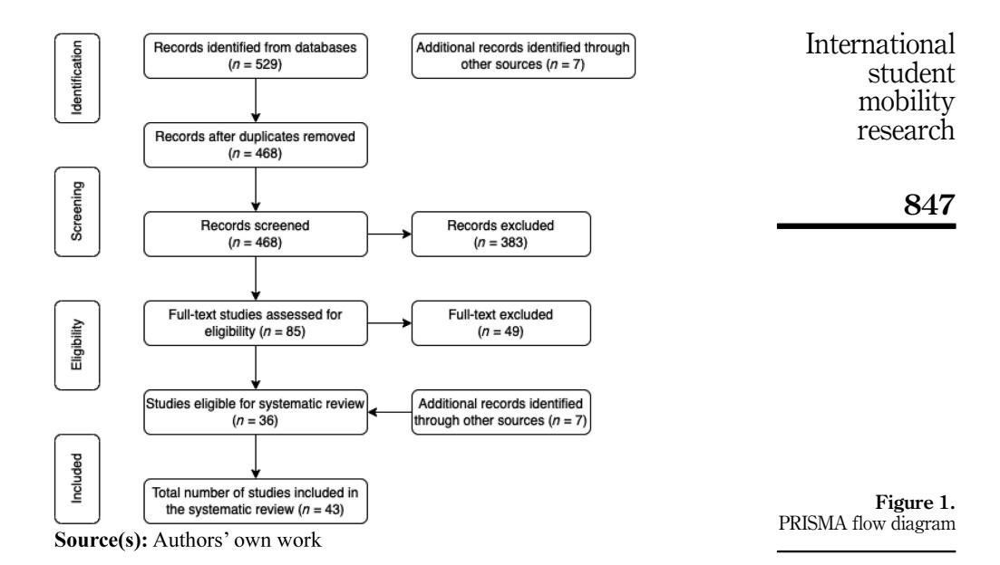
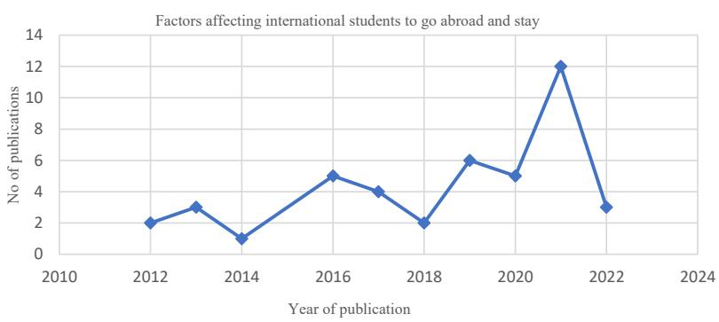

<!-- A2.R19 | source: papers_json/A2.R19/ -->

## Exploring key themes and trends in international student mobility research —A systematic literature review

International student mobility research

843

25 July 2023

Received 14 May 2023 Revised 12 July 2023

Accepted 25 July 2023

## Dandi Merga Gutema

Faculty of Social Sciences, Business and Economics, and Law, Abo Akademi University, Turku, Finland

## Sukrit Pant

Åbo Akademi University, Turku, Finland, and

## Shahrokh Nikou

Åbo Akademi University, Turku, Finland and Stockholm University, Stockholm, Sweden

## Abstract

**Purpose** – The global landscape of higher education has witnessed a steady increase in the mobility of international students, as more individuals seek diverse academic experiences and cross-cultural learning opportunities. This paper conducts a systematic literature review to investigate trends, research directions and key themes in the literature. By utilising the push–pull factor model the aim is to provide a comprehensive understanding of the factors influencing international students' choices to pursue higher education and future career opportunities abroad.

**Design/methodology/approach** – A systematic literature review approach was applied. The selection was made using PRISMA framework-based inclusion and exclusion criteria. The review includes 43 publications from 2010 to 2022.

**Findings** – The review results revealed five themes of scholarly conversations labelled as (1) betterment of life, (2) policy of the host country, (3) role of institutions, (4) return to home country and (5) social, economic, environmental, individual and cultural factors. The findings emphasise on the significance of factors such as the quality of education, visa requirements, academic reputation, tuition fees, availability of scholarships, job opportunities, social, economic, environmental, individual and cultural factors. The paper also identifies language barriers, visa policies and social integration difficulties as major barriers to international students' stay in the host country after graduation.

Originality/value — This research enhances the current body of literature by conducting a comprehensive analysis of the empirical evidence available in literature that investigates the mobility of international students. The outcomes of this study will make a valuable contribution towards developing a more profound comprehension of the primary factors that influence international students' decision to pursue their education abroad.

**Keywords** Education policy, Higher education, International student mobility, LSR **Paper type** Literature review

## 1. Introduction

In the context of the contemporary society and knowledge-based economy, there is a growing need for significant transformations that go beyond surface-level improvements. To make an

© Dandi Merga Gutema, Sukrit Pant and Shahrokh Nikou. Published by Emerald Publishing Limited. This article is published under the Creative Commons Attribution (CC BY 4.0) licence. Anyone may reproduce, distribute, translate and create derivative works of this article (for both commercial and non-commercial purposes), subject to full attribution to the original publication and authors. The full terms of this licence may be seen at <a href="http://creativecommons.org/licences/by/4.0/legalcode">http://creativecommons.org/licences/by/4.0/legalcode</a>

Ethics approval: Ethics approval was not required for this systematic review.

Journal of Applied Research in Higher Education Vol. 16 No. 3, 2024 pp. 843-861 Emerald Publishing Limited 2050-7003 DOI 10.1108/JARHE-05-2023-0195

<!-- page 2 -->

impact, fundamental strategical changes must be made to enhance the skills of the workforce or attracting international talents. Highly skilled knowledge workers are vital in propelling economic growth through their ability to generate innovative ideas that drive progress and advancement [(Gribble, 2008)](#page-16-0). The mobility of global students has tremendously increased over the past few decades [(Kim and Zhang, 2022](#page-16-1)). According to the UNESCO, the global student mobility rose from 2 to 6.36 million from 2000 to 2020 [[1]](#page-15-0). Literature also shows that there is a growing trend among international graduate students seeking for the opportunities to remain in the country where they have completed their studies [(Grimm, 2019](#page-16-2)). The emergence of this trend has led destination countries to develop and implement policies and strategies pertaining to visas and residence permits to aid graduates in their quest for employment opportunities [(Grimm, 2019)](#page-16-2). Many countries around the world have been developing policies that encourage international student attraction and retention ([Ziguras](#page-18-0) [and McBurnie, 2014](#page-18-0)). [Lomer (2017)](#page-17-0) states that policies formulated by host countries exert a significant influence on the volume of students migrating abroad. Policies may either support or constrain migration, and international students are susceptible to the effects of the migration or mobility policy of the host country.

To address the importance of students' mobility, many countries have implemented modifications to their immigration policies and organisational frameworks concerning international education, aiming to attract a greater number of foreign students to their respective countries [(Lomer](#page-17-1)et al., 2018). As such, higher education institutions (HEIs) around the globe attempt to promote internationalisation aiming at integrating the United Nations (UN) sustainable development goals (SDGs) into the teaching and learning functions, crossborder mobility, partnerships and research [(Ramaswamy](#page-17-2) et al., 2021). In Nordic countries, revisions have been made to national policies concerning immigration, talent acquisition and attraction. For instance, as of April 2022, Finland implemented modifications to policies that pertain to residence permits for international students [(Finnish Immigration Services, 2022)](#page-16-3). Before the policy changes, international students were permitted to work up to 20 h per week while studying in Finland and were only allowed to remain in the country for a year after graduation to seek employment. Presently, there have been adjustments to the government's policies and approach towards international talents. The updated policies allow international students to apply for a two-year visa after graduation, exclusively for job-seeking purposes, and work up to 30 h per week during their studies. These changes demonstrate the Finnish government's objective to retain international graduates and encourage them to remain and work in the country ([Finnish Immigration Services, 2022](#page-16-3)).

The literature on international student mobility and study abroad indicates that a diverse range of factors and elements influence students' decision to pursue higher education and future careers abroad [(Arar and Haj-Yehia, 2013](#page-15-1); [Bound](#page-15-2) et al., 2021; [Butkovic](#page-15-3) et al., 2022). Several authors have investigated the factors that influence international students' mobility from different theoretical and situational perspectives [(Geddie, 2012;](#page-16-4) [Shumilova and Cai,](#page-18-1) [2016)](#page-18-1). In many prior studies, the push–pull factor model has been widely utilised to identify factors impacting students' decision to pursue education abroad (e.g. Zhai et al.[, 2019](#page-18-2); [Mosneaga and Winther, 2012)](#page-17-3). For instance, [Mazzarol and Soutar (2002](#page-17-4), p. 87) studied the factors that influence international students' choice of destination and discovered that domestic economic and societal forces act as push factors for students deciding to study abroad. The authors also identified several pull factors that determine which host country students select. These factors include the quality and reputation of the institution, the recognition of the institution's qualifications in their home country, the international strategic alliances of the host institutions, the quality of the institution's staff and the number of international students in the host country.

However, there is currently a lack of a comprehensive overview of the literature that holistically examines and consolidates the core focus of scholarly conversations in this area.

<!-- page 3 -->

Therefore, the main objective of this study is to address gap by consolidating and synthesising the existing studies into common themes from a global perspective. This study utilises the push–pull factor model as theoretical lens to analyse positive and negative factors that influence students' study abroad decision. The decision-making process of international student is influenced by a multitude of push–pull factors [(James-MacEachern and Yun, 2017)](#page-16-5). By considering the intricate interactions among push and pull factors, as well as their varying importance based on individual and contextual factors, this research hopes to develop a more comprehensive understanding of the decision-making processes behind international student mobility.

To address the objective of the paper, a systematic approach will be employed to review published studies from publications between 2010 and 2022 (September). This research is crucial because it enables the efficient synthesis of prior studies in a specific field of study, providing a global perspective that reflects changes over time. Based on the discussion and the objective outlined, the following research questions guiding this research are formulated.

- RQ1. What are the current trends, research directions and key themes regarding international student mobility as reflected in the existing literature?
- RQ2. What factors (pulling) influence international students' decision to study abroad?
- RQ3. What challenges and barriers ("pushing factors") do international students face during their studies in the host country?

The findings of the study contribute to literature, providing valuable insights into international students' mobility, and enhance our current understanding of the decisionmaking process by identifying the key factors influencing students' abroad studies. More importantly, the results will have significant implications for policymakers, and HEIs who seek to attract and retain international students. The results indicate that decision makers at HEIs, policymakers and practitioners should together develop a conducive environment that facilitates career and job opportunities, promotes social integration, fosters multiculturalism and potentially establish scholarships and financial aid programmes to attract and retain international students.

The reminder of the paper is as follows. In the next section, a short theoretical discussion is provided. [Section 3](#page-3-0) presents the research methodology, inclusion and exclusion criteria and search terms. [Section 4](#page-4-0) illustrates the literature search results and discusses the main themes extracted. [Section 5](#page-12-0) presents the discussion, followed by conclusion in [Section 6](#page-13-0).

## 2. Theoretical background

The push–pull theory is a theoretical framework that is commonly used to explain international student mobility ([Gbollie and Gong, 2020](#page-16-6); [Mazzarol and Soutar, 2002](#page-17-4)). The theory suggests that there are push factors that motivate individuals to leave their home country and pull factors that attract them to the destination country. Push factors refer to the negative conditions that drive individuals to leave their home country, such as political instability, lack of economic opportunities, limited access to education and personal safety concerns [(Gbollie and Gong, 2020](#page-16-6)). These factors create a "push" effect on individuals, prompting them to seek out better opportunities and a more stable environment in another country ([Li and Bray, 2007](#page-16-7)). Pull factors, on the other hand, are the positive aspects of the destination country that attract individuals to move there [(Mazzarol and Soutar, 2002)](#page-17-4). These factors can include access to better education, economic opportunities, a more stable political environment and better living conditions [(Mazzarol and Soutar, 2002)](#page-17-4). These factors create a "pull" effect on individuals, encouraging them to move to the destination country [(Gbollie and](#page-16-6) [Gong, 2020](#page-16-6)). By using the push–pull theory in research, scholars can identify the specific

<!-- page 4 -->

factors that drive international student mobility and help institutions understand how to attract and retain international students ([Ahmad and Buchanan, 2016](#page-15-4)). For instance, if a particular country has a reputation for high-quality education but limited job opportunities after graduation, policymakers may need to develop programmes that encourage employers to hire international graduates. In short, push–pull theory provides a useful framework to understand the complex motivations, cognitive processes and factors influencing international student mobility.

## 3. Research methodology

The Systematic Literature Review (SLR) method used in this study is based on the work of ([Kitchenham](#page-16-8) et al., 2009). The advantages of the SLR method are that it offers insights into a research problem and enables a study to gather the available information from a wide range of sources ([Kitchenham and Charters, 2007](#page-16-9)). In addition, SLR results are more reliable and more likely to be unbiased compared to unstructured methods such as the simple literature review [(Stapic](#page-18-3) et al., 2012). SLR consists of three main phases, namely, planning, conducting and reporting, as described by ([Kitchenham](#page-16-8) et al., 2009). This research performs a SLR on relevant publications to understand not only what has been discussed in the literature but also to identify factors influencing the abroad study decision of international students, and the major challenges and barriers they face during their studies in the host country. Previous research indicates that international students are attracted to different factors associated to each country and university around the world and has identified the factors that contribute to their decision to stay or leave the country where they study ([Cameron](#page-15-5) et al., 2019; [Gribble and Blackmore, 2012;](#page-16-10) [Li and](#page-17-5) [Lowe, 2015](#page-17-5)).

## 3.1 Search and information sources

This study focuses on a systematic review of papers related to the international students' mobility, and to fulfil the objective of the study, papers published in Scopus from 2010 to 2022 are considered. To be included in the study, a publication needs to be a peer-reviewed English language publication, and this includes books, book chapters, journal articles and conference proceedings from all subject areas are included in the study. The search string was created using keywords such as "talent acquisition", "attraction" and "retention" with a focus on "employability", "job and labour market" and "job opportunities". As the research is focused on students, graduates and higher education students were also part of the search string. The following search strategy has been used for this systematic review.

"Talent acquisition OR talent retention OR talent attract* OR global talent AND Employability OR Job Market* OR Labo$r Market OR Recruitment OR Opportunit* OR Employability of Foreign Graduate* OR graduate employability AND higher education* OR university student* OR foreign student* OR university OR higher education institution OR higher stud* AND migrat* OR International Student Migration OR International Student OR Migrant Student".

## 3.2 Data collection process and articles screening

The PRISMA (see [Figure 1)](#page-4-1) model was used to search and filter the studies. The initial search with the specified search strings was made on major databases: Web of Science, EBSCO and SCOPUS. In total, 529 publications were retrieved, of which, 268 studies were from the Web of Science, 185 studies were from SCOPUS and 76 studies were from EBSCO. All the article information was exported as RIS format and uploaded to Zotero. After the pre-screening of the retrieved records, 61 duplicated studies were removed. The remaining 468 studies were

<!-- page 5 -->

screened and assessed by the two researchers individually and each has created an Excel datasheet to mark the publications as include, exclude and maybe. Then, in the next step, the researchers met and discussed about their listing and together reached a consensus about which articles to include or exclude from the main database. After the initial assessment and reading abstracts and keywords, 383 additional records were removed and 85 studies were deemed relevant, and full text were downloaded for further evaluation in relation to the research objective.

During the evaluation of full-text, articles were selected for further analysis, if they were relevant and consistent with the overall objectives and research questions of this paper. The articles which discussed migration within a country and related to the attraction of students from one place of the country to others were not included for analysis. Some articles while deemed to be relevant during the evaluation found to be mostly related to general graduates and not relevant to international students. Some of the articles were also related to job market for students rather than relevant to an international student in a particular job market; therefore, we decided not to include them in the review analysis. In this phase, another 49 articles were removed, and 36 studies were included in the final dataset. In addition, seven more relevant articles were found from the external resources leading to a total of 43 studies for the researchers to perform content analysis.

## 4. Results

Among 43 full-text articles reviewed, there were 35 journal articles, 2 reports, 5 books and 1 conference paper among the publications collected. Most of the retrieved studies were published between 2019 and 2021, in total 23 publications, and only one publication in 2014. As illustrated in [Figure 2](#page-5-0), the trend of publications related to factors influencing international students' migration intentions has increased in scientific studies over the years.

<!-- page 6 -->

## JARHE 16,3

## 848

*Figure 2. Publications pertaining to factors affecting international students to go abroad and stay*

***Source(s):** Authors' own work*

## 4.1 Review analysis

The full text analysis and the content analysis of the publications revealed five main streams of research (themes): (1) betterment of life, (2) policy of host country, (3) role of institutions, (4) return to home country and (5) social, economic, environmental, individual and cultural factors. It should be noted that within each main themes, sub-themes were also emerged, which will be discussed in the following.

4.1.1 Betterment of life. Based on the analysis result, the first main theme is betterment of life, and consists of three sub-themes: (1) quality of life, (2) betterment academic life and (3) future prospect. The main factors of international students' decisions to study and live abroad are discussed under this theme, along with the improvements they hope to make to their lives better (generally).

4.1.2 Quality of life. The quality of life in host country has impact on international students' decision to stay in host country [(Netierman](#page-17-6) et al., 2022). Students in Euregio Meuse-Rhine (EMR) in the Euroregion, considered quality of life as important factor when they choose to move abroad. According to the study, students who have a positive view of the quality of life in the host countries are three times more likely to stay than those who have a negative view [(Hooijen](#page-16-11) et al., 2017). [Mosneaga and Winther (2012)](#page-17-3) claimed that international student's perception towards status transition could be influenced by factors such as good work-life and, comprehensive welfare system. [Hung (2021)](#page-16-12) also states that getting quality healthcare service in the host country is highly motivational factor for studying abroad. The author concluded that the perception of gaining quality of life in the host country could influence international students' choice to move abroad and stay in the host country after completing their studies. For instance, the decision of an overseas student to stay in the South Korea to work or study after graduation is positively related to how satisfied they are with their living situation (Istad et al.[, 2021)](#page-16-13).

4.1.3 Better academic life. In the second sub-theme of the betterment of life theme, which is titled as better academic life, the analysis results show that the reputation of specific institution in host country is considered as one factors that affects international students' choice to go abroad ([Mosneaga and Winther, 2012)](#page-17-3). For example, the good reputation of the U.K. education system was mentioned as one of the main reasons for selecting the UK ([Rahimi](#page-17-7) [and Akgunduz, 2017)](#page-17-7). The other factor regarding to motivation to study abroad is the hope to improve one's academic life or pursuing academic growth [(Hung, 2021](#page-16-12)). A study conducted on PhD students in South Africa shows that students remained in the county to pursue for further education, such as post-doctoral study [(Van Schalkwyk](#page-18-4) et al., 2021). One of the educational factors that international students, particularly those from developing countries,

<!-- page 7 -->

consider important when deciding to study abroad is the "student–teacher ratio of higher education" in the destination country [(Wei, 2012](#page-18-5)).

4.1.4 Future prospect in the host country. The third sub-theme in this category, is the future prospect in terms of career development in the host county. This factor was also found to be an important element that influences students' decision to go abroad (e.g. Zhai et al.[, 2019](#page-18-2); [Netierman](#page-17-6) et al., 2022). According to [Cameron](#page-15-5) et al. (2019), one of the main reasons that international students choose to study abroad is the possibility of finding work in the host country after graduation [(Cameron](#page-15-5) et al., 2019). Zhaiet al. [(2019)](#page-18-2) adds that, for instance, when Chinese students choose their destination country for study, career development is a critical factor they consider. In addition, the review analysis shows that one of the major factors that influence English speaking students to stay in Quebec after graduation is the post-graduation work opportunity [(Association for Canadian Studies, 2016](#page-15-6)).

Moreover, the analysis of the publications in this category shows that employment prospects and the positive intention of international students to remain in Finland after graduation are important factor for international students [(Mathies and Karhunen, 2021)](#page-17-8). [Netierman](#page-17-6) et al. (2022) state that the perception of job opportunity in the host country play a major role in the international students' decision to stay in Canada. In addition, the study conducted in Euregio Meuse-Rhine (EMR) revealed that the career opportunities as important factor to study and stay in host countries [(Hooijen](#page-16-11) et al., 2017).

## 4.2 Policy of the host country

The second main theme extracted from the analysis of the retrieved publication is titled as policy of the host county. Policy of the host country can have various impact when it comes to students choosing a country to pursue their higher education. The review analysis revealed that in this themes, literature can be divided into three sub-themes: (1) how easy or difficult is to get student visa [(Lomer, 2017)](#page-17-0), (2) receiving or not given a work permit after graduation ([Mathies and Karhunen, 2021)](#page-17-8) and (3) the difference between what the policy implies and the actual conditions in the country due to conflicting policies [(S](#page-18-6)a[ and Sabzalieva, 2017)](#page-18-6).

4.2.1 Issuance of visa. The analysis of the literature in this sub-theme shows that Eastern European students were more inclined to study in the UK due to its EU membership (Brexit), which also facilitated their visa requirements. Furthermore, being an EU citizen made them eligible to receive funding for their studies in the UK ([Rahimi and Akgunduz, 2017](#page-17-7)). However, the UK's policy towards international students has been volatile, with policies that both promote and discourage immigration. This has led to confusion among international students for choosing the UK as their destination ([Lomer, 2017](#page-17-0)). Similarly, Australia's reputation as a welcoming destination for international students was damaged by the tightening of foreign student visa rules ([Gribble and Blackmore, 2012)](#page-16-10). The results of the analysis of publication in this group, shows that Denmark, on the other hand, has policies that vary by study programmes, which creates stress for students about their status during and after completion of their studies, amplifying their negative intentions towards staying in the country ([Ginnerskov-Dahlberg, 2021)](#page-16-14). On the other hand, the analysis result shows that, due to different policy and unlike work visas, student visas are not capped in the US, making it an easy pathway for those looking to enter the US labour market ([Bound](#page-15-2) et al., 2021).

4.2.2 Ease of receiving work permit. The second sub-theme of discussion in the literature revolves around how easy or difficult is to get the work permit during the study. The review results show that international students are highly concerned about the possibility to work while studying to support their financial needs. In this regard, for example, Canada's open approach towards immigration and the "Study and Stay" programme have made it easier for students to complete their studies and stay in the country, giving them a competitive advantage ([Reichert and Bouajram, 2021)](#page-17-9). Finland has also expanded its international

<!-- page 8 -->

student residence and work permit programme beyond the EU directive, from nine months to 24 months, to facilitate employment opportunities for graduates ([Alho, 2020)](#page-15-7). As a result, international non-EU students are more likely to stay in Finland due to easier visa extension opportunities ([Mathies and Karhunen, 2021](#page-17-8)). Moreover, the availability of post-graduate visa/ permit schemes is considered a major factor in international students' intention to stay in the host country where they completed their higher education studies (Balch et al.[, 2012)](#page-15-8). Similarly, the proposal of post-study work visas for international graduates is seen as positive by Australian universities ([Gribble and Blackmore, 2012](#page-16-10)). The findings also show that in Canada, the ease of obtaining work permits or permanent residency is a significant factor in attracting international students ([Netierman](#page-17-6) et al., 2022).

The findings of the review indicate that policies in countries like the US and Australia are evolving, which can pose challenges for international students in determining their eligibility for residency. For instance, the Australian permanent residency system frequently updates its point system, leading to an unstable situation for international students who are apprehensive that their residency status may be altered at any time ([Grimm, 2019](#page-16-2)). Additionally, the duration of residency rights provided by countries like Germany and Austria can be an important deciding factor for students in selecting a country over another [(Reiner](#page-17-10) et al., 2017).

4.2.3 Conflict between policy and reality. The third subtheme of discussion in the literature centres around publications that delve into international students' perspectives on how policies are implemented in the host country. These students encounter numerous challenges when it comes to post-study employment, as the post-study visa requirements may not align with their area of study, resulting in a sense of disappointment (Tran et al.[, 2020](#page-18-7)). The review results show that although international students and immigrant workers play a significant role in Australia's economy, laws like the Higher Education Act of 2004 do not specifically address international students. As a result, this creates confusion and obstacles for them ([S](#page-18-6)a [and Sabzalieva, 2017)](#page-18-6).

Moreover, the work permit system in South Africa is based on the principle of not displacing South Africans. This implies that individuals may be denied a work permit if there are enough South Africans in the job position, they are seeking [(Van Schalkwyk](#page-18-4) et al., 2021). Similarly, in Finland and the EU, member states prioritise hiring locals first, followed by EU citizens and then non-EU citizens, despite opening up to international students [(Li, 2020)](#page-16-15). In Australia, companies prefer to hire Australian citizens or permanent residents since obtaining work permits for international students involves bureaucratic procedures, making it less likely for them to secure employment in the job market ([Cameron](#page-15-5) et al., 2019). Finally, it can be stated that although policies have been implemented to retain international students, they are still regarded as temporary migrants and are not integrated into the host country's system (Balch et al.[, 2012](#page-15-8)). It is imperative for governments to tackle these problems and establish policies that are more comprehensive and accommodating of international students' professional aspirations.

## 4.3 Role of institutions

The literature review's third primary subject of discussion centres around the role of HEIs in the host country. Apart from policies, institutions also play a significant role in attracting and retaining international students. Universities with notable reputations strive to appeal to students [(Geddie, 2012)](#page-16-4), while employers have recognised the significance of international students and have simplified the process for graduates to stay in the host country [(Coffey](#page-15-9) et al.[, 2018)](#page-15-9).

4.3.1 Role of universities/higher education institutions. The first subtheme in this category encompasses publications that primarily focus on the role of universities and HEIs. The HEIs carry a significant responsibility in providing students from all over the world with the

<!-- page 9 -->

necessary knowledge and comprehensive understanding required to become informed leaders in a world that is becoming more borderless but fraught with national conflicts ([Myhovych, 2019)](#page-17-11). This responsibility has grown even more urgent as HEIs globally have placed more emphasis on international rankings to draw in students and improve their worldwide reputation [(Geddie, 2012](#page-16-4)). In this regard, HEIs in the United States have typically focused on luring and retaining the best international students as a strategy to cultivate a highly skilled workforce [(Douglass and Edelstein, 2009](#page-16-16) as cited in [Shumilova and Cai, 2016)](#page-18-1). Additionally, HEIs are working on enhancing their rankings and image by augmenting the enrolment of international students and evaluating their experiences at these institutions ([Reichert and Bouajram, 2021](#page-17-9)).

The review analysis shows that South African universities are an attractive destination for PhD candidates due to the quality of education they offer, as noted in a study by [Van](#page-18-4) [Schalkwyk](#page-18-4) et al. (2021). Additionally, HEIs significantly influence students from developed countries, who are more interested in factors such as a high student–teacher ratio, as highlighted by [Wei (2012).](#page-18-5) [Rahimi and Akgunduz (2017)](#page-17-7) found that students believe that a qualification from the UK would enable them to find a job almost anywhere in the world, whereas a qualification from Romania or the Czech Republic may present greater challenges in terms of employment opportunities.

HEIs also have a role in helping international students find employment after graduation, with many institutions including mandatory internships to provide valuable work experience for their students and offering job-seeking training and other career advice services [(Cameron](#page-15-5) et al.[, 2019](#page-15-5)). HEIs in Germany are piloting programmes in Tandem Studies which allows international students and German students to work together to improve their language proficiencies which helps in the employability of the international students [(Strenger and](#page-18-8) [Ulbrich, 2019](#page-18-8)). Employers suggest that HEIs are in the driver's seat, as they need to understand the requirements of the job market and make graduates ready for the most important roles [(Nilsson and Ripmeester, 2016)](#page-17-12).

HEIs have a responsibility to equip their students with skills and knowledge that will enable them to be competitive in the global job market. As noted by [Gribble and Blackmore](#page-16-10) [(2012),](#page-16-10) improving the employability of students is a crucial role for HEIs. This includes providing career services to assist students in finding further studies and Optional Practical Training (OPT) after completing their studies [(Shumilova and Cai, 2016)](#page-18-1). In addition, HEIs need to consider the integration of international students, as their experiences during their studies can impact their decision to remain and work or study in the host country after graduation (Istad et al.[, 2021)](#page-16-13).

Studies analysed in this subtheme explore factors like the quality of education and the cost of tuition that affect a student's decision to study at a particular higher education institution. These factors include the programme of study, quality of education, language of instruction and tuition fees ([Association for Canadian Studies, 2016](#page-15-6)). Some students are drawn to universities with a good reputation and professors who specialise in a specific field. Additionally, HEIs that have lower entry requirements are more appealing to students ([Zhai](#page-18-2) et al.[, 2019)](#page-18-2). Timing of the application process is also a critical factor, as international students may choose a different country if the application deadline is too early or too late, to avoid a significant gap in their studies [(Mosneaga and Winther, 2012)](#page-17-3).

4.3.2 Role of employers. Studies analysed in this subtheme explore factors like the role of employer in the job market for the international students. [Alho (2020)](#page-15-7) found that in Finland, informal recruitment practices in the job market make it difficult for international students to find work. [Mathies and Karhunen (2020)](#page-17-13) argued that it is important to focus on building international professional networks not only for students and HEIs but also for potential employers. Developing talent attraction and development practices is crucial for employers and talented workers, as it demonstrates an organization's readiness to cultivate their

<!-- page 10 -->

potential and professional skills ([Latukha](#page-16-17) et al., 2021). [Li (2020)](#page-16-15), and [Shumilova and Cai (2016)](#page-18-1) argued that Finnish employers must adapt to the needs of workers, such as operating in English, to remain competitive in the global market for highly skilled workers, as workers may leave the country if opportunities are not available. [Shchegolev](#page-18-9) et al. (2016) found that German companies have implemented mentoring and international trainee programmes to support international graduates and strategically recruit them.

[Coffey](#page-15-9) et al. (2018) report that Japanese investors have recognised the necessity of providing employment visas to Chinese students studying in Japan to facilitate their work with Chinese businesses. According to Tran et al. [(2020)](#page-18-7), sponsoring international students for employer nomination visas can enhance their prospects of obtaining legal documentation and obtaining a job. In conclusion, to appeal to and retain highly skilled workers, it is critical for employers to comprehend the requirements of international students and adapt their tactics appropriately.

## 4.4 Return to home country

While some students choose to stay, others will go back for one reason or another [(Zhai](#page-18-2) et al., [2019)](#page-18-2). The fourth theme extracted from the review literature canters on international students' return to their home country after completing their studies, with several subthemes addressing the factors and reasons (e.g. family tie and better opportunities in home country) that influence their decision to leave the host country.

4.4.1 Better opportunity in home country. The migration intentions of international students after completing their studies are influenced by their international exposure and academic pursuits. This provides them with better opportunities and a better return on investment when they return to their home country. In contrast, graduates from developed countries tend to return home due to the better quality of life. Additionally, high-performing students often receive funding from their government or an employer scholarship, which requires them to return home after graduation. Therefore, the availability of secure employment prospects in their home country becomes a compelling reason to return. Malaysia supports the recruitment channels that students can use to find employment in their home country, facilitating their return [(Rajani](#page-17-14) et al., 2018).

4.4.2 Family ties. Most PhD candidates cite family-related reasons as their primary reason for returning home ([Van Schalkwyk](#page-18-4) et al., 2021). It is important to recognise that the decision to migrate is not made alone and families have a significant influence on this decision. Family ties play a critical role in both genders' migration decisions, and women have the autonomy to make independent migration decisions [(Latukha](#page-16-17) et al., 2021). Family ties can act as both a pull and a push factor in expatriation, and having family in the home country increases the likelihood of returning ([Rajani](#page-17-14)et al., 2018). In Finland, Chinese students with close ties to their parents may leave the country to care for their elderly parents since only spouses and children are eligible for residence permits ([Li, 2020](#page-16-15)). The absence of parental allowances may encourage graduates to return to their home country ([Li, 2020](#page-16-15)). It is worth noting that while individuals may choose to remain in the host country due to family ties, their decision to return to their home country is also influenced by family considerations [(Mathies and](#page-17-13) [Karhunen, 2020](#page-17-13)).

4.4.3 Socio-cultural. The decision of international students to return to their home country after completing their studies is influenced by a variety of factors, including socio-cultural aspects. Language barriers can be a significant issue, as students may struggle to find jobs in countries where they do not speak the native language. In Finland, for example, the job market is primarily in Swedish and Finnish, despite the fact that the country offers a high number of courses in English ([Mathies and Karhunen, 2020)](#page-17-13). Other important factors include cultural adaptiveness and international experience, with those who have had more exposure

<!-- page 11 -->

to international environments being more likely to stay ([Latukha](#page-16-17) et al., 2021). European students are often more open to migration due to programmes like Erasmus that encourage mobility [(Mendoza](#page-17-15) et al., 2019). Having a stable, professional job is crucial to students' decision to stay, but limited networking opportunities in the job market can make it difficult to find work, leading them to return home ([Mathies and Karhunen, 2021)](#page-17-8). Inability to create social capital can be another reason why students choose not to stay in the host country (Wang and O'[Connell, 2020)](#page-18-10).

While countries like Australia have friendly migration policies and cultural diversity, social integration can still be a challenge for international students, particularly those from China (Zhai et al.[, 2019)](#page-18-2). In conclusion, socio-cultural factors, such as language barriers, cultural adaptiveness, networking opportunities, social capital and social integration, can significantly influence the decision of international students to leave the host country and return to their home. These factors should be considered by policymakers and institutions when creating policies and programmes to encourage international students to stay in the host country.

4.4.4 Policy issues. Policy issues is and impact international students' decision to return to their home country. The changing policies regarding international students can be a significant factor that leads to difficulties in understanding when laws change, resulting in an increased likelihood of returning to their home country ([Reichert and Bouajram, 2021](#page-17-9)). In the UK, the closure of the Post-Study Work scheme and tightened restrictions on international students and migrants have led to a decrease in the number of graduates remaining in the country (Balch et al.[, 2012)](#page-15-8). A sense of obligation towards the government in terms of grants and scholarships received can also be a reason for international students to return to their home country ([Netierman](#page-17-6) et al., 2022). The obligations and expectations associated with receiving scholarships or grants from their home country can influence students' decisions to return home after completing their studies abroad. This indicates the importance of transparent and supportive policies that provide clear guidelines to international students to help them make informed decisions about their future.

Policy issues such as changing laws and regulations, lack of opportunities and obligations associated with grants and scholarships can significantly impact international students' decision to return to their home country. Policymakers and institutions should strive to create supportive and transparent policies that encourage international students to stay in the host country after graduation, while also addressing the challenges and concerns that may influence their decision to return home.

## 4.5 Social, economic, environmental, individual and cultural factors

The review also highlights several factors that influence international students' decision to study and stay in a foreign country. These include social, economic, environmental, individual and cultural factors. Living environment safety and security is one of the critical factors that can influence students' decision to study abroad. A safe and secure living environment can make students feel comfortable and welcomed, while a hostile or dangerous environment can discourage them from staying. Social integration is another important factor that can affect international students' decision to stay in a foreign country.

Familiarity with the culture of the destination country is also a significant factor influencing international students' decision to study abroad. Cultural differences can be a significant challenge for students, and the more familiar they are with the culture of the destination country, the more likely they are to adapt and feel comfortable. Economic factors, such as job opportunities and the cost of living, can also play a role in international students' decision to stay in a foreign country. Having access to stable employment and affordable living arrangements can make it easier for students to remain in the host country after

<!-- page 12 -->

graduation. Environmental factors, such as climate and pollution levels, can also influence international students' decision to stay in a foreign country. Finally, individual factors, such as personal preferences and goals, can play a significant role in students' decision to study and stay abroad.

4.5.1 Social integration and connection. The social integration and connection of international students in their host country are crucial factors that influence their decision to stay Zhaiet al. [(2019)](#page-18-2) found that Chinese students were attracted to studying in Australia due to existence of multiple platforms for social connection, including Chinese communities. These connections provided valuable information about the job market, especially for those whose first language was not English. Other factors that influence international students' decision to study abroad include family ties and the presence of a significant other, as found in studies by [Rahimi and Akgunduz (2017)](#page-17-7).

[Mathies and Karhunen (2021)](#page-17-8) specifically looked at international students in Finland and found that those with family ties, such as family members, children and marriage relationships, were more likely to stay in their host country after graduation. Similarly, [Netierman](#page-17-6) et al. (2022) found that family ties in Canada or abroad affected the decision of international students to remain in the host country. Finally, a study by Istad et al. [(2021)](#page-16-13) on Global Korea scholarship recipients found that those who had a positive experience with social integration and interaction with the local community in South Korea were more likely to stay for study or work.

4.5.2 Economic factors. According to [Ziguras and McBurnie (2014)](#page-18-0), income inequality between the host and home country is a factor that could motivate international students to stay in the host country. Similarly, [Wei (2012)](#page-18-5) suggests that economic factors play a significant role in international students' decisions to choose a destination country, particularly those from developing countries. These economic factors include the destination country's HEI expenditure as a percentage of GDP, the per capita GDP gap between countries and the purchasing power parity in the inflow country ([Wei, 2012](#page-18-5)).

4.5.3 Environmental factors. According to the [Association for Canadian Studies (2016)](#page-15-6), international students in Quebec, Canada consider the safety of the living environment as an important factor to stay in the host country after graduation. Similarly, the study conducted in South Korea by Istad et al. [(2021)](#page-16-13) found that international students are more likely to stay in the host country after graduation if they feel safe and have access to basic necessities. [Mosneaga and Winther (2012)](#page-17-3) found that international students studying in Copenhagen, Denmark, were influenced by the city's attractiveness when deciding on their destination.

4.5.4 Cultural factors. According to [Rahimi and Akgunduz (2017),](#page-17-7) intentional students consider cultural aspects of the host country as a significant factor when deciding whether to stay or leave. If they feel welcomed and can enjoy a multicultural environment, they are more likely to choose to stay in the host country. [Cao (2022)](#page-15-10) argues that international students had positive impressions of Japanese culture prior to their arrival to study there, and cultural adaptability are positively associated with graduates' intention to migrate ([Latukha](#page-16-17) [et al.,](#page-16-17) 2021).

4.5.5 Individual factors. The review indicates that individual factors play a significant role in international students' decision to study and stay abroad. [Cao (2022)](#page-15-10) found that having a strong desire to live in Japan before coming to the country to study had a significant impact on the students' choice to stay and work there permanently. This suggests that students who have a pre-existing affinity for a particular country may be more likely to choose to stay there after completing their studies. [Mosneaga and Winther (2012)](#page-17-3) argued that a student's perception of their lifestyle in the destination country can also affect their decision to study abroad. Students who perceive a desirable lifestyle in a particular country may be more likely to choose it as their study destination.

<!-- page 13 -->

Overall, personal factors such as pre-existing desire to live in a country and lifestyle perceptions play a crucial role in international students' decision to study and stay abroad. These factors should be carefully considered by students when choosing their study destination to ensure a positive experience abroad.

## 5. Discussions

Existing literature on international student mobility has primarily focused on the perspectives of students coming from a particular country or going to a specific destination. However, this systematic literature review aims to address this research gap by investigating the effectiveness of policies in various countries and how different factors impact students' intentions to choose, stay or return from a country. Several push factors were identified as motivators for international students to stay abroad. One of these factors was the perception of better quality of life and access to healthcare and welfare services in the destination country, as noted by [Hooijen](#page-16-11) et al. (2017), [Mosneaga and Winther (2012)](#page-17-3) and [Netierman](#page-17-6) et al. (2022). Another significant factor was the opportunity for academic growth, tuition fee and better academic life, as highlighted by, for example [Hung (2021)](#page-16-12) and [Wei (2012).](#page-18-5) These sub-factors included the reputation of academic institutions, the determination to pursue further education, better student–faculty ratio and overall academic growth, all have a significant impact on the students' decision.

The chance to work after graduation was found to be a compelling motivator for international students to study abroad and stay in the destination country for better career opportunities, as suggested by [Mathies and Karhunen (2021).](#page-17-8) These push factors highlight the importance of considering various factors beyond just academic reasons when deciding to study and stay abroad. The findings suggest that a range of factors such as quality of life, academic growth, reputation of academic institutions and career opportunities should be considered when developing policies to attract and retain international students.

According to literature review results, visa requirements play a significant role in the decision-making process for international students when selecting a country to study in ([Rahimi and Akgunduz, 2017;](#page-17-7) Bound et al., 2021). The ease of mobility is an important factor, as students often consider the long-term potential of staying in a particular country. "Study and Stay" programmes, which allow international students to work and stay in the host country for an extended period, also attract students ([Alho, 2020)](#page-15-7). However, policy changes and unwritten policies, such as prioritising permanent residents or not displacing locals, can demotivate students from staying ([Van Schalkwyk](#page-18-4) et al., 2021).

In terms of attracting students, universities play a crucial role. Language programmes and global rankings are among the factors that universities use to attract international students (e.g. [Geddie, 2012)](#page-16-4). However, it is not enough for universities to attract international students, they also need to prepare them for employment after graduation. Employers believe that universities play a critical role in retaining international students by providing them with jobready skills [(Nilsson and Ripmeester, 2016](#page-17-12)). At the same time, the role of employers needs to grow as they are responsible for hiring and retaining international graduates. Unfortunately, some employers shut out international talent due to language or visa status, while international graduates are highly sought-after for their competencies [(Li, 2020](#page-16-15)).

The decision of international students to return to their home country after completing their studies is influenced by various challenging factors. Family ties have been identified as one of the most significant reasons for international students to return home ([Latukha](#page-16-17) et al., [2021)](#page-16-17). Students from both developed and developing countries may find better opportunities in their home country [(Rajani](#page-17-14) et al., 2018). The results showed that language can be a significant barrier for international students in terms of social integration and building professional networks, even if a common language like English is used (e.g. Zhai et al.[, 2019)](#page-18-2).

<!-- page 14 -->

In addition, policy-related issues also play a significant role in the decision-making process of international students. The policy environment in the host country can be continuously changing, making it difficult for international students to plan their future ([Reichert and](#page-17-9) [Bouajram, 2021)](#page-17-9). Furthermore, the policy of the home country can also create an obligation for international students to return after completing their studies [(Netierman](#page-17-6) et al., 2022).

Moreover, it is essential to understand these factors to ensure that the policies and support systems put in place to attract and retain international students are effective. Efforts should be made to address the challenges related to language and social integration, and policies should be consistent and predictable to create a more welcoming environment for international students. By doing so, universities and host countries can improve their competitiveness in attracting and retaining international students, and the students themselves can make informed decisions about their academic and professional futures.

The literature also highlights that cultural factors can play a significant role in international students' decision-making process. For example, the cultural similarity between the home country and the destination country can impact the decision to study abroad ([Hooijen](#page-16-11) et al., 2017). The cultural shock that some international students experience when studying abroad can also affect their decision to stay or return to their home country ([Istad](#page-16-13) et al.[, 2021](#page-16-13)). Furthermore, the support and services provided by the host institutions can impact international students' decision to study and stay in a particular country. For example, support services such as orientation programmes, accommodation assistance and language support can improve the experience of international students and increase their likelihood to stay ([Hung, 2021)](#page-16-12).

Finally, it is important to note that international student mobility is a complex and multifaceted issue, influenced by a wide range of factors. As such, policies and strategies aimed at attracting and retaining international students should take into account the various social, economic, institutional, environmental, individual and cultural factors that affect their decision-making process. By doing so, host countries can create a welcoming and supportive environment that enables international students to thrive and contribute to the local economy and society.

## 6. Conclusion, limitations and future work

The paper performs a systematic review of literature from 2010 to 2022, analysing 43 most relevant publications on international student mobility to extract the main area of scholarly conversations. To answer the first RQ, the review results reveal five streams of conversations: (1) betterment of life, (2) policy of host country, (3) role of institutions, (4) return to home country and (5) social, economic, environmental, individual and cultural factors. Regarding the second research question, the review results show that several factors influence the international students' decision to study abroad. Regarding the second RQ, the findings suggest that factors such as the quality of education, academic reputation of the institution, availability of scholarships, tuition fee, ease of mobility through lower visa requirements and the possibility of better job opportunities in the host country are significant factors that motivate international students to study abroad and stay after graduation ([Ozo](#page-17-16) € glu et al.[, 2015)](#page-17-16). The social, economic, environmental, individual and cultural factors also play a crucial role in influencing their decision to stay or leave the host country.

Regarding the third RQ, the review results identify and highlight important factors. The findings suggest language barriers, policy-related factors such as changing visa policies, obligations to return to their home country and social integration difficulties as some of the major challenges and barriers that prevent international students from staying in the host country after their graduation [(Riano and Piguet, 2016](#page-17-17) ~ ).

<!-- page 15 -->

These factors may discourage international students from staying, leading to a potential loss of valuable talent for the host country. To attract and encourage a greater number of international students, it is important for HEIs to consider these factors and formulate strategies to mitigate such experiences for their students. The HEIs should prioritise creating an environment that promotes social integration, fosters multiculturalism and provides career and job opportunities. Providing language support and resources that help international students integrate into the host country's culture and society can also be valuable. Moreover, policymakers should ensure that visa policies are stable and welcoming to international students, and work towards creating a supportive and inclusive environment that encourages them to stay and contribute to the host country's economy and society.

The findings provide valuable information for scientific communities, policymakers and HEIs to better understand the needs and motivations of international students and develop strategies to attract and retain them. The decision to study abroad is a complex and interconnected process and policy changes, language barriers and the pull of family ties in their home country may influence international students' decision to stay in the host country or return home. Universities play a crucial role in attracting and retaining international students through language programmes, education quality, global rankings and job-ready skills. Meanwhile, employers need to be more open to hiring international graduates, recognizing their competencies and contributing to their retention.

These findings have significant implications for scientific communities, policymakers and practitioners in higher education with the following actionable recommendation. Policymakers should pay attention to the changing policies that may affect the attractiveness of their country as a destination for international students. Additionally, policymakers should collaborate with stakeholders to develop initiatives that support the transition of international students into the workforce, as well as supporting and implementing policies that promote social integration, language acquisition and career development opportunities for international students. Practitioners in HEIs should provide comprehensive language and cultural support services to help international students adapt and thrive in the host country and offer robust career services and networking opportunities to facilitate international students' professional development. They need to ensure that international students have a positive experience in the host country by providing, for example networking opportunities. They should also work with employers to create opportunities for international students to gain work experience and facilitate their transition into the workforce. To attract more international students, HEIs should continue to improve their academic reputation and global rankings, expand language programmes, make connections with industries to enhance international students' employability, offer more career development opportunities and should consider creating more scholarships and financial aid opportunities to make studying abroad more accessible to students from diverse backgrounds. By implementing these recommendations, stakeholders can actively support and enhance the experiences of international students, improve their integration into the host country and create an environment that attracts more international students to pursue higher education opportunities. We acknowledge that the issues of short mobility or mobility due to conflict ([Mouselli, 2022](#page-17-18)) were not the central focus of the paper. However, we recognise their significance and potential impact on the overall topic of integration students' mobility. We suggest that these topics be explored in future work. Exploring these areas further would allow for a more comprehensive understanding of the factors influencing students' mobility patterns and experiences [(Hayes and Findlow, 2022](#page-16-18)).

One limitation of the research is that the literature review may not have included all relevant publications on the topic, as it was limited to publications from 2010 to 2022. For example, the impact of COVID-19 pandemic on international students' mobility. For example, travel restrictions and border closures made it difficult for students to obtain study visa and

<!-- page 16 -->

to travel to their desired study destinations. In addition, campus closures and the shift to online learning disrupted the traditional study abroad experience, affecting cultural immersion and networking opportunities ([Schleicher, 2020](#page-18-11)). Another limitation of this study is that the use of LSR and PRISMA framework, while LSR is systematic, may be subject to certain weaknesses. For example, the results could be influenced by the choice of search terms and databases, potentially limiting the comprehensiveness of the findings. Additionally, subjective decisions made during the screening and selection process introduce the possibility of missing or excluding relevant studies. This paper provides a broad overview of the factors influencing international students' decisions, but more specific insights may be gained by conducting a more focused analysis of individual factors and their relative importance. Future work could involve conducting a more targeted and in-depth analysis of the factors that influence international students' decision to stay or leave the host country after graduation. This could include a more detailed examination of the impact of specific policies, such as visa policies and requirements on international students' decision-making processes.

## Note

1. The total Outbound student mobility for all countries in 2020 was 6,361,962,60,179. Source [http://](http://data.uis.unesco.org/) [data.uis.unesco.org/](http://data.uis.unesco.org/)

## References

- Ahmad, S.Z. and Buchanan, F.R. (2016), "Choices of destination for transnational higher education: 'pull' factors in an Asia Pacific market", Educational Studies, Vol. 42 No. 2, pp. 163-180.
- Alho, R. (2020), "You need to know someone who knows someone: international students' job search experiences", Nordic Journal of Working Life Studies, Vol. 10 No. 2, pp. 3-22.
- Arar, K. and Haj-Yehia, K. (2013), "Higher education abroad: Palestinian students from Israel studying in Jordanian universities", Journal of Applied Research in Higher Education, Vol. 5 No. 1, pp. 95-112.
- Association for Canadian Studies (2016), "Push-pull factors related to student retention and integration in Quebec", available at: [https://www.canada.ca/en/immigration-refugees](https://www.canada.ca/en/immigration-refugees-citizenship/corporate/reports-statistics/research/push-pull-factors-related-student-retention-integration-quebec.html)[citizenship/corporate/reports-statistics/research/push-pull-factors-related-student-retention](https://www.canada.ca/en/immigration-refugees-citizenship/corporate/reports-statistics/research/push-pull-factors-related-student-retention-integration-quebec.html)[integration-quebec.html](https://www.canada.ca/en/immigration-refugees-citizenship/corporate/reports-statistics/research/push-pull-factors-related-student-retention-integration-quebec.html)
- Balch, A., B€orjesson, M., Shen, W. and De Wit, H. (2012), "Mobile talent? The staying intentions of international students in five EU countries", SVR GmbH, available at: [https://pure.hva.nl/ws/](https://pure.hva.nl/ws/portalfiles/portal/142927/500486_Study_Mobile_Talent_Engl.pdf) [portalfiles/portal/142927/500486_Study_Mobile_Talent_Engl.pdf](https://pure.hva.nl/ws/portalfiles/portal/142927/500486_Study_Mobile_Talent_Engl.pdf)
- Bound, J., Braga, B., Khanna, G. and Turner, S. (2021), "The globalization of postsecondary education: the role of international students in the US higher education system", Journal of Economic Perspectives, Vol. 35 No. 1, pp. 163-184.
- Butkovic, A., Brkovic, I. and Buretic, I. (2022), "The role of openness and cultural intelligence in students' intention to study abroad", Journal of Applied Research in Higher Education, Vol. ahead-of-print No. ahead-of-print, doi: [10.1108/JARHE-06-2022-0201](https://doi.org/10.1108/JARHE-06-2022-0201).
- Cameron, R., Farivar, F. and Coffey, J. (2019), "International graduates host country employment intentions and outcomes: evidence from two Australian universities", Journal of Higher Education Policy and Management, Vol. 41 No. 5, pp. 550-568.
- Cao, N.T.K. (2022), "Determinants of international students' decision to remain in Japan to work after graduation", Journal of Asian Economics, Vol. 82, 101529.
- Coffey, J., Farivar, F. and Cameron, R. (2018), "The job seeking experiences of international graduates in the host country: Australia's lost opportunity?", The International Journal of Human Resource Management, Vol. 32 No. 4, pp. 846-870.

<!-- page 17 -->

International student mobility research

- Douglass, J.A. and Edelstein, R. (2009), "The global competition for talent: the rapidly changing market for international students and the need for a strategic approach in the US", Centre for Studies in Higher Education, Research and Occasional Paper Series, available at: [http://cshe.](http://cshe.berkeley.edu/) [berkeley.edu/](http://cshe.berkeley.edu/)
- Finnish Immigration Services (2022), Rules on International Students Moving to Finland Relaxed, Finnish Immigration Services, Helsinki, available at: [https://migri.fi/en/-/rules-on-international](https://migri.fi/en/-/rules-on-international-students-moving-to-finland-)[students-moving-to-finland-relaxed](https://migri.fi/en/-/rules-on-international-students-moving-to-finland-)
- Gbollie, C. and Gong, S. (2020), "Emerging destination mobility: exploring African and Asian international students' push-pull factors and motivations to study in China", International Journal of Educational Management, Vol. 34 No. 1, pp. 18-34.
- Geddie, K. (2012), "The transnational ties that bind: relationship considerations for graduating international science and engineering research students", Population, Space and Place, Vol. 19 No. 2, pp. 196-208.
- Ginnerskov-Dahlberg, M. (2021), Student Migration from Eastern to Western Europe, Routledge, New York.
- Gribble, C. (2008), "Policy options for managing international student migration: the sending country's perspective", Journal of Higher Education Policy and Management, Vol. 30 No. 1, pp. 25-39.
- Gribble, C. and Blackmore, J. (2012), "Re-positioning Australia's international education in global knowledge economies: implications of shifts in skilled migration policies for universities", Journal of Higher Education Policy and Management, Vol. 34 No. 4, pp. 341-354.
- Grimm, A. (2019), "Studying to stay: understanding graduate visa policy content and context in the United States and Australia", International Migration, Vol. 57 No. 5, pp. 235-251.
- Hayes, A. and Findlow, S. (2022), International Student Mobility to and from the Middle East, Routledge, London.
- Hooijen, I., Meng, C., Reinold, J. and Siegel, M. (2017), "Competition for talent: retaining graduates in the Euregio Meuse-Rhine", European Planning Studies, Vol. 25 No. 12, pp. 2212-2231.
- Hung, N.T. (2021), "Higher education in business: a model for international students' choice", Business Process Management Journal, Vol. 27 No. 6, pp. 1804-1821.
- Istad, F., Varpahovskis, E., Miezan, E. and Ayhan, K.J. (2021), "Global Korea Scholarship students: intention to stay in the host country to work or study after graduation", Politics and Policy, Vol. 49 No. 6, pp. 1323-1342.
- James-MacEachern, M. and Yun, D. (2017), "Exploring factors influencing international students' decision to choose a higher education institution: a comparison between Chinese and other students", International Journal of Educational Management, Vol. 31 No. 3, pp. 343-363.
- Kim, S. and Zhang, C. (2022), "Factors influencing Korean students' choice of study abroad destination short-term and long-term by destination country", Asia Pacific Education Review, Vol. 23 No. 1, pp. 197-208.
- Kitchenham, B., Brereton, O.P., Budgen, D., Turner, M., Bailey, J. and Linkman, S. (2009), "Systematic literature reviews in software engineering–a systematic literature review", Information and Software Technology, Vol. 51 No. 1, pp. 7-15.
- Kitchenham, B. and Charters, S. (2007), "Guidelines for performing systematic literature reviews in software engineering", Technical report, Ver. 2.3 EBSE Technical Report. EBSE.
- Latukha, M., Shagalkina, M. and KalininaKhasieva, E.D. (2021), "Does gender matter? Gender talent migration and its implication for talent management", Journal of Global Mobility: The Home of Expatriate Management Research, Vol. 9 No. 2, pp. 191-216.
- Li, H. (2020), "How to retain global talent? Economic and social integration of Chinese students in Finland", Sustainability, Vol. 12 No. 10, p. 4161.
- Li, M. and Bray, M. (2007), "Cross-border flows of students for higher education: push–pull factors and motivations of mainland Chinese students in Hong Kong and Macau", Higher Education, Vol. 53 No. 6, pp. 791-818.

<!-- page 18 -->

- Li, Z. and Lowe, J. (2015), "Mobile student to mobile worker: the role of universities in the "war for talent", British Journal of Sociology of Education, Vol. 37 No. 1, pp. 11-29.
- Lomer, S. (2017), Recruiting International Students in Higher Education: Representations and Rationals in British Policy, Palgrave Macmillan, Cham.
- Lomer, S., Papatsiba, V. and Naidoo, R. (2018), "Constructing a national higher education brand for the UK: positional competition and promised capitals", Studies in Higher Education, Vol. 43 No. 1, pp. 134-153.
- Mathies, C. and Karhunen, H. (2020), "Do they stay or go? Analysis of international students in Finland", Globalisation, Societies and Education, Vol. 19 No. 3, pp. 298-310.
- Mathies, C. and Karhunen, H. (2021), "International student migration in Finland", Journal of International Students, Vol. 11 No. 4, pp. 874-894.
- Mazzarol, T. and Soutar, G.N. (2002), "Push-pull factors influencing international student destination choice", International Journal of Educational Management, Vol. 16 No. 2, pp. 82-90.
- Mendoza, C., Staniscia, B. and Ortiz, A. (2019), "Knowledge migrants" or "economic migrants"? Patterns of academic mobility and migration from Southern Europe to Mexico", Population, Space and Place, Vol. 26 No. 2, pp. 1-11.
- Mosneaga, A. and Winther, L. (2012), "Emerging talents? International students before and after their career start in Denmark", Population, Space and Place, Vol. 19 No. 2, pp. 181-195.
- Mouselli, S. (2022), "International credit mobilities of Syrians during conflict: opportunities and challenges", International Student Mobility to and from the Middle East, Routledge, New York, pp. 96-114.
- Myhovych, I. (2019), "International mobility as a means of ensuring inclusive global higher education space", Advanced Education, Vol. 6 No. 12, pp. 80-86.
- Netierman, E., Harrison, L., Freeman, A., Shoyele, G., Esses, V. and Covell, C. (2022), "Should I stay, or should I go? International students' decision-making about staying in Canada", Journal of International Migration and Integration, Vol. 23 No. 1, pp. 43-60.
- Nilsson, P.A. and Ripmeester, N. (2016), "International student expectations: career opportunities and employability", Journal of International Students, Vol. 6 No. 2, pp. 614-631.
- Ozo € glu, M., G ur, B.S. and Cos € ¸kun, _ I. (2015), "Factors influencing international students' choice to study in Turkey and challenges they experience in Turkey", Research in Comparative and International Education, Vol. 10 No. 2, pp. 223-237.
- Rahimi, R. and Akgunduz, Y. (2017), "Driving force analysis of East European students to study tourism and hospitality in the U.K", Anatolia, Vol. 28 No. 2, pp. 224-238.
- Rajani, N., Ng, E.S. and Groutsis, D. (2018), "From India to Canada: an autoethnographic account of an international student's decision to settle as a self-initiated expatriate", Canadian Ethnic Studies, Vol. 50 No. 1, pp. 129-148.
- Ramaswamy, M., Marciniuk, D.D., Csonka, V., Colo, L. Saso, L. (2021), "Reimagining internationalization in higher education through the United Nations sustainable development goals for the betterment of society", Journal of Studies in International Education, Vol. 25 No. 4, pp. 388-406.
- Reichert, P.N. and Bouajram, R. (2021), "Beyond recruitment: career navigation and support of international students in Canada", Multidisciplinary Perspectives on International Student Experience in Canadian Higher Education, IGI Global, pp. 308-327.
- Reiner, C., Meyer, S. and Sardadvar, S. (2017), "Urban attraction policies for international academic talent: Munich and Vienna in comparison", Cities, Vol. 61, pp. 27-35.
- Riano, Y. and Piguet, E. (2016), ~ "International student migration", Oxford Bibliographies, Oxford University Press, Oxford, pp. 1-24.

<!-- page 19 -->

International student mobility research

- Sa, C.M. and Sabzalieva, E. (2017), "The politics of the great brain race: public policy and international student recruitment in Australia, Canada, England, and the USA", Higher Education, Vol. 75 No. 2, pp. 231-253.
- Schleicher, A. (2020), The Impact of COVID-19 on Education: Insights from Education at a Glance 2020, OECD Publishing, Paris.
- Shchegolev, V., Lassleben, H. and Martinez, A. (2016), "Employment opportunities and barriers on the Russian and German labor market for international graduates with domestic degrees", Business Perspectives and Research, Vol. 4 No. 2, pp. 93-110.
- Shumilova, Y. and Cai, Y. (2016), "Three approaches to competing for global talent: role of higher education", in Bista, K. and Foster, C. (Eds), Global Perspectives and Local Challenges Surrounding International Student Mobility, IGI Global, pp. 114-135, doi: [10.4018/978-1-4666-9746-1.ch007.](https://doi.org/10.4018/978-1-4666-9746-1.ch007)
- Stapic, Z., Lopez, E.G., Cabot, A.G., de Marcos Ortega, L. and Strahonja, V. (2012), "Performing systematic literature review in software engineering", In Proceedings of the Central European Conference on Information and Intelligent Systems, Varazdin, Croatia, 19–21 September 2012, pp. 441–447.
- Strenger, N. and Ulbrich, N. (2019), "Internationalization @ home in engineering education: enhancing social capital in english-taught Masters programmes", 5th International Conference on Higher Education Advances (HEAd'19).
- Tran, L.T., Phan, H.L.T., Tan, G. and Rahimi, M. (2020), "'I changed my strategy and looked for jobs on Gumtree': the ecological circumstances and international graduates' agency and strategies to navigate the Australian labour market", Compare: A Journal of Comparative and International Education, pp. 1–19.
- Van Schalkwyk, F.B., Van Lill, M.H. and Cloete, N. (2021), "Brain circuity: the case of South Africa as a hub for doctoral education", South African Journal of Science, Vol. 117 Nos 9/10.
- Wang, Z. and O'Connell, P.J. (2020), "Social capital and post-graduation destination: international students in Ireland", The Economic and Social Review, Vol. 51 No. 3, pp. 381-406.
- Wei, H. (2012), "An empirical study on the determinants of international student mobility: a global perspective", Higher Education, Vol. 66 No. 1, pp. 105-122.
- Zhai, K., Gao, X. and Wang, G. (2019), "Factors for Chinese students choosing Australian higher education and motivation for returning: a systematic review", SAGE Open, Vol. 9 No. 2, pp. 1-11.
- Ziguras, C. and McBurnie, G. (2014), Governing Cross-Border Higher Education, Routledge, New York, pp. 99-127.

## Corresponding author

Shahrokh Nikou can be contacted at: [shahrokh.nikou@abo.fi](mailto:shahrokh.nikou@abo.fi)
