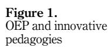
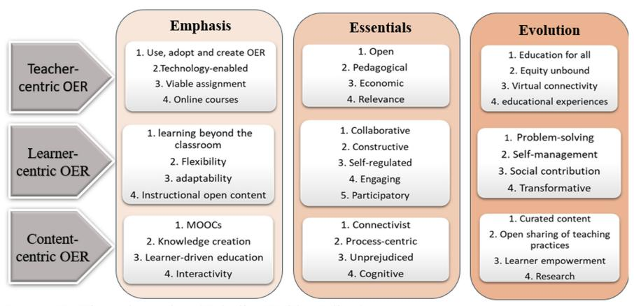
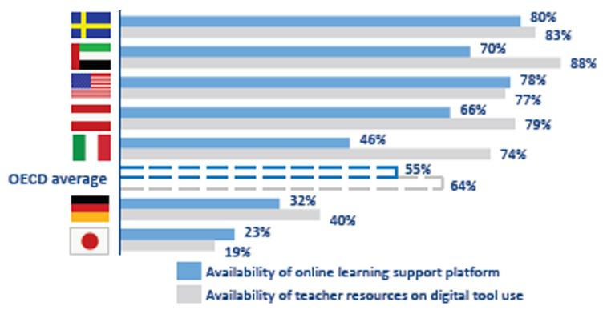

<!-- A2.R20 | source: papers_json/A2.R20/ -->

## Utilizing open educational practices to support sustainable higher education in the United Arab Emirates

Asian Association of Open Universities Journal

117

Received 15 July 2023 Revised 21 January 2024 14 March 2024 30 April 2024 25 May 2024 Accepted 30 May 2024

Debolina Halder Adhya, Eesa M. Al Bastaki, Sara Suleymanova, Nasiruddeen Muhammad and Arunprasad Purushothaman University of Dubai, Dubai, United Arab Emirates

## Abstract

**Purpose** – The COVID-19 pandemic has compelled higher education institutions (HEI) in the United Arab Emirates (UAE) and globally to shift to a new pedagogy that is sustainable and resilient to crises and disruptions. It necessitated the integration of technologies as part of pedagogical innovation and modification of higher education practices – advancing toward a more holistic integration of physical and digital tools and methods to enable more flexible, creative, collaborative and participatory learning. In terms of pedagogy, an open approach to learning is essential, combining in-person teaching with technological tools and online learning.

**Design/methodology/approach** – This paper examines theoretical and empirical literature to define the potential benefits of utilizing open educational practices (OEP) in higher education, including better access, furthering equity and enhancing teaching, learning and assessment.

**Findings** – It proposes a comprehensive framework built on a continuum of open pedagogy (OP) that comprises "Emphasis", "Essentials" and "Evolution". Based on this framework, a set of recommendations for using OEP for successful knowledge building is provided.

Originality/value — The research determined the significance of increased OEP involvement for sustainable learning possibilities and the UAE's initiatives in developing educators to support innovative pedagogies and technology-enabled teaching-learning standards. The study suggests placing more emphasis on faculty and student scaffolding while using OP for better learning experiences and outcomes, as well as more institutional support and the need for policy development to transform the UAE into a global hub for sustainable education.

**Keywords** Distance and online learning, Open pedagogy, Open educational practices, Sustainable education **Paper type** Literature review

## Introduction

The obstacles that ensued from the COVID-19 pandemic forced higher education to reevaluate its current methods of instruction. Face-to-face (F2F) instruction had to be replaced by online or blended learning, which blends traditional F2F classrooms with online environments, as a result of the pandemic's effects. Higher education institutions (HEI), students, academic staff and teachers made major efforts to be resilient and swiftly adapt to online teaching, learning and assessment procedures to ensure educational continuity while

© Debolina Halder Adhya, Eesa M. Al Bastaki, Sara Suleymanova, Nasiruddeen Muhammad and Arunprasad Purushothaman. Published in the *Asian Association of Open Universities Journal*. Published by Emerald Publishing Limited. This article is published under the Creative Commons Attribution (CC BY 4.0) license. Anyone may reproduce, distribute, translate and create derivative works of this article (for both commercial and non-commercial purposes), subject to full attribution to the original publication and authors. The full terms of this license may be seen at <a href="http://creativecommons.org/licences/by/4.0/legalcode">http://creativecommons.org/licences/by/4.0/legalcode</a>

This research was made possible by the funding from the University of Dubai (No: 2022 UDIRF)]. The statement herein is solely the responsibility of the authors.

Asian Association of Open Universities Journal Vol. 19 No. 2, 2024 pp. 117-134 Emerald Publishing Limited e-ISSN: 2414-6994 pp. 155N: 1858-3413 DOI 10.1108/A-BOUJ-07-2023-0086

<!-- page 2 -->

enhancing and expanding online learning provisions. In the United Arab Emirates' (UAE's) case, the shift to online learning not only prevented learning losses but also allowed for the acceleration and evaluation of the UAE's present distance learning efforts (United Nations Educational, Scientific and Cultural Organization [[UNESCO], 2022](#page-16-0); Chan et al[., 2021](#page-11-0)).

Distance and online learning enable communication, collaboration and learning across distance without disruptions and have emerged as a source of innovation and a sustainable response to shape future pedagogies to support post-pandemic education [(Bozkurt and](#page-11-1) [Sharma, 2020](#page-11-1); Bonk et al[., 2020;](#page-11-2) [UNESCO, 2020](#page-16-1)). It enables the advancement of education through an open pedagogy (OP) that emphasizes creativity and innovation within a collaborative learning setting, promoting sustainability and resilience ([Ossiannilsson](#page-14-0) et al., [2020;](#page-14-0) Wiley et al[., 2017](#page-16-2)). OP relates to the open sharing of instructional strategies and the utilization of open educational resources (OER) to encourage learning. The pandemic disrupted F2F instruction, affecting teaching and learning worldwide; however, it also accentuated the importance of open practices. It facilitated unfettered access to educational resources and free information sharing between and within educational networks to assure educational continuity [(Bozkurt and Sharma, 2020](#page-11-1); [Wetzler, 2020)](#page-16-3). Within the framework of open educational practices (OEP), OER are utilized by OP, encompassing the open sharing of resources and information, collaboration with professional communities, the creation and cocreation of knowledge and the open sharing of instructional strategies ([Hegarty, 2015)](#page-13-0).

During the pandemic, distance learning emerged as a practical alternative to F2F instruction and learning ([Adedoyin and Soykan, 2020)](#page-10-0). OEP facilitated realistic and objective approaches to teaching, learning and assessment. These practices allowed for adaptability, enhancing the utility and sustainability of learning strategies and instructional content. This adaptability made OEP suitable for various audiences and learning modes, whether F2F, blended or online, as well as for diverse purposes, practices and contexts. The advantages of OEP are expected to be further explored and enriched within physical classrooms in the postpandemic era (Doi et al[., 2022](#page-12-0); [Ossiannilsson](#page-14-0) et al., 2020). Engagement with OEP during COVID-19 was a key factor in promoting a sustainable blended education approach as the pandemic receded [(Lederman, 2021)](#page-13-1).

In the UAE, higher education has been an inspiring model in the academic field throughout the COVID-19 pandemic, responding with efficiency and forward planning to support the continuity of the education process. The UAE started preparing well in advance to be competitive internationally through the expansion of its educational system and the well-developed infrastructure of its institutions. In 2012, the Prime Minister of the UAE and Ruler of Dubai the launched Mohammed Bin Rashid Smart Learning Program as a part of the [UAE Vision (2021)](#page-15-0) and national agenda for educational transformation. The program aimed to deliver world-leading education technology solutions for the UAE education community and to drive up the educational achievements, excellence and creativity of the students. The smart education model enables communities, regions and academic institutions to pursue sustainable and equitable prosperity ([International Telecommunication Union, n.d](#page-13-2); [Alghamdi](#page-10-1) et al., 2021). Dr Eesa Bastaki, the chair of Global Education Forum (GEF) 2012, stated in an interview with the Khaleej Times newspaper as follows.

"Smart learning will make education enjoyable. We want to allow students to learn more using technology. For this, we need to create smart teachers, smart students, and smart parents who believe in a smart curriculum" ([Shabandri, 2013;](#page-15-1) [Ministry of Education](#page-14-1) [[MOE], 2018](#page-14-1)).

The UAE's well-equipped technical infrastructure actively facilitated the online/distance learning process seamlessly (Emirates Center for Strategic Studies and Research [[ECSSR],](#page-12-1) [2020;](#page-12-1) [Almuraqab, 2020)](#page-11-3). While the pandemic has acted as an external driver for innovative change, an increased engagement with OEP coupled with advanced infrastructure has provided HEI the chance to identify issues and consider inventive ways to construct a

<!-- page 3 -->

Asian Association

"first-rate education system" to transform the UAE into a global hub for sustainable education ([UAE Vision, 2021, 2018)](#page-15-0).

This paper aimed to address three key aspects: the importance of integration of OEP as part of pedagogical innovation, increased OEP engagement for sustainable learning opportunities and UAE's initiatives in developing educators to support innovative pedagogies and technology-enabled teaching-learning standards.

## Conceptualizing open pedagogy, OER and OEP

Distance and online learning emerged as an essential component of higher education worldwide during the pandemic and continue to have a substantial effect on post-pandemic educational practices ([Selwyn, 2020](#page-15-2); [Macgilchrist, 2020](#page-13-3)). It has steered post-pandemic higher education to reassess educational practices, emphasizing flexible and innovative technologyenabled teaching/learning strategies, along with pedagogy of collaborative and participatory learning [(Carloni, 2020)](#page-11-4).

OP has come to the fore as one of the key aspects of post-pandemic higher education practices. It directs to procedures encouraging the use of openly licensed educational content ([V](#page-16-4)€a€a[n](#page-16-4)€[anen and Peltonen, 2016;](#page-16-4) [Clinton-Lisell, 2021](#page-11-5)), supporting the control and supervision of teaching and learning resources and digital means for content knowledge by teachers and learners and involving them actively in the design of open resources ([Kahle, 2008)](#page-13-4). It is not just a way to deliver content but also gives students and teachers an opportunity to take control of their learning environment and foster collaborative knowledge construction. Through OP, students can offer insightful feedback on the learning materials, understanding that knowledge construction is an ongoing process to which new information is constantly added ([Werth and Williams, 2022](#page-16-5)). Practices in OP encourage learners to explore a variety of flexible ideas and perspectives, and when this diversity expands among a larger network of learners and educators, it enhances change and innovation [(Tietjen and Asino, 2021)](#page-15-3).

A review of past research on OP reveals that it is a developing subset of the OEP ([Cronin](#page-12-2) [and MacLaren, 2018)](#page-12-2). OP is focused on student-centered technological strategies that prioritize collaboration ([Mackintosh](#page-13-5) et al., 2011; [Hegarty, 2015)](#page-13-0). The inclusion of OER in these interactions is a crucial component. OER refers to teaching-learning and research contents, in different formats or media that are either in the public domain or that are protected by copyright and released under an open license that allows for unrestricted use, reuse, repurposing, adaptation, retention and redistribution by third parties ([UNESCO, 2019](#page-16-6); [Stracke](#page-15-4) et al., 2019). [DeRosa and Robison (2017)](#page-12-3) defined OP as the practice of revamping courses using OER to serve as platforms for learning, engagement and collaboration with the outside world rather than merely serving as an information repository. A change toward OEP has been made with COVID-19, which has turned into a growth potential for the production and usage of OER. OER can be created, used and reused. OEP also refers to pedagogical methods that use social networks and participatory technologies to empower students through peer learning and interaction [(Cronin, 2017)](#page-12-4). These changes pave the way for a review of current policies and their potential for advancement to better utilize OEP to prevent learning loss during the COVID-19 pandemic and in the post-pandemic period ([Isaacs, 2020)](#page-13-6). OEP is based on a set of interconnected concepts, which are occasionally referred to as openness's qualities or characteristics. They include information sharing and collaboration, online discussion, sharing of knowledge and resources, scholarly criticism and spontaneous invention ([Conole, 2013](#page-11-6)).

The 21st century is witnessing the growing importance of educational advancement, and the COVID-19 pandemic has emphasized the need for pedagogical innovation in classrooms ([Shaikh, 2022](#page-15-5); [Istance, 2019](#page-13-7)). Educational organizations, educators, and students have adapted to digital learning management systems, with some countries implementing

<!-- page 4 -->

national-level changes while others have adopted institutional or individual solutions. To achieve quality education, there needs to be a reorientation toward sustainable development, as emphasized by UNESCO (2011, 2012, 2016, 2019). Ehlers (2011) also stated that "an educational professional or learner embraces their role as open educational practitioners" to have sustainable open practices. Overall, teachers' involvement in a group setting as well as in a network of experts and peers was essential for fostering interest in collaborative work. Building community capacity is essential for OEP acceptance and a long-lasting open practice pathway (Bossu and Stagg, 2018). OEP's goal is to develop the academic staff's capacity for creating and implementing effective connectivist pedagogy, as well as to encourage student participation and digital competency through its course offerings, to generate chances for knowledge creation that will benefit society. OER and OEP both assist students and teachers in acquiring essential digital skills. It is required to be successful in a technology-enabled learning environment to create inclusive, resilient and sustainable knowledge societies (Halder, 2022). Technology-enabled OEP can provide numerous innovative pedagogical solutions, engaging both teachers and students and promoting inclusive and diverse knowledge societies by encouraging them to become active contributors to the educational process and creators of new educational repositories.

## Methodology

A systematic review of the literature was conducted based on the main steps (purpose, selection, extraction and execution) suggested by Okoli (2015). The objective was to understand the past research on OEP, related improvements and expansions of OEP in the higher education context, besides identifying the research gaps to explore future trends (Marangunić and Granić, 2015).

## *Purpose of the study *

In the last few years, especially after the onset of the COVID-19 pandemic, there has been a significant advancement in research on the theoretical development of OEP. In 2020, UNESCO released "Guidance on Open Educational Practices", which focused on the importance of OEP to achieve accessible learning and lifelong learning and offered new approaches to pedagogy, thereby contributing to a knowledge society (Huang et al., 2020). While interest in OEP is growing, when compared with research on OER, it was observed that most recent studies in Saudi Arabia, the UAE and other Middle East countries focused primarily on the integration of OER and embracing technology in higher education (Ashour, 2024; Alyami, 2020; Tlili et al., 2020; Alkhasawneh, 2020). Therefore, there is a need for more specific research on OEP initiatives to facilitate OEP implementation and build a sustainable educational response to future disruptions. Past review studies on OEP focused mainly on bibliometric mapping analysis, the development of concepts of OEP and its effect on improving learning outcomes (Tlili et al., 2021, 2023; Shareefa et al., 2023; Tlili et al., 2021a, b). To date, no systematic literature review has been conducted to highlight the utilization of OEP in higher education in the UAE or other Middle East countries. This study was conducted to address this gap by selecting the following holistic research objectives.

- (1) To explore the role of OEP in innovating pedagogies in higher education.
- (2) To find out how OEP facilitates better access, furthering equity and enhancing teaching, learning and assessment.
- (3) Based on 1 and 2 above, we propose a comprehensive framework to increase OEP engagement for sustainable learning opportunities in higher education in the UAE.

<!-- page 5 -->

Asian Association

## Selection of the literature

The study conducted a comprehensive examination of peer-reviewed publications that focuses on OEP. The literature search was conducted on the Scopus database, and the search was restricted to the titles and abstracts of the studies in the database. The researchers selected studies conducted during the years 2010–2023.

## Data extraction and review

To review the selected literature, the following relevant information was extracted from the papers. Title, purpose, context, research questions, definition and theories of OEP, concepts related to its implementation in higher education, key finding and future research recommendations. Around 63 documents were found. The documents included published research articles, books, book chapters and conference proceedings, editorials; languagewise, English only. OEP, open education practices and higher education were selected as keywords. After applying the filters of subject type, document type, keywords and language, 42 research papers were finally selected.

## Execution and synthesis

Following the extraction of data, each study was then examined based on its relevance to OEP to enhance teaching, learning and assessment procedures, and its implementation in higher education during and after the pandemic period. Finally, a qualitative synthesis was conducted to address the research objectives, as suggested by [Major and Savin-Baden (2010)](#page-13-10) in the case of social science research. During this process, the role of OEP in innovating pedagogies and its potential to support a sustainable educational response were examined and discussed. Furthermore, a comprehensive framework built on a continuum of OP that comprises "Emphasis", "Essentials" and "Evolution" was proposed to derive a set of recommendations for using OEP for successful knowledge building.

## Results and discussion

Role of OEP to innovate pedagogies

Innovation in higher education refers to the development, adoption and transformation of pedagogy, curriculum, policies, technology, practices and ideas to improve performance, address disruptions and create sustainable opportunities. Innovation that enhances access and equity, fosters creativity, engages stakeholders and strengthens collaboration is generally accepted and sustained. In higher education, OEP is regarded as a process-oriented strategy that promotes accessibility to both education and research [(Koseoglu and Bozkurt,](#page-13-11) [2018)](#page-13-11). It includes the active participation of students in discussions and activities as well as a more critical investigation of how technology and education are interrelated ([Knox, 2013](#page-13-12); [Bellinger and Mayrberger, 2019)](#page-11-10).

A model outlining how OP supports OEP with several dynamic characteristics (see [Figure 1)](#page-5-0) to create innovative pedagogies that can sustainably address the challenges posed by COVID-19 is proposed. It is essential to integrate OER, as these resources are vital for implementing the core principles of OP and making significant contributions to OEP ([Hegarty, 2015](#page-13-0)). Focusing on OER enabled OEP ensures that a holistic approach is implemented, taking into account all the stakeholders (such as students and teachers) [(Ehlers](#page-12-7) [and Conole, 2010](#page-12-7)). The rapid advancement of technology is transforming OEP, as noted by Tlili et al. [(2021a](#page-15-8), [b),](#page-15-11) who called for more creative methods to boost user involvement. OEP provides a thorough landscape of innovative pedagogies that are based on theoretical concepts but emphasize involvement, creativity and teamwork in the teaching-learning process. Instead of contrasting teaching practices and learning theories, pedagogies that

<!-- page 6 -->

## AAOUJ 19,2

122

Source(s): Figure by author (Debolina Halder Adhya)

bring these two levels together are considered to be more advanced in the aspect of progressive pedagogy. For instance, the "Catch the Open!" application offers a gamified course rooted in the theoretical foundations and principles of open education, along with a collection of actual practices, which encourages and motivates the users to initiate or innovate in the usage of OEP [(Padilla-Zea](#page-14-3) et al., 2022). Gamification is considered to be more than just the utilization of games within classrooms, but rather an approach that captures the educational benefits of games and applies them to formal teaching [(Paniagua and Istance,](#page-14-4) [2018](#page-14-4)). OEP comprises learning outcomes, instructional methods, learning activities, evaluation and assessment techniques and teaching-learning resources. The capacity to improve the accessibility of learning outcomes, resources, activities and assessment designs, as well as to facilitate their exchange, presents a substantial opportunity for advancing pedagogical practices within and across disciplines ([Paskevicius, 2017)](#page-14-5).

## Role of OEP to improve teaching-learning

The current generation of learners needs autonomy and democracy to learn meaningfully and adequately. The viewpoints and stances on OEP reveal a comprehensive recognition of their capacity to democratize the educational landscape [(Harrison and DeVries, 2019](#page-12-8)); as a social constructivist teaching-learning process ([Cronin and MacLaren, 2018)](#page-12-2). As a digital open practice, OEP includes OP, open scholarship, open learning, open systems and architectures and open-source software, forming a multifaceted and cohesive concept ([Koseoglu and Bozkurt, 2018)](#page-13-11). Most importantly, OEP enables learners as open thinkers, which is one of the significant learning outcomes. Engaging students is a critical issue. Many factors are responsible for such as readiness, academic achievement and well-being ([Upadyaya and Salmela-Aro, 2013](#page-16-9); [Boulton](#page-11-11) et al., 2019). Researchers also added the significant incorporation of educational technologies as a part of OEP to make learning active and participatory ([Veletsianos, 2015;](#page-16-10) [Veletsianos and Navarrete, 2012](#page-16-11); [Waycott](#page-16-12) et al[., 2013)](#page-16-12). Open textbook adoption has been highlighted as a solution that has the potential to support a wide range of OEPs, including pedagogical innovation and student access (Pitt et al[., 2020](#page-14-6)).

<!-- page 7 -->

Asian Association

Several studies have suggested dynamic options to incorporate OEP in a teaching-learning context to make education accessible and sustainable. Educators were urged to approach Edtech critically, educating students on surveillance, privacy and data extraction issues and engaging them in ethical digital and nondigital education models ([Vetter and McDowell, 2023)](#page-16-13). The utilization of social media, listservs and public annotation enables crowdsourced curation of articles and learning materials, promoting collaboration across institutions and countries [(Santos-Hermosa, 2023)](#page-15-12). Virtual laboratories can be developed and implemented through the MOODLE (a free and open-source learning management system) platform for ultimate access and virtual activity [(El Kharki](#page-12-9) et al., 2021). Zhang et al[. (2020)](#page-17-0) suggested that the sustained development of OEP-based courses as a part of virtual activity requires a greater focus on intellectual property and privacy protection. A continuous effort should be made towards the use of open approaches and technologies to promote active learning experiences, real-time sharing of learners' work, formative feedback, peer review and community-engaged coursework [(Paskevicius and Irvine, 2019](#page-14-7)). Assessment strategies can be diversified through OEP such as student blogs as part of dispersed and online evaluation procedures ([DeWaard and](#page-12-10) [Roberts, 2021)](#page-12-10). To overcome institutional boundaries hindering OEP implementation, it was recommended to establish interconnectivity between OER and OEP, coupled with active community engagement ([Arispe and Hoye, 2023;](#page-11-12) [Ouahib](#page-14-8) et al., 2022). OEP helps improve the curriculum in higher education ([Armellini and Nie, 2013)](#page-11-13). In terms of community practice, such as discussion forums and other collaborative activities, OEP enhances the productivity of relationships among students by evaluating successful online communities both within and outside the voluntary sector ([Coughlan and Perryman, 2013)](#page-12-11).

## Sustainable educational response

The COVID-19 pandemic provided possibilities for rethinking and redesigning more sustainable education systems in the future ([Crawford and Cifuentes-Faura, 2022)](#page-12-12). Since OP promotes and supports sustainable learning in a rapidly changing educational setting, its implementation calls for an agile and resilient strategy [(Ossiannilsson, 2018)](#page-14-9). To support learning, teaching and evaluation, this study suggested a general framework based on an OP continuum that consists of "Emphasis," "Essentials" and "Evolution" (derived from the 3E Framework created by [Smyth](#page-15-13) et al., 2011). The adoption, engagement and empowerment of OEP and creative pedagogies across the HEI provide further illustrations of the three broad stages within the continuum (see Figure 2).

**Source(s):** Figure by author (Debolina Halder Adhya)

*Figure 2. Emphasis-essentialsevolution framework*

<!-- page 8 -->

Emphasis: The approach of teacher-centric OEP supports faculty and researchers to utilize, create, edit and share content, policies and technology, among other benefits, including extensive access to knowledge. It generates creative methods for teaching and learning that result in new interpretations of the obligations and practices of both teachers and students. The UAE Ministry of Education has launched a platform for OER (Manara Platform) to support education and learning, nurture a culture of participation in open education and provide opportunities for systematic change in the content of learning and teaching by involving teachers in new educational experiments and effective techniques for learning. The platform engages the community with rich educational resources that can support and develop high-quality curricula and meaningful learning and enable students to access educational resources and educational courses that lead them to learn. Furthermore, the platform offers essential tools that enable users to effectively utilize, create, share, modify and review OER. It also facilitates collaboration among users for the creation and discussion of OER [(Ministry of Education UAE, 2020a,](#page-14-10) [b](#page-14-11)).

Essentials: Focusing on learner-centric OEP emphasizes a process-oriented approach, enabling students to develop valuable skills and competencies that foster personal growth ([Stracke](#page-15-4) et al., 2019). When learners participate in creating OER, it promotes a more balanced relationship between students and educators, empowering learners to collaborate with faculty in co-creating knowledge and taking charge of their learning experiences [(Masterman,](#page-14-12) [2016)](#page-14-12). This approach leads to a curriculum that is more adaptable, transparent, personalized, blended and connected to real-world experiences. Hamdan Bin Mohammed Smart University (HBMSU), a research-oriented institution in the UAE, exemplifies this by incorporating learner-centric strategies into its educational design. HBMSU offers students a distinctive and varied learning experience within a technologically advanced environment. The university's "smart campus"features mobile learning, discussion forums, virtual classrooms, educational gamification and social networking platforms, all tailored to the diverse needs of adult learners. This innovative approach has redefined the paradigm for smart education in the region. The university's learner-centric culture is demonstrated by the extensive support offered to students, which includes automated pre-enrollment and admission assistance, a learners' club and additional learning resources like the library and career and placement services. The university also makes use of the latest technological innovations to engage with students worldwide [(HBMSU, 2023](#page-13-13)).

Evolution: Content-oriented OEP has the potential to increase learners' access to high-quality educational content, hence promoting accessible learning and lifelong learning ([Nascimbeni and Burgos, 2019](#page-14-13)). [Beetham](#page-11-14) et al. (2012) formulated OEP encompassing practices: OER production, management, use and reuse, open/public pedagogies and open learning (including peer-to-peer learning and open accreditation). The use of OER exposes students to a larger variety of concepts, media and representations than a closed course can, whether supervised by teaching personnel or self-directed. In 2020, the Abu Dhabi School of Government (ADSG), which is integral to Abu Dhabi's ongoing transition to a sustainable, knowledge-based economy, started a program called "Digital Learning for All" for UAE residents in 2020. The e-learning portal of ADSG offers free access to more than 4,000 courses from over 190 of the best universities and educational institutions around the globe. International degrees and certificates in a range of subject areas, including health, technology, artificial intelligence, data science, arts, humanities and business, are available to the learners. The initiative, which was built on the three pillars of virtual experiences, community solidarity and ongoing innovation, encourages agile thinking in the community and government, supporting the creation and development of ideas that will have a favorable result in the present and the future ([ADSG, 2020)](#page-10-3).

<!-- page 9 -->

of Open Universities

Asian Association

## UAE higher education post-pandemic

In recent years, the higher education landscape in the UAE has evolved as a preferred choice for local and international students due to its excellent and dynamic facilities. The UAE offers more than 1,200 accredited academic programs in various disciplines and has the largest number of foreign university branches in a single country in the world, paving a solid foundation to attain sustainable development plans for 2030 [(UNESCO, 2021)](#page-16-14). It has 11 institutions listed in the top 1,000 rankings, an amazing accomplishment for a nation that established its first university, the United Arab Emirates University, in 1976 ([Times Higher](#page-15-14) [Education, 2023](#page-15-14)).

The emergence of COVID-19 almost immediately demonstrated the importance of continuous learning. After the pandemic, there are many plans for a digital transformation in higher education, new learning methods and the integration of advanced innovative pedagogies ([McKenzie, 2023)](#page-14-14). Before the emergence of the COVID-19 pandemic, the UAE already had the necessary infrastructure in place for online education. The UAE, among other countries, has been considering changes in education for some years, and the pandemic has hastened the adoption of a technology-enabled learning ecosystem in higher education. In the case of the UAE, post-pandemic blended/hybrid learning is very much possible, especially given the nation's remarkable global standing for its digital education system. Organization for Economic Co-operation and Development (OECD) data show that the UAE has 70% of online learning support platforms and 88% of digital teaching resources, which are 15% and 24% more than the global averages, respectively (see Figure 3). To provide long-term educational value, the move from remote to creatively blended pedagogies must be effective ([Lasku](#page-13-14) et al., 2021). Newer ways of teaching and learning have resulted from the conversion of physical classrooms to digital environments, followed by hybrid and blended learning environments [(Dubai Future Foundation [DFF], 2020;](#page-12-13) [Fernandez, 2022](#page-12-14)). The Ministry of Education formed The Pioneers of Digital Smart Electronic Transformation Committee Services under the guidance of the Undersecretary for Performance Improvement. The Ministry of Education collaborated with the Telecommunication and Digital Government Regulatory Authority to improve the learners' experience with their smart services and applications through the UX Lab. This lab aims to enhance the sustainability of governance and scientific methodologies to measure the user experience while engaging with virtual reality services and products [(Ministry of Education UAE, 2022a)](#page-14-15). The Ministry of Education and HEI had established advanced platforms and educational resources that included adaptive learning and assessment platforms suitable for both distance learning and

Figure 3. Stages of Digital Learning Worldwide

<!-- page 10 -->

traditional classroom learning (United Arab Emirates University [[United Arab Emirates](#page-16-15) [University UAEU, 2020b)](#page-16-15). Public universities such as Zayed University adopted Adobe Connect, UAEU, and the University of Sharjah adopted Blackboard systems and Heriot-Watt University, Dubai, campus adopted a virtual learning tool called Vision [(UAEU, 2020b)](#page-16-16). HBMSU, the first smart university in the UAE, aided other colleges and universities in adopting online courses. Professors and educators at both public and private universities in the UAE participated in training sessions focused on delivering effective online or blended education ([HBMSU, 2020)](#page-13-15). The 5th edition of the National Science, Technology and Innovation Festival in 2022 built more focus on advancing science and technology for holistic development and revolutionary, innovative education [(MOE, 2022aa](#page-14-16)).

The HEI in the UAE offer the best educational opportunities and infrastructural facilities. It does this by implementing advanced innovative pedagogies and current technology to improve people's lives and expand chances for future generations. In this regard, Dr Eesa Bastaki, CEO of the Information and Communication Technology Fund in the UAE, stated as follows.

"We need to alter the culture and make technology easily accessible for educational purposes" (Knowledge and Human Development Authority [[KHDA], 2012](#page-13-16)).

To enhance collaboration between Arizona State University and The Digital School (a project by Mohammed bin Rashid Al Maktoum Global Initiatives to offer a certified online education to students who face challenges in accessing formal education in both the Arab region and globally), a new phase of a strategic partnership was announced with Arizona State University [(Al-Olama, 2022](#page-10-4)). Three pillars have been identified as the foundation of this new phase. A Global Digital Training Institute will be established as part of the first pillar, and there will be work done there to launch and create recognized professional development programs for teachers and to spread them globally. Both sides will work together to make these programs more accessible and reach 10,000 teachers worldwide. The second pillar will concentrate on offering internationally acknowledged credentials and benchmarks for teacher preparation programs that use technology. The two parties will work together to produce digital education standards and digital teachers by utilizing their individual expertise and wide networks. As the two parties collaborate on a series of open virtual webinars that will cover the most important issues in digital education and its advances, the third pillar will be centered on thought leadership in the field of digital education. In the areas of technology-enabled teaching and learning and advanced open pedagogies and their effects, they will collaborate in the writing and publication of joint research publications. These will help to strengthen the role of this partnership in advancing the future of learning, empowering the next generation to shape the future and actively advancing the process of global development ([Al-Olama, 2022)](#page-10-4).

## Conclusion and recommendation

This study used a systematic literature review to determine the effect of OEP on pedagogical innovation and enhancement of the teaching and learning process. The findings highlighted that OEP promotes collaboration, interaction and learner empowerment while also addressing issues of equity and access in education [(Shareefa](#page-15-10) et al., 2023). OEP facilitates realistic and equitable teaching, learning, alternative assessment and evaluation procedures ([Bozkurt and Sharma, 2020](#page-11-1); [Huang](#page-13-9) et al., 2020; [Ossiannilsson](#page-14-0) et al., 2020). It assists educators and learners in acquiring the essential digital skills required to be successful in postpandemic learning environments. OEP supports open access to knowledge and information to shape inclusive, sustainable knowledge societies ([Halder, 2022](#page-12-6)). The role of OEP also extends beyond pedagogical innovation and learner empowerment to institutional and societal transformation ([Harrison and DeVries, 2019)](#page-12-8). The study proposed a comprehensive

<!-- page 11 -->

Asian Association

framework built on a continuum of OP to support teachers, learners and learning content (the main components of a learning process) to advance teaching, learning, assessment and collaboration. The findings could guide HEI in developing their OEP-based courses to maintain sustainable learning even in times of disruption ([Zhang](#page-17-0) et al., 2020).

Higher education needs to update, reassess and realign itself in the educational landscape. Several initiatives and policies from the HEI, government and organizations have been implemented to aid in the adaptation of technology-enabled OP in the UAE. OEP, including tools, instructional strategies and open courseware, have been implemented. Students started liking open learning and showed a positive attitude toward the blended learning system ([Almuraqab, 2020)](#page-11-3). Further, a novel approach, named agile blended learning, has emerged to develop new pedagogical practices that cater to diverse learner needs [(Halder](#page-12-15)et al., 2024). It is evident that there is room for development in the near future after establishing the numerous advantages and drawbacks of having online learning in the higher education system. Therefore, training is crucial for academic staff to enhance their qualifications and technical skills to keep up with the fast-paced advancements in teaching tools and educational technology ([Shishakly and Sabah, 2021](#page-15-15)). The UAE stressed the need to recover collectively and grow stronger after the pandemic, as well as to reimagine and rebuild a more inclusive and equitable education system ([MOE, 2022b)](#page-14-16). The Ministry of Education in the UAE announced the launch of its innovation strategy in 2023 with the aim to enhance the position of the UAE as a global center in innovation, promoting the development of creative ideas and capabilities, spreading a culture of innovation on a large scale and creating a national environment that nurtures innovative and creative minds [(Nashar and Saleh, 2023)](#page-14-17). OEP must be promoted, and campaigns to increase awareness and incentive programs should be developed to incentivize educators to create and use OER as a means of maintaining OEP. OEPs are best aligned with the UAE's quest for a nation of knowledge producers and active contributors to innovation and creativity ([Warner, 2016](#page-16-17)). Finally, policy development for OEP in UAE would be a significant step to increase its adoption across the HEI, as it would accelerate change at the institutional and practitioner levels and possibly alter the way HEI look at knowledge resources and teaching-learning [(Bossu and Stagg, 2018)](#page-11-7). The higher education ecosystem can be sustained by using open-licensed inputs and outputs, and openness will help make it more resilient to upcoming crises [(Bozkurt and Sharma, 2020](#page-11-1)).

## References

- Abu Dhabi School of Government (2020), "Abu Dhabi school of government launches "digital learning for all" initiative for residents of the UAE", available at: [https://www.adsg.gov.ae/en/media/](https://www.adsg.gov.ae/en/media/news/Abu%20Dhabi%20School%20of%20Government%20launches%20Digital%20Learning%20for%20All%20initiative%20for%20residents%20of%20the%20UAE) [news/Abu%20Dhabi%20School%20of%20Government%20launches%20Digital%20Learning](https://www.adsg.gov.ae/en/media/news/Abu%20Dhabi%20School%20of%20Government%20launches%20Digital%20Learning%20for%20All%20initiative%20for%20residents%20of%20the%20UAE) [%20for%20All%20initiative%20for%20residents%20of%20the%20UAE](https://www.adsg.gov.ae/en/media/news/Abu%20Dhabi%20School%20of%20Government%20launches%20Digital%20Learning%20for%20All%20initiative%20for%20residents%20of%20the%20UAE)
- Adedoyin, O.B. and Soykan, E. (2020), "Covid-19 pandemic and online learning: the challenges and opportunities", Interactive Learning Environments, Vol. 31 No. 2, pp. 1-13, doi: [10.1080/](https://doi.org/10.1080/10494820.2020.1813180) [10494820.2020.1813180.](https://doi.org/10.1080/10494820.2020.1813180)
- Al-Olama, O. (2022), UAE Adopts Digital Technology to Provide Best Educational Options for Less Fortunate Students Around the World, Emirates News Agency-WAM, available at: [https://](https://www.wam.ae/en/details/1395303066143) [www.wam.ae/en/details/1395303066143](https://www.wam.ae/en/details/1395303066143)
- Alghamdi, A.K.H., El-Hassan, W.S., Al-Ahdal, A.M.H. and Hassan, A.A. (2021), "Distance education in higher education in Saudi Arabia in the post-COVID-19 era", World Journal on Educational Technology: Current Issues., Vol. 13 No. 3, pp. 485-501, doi: [10.18844/wjet.v13i3.5956](https://doi.org/10.18844/wjet.v13i3.5956).
- Alkhasawneh, S. (2020), "Perception of academic staff toward barriers, incentives, and benefits of the open educational resources (OER) network (SHMS) at Saudi universities", Italian Journal of Sociology of Education, Vol. 12 No. 1, pp. 211-225, doi: [10.14658/pupj-ijse-2020-1-12.](https://doi.org/10.14658/pupj-ijse-2020-1-12)

<!-- page 12 -->

- Almuraqab, N.A.S. (2020), "Shall Universities at the UAE continue distance learning after the Covid-19 pandemic? Revealing students'perspective", Social Science Research Network, available at: [https://www.ncbi.nlm.nih.gov/pmc/articles/PMC7366799/](https://www.ncbi.nlm.nih.gov/pmc/articles/PMC7366799/)
- Alyami, H.Y. (2020), "Integration of open educational resources in higher and general education institutions: from the perspectives of specialized and concerned bodies in E-learning", World Journal of Education, Vol. 10 No. 1, pp. 30-41, doi: [10.5430/wje.v10n1p30](https://doi.org/10.5430/wje.v10n1p30).
- Arispe, K. and Hoye, A. (2023), "Partnering higher education and K–12 institutions in OER: foundations in supporting teacher OER-enabled pedagogy", International Review of Research in Open and Distributed Learning, Vol. 24 No. 2, pp. 196-212, doi: [10.19173/irrodl.v24i2.6856.](https://doi.org/10.19173/irrodl.v24i2.6856)
- Armellini, A. and Nie, M. (2013), "Open educational practices for curriculum enhancement", Open Learning: The Journal of Open, Distance and E-Learning, Vol. 28 No. 1, pp. 7-20, doi: [10.1080/](https://doi.org/10.1080/02680513.2013.796286) [02680513.2013.796286.](https://doi.org/10.1080/02680513.2013.796286)
- Ashour, S. (2024), "How COVID-19 is reshaping the role and modes of higher education whilst moving towards a knowledge society: the case of the UAE, Open Learning", The Journal of Open, Distance and E-Learning, Vol. 39 No. 1, pp. 52-67, doi: [10.1080/02680513.2021.1930526](https://doi.org/10.1080/02680513.2021.1930526).
- Beetham, H., Falconer, I., McGill, L. and Littlejohn, A. (2012), Open Practices: Briefing Paper, JISC, available at: [https://oersynth.pbworks.com/w/file/fetch/58444186/Open%20Practices%20%](https://oersynth.pbworks.com/w/file/fetch/58444186/Open%20Practices%20%20briefing%20paper.pdf) [20briefing%20paper.pdf](https://oersynth.pbworks.com/w/file/fetch/58444186/Open%20Practices%20%20briefing%20paper.pdf)
- Bellinger, F. and Mayrberger, K. (2019), "Systematic Literature Review zu Open Educational Practices (OEP) in der Hochschule im europ€aischen Forschungskontext", MedienP€adagogik: Zeitschrift fur Theorie und Praxis der Medienbildung € , Vol. 34, pp. 19-46, doi: [10.21240/mpaed/34/2019.02.](https://doi.org/10.21240/mpaed/34/2019.02.18.X) [18.X](https://doi.org/10.21240/mpaed/34/2019.02.18.X).
- Bonk, R., Kefalaki, M., Rudolph, J., Diamantidaki, F., Munro, C., Karanicolas, S., Kontoleon, P. and Pogner, K. (2020), "Pedagogy in the time of pandemic: from localisation to glocalisation", Journal of Education, Innovation, and Communication, pp. 17-64, available at: [https://discovery.](https://discovery.ucl.ac.uk/id/eprint/10101902/1/1_SP_JEICOM_JUNE_2020_Bonk-et-al_Pedagogy-in-the-Time-of-Pandemic.pdf) [ucl.ac.uk/id/eprint/10101902/1/1_SP_JEICOM_JUNE_2020_Bonk-et-al_Pedagogy-in-the-Time](https://discovery.ucl.ac.uk/id/eprint/10101902/1/1_SP_JEICOM_JUNE_2020_Bonk-et-al_Pedagogy-in-the-Time-of-Pandemic.pdf)[of-Pandemic.pdf](https://discovery.ucl.ac.uk/id/eprint/10101902/1/1_SP_JEICOM_JUNE_2020_Bonk-et-al_Pedagogy-in-the-Time-of-Pandemic.pdf)
- Bossu, C. and Stagg, A. (2018), "The potential role of Open Educational Practice policy in transforming Australian higher education", Open Praxis, Vol. 10 No. 2, pp. 145-157, doi: [10.5944/](https://doi.org/10.5944/openpraxis.10.2.835) [openpraxis.10.2.835,](https://doi.org/10.5944/openpraxis.10.2.835) available at: [https://www.learntechlib.org/p/183576/](https://www.learntechlib.org/p/183576/)
- Boulton, C.A., Hughes, E., Kent, C., Smith, J.R. and Williams, H.T. (2019), "Student engagement and wellbeing over time at a higher education institution", PloS One, Vol. 14 No. 11, e0225770, doi: [10.1371/journal.pone.0225770](https://doi.org/10.1371/journal.pone.0225770).
- Bozkurt, A. and Sharma, R.C. (2020), "Education in normal, new normal, and next normal: observations from the past, insights from the present and projections for the future", Asian Journal of Distance Education, Vol. 15 No. 2, pp. i-x, available at: [http://www.asianjde.com/ojs/](http://www.asianjde.com/ojs/index.php/AsianJDE/article/view/512) [index.php/AsianJDE/article/view/512](http://www.asianjde.com/ojs/index.php/AsianJDE/article/view/512)
- Carloni, L. (2020), "Higher education after COVID-19: the impact of social distancing measures on international students' socialisation", Journal of International Students, Vol. 10 No. S1, pp. 1-10, doi: [10.32674/jis.v10iS1.2669.](https://doi.org/10.32674/jis.v10iS1.2669)
- Chan, R.Y., Bista, K. and Allen, R.M. Eds. (2021), Online Teaching and Learning in Higher Education during COVID-19: International Perspectives and Experiences, Routledge, available at: [https://](https://books.google.ae/books?id=fN4zEAAAQBAJ&lpg=PT13&ots=Y7Bc5I9bzt&lr&pg=PT13#v=onepage&q&f=false) [books.google.ae/books?id](https://books.google.ae/books?id=fN4zEAAAQBAJ&lpg=PT13&ots=Y7Bc5I9bzt&lr&pg=PT13#v=onepage&q&f=false)5[fN4zEAAAQBAJ&lpg](https://books.google.ae/books?id=fN4zEAAAQBAJ&lpg=PT13&ots=Y7Bc5I9bzt&lr&pg=PT13#v=onepage&q&f=false)5[PT13&ots](https://books.google.ae/books?id=fN4zEAAAQBAJ&lpg=PT13&ots=Y7Bc5I9bzt&lr&pg=PT13#v=onepage&q&f=false)5[Y7Bc5I9bzt&lr&pg](https://books.google.ae/books?id=fN4zEAAAQBAJ&lpg=PT13&ots=Y7Bc5I9bzt&lr&pg=PT13#v=onepage&q&f=false)5 [PT13#v](https://books.google.ae/books?id=fN4zEAAAQBAJ&lpg=PT13&ots=Y7Bc5I9bzt&lr&pg=PT13#v=onepage&q&f=false)5[onepage&q&f](https://books.google.ae/books?id=fN4zEAAAQBAJ&lpg=PT13&ots=Y7Bc5I9bzt&lr&pg=PT13#v=onepage&q&f=false)5[false](https://books.google.ae/books?id=fN4zEAAAQBAJ&lpg=PT13&ots=Y7Bc5I9bzt&lr&pg=PT13#v=onepage&q&f=false)
- Clinton-Lisell, V. (2021), "Open pedagogy: a systematic review of empirical findings", Journal of Learning for Development, Vol. 8 No. 2, pp. 255-268, doi: [10.56059/jl4d.v8i2.511,](https://doi.org/10.56059/jl4d.v8i2.511) available at: [https://files.eric.ed.gov/fulltext/EJ1314199.pdf](https://files.eric.ed.gov/fulltext/EJ1314199.pdf)
- Conole, G. (2013), Designing for Learning in an Open World, Springer, New York, NY, doi: [10.1007/978-](https://doi.org/10.1007/978-1-4419-8517-0) [1-4419-8517-0](https://doi.org/10.1007/978-1-4419-8517-0).

<!-- page 13 -->

of Open

**Journal **

Universities

- Coughlan, T. and Perryman, L.A. (2013), "Más allá de la torre de marfil: un modelo para potenciar las Asian Association comunidades de aprendizaje informal y desarrollo mediante prácticas educativas abiertas". International Journal of Educational Technology in Higher Education, Vol. 10 No. 1, pp. 312-326. doi: 10.7238/rusc.v10i1.1586.
- Crawford, J. and Cifuentes-Faura, J. (2022), "Sustainability in higher education during the COVID-19 pandemic: a systematic review", Sustainability, Vol. 14 No. 3, p. 1879, doi: 10.3390/su14031879, available at: https://www.mdpi.com/2071-1050/14/3/1879
- Cronin, C. (2017), "Openness and praxis: exploring the use of open educational practices in higher education". International Review of Research in Open and Distributed Learning: IRRODL. Vol. 18 No. 5, pp. 15-34, doi: 10.19173/irrodl.v18i5.3096.
- Cronin, C. and MacLaren, I. (2018), "Conceptualising OEP: a review of theoretical and empirical literature in open educational practices", Open Praxis, Vol. 10 No. 2, pp. 127-143, doi: 10.5944/ openpraxis, 10.2,825, available at: https://search.informit.org/doi/pdf/10.3316/informit. 559671315718016
- DeRosa, R. and Robison, S. (2017). "From OER to open pedagogy: harnessing the power of open", in Open: the Philosophy and Practices that Are Revolutionizing Education and Science, pp. 115-124, available at: https://scholar.google.com/scholar?hl=en&as sdt=0%2C5&g=DeRosa+% 26+Robison%2C+2017&btnG=.
- DeWaard, H. and Roberts, V. (2021), "Revisioning the potential of Freire's principles of assessment: influences on the art of assessment in open and online learning through blogging", Distance Education, Vol. 42 No. 2, pp. 310-326, doi: 10.1080/01587919.2021.1910494.
- Doi, C., Lucky, S. and Rubin, J.E. (2022), "Open educational resources in the time of COVID-19: two case studies of open video design in the remote learning environment", KULA, Vol. 6 No. 1, pp. 1-15, doi: 10.18357/kula.218.
- Dubai Future Foundation (DFF) (2020), "Education report", available at: https://www.dubaifuture.ae/ life-after-covid-19/education-report/
- Ehlers, U.D. (2011), "Extending the territory: from open educational resources to open educational practices", Journal of Open, Flexible and Distance Learning, Vol. 15 No. 2, pp. 1-10, available at: https://search.informit.org/doi/abs/10.3316/INFORMIT.726960668596898
- Ehlers, U.D. and Conole, G. (2010), "Open educational practices: unleashing the power of OER", in UNESCO Workshop on OER in Namibia, available at: https://www.oerknowledgecloud.org/ archive/OEP_Unleashing-the-power-of-OER.pdf
- El Kharki, K., Berrada, K., Bensamka, F. and Burgos, D. (2021), "The adoption of open educational practices to support practical work at Moroccan universities", in Radical Solutions for Education in Africa: Open Education and Self-Directed Learning in the Continent, pp. 233-249, doi: 10.1007/978-981-16-4099-5 12.
- Emirates Center for Strategic Studies and Research (2020), "The UAE and the fourth industrial revolution", in Fourth Industrial Revolution Series, 1st ed., ECSSR, available at: https://www. ecssr.ae/en/publications-en/
- Fernandez, K.J. (2022), "UAE universities – forging new frontiers", Gulf News, available at: https:// gulfnews.com/uae/education/uae-universities—forging-new-frontiers-1.1659014046866
- Halder, D. (2022), "Utilizing OER-OEP to support a resilient sustainable education", Conference proceedings of the Tenth Pan-Commonwealth Forum, Calgary, Canada, doi: 10.56059/pcf10.6118.
- Halder, D., Al Bastaki, E.M., Suleymanova, S., Muhammad, N. and Purushothaman, A. (2024), "Agile blended learning: a promising approach for higher education in the UAE", SN Computer Science, Vol. 5 No. 5, pp. 1-15, doi: 10.1007/s42979-024-02813-5.
- Harrison, M. and DeVries, I. (2019), "Open educational practices advocacy: the instructional designer experience", Canadian Journal of Learning and Technology, Vol. 45 No. 3, doi: 10.21432/ cilt27881.

<!-- page 14 -->

- HBMSU (2020), "Hamden university | accredited smart university in U.A.E", available at: https://www.hbmsu.ac.ae
- HBMSU (2023), "HBMSU vision", available at: https://www.hbmsu.ac.ae/about/hbmsu-in-brief#overview
- Hegarty, B. (2015), "Attributes of open pedagogy: a model for using open educational resources", *Educational Technology*, Vol. 55 No. 4, pp. 3-13, available at: https://www.researchgate.net/publication/281286900_Attributes_of_Open_Pedagogy_A_Model_for_Using_Open_Educational_Resources/link/55dfa74908aede0b572b916b/download
- Huang, R., Liu, D., Tlili, A., Knyazeva, S., Chang, T.W., Zhang, X., Burgos, D., Jemni, M., Zhang, M., Zhuang, R. and Holotescu, C. (2020), "Guidance on open educational practices during school closures: utilizing OER under COVID-19 pandemic in line with UNESCO OER recommendation", available at: https://iite.unesco.org/wp-content/uploads/2020/05/Guidance-on-Open-Educational-Practices-during-School-Closures-English-Version-V1_0.pdf
- International Telecommunication Union (n.d.), *Mohammed Bin Rashid Smart Learning*, available at: https://www.itu.int/net4/wsis/archive/stocktaking/Project/Details?projectId=1515551649
- Isaacs, S. (2020), "COVID-19 education responses and OER-OEP policy in the commonwealth", in Mishra, S. and Panda, S. (Eds), *Technology-Enabled Learning: Policy, Pedagogy and Practice*, pp. 33-45, available at: https://www.researchgate.net/publication/343962515_COVID19_Education_Responses_and_OER-OEP_Policy_in_the_Commonwealth
- Istance, D. (2019), "Approaches to pedagogical innovation and why they matter", [Blog post], available at: https://www.brookings.edu/blog/education-plus-development/2019/01/23/approaches-to-pedagogical-innovation-and-why-they-matter/
- Kahle, D. (2008), "Designing open education technology", in Iiyoshi, T. and Vijay Kumar, M.S. (Eds), *Opening up Education*, MIT Press, Cambridge, MA, pp. 27-45, available at: https://library.oapen.org/bitstream/handle/20.500.12657/26069/1004016.pdf?sequence#page=49=
- Knowledge and Human Development Authority (2012), *UAE Schools Need Better Technology*, available at: https://web.khda.gov.ae/en/About-Us/News/2012/UAE-schools-need-better-technology
- Knox, J. (2013), "The limitations of access alone: moving towards open processes in education technology", *Open Praxis*, Vol. 5 No. 1, pp. 21-29, doi: 10.5944/openpraxis.5.1.36.
- Koseoglu, S. and Bozkurt, A. (2018), "An exploratory literature review on open educational practices", *Distance Education*, Vol. 39 No. 4, pp. 441-461, doi: 10.1080/01587919.2018.1520042.
- Lasku, A., Khoury, R., Gustavsson, O. and Widmann, K. (2021), "Accelerating post-pandemic e-learning", *Arthur D. Little*, available at: https://www.adlittle.com/sites/default/files/viewpoints/ADL_Post_pandemic_elearning.pdf
- Lederman, D. (2021), "Awareness of open educational resources grows, but adoption doesn't", *Inside Higher Ed*, available at: https://www.insidehighered.com/digital-learning/article/2021/03/18/pandemicdidnt-speed-adoption-open-educational-resources-outlook
- Macgilchrist, F. (2020), "Three stories about Edtech after the corona pandemic", *Techlash June*, pp. 12-16, available at: https://der.monash.edu/wp-content/uploads/2020/06/TECHLASH-01-COVID-education.pdf
- Mackintosh, W., McGreal, R. and Taylor, J. (2011), "Open education resources (OER) for assessment and credit for students project: towards a logic model and plan for action", available at: https://auspace.athabascau.ca/handle/2149/3039
- Major, C.H. and Savin-Baden, M. (2010), An Introduction to Qualitative Research Synthesis: Managing the Information Explosion in Social Science Research, Routledge, Oxon, doi: 10.4324/ 9780203497555.
- Marangunić, N. and Granić, A. (2015), "Technology acceptance model: a literature review from 1986 to 2013", *Universal Access in the Information Society*, Vol. 14 No. 1, pp. 81-95, doi: 10.1007/s10209-014-0348-1.

<!-- page 15 -->

of Open

Universities **Iournal **

- Masterman, E. (2016), "Bringing open educational practice to a research-intensive university: Asian Association prospects and challenges", Electronic Journal of E-Learning, Vol. 14 No. 1, available at: https:// academic-publishing.org/index.php/ejel/article/view/1741/1704
- McKenzie, F. (2023), 2023 Predictions for UAE Universities, The Pie Blog, Blog post, available at:. https://blog.thepienews.com/2023/01/2023-predictions-for-uae-universities/
- Ministry of Education (UAE) (2018), Mohammed Bin Rashid Smart Learning Programme, available at: https://www.moe.gov.ae/En/SmartLearning/Pages/Home.aspx
- Ministry of Education (UAE) (2020a), About Manara Platform, available at: https://manara.moe.gov. ae/about-manara-platform
- Ministry of Education (UAE) (2020b), Distance Learning System to Continue to Be Applied till End of Current Academic Year (2019-2020), available at: https://www.moe.gov.ae/En/MediaCenter/ News/Pages/elearning3.aspx
- Ministry of Education (UAE) (2022a), Digital Transformation Journey in Education, available at: https://www.moe.gov.ae/En/ImportantLinks/Pages/DigitalTransformation.aspx
- Ministry of Education (UAE) (2022b), The UAE Is Proactive in Supporting Priorities and Building Partnerships Internationally to Sustain the Development of Education, available at: https://www. moe.gov.ae/en/MediaCenter/News/Pages/forerunner-in-supporting-priorities.aspx
- Nascimbeni, F. and Burgos, D. (2019), "Unveiling the relationship between the use of open educational resources and the adoption of open teaching practices in higher education", Sustainability, Vol. 11 No. 20, p. 5637, doi: 10.3390/su11205637.
- Nashar, K. and Saleh, A. (2023), Ministry of Education Launches Innovation Strategy, Emirates News Agency-WAM, available at: https://www.wam.ae/en/details/1395303125001
- Okoli, C. (2015), "A guide to conducting a systematic literature review", Communications of the Association for Information Systems, Vol. 37 No. 43, pp. 879-910, doi: 10.17705/1CAIS.03743.
- Ossiannilsson, E. (2018), "Ecologies of openness; reformations through open pedagogy", Asian Journal of Distance Education, Vol. 13 No. 2, pp. 103-119, available at: https://files.eric.ed.gov/fulltext/ EJ1315604.pdf
- Ossiannilsson, E., Zhang, X., Wetzler, J., Gusmão, C., Aydin, C.H., Jhangiani, R., Glapa-Grossklag, J., Makoe, M. and Harichandan, D. (2020), "From open educational resources to open educational practices", Distances et médiations des savoirs, No. 31, available at: http://journals.openedition. org/dms/5393, doi: 10.4000/dms.5393.
- Ouahib, S., El Kharki, K., Bendaoud, R., Burgos, D. and Berrada, K. (2022), "Open educational resources as a global solution for wider class courses", in Pedagogy, Didactics and Educational Technologies: Research Experiences and Outcomes in Enhanced Learning and Teaching at Cadi Avvad University, Springer Nature Singapore, Singapore, pp. 31-48, doi: 10.1007/978-981-19-5137-4 4.
- Padilla-Zea, N., Burgos, D., García-Holgado, A., García-Peñalvo, F.J., Harquevaux, M.P., de-la-Higuera, C., Brunton, J. and Tlili, A. (2022), "Catch the open! A gamified interactive immersion into open educational practices for higher education educators", Frontiers in Psychology, Vol. 13, 812091, doi: 10.3389/fpsvg.2022.812091.
- Paniagua, A. and Istance, D. (2018), Teachers as Designers of Learning Environments: the Importance of Innovative Pedagogies, Educational Research and Innovation, OECD Publishing, Paris, doi: 10.1787/9789264085374-en.
- Paskevicius, M. (2017), "Conceptualizing open educational practices through the lens of constructive alignment", Open Praxis, Vol. 9 No. 2, pp. 125-140, doi: 10.5944/openpraxis.9.2.519.
- Paskevicius, M. and Irvine, V. (2019), "Open education and learning design: open pedagogy in praxis", Journal of Interactive Media in Education, Vol. 2019 No. 1, doi: 10.5334/jime.512.
- Pitt, R., Jordan, K., de los Arcos, B., Farrow, R. and Weller, M. (2020), "Supporting open educational practices through open textbooks", Distance Education, Vol. 41 No. 2, pp. 303-318, doi: 10.1080/ 01587919.2020.1757411.

<!-- page 16 -->

- Santos-Hermosa, G. (2023), "The role of institutional repositories in higher education: purpose and level of openness", in Distributed Learning Ecosystems: Concepts, Resources, and Repositories, Springer Fachmedien Wiesbaden, Wiesbaden, pp. 47-70, doi: [10.1007/978-3-658-38703-7_4.](https://doi.org/10.1007/978-3-658-38703-7_4)
- Selwyn, N. (2020), "Digital education in the aftermath of Covid-19: critical concerns and hopes", Techlash, June, pp. 8-10, available at: [https://der.monash.edu/wp-content/uploads/2020/06/](https://der.monash.edu/wp-content/uploads/2020/06/TECHLASH-01-COVID-education.pdf) [TECHLASH-01-COVID-education.pdf](https://der.monash.edu/wp-content/uploads/2020/06/TECHLASH-01-COVID-education.pdf)
- Shabandri, M. (2013), UAE Moves towards Smarter Education, Khaleej Times, available at: [https://](https://www.khaleejtimes.com/article/uae-moves-towards-smarter-education-2?_refresh=true&=true) [www.khaleejtimes.com/article/uae-moves-towards-smarter-education-2?_refresh](https://www.khaleejtimes.com/article/uae-moves-towards-smarter-education-2?_refresh=true&=true)5[true](https://www.khaleejtimes.com/article/uae-moves-towards-smarter-education-2?_refresh=true&=true) [&amp](https://www.khaleejtimes.com/article/uae-moves-towards-smarter-education-2?_refresh=true&=true)5[true](https://www.khaleejtimes.com/article/uae-moves-towards-smarter-education-2?_refresh=true&=true)
- Shaikh, N. (2022), Covid 19: A Catalyst for Change and Evolution in Education, The Daily Guardian, available at: [https://thedailyguardian.com/covid-19-a-catalyst-for-change-and-evolution-in](https://thedailyguardian.com/covid-19-a-catalyst-for-change-and-evolution-in-education/)[education/](https://thedailyguardian.com/covid-19-a-catalyst-for-change-and-evolution-in-education/)
- Shareefa, M., Moosa, V., Hammad, A., Zuhudha, A. and Wider, W. (2023), "Open education practices: a meta-synthesis of literature", Frontiers in Education, Vol. 8, 1121739, doi: [10.3389/feduc.2023.](https://doi.org/10.3389/feduc.2023.1121739) [1121739.](https://doi.org/10.3389/feduc.2023.1121739)
- Shishakly, R. and Sabah, A. (2021), "Challenges of online learning systems during COVID-19 in the UAE universities and its effect on business students' academic performance", American Journal of Online and Distance Learning, Vol. 3 No. 1, pp. 1-24, doi: [10.47672/ajodl.757](https://doi.org/10.47672/ajodl.757).
- Smyth, K., Bruce, S., Fotheringham, J. and Mainka, C. (2011), "Benchmark for the use of technology in modules", available at: [https://staff.napier.ac.uk/services/viceprincipalacademic/academic/TEL/](https://staff.napier.ac.uk/services/viceprincipalacademic/academic/TEL/TechBenchmark/Documents/3E%20Framework.pdf) [TechBenchmark/Documents/3E%20Framework.pdf](https://staff.napier.ac.uk/services/viceprincipalacademic/academic/TEL/TechBenchmark/Documents/3E%20Framework.pdf)
- Stracke, C.M., Van Dijk, G., Daneniene, J., Kelmelyte, V., Lisdat, F., Wesolowski, A., Barreiros, A., Baltazar, R., Simoens, W., Desutter, J., Pascoal, A., Rimkevice, A., Spatafora, M., Cotovanu, A.M. _ and Spatafora, A. (2019), "Learn STEM: the pedagogical model for innovative STEM learning and teaching", Open Universiteit, available at: [https://research.ou.nl/ws/files/12166843/](https://research.ou.nl/ws/files/12166843/20190301_Learn_STEM_Pedagogical_Model_v10.pdf) [20190301_Learn_STEM_Pedagogical_Model_v10.pdf](https://research.ou.nl/ws/files/12166843/20190301_Learn_STEM_Pedagogical_Model_v10.pdf)
- Tietjen, P. and Asino, T. (2021), "What is open pedagogy? Identifying commonalities", International Review of Research in Open and Distributed Learning, Vol. 22 No. 2, pp. 185-204, doi: [10.19173/](https://doi.org/10.19173/irrodl.v22i2.5161) [irrodl.v22i2.5161.](https://doi.org/10.19173/irrodl.v22i2.5161)
- Times Higher Education (2023), World University Rankings 2023, available at: [https://www.](https://www.timeshighereducation.com/world-university-rankings/2023/world-ranking) [timeshighereducation.com/world-university-rankings/2023/world-ranking](https://www.timeshighereducation.com/world-university-rankings/2023/world-ranking)
- Tlili, A., Jemni, M., Khribi, M.K., Huang, R., Chang, T.-W. and Liu, D. (2020), "Current state of open educational resources in the Arab region: an investigation in 22 countries", Smart Learning Environments, Vol. 7 No. 11, 11, doi: [10.1186/s40561-020-00120-z.](https://doi.org/10.1186/s40561-020-00120-z)
- Tlili, A., Zhang, J., Papamitsiou, Z., Manske, S., Huang, R. and Hoppe, H.U. (2021a), "Towards utilising emerging technologies to address the challenges of using open educational resources: a vision of the future", Educational Technology Research and Development, Vol. 69 No. 2, pp. 515-532, doi: [10.1007/s11423-021-09993-4](https://doi.org/10.1007/s11423-021-09993-4).
- Tlili, A., Burgos, D., Huang, R., Mishra, S., Sharma, R.C. and Bozkurt, A. (2021b), "An analysis of peerreviewed publications on open educational practices (OEP) from 2007 to 2020: a bibliometric mapping analysis", Sustainability, Vol. 13 No. 19, 10798, doi: [10.3390/su131910798.](https://doi.org/10.3390/su131910798)
- Tlili, A., Garzon, J., Salha, S., Huang, R., Xu, L., Burgos, D., Denden, M., Farrell, O., Farrow, R., Bozkurt, A., Amiel, T., McGreal, R., Lopez-Serrano, A. and Wiley, D. (2023), "Are open educational resources (OER) and practices (OEP) effective in improving learning achievement? A metaanalysis and research synthesis", International Journal of Educational Technology in Higher Education, Vol. 20 No. 54, 54, doi: [10.1186/s41239-023-00424-3.](https://doi.org/10.1186/s41239-023-00424-3)
- UAE Vision (2021/2018), National Agenda 2021: First-Rate Education System, available at: [https://](https://www.vision2021.ae/en/national-agenda-2021/list/first-rate-circle) [www.vision2021.ae/en/national-agenda-2021/list/first-rate-circle](https://www.vision2021.ae/en/national-agenda-2021/list/first-rate-circle)
- UNESCO (2011), Guidelines for Open Educational Resources (OER) in Higher Education, available at: [https://unesdoc.unesco.org/ark:/48223/pf0000213605.locale](https://unesdoc.unesco.org/ark:/48223/pf0000213605.locale=en)5[en](https://unesdoc.unesco.org/ark:/48223/pf0000213605.locale=en)

<!-- page 17 -->

Asian Association

- UNESCO (2012), The Paris OER Declaration 2012, available at: [https://en.unesco.org/oer/paris](https://en.unesco.org/oer/paris-declaration)[declaration](https://en.unesco.org/oer/paris-declaration)
- UNESCO (2016), Ljubljana OER Action Plan 2017, available at: [https://en.unesco.org/sites/default/](https://en.unesco.org/sites/default/files/ljubljana_oer_action_plan_2017.pdf) [files/ljubljana_oer_action_plan_2017.pdf](https://en.unesco.org/sites/default/files/ljubljana_oer_action_plan_2017.pdf)
- UNESCO (2019), Recommendation on Open Educational Resources (OER), available at: [https://www.](https://www.unesco.org/en/legal-affairs/recommendation-open-educational-resources-oer#:~:text=This%20Recommendation%20addresses%20five%20objectives,OER%2C%20and%20(v)%20facilitating) [unesco.org/en/legal-affairs/recommendation-open-educational-resources-oer#:](https://www.unesco.org/en/legal-affairs/recommendation-open-educational-resources-oer#:~:text=This%20Recommendation%20addresses%20five%20objectives,OER%2C%20and%20(v)%20facilitating)∼:text5[This%](https://www.unesco.org/en/legal-affairs/recommendation-open-educational-resources-oer#:~:text=This%20Recommendation%20addresses%20five%20objectives,OER%2C%20and%20(v)%20facilitating) [20Recommendation%20addresses%20five%20objectives,OER%2C%20and%20(v)%](https://www.unesco.org/en/legal-affairs/recommendation-open-educational-resources-oer#:~:text=This%20Recommendation%20addresses%20five%20objectives,OER%2C%20and%20(v)%20facilitating) [20facilitating](https://www.unesco.org/en/legal-affairs/recommendation-open-educational-resources-oer#:~:text=This%20Recommendation%20addresses%20five%20objectives,OER%2C%20and%20(v)%20facilitating)
- UNESCO (2020), Distance Learning Solutions, available at: [https://www.unesco.org/en/covid-19/](https://www.unesco.org/en/covid-19/education-response) [education-response](https://www.unesco.org/en/covid-19/education-response)
- UNESCO (2021), UAE Universities Play a Pivotal Role in Achieving the 2030 Sustainable Development Goals, available at: [https://www.unesco.org/en/articles/uae-universities-play-pivotal-role](https://www.unesco.org/en/articles/uae-universities-play-pivotal-role-achieving-2030-sustainable-development-goals)[achieving-2030-sustainable-development-goals](https://www.unesco.org/en/articles/uae-universities-play-pivotal-role-achieving-2030-sustainable-development-goals)
- UNESCO (2022), Reimagining Our Futures Together: A New Social Contract for Education, available at: [https://unesdoc.unesco.org/ark:/48223/pf0000379707.locale](https://unesdoc.unesco.org/ark:/48223/pf0000379707.locale=en)5[en](https://unesdoc.unesco.org/ark:/48223/pf0000379707.locale=en)
- United Arab Emirates University (UAEU) (2020a), "Learning technologies and distance education", available at: [https://www.uaeu.ac.ae/en/about/learning_technologies_distance_education.shtml](https://www.uaeu.ac.ae/en/about/learning_technologies_distance_education.shtml)
- United Arab Emirates University (UAEU) (2020b), "Homepage", available at: [https://www.uaeu.ac.ae/](https://www.uaeu.ac.ae/en/cetl/videos.shtml) [en/cetl/videos.shtml](https://www.uaeu.ac.ae/en/cetl/videos.shtml)
- Upadyaya, K. and Salmela-Aro, K. (2013), "Development of school engagement in association with academic success and well-being in varying social contexts", European Psychologist, Vol. 18 No. 2, pp. 136-147, doi: [10.1027/1016-9040/a000143](https://doi.org/10.1027/1016-9040/a000143).
- V€a€an€anen, I. and Peltonen, K. (2016), "Promoting open science and research in higher education: a Finnish perspective", in Blessinger, P. and Bliss, T.J. (Eds), Open Education. International Perspectives in Higher Education, Open Book, Cambridge, pp. 281-299, available at: [https://](https://www.jstor.org/stable/j.ctt1sq5v9n) [www.jstor.org/stable/j.ctt1sq5v9n.](https://www.jstor.org/stable/j.ctt1sq5v9n)
- Veletsianos, G. (2015), "A case study of scholars' open and sharing practices", Open Praxis, Vol. 7 No. 3, pp. 199-209, doi: [10.5944/openpraxis.7.3.206.](https://doi.org/10.5944/openpraxis.7.3.206)
- Veletsianos, G. and Navarrete, C. (2012), "Online social networks as formal learning environments: learner experiences and activities", The International Review of Research in Open and Distributed Learning, Vol. 13 No. 1, pp. 144-166. 6, doi: [10.19173/irrodl.v13i1.1078.](https://doi.org/10.19173/irrodl.v13i1.1078)
- Vetter, M. and McDowell, Z. (2023), A Spectrum of Surveillance: Charting Functions of Epistemic Inequality across EdTech Platforms in the Post-COVID-19 Era, doi: [10.53761/1.20.02.02.](https://doi.org/10.53761/1.20.02.02)
- Warner, R.S. (2016), "An alternative pedagogical approach to traditional teaching in Higher Education in the UAE: student Engagement", available at: [http://hdl.handle.net/10871/24300](http://hdl.handle.net/10871/24300)
- Waycott, J., Sheard, J., Thompson, C. and Clerehan, R. (2013), "Making students' work visible on the social web: a blessing or a curse?", Computers and Education, Vol. 68, pp. 86-95, doi: [10.1016/j.](https://doi.org/10.1016/j.compedu.2013.04.026) [compedu.2013.04.026.](https://doi.org/10.1016/j.compedu.2013.04.026)
- Werth, E. and Williams, K. (2022), "The why of open pedagogy: a value-first conceptualization for enhancing instructor praxis", Smart Learning Environments, Vol. 9 No. 10, 10, doi: [10.1186/](https://doi.org/10.1186/s40561-022-00191-0) [s40561-022-00191-0.](https://doi.org/10.1186/s40561-022-00191-0)
- Wetzler, J. (2020), "Leveraging OER for COVID-19 response efforts and international partnerships", Creative Commons, available at: [https://creativecommons.org/2020/06/01/leveraging-oer-for](https://creativecommons.org/2020/06/01/leveraging-oer-for-covid-19-response-efforts-and-long-term-international-partnerships/)[covid-19-response-efforts-and-long-term-international-partnerships/](https://creativecommons.org/2020/06/01/leveraging-oer-for-covid-19-response-efforts-and-long-term-international-partnerships/)
- Wiley, D., Webb, A., Weston, S. and Tonks, D. (2017), "A preliminary exploration of the relationships between student-created OER, sustainability, and students' success", International Review of Research in Open and Distributed Learning, Vol. 18 No. 4, pp. 60-69, doi: [10.19173/irrodl.v18i4.](https://doi.org/10.19173/irrodl.v18i4.3022) [3022](https://doi.org/10.19173/irrodl.v18i4.3022), available at: [http://www.irrodl.org/index.php/irrodl/article/view/3022](http://www.irrodl.org/index.php/irrodl/article/view/3022)

<!-- page 18 -->

AAOUJ 19,2

Zhang, X., Tlili, A., Huang, R., Chang, T., Burgos, D., Yang, J. and Zhang, J. (2020), "A case study of applying open educational practices in higher education during COVID-19: impacts on learning motivation and perceptions", Sustainability, Vol. 12 No. 21, p. 9129, doi: [10.3390/su12219129.](https://doi.org/10.3390/su12219129)

## Corresponding author

Debolina Halder Adhya can be contacted at: [dhalder@ud.ac.ae](mailto:dhalder@ud.ac.ae)

134
