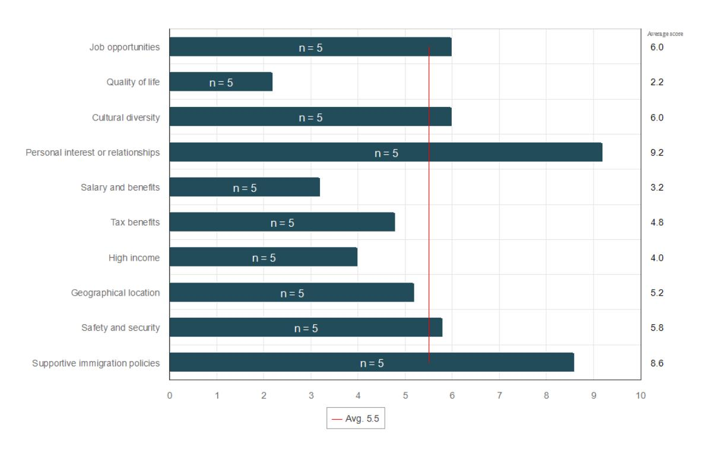

<!-- A2.R35 | source: papers_json/A2.R35/ -->

Bachelor's thesis

International Business

2023

Janni Nurmi

## Talent Attraction & Retention in the United Arab Emirates

<!-- page 2 -->

Bachelor's Thesis | Abstract

Turku University of Applied Sciences

International Business

2023 | 47 pages

Janni Nurmi

## Talent Attraction & Retention in the United Arab Emirates

This thesis aims to understand why and how the United Arab Emirates (UAE) is trying to attract skilled migrants to migrate to the UAE through nationwide policy changes and through individual points of view. The study's overall purpose was to understand the underlying reasons behind talent attraction and retention, the importance of it to the UAE, and the individual's motivations for moving to the UAE.

The data was collected using quantitative and qualitative methods. The quantitative method was used to respond to which immigration policies the UAE has implemented to attract skilled migrants and why the UAE wants to attract skilled migrants. The qualitative method is used to analyze the responses from the face-to-face interview to gather more in-depth information from the more detailed responses.

In conclusion, the study highlights the introduction of the long-term 5- or 10-year Golden visa is one of the major policy changes the UAE has implemented. The results of this thesis show that the primary factors why skilled migrants decide to move to the UAE are quality of life, safety and security, high income, and zero income tax. All respondents indicated they do not want to leave the UAE and intend to stay in the country long-term.

The research shows that the UAE highly relies on the foreign workforce to sustain a high standard of living and economic growth. Therefore, the UAE is keen to attract skilled migrants to its country.

Keywords: Talent attraction and retention, Immigration, Skilled migrant

<!-- page 3 -->

## **Content**

**List of abbreviations (or) symbols**5**1 Introduction**61.1 Research background61.2 Research questions and objectives of the study71.3 The structure of the research8**2 Literature review**102.1 Workforce in the UAE102.2 Definition of skilled migrant112.3 Global race for talent122.4 Talent Attraction & Retention in the UAE132.5 Immigration policy changes in the UAE14**3 Methodology**163.1 Research methods163.2 Data collection163.3 Limitations18**4 Data analysis**194.1 Background information194.1.1 Consideration to move to the UAE204.1.2 Living in the UAE234.1.3 Moving out from the UAE28**5 Conclusion**315.1 Conclusions315.2 Recommendations for future studies32**6 References**33

<!-- page 4 -->

## **Appendices**

Appendix 1. Cover letter for the online surveyAppendix 2. Online survey questionsAppendix 3. Interview questions

## **Tables**

Table 1 Emirati vs. Expatriates in the UAE population (Global Media Insight, 2023)10Table 3: Primary reasons for moving to the UAE21Table 4 Important factors to reasoning to move to the UAE22Table 7 Received support in the immigration process to the UAE.25Table 8 Quality of life in the UAE26

<!-- page 5 -->

## **List of abbrevia5ons (or) symbols**

Abbreviation Explanation of abbreviation (Source)

ILO International Labor Organization

INSEAD The Business School of the World

OECD The Organization for Economic Co-operation and

Development

UAE United Arab Emirates

UN The United Nations

<!-- page 6 -->

## **1** **Introduction**

The first chapter of this research aims to present an outline and introduce the objectives of this study through three separate parts: research background, research questions and objectives, and lastly, the research structure. The research background introduces the thesis topic and gives the reader an overview. Research questions and objectives clarify the study's purpose and why the topic was chosen. Lastly, the framework of this research will be presented.

## 1.1 Research background

The Organization for Economic Co-operation and Development (OECD) reports that countries face a growing shortage of skilled labor. The shortage of skilled labor can be seen as a complex issue, as the concept can have various meanings. Generally, a labor shortage can happen when the demand for a specific worker overcomes the supply of workers (Richardson, 2007). In turn, employers expect their employees to have broad qualities that can be beyond the available employees' skills. When qualified employees become hard to find, employers are required to accept employees with less qualities. This leads to employers who need more suitable workers (Richardson, 2007). Richardson (2007) presents that the labor market will not operate normally if fewer people are available with the required skill sets (Richardson, 2007).

Manpower Group conducted a Global Talent Shortage survey, in which 39,000 employees across 41 countries participated. According to the study, in 2023, four out of five employers globally reported difficulty in hiring skilled talent (Manpower Group, 2023). The global shortage of skilled labor has led countries to take the initiative to attract skilled labor to their markets, as evidence reported by OEDC suggests that the implementation of new immigration policies toward more selective and relaxed for skill-based individuals is among the most critical factors in facilitating the attraction of skilled migrants (OECD, 2002). Talent

<!-- page 7 -->

attraction and retention strategies play an essential role and are of interest globally in addressing the shortage of skilled labor. In recent years, there has been an increasing interest globally in implementing new immigration policies to facilitate the attraction and retention of skilled migrants. Policies are aiming to streamline the immigration process for skilled migrants.

Immigration policies are a significant factor when discussing the shortage of skilled labor. The author's interest in the area of immigration developed when she was working at the Embassy of Finland in Abu Dhabi, UAE, as a Consular Services Coordinator. The author is employed by the Royal Danish Consulate in Dubai, UAE, as a Visa Officer. The author has worked closely with matters related to immigration for seven years and has been part of the processing of entry permit issuance for skilled migrants moving to Europe. The research topic is in line with the author's current role and personal interests, as the author has been closely following the immigration policy changes related to talent attraction and retention in the United Arab Emirates (UAE), where the author is residing. In this research, the author will focus on talent attraction and retention in the country she calls her home, the United Arab Emirates (UAE).

No published research focuses on the same issue as this research. Most studies in Talent Attraction and Retention have only focused on the subject from an organization's point of view, emphasizing how the organization can attract and retain talent internally. Such approaches still need to address the policy changes that must be made nationwide to facilitate talent attraction and retention on a broader scale.

## 1.2 Research questions and objectives of the study

This research aims to provide new insights into talent attraction and retention in the UAE. The study enhances the understanding of why the UAE wants to attract skilled migrants and how it implements new policies to support its goals. This research aims to understand the reasons from both sides through policy

<!-- page 8 -->

changes and individuals' points of view. The overall purpose of this study is to understand better the underlying reasons behind talent attraction and retention, the importance of it to the UAE, and the individual's motivations for choosing to move to the UAE.

## The research questions are:

- 1. Which immigration policies the UAE has implemented to attract skilled migrants?
- 2. Why does the UAE want to attract skilled migrants?
- 3. What are the reasons why skilled migrants decide to come, stay, or choose to leave the country in the long run?

## 1.3 The structure of the research

This research is divided into five chapters. The first chapter is the introduction, which includes background to the topic, objectives, and motivation of this research, giving a comprehensive picture of what the study contains. The second chapter is the literature review, which is the central part of the research. The literature review will focus on the UAE's immigration policies and what updates have been made. This part of the research will focus on publicly available procedures and statements issued by the UAE government regarding their current and upcoming visions of the UAE's economic and immigration development. The research questions one and two are answered in this chapter.

The third chapter provides information on the research methodology. This part of the research will describe the methods chosen in this research. In addition, the limitations, validity, and reliability are presented in this part. Lastly, the timeline of the study is given.

In the fourth chapter, the author will introduce real-life examples of individuals' perspectives and why these individuals have decided to migrate to the UAE.

<!-- page 9 -->

This part of the research will be semi-structured interviews with selected skilled migrants. This part of the research aims to enlighten the individual's perspective so that future research questions can be formed from these interviews. In this chapter, the results from the gathered data will be analyzed as well. The third research question will be answered in the fourth chapter.

Lastly, in the fifth chapter, the conclusions of the research findings and literature review are gathered with recommendations for further research. The interview and online survey questions in English are enclosed in the appendices.

<!-- page 10 -->

## **2** **Literature review**

In this chapter, an introduction to the UAE's workforce is presented. The definition of the skilled migrant is explained. The global competition for talent is introduced. A general overview of the UAE's current focus on talent attraction and retention will be presented together with the policy changes that the UAE has made to attract skilled migrants. Lastly, the migration process to the UAE is explained. This chapter will answer research question one, which immigration policies the UAE has implemented to attract skilled migrants, and research question two, why the UAE wants to attract skilled migrants.

## 2.1 Workforce in the UAE

The UAE is located in the Middle East, with a geographical location between three continents: Asia, Africa, and Europe. The official language of the UAE is Arabic, but English is very well-spoken all around the country. All the traffic and road signs and signs on commercial signs in the UAE are written in English and Arabic to serve its residents. As shown in Table 1, most of the UAE's population are expatriates (expats). Expats are defined as an individual working and living in another country than their citizenship, often for work temporarily (Investopedia & Kagan, 2022).

Expats are a crucial part of the UAE's workforce as they are the majority (89%) of the UAE's population. In return, the local citizens, the Emiratis, form a minority (11%) in the population of the UAE. The population distribution between the expats and the Emiratis emphasizes the importance of the foreign

<!-- page 11 -->

workforce in the UAE. The UAE highly relies on the foreign workforce to sustain a high standard of living and economic growth.

In the UAE, naturalization is close to non-existent with strict requirements. Cambridge Dictionary describes naturalization as when an individual acquires legal citizenship of a country other than their origin (Cambridge Dictionary, 2023). Expats in the UAE cannot obtain citizenship of the UAE unless they can meet the tight requirements. In 2021, the UAE Government approved changes to the Citizenship law by allowing foreigners of specific categories to be nominated for Emirati nationality. These categories include individuals who are investors, inventors, doctors, intellectuals, and scientists (u.ae, 2023). The introduction of specific types of naturalization supports the UAE's objective to attract skilled labor to the UAE.

On the other hand, expats in Finland and European countries can obtain citizenship by meeting the requirements, including satisfactory language skills, a long enough duration of residency, and not being guilty of a crime, to name a few (Finnish Immigration Services, 2023). The UAE's tight naturalization requirements differ from the requirements that the majority of European countries have set.

## 2.2 Definition of skilled migrant

The terms "skilled migrant" or "talented migrant" are challenging to define as the words do not have commonly agreed definitions. In addition, the term "talent" lacks a unified scope and definition. A skilled migrant can broadly be defined as an individual who has the ability to do something well (Collins Dictionary, 2022).

The United Nations (UN) and the International Labor Organization (ILO) have defined a migrant as an individual who is a foreign citizen or foreign-born. UN and ILO have defined the different skill levels of migrants. Skilled migrants are individuals with a minimum of four years of higher education, for example, a

<!-- page 12 -->

university degree. Intermediate skill-level migrants have secondary education between three to six years. Low-skill migrants have completed primary schooling for at least six years (United Nations Secretariat, 2005).

In the UAE's Talent Attraction and Retention Strategy 2031, "skilled migrant" refers to individuals performing higher than others using their learned skills and abilities (Ministry of Economy, 2023). The definition presented by the UAE Ministry of Economy refers to the individual's skill set, focusing on the individual's skill set rather than the educational background. The strategy highlights that it is restrictive to judge talents' value proposition to the economy only based on professional or academic qualifications. Therefore, as mentioned earlier, these are not the only elements used when defining talent. Importance is put into recognizing the skill set together with the other factors in the individual's "talent profile" (Ministry for Economic Affairs and Employment, 2023). The term "skilled migrant" in this research will follow the definition set in the UAE's Talent Attraction and Retention Strategy 2031.

## 2.3 Global race for talent

The global race for talent refers to a phenomenon in which countries compete to attract and retain skilled migrants to gain economic growth and cover labor shortages (Hanwei, 2020). Skilled migrants play an increasingly central role in innovations and scientific discoveries, which in turn have a positive impact on expediting economic development (Hanwei, 2020).

Globally, the positive economic impacts of attracting skilled migrants have been recognized. This recognition has led countries to introduce more competitive migration policies to ensure their migration policies are attractive to skilled migrants. Organization for Economic Co-operation and Development (OECD) countries have established fast-track immigration programs created to encourage and advance the migration processes for skilled migrants (Shachar, 2006). Finland illustrates this change clearly. In Finland, the Finnish Immigration

<!-- page 13 -->

Services is offering a fast-track residence permit program for individuals coming to work as specialists in their fields. Finnish Immigration Services states that the decision for the fast-track residence permit application is received in two weeks, making it faster than the standard processing time (Migri, 2023). The introduction of fast-track schemes offered to skilled migrants indicates that the race for talent is global, and countries are implementing faster and more lenient policies to attract skilled migrants to their respective countries.

## 2.4 Talent Attraction & Retention in the UAE

In terms of attracting skilled migrants, the UAE is one of the world's leaders in the (INSEAD, 2022). The UAE has been actively looking to attract and retain skilled migrants, which has led to the launch of various initiatives. To maximize UAE's efforts to support talent attraction and retention in strategic sectors, the Ministry of Economy of the UAE launched a "*UAE Talent Attraction & Retention * *Strategy 2031*". The strategy focuses on enhancing the UAE's place in global talent competitiveness indicators and ensuring that the needed skills and talents are available to support the UAE's goals. The UAE views talent attraction and retention as essential to the UAE's long-term social and economic development strategy (Ministry of Economy, 2023).

The UAE has set three main strategic goals for the talent attraction and retention strategy. The first goal is for the UAE to be one of the top 10 leaders of global talent competitiveness. The first goal's key performance indicator is for the UAE to reach the top 10 countries in the Global Talent Competitive Index ranking by The Business School of the World (INSEAD). The Global Talent Competitive Index is formed through metrics such as Enable, Attract, Grow, Retain, Vocational and Technical Skills, and Global Knowledge skills. These metrics have subcategories that overlook the country's rankings in various areas. By looking into these metrics, the UAE can introduce policies that will help with the mission to attract talent and create an environment that enhances talent retention. 2022, the UAE ranks 25th in the index (INSEAD, 2022).

<!-- page 14 -->

The second goal is to enable a knowledge-based economy by ensuring available talent in the strategic sectors. The second goal's key performance indicator is for the UAE to reach the top 10 in the high-level skills ranking on the Global Talent Competitiveness Index. The second goal aligns with the strategy's vision to attract high talent to facilitate the UAE towards a knowledge-based economy. In 2022, the UAE's high-level skills ranking is 11 (INSEAD, 2022).

The third goal is for the UAE to be the top country of choice for global talent (Ministry of Economy, 2023). The third goal's key performance indicator is for the UAE to rank in the top 3 in the "*Brain Gain*" and "*Ease of Finding Skilled * *Employees*" ranking by the World Economic Forum Executive Opinion Survey. In 2022, UAE ranked 6th on the Brain Gain ranking and 9th on the Ease of Finding Skilled Employees ranking (Ministry of Economy, 2023). These goals with key performance indicators create a clear image of what the country wants to achieve in this field.

## 2.5 Immigration policy changes in the UAE

The UAE immigration policies were created to facilitate many foreign workers to respond to the UAE's need for labor due to the UAE's rapid economic development goals (Valenta, 2023). Over the past few decades, the UAE's immigration policy followed the temporary sponsorship-based model, where individuals could only reside in the UAE under an employer's sponsorship. The residence permit was granted based on temporary work contracts with validity from one year to three years (Valenta, 2023). The temporary sponsorshipbased model is not a competitive immigration policy in today's race for global talent, as it can cause the individual to be uncertain of his future. This can have a tremendous economic impact on the UAE as these individuals would be hesitant to buy a property or invest their life savings back into the market and would prefer to divert their investment to their country of origin. It is the UAE's interest to raise its competitiveness, and therefore, the UAE introduced the

<!-- page 15 -->

Talent Attraction and Retention Strategy 2031 to develop programs and policies that attract skilled migrants. It is evident from previous examples that to attract talent, countries must facilitate faster, more accessible, and more attractive immigration programs.

In line with the Talent Attraction and Retention Strategy 2031 and to strengthen the UAE's position in the global race for talent, the UAE Cabinet approved the Federal Decree-law regarding entry visas and residence of foreigners. This change aims to attract skilled workers and boost the competitiveness of the UAE's job market (WAM, 2022). The most drastic change introduced is a new long-term renewable residence permit for foreign talents, the Golden Visa. The Golden visa can be obtained without the need for a sponsor, and it enables its holder to work, live, or study in the UAE long-term, as it is valid for ten years. The long-term residence permit is critical for the UAE to be an attractive choice for skilled migrants.

In addition to the long-term residency change, the UAE Government introduced a new Green Residence program. The Green Residence permit is issued for five years and without the requirement of a sponsor. Green residences are issued like Golden visas to skilled talents, but the income requirements for the green residence program are lower (WAM, 2022). By introducing these new chances, the UAE creates an environment that enhances talent attraction and retention.

<!-- page 16 -->

## **3** **Methodology**

In this chapter, the chosen research method is presented. In addition, the data collection method is given, and lastly, limitations are presented.

## 3.1 Research methods

As the purpose of this study is to understand better the underlying reasons behind talent attraction and retention, the importance of it to the UAE, and the individual's reasons for choosing to move to the UAE, quantitative and qualitative methods are used for this research.

The quantitative method is used in this research to answer research questions one, which immigration policies the UAE has implemented to attract skilled migrants, and research question two, why the UAE wants to attract skilled migrants. In addition, the quantitative method is used to analyze the online survey results for research question three: why do skilled migrants decide to come, stay, or leave the country in the long run. The quantitative method was chosen as it allows for collecting number-based data, which can be converted into statistics.

In addition to using the quantitative method to respond to research question three, the qualitative method is used to analyze the responses from the face-toface interview to gather more in-depth information on the personal point of view. The interviews were conducted as semi-structured interviews. This method was chosen because it allows the respondent the flexibility to bring light to the problems and possible reasons behind their decisions.

## 3.2 Data collection

In this study, both primary and secondary data were used. To start with the study, secondary data was collected for the literature review. Previous research,

<!-- page 17 -->

governmental websites, and official reports related to the topic were used to collect the data to respond to research questions one, which immigration policies the UAE has implemented to attract skilled migrants, and research question two, why the UAE wants to attract skilled migrants.

In addition, primary data was collected using an online survey and two face-toface interviews. Based on the findings from the literature review, the author selected the interview and online survey questions that will provide an answer to research question three: what are the reasons why skilled migrants decide to come, stay, or choose to leave the country in the long run. The online survey aimed to keep it as simple as possible to ensure that the respondents would give reliable responses. There were 18 questions all in all. The online survey started with demographic questions (1-6). The second part of the online questionnaire focused on the factors that attracted skilled migrants to migrate to the UAE (7-10). The third part of the online survey focused on the integration process, challenges, and living in the UAE (10-16). Lastly, the focus was shifted to understanding whether the respondents plan to stay in the UAE long-term and what the UAE could improve to retain the skilled migrants.

The online survey was conducted using the Webpropol online survey website. The online survey link was sent to 20 individuals by email. In parallel, the individual interviews were conducted online using the Zoom platform. The author interviewed two individuals currently residing in the UAE with Golden visas. The first interview was conducted on the 12th of July, 2023, and the second was on the 25th of August, 2023. In parallel, the author opened the Webprobol online survey from the 4th of September 2023 until the 8th of September 2023. The email was sent to 20 individuals holding a Golden UAE visa. The survey received responses from five respondents.

<!-- page 18 -->

## 3.3 Limitations

The major limitation of this study is the size of the sample. The online survey should have been distributed on a larger scale to acquire more reliable results, and more face-to-face interviews should have been conducted. High-skilled talents are employed in high positions, and getting in contact for data collection can be challenging. The interviews were conducted with two skilled migrants, and finding a suitable time in their calendars was challenging. Due to time limitations, the online survey was sent to 15 respondents, and five responded. As the number of responses was limited, this research cannot process mass averages from the online survey responses, as they would not be accurate.

Lastly, the topic of Talent Attraction and Retention in the UAE is broad, and the discussion of factors related to successful talent attraction and retention is beyond the scope of this research. The data and analysis presented here are based solely on the limited number of interviews, online survey responses, and the author's expertise.

<!-- page 19 -->

## **4** **Data analysis**

This research aims to understand the individual's reasons for moving and staying in the UAE for the long term and how the UAE's Talent Attraction and Retention Strategies and policy changes support those reasons. The population size of this research is limited to two interview respondents and five online survey respondents. This part of the research focuses on data analysis and discussion of the findings.

## 4.1 Background information

The first questions for the online survey and the interviews aimed to get more in-depth information about the respondents' backgrounds. The first question asked the gender of the respondents. Most online survey respondents were female, 60%, and 40% were males. The interview respondents were a female (A) and a male (B).

As the UAE is a multicultural country with international residents, question two was asked to find out the respondents' country of birth, and question three to determine the respondents' current nationality. To understand the multiculturality of the respondents, it is essential to understand their cultural background. The online survey respondents were born in Finland, Lebanon, the United States, and India, holding nationalities of Finland, Canada, the United States, and India. Interview respondents were born in Denmark (A) and the United States (B) and hold the same nationality as their country of birth. Most online survey and interview respondents hold the same nationality as their country of birth. Still, interestingly, one online survey respondent had a different nationality (Canada) than the country of birth (Lebanon).

Questions four and five focused on finding the respondents' educational background and current occupations. As this is research about skilled migrants, it is essential to distinguish the educational background and the current

<!-- page 20 -->

occupation to distinguish if the profiles of the respondents are in line with the UAE's Talent Attraction and Retention Strategy. 60% of the online survey respondents are PhD-level educated, and 40% hold a Master's degree. In addition, both interview respondents (A) and (B) have Master's degrees. The online survey respondents are employed as IT Managers, HR Director, Chief Technology Officer, University Professor and Endocrinologist/Doctor. The interview respondent A is employed as IT Manager and respondent B as General Manager. As per the responses to these questions, the survey and interview respondents are within the UAE's definition of high talent due to their educational background and current occupation.

The last question asked how many years the respondents lived in the UAE. This question aimed to understand if the respondents moved to the UAE after the Talent Attraction and Retention Strategy was introduced or if they lived in the UAE longer. Interestingly, the differences in the responses were broad. The time period varied between one and a half years to 22 years, bringing the average years in the UAE to eight years for both online survey and interview respondents. The results indicate that most respondents moved to the UAE before introducing the Talent Attraction & Retention Strategy 2031.

### 4.1.1 Consideration to move to the UAE

The second set of questions (7-10) aimed to understand the primary factors that attracted the respondents to move to the UAE. First, the respondents were asked to choose between elements that were the primary reasons for moving to the UAE. The factors were job opportunities, tax benefits, high salary, quality of life, cultural diversity, geographical location, safety and security, supportive immigration policies, and lastly, where respondents could write any other important factor. The author chose these factors based on the findings from the literature review focusing on the aspects that the UAE is focusing on making the country more competitive globally. The results show that 80% of the online

<!-- page 21 -->

survey respondents chose "Quality of life" and "Safety and security" as primary reasons for moving to the UAE (see Table 3).

.

*Table 2: Primary reasons for moving to the UAE*

Interview respondent A stated that her primary reasons for moving to the UAE were to move somewhere safe, with a pleasant climate, and where she could communicate in English. Interview respondent B stated that his primary reason for moving to the UAE was to live in a safe country, and he wanted to raise his children by his Christian morals, values, and beliefs, which was very difficult to do in the US recently. The overall result was not surprising, as the UAE has a reputation for being a very safe country with a high quality of life. The most surprising response was from respondent B, who stated that one factor in moving to the UAE is raising his children with Christian morals. This response indicates that the UAE is tolerant of all religions despite Islam being the major religion in the country.

Question eight asked the respondents to rank different factors to move to the UAE from most important and least important. The same elements were used

<!-- page 22 -->

as in the last question. The responses indicate that the respondents value "Quality of life" the highest. Factors related to the financial incentives, such as "Salary and benefits," together with "High income," are ranked second and third most important factors to move to the UAE (see table 4).

*Table 3 Important factors to reasoning to move to the UAE*

Interview respondent A said financial incentives, such as zero income tax, are essential for her. She stated: "In my home country, we pay income tax, and in return, we get social benefits, such as free education and health care. In the UAE, we do not pay income tax, and when I was employed, I negotiated with my employer so that my employer would cover my children's school fees. My employer has provided us with excellent health insurance". Based on the author's experiences; many skilled migrants negotiate a "relocation package" with their employer before they accept the work offer. The "relocation package" can include as an example agreement of education allowance, housing allowance, relocation fees, healthcare and transportation allowance to name a few. The skilled migrants have the stand in the UAE's job market to negotiate an attractive "relocation package" on top of the salary. Interview respondent B said

<!-- page 23 -->

financial incentives, such as zero income tax, were desirable. The results indicate that skilled migrants are aware of the value they bring to society, so naturally, they are interested in the financial incentives of work.

### 4.1.2 Living in the UAE

The long-term economic benefit of talent attraction lies in the country's ability to keep skilled migrants as long-term residents. The earlier findings indicated that financial incentives are essential to attract skilled migrants to the UAE. Compared to other countries, the zero income tax is a desirable factor compared to other countries where income tax percentage can be pretty high. These results indicate that based on the data collected, financial incentives are a significant factor for the UAE to attract and retain skilled migrants.

The aim of question 10 was to know the respondents' thoughts on the UAE's attractiveness compared to other countries. The results show that all the online survey respondents think the UAE is the most attractive destination for skilled migrants. The global race for talent has raised countries to market their strengths and to show the vision and future plans to attract talent. The result is excellent for the UAE as it indicates that the respondents think other countries could give them less competitive benefits or quality of life.

The interview respondent B said that for him, the UAE is at the top of the list of attractiveness compared to other countries. The interview respondent A said that for her, UAE is very attractive for a skilled migrant. She continued by mentioning that the UAE has made some changes in their rules and regulations that have made life easier, such as introducing the Golden visa, which she and her family members hold. Another question was asked to clarify how the Golden Visa made her life easier. She responded that her daughter is turning 18 years old soon, and they plan to send her to Denmark to continue her higher education in Denmark. With the new Golden visa, her daughter can be outside the UAE as long as she wishes. Interview respondent A continued that based on

<!-- page 24 -->

her knowledge earlier, the UAE residence permit was canceled automatically if the holder stayed outside the country for more than six months. The Golden visa gives her and her family flexibility to plan their daughter's education without worrying about the cancellation of her UAE residency.

The response is in line with the author's knowledge of the topic. The normal UAE residence permit will be automatically canceled if the holder stays out of the country for over six months. The change was introduced with the new Golden visa, which allows the Golden visa holder to remain outside the country as long as needed. This gives the Golden visa holder flexibility and stability to even leave UAE for some time without worrying about the residency's cancellation. From the author's perspective, this brings stability to the Golden visa holder and could attract the Golden visa holder, for example, to purchase their own home instead of renting a home. Therefore, the stability the Golden visa brings to its holder could bring more investments to the country.

The next question was whether the respondents received adequate support and guidance in migrating to the UAE. The question gave different factors, such as visa and immigration assistance, relocation services, language training, cultural orientation, legal assistance, etc. The question was an open-ended question where respondents wrote their responses.

As shown in Table 7, in all responses, the respondents reported that their employer had helped them obtain their residency in the UAE. In a few answers, the employer also helped relocate to the UAE.

**Have you received adequate support and guidance from** **your employer ** **or other organization in the UAE in the process of migrating to the UAE? ** **(Example: visa and immigration assistance, relocation services, ** **language training, cultural orientation, legal assistance,** **etc. **

Yes, my employer did all my visa matters

When I moved to the UAE our PRO assisted on obtaining the residence visa for me and my family

Yes from the university, my employer handled my visa process and helped me with relocation

My employer handled the visa process and helped me with relocating

<!-- page 25 -->

## Yes from my employer

Everything was done by my employer, they guided me step by step through the process of relocation, visa, and immigration, however, I didn't receive a cultural orientation, but after living here for 3 years I don't think I needed one, as the country has around 200 different nationalities, therefore, blinding with the society was easy, as we are all coming from different backgrounds. (Interview respondent B)

Yes, my employer handled the whole residency process for me and my family. There is a specific person in my company whose task is to follow up and handle the residence permit process from A to Z. I thought the residency process was very easy and it did not bring me any issues. My employer also covered the moving expenses. I'm very eager to learn Arabic and I'm currently trying to find Arabic classes which I could attend. (Interview respondent A)

*Table 4 Received support in the immigration process to the UAE.*

These findings are not surprising, as the UAE's immigration policies are still heavily dependent on the employer's work on visa matters, which shows in the responses. Interview respondent A brought up a fascinating insight that she is eager to learn the Arabic language and is trying to find Arabic classes that she could attend. Another question was asked why she has not started to study Arabic yet. She responded that she had not found an appropriate course for her working schedule. Interview respondent A mentioned that she wishes to learn the Emirati Arabic dialect, as she thinks it could benefit her at her work, as she has colleagues and clients who are local UAE citizens. She thinks the Emirati Arabic language skills would help her create deeper relationships with them.

Based on this response and the author's experience, many non-Arabic speaking expats are interested in learning the Arabic language. However, English is spoken so widely in the UAE that even after living in the UAE for decades, the expats might not speak Arabic at all. The author suggests that based on this finding, the UAE could introduce Emirati Arabic classes as an integration program to the UAE. The Emirati Arabic classes could be offered to the Golden visa holders who wish to attend. The employers could also be part of the incentive so Golden visa holders could attend the classes despite their busy schedules. Emirati Arabic skills would help the Golden visa holder to

<!-- page 26 -->

integrate into the country and create deeper business relationships that would benefit the Golden visa holder, employer, and the UAE.

As challenges and obstacles can make life in a new country unbearable, in question 12, the respondents were asked whether they had encountered any challenges or obstacles in the transition to life in the UAE. The interview respondents said that they had not faced any challenges. Four out of five online survey respondents said the same. One online survey respondent responded: "Not at all; transitioning my life to the UAE couldn't be easier; the services provided in the UAE are incredibly high compared to Finland, and make your life easy.

Moving on to question 13, which asked how the respondents rate the quality of life in the UAE compared to their country of origin or other countries where the respondents have resided. The same question was asked to the interview respondents as an open-ended question. As we can see in Table 8, all the online survey respondents rated the quality of life the maximum value of 10, indicating that they are satisfied with the quality of life in the UAE compared to their country of origin or other countries where they have resided.

The interview respondent A stated that she would rate the quality of life in the UAE compared to her home country as 9/10. She noted that the only issue she has faced is the weather during the summer months. When the temperature reaches 47 degrees and the kids are off from school, she finds herself in a situation where she wishes to open the door and let the kids play outside. She continued that her children will start swimming classes, which she thinks is an excellent sport for the weather in the UAE. She ended by saying that, all in all,

<!-- page 27 -->

no place is perfect, and she feels they need to adapt to the circumstances and make the most out of it.

The interview respondent B responded that the quality of life has surpassed his expectations. The safety in the UAE is unparalleled to any other place he has visited and has been around. He continued that in the UAE, people are friendly and helpful. He stated that the UAE's cost of living is much cheaper than San Francisco's. He also mentioned that the available services are excellent, and his wife and children are happy. Lastly, he stated that he would say that their quality of life improved drastically in the UAE. The responses indicate similar results as to question 10. The respondents rated the Quality of life as one of the primary reasons to move to the UAE. By highlighting the Quality of life in the UAE, based on the results, the UAE can attract many more skilled migrants to the country.

Skill and qualification matches related to the UAE's job market must be balanced when hiring skilled migrants. Question 14 was an open-ended question, where the respondents were asked if they feel like their skills and qualifications are well-matched to the UAE. 4 out of 5 respondents said that they agree that their skills and qualifications match the UAE job market. One respondent elaborated more:

"Yes, I believe my IT qualifications are well matched to UAE's vision in the future as they have a great interest in having AI and Blockchain technology integrated into all aspects of their government services, and companies are also competing highly in this field."

ICT, Advance Technology, and Space are strategic groups on which the UAE's Talent Attraction and Retention Strategy focuses. The response is in line with UAE's talent attraction and retention strategy.

Lastly, in this sector, the respondents were asked to rate their satisfaction with their decision to move to the UAE as skilled migrant. The interview respondent A stated that she is very satisfied with the decision to move to the UAE. She

<!-- page 28 -->

continued by saying that career-wise, she is currently in a higher position and receiving a higher salary than she did in her home country. She mentioned that she feels like her knowledge is appreciated. Lastly, she stated that on a personal note, she is enjoying life in a warmer environment. The interview respondent B indicated that he is delighted with his decision to move to the UAE, which aligns with the online survey responses. The responses to the online survey and the interviews indicate that all the respondents are satisfied with their decision to move to the UAE.

This part of the research indicates excellent results for the UAE regarding the retention of skilled migrants. The results show that the individuals are satisfied with their quality of life in the UAE and continue to see it as a competitive job market for their skills and qualifications.

### 4.1.3 Moving out from the UAE

The last part of the data analysis focuses on the respondent's plans to move out of the UAE. Question 16 asked the respondents about their long-term plans to stay in the UAE. The same question was asked in the interviews and the online survey. Three online survey respondents stated they plan to stay in the UAE for the long term. One online survey respondent stated: "I don't want to move from UAE ever." Another online survey respondent said: "I have been here 22 years now, so I would say I'm already a long-term resident of UAE, and I don't plan to move back to India anytime soon, maybe after I retire.". Interview respondent A mentioned that she plans to stay in the UAE long-term; they do not intend to leave the UAE any time soon. Interview respondent B stated that he has planned to stay in the UAE long term. The responses go hand in hand with the earlier answers, indicating high satisfaction with life in the UAE.

To follow up on the earlier question, question number 17 was asked to get insight on whether the respondents were considering leaving the UAE and, if so, what were the reasons for considering leaving. Four respondents said "No"

<!-- page 29 -->

to indicate they have not considered leaving UAE. One respondent said: "Maybe after I retire because I have my own house and life in India as well, my bigger family are there, so most probably I will move back after I retire and my kids all graduate.". The results indicate that the respondents plan to stay in the UAE long-term. The interview respondent A stated that she has not considered leaving the UAE. She continued by saying that if she considered leaving the UAE, it would be related to her family. If she would receive a better opportunity somewhere else, or if she was in a situation where she could offer her small kids a better education, maybe she would take it. Interview respondent B states shortly that he has not considered leaving the UAE.

The last part of the online survey gave the respondents the free word to write how they think the UAE could improve its attractiveness for skilled migrants. The following responses were given to the online survey.

"It would be essential to support work-life balance. Ultimately, it is the individual's responsibility, but the country should bring awareness."

"Integration to society."

"They should improve their marketing to reach the right audience of highly skilled individuals."

"Many people are moving to the UAE, so I don't know if they need to improve its attractiveness. Still, if I had to mention a point, it would be to open the door to give the UAE nationality a more straightforward path for everyone if they meet specific criteria. This is something that many people have found unattractive, that they don't know how to be a citizen of this country."

"They should give citizenship to people who have stayed here long enough or have clear criteria for giving citizenship; I believe that will be a game changer in UAE's attractiveness."

Interview respondent A stated that she wishes there were Arabic lessons or introductions to the local culture. For her, work-wise, everything is fine, but she

<!-- page 30 -->

has not made any local friends besides her work colleagues and clients, and she continued by saying that she would be thrilled to learn about the country's culture and language.

Interview respondent B said that, in his opinion, they (the UAE) can work on their marketing more. He continued that he knows about the UAE and its attractiveness because he is a well-traveled man; however, people who only travel a little might need to learn more about what the UAE has to offer. Lastly, he added that the UAE has to open the chance to give the UAE nationality to people who stay here long-term, "which would boost its attractiveness big time".

<!-- page 31 -->

## **5** **Conclusion**

This part of the research summarizes the research and the key findings. In addition, limitations of the study and further recommendations are mentioned.

## 5.1 Conclusions

This research aimed to understand why and how the UAE is trying to attract skilled migrants to migrate to the UAE. The study has identified the immigration policies that the UAE has implemented to attract skilled migrants. The significant change has been the introduction of the long-term 5- or 10-year Golden visa, which can be obtained without the need for a sponsor and is issued to foreign talents with specific qualifications. The research has also shown that the UAE highly relies on the foreign workforce to sustain a high standard of living and economic growth. Therefore, the UAE is keen to attract skilled migrants to its country.

The results of this research show that the primary factors why skilled migrants decide to move to the UAE are quality of life, safety and security, high income, and zero income tax. All respondents indicated they do not want to leave the UAE and intend to stay in the country long-term. One suggestion from the responses is that the UAE should give citizenship to long-term residents with precise selection criteria, which could lead to even higher retention of skilled migrants.

This research aimed to understand the reasons from both sides through policy changes and individuals' points of view. In addition, this study's overall purpose was to understand better the underlying reasons behind talent attraction and retention, the importance of it to the UAE, and the individual's motivations for moving to the UAE.

<!-- page 32 -->

## 5.2 Recommendations for future studies

Talent Attraction and Retention is a broad and multidimensional topic. Future studies should involve a larger sample of responses from diverse groups of people. Using a wider sample would help the author to pull averages of the responses and establish a higher accuracy on the responses.

<!-- page 33 -->

## **6** **References**

Algan, Y., Bisin, A., Manning, A. & Verdier, T., 2012. *Cultural Integration of * *Immigrants in Europe. *1 ed. s.l.:Oxford Scholarship [Online]

Business France Nordics, 2020. *France deploys significant measures in the * *competition for talents. *[Online]

Available at: https://world.businessfrance.fr/nordic/2020/02/05/france-deployssignificant-measures-in-the-competition-for-talents/ [Accessed 30 January 2023].

Cambridge Dictionary, 2023. *Cambridge Dictionary. *[Online] Available at: https://dictionary.cambridge.org/dictionary/english/naturalization [Accessed 17 September 2023].

Collins Dictionary, 2022. *Collins Dictionary. *[Online] Available at: https://www.collinsdictionary.com/dictionary/english/skilledmigration

[Accessed 24 September 2022].

Dubai Media Office, 2021. *Mohammed bin Rashid approves the UAE Strategy * *for Talent Attraction and Retention. *[Online]

Available at: https://mediaoffice.ae/en/news/2021/April/14-04/Mohammed-bin-Rashid-approves-UAE-Strategy-for-Talent-Attraction-and-Retention [Accessed 30 April 2022].

Duhatschek, P., 2020. *Canadian tech group spends $100K on billboards to lure * *anxious tech workers from U.S.. *[Online]

Available at: https://www.cbc.ca/news/canada/kitchener-waterloo/techbillboards-1.5683762

[Accessed 2 February 2023].

Finnish Immigration Services, 2023. *Citizenship for adults. *[Online] Available at: https://migri.fi/en/citizenship-for-adults [Accessed 19 October 2023].

Froilan, M. J. & Al Youha, A., 2013. *Labor Migration in the United Arab Emirates: * *Challenges and Responses. *[Online]

Available at: https://www.migrationpolicy.org/article/labor-migration-united-arabemirates-challenges-and-responses

[Accessed 29 January 2023].

Global Media Insight, 2023. *United Arab Emirates Population Statistics 2023. * [Online]

Available at: https://www.globalmediainsight.com/blog/uae-population-statistics/ [Accessed 30 January 2023].

<!-- page 34 -->

Hanwei, L., 2020. *How to Retain Global Talent? Economic and Social * *Integration of Chinese Students in Finland, *Manchester: Manchester China Institute.

Immigration and Diversity, 2022. *Benefirs of Cultural Integration into a Society. * [Online]

Available at: https://immigrationanddiversity.weebly.com/benefits-of-culturalintegration-into-a-

society.html#:~:text=Integration%20has%20the%20benefits%20of,while%20exp anding%20their%20own%20horizon

[Accessed 30 April 2022].

INSEAD, 2022. *The Global Talent Competitiveness Index. *[Online] Available at: https://www.insead.edu/sites/default/files/assets/dept/fr/gtci/GTCI-2022-report.pdf

[Accessed 2 February 2023].

Investopedia & Kagan, J., 2022. *Expatriate. *[Online] Available at: https://www.investopedia.com/terms/e/expatriate.asp [Accessed 24 September 2022].

Khamidov, E. T. U., 2022. Impact of high-skilled migration on the economy. *Economy and Innovation, *Volume 29/2022, pp. 101-108.

Manpower Group, 2023. *2023 Global Talent Shortage Survey. *[Online] Available at:

https://go.manpowergroup.com/hubfs/MPG_TS_2023_Infographic_FINAL.pdf [Accessed 19 October 2023].

Migrant Integration Policy Index 2020, 2020. *Migrant Integration Policy Index * *2020. *[Online]

Available at: https://www.mipex.eu/united-arab-emirates [Accessed 6 May 2022].

Migration Down Under, 2023. *Global Business and Talent Attraction Taskforce. * [Online]

Available at: https://migrationdownunder.com/australian-visas/individual-visaoptions-australia/globalbusiness-talentattraction-australia/ [Accessed 30 January 2023].

Migri, 2023. *Fast-track. *[Online] Available at: https://migri.fi/en/fast-track

[Accessed 1 September 2023].

Ministry for Economic Affairs and Employment, 2023. *Talent Boost. *[Online] Available at: https://tem.fi/en/talent-boost-en [Accessed 30 January 2023].

<!-- page 35 -->

Ministry of Economy, 2023. *Talent Attraction & Retention. *[Online] Available at: https://www.moec.gov.ae/en/talent-attraction-and-retention [Accessed 2 February 2023].

Narayanappa, J., 2022. Pandemic Recalibrates Rules of Engagement for Gulf Expatriates. *Journal of International Women's Studies, *23(3), pp. 122-135. OECD, 2002. *International Mobility of the Highly Skilled. *[Online] Available at: https://read.oecd-ilibrary.org/employment/international-mobility-ofthe-highly-skilled_9789264196087-en#page8 [Accessed 24 September 2022].

Peterson, O. & Arun, T., 2020. *Spillover of COVID-19: Impact on the Global * *Economy, *Munich: Munich Personal RePEc Archive.

Prime Minister's Office, 2018. *Immigrants in the Innovation Economy -* *Lessons * *from Austria, Canada, Denmark and the Netherlands, *s.l.: Prime Minister's Office.

Reuters, 2021. *Saudi Arabia grants citizenship to group of "talented" expats. * [Online]

Available at: https://www.reuters.com/world/middle-east/saudi-arabia-grantscitizenship-group-talented-expats-2021-11-15/ [Accessed 2 February 2023].

Richardson, S., 2007. *What is a skill shortage?. *[Online] Available at: https://files.eric.ed.gov/fulltext/ED495918.pdf [Accessed October 2023].

Shachar, A., 2006. *The Race For Talent: Highly Skilled Migrants and * *Competitive Immigration Regimes, *Toronto: University of Toronto. Sugiura, E., 2020. *Nikkei Asia. *[Online] Available at: https://asia.nikkei.com/Editor-s-Picks/Interview/A-great-war-fortalent-awaits-post-COVID-world-Parag-Khanna [Accessed 2 February 2023].

u.ae, 2022. *Fact sheet. *[Online] Available at: https://u.ae/en/about-the-uae/fact-sheet [Accessed 14 March 2022].

U.AE, 2022. *Population and demographic mix. *[Online] Available at: https://u.ae/en/information-and-services/social-affairs/preservingthe-emirati-national-identity/population-and-demographic-mix [Accessed 23 January 2023].

u.ae, 2023. *Emirati Nationality. *[Online] Available at: https://u.ae/en/information-and-services/passports-andtraveling/emirati-nationality [Accessed 19 October 2023].

<!-- page 36 -->

U.ae, 2023. *Emiratis' employment in the private sector. *[Online]

Available at: https://u.ae/en/information-and-services/jobs/emiratis-employmentin-private-sector

[Accessed 30 January 2023].

United Arab Emirates The Cabinet, 2023. *Minimum retirement age in UAE is * *now 49. *[Online]

Available at: https://uaecabinet.ae/en/details/news/minimum-retirement-age-inuae-is-now-49

[Accessed 30 January 2023].

United Nations Secretariat, 2005. *Highly Skilled Migration. *[Online] Available at:

https://www.un.org/en/development/desa/population/events/pdf/4/P01_ICMPD.p df

[Accessed 5 March 2023].

Valenta, M., 2023. *Temporary Labour-Migration System and Long-term *

*Residence Strategies in the United Arab Emirates. *[Online]

Available at: https://ntnuopen.ntnu.no/ntnu-

xmlui/bitstream/handle/11250/2588889/Long_term_migrants_the_UAE_main_d

ocument_for_IM_Final.pdf?sequence=2

[Accessed 2023 September 2023].

Vision 2030, 2023. *Overview. *[Online]

Available at: https://www.vision2030.gov.sa/v2030/overview/

[Accessed 2 February 2023].

WAM, 2022. *UAE Cabinet approves Executive Regulations of Federal Decree-*

*Law on Entry and Residence of Foreigners. *[Online]

Available at: https://wam.ae/en/details/1395303040263

[Accessed 1 September 2023].

Waxin, M.-F., Al Ariss, A. & Zhao, F., 2021. Global Talent management of skilled migrants: current and future research. In: *Contemporary Talent Management. *

Tarique, Ibraiz: Routledge, pp. 277-295.

Worldometers, 2023. *Worldometers. *[Online]

Available at: https://www.worldometers.info/coronavirus/

[Accessed 29 January 2023].

<!-- page 37 -->

## **Appendix 1. Cover letter for the online survey**

Dear receiver,

My name is Janni Nurmi and I'm 3rd year International Business student at Turku University of Applied Sciences. I am conducting an online survey about Talent Attraction and Retention in UAE, focusing on the reasons why skilled migrants decide to come, to stay or decide to leave UAE. The online survey is part of my Bachelor Thesis.

The survey takes only few minutes to complete and I would appreciate your response. The responses are confidential and anonymous and will be complied and analyzed as a group.

The survey can be found below.

https://link.webropolsurveys.com/S/F1C68BCC12638AEC

Thank you for your time and responses.

Kind regards,

Janni Nurmi International Business student Turku University of Applied Sciences Janni.nurmi@edu.turkuamk.fi

<!-- page 38 -->

## **Appendix 2** **Online Survey Questions**

Talent Attraction and Retention in the United Arab Emirates

By taking part in this questionnaire, you consent that your answers will be used for research purposes, and the results of this research can be made public. Respondents' identification is not needed for the purpose of this research. It is not possible to identify the respondents without additional information that the researcher doesn't hold.

1. What is your gender? Male Female Other Prefer not to say2. Country of birth:

<!-- page 39 -->

3. Current nationality:4. EducationO High schoolO Bachelor's DegreeO Master's DegreeO PhD or higher5. Current occupation6. How many years have you been living in the UAE? (Round up to nearest year)

<!-- page 40 -->

7. What were your primary reason for moving to the UAE? Please select all the options that apply[ ] Job opportunities[ ] Tax benefits[ ] High salary[ ] Quality of life[ ] Cultural diversity[ ] Geographical location[ ] Safety and security[ ] Supportive immigration policies[ ] Other _________8. Rank the following factors in turns of importance for reasoning to move to the UAE (1 being the most important and 9 the least)Job opportunitiesSelect &#9660;Quality of lifeSelect &#9660;Cultural diversitySelect &#9660;Personal interest or relationshipsSelect &#9660;Salary and benefitsSelect &#9660;Tax benefitsSelect &#9660;High incomeSelect &#9660;Geographical locationSelect &#9660;

<!-- page 41 -->

How important are financial incentives, such as zero income tax, in your decision to stay in the UAE long-term?

How would you rate the UAE's attractiveness for highly skilled individuals compared to other countries?

<!-- page 42 -->

11. Have you received adequate support and guidance from your employer or other organizations in the UAE in the process of migrating to UAE? (Example: visa and immigration assistance, relocation services, language training, cultural orientation, legal assistance etc.)12. Have you encountered any challenges or obstacles in your transition to life in the UAE as a highly skilled individual? If so, what were they?13. How would you rate the quality of life in the UAE compared to your country of origin or other countries where you have lived in?Low quality 0High quality 100

<!-- page 43 -->

14. Do you feel like your skills and qualifications are well-matched to the job market in the UAE? Why or why not?15. How satisfied are you with your decision to move to the UAE as a highly skilled individual?SatisfactionNot satisfiedVery satisfied001016. Do you plan to stay in the UAE long-term?

<!-- page 44 -->

17. Have you considered leaving the UAE? If so, what were your reasons for considering leaving?18. How do you think the UAE could improve its attractiveness for highly skilled individuals, if at all?PreviousSubmit

<!-- page 45 -->

## **Appendix 3 Interview Questions**

Gender:

Country of birth: Current nationality:

Education:

Current occupation:

- 1. How many years have you been living in the UAE?
- 2. What were your primary reasons for moving to the UAE?
- 3. How important are financial incentives, such as zero income tax, in your long-term decision to stay in the UAE?
- 4. How would you rate the UAE's attractiveness for highly skilled individuals compared to other countries?
- 5. Have you received adequate support and guidance from your employer or other organizations in the UAE in the process of migrating to the UAE? (Example: visa and immigration assistance, relocation services, language training, cultural orientation, legal assistance etc.)
- 6. Have you encountered any challenges or obstacles in your transition to life in the UAE as a highly skilled individual?
- 7. How would you rate the quality of life in the UAE compared to your country of origin or other countries where you have lived in?
- 8. How satisfied are you with your decision to move to the UAE as a highly skilled individual?
- 9. Do you plan to stay in UAE long term?
- 10.Have you considered leaving the UAE? If so, what were your reasons for considering leaving?
- 11.How do you think the UAE could improve its attractiveness for highly skilled individuals?

<!-- page 46 -->

<!-- page 47 -->
