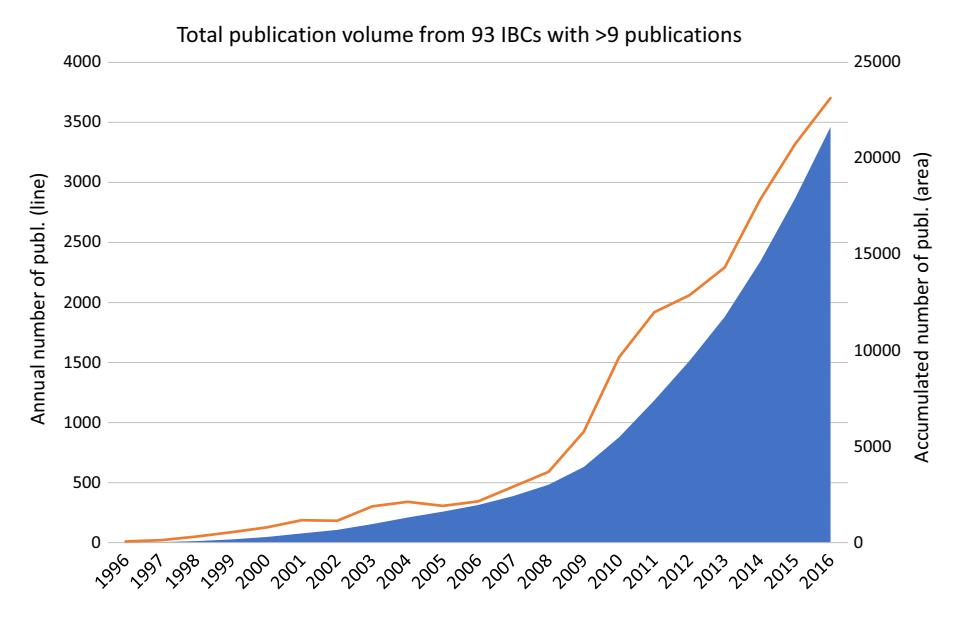
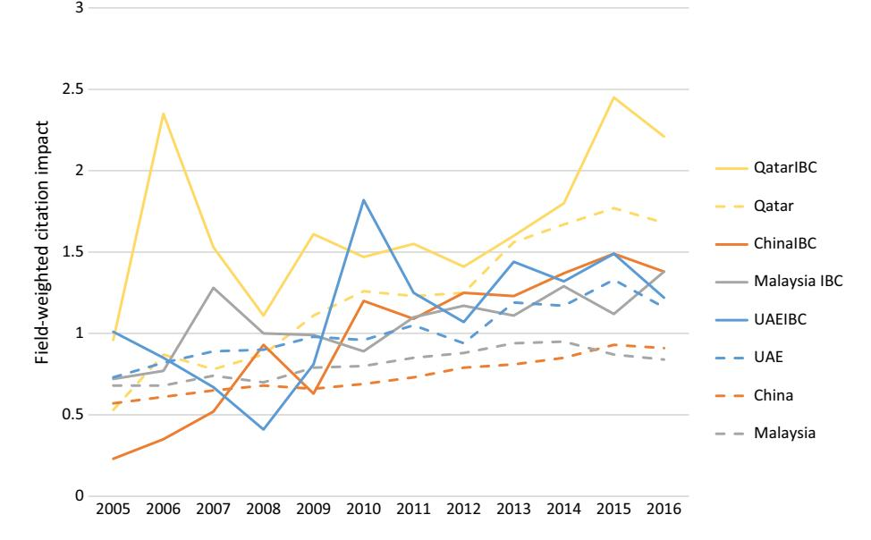
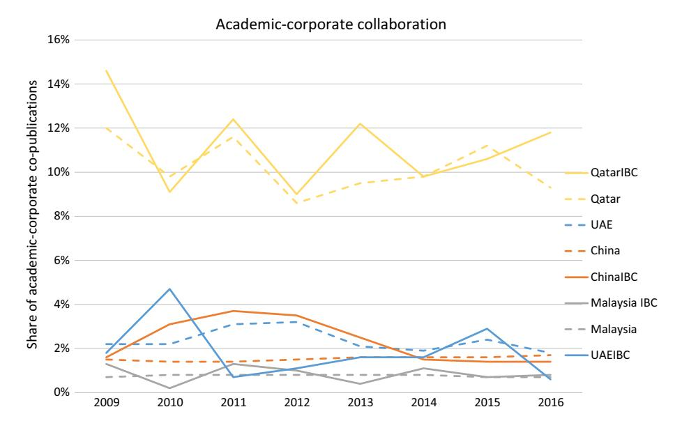
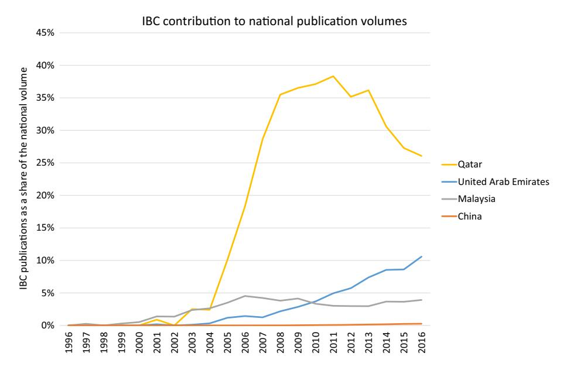
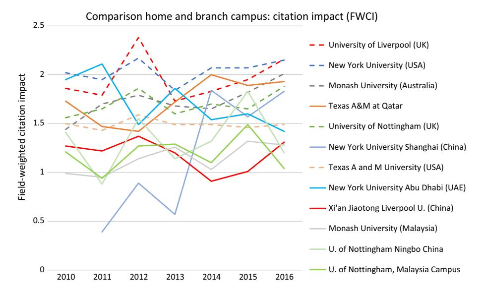
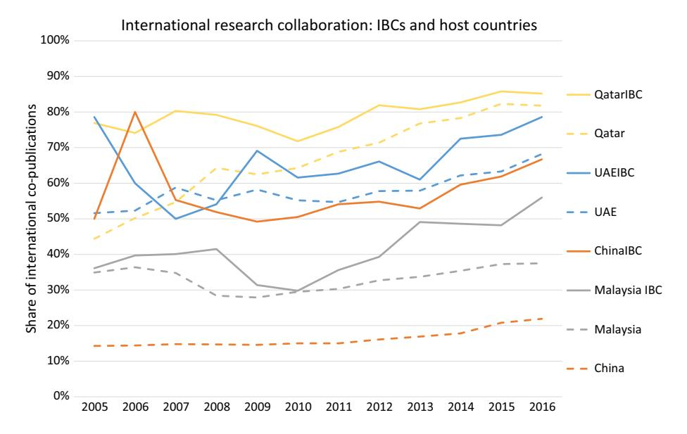
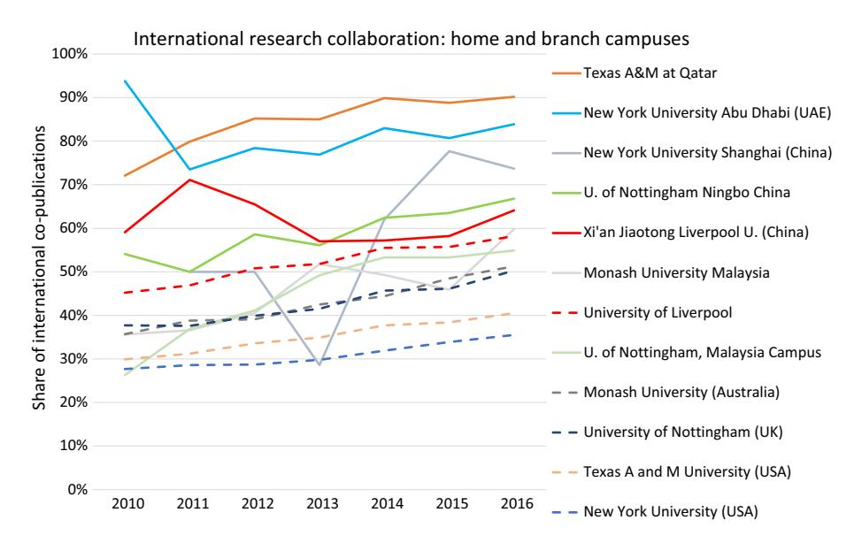
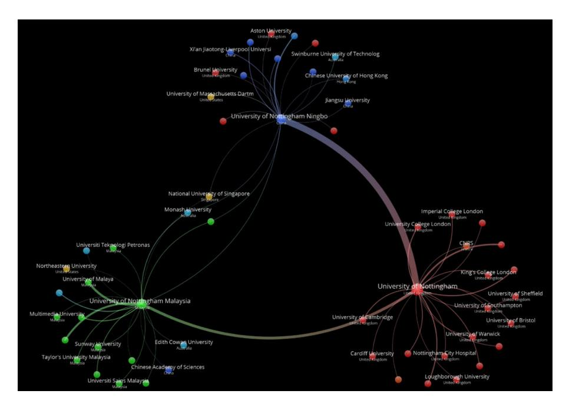

<!-- A2.R37 | source: papers_json/A2.R37/ -->

## Research contributions of international branch campuses to the scientific wealth of academically developing countries

Hans Pohl1,2 • Jason E. Lane2

Received: 29 December 2017/Published online: 11 June 2018

© Akadémiai Kiadó, Budapest, Hungary 2018

Abstract A majority of international branch campuses (IBCs) have been established during the last two decades, with China, Malaysia, Qatar, and the United Arab Emirates being the countries hosting the largest numbers. IBCs are often considered education providers within the host country; but there has been ongoing debate about their role as contributors to the scientific wealth of the host country. This study develops a methodology to investigate the research activity at branch campuses based on their publications. The main methodological challenge was to identify publications from these entities, as they are often not indexed and visible in the publication databases. This was solved through a search query extracting publications with affiliation data including the host country or city for the branch campus as well as the name of the institution. Using the publication sets for each research active IBC, the study illustrates not only that they are increasingly active in research, but also how their publication quality and collaboration patterns relate to their host country as well as to their home institution. The results also indicate that IBCs appear to have a role in the academic research development of some hosting countries; Qatar, the United Arab Emirates and Malaysia.

**Keywords** International branch campus · IBC · Bibliometric analysis

## Introduction

Growing interest is being placed on better understanding the "scientific wealth" of nations, particularly in looking at productivity of research as measured by publications and citations (May 1997; King 2004). This line of research typically focuses on the overall productivity of national tertiary education systems or evaluating efficiency based on the number papers

> ^☐ ^Hans Pohl hans.pohl@stint.se

> The Swedish Foundation for International Cooperation in Research and Higher Education, Stockholm, Sweden

> ^&^lt;sup>2 The University at Albany, SUNY, Albany, NY, USA

<!-- page 2 -->

and citations and the investment in research and development. While much of the work on citation data focuses on developed nations, there is recent focus in understanding the research productivity of developing countries (Gonzalez-Brambila et al. [2016;](#page-14-0) Prathap [2017)](#page-15-0).

The growing focus on developing nation's research productivity comes during a period when nations, from China to the United Arab Emirates (UAE), have made investments in their tertiary education system and in their research and development infrastructure a national priority. Much of this effort is being driven by a belief that a nation's economic competitiveness is significantly impacted by its ability to compete in the knowledge and innovation economy (Lane [2012](#page-14-0)). Indeed, as Wildavsky [(2010)](#page-15-0) noted, the world is in the midst of a Great Brain Race with developing countries seeking to develop their own education and research infrastructure as well as to attract the best and the brightest from around the world. This effort then, in turn, supports the growth of their economy and global economic engagements.

It is typically assumed that a nation advances its educational and research infrastructure by investing in new or existing native institutions. These institutions develop over time, slowly building and contributing to the scientific wealth of the nation. However, in other sectors, the economic development of a nation often develops through foreign direct investment, with foreign economic capital being used to build that sector. Now, a small number of nations have employed a similar strategy of actively importing the existing foreign academic capital developed in another country to support and build their education and research infrastructure (Lane [2011a](#page-14-0), [b;](#page-14-0) Lane and Owens [2012)](#page-14-0). This effort not only purports to build research capacity, it may also ignite international collaborative research efforts.

The most evident example of this transference of foreign academic capital comes through the development of International Branch Campuses. To define an IBC, the most recent definition by the Cross-Border Education Research Team is used: ''An entity that is owned, at least in part, by a foreign higher education provider; operated in the name of the foreign education provider; and provides an entire academic program, substantially on site, leading to a degree awarded by the foreign education provider.'' (CBERT [2017](#page-14-0)). According to CBERT ([2017](#page-14-0)), there were more than 250 such institutions around the world in the last of 2017, with a majority existing in developing nations and founded within the last decade.

While often labelled as being primarily teaching institutions, many of these IBCs are extensions of well-established research universities such as the University of Nottingham (UK), Texas A&M (US), Lomonosov Moscow State University (Russia) and Monash University (Australia). The limited examination of research productivity of branch campuses has been primarily based on interviews and case studies (Lane [2011a,](#page-14-0) [b;](#page-14-0) Lane and Kinser [2011](#page-14-0); Garrett et al. [2016](#page-14-0), [2017)](#page-14-0).

There is a wealth of literature analysing international research collaboration using publication data. Apart from illustrating the trends towards increasing numbers of international co-publications (Royal Society [2011;](#page-15-0) Wagner and Leydesdorff [2005;](#page-15-0) Wagner et al. [2015](#page-15-0)), the research suggests that international co-publications typically are rewarded with higher citation impact (Gla¨nzel [2001)](#page-14-0). The measurement challenges are not negligible (c.f. De Wit [2009](#page-14-0)) and different metrics to capture international collaboration are suggested, among them the Jaccard index (Leydesdorff [2008](#page-14-0)) or the Field-weighted internationalisation score (Pohl et al. [2014](#page-15-0)).

This paper describes a methodology that has been used to investigate all IBCs in the CBERT database. To illustrate the resulting data, it then examines the contribution of IBCs

<!-- page 3 -->

to the research productivity of four developing countries: China, Malaysia, Qatar, and the UAE. These nations were selected as they are the largest importers of IBCs in the world (based on the number of IBCs and the volume of publications) and each nation has actively worked to recruit such institutions through the changing of national policy and/or providing subsidy for their creation. As such, it is understood that the recruitment and support of IBCs has been a purposeful component of each nation's efforts to build their education and research infrastructure.

It could be argued that IBCs are similar to double or multiple affiliations, but on institutional level. On author level, it has been demonstrated that multiple affiliations tend to increase and that there is a link between the number of affiliations and the impact of the author's publications (Hottenrott and Lawson [2017](#page-14-0)). This study will investigate whether IBC initiatives also result in higher impacts.

There are two major contributions of this paper. First, this is an initial attempt to capture research productivity among IBCs based on their publication volumes and citation impact. Until now, the productivity of these institutions has been counted as part of the national productivity and/or the productivity of the home campus. The methodology developed for this paper seeks to identify IBCs as standalone institutions, capturing their productivity as distinct from the nation in which they live and distinct from their home campus. Second, the paper evidences the contributions of IBCs to the overall scientific wealth of a nation, which in some cases is quite significant relative to that of the domestic institutions.

## The development of IBCs

While often viewed a more recent phenomenon, IBCs can be traced back to at least the 1920s when Parsons Fashion School in New York established a branch in Paris in order to create an academic home in what was then the fashion capital of the world. However, growth of such institutions during the next five decades was sporadic such as Johns Hopkins opening in Italy in the 1960s, Florida State in Panama in the 1970s, and Webster University (US) opening in Geneva also in the 1970s. The development of these institutions was driven mostly by the home campus and the IBC remained largely under the regulatory radars providing small numbers of programs to small numbers of students (Lane [2011a,](#page-14-0) [b](#page-14-0)).

The transforming economic order of the world first influenced IBC growth during the 1980s, when more than 30 U.S. institutions were recruited by Japanese leaders to set up in Japan as part of a larger effort by Japanese leaders to strengthen ties between what were then the two largest economies in the world (Chambers and Cummings [1990](#page-14-0)). Most of these efforts folded after the recession hit the Japanese economy in the late 1980s, with only IBCs of Temple University and Lakeland remaining today.

It was the 1990s that witnessed the beginning of the boom in terms of IBC growth, with approximately 40 IBCs founded throughout the decade, half from the United States. Other early exporters included Australia, Chile, China, France, Ireland, Italy, Kenya, Russia, Sweden, and the United Kingdom. The host countries, those importing IBCs, were even more diverse covering Asia, Africa, Europe, the Middle East, South America and North America. The late 1990s saw countries such as Malaysia, Qatar, and the UAE become more active in the purposeful recruitment of such institutions as a means to diversify their educational options and seeking to building capacity within the domestic education system.

<!-- page 4 -->

The most significant growth would occur in the 2000s, with the number of IBCs more than doubling from 84 in 2000 to 198 in 2010. This number would increase by another 25% in the following 5 years to 250 in 2015.

In nearly every case, IBCs seem to have developed initially as teaching-focused institutions and both popular media and scholarship have highlighted this role, sometimes being critical of the perceived lack of research activity. However, anecdotal evidence uncovered by the researchers suggested that some IBCs were engaging in research and activity seeking to support such activity among faculty. This study is an exploratory effort to provide an empirical examination of the research activity of IBCs.

## Data and methodology

The purpose of this study is to develop and test a methodology to investigate the research performance of IBCs. For standard higher education institutions (HEIs), this is a relatively standardized activity as publication data is easily accessible in tools such as SciVal. Even though there always are distinguishing details that might have to be considered, the data represents the research productivity of standard HEIs fairly well. But for IBCs, the study is a bit more complicated as they are rarely indexed as independent organisations, and, to our knowledge, no such previous examination of IBC research productivity has been conducted, suggesting there has been little, if any, validation of the veracity of the data. For example, our examination revealed that many of the IBCs independently indexed in the citation databased proved to have an incomplete associated publication, necessitating additional steps to identify the full record.

Below follows a step-by-step description of how we extracted and analysed the publications made by IBCs. The data used for this study was for 1996–2016, the last full year for which the full citation data was available.

First, we identified the existence and location of IBCs worldwide. Unfortunately, IBCs are not systematically tracked by any government or non-governmental organization. As such, the CBERT began chronicling the existence of IBCs in 2010 and, today, keeps the most comprehensive list of known IBCs in the world. This list was used to identify the IBCs targeted in this study (CBERT [2017)](#page-14-0) and we complemented the existing CBERT publicly available database of 250 IBCs with the name of the city where each IBC is located.

The next step was to gather the bibliometric data for each IBC. To do so, we used the bibliometric data compiled by Scopus, which is ''the largest abstract and citation database of peer-reviewed literature: scientific journals, books and conference proceedings'' (Elsevier [2017a)](#page-14-0). For a part of the analysis of the Scopus data, SciVal was used. SciVal is a tool provided by Elsevier to facilitate the analysis of publication data (Elsevier [2017b](#page-14-0)).

A Scopus search query was designed for the identification of publications from each IBC. In the same affiliation post it was required that the following conditions should be true:

(the name of the home HEI or the IBC) and (the name of the IBC host country or the name of the IBC host city)

<!-- page 5 -->

This relatively generous search query was necessary as affiliation policies and practices differ very much between institutions as well as between journals. Fortunately, the Scopus system allows for an iterative approach where the results can be directly checked and, if necessary, the query modified.

To further increase the quality and accuracy of the data, three approaches were used:

- The data was manually reviewed by one of the article co-authors and the CBERT codirector to identify any glaring errors in terms of the missing institutions or data that appeared to be different from what we would expect based on knowledge of the institution.
- The findings from Scopus query were compared with the data available in SciVal for the twelve IBCs indexed in that database.
- The data was then cross-checked with the founding year of the IBC to ensure that publications prior to the founding of the institution were examined further.

If questions were raised about the data for a particular IBC, a further analysis of the Scopus query sometimes revealed small but important details to change, particularly in how authors listed their affiliations. Some examples:

- Several, but not all, Hong Kong publications use affiliations with China as the country. This led to high volumes for Hong Kong IBCs in China. To solve this, only the affiliation city in China was used.
- There were discrepancies in how the country's name was spelled (e.g., Vietnam or Viet nam).
- There were discrepancies in how the author's institution was labelled (e.g., NYU or New York University).

After this quality check, lists with the DOI (digital object identifier) number for each publication were made for the IBCs with 10 or more publications. Lists were also made for each host country and one list was made for the world. These lists were then imported into SciVal for analysis. This process removed duplicates in each publication set. In the SciVal benchmarking module, the publication sets were selected and different dimensions such as volume, citation impact, international collaboration and academic-corporate collaboration were examined. Data was exported to Excel for further analysis.

When looking at collaborations, SciVal was not possible to use for all collaborations. For example, if we want to know the number of co-publications between an un-indexed IBC and its home institution, this is not possible in SciVal. To solve this, we had to use the initial search queries in Scopus combining the IBC and the host institution.

## Publication volume development

Among the 250 IBCs for which we sought publication information, 149 had at least one publication noted in Scopus. In order to further hone the focus on institutions where there was at least some sustained research effort, we then further refined the search to identify IBCs with at least 10 publications in the record. This refinement revealed that 93 of the 250 IBCs (or 37.2%) had at least 10 publications reported in the database. In terms of overall productivity of the global IBC sector, this simplification equals the removal of 164 publications, or only 0.8% of the total publications found for all IBCs. Importantly, this data also demonstrates that several IBCs remain research inactive.

<!-- page 6 -->

*Fig. 1 Publication volumes from 93 IBCs, annual and accumulated*

In Fig. 1, the development of IBC publication volumes is indicated for all 93 IBCs together. The number of annual publications is represented by a line with the scale on the left-hand side of the Figure, while the total accumulated number of publications is the area with scaling along the right-hand side. For the 20-year period shown here (1996–2016), the overall productivity remained almost non-existent for the first 5 years, then begins a period of slow growth, with sharp increases in productivity starting around 2009–2010.

The number of IBCs in each country has increased rapidly and in Table 1, the total numbers of IBCs in each of the four largest host countries are presented as well as the number of IBCs with at least 10 publications. Overall, IBCs in Malaysia and Qatar are research engaged; whereas fewer than half of IBCs in China and the UAE produced at least 10 publications.

In terms of publication volumes, the IBCs in China are most productive with a total annual volume approaching 1700 in 2016. Thereafter follow Malaysia, the UAE and Qatar as host countries for research active IBCs. But in relation to the total national volume of publications, the development is a bit different among these countries, see Fig. [2.](#page-6-0) Whereas the IBC share of the Chinese publication volume is less than one per cent, the IBCs in the other three nations contribute not insignificantly to the nation's research productivity. The

<!-- page 7 -->

*Fig. 2 IBC share of all publications in each country*

contribution of IBCs in Malaysia to the Malaysian research productivity was increasing beyond 5% in 2016. In the UAE, IBC contributions were levelling out just above 10%. Qatar was the outlier of the group with IBCs contributing between 25% and nearly 40% in the decade between 2007 and 2016. Figure 2 also indicates the importance for analysing IBC within the context of the host country as educational, political, cultural, economic, and governmental factors all contribute to understanding the impact of the productivity. Qatar IBCs have produced far fewer publications than IBCs in China, but the effect on the research ecosystem in Qatar is far greater than in China.

## Citation impact of IBC research

When looking at the quality of research, we used the indicator Field-weighted citation impact (FWCI). This indicator compares the number of citations a publication receives with other publications in the same scientific field, the same type of publication and the same year. If FWCI equals one, the impact of the publication equals the world average (Elsevier [2014)](#page-14-0). An FWCI above one indicates that citation count is above average; while an FWCI below one indicates it is below average. For all 93 IBCs together, FWCI has been around or above one during the last decade, suggesting that overall, the impact of the research produced by IBCs is above average. However, to further examine the concept of quality, we compared to the FWCI of IBC publications to that of their home institution; and we compared the cohort of IBCs within a given nation to the cohort of native HEIs in the host country.

In Fig. [3,](#page-7-0) the FWCI is presented with a dotted line for the host countries (including the IBC publications) and with the solid line for the IBCs in that country. It indicates that the IBCs with very few exceptions have a higher citation impact each year. The differences are

<!-- page 8 -->

Comparison host country and IBC: citation impact (FWCI)

*Fig. 3 FWCI for IBC host countries and their IBCs*

relatively large except for the publications in the UAE. If the IBCs were extracted from the overall grouping, it is expected that the difference would be even greater.

Thus, beyond merely analysing the overall productivity, the data indicates that IBCs contribute to the overall citation impact of publications as well. In China, for example, while the overall number of IBC publications accounts for a few small proportion of the nation's overall productivity, that group of publications appear to have significantly greater impact compared to the nation's overall productivity. Why this difference exists needs further examination.

We should note that the extent to which a publication is cited may be influenced by many factors such as reputation of the scholar, reputation of the institutional affiliation, type of journal and publication and so forth. Thus, while FWCI provides insight into impact in the field; further comparison of IBC and native institution FWCI may yield new knowledge about what factors into whether a particular publication is cited by other scholars.

We also compared citation data between the IBC and the home institution. Based on the accumulated publication volume production and IBC locations in the four countries previously analysed in this paper, we selected five home campus-branch campus dyads or triads to examine.

- University of Liverpool and its IBC in China
- Monash University is based in Australia and has a branch campus in Malaysia
- The University of Nottingham, based in the United Kingdom, has IBCs in China and Malaysia
- Similarly, New York University from the United States has campuses in China and the United Arab Emirates
- Texas A&M, also from the United States, has a campus in Qatar.

<!-- page 9 -->

These grouping include the two most research productive IBCs in Malaysia and the single most productive IBC in China, Qatar and the UAE for this part of the study. In Fig. 4, the FWCI for these home institutions with branch campuses are indicated for the period 2010–2016. Home campuses are illustrated using dotted lines, while IBCs are represented using solid lines of the same or similar colour.

As seen in Fig. 4, FWCI can fluctuate markedly year to year. During the time period of 2014–2016, the FWCI for all home and host campuses exceed 1.0, suggesting the impact of the research above average. In the period 2010–2013, NYU-Shanghai had a low FWCI, likely due to it being officially founded in 2012. (There are 2 publications appearing in 2011, 2 in 2012, 7 in 2013 and 50 in 2014, suggesting that those working on its development may have also been producing research.) However, its FWCI quickly spiked and has maintained between 1.5 and 2.0 from 2014 to 2016, above that of its sister IBC in the UAE.

In the aggregate the FWCI of the home campus is almost always higher than that of the IBC(s). The noted exception is the case of Texas A&M at Qatar, which has a FWCI of nearly 2 in the later years of the analysis (2013–2016), while the home campus in the United States has a FWCI of around 1.5.

## International and corporate collaborations

Almost by definition, the IBCs are likely to have substantial international collaboration. If the home campus and the IBC are viewed as separate entities, there is likely to be a high level of collaboration between these dyads. In addition, many nations have sought to import IBCs with an expectation that they will collaborate with the native HEIs (McBurnie and Ziguras [2007](#page-15-0); Lane and Owens [2012)](#page-14-0). The data used in this study allows us to begin to

*Fig. 4 Comparison FWCI for home institutions and their IBCs*

<!-- page 10 -->

empirically explore whether these expectations are reflected in the actual actions of IBC researchers.

To begin to examine this phenomenon, we calculated the percentage of the overall research productivity that included international collaboration, as defined by having at least two authors identifying with two different nations. We then compared the average percentage of international collaboration of a national cohort of IBCs with the overall average of international collaborations in that nation (Fig. [6)](#page-10-0). This analysis is followed by a comparison of the individual IBC and the home campus, also in terms of international collaborations.

Figure 5 shows that IBCs in the four countries analysed have higher rates of international collaboration than the overall publication volume in that country. Sometimes the IBC and overall rates of collaborations tracked closely, such as the case in Qatar and very likely because most often international collaboration was conducted by the IBCs. In China, the IBCs significantly outpaced the overall international collaboration of the nation.

The IBCs are also more international than their home institutions, see Fig. [6.](#page-10-0) The universities in the USA exhibit large differences, whereas the difference in the share of international co-publications is smaller for Australia and the United Kingdom.

Another type of collaboration is between the academy and corporate actors. Data indicates that the IBCs appear to behave as the host country at large, compare Fig. [7](#page-10-0). A closer look at data reveals large differences among the IBCs, whereas the Texas A&M branch campus in Qatar has had an even lower share of academic-corporate co-publications than its home campus with a share of 2.9%, other IBCs in Qatar have had shares above 30%.

As a final example of what this unique data set can shed some light on, we used the Vosviewer tool to map the collaborations between the University of Nottingham and its two campuses in Malaysia and China (Vosviewer [2017](#page-15-0)). The IBCs of University of Nottingham are both among the seven largest producers of Scopus publications and thus

*Fig. 5 Share of international co-publications, IBCs and their host country*

<!-- page 11 -->

*Fig. 6 Share of international co-publications for home and branch campuses*

*Fig. 7 Academic-corporate co-publications*

clearly the largest group of three campuses. In Fig. [8](#page-11-0), the 20 largest co-publishing entities with each of the three campuses are mapped. The colours indicate that each campus mainly has collaborators in the country where it is located. Interestingly, none of the home campuses' top collaborators are shared with the branch campuses. However, they share a couple, among them the National University of Singapore. The size of the line corresponds

<!-- page 12 -->

*Fig. 8 University of Nottingham with branch campuses in China and Malaysia*

to the number of co-publications and there are obviously, as expected, many co-publications between the home campus and its branches.

## Discussion

The main contribution of this paper is the development of a methodology that allows for the study of research at IBCs. This methodology allows for identifying publications that are tied specifically to IBCs (rather than to their home campus). From a methodological standpoint, it is based on high quality data and uses indicators that are well established and often used to quantify the impact of research. The approach does indeed involve some manual iterations to identify publication sets for each IBC with sufficient quality. But this is a single effort that must not be repeated from scratch, when following studies of the rapid development of IBC research are made. Then only queries for the new IBCs must be designed and tested.

Among the methodological weaknesses, the use of publications as the only indicator for research activity is a limitation. Other indicators exist but publication data is by far the most used one. Another potential weakness is the affiliation policy that differs between countries, institutions and researchers. A part of the faculty working at an IBC are only temporarily at the branch campus. It is likely that some of them only use the home institution as an affiliation, even though the research at least partly was carried out at the IBC. This and similar weaknesses contribute to lower publication volumes.

On the other hand, several authors probably use multiple affiliations. This study is based on 'whole counts', i.e. a publication with one affiliation meeting the criteria is calculated as one publication, even though there might be several authors and affiliations that do not

<!-- page 13 -->

meet the criteria in the same publication. An alternative approach is to split the publication in fractions per affiliation (or author). This has not been done and the whole count approach contributes thus to higher publication volumes.

When we analyse the research productivity of the entire known population of IBCs, it remains that less than 40% of the IBCs can be considered to have even a minimum level of research productivity (i.e., having produced at least 10 publications). Thus, we confirm that this sector of higher education, overall, is likely primarily teaching focused. However, it is also true that it cannot be claimed that the sector is entirely research-inactive. Of the 93 research active IBCs, they have produced nearly 22,500 publications from 1996 to 2016 and were collectively producing more than 3500 publications in 2016.

To more fully understand the research profile of IBCs, we conducted further exploratory analysis of the group of IBCs in four countries where the IBCs were the most research active; China, Malaysia, Qatar, and the UAE. We specifically chose the countries with high levels of IBC research productivity in order to illustrate the how the methodology developed in this paper provides insights into the topic. While there is a global cohort of IBCs, they each exist within national contexts as IBC productivity is impacted by and impacts upon the nations in which they exist.

The IBCs are young in comparison to their home campuses. However, they are mainly also located in countries, which relatively recently started to increase the investments in the higher education sector substantially. As shown in Figs. [1](#page-5-0) and [2,](#page-6-0) the volumes increase rapidly in absolute numbers but in comparison to the host country's publication volume development, the share appears to have stabilised in three of the four main host countries. This is due to the overall very rapid development of publication volumes in the host countries. It could be discussed whether the existence of the IBCs has contributed to trigger existing HEIs in the host countries to increase their research activity, but this study does not allow for any conclusions in this regard. China represents a different type of situation. In this case, even though the productivity of IBCs is substantive, the number of IBCs relative to the number of institutions in China is quite small. As such, the contribution is very small in comparison to the national volume and it is therefore not possible to tell much about the impact that IBCs have had based on this data. Additional research is needed to further unpack the role of IBCs in the host country's research ecosystem.

Next, we compared the citation impact of the IBCs with their home campuses as well as their host countries. With only one exception (Texas A&M in Qatar), the comparison shows that the highest FWCI is received by the home campus and the lowest FWCI is received by the host country. The IBCs have a FWCI in between. Given that it typically requires a long time-period to establish institutions capable of delivering high-quality research, it could be argued that the IBCs appear to have managed this very rapidly. Obviously, this is also part of the idea when importing branch campuses, they are expected to be a shortcut to high quality education, and, as our study indicates, sometimes also to research.

The analysis of the share of international co-publications indicates that the IBCs collectively are more international than their host countries and individually more international than their home campuses. In this dimension, it could therefore be argued that IBCs contribute to higher degrees of international co-publications in both directions. The only exception to this trend occurring to prior to 2010, when the UAE IBC collaboration dipped below that of the overall sector. We examined this issues in part, with the data suggesting that this was due to an emergence of other international research partnerships supported by the UAE government (Lane and Pohl [2017)](#page-14-0). Additional research is needed to further understand what may cause the differences and the role of IBCs in fostering more

<!-- page 14 -->

international connections in the host country. When it comes to collaboration with corporate actors, the IBCs appear to follow the traditions in the host country. A closer study of the interactions with the local society would be interesting. Further studies could add patenting data to investigate technology transfer activities involving IBCs.

For one of the two HEIs with two IBCs, Nottingham University, a cluster map shows the co-publication links to their main partners. The links between the home campus and its IBCs are relatively strong, which to some extent probably depends on the sharing of some parts of the faculty. Another motive is of course the management links that exist, which to some extent may promote collaboration between the campuses. But apart from these links to the home campus, the main partners for the Malaysian campus are to a large extent in Malaysia, and the IBC in China has some large partners in China but a somewhat more international mix. The recruitment policy influences the mix of research partners as researchers tend to bring their existing partners along when they move from one HEI to another. If the researcher mainly was educated in Malaysia, it is likely that the network to Malaysian institutions is strong. Another factor influencing might be the availability of local research funding and under which conditions such funding is granted.

Again, it should be noted that the IBCs have not been research active many years and it is likely that the research network will develop and change over time. In line with this, they are also relatively small, which in turn calls for collaboration as the critical number of researchers may not exist in-house. Another aspect to consider is whether the IBCs are comprehensive or more specialised.

In the introduction it is mentioned that international collaboration often leads to higher citation impact (Gla¨nzel [2001)](#page-14-0) and that multiple affiliations have the same consequences. The results of this study of the top four host countries indicate that this is true when comparing the IBCs with their host countries. In these cases, the IBCs are typically more international, and their research gets higher FWCI. But when comparing the IBCs with their home campuses, the opposite relationship dominates. The home institutions are less international but receive higher citation impact.

## Conclusions

The purpose of this work was to develop and test a methodology to study the research activity of international branch campuses (IBCs). Publications were extracted using search queries combining the name of the home or branch campus institution and a localisation in the host country or city. Due to large variations in affiliation policies on different levels, from the journals to the institutions and countries, the methodology required in some cases a few iterations to give data with acceptable quality.

The obtained publication sets were analysed and presented showing how IBCs, their host countries and their home institutions relate to each other in terms of volume development, publication quality and collaboration. One implication from the study is that IBCs, despite the general perception that they are education providers, actually are quite active in research as well.

This paper also provides exploratory insights into the potential research contributions of IBC, both as a collective sector of higher education as well as their specific contributions to the research ecosystem of host nations. The four exploratory national cases used in this study suggest that in situations when IBCs comprise a substantive number of the overall

<!-- page 15 -->

universities in a country, they have the potential to also be significant contributors to the overall research productivity, research quality, and international research collaborations.

When comparing the citation impact of the IBCs in China, Malaysia, Qatar and the United Arab Emirates, they tend to enjoy higher citation impact than their host country, but lower than their home campus. On the other hand, they have typically a higher share of international co-publications than both the host country and the home campus.

## References

- CBERT. (2017). Cross-border education research team branch campus listing. [Data originally collected by Kevin Kinser and Jason E. Lane]. Albany, NY: CBERT. [http://cbert.org/branchcampuses.php.](http://cbert.org/branchcampuses.php) Accessed 27 Dec 2017.
- Chambers, G., & Cummings, W. K. (1990). Profiting from education: Japan-United States international education ventures in the 1980s. IIE research report 20, Institute for International Education, New York.
- De Wit, H. (2009). Measuring success in the internationalisation of higher education. EAIE occasional paper 22, EAIE, Amsterdam, Netherlands.
- Elsevier. (2014). SciVal metrics guidebook. [https://www.elsevier.com/__data/assets/pdf_file/0020/53327/](https://www.elsevier.com/__data/assets/pdf_file/0020/53327/scival-metrics-guidebook-v1_01-february2014.pdf) [scival-metrics-guidebook-v1_01-february2014.pdf](https://www.elsevier.com/__data/assets/pdf_file/0020/53327/scival-metrics-guidebook-v1_01-february2014.pdf). Accessed 27 Dec 2017.
- Elsevier. (2017a). Scopus. [https://www.elsevier.com/solutions/scopus.](https://www.elsevier.com/solutions/scopus) Accessed 27 Dec 2017.
- Elsevier. (2017b). SciVal. [https://www.elsevier.com/solutions/scival.](https://www.elsevier.com/solutions/scival) Accessed 27 Dec 2017.
- Garrett, R., Kinser, K., Lane, J. E., & Merola, R. (2016). International branch campuses: Trends and developments, 2016. London: The Observatory for Borderless Higher Education and Cross Border Education Research Team.
- Garrett, R., Kinser, K., Lane, J. E., & Merola, R. (2017). International branch campuses: Success factors of mature IBCs, 2017. London: The Observatory for Borderless Higher Education and Cross Border Education Research Team.
- Gla¨nzel, W. (2001). National characteristics in international scientific co-authorship relations. Scientometrics, 51(1), 69–115.
- Gonzalez-Brambila, C. N., Reyes-Gonzalez, L., Veloso, F., & Perez-Ango´n, M. A. (2016). The scientific impact of developing nations. PLoS ONE, 11(3), e0151328. [https://doi.org/10.1371/journal.pone.](https://doi.org/10.1371/journal.pone.0151328) [0151328.](https://doi.org/10.1371/journal.pone.0151328)
- Hottenrott, H., & Lawson, C. (2017). A first look at multiple institutional affiliations: A study of authors in Germany, Japan and the UK. Scientometrics, 111, 285–295.
- King, D. A. (2004). The scientific impact of nations. Nature, 430, 311–316. [https://doi.org/10.1038/](https://doi.org/10.1038/430311a) [430311a](https://doi.org/10.1038/430311a).
- Lane, J. E. (2011a). Global expansion of international branch campuses: Managerial and leadership challenges. In J. E. Lane & K. Kinser (eds) Multinational colleges and universities: Leading, governing and managing international branch campuses, New directions for higher education, 155. San Francisco: Jossey-Bass.
- Lane, J. E. (2011b). Importing private higher education: International branch campuses. Journal of Comparative Policy Analysis, 13(4), 367–381.
- Lane, J. E. (2012). Higher education and economic competitiveness. In J. E. Lane & D. B. Johnstone (Eds.), Universities and colleges as economic drivers: Measuring and building success (pp. 1–30). Albany, NY: SUNY Press.
- Lane, J. E., & Kinser, K. (2011). Reconsidering privatization in cross-border (higher education) engagements: The sometimes public nature of private activity. Higher Education Policy, 24, 255–273.
- Lane, J. E., & Owens, T. (2012). The International Dimensions of Economic Development. In J. E. Lane & D. B. Johnstone (Eds.), Universities and colleges as economic drivers: Measuring and building success (pp. 205–238). Albany, NY: SUNY Press.
- Lane, J. E., & Pohl, H. (2017). Research capacity building and branch campuses. International Higher Education, 89, 14–16.
- Leydesdorff, L. (2008). On the normalization and visualization of author co-citation data: Salton's Cosine versus the Jaccard index. Journal of the American Society for Information Science and Technology, 59(1), 77–85.
- May, R. M. (1997). The scientific wealth of nations. Science, 275(5301), 793–796.

<!-- page 16 -->

- McBurnie, G., & Ziguras, C. (2007). Transnational education: Issues and trends in offshore higher education. London: Routledge.
- Pohl, H., Warnan, G., & Baas, J. (2014). Level the playing field in scientific collaboration with the use of a new indicator: Field-Weighted Internationalization Score. Research Trends, 39, 3–8.
- Prathap, G. (2017). Scientific wealth and inequality of nations. Scientrometrics, 113(2), 923–928.
- Royal Society. (2011). Knowledge, networks and nations: Global scientific collaboration in the 21st century. RS Policy document 03/11, The Royal Society, London, UK.
- Vosviewer. (2017). Centre for Science and Technology Studies. Leiden: Leiden University.
- Wagner, C. S., & Leydesdorff, L. (2005). Network structure, self-organization, and the growth of international collaboration in science. Research Policy, 34(10), 1608–1618.
- Wagner, C. S., Park, H. W., & Leydesdorff, L. (2015). The continuing growth of global cooperation networks in research: A conundrum for national governments. PLoS ONE, 10(7), e0131816. [https://doi.](https://doi.org/10.1371/journal.pone.0131816) [org/10.1371/journal.pone.0131816.](https://doi.org/10.1371/journal.pone.0131816)
- Wildavsky, B. (2010). The great brain race: How global universities are reshaping the world. New Jersey: Princeton University Press.

