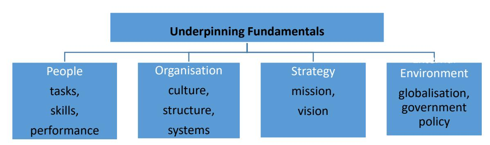
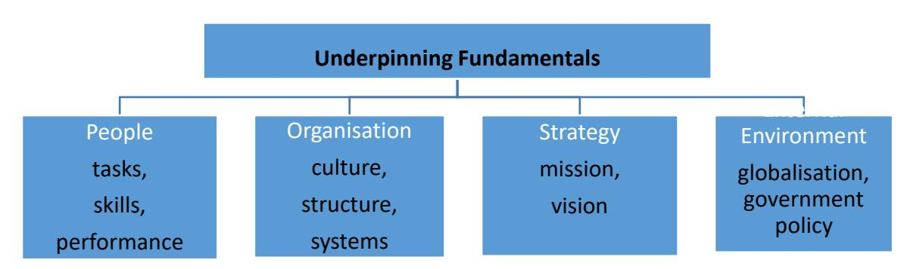
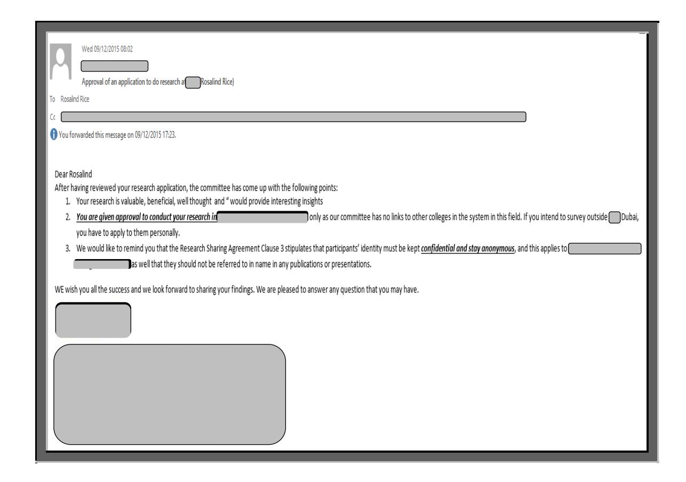

<!-- A2.R39 | source: papers_json/A2.R39/ -->

**The Impact of Globalisation on Higher Education in the United Arab Emirates:**

**Practitioner Perspectives of one Higher Education Institution**

**Thesis submitted in accordance with the requirements of** **the University of Liverpool** **for the degree of Doctor of Education**

**by**

**Rosalind Rice**

**December 2018**

<!-- page 2 -->

ProQuest Number: 28018248

## All rights reserved

## INFORMATION TO ALL USERS

The quality of this reproduction is dependent on the quality of the copy submitted.

In the unlikely event that the author did not send a complete manuscript and there are missing pages, these will be noted. Also, if material had to be removed, a note will indicate the deletion.

## ProQuest 28018248

Published by ProQuest LLC ( ). Copyright of the Dissertation is held by the Author. 2020

All Rights Reserved.

This work is protected against unauthorized copying under Title 17, United States Code Microform Edition © ProQuest LLC.

ProQuest LLC 789 East Eisenhower Parkway P.O. Box 1346 Ann Arbor, MI 48106 - 1346

<!-- page 3 -->

## **ABSTRACT**

**The Impact of Globalisation on Higher Education in the United Arab Emirates: ** **Practitioner perspectives of one Higher Education Institution.**

## **Rosalind Rice**

The purpose of this research is to create new knowledge about the ways in which a given Higher Education Institution (HEI) within the United Arab Emirates (UAE) is responding to globalisation. This unique setting is being impacted by local influences (for example Emiratisation) and global forces (for example internationalisation and the growth of knowledge economies). Demands are being made by both the UAE Government and by society in general, resulting in new expectations of the role of Higher Education. The research questions focus on drawing out the knowledge that participants had of global issues by inquiring into ways in which globalisation is driving the change impacting the institution being studied (hereafter known as *The* *College*), educational policy changes resulting from these change factors, and considering the implications for practice.

The research has been informed by the work of Clark (1983), where state, market and academic oligarchy are represented in his 'triangle of coordination'. This has provided a robust model, sufficiently flexible to allow for an original interpretation of the views put forward by the participants. The research is qualitative in design, consisting of semi-structured individual interviews. Data was collected regarding professional practitioners' perspectives on the global factors impacting on HE in the UAE. The inquiry also investigates the ways in which HE and *The College* are perceived to be changing in response to global issues. Adopting a social constructivist approach has allowed an interpretive framework to be used to understand the ways in which practitioners viewed their environment. Furthermore, the theoretical basis for studying *The College* is multi-level, extending from HE practice, to policy, government agendas and internationalisation. The need for this study, is strengthened by the most recent announcement underlining the government's desire to prepare for the declining importance of oil production by re-orientating the UAE's economy to that of a knowledgebased society (Nagraj, 2015).

The findings reveal that globalisation is disrupting the UAE's HE sector, prompting the national government to introduce policy changes, resulting in

<!-- page 4 -->

institutions interpreting global change factors in a way that satisfies the nuances of this setting. From the perspective of those interviewed, *The * *College *has been engaged in an ongoing change process for many years, impacting all aspects of the organisation, including its functions, procedures and behaviours. The research argues that the data demonstrates that the relationship between government, organisation and practitioners is complex, particularly when set against a changing global HE framework. The need to build a sustainable HE system in the context of the UAE is highlighted and the recommendation is that a cohesive approach to change is necessary. A prototype of a structured approach to change implementation is presented in this thesis. This graphical representation is informed by Lewin (1951) and Burke-Litwin (1992) in terms of critically analysing the elements necessary for meaningful change to take place. The research, therefore, makes an important contribution to constructing an understanding of the complexity of change taking place within *The College*.

<!-- page 5 -->

## **TABLE OF CONTENTS **

AbstractiiTable of ContentsivList of Tables and FiguresixStatement of Original AuthorshipxAcknowledgementsxiAbbreviationsxiiForeword1My Personal and Professional Profile2Background: My Areas of Interest3Research Locale4Summary7Chapter 1: Introduction91.1 Research Setting91.2 Contextual Background of the Study131.2.1 History and Context of the UAE131.2.2 Vision 2021161.2.3 Higher Education in the UAE171.2.4 Innovation181.2.5 Higher Education Not Meeting Employers' Expectations191.2.6 Sustainable Employment191.3 Study Objectives201.4 Research Problem and Key Research Questions211.5 Contribution231.6 Research Approach231.7 Thesis Overview24Chapter 2: Literature Review272.1 Higher Education Issues in the UAE292.1.1 Context292.1.2 The College, Its Mission and Vision322.1.3 Categories of Literature342.2 Globalisation352.2.1 Definition of Globalisation362.2.2 Globalisation as a Concept382.2.3 Globalisation – Its impact on HE globally402.2.4 Globalisation as It Applies to HE in the UAE432.2.5 Internationalisation452.2.6 Internationalisation as It Applies to HE in the UAE462.2.7 Internationalisation and UAE Culture492.2.8 UAE: Globalisation, Internationalisation and External Influences532.3 Cross-cultural Issues582.3.1 Hofstede's Dimensions of National Culture602.3.2 Cross-cultural Issues in *the College*622.3.3 Implications for the Leadership of *The College*632.3.4 Organisational Culture642.3.5 Cross-cultural Communication642.3.6 Cultural Influences in the UAE652.3.7 Leadership as a Cultural Issue in the UAE682.4 Change712.4.1 Change as an Organisational Concept722.4.2 Change in HE in the UAE742.4.3 Implications of Policy and Policy Changes762.4.4 Government Policy: Emiratisation782.5 Possible Future HE Developments802.5.1 Development of HE in the UAE822.5.2 Economic Growth in the UAE862.5.3 Protecting Culture and Traditions862.5.4 Human Capital882.5.5 Employability892.5.6 Current Issues in HE in the UAE902.6 Concept of Identity in Higher Education922.6.1 Organisational Identity93

<!-- page 6 -->

<!-- page 7 -->

2.6.2 Interpretations of Identity in Higher Education962.6.3 Identity of Higher Education in the United Arab Emirates992.6.4 Culture and Influence1012.7 Theoretical Framework1042.7.1 Change Models of Lewin (1951) and Burke and Litwin (1992).1042.7.2 Lewin's Change Theory (1951)1052.7.3 Burke and Litwin's Change Theory (1992)1072.7.4 Combining Lewin (1951) and Burke and Litwin's (1992) Change Theories1082.7.5 Clark's Triangle of Coordination (1983)1092.8 Summary112Chapter 3: Methodology1143.1 Approach1153.1.1 Theoretical Perspective1203.1.2 Social Constructivism1203.1.3 Origins of Social Constructivism1213.1.4 Assumptions1233.1.5 Limitations of Social Constructivism1243.2 Site and Subject Selection1263.2.1 Subject Selection1263.2.2 Sample1293.3 Research Methods – Interviews and Data Collection1303.3.1 Qualitative Interviews1313.3.2 Rationale for Qualitative Interviews1313.3.3 Limitations of Semi Structured Qualitative Interviews1343.3.4 Qualitative Interview Design1353.3.5 Qualitative Interview Process1393.4 Data Analysis1403.4.1 Use of Software in Analysis: NVivo1413.4.2 Procedure1423.4.3 Identification of Themes1443.5 Researcher Positioning1483.1.4 Assumptions1233.1.5 Limitations of Social Constructivism1243.2 Site and Subject Selection1263.2.1 Subject Selection1263.2.2 Sample1293.3 Research Methods – Interviews and Data Collection1303.3.1 Qualitative Interviews1313.3.2 Rationale for Qualitative Interviews1313.3.3 Limitations of Semi Structured Qualitative Interviews1343.3.4 Qualitative Interview Design1353.3.5 Qualitative Interview Process1393.4 Data Analysis1403.4.1 Use of Software in Analysis: NVivo1413.4.2 Procedure1423.4.3 Identification of Themes1443.5 Researcher Positioning148

<!-- page 8 -->

SectionPage3.5.1 Researcher and Participants143.5.2 Role of the Researcher143.5.3 Insider Research153.5.4 Researcher Bias153.6 Trustworthiness and Reliability153.7 Triangulation153.8 Ethical Issues163.8.1 Confidentiality and Anonymity163.9 Summary16**Chapter 4: Findings: Results and Discussions****16**4.1 Framework for Presenting Results and Discussion164.2 Thematic Categories174.3 Cultural Background of Participants174.4 Global Theme174.4.1 Change and the Changing World174.4.2 Demographics184.4.3 Quality and Accreditation184.4.4 Innovation194.5 Government Theme194.5.1 Role of Government194.5.2 Government Initiatives194.5.3 Government Policy204.6 Organisation Theme204.6.1 Identity204.6.2 Changing Organisation214.6.3 Leadership224.6.4 Communication224.6.5 The Way Forward224.7 Summary22**Chapter 5: Conclusions and Recommendations****23**5.1 Study Contribution235.1.1 Study Relevance235.2 Implications for Practice2345.2.1 Impact Within the Organisation2365.2.2 Impact Outside the Organisation2425.3 Study Limitations2465.4 Recommendations and Proposed Model for Change2485.4.1 Proposed Model for Change2495.4.2 Rationale for Model Proposed2505.4.3 Change Theories Informing the Model Proposed2545.5 Areas for Future Research2575.6 Conclusion260References262Appendix 1: University of Liverpool VPREC Ethics Approval311Appendix 2: *The College* (*Institution Under Scrutiny*) Ethics Approval314Appendix 3: Interview Questions315Appendix 4: Interview Schedule317Appendix 5: Participant Information Sheet325Appendix 6: Participant Consent Form333

<!-- page 9 -->

<!-- page 10 -->

## **LIST OF TABLES AND FIGURES**

**Table 2.1: Leadership Values in an Islamic Context (adapted from Brooks & Mutohar, 2018)****69****Table 3.1: Selection of Interview Participants****128****Table 3.3: Data Analysis Focus****144****Table 3.4: Summary of the work of Braun and Clarke (Source: Braun & Clarke, 2006, 2013)****145****Table 4.1: Participants' Cultural Background****174****Figure 2.1: Clark's Triangle of Coordination (1983)****110****Figure 4. 1: Thematic Meta Categories Emerging from the Data****169****Figure 4.2: Categories of Themes (based on Clark's Triangle of Coordination, 1983)****172****Figure 5.1: Model for Change Recommended to Take Place Within *The* College****251**

<!-- page 11 -->

**STATEMENT OF ORIGINAL AUTHORSHIP**

This thesis contains no material that has previously been submitted for the

award of any other degree, diploma or credit at any university or other

institution of higher education. To the best of my knowledge, this thesis is

wholly original and contains no material previously published by any person

except where due acknowledgement has been made.

Signature:

Signature: *Rosalind Rice*

Date:

Date: December 2018

x

<!-- page 12 -->

## **ACKNOWLEDGEMENTS**

Writing this thesis has been an experience that has challenged me in many ways. I have been fortunate to receive support from many people and would like to thank them.

Thanks to Dr Hazel Brown, my primary thesis supervisor for her patience, ideas and unremitting support of my research. Her ongoing dialogue with me and regular feedback inspired me to continually improve and produce my best work. Thanks also to Dr Ian Willis, my secondary supervisor, who provided me with insightful comments and questions, giving me the incentive to challenge my viewpoints. Both Hazel and Ian helped me develop my research by supporting and encouraging me throughout.

I would like to thank all those who participated in this research. Their generosity of time and the openness with which they shared insights, thoughts and perceptions was impressive.

Thanks to my colleagues. Their help, guidance and sharing of resources proved invaluable at crucial points during this process.

Not to be forgotten was the ongoing support I received from my new friends in the Ed D programme who shared their own experiences. Their comments, suggestions and advice was much appreciated.

Special thanks to my family and family-in-law. It cannot be underestimated just how encouraging it was to receive support on this level.

A heartfelt thanks to my husband David who, without hesitation, provided me with emotional support at the beginning, middle and end of this journey. The occasional application of his business brain helped me form a wider perspective of my research. He gave me a reason to keep going, to push myself to realise my ambitions and to continue to learn.

What a journey!

<!-- page 13 -->

## **ABBREVIATIONS**

**CAA** Commission for Academic Accreditation

**FNC** Federal National Council

**GCC** Gulf Cooperative Council

**HE** Higher Education

**HEI** Higher Education Institution

**KHDA** Knowledge and Human Development Authority

**MOOC** Massive Open Online Course

**NQA** National Qualifications Authority

**SDGs** Sustainable Development Goals

**UAE** United Arab Emirates

**UN** United Nations

## **Special Terminology**

**Emirati** (UAE national)

**Emiratisation** (UAE government initiative to bring Emiratis into the workplace)

**Expatriate** (national of country other than UAE)

**The College** (used as synonym for HEI under scrutiny)

<!-- page 14 -->

## **FOREWORD**

The purpose of this section is to lay out the original circumstances that sparked the thesis research questions. It lays the foundations of the researcher perspective and positionality.

The initial idea for this research emerged from various discussions that took place in my workplace relating to change. I observed many animated conversations around the degree, process and impact of change, as educational practitioners reflected on their experiences both individually and collectively. The range of insights suggested as explanations as to the reasons for change by those experiencing that change, sparked an interest in a topic for insider practitioner research. The perceptions of those experiencing a changing organisation seemed to offer narratives that appeared to me as a researcher as a source of rich data. An idea for a qualitative study based on interviewing internal actors began to form, which would allow me to explore ways in which my higher education (HE) organisation was responding to global forces. A desire to formalise these anecdotal observations in the form of research became the obvious way forward.

A preliminary literature search revealed that there was a lack of research on such a topic focussed on one HE organisation in the United Arab Emirates (UAE), thereby strengthening my initial research interest. With a goal of contributing to the field of organisational change in HE within the context of the UAE, a viable practitioner research study was now developing.

<!-- page 15 -->

## **My Personal and Professional Profile**

I am Scottish, living and working in the UAE. During my time in the United Kingdom I was employed in education, both in the High School and the Further Education sectors. My first degree is in Business and I continued my formal education by completing a Master's in Education (2002), with a specialisation in Online Education. This positioned me to take up employment in 1997 in HE in the UAE, which at that time was a small developing nation just coming to terms with the fact that a serious commitment would have to be made regarding the development of young Emiratis (namely the UAE's nationals) so that they might take their place in the workforce and make a meaningful contribution to society. My original appointment was to an academic teaching faculty role, a position where I was quickly given the responsibility of leading a team charged with establishing the Diploma in Office Technology. This academic programme was new at the diploma level (due to begin five months after my start date) so my introduction to curriculum planning and development in the UAE was short and swift.

For more than two decades I have been involved in the HE sector in Dubai. This was a surprise outcome to what began as a one-year adventure, when a friend and I applied for jobs advertised in the educational print media, the only source of employment listings in 1997. That action led to a life changing opportunity to travel, meet people from many backgrounds and cultures and experience living in a country and context completely foreign to my own. I have benefitted both personally and professionally from this experience.

<!-- page 16 -->

## **Background: My Areas** **of Interest**

Working on this thesis has afforded me an opportunity to explore my long held interest in future directions in education and HE in particular. There is a lot of talk about change and many change initiatives have been introduced, however, it has been my experience that behaviours and practices change very little. Is this due to resistance, misunderstandings, communication issues, lack of engagement (by practitioners and/or leadership) or is there some other factor? The more reading I did in preparation for this thesis, the more my interest grew as to the need to explore practitioners' perceptions regarding change and drivers of change. This interest grew into a desire to discover if globalisation was impacting HEIs, particularly in the UAE. This will be explored later in the thesis.

As a practitioner researcher, I was conscious of the need to remain objective and to be aware of biases I could bring to this study (Greene, 2014; Unluer, 2012; Trowler, 2011). A danger facing the practitioner researcher according to Berdegué and Fernández (2011) is that the researcher is driven by the desire to influence policy. Indeed, the desire to add to the knowledge of HE activity in the UAE was more of an encouragement to succeed, supported by the realisation that there was a lack of research into the topic of globalisation and the ways in which it impacts one HEI in this context*.* Scholte (2000) describes globalisation as the process whereby societies are becoming more connected due to the lessening of political, legal and geographical limitations. As one of the strategic goals of the UAE is to create a globally competent Emirati workforce, it could reasonably be presumed

<!-- page 17 -->

that this is a governmental reaction to global forces impacting the UAE economy (UAE Government, 2017). Also reasonable to assume is the Government's recognition of the importance an educated national population is in terms of the achievement of sustainable economic development (Hvidt, 2013). Globalisation is becoming ever more relevant to HE in the UAE, with the education sector given a role to play in this nation's attempt to achieve the central objectives of globalisation, namely the "diffusion of technology, knowledge and Ideas across societies" (Baburajan, 2011, p. 29).

I feel that there is an opportunity for HE policy to benefit from the outcomes of this study. Byat and Sultan (2014) refer to a more contextualised (namely UAE) point of view when engaging in practitioner research when they discuss the changes that are taking place from a government perspective and the role of education in future plans for the nation. Both of these viewpoints provided an informational base supporting the research focus, which is to interpret the views of individuals through a process of semi-structured qualitative interviews*. *

## **Research Locale**

This research takes place in my workplace, *The College* which is part of a HE system responsible for providing tertiary education to the Emirati population in the main. This is a multi-campus system with a presence in all seven Emirates of the UAE. In this HE system, educational programmes are designed to assist Emiratis to take their place in the workforce by providing

<!-- page 18 -->

students with professional and technical skills blended with soft-skills development, such as problem solving, critical thinking, team work and leadership. All programmes are delivered in the English language, meaning that students are learning in a second language learning environment.

The teaching faculty is comprised of a multi-national group of individuals drawn from a range of cultures. This dynamic means that my research context involves a cross-cultural dimension which influences our students' teaching and learning environment. What is now a homogenous leadership, solely comprised of Emiratis, is charged with managing a diverse group of professional educators.

My own experience during the twenty-two years I have spent in this environment and bearing witness to what my colleagues have discussed informally is that leadership, in this context, is observed from a variety of viewpoints depending on both professional and cultural experiences (Rugh, 2007; Spencer-Oatey, 2012; Walsh, 2010). A good example of the ways in which practitioners have been exploring leadership in their informal discussions has been the emergence of the concept of *shura*. This aspect of leadership has been discussed many times, especially so over the past five years as *The College *(my place of work and the pseudonym of the HEI scrutinised in this research) has been in the throes of change. The Oxford English Dictionary (n.d.) defines *shura* as "The principle of consultation, in particular as applied to government". The rationale for including this important aspect of Emirati leadership at this point is to establish the significance of leadership in the UAE (both governmental and institutional)

<!-- page 19 -->

and the impact that it has on HE activity in this multicultural context. The premise of this Islamic tradition is that the leader (senior person within the organisation or the ruler in the case of the UAE Government) engages in a process of consultation to arrive at a consensus prior to any action being taken (Findlow, 2005). *Shura* is an important influence in organisational leadership in this and other contexts and can drive the decision-making behaviours of those individuals given the responsibility for planning the strategic direction of the organisation. However, during this research it did not become visible as one may have thought given the research setting. It is possible that, as the new Emirati leadership establishes itself as the norm over the pre-existing 'expatriate' style, that *shura* will be a feature of future research into *The College*. Shura is more fully explored later in the thesis in Section 2.3.7.

A variety of explanations have been proffered, by the people engaged in these conversations, for the approach taken by the new leadership of *The * *College* as they transition the organisation during this time of change. These explanations are varied, which can be explained by the multicultural lenses through which this collective organisational experience is being viewed (Orr & Hauser, 2008). I mention this here because I feel that the importance of such workplace discussions, however anecdotal, should not be ignored.

Conversations such as these reflect the cultural backgrounds, experiences and views of those taking part. I have witnessed many animated interactions between those from what Hofstede (1984) has referred to as *collective* as well as *individualistic* cultural backgrounds. As the leadership is

<!-- page 20 -->

made up of Emiratis, and with the UAE being a collective culture, leaders aspire to conformity and expect compliance (Hofstede, 1984). As their experiences and cultural backgrounds support this style of leadership, acceptance is much more readily and positively given from those who are from collective cultures (Orr & Hauser, 2008). An assumption is made that the consultation process (a characteristic of the *shura* system of decision making) will have taken place with trusted individuals who could offer the most in the way of advice as part of the senior leadership's decision making process. Supportive leadership is a core value of collectivist cultures where directives are expected and appreciated (Spencer-Oatey, 2012). In contrast, the response from those of a more individualistic cultural background is evidenced by a struggle to accept directives and disquiet as to the reasons behind decisions they see to have been taken in isolation from the main body of internal actors (Hofstede, 1984). The concept of cultural background is explored further in the literature review and in the discussion of the findings of this thesis.

Findlow (2005) reminds us of the importance of the Arab-Islamic identity being established and maintained in the UAE's government institutions and this is becoming more evident as change takes place within the HE organisation being studied in this dissertation.

## **Summary **

I am an educational professional with experience in both teaching and educational leadership roles. I have sought and welcomed the variety of roles to which I have been appointed, including: lecturer, senior lecturer, teacher,

<!-- page 21 -->

teacher trainer, curriculum designer, curriculum planner, curriculum developer, materials developer (online and offline), and independent learning facilitator. As a firm believer in life-long learning, completing my doctoral thesis is a natural culmination of my personal and professional desire to contribute to HE development.

<!-- page 22 -->

## **CHAPTER 1: INTRODUCTION**

The ultimate goal of the UAE government is to achieve a sustainable future for the country by equipping Emiratis with the skills and knowledge necessary to shape an economy capable of competing locally, regionally and globally. In this sense 'sustainable' implies the consolidation and development of community and society whilst preserving culture and traditions (Al-Ali, 2008; UAE Government, 2010). The purpose of this research is to explore the perceptions of professional practitioners as to the ways in which globalisation is **i**mpacting a HE Institution (HEI) in the UAE.

## **1.1 Research Setting**

As one of the wealthiest countries in the Middle East, the UAE has established itself as an economic force of growing importance (IMF, 2017). Since the discovery of oil in the 1960s, this nation state has been focussed on the growth of human capital as a priority in taking the country forward (Heard-Bey, 2005; Trow, 2007). Since unification in 1971 when the Trucial States merged to become what is today known as the United Arab Emirates, this nation has enjoyed political stability. Current political structures appear to meet the needs of the tribal nature of UAE society and the benevolent way in which oil revenues are distributed to the Emirati population, as evidenced in high salaries and elevated levels of social services (health and education), meaning that Emiratis enjoy a high standard of living.

<!-- page 23 -->

As the UAE works to solidify its position in the global economy, the country's leadership has made a commitment to develop educational opportunities at all levels. Tertiary education has been the main beneficiary of this expansion as the nation's decision makers have recognised that in order to compete in a sustainable way, economic diversification is essential (Bin Taher, Krotov, & Silva, 2015). In 2017 the UAE government announced a long term HE strategy with a focus on quality, efficiency, innovation and harmonisation (supported by 33 key initiatives), deemed necessary to achieve the overriding national priority of economic growth (UAE Government, 2017). Investment in the HE sector has been explicitly employed as a means by which a sustainable knowledge economy can be built by developing human capital; to this end the *Vision 2021* policy has been the focus of all HE activity (UAE Government, 2010).

The problem investigated in this research is rooted in the *Vision* *2021* policy, where the UAE government set out a long term national agenda, detailing the desired national performance in the areas of education, healthcare, economy, police and security, justice, housing, infrastructure and government services respectively. The education sector is of particular importance in this vision with eight key objectives established which will be used to guide the education sector's direction (UAE Government, 2010). *Vision 2021* is discussed in more detail later in this thesis.

A thorough search of the available literature revealed that little has been written about the response of HEIs in the UAE to globalisation. Much of what is written on this topic considers the organisational change *process*

<!-- page 24 -->

rather than *causes* of change such as globalisation. Indeed, education reform is now prevalent within the HE sector globally (Buckner, 2017). Within the UAE the HE sector's attitude to change is based on a complex set of factors. Nation building, knowledge economy, human capital, innovation, confidence, community and sustainability are the tenets embedded in the *Vision 2021* as the UAE strives to take advantage of the strengthening relationship that now exists between education and economic growth (Bin Taher, Krotov, & Silva, 2015; UAE Government, 2017). This *Vision 2021* policy is a focus for the UAE's development in terms of government affirmation of key metrics for the country's socioeconomic growth. As such, this government initiative is worth further consideration as it situates this emerging nation globally in terms of social development and economic growth. Indeed, *Vision 2021* offers a solid basis for this research as it offers an interpretation of the changing national priorities now embodied by this evolving nation.

HEIs globally are increasingly being given a more significant role as governments are looking to drive forward their national economies (Becker, Cummins, Davis, Freeman, Hall, & Ananthanarayanan, 2017). Whilst providing education and engaging in cutting-edge research continues to be part of HEIs' missions and visions, increased demands regarding public funding accountability means that HEIs are expected to play an increasingly active role in meeting society's needs.

Evolving national priorities provide the conditions for investigating change triggers (Altbach, Reisberg, & Rumbley, 2009; Russow, 2003), especially when the HE sector is charged with driving economic and social

<!-- page 25 -->

development as in the UAE (Bubtana, 2007; Fox, 2008). The UAE Government continues to declare initiatives with the intention of taking this developing country into an unclear future, resulting in the institutional priorities of HEIs being regularly recalibrated. For example, the Government sets national priorities according to the *Vision 2021* policy (UAE Government, 2010), including highlighting "National Human Capital" (p.16) as a priority. Human capital is generally understood as the benefits to society derived from investment in people (Sweetland, 1993). In the context of the UAE, the national agenda places economic progress within the framework of human capital development couched in the narrative surrounding nation building (Jones & Punshi, 2008; KHDA, 2008). Developing this, Pillay (2010) argues that tertiary education in the UAE is vital to building the nation's capabilities while stressing the value of HEIs as the states moves away from being oil dependent to a more diversified economy. In addition, the role of education, particularly HE, is discussed throughout *Vision 2021*, making this a seminal policy in the modern-day UAE while illustrating the strength of governmental resolve to position this emerging nation alongside developed, first world countries (The National, 2014; Nazzal, 2015; Pennington, 2014).

Johnson, Adams, Cummins, Estrada, Freeman and Ludgate (2013), Jongbloed (2003) and Lightfoot (2011) have all discussed the significance of the 'Knowledge Society' when considering the future of HEIs. A re-ordering of national priorities is now taking place in the UAE, with the government's policy on education being charged with providing the environment where this change of focus may flourish (Kirk, 2010; Mohamed, O'Sullivan, &

<!-- page 26 -->

Ribière, 2008). In addition, Government announcements over recent years underline the desire to prepare for the declining importance of oil production by developing the UAE economy to that of a knowledge-based economy (Bin Taher, Krotov & Silva, 2015; UAE Ministry of Cabinet Affairs, 2010; Nagraj, 2015; The National, 2014; UAE Government, 2017). This provides a dynamic background in which to situate current and future research.

## **1.2 Contextual Background of the Study**

It is important to contextualise HE in the UAE by discussing the country's development. Only by presenting a brief history of the nation will a sound understanding be formed as to the dynamics affecting HE in this unique context (Farah, 2012; Macpherson, Kachelhoffer, & Medhat, 2007).

## **1.2.1 History and Context of the UAE**

The UAE comprises seven Emirates (Abu Dhabi, Dubai, Sharjah, Ras Al-Khaimah, Ajman, Umm All-Qaiwain, Fujairah) which united to become a federal state in 1971. In the 1980s the UAE became a member of the Gulf Cooperation Council (GCC), thus establishing the nation as a participatory member of a growing interconnectedness between geographically close countries (Global Media Insights, 2018; Hvidt, 2013; Wirba, 2017). In the 1960s oil was discovered in the UAE and the 1970s saw the country begin its transformation into a modern state on the back of the rise in oil prices (Beblawi, 1987; Fox, 2007; Hatherley-Greene, 2012). This laid the foundations for the UAE's transformation as evidenced by its subsequent economic

<!-- page 27 -->

growth and political development (Al-Ali, 2008; Byat & Sultan, 2014). Nowadays, with reductions in oil production forecast for the foreseeable future (and therefore reduced income from oil) (Toledo, 2013), dependence on revenues from natural resources is no longer viable in terms of supporting economic plans. Thereby, nations such as the UAE must now pursue economic diversification (Rutledge, 2014; Schwartz, 2011).

As an Arabic and Muslim nation, Islam is the official religion of the UAE and the government is based on an Islamic foundation which the ruling families endorse and which is used to underpin the nation's values and practices (Hijazi, Zoubeidi, Abdalla, Al-Waqfi, & Harb, 2008; Schmidt, 2009). President Sheikh Khalifa Bin Zayed became president in 2004 and is widely known as a moderniser. Although traditionally conservative, the UAE is a liberal country compared to its geographic neighbours, with other cultures generally tolerated (Suliman & Hayat, 2011). Indeed, over the past decade there has been an emphasis on technology, global trade and tourism as exemplified by the development of government administrative policies and increased participation in world affairs (Waxin, 2016; World Bank, 2017).

Emirati culture was shaped when two groups came together, each with its own cultural framework of values, practices, conventions and identity (Almazroui, 2012; Pech, 2009), the first being the nomadic Bedouin tribes, desert living people engaged in the business of small oasis farming, and the second was the sea-oriented culture where people were employed in the pearl industry and in sea trading activities. Having been politically, economically and socially codependent, the discovery of oil and subsequent

<!-- page 28 -->

economic growth brought together these two cultures, creating a common culture and social identity (Galal, 2007; Wilkins, 2010).

The UAE's demographics are unique and provide a foundation for this study as the growth of the economy and subsequent impact of globalisation can only be understood given an appropriate social, cultural and religious perspective (Glesne, 2015; Wagie & Fox, 2005). This thesis argues that it is important to contextualise any socio-economic development that may be taking place and to recognise the impact that being a resource-rich state has on the country. Hatherley-Green (2012) has pointed to the negative effects of globalisation that has resulted from this unusual situation where the national population (Emiratis) is outnumbered so dramatically as the expatriate population continues to grow in the UAE. In 2012 Hatherley-Green stated that foreign expatriate workers made up ninety percent of the total population, a statistic that is supported by the UAE National Bureau of Statistics (2013). At the time of writing this thesis the number had reduced slightly to eighty-eight percent (Dubai Statistics Center, 2018; Global Media Insight, 2018). This illustrates that the influx of foreign expatriate workers continues to impact the UAE. In 2017 the population of the UAE was 9,304,277, with 12 percent being Emirati and 88 percent expatriate (Dubai Statistics Center, 2018; UAE Government, n.d.; World Bank, 2018). With a workforce comprising an expatriate population of such magnitude, the UAE is one of the most ethnically diverse countries in the Middle East, if not globally (Global Media Insight, 2018; World Bank, 2018).** **

<!-- page 29 -->

## **1.2.2 Vision 2021 **

In 2010 the UAE government introduced the *Vision 2021* initiative (UAE Ministry of Cabinet Affairs, 2010). Innovation and knowledge have been identified by the government as being the foundation blocks for the creation of a sustainable knowledge economy. This 'Vision' is expressed as being built on four pillars:

- an ambitious and confident nation grounded in its *heritage*;
- a strong union bonded by a *common destiny*;
- a competitive economy driven by knowledgeable and *innovative * *Emiratis*;
- a nurturing and sustainable environment for quality of life.

Policies will have to be created, institutions built and resources invested so that a sustainable knowledge economy can be constructed (UAE Government, n.d.). Coordination of all these factors across all pillars will need to be carefully crafted to ensure that the demands of globalisation will be met in a sustainable way that is respectful of *society's *expectations that cultural values are being maintained. Building a workforce capable of being creative, producing new ideas whilst demonstrating skills and skills development is the ongoing challenge for the HE sector directed by the UAE Government (Suliman & Hayat, 2011).

<!-- page 30 -->

## **1.2.3 Higher Education in the UAE **

Over the past two decades, the UAE's HE sector has progressed together with the development of the nation (Baburajan, 2011; Fox, 2007; Litz, 2011 and Riel, 2010). This is largely attributed to the introduction of federal government initiatives with the strategic aim of economic diversification. As oil reserves decline, there has been a societal demand for a sustainable HE system capable of producing work ready individuals (UAE Federal Competitiveness and Statistics Authority, n.d.). The strategic response to this demand for a changed HE landscape has resulted in an expansion of public (i.e. government-funded) HEIs and an increase in global partnerships (UAE National Bureau of Statistics, 2011).

As the Emirati population accounts for approximately 12 per cent of the UAE's 9.54 million total, based on recent figure from Dubai Statistics Center (2018), it is incumbent upon the UAE government to provide a HE system that ensures the local Emirati population benefits from high levels of education so as to provide a suitably qualified workforce and a leadership that is capable of taking this developing nation into a globalised future (Fox, 2007; Observatory on Borderless Higher Education, 2012).

The forces of globalisation are now creating an environment in which all aspects of HE are impacted. Some observers have noted that the UAE's wider society is beginning to realise that a strong commitment to education at all levels is necessary while greater demands are being placed on students to perform to international standards and that the infrastructure provided by the government will be challenged and require a financial commitment that

<!-- page 31 -->

has not been reflected in UAE national spending on this sector of the economy previously (Fox, 2007; UAE Yearbook, 2010; World Bank, 2017).

## **1.2.4 Innovation**

Innovation is one of the national priorities and a mainstay of *Vision 2021*. There is much discourse surrounding innovation and innovative practices, particularly focussing on government departments (Mohammed Bin Rashid Centre, 2014). The desire to achieve a flexible, diversified economy which is knowledge-based and powered by well qualified Emiratis is driven by a Government goal to become a sustainable, globally competitive nation (Gulf News, 2018). The role of HEIs is being revised to include a commitment to developing the necessary skills in the national population (Innovation, n.d.; Nagraj, 2015).

The UAE Government promotes the concept of innovation by constantly announcing activities where individuals and organisations are encouraged to contribute ideas and become engaged with the concept of innovation and innovative practices. For example, February 2018 was announced as "*UAE Innovation Month*" and there is a government-led award scheme where Emirati students are encouraged to grow the knowledgebased economy so desired by the Government (Mohammed Bin Rashid Centre, 2014). Research to understand social and economic problems is encouraged, thereby enriching the knowledge base by supporting research projects with real short term applications (UAE Ministry of Cabinet Affairs, 2015; Nagraj, 2015; The National, 2014; UAE Government, 2017).

<!-- page 32 -->

## **1.2.5 Higher Education Not Meeting Employers' Expectations **

Meeting the goals of *Vision 2021*, means that the UAE's leadership is required to monitor the contribution Emiratis make to the workforce. To support this effort, HE is charged with producing graduates capable of taking their place in a multinational, multicultural workforce. However, the government has identified a gap between the skills offered by HEIs and those demanded by employers (UAE National Qualifications Authority, 2013, p. 10). Set against this background there is a continuous programme of change imposed on HE organisations.

## **1.2.6 Sustainable Employment**

Providing viable careers for the Emirati population is an ongoing quest for the UAE government and is well documented (Jones & Punshi, 2008; KHDA, 2008; Punshi, 2008; Yousef, 2000; UAE Ministry of Cabinet Affairs, 2010). However, encouraging Emiratis into critical occupations within the private sector is a challenge (Al-Ali, 2008). There is, however, another challenge to be faced in this unique setting, namely that of the Emirati perception of public versus private sector employment. In a benevolent autocratic society, there is much to be gained in monetary terms by being employed in the government sector. Haukka (2013) discusses the issue of providing a private sector environment which compares favourably with the more attractive government sector where pay and conditions are superior. The issue of career advancement is not seen as an attractive enough option compared to the benefits of working in the public sector. Building an understanding of these issues provides a

<!-- page 33 -->

basis for this research by depicting the nuances of this setting which will be articulated in more detail later in the thesis.

## **1.3 Study Objectives **

This research investigates the ways in which the globalisation of education is impacting one HEI in the UAE. To answer the basic research question, there needs to be an understanding of the degree to which professional practitioners are able to identify relevant issues and then explain the ways in which global forces are impacting practice in the UAE. The objectives of this research can be summarised as follows:

- Investigate professional practitioners' perceptions of ways in which the UAE is responding to the impact of globalisation on higher education;
- Examine ways in which professionals (interviewees) within *The * *College* view possible reactions by this organisation to globalisation;
- Evaluate opinions put forward by interviewees considering the influence their world view has on their perspective.

The response of *The College* is another feature that has been investigated in this study in order to provide an informed view of the professionals' understanding of the behaviours that have taken place to accommodate change factors. Research into HE activity in this setting cannot be complete without considering the government's role. In this culture, where an autocratic style of leadership prevails, the influence of government

<!-- page 34 -->

and government announcements (commonly known as decrees) cannot be overstated and the rapid implementation timelines that are often part of the implementation process must be considered when researching HE practice and behaviours. This approach to exploring internal actors' perceptions of *The College*'s reaction to globalisation is designed to provide an informed set of recommendations upon which strategic decisions may be made by those charged with the governance of *The College*. Recommendations derived from this study are detailed in Chapter 5.

The answers will offer insights into the perceptions of these internal professional actors as they reflect on the types of change that are being effected due to the influence of globalisation. Once globalisation has been identified, a deeper understanding of the reactions of the organisation can be constructed, leading to a clearer appreciation of the wider issue of which global forces are impacting UAE HE. Furthermore, knowledge can be built concerning the ways in which globalisation is influencing HE activity in this context.

## **1.4 Research Problem and Key Research Questions**

This research aims to explore the perceptions of professional practitioners in an attempt to answer the basic research question:

*What is the understanding of professional practitioners within The * *College, of the impact of globalisation on higher education? *

The decision to investigate one HE organisation was based on the belief that this particular organisation characterises the operational context

<!-- page 35 -->

for this type of HEI in the UAE. This decision was taken as *The College* aligns its mission and vision statements with the national agenda as set by the UAE Government (UAE Government, n.d.). Furthermore, *The College* is accountable to the government on many levels; curriculum, technology and environment, as required by the government. Therefore, it is reasonable to expect that the outcomes of this research could be mirrored in similar institutions in this setting given that the same governmental demands are being made of all HEIs providing tertiary level education to Emiratis.

This research question has developed throughout the research process into the following sub-questions:

According to the professional practitioners' perspectives,

- 1) In what ways is globalisation driving change within *The College*?
- 2) What educational policy changes nationally are identified as having resulted from globalisation?
- 3) How have these policy changes been received at *The College* level?
- 4) What are the implications for practice?

Many commentators on qualitative research advocate generalisation as being vital to a qualitative study design (Firestone, 2013; Glesne, 2015). This allows for the value of the research to be verified in terms of the findings being relevant beyond the context of the study (Guba & Lincoln, 1994; Lincoln & Denzin, 2003). Taking a lead from Creswell (2014) and Silverman (2010), this study was designed so that future studies could follow, thereby strengthening the position of this particular investigation into UAE HE

<!-- page 36 -->

activity. Conditions whereby generalisation is possible could be expected in other federally funded HEIs in the UAE. Here there would be sufficient commonality to merit similar studies based on a comparable sample (Firestone, 2013).

## **1.5 Contribution**

It is hoped that the study will lead to an understanding of the impact globalisation has on HE in the context of the UAE, thus forming a contribution to knowledge regarding drivers of organisational change as experienced in this HEI setting.

The research questions were intended to draw out the informed perceptions of professional practitioners as they, first, identified globalisation and, second, considered the ways in which one HEI in the UAE is prompted to change. The questions cover a range of interrelated aspects of the issues which must be considered so as to understand the drivers of change taking place within the organisation under scrutiny, whilst keeping in mind the need to contextualise these in terms of wider global developments.

## **1.6 Research Approach **

This study's theoretical foundation is based on social constructivism, which is believed to be the most effective way of developing a multi-faceted perspective on the change factors impacting *The College*. The research looks at factors ranging from HE practice, HE policy, government agendas, and internationalisation in order to understand the responses to global drivers of

<!-- page 37 -->

HEI organisational change. Byat and Sultan (2014) point out the need to appreciate UAE nuances whilst Casey (2012) advocates positioning research within the confines of context; both perspectives are valid when studying HEIs within a unique setting such as the UAE.

UAE HEIs deal with the same overarching factors as similar organisations globally. They must react to forces such as shifting demographics, variations in funding models and developments in technology. When changing societal expectations are added to the mix, the challenges facing UAE HEIs become evident. At a local level, *The College* is now in a position where transformation is a strategic process necessitating that the leadership, as argued by Mazawi (2008), engage with the discourse currently taking place in relation to global forces impacting education.

## **1.7 Thesis Overview**

The Foreword to the thesis outlined the context in which the research study took place. Additionally, a brief description of the researcher's personal and professional context was provided which allowed the reader to gain some insight into this setting's nuances. The Introduction has offered an overview of the thesis by outlining the research problem being investigated and stating the research questions.

The remaining chapters of this thesis are as follows: Chapter 2 provides a detailed review of literature that informs the study. This body of literature is linked to HE organisational change as it takes place in one HEI in response to globalisation impacting HE activity in the UAE. The areas

<!-- page 38 -->

explored in the literature are: HE issues in the UAE, globalisation, crosscultural issues, change, possible future HE developments and the concept of identity in HE. A theoretical framework for understanding the nature of this research is presented. Each of these fields of study are reviewed within parameters that define the area of concern, namely HE in the context of the UAE (Denzin & Lincoln, 1994; 2000). In this way the complexity of the nuances of this setting can be reviewed from the perspective of the professional practitioners as they strive to interpret changes in their organisation in relation to wider global issues (Eisner, 1997; Kirk & Napier, 2009).

It is important to highlight that the Literature Review explains the *triangle of coordination* devised by Clark (1983) as well as the work of Lewin (1951) and Burke-Litwin (1992), both authorities on organisational change. The work of these authors provides the theoretical framework for this research.

Chapter 3 outlines the research methodology used in this study and describes the philosophical perspective which underpinned the choice of study design and methodology (Creswell, 2007; Lincoln & Denzin, 2003; Wilkins, 2010). An overview of social constructivism as a theoretical paradigm is provided (Barnett, 2014), after which a rationale is offered for the sample selection, data collection process, and thematic analysis procedure (Creswell, 1998; 2009). Concerns regarding validity and reliability as well as a description of the ethics process concludes the chapter.

<!-- page 39 -->

Chapter 4 details the study's key findings. The results of the qualitative interviews are presented and a discussion follows on the ways in which the results have been thematically analysed as a means of answering the research questions. The model created by Clark is used as a lens with which to view the research results (Clark, 1983).

Chapter 5, the Conclusion, presents the recommendations, implications for practice, and areas for future research. The study's contribution to HE is outlined and described in relation to Clark's model. The chapter then outlines the implications for practice as well as the contribution the results might have for understanding the ways in which globalisation are impacting the behaviours and practices within *The College *(Baburajan, 2011; Findlow, 2005; Hijazi, Zoubeidi, Abdalla, Al-Waqfi & Harb, 2008). The chapter examines the study's limitations of the study and outlines future areas for research that have emerged in response to the research findings.

<!-- page 40 -->

## **CHAPTER 2: LITERATURE REVIEW**

This literature review attempts to understand the ways in which global forces are impacting HE in the UAE. The chapter begins by outlining the wider context within which HE in the UAE can be understood allowing for an understanding to be gained into the main areas of literature that inform this research. The main areas of the literature are then discussed – globalisation, cross-cultural issues, change, possible future HE developments and identity in HE.

This chapter appraises the literature on *globalisation,* so that an understanding of this phenomenon and its impact on HE in the UAE is clear and gives a basis for this study. The literature on internationalisation is appraised at this point as a way of providing further appreciation of global issues to be faced by HE in this context. Then, *cross-cultural* literature is explored as a means of revealing the impact that carrying out research in a multi-cultural environment will have on interpretations of the topic under scrutiny. Next is an overview of the scholarship related to *change*, particularly in relation to HE organisations. The implications of UAE Government policy are explored at this point, namely Emiratisation, which has had a fundamental impact on the operations of the institution under scrutiny (Emiratisation.org, 2013; UAE Government, n.d.). Emiratisation is a UAE government initiative to increase the number of Emiratis in the job market with a strategic goal of increasing the contribution of the national population to the UAE economy (Emiratisation.org, 2013; Thompson & Wissink, 2016).

<!-- page 41 -->

*Possible Future Developments* in HE is the next topic to be considered and asks where the change initiatives could take *The College* specifically and HE in general, including a critique of the existing literature on economic growth in the UAE and the issues concerning the protection of culture and traditions, both of which are central to developing an understanding of the backdrop against which this research took place. The contemporary focus on human capital and employment opportunities is considered in this section as these issues are a real concern for the UAE leadership while providing a solid foundation for an understanding of the study's setting. The literature on *identity* as it relates to HE is reviewed to offer an appreciation of the types of arguments that surround HEIs as they reform.

The chapter concludes with a presentation of the theoretical framework which is the guiding structure around which the analysis of data and its resulting interpretations were built. The models of Clark (1983), Lewin (1951) and Burke and Litwin (1992) are presented and an explanation is offered as to the ways in which these particular theories inform this research. All of the above are presented by considering literature that is written from a wider global perspective, then a critique is offered as to the UAE's perspective. This is important so that the nuances of this setting can be explored fully.

It is often reported that organisational change in HEIs results in educational provision becoming more meaningful (Pieterse, Caniëls, & Homan, 2012). What is not stressed is that the goals of change must be crafted in such a way as to be communicated to all stakeholders, thus

<!-- page 42 -->

resulting in ownership and engagement. Surprisingly, in this respect attitudes towards change and the implementation of change by internal actors in HEIs have changed little, a point made by Keenan and Marchel (2007) in their discussion of the "energy needed to fuel the change" (p. 60). This provides an opportunity for this study to explore the drivers and the responses to change as it takes place in a modern UAE HEI.

This thesis could be viewed as being part of the new wave of research literature creating a way forward for HEIs and may provide added value to the development of education in the UAE. In addition, this establishes the basis on which this research will explore perceptions of professional practitioners within the UAE's HE system, particularly in the context of *The * *College*.

## **2.1 Higher Education Issues in the UAE**

In this section the literature available is presented to establish a context in which to consider the position of HEIs in the UAE. Lightfoot (2011), Mazawi (2008), and Marginson and Rhoades (2002) all underline that the available literature on HEIs and change factors reveal that HE is increasingly expected to respond rapidly to a changing landscape where learners, technology and behaviours are changing.

## **2.1.1 Context**

Attracting and maintaining talent is a cornerstone of the UAE's national vision as outlined in *Vision 2021* and in order to do this the Government has

<!-- page 43 -->

specifically stressed the need to support the Emirati population so that they may enter the workplace, and make a meaningful contribution, particularly the private sector. Academics have hardly touched this area of research which, as Lee, Toufaily and Zalan (2017) claim, allows for much exploration of the current state of educational development in the UAE.

Providing the correct conditions in which to cultivate the potential of the Emirati population and encourage those who show promise – particularly in the areas of innovation, entrepreneurship and leadership and by utilising nationalist pride – is a powerful tool to move forward personally, professionally and to further the nation's future. Byat and Sultan (2014) and Lee et al. (2017) offer an insight into what the future could be for UAE HE, however their work points to technology; whilst this feature of HE activity cannot be ignored, it is not one on which this research will depend as a means of explaining possible Emirati futures. Taking a more global view of the future, Lefrere (2007) indicates that building on existing structures and consolidation is a more productive path to follow in order to meet the UAE's needs. Further, the UAE's Department of Higher Education, in response to a call from the federal Government of the UAE, has been charged with facilitating reform within HEIs: it is from this perspective that this research has adopted the objective of providing informed comment on the possible future of HE in UAE.

When considering the literature that might support this research, it is evident that notable themes over the past two decades have been connected to broader issues such as globalisation, massification and marketisation. All of

<!-- page 44 -->

these issues have been investigated and many researchers have put forward their varied understandings of the degree to which these factors have impacted HEIs' development. However, this research, whilst not neglecting these factors, focusses on narrowing these wider issues to a specific national context, namely the UAE, then narrowing this further to *The College*, thereby adopting a more localised perspective. Only by taking this approach can this research hope to produce the desired outcome of understanding what is impacting UAE HE and causing change to take place from the perspective of local actors.

Lowe (2009) discusses the growth of the HE sector and the growing emphasis on questioning the fundamental purpose of HE. Lowe, together with Silver (2003), goes on to highlight the paradox that exists when HEIs are charged with being central to societal development as well as leading advances in technology and science, all the while being perceived as being detached from most of society's activity.

It is predicted that the UAE government will continue to support increases in the size of the migrant workforce, which as it continues to grow will help ensure the economic growth that the nation has enjoyed over the past three decades (Dubai Statistics Center, 2018). The main reason for this is the government's desire to provide sustainable economic growth which will underpin sustainable and high standards of living while maintaining the impressive programme of infrastructure building that demands both a skilled and non-skilled workforce (Hijazi, Zoubeidi, Abdalla, Al-Waqfi, & Harb, 2008; Litz, 2011).

<!-- page 45 -->

## **2.1.2** *The College***, Its Mission and Vision**

In the late 1980s a system of applied HEIs was established in response to the fact that graduates from existing HEIs were not equipped with the skills required to operate effectively in the workplace. At this time US-based systems of education were considered to be HE's future. HE was redefined and presented to UAE society as a system of post-secondary education for UAE nationals, one that emphasised "productivity, self-determination and excellence" (*The College* website, n.d.). Indeed, the goal was to "Educate Nationals for the professional and technical careers necessary in a rapidly developing society". By providing work-ready young people capable of fulfilling the nation's employment needs, these graduates would eventually take up leadership roles, thus ensuring the sustainability of the UAE's economic growth. Colleges in the system were staffed largely by Western teaching faculty and leadership (Findlow, 2001).

In the mid-1980s the concept of the HE system of which *The College* is now a part was conceived, with a governmental strategic aim intended to contribute an international dimension to the education of the nation's youth (Wagie & Fox, 2005). From a modest beginning, the system has grown to seventeen colleges. The system of HE colleges (of which *The College* is one) was established with a purpose of training post-high school students to graduate with certificates, diplomas and higher diplomas in applied arts, business, health science and technology. The system website states that the HE system was set up to "stress the ideals of productivity, self-determination and excellence" (*The College* website, 2016).

<!-- page 46 -->

Shaping the future of the UAE by providing learners with skills that meet international standards underpins the strategic visualisation of *The * *College *(Al-Ali, 2014; *The College* website, n.d.). Indeed, its vision and mission identifies the following as the values upon which the UAE's HE system is based:

- Service to society;
- Creativity and innovation;
- Accountability;
- Integrity;
- Excellence;
- Respect;
- Community spirit.

The focus of *The College* is on producing graduates with workplace skills alongside professional certificates from international awarding bodies. The original strategic plan was re-envisaged in 2017, with *The College*'s Strategic Plan 2017-2021 (2017) offering academic programmes in over one hundred majors, covering Computing, Business, Education, Engineering, Health Science and Media. Terms such as "prepare graduates to meet industry needs" and "empower students academically and professionally" illustrate the pledge to prepare young Emiratis to operate fully in the workplace and to be able to cope with the future job market as it adjusts to the challenges of the UAE operating in a globalised world. The goal is to

<!-- page 47 -->

position graduates of *The College* as the UAE labour market's number one choice of personnel.

Over the past decade, the system (of which *The College* is a member) has worked to establish dynamic relationships with national and international businesses in the UAE. The programmes of study are constantly reviewed through a process of ongoing quality measurements activity and interactions with business leaders so that the UAE's labour market is satisfied while also meeting the demands of the UAE's strategic development plans (*The College*, Strategic Plan, 2017-2021; UAECD, 2011). Graduates study in English and therefore will have the linguistic ability to function effectively in a multicultural environment which places a great deal of emphasis on high levels of English language competence and a set of workplace skills capable of adapting to a multicultural environment (UAE Government, 2018).

## **2.1.3 Categories of Literature**

The remainder of this chapter considers the main groupings of literature that best inform this research (Creswell, 2007; Crotty 1997). The groupings listed below help identify how the outcomes of this dissertation can make a valuable contribution (Bentz, & Shapiro, 1998; Blaxter, Hughes & Tight, 2010):

- Identifying *higher education issues* in the UAE
- Considering *globalisation* as it impacts HE in general and the UAE in particular;

<!-- page 48 -->

- Identifying *cross-cultural* issues underpinning the contributions made by the participants who operate in a multi-cultural environment;
- Providing a definition of *change* and consideration of *change theories* as applicable to the context of HE in the UAE;
- Identifying *possible HE developments *with reference to their impact on the sustainable development of HEIs in the UAE;
- Considering the *identity* of the HE organisation, by looking at what the *role of the HEI *is considered to be in the setting of the UAE, especially during this time of fundamental change.

These themes were identified as constituting a common thread in that they considered the global, national and local perspectives, in other words they moved from wider, international viewpoints to the domestic government's influence and, more locally, issues at the level of *The College*.

## **2.2 Globalisation **

Globalisation is a phenomenon that creates a degree of controversy as its definitions vary. However, one concept that appears in all definitions regardless of the vernacular used is that of *interconnectedness*. Diverse views are presented in the literature as to the impact of globalisation on HE, however it is generally agreed that each country and context is impacted in different ways. A nation's history, culture, traditions will all influence perceptions of globalisation and its impact (Green, Marmolejo, & Egron-Polak, 2012). The following paragraphs will provide definitions of

<!-- page 49 -->

globalisation and internationalisation and give justifications for the use of each.

The nuances that characterise the global forces impacting HE are reflected in the meanings and rationales of both globalisation and internationalisation. For the purposes of this study, the terms 'globalisation' and 'internationalisation' must be defined and contextualised within the context of the Gulf region and the UAE (De Wit, 2011; Marginson & Rhoades, 2002; Trow, 2007). This section will present definitions which will then be discussed in relation to HE, and then to the UAE.

## **2.2.1 Definition of Globalisation **

Marginson and van der Wende (2007), quote Held et al. (1999) when defining globalisation as: "The widening, deepening and speeding up of worldwide interconnectedness" (p. 4). This definition gives a sense of the range of activity that is expected to work together in a globalised world without identifying the actions necessary to become 'interconnected'. The focus on 'interconnectedness' presupposes that nations are confined entities, culturally, socially and politically, which *connect* at points rather than integrate. Which may be true, however the definition put forward by Altbach, Reisberg and Rumbley (2009) in a report prepared for UNESCO, focuses on integration. The authors define globalisation as reflecting a version of reality "shaped by an increasingly integrated world economy, new information and communications technology (ICT), the emergence of an international

<!-- page 50 -->

knowledge network, the role of the English language, and other forces beyond the control of academic institutions" (p. iv).

The following definition by Held and McGrew (2003) adds the dimension of organisational transformation: "Globalisation can be thought of as a process (or set of processes) which embodies a transformation of the spatial organisation of social relations and transactions ... generating transcontinental or interregional flows and networks" (p. 51). Indeed, this thesis takes the view that all of these definitions taken together illustrate the context of the UAE as it builds a sustainable economy capable of absorbing the effects of global forces and aligning those forces with the social, cultural and political aspirations of the nation (Findlow, 2005; UAE Government, n.d.). Given the stated strategic need to connect globally (both economically and politically) and to integrate the aims of the HE sector with those of global HEI's, the UAE Government is continually realigning its strategic direction in a way that is illustrative of the connective, integrative and transformational aspects of globalisation (Hijazi, Zoubeidi, Abdalla, Al-Waqfi, & Harb, 2008; Baburajan, 2011).

The complexity of globalisation is evident when all of these factors – connectedness, integration and organisational transformation - are considered, particularly given the difficulty for governments to strategise and plan for globalisation (Litz, 2011). Components of each country's society, economy and politics all impact on definitions of globalisation in different ways depending on context (De Wit, 2011; Marginson & Rhoades, 2000; King, Marginson, & Naidoo, 2011; Rizvi & Lingard, 2000). Definitions and

<!-- page 51 -->

theoretical interpretations around the globalisation are numerous and as can be seen, susceptible to contextual dynamics, thus understanding the impact of globalisation on a specific, such as HE in the UAE, becomes difficult and must be contextualised in order to be useful (Baburajan, 2011; Heard-Bey, 2002; Toledo, 2013).

Altbach and Knight (2007) take the view that the globalisation of the HE sector involves the impact of economic, political and societal factors on HEIs in a way that empowers these organisations to move towards international involvement. Therefore, globalisation can be seen as a threat and an opportunity for HEIs in this region, hence this study into *The College* and its response to globalisation must be cognisant of the fact that globalisation has many interpretations and applications.

## **2.2.2 Globalisation as a Concept**

The last three decades have seen HE deal with a number of reforms. Much of the literature identifies a drive to make HEIs more adaptable, able to respond quickly to changing student demands, to ever-evolving job markets and to shifting government priorities (Altbach, 2006; De Wit, 2011; Marginson & Sawir, 2005). Globalisation is seen as the driver of HE transformation, but as Marginson and van der Wende (2007) discuss, globalisation is a term that is used – often with very general connotations – as a means of explaining away any difficult issues and can be used to deflect criticism of reforms that prove to be unpopular.

<!-- page 52 -->

It is the view of Altbach and Knight (2007) and Litz (2011) that HEIs have not been 'global' in terms of their outlook. This perception is shared by Abdulkhaleq Abdulla (cited in Fox, Mourtada-Sabbah, & Al Mutawa, 2006) when arguing that Arab Gulf states are "in the grip of forces over which they have little power" (p. 180). This statement is explained in terms of the effects of globalisation as it increasingly impacts the Arab Gulf States (AGS). The AGS countries include Kuwait, Bahrain, Qatar, Oman, Saudi Arabia, and the United Arab Emirates, all of which are impacted by global forces in a way that they cannot necessarily regulate (Fox, Mourtada-Sabbah, & Al Mutawa, 2006). However, due to their geopolitical status, these countries can influence the effects of global forces as they play a significant role in the global economy. Continued global demand for oil means that Gulf countries are centres of economic and political importance (Galal, 2007; Hvidt, 2013). This thesis takes the view that Gulf countries have had three decades of dealing with the impact of globalisation, having devised social, cultural and political strategies capable of absorbing the effects of global forces. This is specifically true of the UAE, where risks are being mitigated and opportunities exploited in ways that support the Government's strategic pursuit of sustainable growth (Burden-Leahy, 2009; UAE government, n.d.; Vision 2021, 2010).

This is not to say that there has been no attempt to adjust to such external forces, however the challenges faced are multi-faceted. The neoliberal ideology behind the transformation of HEIs from supposedly static to dynamic entities (Deacon & Parker, 1995), from government policy- to market-driven institutions are now realities with which practitioners have

<!-- page 53 -->

become familiar (Marginson, 2007; Marginson & Rhoades, 2002; Mourshed & Barton; OECD, 2010). In fact, Slater and Griggs (2015) argue that "visions of social possibility are painted with an economist's brush" (p. 455), cautioning that educators must be more critical of changing ideologies and be aware of the fact that economics can be a driving force in educational development.

## **2.2.3** **Globalisation ****–** **Its** **impact on HE globally**

One of the criticisms of globalisation is that it has included advances in neocolonialism (Tikly, 2004).

The impact of Western educational approaches on non-western countries is often referred to as educational neocolonialism. This terminology is taken from the perspective that educational paradigms suited to Western societies and cultures tend to influence education in non-western nations through shaping thinking, systems and ultimately policy (Rizvi, 2004). Taking the argument further, Altbach (1971, 1982) uses the designation neocolonialism to illustrate the post colonialism impact of advanced industrial countries on educational systems of developing nations. To understand the impact of globalisation on HE in the UAE as a developing nation, it should be stressed that neocolonialism does not involve direct political control, thus leaving the developing nation boundaries within which to operate and to apply practices appropriate to the particular context of that nation. However, there remains the criticism that the domination of advanced nations over developing nations can be interpreted as

<!-- page 54 -->

neocolonialism as a planned policy approach whereby Western nations maintain their influence in developing countries (Altbach, 1982).

A search of available literature reveals that an argument can be made that neocolonialism can impact non-western countries in the following ways:

- Education systems of all levels are rooted in academic and administrative structures of past colonial rulers. The fact that organisational structures reflect a foreign model suited to a foreign society and culture impacts on the nature of the education provided.
- Curriculums reflect orientations of other cultures and societies. For example textbooks are imported from western countries giving a perspective and language style that is not reflective of the local context. Other qualitative aspects of education can be deemed to be secondary to the drive for a quantitative need for development. Striving to meet international accreditation standards is an applicable example.
- Expatriate, or foreign educated educational professionals are often charged with teaching in developing nations. This is especially true of HE and particularly so in the UAE given the makeup of the population.
- Language is an ongoing and pertinent example of the impact that neocolonialism can have on HE, particularly in the context of *The * *College i*n the UAE. English language is the medium of instruction in many developing countries, thus impacting the access to education

<!-- page 55 -->

for sections of the population. Additionally, the use of English language influences the nature of the education system and values inculcated.

Crossley and Tickly (2004) argue that the post-colonial legacy has resulted in education systems that "lack relevance to local realities and are often at variance with indigenous knowledge systems, values and beliefs (p. 149). This is a notion supported by Tikly (2004) when discussing that neocolonialism reflects the interests of Western countries and that the flow of cultural values and standards are one way. Neocolonialism from this perspective reflects a more subtle form of dominance of the West over nonwestern nations, referring to the continuation of past practices established by colonising nations (Altbach, 1971; 1982).

Altbach (2014) develops the argument of the adverse impact of globalisation on non-western contexts when discussing the growth of Massive Open Online Courses (MOOCs). Here the focus of Altbach is on the use of technology in content delivery and on the interactive nature of academic instruction. The significance of this approach to teaching and learning for this thesis is that neocolonialism is strengthened in that "MOOCs are largely an American led effort and the majority of courses available so far come from universities in the United States or other Western countries", (p1). Altbach develops this argument by stressing the fact that non-western nations are likely to use technology, pedagogy and content developed in Western contexts to access these online courses. Such an approach to

<!-- page 56 -->

teaching and learning could be perceived to strengthen the dominance of developed countries over developing nations. As claimed by Altbach (2014), "online courses threaten to exacerbate the worldwide influence of Western academe, bolstering its higher education hegemony", (p. 2). The concept of dominance of one society, with its inherent set of culture and values over another society, leads Altbach to question "who controls knowledge" in the paper written in 2014. Courses are not only presented using English as the medium of communication and instruction, but the concepts, examples and explanations are very much from a Western perspective. Knowledge and pedagogy reflect values, practices, standards and orientations of the context in which they are created, they are not neutral (Altbach, 2004; 2014).

This type of academic hegemony is where the argument of neocolonialism is supported in that the way in which Western orientated educational professionals present knowledge will by definition reflect a Western ideology and philosophy of education (Tikly, 2001). The implications for non-western countries are significant as online education from a particular (Western) perspective could mean content designed around localised academic ideals and values not being encouraged to flourish (Burden‐Leahy, 2009; Crossley, 2004).

## **2.2.4** **Globalisation as It Applies to HE in the UAE **

Globalisation in terms of UAE HE offers, as Bubtana (2007) claims, opportunities to grow external connections beyond those traditionally considered acceptable. Policy decisions made with little concern for global

<!-- page 57 -->

issues have been reported as detrimental to the progress of HEIs (Altbach & Knight, 2007). The literature often argues that the true value of the HEI is based on what the organisation offers learners and society, rather than the wider global society or stakeholders (Buckner, 2011; Forstenlechner, 2008; Nasrallah, 2014).

The last three decades have seen HE in the UAE deal with an unrelenting number of reforms. Change, transformation, reorganisation, and restructuring are a sample of the terminology with which professional practitioners are familiar (Findlow, 2005; Fox, 2007). Much of the literature points to a drive to make HEIs in this context more adaptable and responsive to, changing student demands, ever-evolving job markets, and shifting government priorities (DiVerniero, 2011; Mourshed, Farrell & Barton, 2012; Punshi, 2008; Pennington, 2014). Globalisation is seen as the driver of HE transformation in the UAE but, as Marginson and van der Wende (2007) discuss, globalisation is a term that is used, often with very general connotations as a means of explaining away difficult issues and to deflect criticism of reforms that prove to be unpopular.

Buckner (2017) has undertaken a comprehensive quantitative study into literature produced by UNESCO focusing on the nation state, of which the UAE is a good exemple, and the ways in which the role of HE is changing as globalisation continues to encompass economic activity. In addition, in the UAE, the concept of a changing role for HE reflects the strategic governmental goal of becoming part of the globalised world (Hijazi, Zoubeidi, Abdalla, & Harb, 2008; Nagraj, 2015).

<!-- page 58 -->

Standardisation in education has, as Slater and Griggs (2015) tell us, been responsible for much educational reform over the last two decades. Herein lies a paradox in terms of *The College*'s context as it attempts to transform. Demands from Government and society for HEIs to produce workready graduates, capable of operating effectively in a multicultural environment, provide an environment where conflicts arise. These conflicts take place when standards are perceived as too low and where accountability is not sufficiently rigorous. This presents *The College* with a dilemma when demands for standardised, measurable outcomes are set alongside the remit to produce open-minded and culturally-aware individuals capable of taking up leadership roles in society (Samier, 2015).

There is substantial research on this area of HE development, although what has been written about the UAE is minimal and tends to be narrative instead of developing solutions to help leaders and practitioners understand new realities, thereby leaving a gap for this research to address.

## **2.2.5** **Internationalisation**

Altbach (2004, cited in Altbach & Knight, 2007) mention that the constructs of internationalisation and globalisation are often confused and the terms used interchangeably. Interestingly, Altbach and Knight (2007) argue that, "Globalisation may be unalterable, but internationalisation involves many choices" (p. 291), which explains, in some way, the emphasis placed on HEIs being responsive to globalisation.

<!-- page 59 -->

Globalisation can be seen to reflect the totality of those external factors (economic, political, societal) (Giddens, 2006), thereby impacting on the HE organisation, while internationalisation is the manifestation of the reaction of each HEI to the context of globalisation according to its particular context (Cantwell & Maldonado-Maldonado, 2009).

As globalisation presents challenges to different sectors within national economies, internationalisation strategies are seen as the methods by which governments and leaderships of entities such as HEIs deal with those challenges.

## **2.2.6** **Internationalisation as It Applies to HE in the UAE **

Broadly speaking, internationalisation in HE is seen as a continuous process, transformative in nature, and is now an acceptable change strategy adopted by HEIs as core functions are re-envisioned (Agnew, 2012). Whilst it is easy to identify global issues impacting HE, the challenge is to interpret and apply them to a local setting (Altbach, Reisberg, & Rumbley, 2009). This is where the UAE context needs to be understood in that the role of government is imperative in HE's development while influencing the population's attitude to the role of HEIs and what to expect of them as educational entities. As a relatively new country, with many historical influences, the UAE Government has faced challenges in defining the role of HE and is attempting to establish public legitimacy of the new strategic vision and missions of HEIs by incorporate social and political change into the new vision for HE. Findlow (2005) makes the point that "it is not surprising that higher education's

<!-- page 60 -->

potential as a 'tool' (rather than simply a threat) is beginning to be realised" (p. 295).

The main response by HEIs to internationalisation relates to both academia and organisation. Strategies focused on academic programme provision, scholarly collaboration (research for example) and building relationships with external HE providers are now activities that are much encouraged by HE leaderships. At the same time, HEIs as organisations are now engaged in incorporating an international dimension into their missions and visions (Findlow, 2005). This change of emphasis impacts governance at all levels, including management, teaching and learning, and resource allocation.

Over the past two decades, the impact of the internationalisation of higher education in the UAE has resulted in a significant expansion of the sector (Suliman & Hayat, 2011; UAE National Bureau of Statistics, 2017). Federal government and private HEIs have developed in terms of both their physical numbers and course offerings. Curricula, teaching faculty members coming from a variety of cultural backgrounds, and international collaborations have all reflected an internationalisation that was not previously evident in this nation.

The implications here are many, beginning with an increase of the private sector to accommodate growing demand from potential students from the UAE, South Asia and Africa (Global Media Insight, 2018; UAE Government, n.d.). The Dubai government has stated its intention to create an international education hub, developing the existing education free-zone

<!-- page 61 -->

by increasing the number of international branch campuses with a presence in the Emirates (Dubai Statistics Center, 2018). Degrees awarded from these HEIs are accredited based on the same recognised standards as those from their home countries and are subject to approval from the Government's Knowledge and Human Development Authority (KHDA) (Government of Dubai, n.d.)

The impact of these developments is such that there has been a move towards Western HE models (Al-Ali, 2014). Such a move demonstrates the openness with which the UAE has embraced globalisation insofar as private HE providers are concerned. How much this has impacted federally funded HEIs, such as *The College*, has been debated (Findlow, 2005; Litz 2011; Pech, 2009; Wilkins, 2010).

By considering globalisation and internationalisation with a specific focus on the UAE, this research is able to contribute to the HE-related discourse as it adapts to these realities, the impact of which cannot be ignored. HEIs are in a position where their leadership needs to respond proactively to this aspect of HE activity. This is especially true of *The College* as its leadership strives to reform the organisation so that it can meet stakeholders' demands. However, any study of HE in the UAE must be cognisant of the impact that culture has, both implicitly and explicitly, on activity.

<!-- page 62 -->

## **2.2.7** **Internationalisation and UAE Culture **

The UAE has a history steeped in tradition, with cultural values, belief systems and behaviours characteristic of Islamic, Arab and tribal conventions (Findlow, 2005; Heard-Bey, 2002, 2005; Riel, 2010). Heard-Bey (2002) reminds us that family connections are strong in the UAE, with extended family networks forming a structure typical of Arab societies that follow Islamic teachings and traditions. Riel (2010) takes the view that the UAE's society is very much influenced by adherence to concepts such as preserving one's honour, putting the needs of the group before those of the individual and behaving collectively in a way that differs from the more individualistic, Western style of living (Schimmack, Oishi, & Diener, 2005).

However, wider issues associated with global networks are beginning to influence emerging nations such as the UAE, particularly the country's move to consolidate economic growth. In this vein, Findlow (2005) has underlined that the development of HE in the UAE has involved adjusting core activities to meet the UAE Government's demands for HEIs to align with global standards. This is evidenced by the increased demand for internationally recognised qualifications for undergraduate and postgraduate level degrees which in turn has exerted pressure on HEIs, for example establishing international collaborative teaching and learning projects and joint research projects with overseas HEIs. All of the federally funded HEIs have strategised in order to allow for international accreditation bodies to recognise the activities of the HEIs in the UAE (Suliman & Hayat, 2011; *UAE * *Yearbook, 2010*; Wagie & Fox, 2005; Waxin, 2016).

<!-- page 63 -->

All of this offers an insight into HE in the unique context of the UAE. This insight is necessary if an understanding is to be gained regarding the impact of internationalisation on the HE system in this setting (Spencer-Oatey, 2012). Over the past two decades, Emiratis as a community have had to deal with the unprecedented level of commercialism that now characterises their country as the nation adapts to increasing levels of tourism which is the result of the Government strategy to open up the country in a way that offers travel opportunities to global visitors. The national Emirati population, led by the ruling families, has strived to maintain its societal norms built on community bonds with a historic sense of the traditions, family structures, values and beliefs founded on a tribal system (Al-Khazaraji, 2009, cited in Al-Ali, 2014).

The UAE legal system is based on Sharia law, derived from The Quran (the holy book of Islam), which provides the UAE with its social structure and governance model. In addition, the UAE's ruling families have emerged from historical tribal communities, and it is to those families that the wider society looks for direction and guidance (Farah, 2012; UAE Government, *2015*; Macpherson, Kachelhoffer, & Medhat, 2007). This type of hierarchy is typical of Arab, Islamic cultures and is accepted in a way that is not common in Western-style societies. However, the effects of globalisation and western standards of consumerism have also impacted on society, with the surge of construction and the influx of tourists evident in everyday life, nonetheless the local Emirati population maintains strong affinity with family structures, culture, values and traditions (Galal, 2007; Riel, 2010). Scholars have pointed

<!-- page 64 -->

to the fact that modernisation and commercialism have created a unique culture in the UAE whereby the Emirati population have accepted the globalisation and internationalisation of their environment, but have maintained their commitment to their societal norms in a way that has strengthened nationalism (Hijazi, Zoubeidi, Abdalla, Al-Waqfi, & Harb, 2008; Litz, 2011; Wilkins, 2010).

This notion of preserving what is important to one's culture and society in the face of globalisation can be explained by reference to the concept of *glocalisation *(Roudometof, 2016). Glocalisation is a combination of 'globalisation' and 'localisation' with the emphasis being on the adaptation of concepts, processes, and ideas to specific local requirements (Cha, Gundara, Ham, & Lee, 2017). These requirements could be local practices, law making, socio-political processes, cultural practices and expectations. Glocalisation can be described as the integration of local cultural differences and practices into the globalised framework (Francois, 2015) where ideas are adopted by a given society and adapted to local and regional needs. Interactions between global and local conditions are managed to benefit local needs. Examples of this can include political governance, business strategies (marketing for example) and media messages, all of which can be adapted to be sympathetic to a particular society's needs and expectations (Roudometof, 2016). This is particularly true of the UAE where the preservation of values and cultural traditions is important and where the government aims to define strategic goals in a way maintains respect for cultural sensitivities (Francois, 2015; Raddawi & Meslem, 2015). Glocal is a

<!-- page 65 -->

term that has been in use since the 1990s but is now achieving wider prominence (Roudometof, 2016) in a way that is useful to the outcomes of this research, namely that it can be used to illustrate a bridge between the pursuit of globalisation and the UAE's strategic objectives, one of which is Emiratisation. This thesis argues that Emiratisation is a useful illustration of glocalisation in the context of the UAE. As a government response to the globalisation of the nation's workplace, the Emiratisation programme was established to ensure that the numbers of Emiratis in the workplace would increase (Riel, 2010; Toledo, 2013; Waxin, 2016). This initiative was in line with the strategic aim of the UAE Government to facilitate the national population's further entry into the workforce and provide conditions whereby Emiratis could make a contribution to the economic growth of the nation (Al-Ali, 2014; UAE Government, n.d.). The concept of glocalisation in this respect can be used to describe social and cultural dynamics that resulted in a local interpretation of global forces. Here glocalisation can be used to broaden our understanding of issues that can necessitating adapting to global forces so that this can be achieved while preserving and maintaining indigenous social, cultural and religious values. However, Roudometof (2016) warns that "Glocalization is not simply a new term but also a new *concept. * Glocalization should be a concept analytically distinct from globalization" (p. 2). Therefore, this study will view *glocal* as a useful expression of the ways in which the UAE can interpret global forces so as to benefit the nation.

Arab culture in general is hierarchical with collectivism being more dominant than individualism (Hofstede, 1997; Schimmack, Oishi, & Diener,

<!-- page 66 -->

2005). However, the trend towards internationalisation has resulted in many UAE nationals believing that their identities are being threatened (Al-Ali, 2014; Jonsen, 2018; McGlennon, 2015). In a collective culture, such as the UAE's, the state plays a more dominant role than that of the individual (Al-Ali, 2014), with the family taking a central position in setting societal expectations and standards of behaviour (Al Naqbi, 2016). Whilst these cultural issues may seem at odds with the impact of globalisation and internationalisation, in the interest of sustainability the UAE government has clearly set out strategic directions for the nation in the *Vision 2021* agenda (Vision 2021, 2010). This vision for the future has been presented to the Emiratis as a constructive governmental approach to forward planning**. **This initiative demonstrates the government's commitment to providing a strategic direction that is cognisant of global forces impacting the UAE whilst providing the national population with assurances that social and cultural priorities will be maintained (Riel, 2010; Hadid, 2013, cited in Al-Ali, 2014).

**2.2.8** **UAE: Globalisation, Internationalisation and External Influences** The previous sections outlined globalisation and the global forces impacting HE in the UAE. As previously stated, the UAE, as a developing nation, has placed a high priority on the role of HE in taking the country forward in a cohesive and measured way (Fox, Mourtada-Sabbah, & Al Mutawa, 2006; Suliman & Hayat, 2011; UAE Government, 2015). Indeed, Al-Ali (2014), when discussing the models upon which HE systems tend to be built, observes that*:*

<!-- page 67 -->

… higher education in developing countries has been involved in policy borrowing from high income countries, particularly the UK and the USA and to a lesser extent continental Europe (p. 39).

From this statement, it is possible to make a connection whereby HEIs in the UAE are heavily influenced by global educational systems that have historically been perceived to reflect an economically advanced and global state (Rutledge, 2014). Developing countries have taken their lead from HE in developed countries such as the United Kingdom (UK) and the United States of America (USA) (Findlow, 2005). This is especially true of policy decisions and the governments of developing nations, who have expected their HEIs to adapt to international benchmarks. This can be seen in the direction that HE in the UAE is taking with respect to accreditation and the push from the CAA to ensure that all academic programmes meet international standards (CAA, 2008). Educational leaders are encouraging teaching professionals to initiate ways in which they might align UAE students' performance standards with those of leading global performance standards (Riel, 2010; Hvidt, 2013). By encouraging educators to think globally UAE leaders, both governmental and educational, hope to prepare students for a more challenging world, a world where the ability to navigate cultures, languages, behaviours and practices is ascribed the same value as the development of complex skill-sets (Burden-Leahy, 2009).

Values such as tolerance, equality, justice, inclusion and co-operation are considered to be evidence of a global education (AlSuwaidi, 2011). These tenets are all mentioned in *Vision 2021* as it sets out the UAE government

<!-- page 68 -->

agenda for the future growth of the nation (Fox, 2007; *Vision 2021, 2010*). However, the impact on the traditions and culture of a post-colonial, developing nation such as the UAE are not always considered when exploring HE growth (Al Naqbi, 2016). In addition, the internationalisation of HE in developing countries still shows signs of maintaining the basic characteristics of the processes and policies followed in more developed countries (Al-Ali, 2015; Findlow, 2005; Wildavsky, 2010).

Indeed, the UAE's leadership is beginning to embrace the degree of interconnectedness which has resulted in the development of a level of global dependency perceived to be necessary to succeed in an increasingly globalised world (Altbach & Knight, 2007; Stensaker, Frolich, Gornitzka, & Maassen, 2008). The introduction of governmental initiatives such as *Vision * *2021* is evidence of this understanding by governments for the need to commit to global interconnectedness by providing social and cultural support alongside political action if sustainable international relationships are to be formed (UAE Government, 2015; Walsh 2010). Alignment of UAE national growth with the United Nations Sustainable Development Goals 2030 provide further evidence of the seriousness with which the UAE government is approaching goal setting in this context (UAE Government, 2010; SDGs, UAE Government, n.d.). Most applicable to this research is the role that HE is expected to take in supporting the government in its aim to drive forward economic development. Education (along with Health and Energy) UAE Government departments are increasingly expected to shape their core

<!-- page 69 -->

business to fit within the Sustainable Development Goals (SDGs) of the United Nations (UN).

A common notion now being applied to HE in developing nations is that, as a former colony of the UK, the UAE is dealing with imperialism in a new format – that of the globalisation of education (Baburajan, 2011; Samier, 2019). Baburajan argues that the benefits for HE in the UAE are that international connections are being established by both private and public institutions. These collaborations benefit *The College* in that in terms of quality subject to standardised metrics, innovations and methods of instructions can be shared in ways that would not be possible otherwise. Capacity building is another beneficial outcome in relation to the globalisation of HE in this context, particularly so for *The College* as it begins to reach out to international HEIs with the purpose of giving students and teaching faculty experiences of international collaboration (*The College* website, n.d.). Skills, knowledge and research development are all benefitting from international collaborations while the HE sector in the UAE is impacted by global forces as models of HEIs from the UK, USA and increasingly Australia are being selected as those to be followed (Toledo, 2013; Wagie & Fox, 2005). The complex intersection of globalisation, cultural security and postcolonialism in terms of the factors influencing HE in the UAE is becoming more of a topic of research and debate (Samier, 2015, 2019) and is relevant to this research in that there are many significant factors that must be considered when viewing globalisation in this context (Findlow, 2005; Heard-Bey, 2002, 2005; Wilkins, 2010). Findlow argues that "global consumerism"

<!-- page 70 -->

(p. 287) has impacted the UAE, bringing an international dimension to all aspects of life in what was once a traditional and materially poor nation, and this has happened within a short period of time (one generation says Findlow). Heard-Bey discusses the "world-wide attention" (p. 3) that is now paid to the UAE and its rapid development. Wilkins focusses on the impact of globalisation on HE in the UAE, in particular the growth of "international branch campuses" (p. 390) and considers the impact on the UAE's HE sector in terms of increasing HE capacity, all of which underscores the complexity of the context in which this research takes place.

Identity, culture and politics are all part of the UAE's national infrastructure that are impacted by external global factors (Heard-Bey, 2002). National identity, cultural traditions, behaviours, practices and expectations, and political institutions (such as federally funded HEIs of which *The College* is one) could all be negatively impacted (Yousef, 2000).

As the UAE grows economically, the impact that building a HE sector dependent on foreign, expatriate teaching professionals is having on the indigenous population's culture and society means that there are certain challenges to be faced (Jonsen, 2018; Marginson & Rhoades, 2002; Trow, 2007). These challenges relate to the large number of expatriate educators currently in the UAE's HE system and the imposition of knowledge values and methods of knowledge acquisition, language and its uses and impact on the building of skills (Samier, 2019).

Government strategic directions are taking this nation in a direction where traditions, culture and values are being challenged, although the UAE

<!-- page 71 -->

Government has elected to face these challenges with the introduction of initiatives that recognise the importance of maintaining and strengthening the basis on which its culture is founded (Naidoo, 2007; Rugh, 2007; Ulrichsen, 2011; UAE Government, *2010*). Here the UAE Government is not only aiming to preserve traditions but to raise awareness of cultural and heritage in the expatriate community. Holding cultural Festivals, establishing heritage villages, constructing and updating museums, and opening mosques to public visits are all examples of the ways in which the UAE government has chosen to raise UAE heritage to a new prominence. There is a section of the UAE Government Portal website with the title of "Efforts of the UAE Government in preserving the heritage". The home page of this section of the Government Portal has the following words: "bring alive UAE's heritage to the new generation to experience and value it" (UAE Government, 2018). This emphasis on the cultural traditions of the UAE demonstrates that there is an openness in the sharing of knowledge and experiences in a way that was not previously evident and illustrates the explicit commitment of the UAE Government to the preservation of heritage whilst raising awareness of Emirati customs and values (IIR Middle East, 2014; UAE Government, 2018).

## **2.3 Cross-cultural** **Issues **

As discussed in the globalisation and internationalisation sections of this literature review, there is a plethora of literature on the ways in which the world is becoming more interconnected (Altbach, 2006, Aneas & Sandin, 2009; De Wit, 2011). For the purposes of this study, which set in a multi-

<!-- page 72 -->

cultural environment, an understanding of ways in which cross-cultural issues can impact on behaviours and influence individuals as they try to make sense of their environment is essential (Orr & Hauser, 2008).

Schein (1985, 2004) underlines that concepts of culture have been studied across disciplines for more than five decades with Hall (1963) beginning the focused research on this topic, followed by Hofstede (1992) and Trompenaars (1998) and, more recently, Spencer-Oatley (2000), Fischer (2009) and Trompenaars and Hampden-Turner (2011). This research study does not fully explore the wealth of the literature available, however the work of Hofstede provides a sound foundation upon which to base the construction of knowledge around the multi-cultural context of *the College* in the UAE.

Each national culture comprises a value system that is unique (Pelzang & Hutchinson, 2017). Cultures have standards, behaviours, traditions and communications each of which may be interpreted as being disrespectful, irrelevant or threatening by other cultures when misunderstood (Aneas & Sandin, 2009; Jonsen, 2018; Pelzang & Hutchinson, 2017). Such misunderstandings often highlight cultural gaps that exist in the workplace (Hofstede, Hofstede, & Minkov, 2010; Grigorenko, 2007). This study takes the view that although individual professional educators work in the same environment, their experience and perceptions of experiences may differ (Hofstede, Hofstede, & Minkov, 2010). The relevance is that findings may be impacted by these differences as the research aims to draw out the views of those from a variety of cultural backgrounds.

<!-- page 73 -->

## **2.3.1 Hofstede's Dimensions of National Culture**

Leadership behaviours and conventions suited to one culture may result in undesirable consequences in another. Hofstede, Hofstede and Minkov (1980) wrote about the "software of the mind" and defined 'culture' as consisting of "… the unwritten rules of the social game. It is the collective programming of the mind that distinguishes the members of one group or category of people from others" (p. 6).

This definition had been explored in his original work (Hofstede, 1984) where he conducted one of the most comprehensive studies of how values in the workplace are influenced by culture. The resulting six dimensions of national culture are based on extensive research which has been recognised and applied globally in both academic and professional management settings (Schein, 2004; Schultz, 1995). In 1980 and 1988 Hofstede identified cultural dimensions whereby nations are measured on a continuum from high to low. The dimensions are:

- power distance the extent to which less powerful individuals in a society accept and also expect that the distribution of power takes place unequally;
- uncertainty avoidance the extent to which individuals in society are not at ease with ambiguity and uncertainty;
- individualism/collectivism the extent to which individuals have a preference for being left alone to look after themselves or want to remain in a closely knitted network;

<!-- page 74 -->

masculinity/femininity – *masculinity:* the extent to which society demonstrates a preference

for assertiveness, heroism, achievement and material reward

for attaining success.

*femininity*: the extent to which society demonstrates a preference for modesty, cooperation, quality of life and caring for the weak;

- long-term v. short-term the extent to which society has a tendency toward searching for virtue. Short-term orientation pertains to those societies that are strongly inclined toward the establishment of the absolute truth;
- indulgence v. restraint the extent to which societies can exercise control over their impulses and desires.

Hofstede's cultural dimensions is based on an understanding that the intrinsic values of a culture impact on people's behaviours in all contexts, both personal and professional (Hofstede, 1984). In terms of this study, and taking the view that *The College* is multi-cultural environment, there is therefore a mix of cultures interacting and viewing the world from their individual perspectives (Jonsen, 2018; Pelzang & Hutchinson, 2017).

Leaders today must understand the core concept of the culture(s) with which they are dealing (Schimmack, Oishi, & Diener, 2005). Notions of values, expectations and patterns of behaviour must be understood and, as Spencer-Oatey (2012) argues, it is important to understand (as a starting point) if individuals belong to 'collective' or 'individualistic' cultures:

<!-- page 75 -->

In other words, we should use characterisations of whole cultures (e.g. collectivist values) to explain specific attributes of that culture as a whole... But we should use characterisations of the values of particular individuals or groups of individuals if we want to predict how those particular individuals will behave (p. 17).

Connecting this to the work of Hofstede is straightforward as the latter has stressed that the way to construct understanding and acceptance of national cultures was to understand that there are possible differences in reactions to the same situation (Hofstede, 1998).

To appreciate how this model is applied to *The College* involves constructing an understanding of ways in which Hofstede is a valuable tool in terms of viewing differences in cultures. The dimensions of a culture form an important facet of leadership strategy and can help a leader understand employees thus building a sustainable work environment. This is pertinent as *The College* is a multicultural environment characterised by a transient workforce working on one, two or three year contracts. The variety of cultures (not to mention individuals within those cultures) is an ongoing challenge for all involved in this particular organisational culture.

## **2.3.2 Cross-cultural Issues in ***the College*

When a variety of cultural structures interact the potential for conflict or disagreement can be high while the methods employed when dealing with cultural diversity must be carefully crafted by managers and leaders. The work of Hofstede (1980, 2001), in which a comprehensive study of the ways

<!-- page 76 -->

in which values in the workplace are influenced by culture was carried out, produced a model identifying a set of cultural dimensions which was then paired with a set of core values. This model can help organisational strategists to understand individuals using a lens of cultural diversity (Quansah, 2017; Orr & Hauser, 2008; Spencer-Oatey, 2012).

## **2.3.3 Implications for the Leadership of ***The College*

Much relevant research has been carried out in individualistic countries, where cultural assumptions may not apply in collectivist settings such as the UAE. An example of this would be when "difficult" conversations are to be had between a manager from an individualistic context and subordinate employee from a collectivist culture. Discussing abilities or achievements may cause a problem if this practice clashes with the expectation of the employee as to how one should interact with others in the workplace and may be felt to be a loss of face (Hofstede, 2001). The organisational culture in a setting such as *The College *in the UAE means that one must be aware of this issue and appreciate that a more indirect method of communication would be appreciated and indeed expected. Collectivist cultures place value on relationships and the associated obligations of friendships or other close (and valued) inter-workplace relationships. Legal codes of practice and behaviours are seen to be of less importance compared to personal relationships, whereas in individualistic culture the opposite is true.** **

<!-- page 77 -->

## **2.3.4 Organisational Culture**

Schein (1996) defined organisational culture as made up of the shared expectations, behaviours and conventions developed by a particular group. These norms are guiding principles of a given group, with many researchers arguing that when leaders demonstrate their own individual leadership style, they might be influenced inadvertently by an organisational culture. Schein (2010) proposes that leaders, when they display their values, beliefs and demonstrate their behaviour patterns, are the creators of the organisational culture. The Schein's (1985, 1996) theory was further developed in 2004 and will be used to discuss the position of culture as it applies to *the College*.

## **2.3.5 Cross-cultural Communication**

Cross-cultural communication reflects the ways in which individuals from different cultures connect and interact. This is a field of study that is concerned with the ways in which individuals communicate verbally and nonverbally. Our relationship with others is based on the type and level of interaction while this is especially relevant in the context of workplaces in the UAE. For the purposes of this study, cross-cultural impact can be summarised as follows:

Cultural diversity – the blend that exists of Emirati and expatriate cultures, including Western (the United Kingdom and North America), Gulf Cooperation Council (GCC) and Indian Sub-continent are a complex mix of collective and individualistic cultures and therefore are likely to have different perceptions, attitudes and behaviours;

<!-- page 78 -->

- Group behaviour although the organisation may have stated goals, conventions and traditions, behaviours of individuals within the organisation may not align with expectations;
- Managerial behaviour a manager may face challenges if there is a misunderstanding or conversely may present challenges to employees if cultural differences are not understood or respected.

## **2.3.6 Cultural Influences in the UAE**

Over the past two decades, the UAE has experienced a period of rapid expansion and modernisation (Almazroui, 2012). Its society, culture and values have been challenged and the country had had to discover ways in which to respond to significant changes impacting all aspects of life in the UAE. These changes range from the impact of tourism to a decrease in the revenues from oil production (Galal, 2007; Suliman & Hayat, 2011; Wagie & Fox, 2005).

Cultures are socially constructed (Geertz, cited in Michie, 2011), with philosophies, concepts, information, values, beliefs, conventions, and behaviours created and accepted by groups, that is, society. In the UAE, Islam is the single most significant factor that defines society and gives shape to the country's identity (Findlow, 2006). As this research is intended to study the impact of globalisation on a HEI in the UAE, an understanding must be developed as to the background against which decisions are made and actions taken by UAE governments (Heard-Bey, 2005).

<!-- page 79 -->

The UAE is a group-oriented culture based on the principle of the importance of family and religion (Riel, 2010). In Arab society, family name and background are often used as a way of placing a person socially in the same way that profession is used in other cultures as a means of determining status (Hijazi, Zoubeidi, Abdalla, Al-Waqfi, & Harb, 2008; Litz, 2011). Riel goes on to explain that individuals are influenced by their culture in terms of society, family and organisations such as schools. Having an understanding of this characteristic of Emirati culture, where hierarchy is respected and where a group-centric approach to life is practiced, allows this research to contextualise the core values of the new style of leadership now in place in *The College*. For the purposes of this study it is important to understand that values represent the basic principle of behavior – a judgement of what is important made by individuals in individualistic cultures or collectively in collectivist cultures such as the UAE (Hofstede, 1984). This research recognises the definition of Schwartz (1999, cited in Al-Naqbi, 2016, p. 40) as most pertinent here: "values as conceptions of the desirable that guide social actors (e.g., organisational leaders, policy-makers, individuals) select actions, evaluate people, and events, and explain their actions and evaluations".

From this perspective, values inform decision making of the leaders of *The College *in ways that mean adjustments have to be made by professional practitioners as they alter their expectations of leadership in response to the new norm. The Emirati culture expects a fair leader to lead the group – this is the new norm.

<!-- page 80 -->

Arabic has been declared as the official language of the UAE, however, this is not the language used by the majority of the country's population (Findlow, 2006; UAE Government, n.d.). Insofar as this dissertation concentrates on *The* *College*, it is pertinent to highlight the extent to which language is used as an identifier as to the mission and vision of the organisation as an HEI charged with producing work-ready graduates suitably equipped to work in a multi-cultural, globally linked workplace (AlAli, 2014; *The College* website, 2018). Until recently (the past five years) the use of Arabic was actively discouraged within *The College*, with disciplinary measures being taken if teaching faculty and management were overheard speaking to students in Arabic. In fact, if students were observed using Arabic during a scheduled class it could be and often was noted in the teacher's performance review records. This action has diminished somewhat over the past five years as the transformation process has begun to establish new norms. In explicit terms, the reasons for these changes are not obvious, as there has been no stated directive and the drive to produce graduates fluent in the English language remains strong. However anecdotally there are views that the new style of leadership now in place and which is seen to be a response to the UAE Government's Emiratisation policies (Waxin, 2016), has resulted in an environment where the use of Arabic is not discouraged. Scrutiny of the Vision 2021 government strategy and prominent on the first page of the Vision 2021 website is a commitment to ensuring that graduates will have "a strong knowledge of the Arabic language" (UAE Government, 2010).

<!-- page 81 -->

## **2.3.7 Leadership as a Cultural Issue in the UAE**

Much of the research on leadership has focused on western definitions (Litz, 2011; Fox, 2007), however this study is concerned with exploring how leadership is viewed in the multicultural setting of the UAE**. **It should be emphasised at this point that the theme of *leadership* could be a thesis study in itself so can only be lightly touched upon here. Instead this research focuses on global forces imposing change on HEIs not on the management of change per se.

In the context of the UAE there are many groups of people influenced by their cultural expectations of what is meant by leadership and effective leadership, therefore the approach described above of considering different perspectives on leadership, is relevant as the context of HE leadership in the UAE is unique as the development of the nation allows for a new outlook to be adopted by its leaders. Taking an Islamic perspective on educational leadership, many scholars have argued that the role of society and culture cannot be ignored (Benlawi, 1987; Findlow, 2005). Riel (2010) describes Arab culture as being impacted by Islam in a way that propagates a hierarchical society given "The fact that it teaches submission to a higher being has produced a cultural impact that is hierarchical" (p. 1).

In Islamic contexts, the term 'leadership' is contextualised as reflecting the values detailed in Table 2.1.

<!-- page 82 -->

A Muslim leader of an education institution will enact leadership values by their beliefs about Islam, leadership, culture and education by being mindful of the values listed in Table 2.1 (Brooks & Mutohar, 2018). Heard-Bey (2005) takes the argument further by pointing to the complexity of the UAE's context. This complexity, according to Heard-bey, is characterised by the fact that each of the seven Emirates places great importance on preserving its own identity and decision-making abilities within the federal style of overall governance by emphasising that the "integrity of every local Emirate's autonomy remain an all-important principle in the UAE's political landscape" (p. 359).

Recognising the need to resolve some of the issues that arose from this decentralisation of decision-making activity, the Federal National Council (FNC) was created to help align differences in approach of the Abu Dhabi and Dubai ruling families (Heard-Bey, 2002, 2005). The FNC, created in 1997, had the goal of creating a more evenly distributed system of governance of government entities and a more centralised approach to dealing with, for example, oil revenues. These actions offer some explanation as to the origins

<!-- page 83 -->

of the cultural context in which the change of leadership has evolved in *The * *College* as it adapts to the changing governmental strategic direction (AlAli, 2014; McGlennon, 2015; UAE Government, 2010).

For the purposes of this research, *shura* is the most relevant concept as it applies to the context of *The College* and the changes currently being experienced by the organisation as it moves to adapt to a newly crafted strategy capable of enacting the vision as set out in *Vision 2021* (UAE Government, 2010). *Shura* involves the process of consultation and is an integral concept in Islamic leadership (Al-Ali, 2014; Brooks & Mutohar, 2018). This concept of inclusive decision-making affects not only political, professional and leadership spheres but also social situations involving family and community decisions (Davis & Winn, 2016; Marbun, 2013). The Quran cites *shura* when discussing those activities implied by contributory decision making where the leader takes counsel from trusted advisors, then uses the authority afforded that person (i.e. the leader) relative to their position in the hierarchy to decide matters of importance (Al-Ali, 2014; Shah, 2006).

As *shura* requires leaders to consult with "knowledgeable others" (Brooks & Mutohar, 2018, p. 58) to arrive at a consensus, the assumption would be that there is a recognisable consultation process established within the practices of *The College*. However, the noticeable practice that now appears to exist within *The College* is that decisions are made where the process of collaboration takes place at the top of the hierarchy, with memoranda being issued stating decisions made and the internal organisational actors are expected to enact the decrees (*The College *website,

<!-- page 84 -->

n.d.). There is a paradox in that there is much communication made available to professional educators within *The College* (much more so than in the past) with newsletters, blogs, websites, majlis appointments, cascading of ideas, professional development (PD) sessions and senior management attending academic programme meetings on a regular basis. All of this reflects an attempt to cultivating a collaborative HEI culture within *The College. *The challenge remains that there is a multi-cultural environment where practitioners and decision makers, at the local department level (as opposed to the senior leadership level) who bring with them their own social-cultural dimensions of understandings and behaviours (Hofstede, 1984; Hofstede, Hofstede & Minkov, 2010). Therefore, the attempt by senior leadership (Emiratis), which is a real attempt to bring more information to the internal organisational stakeholders may provide clarity, bring comfort or be misconstrued – all of which are cultural bound reactions (Hofstede Insights, n.d.; Orr & Hauser, 2008; Suliman & Hayat, 2011; Tikly, 2001).

## **2.4 Change**

The purpose of this section is to investigate the literature relating to change in HE, specifically in the UAE, however no discussion of the available literature would be complete without considering the wider global position within which the UAE HE sector operates. To achieve this aim, 'change' as an organisational concept must be defined while in order to meet the goals of this study, it should be considered from two perspectives. Firstly,

<!-- page 85 -->

organisational change has to be defined as it applies to HEIs and change as it applies to HEIs in the UAE must be discussed (Bubtana, 2007).

## **2.4.1 Change as an Organisational Concept**

Change as a phenomenon is multifaceted in nature and presents itself in many different ways: as either emerging organically from practice, a deliberate action on the part of leadership innovation, and as externally imposed by government. However, this research is aware that the study of change in organisations, according to Kezar (2011), Kezar and Eckel (2000) and Kreber (2009), can be viewed as disingenuous in nature, indeed as being change without direction or purpose. In addition, Burnes (2011) underlines the high rate of failure of change initiatives in organisations and suggests that the change process must include finding answers to the following questions:

*How reliable is the data on change failure?*

*Why does change fail?*

*What can organisations do to improve their success rate? *(pp. 244-245)

This focus on failure seems to be a feature of much of the literature with researchers emphasising that *resistance to change* is not to be ignored as a feature of any change process. Burnes provides the organisation with much to consider as it sets out to reform when he suggests the following three lines of investigation:

- Why failure rates are so high;
- The role of communication;
- The role of middle managers.

<!-- page 86 -->

The ability to view change from different perspectives should be understood as an important factor when investigating change in HE and is much lauded in the existing literature (Tibi & McLeod, 2010). This aspect of change should not be permitted to shape the change taking place in an organisation, however, and as Appelbaum et al. (2012) argue, resistance to change and individuals' noncompliance within HEIs can be typical of reactions to HE change initiatives.

Change cannot be unconnected to strategy, in fact much of the research on change management points to the fact that change management is a skill and a knowledge set required when appointing managers to their positions (Al-Haddad & Kotnour, 2015; Keenan & Marchel, 2007). Taking this argument further, Tibi and McLeod (2010) posit that the insights of individual practitioners are a valuable resource that is often not exploited during the change process.

Examination of existing research revealed that organisational change is often hindered by conflict between HE governance and knowledge governance, the former being seen as the province of leadership whilst knowledge facilitation is regarded as the responsibility of the professionals operating within the HE organisation.

Few studies have considered the change process from a holistic perspective, concentrating more on the impact of technology and changes to teaching and learning. In addition, not much research has focussed on the relationship between the factors that must work *together *to produce

<!-- page 87 -->

meaningful change in HEIs. Bolden, Petrov and Gosling (2009) stress the need for strategy to precede process and for evaluation to conclude the process. However, a search of the available literature on this topic has shown many gaps, not least of which was the paucity of research into how change could take place in HEIs in the UAE context.

## **2.4.2** **Change in HE in the UAE**

In spite of the exponential level of change that has taken place in the UAE in the last two decades across all sectors of society, there have been limited attempts to understand organisational change and its impacts. Wagie and Fox (2005) have written of the need to transform education, particularly HE, as a means of supporting ambitious governmental targets for improvements in society and the economy. However, there was no real solution put forward until the UAE Government in 2010 presented *Vision 2021* whereby a national agenda was introduced based on the founding principles of: "United in responsibility, united in destiny, united in knowledge, and united in prosperity". The idea was that the UAE Government would create metrics against which national growth and development would be measured (UAE Ministry of Cabinet Affairs, 2010). Higher Education was given prominence in this vision while 'National Human Capital' (p.16) was discussed as a leading strategy for taking the country forward (The National, 2014; Nazzal, 2015; Pennington, 2014). Bin Taher, Krotov and Silva (2015) have taken a wider view of change when considering the impact on stakeholders when transformation is taking place. The authors support the argument that,

<!-- page 88 -->

particularly in the context of the UAE, change should be viewed an ongoing process, with communication fully integrated into the process. Their argument for this is that power balances would shift along a continuum meaning that Government, HE organisational leaders and practitioners must come together to ensure change is successful.

Interestingly, one of the justifications put forward for the UAE Government's persistence in HE change is, as Bin Taher, Krotov and Silva (2015) state, a desire to embark on research with a focus on the change management process as it applies to the HE sector. Thorough searches of the literature available revealed that little of HE change process in the UAE is documented (Fox, 2008). The need for change has been written about from a variety of perspectives and some consideration has been given as to how HEIs might be used to take an emerging economy forward (Hammadi, 2016; Randeree, 2008; Randeree & Narwani, 2009). However, little research has been carried out to capture national and local conversations about the need to reform UAE HE. Neither is there any recent literature linking change to globalisation which might drive change scenarios other than Yousef's (2000) tentative connections when he identifies the need for change and points to the latter's success being dependent on the reactions of those operating within the organisation. Yousef is careful to mention that attitudes to and perceptions of change are vital to the success or not of any change initiative. However, as Wagie and Fox (2005) arguing when supporting this viewpoint, factors affecting individuals' reactions are dependent on their commitment to the organisation. This is where the issue of workforce transience needs to

<!-- page 89 -->

be understood as an underlying principle in the success of any management action.

There is little written about the actual focus the UAE HE and its future agenda, so to change the narrative to where it is possible to envisage a reframed vision for the organisation requires viewing HEIs and their provisions from a different perspective, a point made powerfully by Harden (2013). Within the UAE this is a view which was strengthened when the Government set out new initiatives (Nazzal, 2015) with a focus on innovation. Having established the Mohammed Bin Rashid Center for Government Innovation demonstrates the seriousness with which the UAE Government takes the future direction of this emerging nation (UAE Government, 2017). The fact that there is little research discussing this vision for the future is indicative of this country's very recent foray into the global arena (Wilkins, 2010, 2001; Mourshed, Farrell, & Barton, 2012; Hasnah, 2013; Zahran, Pettaway, & Waller, 2016), thus underlining the gap in the literature that can be filled by the outcomes of this research on *The College*.

## **2.4.3** **Implications of Policy and Policy Changes **

As one of the ultimate aims of this research was to inform current discourse on UAE HE, it must be stressed that the study has been undertaken in the context of ongoing policy changes. Governmental changes to policy have taken place against a backdrop of national strategic goals focussed on transitioning from an oil dependent economy to a knowledge-based one (UAE Government, n.d.). In addition, there is an acknowledgement at

<!-- page 90 -->

government level that such changes must be based on a quality HE system measured in international terms whilst being mindful of contextual sensitivities with respect to culture and society (Bin Taher, Krotov, & Silva, 2015).

Discussion on HE change repeatedly centres on what has to change as opposed to the change process; Johnson, Levine, Smith and Stone (2010) argue that teachers, environments and leadership must be prepared to move into new positions while Salazar and Leihy (2013) and Sarker, Davis and Tiropanis (2010) discuss HE's slow response to change globally. Wildavsky (2010) understands this reluctance to embrace change as reflecting the global HE sector's reluctance to predict the future. Therein lies the barrier to change, according to these writers. We can contrast this with the work of Green, Marmolejo and Egron-Polak (2012), who suggest that the influence of globalisation will grow and develop into the new norm, leading to the need for a deeper understanding of what change scenarios are possible. In the absence of substantial research, such perspectives on change must be adapted so that it is possible to position UAE HE within the global context as its HE policy evolves. One of the main challenges for this current study is identifying a connection between *The College*'s strategic policy and wider policy-driven initiatives such as 'Emiratisation' as *The College* constantly moves along the spectrum of government priorities (Emiratisation.org, 2013; UAE Government, n.d.).

<!-- page 91 -->

## **2.4.4** **Government Policy: Emiratisation **

As the UAE Government searches for solutions to the reluctance of the Emirati population to engage with private sector employers, HE has been given a higher profile and increased role in employment plans as set out by the federal government. Although the 'Emiratisation' initiative (Emiratisation.org, 2013) continues to be a feature of UAE Government strategy, young Emiratis have responded slowly in terms of taking advantage of opportunities offered to them by the private sector (Raven, 2011).

Buckner (2011) argues that the need for governments globally to produce work-ready individuals is necessitating a requirement to measure the 'rate of return' (p. 22) of HE activity while pressure is being exerted by society and business on HEIs to recognise the over need for policy makers to incorporate employable skills into HE activity. Altbach and Peterson (2007, cited in Buckner, 2011) point to the expectation that HEIs will "*internationalise*" (p. 486) as this is recognised as a way to strengthen a country's competitive position in the global economy. The argument is that by inculcating students with an understanding of intercultural issues and developing cross-cultural competencies, their ability to produce a sustainable home country advantage will be strengthened. Many researchers have provided evidence that the line between HE's national and global responsibilities is becoming blurred and alters HEIs' purpose from responsibility for nation building to becoming drivers of the global competitiveness of their national economies. Such a shift is not quick and is not easy, as Mourshed, Farrell and Barton (2012) discovered when they

<!-- page 92 -->

looked at the complexity of designing an education system that meets workplace demands.

Sharma, Samuel, and Ng (2009) emphasise the need to consider change processes while making connections between developing the skills necessary to take an economy forward and identifying the nature of those skills. This is supported by Pennington (2014) and Romani (2009), both of whom take a more restricted view in that they reference the challenges faced by the UAE as an increasing responsibility is placed on HEIs to change the nation from an oil dependent economy to a diversified one.

Studying the available literature revealed that there are many areas on which this study could focus. Change is such a wide and well explored topic, that there needed to be a focus honed to informing the desired outcomes of this research. Cohen, Manion and Morrison (2011) suggest that the responsible educational researcher needs to provide an informed way of looking at existing issues, however Brennan and Teichler (2008) warn against the immediacy that can drive HE research as solutions to problems are sought. By making a contribution to the debate on HE policy and practice, this research can provide evidence as to what is impacting HEIs and offer possible solutions. In this context there is real pressure on HEIs to move forward, to provide answers and build a foundation on which the *knowledge * *society* can be built.

<!-- page 93 -->

## **2.5 Possible Future HE Developments **

In 2015 some eminent academics were asked where HE would be by 2030 (Time Higher Education, 2015). These are the replies they gave:

*In 15 years, we will have no one to teach. The professional jobs for * *which we prepare students will be done by intelligent machines.*

(Eric Cooke, retired senior tutor from the Department of Electronics and Computer Science, University of Southampton)

*The pedagogic pendulum will swing back towards the lecture as the * *importance of an analytical mind becomes appreciated once more.*

(Warren Bebbington, Vice-chancellor, University of Adelaide, Australia)

*Exams that emphasise mastery of taught knowledge will no longer be * *the primary tool for judging student performance.*

(Dan Schwartz, Dean, Stanford University Graduate School of Education)

*Technology has found a place in universities, but nothing significant * *has changed.*

(Steven Schwartz, former Vice-chancellor, Macquarie University)

*Devices will replace academic faculty by 2030. The concept of * *individual campuses will slowly disappear. The two-semester pattern * *will be replaced by year-round learning.*

<!-- page 94 -->

(Stephen Joel Trachtenberg, President Emeritus, George Washington University)

*We will see a form of higher education that truly values a broader * *range of characteristics than those linked to subject* *knowledge or * *employability skills.*

(Claire Taylor, Pro Vice-chancellor, St Mary's University, Twickenham) *The real game changer will be viable measures of comparative student * *learning outcomes. These will lift teaching to a status closer to that * *enjoyed by research.*

(Simon Marginson, Professor of International Higher Education, UCL Institute of Education) (Times Higher Education, 2015).

Unsurprisingly, the central theme of these replies could be attributed to any HE institution: preparation for work, pedagogy, assessing student performance, technology as an agent of change, the changing role of HEIs. Indeed, just as the literature is varied and academics' conclusions on this topic are diverse as evidenced by the comments quoted above), one theme does appear in much of what is written about HE as it transitions into the future, namely that there needs to be a shift in understanding higher education and its place in society. There needs to be a consolidation of ideas regarding the purpose of HE and the functions of HEIs. Perhaps before that shift can take place the place of HE at the moment should be considered. It is

<!-- page 95 -->

the position of this study that society, HE organisations and learners must stop, regroup, and form a shared understanding of the values and behaviours that inform HEIs' mission and vision within our societies.

## **2.5.1 Development of HE in the UAE **

Education at all levels in the UAE is currently experiencing a period of significant development. Reforms have been implemented as a result of policy revisions, which are not only consistent with changes being experienced by geographical neighbours in the MENA region but which are also impacting education in the wider international setting. The OECD is instrumental in proposing change scenarios and supporting developmental processes that have resulted in improved access to HE in this emerging region (OECD, 2008, 2010, 2015).

The literature has an overview of the connection between the development of human capital and economic growth. There is no denying that there is a strong link between these two features of societal stability, as argued by el Mahdi and el Khawaga (2015) when they connect improvements in national populations' education levels and public sector growth in general. Whilst el Mahda and el Khawaga study Eastern Mediterranean countries, there are many parallels with the UAE given the emergent status of their nations. The development of HEIs and their changing mission and visions in both contexts (namely the Eastern Mediterranean and UAE) are reflective of changes happening in the external environment of society and business. When these factors are compared with the national goals set by the UAE

<!-- page 96 -->

Government's *Vision 2021*, the connections between nation building and a strong HE sector become evident. Bennell and Pearce (2003) suggest that "The internationalisation of higher education has far-reaching implications for the development of higher education in the developing and transitional countries" (p. 231), thereby strengthening the argument that emerging nations (such as the UAE) must understand that external factors are increasingly impacting the ability of HEIs to develop and grow in a sustainable way.

This section provides an overview of the HE system in the UAE and examines the sector's ability to provide the nation's economy with a skilled Emirati workforce capable of taking the country into the future in a sustainable way. Meeting the strategic goals of the nation are a challenge for the leadership of local HEIs which are, as organisations, going through a period of great change as strategies are put in place to achieve the Government's social development goals (UAE Government, 2010).

Higher education in the UAE has experienced many challenges over the past two decades as it recalibrates to deal with the increase in size of the HE private sector (Burden-Leahy, 2009; Findlow, 2005; UAE National Bureau of Statistics, 2017). Provision from global players in the sector has expanded exponentially since the mid-2000s (Galal, 2007; UAE Government, n.d.), resulting in both private and public sub-divisions of the HE sector facing challenges new to education and the UAE's HE governance. This growth in HE opportunities has both opened up opportunities for Emiratis while conversely meaning that HE is expected to provide more of the answers to a national

<!-- page 97 -->

population that is not perceived to be adequately skilled to meet the needs of the UAE's growing economy (Hijazi, Zoubeidi, Abdalla, Al-Waqfi, & Harb, 2008).

The development of HE in the UAE is comparatively new (Hijazi, Zoubeidi, Abdalla, Al-Waqfi, & Harb 2008), meaning that the sector still faces challenges when attempting to achieve the nation's social development goals (Hvidt, 2013; UAE Government, 2017; Toledo, 2013). These challenges are identified as being in two main areas – establishing solid links with industry so as to provide suitably qualified graduates while maintaining HEIs' strategic direction as the leadership strives to steer its HE organisations towards meeting the UAE Government's goals (Baburajan, 2011; Burden-Leahy, 2009; Heard-Bey, 2005; Quansah, 2017).

HE policy in the UAE is facing a challenge in that it must evolve in a way that is capable of contributing to the economic and social changes that are taking place within the nation (Fox, 2007). Additionally, federal HEIs are being closely aligned to the UAE's fiscal and policy decisions, as the nation's rulers aim to refine their socio-economic development model (Litz, 2011). This model of strategising future economic plans is based on the impact that globalisation is having on the UAE as a developing nation from which HE is taking its lead (Pech, 2009; Wilkins, 2010).

The UAE's Constitution makes provision for the role of education in sustainable national development (UAE Government, 2018). The federal government has promised that education will be free for all UAE nationals. This pledge covers education at all levels and is the basis upon which Emiratis

<!-- page 98 -->

commit to taking their education to post-secondary levels as all school leavers are entitled to attend one of the three federally funded HEIs (UAE Government, n.d.). Meeting the entry requirement is the only determining factor should an Emirati choose to attend the Higher Colleges of Technology (HCT), the United Arab Emirates University (UAEU) or Zayed University (ZU), the three federally funded HEIs available to Emiratis. Wilkins (2010) references Godwin (2006) informing us that the UAE Government's commitment to education was confirmed when, in 2001, the largest single allocation of federal funds was for the provision of education for UAE nationals. This commitment to education is laudable, however there has not been a comparable financial commitment to the sector in many years (Hatherley-Greene, 2012; Hvidt, 2013; Wilkins, 2010).

The three HEIs mentioned above – UAEU, ZU and HCT – are the public institutions available to Emiratis (free of charge), however there is a growing private sector that is fueling the growth of HE provision in the UAE. There are two subsections of private HE providers:

Owned locally, examples include:

American University of Sharjah Abu Dhabi Polytechnic Al Ghurair University

Owned by foreign HEIs (also known as 'branch campuses'), examples include:

University of Wollongong Middlesex University New York University

<!-- page 99 -->

The above information is provided by the Commission for Academic Accreditation (CAA, 2008), a branch of the UAE Government charged with ensuring that all HEIs offer quality academic programmes that can be measured against the standards and procedures set out in the *Standards for * *Licensure and Accreditation of 2011*. Programmes of study are required to be recognised both within the UAE and internationally, and meet specific metrics as approved by the UAE's Ministry of Education (UAE Government, 2017).

## **2.5.2 Economic Growth in the UAE**

The UAE Government has set out a desire to prepare for the declining importance of oil production by changing the nation's economy to that of a knowledge-based economy (Nagraj, 2015; Nazzal, 2015). To that end, *Vision * *2021* was introduced as a major governmental initiative as a means of setting out national goals for taking this nation forward (UAE Government, 2010). This re-ordering of national priorities is characterised further by the UAE Government's policy on education (Kirk, 2010; Mohamed, O'Sullivan, & Ribière, 2008). This illustrates the ever-changing nature of HE in this setting and provides a solid background against which to situate this research.

## **2.5.3 Protecting Culture and Traditions**

The UAE Government is charged with preserving cultural behaviours and traditional values juxtaposed with the national desire to take up a position

<!-- page 100 -->

within the global HE sector. Illustrating the priority given to this is the 'UAE Moral Education' initiative that was recently introduced:

Moral Education is an innovative, engaging curriculum designed to develop young people of all nationalities and ages in the UAE with universal principles and values, that reflect the shared experiences of humanity (UAE Government, 2017).

This vision is based on four 'Pillars': Character & Morality; Individual & Community; Civic Duties; and Cultural Studies. Whilst this is aimed at the school sector, there is a drive to include Arabic Studies and Emirati Studies in all courses offered by *The College*, highlighting the delicate balance that must be achieved between the more traditional paradigm and the change philosophy that now pervades UAE education policy.

Very little has been written about moral education and its impact on HE in the UAE, which the outcomes of this thesis can address in terms of informing practice and possibly influencing policy. This is in no small part due to the fact that students will be entering HEIs with this knowledge of culture, values and behaviours (gained in their moral education lessons in high school) alongside their critical content skills and knowledge (Godwin, 2006; Hammadi, 2016; Haukka, 2013). Taken together with the Government Emiratisation initiative, this positions young Emiratis to take their place in the workforce. As the workplace in the UAE is multinational, a national population equipped with a tolerant and open-minded approach will assist in developing HE in the UAE in a sustainable way (IIR Middle East, 2014; Langton, 2018).

<!-- page 101 -->

## **2.5.4 Human Capital**

In the context of this study, human capital is concerned with the connection between trained human resources and the growth of education (Schultz, 1961). This is taken to mean the need for the UAE to meet the changing demands from employers with a suitably skilled Emirati population. The UAE as a nation state, pronounced identity as being a fundamental goal for the national HE system (Findlow, 2005; Heard-Bey, 2005). The challenge for the UAE government is to lead the nation through a program of modernisation and human capital development, whilst managing the impact of globalisation and the diversification of the national economy (Al-Ali, 2008; Emiratisation.org, 2013)

Academic writers have long written about the development of people as fundamental to the growth and development of a nation. Passaro, Quinto and Thomas (2018) argue that, in order to foster an entrepreneurial mind-set in the population, a government must recognise that risk-taking and innovation will not automatically emerge in the majority, therefore education must play a role. Findlow (2005) and Wildavsky (2010) support this view and add that policy makers must assume a certain responsibility in order to inculcate an entrepreneurial ideology in society. All of these authors have looked at possible connections between entrepreneurship education and building a nation's human capital capacity. Jones and Punshi (2008), considered the UAE when they researched the impact that building towards the 2020 World Expo would have on human resource talent acquisition and development. This may seem a small event in global terms, but in the UAE

<!-- page 102 -->

being awarded this event is being marketed as a real focus for government priorities. The issue of national identity is being superimposed on this success because, as Findlow (2005) argues, having a common, popular goal is imperative for a reconstruction of a "re-defined role" for nation states (p.286). Expo 2020 is driving much of the expansion in the construction and hospitality sectors and so cannot be separated from the UAE's economic growth. The paradox will be in trying to produce work-ready Emiratis who are able and willing to take their place in a sustainable way in the workforce of the future.

## **2.5.5 Employability**

Looking to HE's future has attracted much debate and there is a large body of literature presenting possible change scenarios. These writings have a tendency to consider the Western view of what HE will look like in the future, while there is a dearth of research with a focus on the UAE (Byat & Sultan, 2014; Hasnah, 2013).

There is no way of knowing how global forces will manifest themselves with respect to the future direction of HE in this (or indeed any other) region, therefore, a critical view must be taken of what the possibilities are. An informed view must also be taken of what possible new factors could become part of the discourse around HE, particularly in this region as it strives to become part of the global economy. Buckner (2011) has taken a quantitative approach to exploring the debate around HE globally and notes that the role of government changed over the four decades she

<!-- page 103 -->

focussed on for her study. As the private sector expanded, the role of the government changed from people-planning to strategic planning while shifted some of the burden for national goal attainment from the government itself to HEIs' leadership. Some of this can be identified as characteristic of the situation experienced by the UAE's HE sector, where much of the responsibility for raising the global profile of this emerging nation rests. Buckner along with Galal and Kanaan, (2010) and el Mahdi and el Khawaga (2015) have taken a wider more globalised view of HE and its contribution to the knowledge society, with Galal and Kanaan focussing on Arab countries and el Mahdi and el Khawaga looking at Eastern Mediterranean nations. All of these authors found common ground in that the role of governments continued to change in relation to HE, with Buckner noting the increased policy-making role of governments and the use of a strong HE sector to help with economic growth.

Providing a way forward for HE is an increasingly high UAE Government priority as the realisation grows that providing a work-ready population is vital to the continued success of the country's economy while this can most effectively be achieved by a continued commitment to the sustainable development of the HE sector (UAE Government, 2010).

## **2.5.6 Current Issues in HE in the UAE**

From a national development point of view, the UAE is focused on economic diversification (Fox, 2007). Revenues from oil will gradually dwindle and new streams of sustainable national income must be found (Findlow, 2005; Galal,

<!-- page 104 -->

2007; Oplatka, 2004). A key factor in this economic development is the access that Emiratis have to quality HE provision so that the need for diversification identified by the UAE government can be achieved (Wilkins, 2010). The availability of an educated population is a central premise of the government's plans (Bedlawi, 1987; Litz, 2011). Post-secondary education in the UAE must continue to reform and to meet demands from many entities, including government, business and society (Hijazi, Zoubeidi, Abdalla, Al-Waqfi, & Harb, 2008). This thesis takes the view that the strategic direction of the UAE Government and its ambitions to build a sustainable nation provides the context for the change scenario that is now evident in UAE HE.

However, institutions in the UAE's HE sector are having problems distinguishing themselves from others in the marketplace (Global Media Insight, 2018; Raven, 2011; Wilkins, 2010). This issue is more applicable to private HE providers, however public HEIs are also vying for the attention of the same small population (Hvidt, 2013). This has led to plans being devised so that expatriates could be encouraged to join the three public institutions – UAEU, ZU and HCT (Global Media Insight, 2018; UAE Government, Federal Competitiveness and Statistics Authority, n.d.). However, the social and cultural implications of this action are yet to be publically documented. Indeed, Baburajan (2011) has argued that globalisation could have an impact on cultural values and identity, the degree to which was still being revealed as noted by Bubtana (2007): "HE is expected to have the responsibility of preserving and protecting the national cultures and prepare individual for citizenship and serving that national and economic objectives" (p. 34).

<!-- page 105 -->

However, according the Baburajan, this was not the situation in the UAE with foreign universities, through the presence of their satellite campuses, offering curricula that did not align with the UAE's socio-cultural values. This is also true of the public HEIs as they strive to produce workready graduates capable of operating in a multicultural workplace environment. *The College's* leadership has stated that English must be the language of instruction while their institutions are to be marketed as being staffed by a multi-cultural teaching faculty. The implied emphasis is on the employment of Western educational professionals which results in westernstyle teaching and learning materials, approaches and content being the norm (Litz, 2011; Suliman & Hayat, 2011; Wilkins, 2010).

## **2.6 Concept of Identity in Higher Education **

An issue that quickly becomes evident as a thread running through much of the literature is that HEIs must be able to express their primary purpose. This includes an ability to not only state their mission (what the organisation is doing) and their vision (plans for future development and growth), but also to practice such sentiments and be able to articulate them to stakeholders. Ferrari and Velcoff (2006) argue that this is the central question for any HEI, namely, "*What is the purpose of the organisation?*". This section explores the literature on the idea of identity as it applies to the HEI concerned. From a constructivist perspective, this research is concerned with the ways in which individual employees of an organisation construct their organisational identities.

<!-- page 106 -->

## **2.6.1 Organisational Identity **

For all organisations *image* is important so that sustainable development goals can be achieved. Albert and Whetten (1985) first proposed *organisational identity *as a defined concept, arguing that the organisation must have a clear vision of its identity and only then is it able to deal with the many challenges presented. Typically organisational identity is explained as being the collective understanding of the organisation's internal actors (Ferrari & Velcoff, 2006). The ways in which the members of the organisation construct their understanding of that organisation are based on the features presumed to be fundamental and permanent and which distinguish that organisation from others (Albert & Whetten, 1985). However, the more recent work of Ashforth and Dutton (2002) has broadened the concept of identity and established connections to the *unique selling point*, to use the marketing term, or the individuality of the organisation, whereas, Altbach and Knight (2007) have considered the impact that both internationalisation and globalisation have had on the HEI over the past three decades. Clarity of identity underpinned by a clearly stated mission and vision within the HEI allows the organisation to position itself strategically in order to deal with challenges. Ferrari and Velcoff (2006) talk about the ability of an HEI to differentiate its activity from that of other, similar, institutions and suggest that one of the main roles of leadership when forming an organisational vision is to prevent the incidence of misperceptions by providing clarity. HEIs' leaderships must now concern themselves with the distinctiveness of the given organisation. To move this on to UAE HEIs, answers must be found to

<!-- page 107 -->

questions such as "*What are we as an organisation?*" and "*What are we as a * *higher education provider?*". The use of terms such as 'university' and 'higher education institution' have certain connotations as claimed by Al-Yahya (2009) and can be very much culture based. This is where there can be a challenge when researching organisational behaviours and change management practices. In fact, Al-Yahya claims that "with increasing international integration and the accumulation and diffusion of knowledge, the influence of economic and technological factors will become stronger than the impact of culture" (p. 387).

Essential to exploring organisational identity in qualitative research as has been carried out on *The College,* is an understanding of the view put forward by Albert and Whetten (1985) that identity is those characteristics which are central, enduring and distinctive to the organisation. Some scholars have developed the argument to include the notion that organisational identity should include the ways in which professional practitioners operating within that organisation believe others see the organisation.

Organisational identity literature tends to discuss the shared cognitive views of an organisation held by internal members of that organisation (Gioia & Thomas, 1996). From this perspective it becomes evident that individuals construct identities of their organisation by viewing through a lens where the social world is presented in terms of a collection of characteristics coming together to form a particular organisation – *The College* in this instance.

Al-Yahya points to the lack of current research into HEIs and their transformation, referencing the existing literature which claims that the

<!-- page 108 -->

trend when reforming management practices is characterised by an approach to governance where decentralisation of administrative processes and transparency in information management systems is paramount to improved organisational performance. Romani (2009) adopts a different tact by adding that conflict comes about when politics is part of the debate. In the UAE the government is so dominant that no investigation into HE activity would be complete without considering the role of politics and the demands placed upon HEIs. Romani has focused on the Middle East and identified the UAE as progressive compared to the HEI sector in geographically close countries. It should be noted, though, that Romani has highlighted that there is always a danger that the lines between society, government and HE can easily become blurred, resulting in the image of the HEI being unfocussed. As a way of highlighting this dilemma, Romani poses this question: "*How can reforms * *cope with the huge governmental stake in Arab higher education, and the * *concomitant constraints that Arab governments impose*?" (p.4). He then goes on to discuss the conflicts that may arise when constraints imposed by government are in contrast to the stated aims of taking HE into the future.

As far back as 1996, Gioia and Thomas (using a mixed methods approach to a case study) undertook research into top-level managers' perception of their organisation's image. They state that image and identity is externally validated when external stakeholders offer a view of the organisation that is positive. This is a characteristic of change management that is often not considered in the planning and strategising stages of organisational reform (Stensaker, Välimaa & Sarrico, 2012). The image of an

<!-- page 109 -->

organisation is, therefore, a multifaceted concept and a construct formed when values, beliefs, attitudes and behaviours come together to form the combined view of members' shared belief regarding the question – who are we as an organisation? (Gioia & Thomas, 1996). It should be noted that Identity related discourse was most likely to be observed juxtaposed with profound organisational experiences of the internal actors. Perceptions of identity can be held by both internal and external stakeholders and is not necessarily the same identity depending on what given stakeholders want from the HEIs operating within their society. Once again, the work of Albert and Whetten (1985) is referenced in this work when Gioia and Thomas ask us to try to make sense of the concept of identity, suggesting that leaders of HE organisations need to be aware of the complexities of change. Albert and Whetten go on to argue that it is possible for identity to remain a constant when change takes place. Making a conscious note (in governance terms) of the external perception of the given HEI is therefore essential to the successful transition of the organisation and, as Gioia and Thomas (1996) suggest, must be followed by a plan to measure the image so that this dimension of the transformation process is quantifiable and can be strategised along with other institutional activity in the change process (Kirk & Napier, 2009; Stensaker, Välimaa & Sarrico, 2012).

## **2.6.2 Interpretations of Identity in Higher Education **

The challenge when discussing organisational identity is to be aware that when framing identity from the perspective of an internal actor (or collection

<!-- page 110 -->

of internal actors), that subjectivity is inherently a factor (Albert & Whetten, 1985). Questions therefore arise as to "who is able to (or allowed to) specify the organisation's identity?". This does not take away from the organisation members' ability to construct an identity of the organisation, however wider role related projections of the organisation's identity, for example by the marketing professionals, should be recognised as being a factor (Gioia, 1998; He & Brown, 2013).

Exploration of the literature reveals that there is a growing interest in 'identity' as a feature of HEIs' development as organisations striving to prove their uniqueness in an effort to meet management-prescribed recruitment and marketing targets. There has been debate as to the status of HEIs and what happens when changes of name or mission take place (Stensaker, Välimaa & Sarrico, 2012). What this means in terms of HE in general is unclear and the debate is still unsettled, however Marginson (2007) discusses the conflict that is taking place within many HEIs as they struggle to navigate stakeholders' expectations. The challenge of meeting diversification targets as well as increasing one's position in rankings tables so that global competitiveness is assured is, as Marginson states, stretching the managerial capabilities of many institutions. A counter argument is put forward by Trowler, Hopkinson and Comerford Boyes (2013) when they dismiss much of the commentary that claims HEIs are slow to change, and state that historically HEIs have proven to be capable of adapting and indeed their very survival is evidence of this. Identity changes are, as Marginson (2007) posits, usually set according to context and are capable of being crafted to meet the

<!-- page 111 -->

given organisation's changing mission and vision. However, the danger as identified by Marginson is that, whilst an organisation's identity should endure over time, there must continue to be a focus on its core activity. This determines its "distinctive character" (p.118) and marks the point from which change takes place.

Albert and Whetten (1985) posit that an organisation's identity is intertwined with the mission and vision of the organisation and whilst those strategic creations may be reinvented over time, essentially the identity of the organisation remains largely constant. From this position is should be reinforced that the identity of the organisation (even at the individual level) is a social construct derived from repeated interactions from other actors operating within the organisation (Ferrari & Velcoff, 2006; Gioia, 1998; Gioia & Thomas, 1996).

Much of the available literature points to significant developments in the HE sector over past decades, claiming that such changes relate to governmental policy decisions and are a reaction to changes in the global environment, with economics, accountability and governance the most significant factors identified (Silver, 2003; Sarker, Davis, & Tiropanis, 2010). However, knowing the identity of the organisation is, as Kez and Eckel (2000) suggest, paramount to the successful implementation of change.

Organisational identity is a complicated phenomenon that can be varied according to the context in which it is expressed (Gioia, 1998). It should be noted that acknowledging identity as being socially constructed, leads us to question if understandings of identity, as perceived by

<!-- page 112 -->

organisational members, can change with interpretations. The basic elements of organisational identity (central, enduring, distinctive) need to be understood so that the changing characteristics of modern organisations, modern HEIs in particular (Ferrari & Velcoff, 2006; He & Brown, 2013. To accept the enduring nature of identity without question could result in limitations being placed on changes to organisational strategy.

## **2.6.3 Identity of Higher Education in the United Arab Emirates **

In order to understand the need for educational change in the UAE and the speed with which it is taking place, there is a need to situate the reforms in the context in which HE operates within this society. Whilst this study is not concerned with the *purpose of education* as such, it is vital to the validity and robustness of the research findings that clarity is provided regarding HE and how it is viewed by government and society, thereby making reliable connections. The HE human capital model espoused by those authors such as Becker (1975) is one of the foundations of this study as is the *Vision 2021* policy which is a vital framework in which this research takes place (Vision 2021, 2010; UAE Ministry of Cabinet Affairs, 2010).

Marginson (2007) argues that it is easy to identify that in the UAE external factors such as rankings and accreditation are now given prominence in a way that, and if not managed effectively, can impact negatively on the development of the given organisation, in this case *The * *College*. Policies, Marginson suggests, can be driven by the desire to improve rankings or to meet accreditation objectives. The UAE Department of Higher

<!-- page 113 -->

Education's Commission for Academic Accreditation continually measures and reviews HE practices and in 2011 issued *Standards for Licensure and * *Accreditation*, demonstrating the UAE Government's commitment to setting quality standards (benchmarked to international standards) which must be met in order to receive the operating licence required for programme accreditation (CAA, 2008).

The UAE leadership has articulated that the future prosperity of the nation is dependent on developing the skills of its population while HE has been prioritised as a method of achieving Government goals. However, this has resulted in many and varied changes taking place and reforms being initiated over the past few years. The resultant uncertainty has manifested itself in a multi-faceted approach to organisational change, where HE's role and purpose in general and in *The College* in particular is not clear to those operating within the latter organisation. An aim of this study is to explore possible reasons for this dilemma.

It is reasonable that the lack of understanding as to the identity of *The * *College* impacts the functioning of the organisation and blurs the lines between the strategies set out by the leadership and the purpose of the individuals operating within it. Kirk (2010) and Kirk and Napier (2009) posit that without clarity as to strategic direction, HE will struggle to fulfil the role that has been identified by the UAE Government as being the remit of HE in this context.

Irvine, Code and Richards (2013) and Keenan and Marchel (2007) stress that skills development must be a HEI's focus in taking economies

<!-- page 114 -->

forward. This is particularly pertinent to the UAE where there is a strategic change of economic direction (Vision 2021, 2010). This could, in some way, explain the lack of clarity (perceived or actual) in relation to evolving identities of HEIs in the UAE (Lightfoot, 2011; Wilkins, 2010). Taking this concept further, Kirk and Napier (2009, cited in Zajda, Daun, & Saha, 2010) point to the challenges faced by the UAE when placing traditional social values alongside economic goals. Al-Ali (2008) takes this argument further and includes the UAE Government's Emiratisation initiative as having a remit to place the responsibility for establishing a measurable connection to the success (or otherwise) of economic and social outcomes stretching across different sectors of the UAE's economy (Pech, 2009; Raven, 2011).

However, Mazawi (2002, 2008) argues that there is a need for caution when attributing responsibility for economic development and growth to HEIs and their mandates. Confusion as to identity, role and purpose can, and often is the result of such expectations of HE, especially in emerging nations such as the contemporary UAE (Mirghani, O'Sullivan, & Ribière, 2008).

## **2.6.4 Culture and Influence **

To reiterate the high priority of culture in UAE society and the importance of it throughout this thesis, it is important to include a discussion of power dynamics in change processes.

Al-Yahya (2009) discusses organisational behaviours and values as reflecting those of society, noting that this is especially true of Arab nations. The intrinsic link between identity and organisational characteristics,

<!-- page 115 -->

according to Al-Yahya, is one of the challenges facing leaders when engaged in a process of change. Indeed, He and Brown (2013) go further when they underline the dangers of the "predictive powers" (p.7) of defining identity in too casual a way, but do stress the fact that environment is a factor when setting an organisation's identity. Al-Haddad Kotnour (2015) suggest that in order to be successful when aligning change processes with desired outcomes, consideration must be given to the type of change planned for a given HEI, taking into account the complex relationship between leadership, practitioners and learners. The complexity of the HEI is layered in such a way that an understanding of all aspects of organisational activity must be explored so that the actors within may be understood (Alnaqbi, 2016). It is important to note that the place of the learner is often missed from the debate on transforming HEIs, with Pennington (2014) and Haukka (2013) making this point forcefully and providing examples of the ways in which a solid educational experience is dependent on the learners being given equal attention when considering relevant factors in the transformation process.

How this links to power and culture is that, in order for *The College* to reform its practices, all participants need to buy into this change (Al-Yahya (2009). In addition, identity needs to be a focus when reshaping the HEI, particularly in this context and point in time, therefore *The College*'s programmes of study might be revisited in response to demands from employers. Although socioeconomic development has taken place in the UAE at an exponential rate, at the heart of its culture is a hierarchical approach to grouping of people, culturally, organisationally and societally.

<!-- page 116 -->

There is much written about power structures in Arab society (Al-Yahya, 2009; Thompson & Wissink, 2016). However, when discussing the UAE, and as Hijazi, Zoubeidi, Abdalla and Harb (2008) argue in their descriptive analysis of the HE landscape, the ability of graduates to work with other nationalities is a measurable strength that employers report when analysing workplace performance. Conflict can come about when power plays become evident and this is where UAE HE is typical of the workplace in general. Jones and Punshi (2008) discuss other peculiarities in this setting, for example the governmental push to reshape the UAE's workforce by introducing initiatives such as Emiratisation. This could impact the workforce by causing an imbalance in power structures as Emiratis will always enjoy a position (supported by government policies) that other nationalities do not.

This research argues that the study of HEIs' identity should be considered from three angles. Firstly, there is the wider, global aspect of HE development, namely the globalisation and massification of the HE sector; secondly there is the national drive by governments and societies to demand more of their HEIs by way of strengthening economic outcomes; and thirdly, locally HEIs are reforming at a rate untypical of the education sector. Gioia and Thomas (1996) have identified challenges in relation to organisational change and identity when they studied behaviours within HEIs. When researching the UAE, the paradox is that HE in this setting is increasingly expected to adapt to global issues (by both society and government) whilst recognising the importance placed on community and culture which is characteristic of the local Emirati, Arab culture.

<!-- page 117 -->

## **2.7 Theoretical Framework **

Establishing a framework allowing for analysis of the complexity of these factors as they impact UAE HE was a challenge given the nuances of this context. Constructing a proposed model for change emerged as a practical outcome to this practitioner-based research and was built on the work of Lewin (1951) and Burke and Litwin (1992) while Clark (1983) provided a framework permitting a wider view of the complexities of the UAE HE environment, thereby allowing this research to understand the latter's changing nature by comparison with the global situation.

## **2.7.1 Change Models of Lewin (1951) and Burke and Litwin (1992)**

This thesis argues that fundamental change is required in *The College* so that the change taking place at all levels and in all functions can be accommodated. As the research focusses on global factors impacting *The * *College*, an external view of change needed to be recognised as being fundamental to this research addressing gaps in the literature. From this perspective, many change theories that could inform this research were considered, however Lewin (1951) and Burke and Litwin (1992) emerged as the models that could be most effectively applied to researching *The College * in its current context.

<!-- page 118 -->

## **2.7.2 Lewin's Change Theory (1951) **

Lewin's model of change is a 3-Step process which allows for a fundamental change process to take place with minimal disruption to organisational operations, meaning that change can be imbedded permanently.

Kurt Lewin considered group dynamics, action research and the 3-step model of change as an integrated method used when considering planned change. These elements are often viewed as individual aspects of organisational change (Schein, 2010), however Lewin intended that all these elements of his work were interconnected and necessary to understand the need for change (Schein, 2004). Lewin considered change from all levels – individual, group, organisation and society. Indeed, the 3-step model of change created by Lewin (1951) is used in this research to support the view that change is complex and must be understood from an organisational and a human resource point of view. As *The College* implements change, all aspects of the organisation must be considered so that sustainable change can take place (Crossley & Tikly, 2004; Schein, 1996; Weber 1998).

The main aim of Lewin was to identify areas of potential social conflict, then to provide solutions in a way that allowed for behavioural changes (Schein, 1996). He considered his work suitable for application to not only organisations but also to the wider society. While societal change is outside the scope of this study, it is important to understand that this philosophy underpins the work of Lewin (Raven, 1999). In this way, the flexibility of Lewin's model (Kanter, 2003) can be explained as being useful to this research considering the unique nature of HE in the UAE. This flexibility is

<!-- page 119 -->

particularly useful when studying *The College* as the organisation transitions and redefines its mission and vision to accommodate the changing priority being given to federal HEIs (Waxin, 2016).

Lewin saw the change process as not merely an organisational issue, but also set out to understand change as an integrated approach to bringing about transformation at the group, organisational and societal levels (Lewin, 1947). His 3-step process involved analysing and understanding individuals, groups, organisations and society as interconnected entities working together to produce sustainable change (Burnes, 2000; Raven, 1999). Lewin designed his 3-step change process from the point of view of its interrelatedness with the other concepts which comprised his planned approach to change, namely Field Theory, Group Dynamics and Action Research (Schein, 1996). However, Lewin's change theory has been criticised as being outdated on the basis that it is too simplistic (Kanter et al., 1996), not suitable for radical change (Pettigrew, 1979), or that it fails to adequately consider differences in value systems and hierarchical structures (Bargal & Bar, 1992). Notwithstanding this, the work of Lewin remains one of the most respected change-related theories particularly as this model is based on a solid foundation of research, theory and practice (Kanter, 2003; Kanter, Stein, & Jick, 1992).

The first stage of Lewin's model prepares the organisation for change, the second change phase is where new practices and behaviours are implemented to support the change vision, while stage three is when all the elements of change are internalised and new norms emerge. This approach

<!-- page 120 -->

informs this study by providing a lens through which to consider possible ways for *The College* to implement change as there is a phased process when each stage is defined. This allows for planning to take place in a cohesive way, one which is easily explained to all individuals and groups involved. Evaluation, feedback and participation are all factors inbuilt into this process. The focus on employees' involvement made this a particularly relevant model as the context of *The College* and the tendency towards a given leadership style means that much is dictated rather than negotiated.

Lewin's transitional change model focuses on helping employees understand why change is necessary and, if implemented with this philosophy in mind, would allow for *The College* to transition in a nonthreatening way. From this perspective, the model has the propensity to fundamentally inform this research.

## **2.7.3 Burke and Litwin's Change Theory (1992) **

The change model put forward by Burke and Litwin depicts transformational change in response to external factors impacting the organisation. The impact on mission, strategy and leadership are features to be considered when implementing this theory of change. As this study is focussed on globalisation impacting *The College*, any research looking to make a meaningful contribution to the field must consider the impact of external factors. Therefore, the theory as posited by Burke and Litwin is an ideal base on which to place this research and upon which to build recommendations and offer solutions.

<!-- page 121 -->

The Burke-Litwin model is based on the view that organisational change is driven by external factors. The model put forward by these two authors is based on identifying external elements that are judged to have impacted the organisation, and then measuring the impact of each driver of change. In addition, Burke and Litwin's change model focuses considering the interactions between external change factors and the ways in which these factors relate to each other during a time of change, and then make connections to employee performance. Adopting this attitude to external issues should allow *The College* to implement change in a way that that is seen to be holistic. From this perspective, the model has the ability to inform this research from a perspective that can be combined with the model of Lewin.

## **2.7.4 Combining Lewin (1951) and Burke and Litwin's (1992) Change Theories **

As the aim of this research is to consider globalisation and its impact on *The * *College*, consideration needed to be given to both internal and external issues affecting the institution as it reforms. Silverman (2010) tells us to continuously make connections between data and to follow a process of data analysis and synthesis; it became evident that no single existing model could inform this research. No one model was considered to be applicable as the complexity of the organisational change process in this context must include the effect change would have on the wider cultural and societal expectations of an HEI operating in this culturally sensitive environment. In addition, this is an emerging nation in a state of transition, therefore the rate of change in

<!-- page 122 -->

*The College* is expected to parallel the state's changing needs (UAE Government, n.d.). Therefore, a search of the literature included change theories which could effectively be combined, thereby producing a set of recommendations that would take into account *The College*'s internal and external environments. This led to the decision to combine the models of Lewin (1951) and Burke and Litwin (1992).

## **2.7.5 Clark's Triangle of Coordination (1983) **

Burton Clark in 1983 presented a model of HE, the main components of which must come together to provide a sustainable HE system. It is argued in this research that an HE system is based on the successful amalgamation of the action of bureaucrats, politicians and professional academics.

Clark provides a model which considers the complex relationship that exists in HE operations between the state, the market and academic oligarchy. Indeed Clark's 'triangle of coordination' (see Figure 2.1) locates these three forces within a dynamic structure that allows for an understanding of the ways in which academic systems and activities are determined by the actions and interactions of a variety of stakeholders, a model which has been influential in the study of HEIs, particularly given its flexibility when considering the changing relationships characterised by HEIs as evolving entities, both in a global and UAE context.

<!-- page 123 -->

This research uses Clark's triangle of coordination as a means of informing the study. After surveying the literature, this framework of categorising themes emerging from the data, proved to be the most useful in terms of constructing a backdrop against which to present the findings. In this way, explaining the UAE's HE system is given a structure that allows for analysis of the findings to be clearly presented in a way that applies a proven model. Salazar and Leihy (2013) talk about the need to consider national HE systems in terms of the extent to which interaction between government (state authority), professional practitioners (academics) or external forces (market) move along the axis set in the triangle of coordination. This is particularly pertinent in the UAE's contemporary HE sector as the nation and its HEIs transition from being completely state-controlled to a global player in economic terms.

<!-- page 124 -->

There are critics of the triangle, saying that the model is from another time and does not take into consideration the contemporary influence of global factors on HE activity (Jongbloed, 2003). However, this study believes that this is the very reason Clark's model is useful in understanding HE in this setting. The UAE is a very new nation and therefore the HE sector is evolving and responding to external (i.e. global) factors in a way that is uncharacteristic of other contexts. In addition, van der Wende (2001) points out the supposed weaknesses of the model and goes on to describe her rationale for the inclusion of globalisation and internationalisation into Clark's triangle.

This is where this study can be situated, by contributing to the discussion regarding HEIs in the UAE. As van der Wende states, it is important to understand HE within its national context. Van der Wende also takes the view that internationalisation is increasingly influencing educational policy, with governments and HE institutions needing to be cognisant of their impact in their particular context:

Whereas political, cultural and academic rationales have driven internationalisation over the last decades, now, increasingly economic rationales play a role. This may involve institutions generating income from international activities, but national-level economic arguments are also at stake (p. 250).

This reflects the context of *The College* as the leadership strives to produce results in ways which will satisfy the Government's desire to grow the economy.

<!-- page 125 -->

Clark (1983) offers a panoramic vision of the factors impacting *The * *College *according to the data on which this thesis is based, while Lewin's model gives a wide view of the change process (likening the process to a block of ice which is melted, moulded and then reshaped), whereas Burke-Litwin operates at a more focussed level as they look to identify external factors driving change. Taken together, for the purposes of this research, the work of Lewin and Burke and Litwin was used as a perfect foundation upon which to build a customised model which is both realistic and achievable. Such an approach would allow for this research to be informed from a dual aspect point of view, meaning that both the internals to *The College* could be considered for change as could the external factors impacting the organisation. The model illustrated in chapter 5 (Figure 5.1) is the result.

## **2.8 Summary**

Reviewing the literature for this research has revealed that there exists a complex interaction of elements influencing the UAE's HEIs as they transition to become members of the global education sector. These elements include: globalisation, cross-cultural issues, change processes; advances in HE and the concept of identity in HE, all of which are contextualised in terms of HE issues globally.

The main challenge for this type of research is to source literature that is relevant to the UAE. The available literature tends to describe the UAE in the context of other regional settings, for example the Gulf Cooperation Council (GCC) or the Middle East and North Africa (MENA) region. Finding

<!-- page 126 -->

literature that is relevant, up-to-date and focussed on UAE HE has been problematic, however, this has highlighted a gap that this thesis hopes (in part) to address. Fox (2008) and Fox and Hayward (2010) have much experience in this context and have noted this lack of research relating to HE in the UAE.

The work of Clark (1983) is a useful framework based on which to consider and synthesise the influences impacting *The College* as the 'triangle of coordination' suggests that shifts within HE systems can be understood when one appreciate that the relationships between the market, state and academics are ever evolving in response to the prevailing conditions. Indeed, the change models of Lewin (1951) and Burke and Litwin (1992) offer a context that considers all aspects of change. From both a transitional (Lewin) and a transformational (Burke and Litwin) point of view, by taking into consideration internal and external factors, the change theorists provide a suitable framework in which to situate this research.

As part of the findings of this thesis, a model is developed which incorporates the elements of the above change models which is more fully described in Chapter 5.

<!-- page 127 -->

## **CHAPTER 3: METHODOLOGY**

This chapter focuses on positioning this thesis in relation to existing research paradigms while discussing the methodological foundations of this research and explaining the assumptions on which the inquiry was based.

The chapter begins by outlining the approach selected to explore this topic and offers an account of the importance of context within this particular setting (Spencer-Oatey, 2012). A description of the site in which the research took place is then given alongside a description of the population sample selected for interview and a justification for the same selection.

The chapter then describes the research methods used and validates the choice of a qualitative approach as this is practice-based research (Braun & Clarke, 2006; Crotty, 1998). Given the context's nuances (King, Marginson, & Naidoo, 2011), the importance of these contextual details are mentioned throughout the chapter and are linked to each part of the research process in order to emphasise the research environment's specifics. Details are given that support a qualitative, semi-structured interview approach to data collection (Creswell, 2007; Denzin & Lincoln, 1998; Patton, 2002). An explanation is given for exploring the perceptions of actors operating within the HEI under study. Then, the method is justified in terms of providing new knowledge on the topic of the ways in which globalisation is impacting the HE sector in the UAE (Brennan & Teichler, 2008). The data analysis section outlines the choice of a narrative style of presenting participants' perceptions

<!-- page 128 -->

drawn from semi-structured interviews. Reasons are given for the use of thematic analysis and an explanation is offered as to why this was considered to be the most suitable way of answering the research questions.

The positionality of the researcher is the next section of the chapter, providing an explanation as to the relationship between the researcher and the participant and the role of the researcher (Croty, 1998). The pertinent issues concerning being an insider researcher in this unique setting are outlined (Al-Makhamreh & Lewando-Hundt, 2008; Unluer, 2012). The chapter then details trustworthiness and reliability issues that are inherent in this type of research, particularly in a context such as the UAE (Hijazi, Zoubeidi, Abdalla, Al-Waqfi, & Harb, 2008). The ways in which research rigour was ensured so that a full and informed understanding of the topic could be constructed is outlined in the section on triangulation (Kvale, 1995; Patton, 2002). An explanation of the relevant ethical issues concludes the chapter with specific mention of the *access challenges* encountered in this environment and why this cultural setting has certain peculiarities that impact on this research project (AlNaqbi, 2016; Brennan & Teichler, 2008; Bubtana, 2007; Hasnah, 2013).

## **3.1 Approach**

This is a qualitative, exploratory study that attempts to uncover the perceptions of those operating within one HEI in the UAE regarding the impact globalisation is having on that organisation.

<!-- page 129 -->

The research questions are approached using an interpretivist paradigm (Willis, 2007), based on the assumption that an understanding of reality is inevitably socially constructed (Crotty, 1998). This research takes the view that social artefacts such as culture and language influence understandings of reality as individuals seek to interpret their surroundings. Thus allowing the researcher to "make sense of (or interpret) the meanings others have about the world" (Creswell, 2009, p. 8).

From a social constructivist perspective, this research will at times address the processes of interaction between individuals in shaping their understandings, which is important in this context as the professional practitioners interact with each other, other practitioners and documentation in ways that will combine to form their understandings of their professional environment (Lincoln & Guba, 1985, 2000). Also important to answering the research questions of this study is to recognise that the culture and experiences of the researcher will influence interpretations made of participants' culture and experience (Creswell, 2009; Crotty, 1998; Neuman, 2000). To understand the issue under study from the perspective of the participants, it is important to recognise that reality may be experienced by different social groups in different ways. Therefore, this study takes the view that an understanding must be built as to the relationship the participants have with the issue under scrutiny as they have experienced it. Also, there is an awareness of the fact that the researcher may have experienced the issue in different ways to the participants (Crotty, 1998; Marton, 1981).

<!-- page 130 -->

Such an approach is concerned with understanding the ways in which globalisation is impacting HE in the UAE an issue which impacts different HEIs in different ways (Barnett, 2004; 2009). The focus on one HEI allows this study to explore the various ways in which individual practitioners, operating in the same professional environment, experience this phenomenon. It is hoped that by providing an understanding of the impact of globalisation on *The College* will allow other professional practitioners, other researchers and HEI leaders in this context to benefit from a focused study on this global issue.

Qualitative research is most suited to exploration of issues, Glesne (2011), particularly as the individual stories are expected to be elicited through responses to probing open-ended questions. Cresswell (2013) tells us that qualitative research is an appropriate research method when the issue being studied is in a specific context (Barnett, 2014; Kvale, 1995). Given that one HEI in the UAE is the focus of the study, this approach is considered appropriate to fulfil the requirements of this research. By concentrating on one organisation – *The College* – there is a unique opportunity to consider the individual experiences, influences and views (Glesne, 2006).

The response of *The College* to government initiatives such as Vision 2021 has been to engage in restructuring in a way that has meant that the multi-cultural context of this organisation has had to deal with much readjustment (UAE Government, 2010). Perceptions of internal actors is the focus of this study and from that standpoint, comes the need to recognise the importance of the multi-cultural aspect of the operating environment

<!-- page 131 -->

(Pelzang, & Hutchinson, 2017; Schimmack, Oishi, & Diener, 2005). For example the change in leadership of *The College* has meant that decisions, actions and strategies for reshaping the organisation have had, unsurprisingly, various interpretations placed on those decisions, actions and strategies from those professional practitioners operating within the organisation. The intentions of the leadership, as perceived by the practitioners, is another aspect of this study in building an understanding of perceptions and the ways in which cultural backgrounds influence individuals' understandings of their environment. Cultural backgrounds of participants cannot be ignored in this study as a framework for understanding perceptions (Hofstede, 1984; Riel, 2010).

The approach described here was selected as being the most effective way to address the research questions and to provide useful insights for practice. There are three reasons for this approach. Firstly, and as mentioned in the previous two chapters, the researcher has a personal interest in exploring and understanding the perceptions of others in an attempt to answer the main research question: What is the understanding, of internal actors within The College, of global issues impacting higher education? This question developed into the following sub-questions:

According to professional practitioners' perspectives

- 1) In what ways is globalisation driving change within *The College*?
- 2) What educational policy changes nationally are identified as having resulted from globalisation?

<!-- page 132 -->

- 3) How have these policy changes been received at *The College* level?
- 4) What are the implications for practice?

The second reason why this methodology has been adopted is that a thorough reading of the literature revealed little evidence to show that this approach has been employed as a means of exploring practitioner perceptions of the future directions of HE within regional HEIs. Therefore, this research is able to exploit gaps in the research on the UAE's developing HE landscape. Qualitative research methods provide the human perspective of issues by providing a way in which values, behaviours, beliefs and relationships of different individuals can be revealed (Creswell, 2014).

Thirdly, there is an opportunity to reveal new ways of knowing, thereby identifying problems and shaping questions in this area of research. A comprehensive search of the available research literature failed to provide an up-to-date picture of the interpretations of professional practitioners within one HEI regarding the global forces impacting on a given organisation as it explores possible future directions.

Maintaining the integrity of any research whilst simultaneously adding to existing knowledge is dependent on using a methodology that is capable of withstanding scrutiny by the wider HE environment (Oliver, 2003; Silverman, 2010). Therefore, it is important to remain focussed on the aim of the research, which in qualitative terms is to explore reality and to construct or

<!-- page 133 -->

re-examine theory. Being ever mindful of the context is, as Al-Makhamreh and Lewando-Hundt (2008) advise, vital in practice-based research.

## **3.1.1 Theoretical Perspective**

Having considered different theoretical perspectives on which to base this study, *social constructivism* emerged as a pertinent way of understanding the 'nature of reality' given the unique conditions of this context (Bandura, 2001; Draper, 2013). With origins in sociology, this theory of knowledge, as Crotty (1998) suggests, provides a framework within which to study individuals as they seek to understand their environment. Social interaction – the conduit shaping values and behaviours – is the founding principle of this research study. This is achieved by investigating and interpreting the subjective nature of individuals' understandings of global forces impacting their environment (Altbach, Reisberg, & Rumbley, 2009; Altbach & Knight, 2007).

## **3.1.2 Social Constructivism **

Identified as related to the post-modern era in qualitative research, social constructivism should not be confused with social constructionism. Whilst both originate from the same paradigmatically sound standpoint (Buzan, 2004) the former applies to a more cognitive framework, the latter to the more physical way individuals come together to collaborate and create realities. Social constructivism is where the individual constructs their own way of knowing based on experiences and perspectives, whereas social

<!-- page 134 -->

constructionism applies to the ways in which society and social phenomena are created, interpreted and normalised by individuals (Moses & Knutsen, 2007).

## **3.1.3 Origins of Social Constructivism**

Vygotsky (1962, 1978) Piaget (1969), Gagne (1987), Bandura (1977) and Bruner (1960) are the names most associated with this social constructivist paradigmatical attitude towards learning. Taking this model and applying it to the context of this research, people are considered as learners in whatever situation they find themselves, that is to say as professional practitioners, and explores how they, as individuals, have absorbed the social and organisational influences of their particular setting.

Social constructivism provides a particular lens through which we can view globalisation, allowing us to interpret globalisation in ways pertaining to context, leading us to ask specific questions (Moses & Knutsen, 2007). Two ways in which social constructivism can inform this research are:

- 1) a critical view can be taken of the discourse around globalisation as it applies to HE;
- 2) an understanding can be formed of the intangible aspects of globalisation. This allows internal actors in *The College* to gain an understanding of the complexity of the concept of globalisation – to construct an informed view of their individual perceptions of reality.

<!-- page 135 -->

This study takes the view that a social constructivist lens helps to strengthen globalisation discourse by focusing on the potential for change rather than the inevitability of global processes (Lincoln & Guba, 2000).

As this study is to make connections between the process of knowledge acquisition by individuals and ascertaining how they acquired that knowledge by probing their perceptions. Once again context must be mentioned as a salient factor in any research taking place in this setting. Bandura (2001) supports the work of Deakin-Crick, Broadfoot and Claxton (2004) regarding context as a fundamental consideration in any research: the importance of society and its influence in the UAE cannot be overstressed. The Forward to this thesis further explains the intricacies and nuances of this particular setting and provides clarity as to why culture – both as an institutional and a societal factor – is a main thread running through this thesis (Byat & Sultan, 2014). A culturally sensitive approach must be taken when engaged in research in this context. All aspects of research, from data collection to data dissemination to differences in understandings of language (terminology, use of individual words, phraseology) must be uppermost in the mind of the researcher at all times during the process.

Social constructivism contributes to our understanding of globalisation in significant ways. To begin with and most pertinent to this study is the emphasis on culture and cultural understandings that globalisation introduces to a society (Rizvi & Lingard, 2000). Especially pertinent in the context of this study is the perceived impact of globalisation on HE activity (Marginson & Rhodes, 2002). Also important is the

<!-- page 136 -->

development of an understanding of the impact of globalisation on leadership so that this study can take an informed view of power structures within society (Rizvi & Lingard, 2000; Wilson, Metcalfe, & Mimouni, 2011). Building such knowledge is especially applicable to this study as the power structures of both *The College* and of the government are fundamental to the perceptions of the participants as they attempt to understand their experiences in their professional world (Orr & Hauser, 2008). To critically examine the various systems of meanings when studying globalisation in this context is crucial to providing a deep understanding of the context in which this study takes place (Altbach, 2006). Lastly, in a wider sense, social constructivism allows us to identify and debate the legitimacy of global governance and the effectiveness of that governance. In this study, power, control and leadership are to be considered as a framework within which to place HE activity. This is especially apposite in the unique context that is the UAE.

## **3.1.4 Assumptions**

As an interpretive framework within which to study a problem or set of circumstances, social constructivism allows individuals to reflect on their world. Cohen, Manion and Morrison (2011) stress the need to place research within a suitable framework so as to strengthen and legitimise the approach adopted which supports investigation into a given phenomenon. Thereby, selecting a theory that provided a backdrop to shaping new knowledge as envisioned at the beginning of this research project was of paramount

<!-- page 137 -->

importance. Identifying and understanding change factors and considering the effect of certain changes at a moment of ongoing transformation within the organisation was a test of the researcher's knowledge of the UAE's evolving HE environment. How to isolate elements of change and then to ask individuals to consider the impact was something of a challenge as the practitioners were living the change and the researcher, early on in the interview process, became aware of how quickly change becomes normal (Kezar & Eckel, 2000; Kirk & Napier, 2009; Wenger, 2000).

## **3.1.5 Limitations of Social Constructivism**

Individuals are always part of a larger group which provides a framework for knowledge to be socially constructed (Crotty, 1998). However, the knowledge we have about our world is subjective as it is inevitably filtered by individuals as they construct their own understandings of their environment (Crotty, 1998; Weber, 1977).

Interpreting the world of human interaction, namely the social world, is dependent on understandings of that world and the ways in which individuals assign meaning to the actions and behaviours of themselves and others (Fearon & Wendt, 2002). As a qualitative study, this research looks at globalisation as a contextualised social phenomena, and asks individual professional practitioners to interpret their experiences which they present according to their world views (Deakin-Crick, Broadfoot, & Claxton, 2004).

However, social constructivism cannot present the social world as a given (Cupchik, 2001), in other words it does not exist independently of the

<!-- page 138 -->

thoughts and behaviours of the people involved. In terms of qualitative research, this means that the researcher must design a methodology that elicits data in the form of individual participants' stories in relation to their understanding of their world (Bandura, 2001; Buzan, 2004; Draper, 2013). Neither can social constructivism provide rules, laws or artefacts as is possible with other forms of research (Cupchik, 2001). This presents a challenge as research findings are meaningful only when understood in context. They (i.e. the findings) are processes which must be understood against a social background (Lincoln & Guba, 2000). Outcomes of social constructivism cannot be measured in exact terms using tools that are available to other forms of research (Buzan, 2004) as ideas, conceptions and assumptions are meaningful to those who experience or create them and are possibly shared by groups, however, the level of shared experience is culturally bound and, as Crotty (2001) argues, "the nature of these experiences is ... heavily dependent on the types of social and physical environment people select and construct" (p. 5).

Social constructivists assume that truth is relative to individuals and communities while interpretive understandings must be applied to analyse social action (Buzan, 2004; Crotty, 1998). Here there can be challenges, particularly in the context of this research, where juxtaposing cultural backgrounds with subjective interpretations that individuals make of their own experiences underpins the findings (Moses & Knutsen, 2007), with the researcher having the additional challenge of interpreting the words of the participants in an accurate and meaningful way.

<!-- page 139 -->

Making claims that are interpretations of a complex setting is contingent on eliciting rich data (Creswell, 2009), however basing one's research outcomes on human awareness can be viewed negatively, only if not supported by theory or corroborated by others taking part in the study or comparable studies (Moses & Knutsen, 2007).

## **3.2 Site and Subject Selection**

This research takes place in the workplace of the researcher. As explained in more detail in chapter two, *The College* is part of a HE system responsible for providing tertiary education to the Emirati population in the main. Programmes are designed to assist Emiratis to take their place in the workforce by providing professional and technical skills.

For the purposes of this research, it was considered that one site was a suitable sample size, considering the nature of the topic and the depth of understanding required to answer the research questions in a meaningful and informed way (Creswell, 2014). This type of qualitative research is often undertaken with a small sample (Al Naqbi, 2014; Glesne, 2009) due to the nature of semi-structured interviews which required a time commitment that is not easy to achieve (Creswell, 2007; Denzin & Lincoln, 2011).

## **3.2.1 Subject Selection **

Exploring the ways in which one HEI in the UAE is interpreting globalisation of HE by inquiring into the perceptions of practitioners and decision-makers seemed the most likely way to uncover the perceptions of those witnessing the change taking place in this context.

<!-- page 140 -->

It was decided, rather than identifying individuals from across the system to be invited to take part in the study, that groupings of individuals would yield the most valuable outcomes relative to the investigation's goals. This would, as Patton (1990) advises, ensure that the sample selected would accurately represent the available population. Therefore, three groupings of participants were identified: one group of five professional practitioners (having completed at least one full employment contract), and two groups of decision makers, where a group of five had completed less than one year's employment with the organisation and another group of five with more experience within the organisation. Table 3.1 shows the rationale for the identification of the most suitable participant selection method.

<!-- page 141 -->

The approach to participant selection used allowed for the provision of a meaningful set of data to be collected as the participants were carefully identified, not only as individuals but, as Cohen, Manion and Morrison (2007) state, as part of a cohort of "knowledgeable people" (p. 97) who are practitioners or decision-makers, thereby best representing the main actors within the UAE's HE sector.

<!-- page 142 -->

## **3.2.2 Sample**

The population of interest comprised two distinct groups, decision-makers and teaching faculty practitioners. These groupings included both Emirati and expatriate employees, all of whom were fluent English speakers. The decision-makers fell into two groups: new members of the management team and individuals who have been part of the management team for more than one year. The researcher believes that having such groupings would be of an optimum size so as to reach saturation point for this research study (Creswell, 2007; Glesne, 2009). An assumption was made that the group who had been employed for more than one year would have a variety of knowledge and experience in operating within this environment and would therefore have a frame of reference when asked to reflect on the likely impact of changes and the possible drivers of such change.

This non-probability type of sampling is often described as not requiring pre-identified criteria and that all available subjects would qualify to be included in that data collection sample (McNamara, 2009). However, for this particular study, the participants were identified and included according to the criteria outlined in Table 3.1. Patton (2002, 2003) emphasises the need to compile a sample that allows for generalisation and Yates (2004) suggests that rigour must be reinforced by a demonstration that proof exists of a robust sample having been used to study the phenomena in question.

Working with an ill-defined set of criteria exposes the research process to challenges such as unintended bias and uncertainty as to the

<!-- page 143 -->

availability of individuals. However, recognising such limitations and in an effort to vulnerabilities, this study addressed such issues by researching locally (within one's own environment), thus permitting a certain degree of flexibility in the interview sessions' timing (Pallas, 2001; Silverman, 2010).

## **3.3 Research Methods ****–** **Interviews and Data Collection**

A trio of factors were identified as forming the background against which this research would take place: globalisation (as a concept; as it applies to HE; as it applies to HE in the UAE); UAE national government strategy (intended to stimulate national economic growth); and a desire within the leadership of *The College *to attain international recognition in the form of accreditation. All of these come together to provide the context for changes currently taking place within HEIs in the UAE.

Globalisation and a desire to investigate the ways in which this phenomenon could and would impact the future direction of *The College *is central to this study. This aspect of HEI activity needs to be explored so as to provide a platform for the narratives provided by the participants. Unpacking the interviewees' comments in a meaningful way and allowing for the construction of new knowledge can only be achieved by understanding the catalyst of change impacting *The College*. The UAE government is responding to many global stimuli in ways that are designed to build on the economic growth that has taken place over the past two decades (Baburajan, 2011; Global Media Insight, 2018; UAE Government, n.d.). Thus, there is a need to include government strategic planning in this research as a way of providing a

<!-- page 144 -->

solid foundation upon which to place the comments of the participants as they strive to provide informed perceptions of their experiences as actors within *The College*. Another way in which a foundation is built for this study is that the leaders of *The College* are engaged in reshaping the organisation so that it is capable of sustainable growth (Raven, 2011; Wilkins, 2010). Taking a focused look at one HEI in the UAE will provide valuable information that can be used to understand the responses necessary for the HE sector to make so as to adapt to the changing global HE landscape (Al-Ali, 2014; Hijazi, Zoubeidi, Abdalla, Al-Waqfi, & Harb, 2008; Pech, 2009).

## **3.3.1** **Qualitative Interviews**

Interviewing professional practitioners was considered to be the most effective method of gaining insight into individual experiences while allowing for the interpretation of individuals' experiences as they reflected on and verbalised their perceptions.

Semi-structured interviews formed the basis of a transparent and ethical process, thus permitting the researcher to explore perceptions and go on to construct an understanding of the resultant insights and observations.

## **3.3.2 Rationale for Qualitative Interviews**

At the beginning of the process, the researcher considered many approaches to data collection, such as action research, focus groups and group interviews. However, it was decided, based on the need for anonymity as requested by the University of Liverpool Research Ethics Committee, that

<!-- page 145 -->

direct interaction on a one-to-one basis with individual participants would be the most fruitful approach to data collection.

Silverman (2010) and Yates (2004) highlight the need for structure when engaged in a process of interviewing individuals as a method of data collection. Creswell (2007) supports this approach based on the idea that qualitative research is very much a process which flows from "philosophical assumptions, to world views and through a theoretical lens, and on to the procedures involved in studying social or human problems" (p. 37). From this perspective, individual interviews conducted with a purposely selected group was chosen as the most effective method of data collection. These groups are detailed in Table 3.1.

This study is interpretivist in nature, where semi-structured interviews allow participants to express their experiences and interact with the interviewer in a way that allows meaning to be negotiated by the two parties, which is consistent with constructivist approaches to qualitative research (Braun & Clarke, 2006; Lueddeke, 1999). Qualitative Interviews were used as the primary source of data, enabling the researcher to explore the experiences of the participants and to understand the phenomena being studied from their perspectives (Agee, 2009; Creswell, 2013). Interviews can be formal and structured (Kvale, 2007; Silverman, 1983) or be based on more of an information/discussion type experience; the latter was selected as the most suitable format for this particular investigation. This allowed the interviewer to make inferences based on participants' perspectives, and

<!-- page 146 -->

permitted as much data as possible to be discovered so that future analysis was reliable (Bentz & Shapiro, 1998).

Cohen, Manion and Morrison (2007) discuss the variety of interview models that commonly appear in the methodology literature. Patton (1999) narrows this discussion when describing the interview guide approach which, for the purposes of this research, took the form of an interview schedule (see Appendix 4). Thus, formalising the interviews in a way that allowed for a reflective approach to be adopted as part of the decision-making process to employ semi-structured qualitative interviews as the most efficient and effective way to collect data (Fontana & Frey, 2003; Kvale, 2007; Patton, 1999).

It is often argued that deciding to interview participants face-to-face recognises the importance of context, and this is particularly true of the context in which this study took place (Kvale, 1996; Creswell, 2007; Crotty, 1998). Thereby, this research was approached based on the understanding that stories provided by the participants would reveal research data that would be rich, contextualised, while reflecting the social world in which the research took place.

Fear of disclosure limits many formal and informal exchanges between individuals and groups of individuals and is a characteristic of the cultural norms and leadership styles in this context (Hofstede, Hofstede, & Minkov, 2010; Litz, 2011). This was a major consideration when designing the research study from the initial stages (see Section 3.5). Semi-structured interviews were employed as the preferred method of gathering data for this

<!-- page 147 -->

type of qualitative inquiry, allowing the concentrated in-depth collection of data, whilst permitting follow-up opportunities as necessary (Creswell, 2007, 2014).

## **3.3.3 Limitations of Semi Structured Qualitative Interviews**

The reliability of semi-structured interviews can be questioned (Chenail, 2009). Leading questions, researcher bias, researcher preconceptions and attitudes can influence data collected from qualitative interviews (Patton, 1999). Lack of experience could result in questions being poorly communicated to the interviewee, and knowing when to end a particular answer, or indeed the actual interview itself, can all present problems (Agee, 2009). Secondly, the question preparation and interview format must be carefully crafted so as to avoid prescriptive or leading questions (Patton, 1999; Flick, 2006). Thirdly, confidentiality must be maintained, especially in the case of insider research where the possibility of informal discussion could reveal the identity of a participant, thereby breaking the code of ethics (Creswell, 2007; Denzin & Lincoln, 1998). Fourthly, and as posited by Patton (2002), there is a need for the data to be analysed in an accurate and representative way, meaning that the interviewer must be aware of a conversation's nuances, for example the interviewee's tone and body language. This is especially true of this context in which cultural differences may inadvertently affect comments' delivery and interpretation (Aneas & Sandin, 2009; Brinkman, 2013; Orr & Hauser, 2008). Finally, the comfort level of both the interviewer and interviewee is an issue to be considered when

<!-- page 148 -->

planning semi-structured qualitative interviews. There could be an issue of 'upward interviewing' where the interviewee holds a position in the organisational hierarchy that is above that of the interviewer (Denzin & Lincoln, 1998; Patton, 2002) while certain questions may be beyond the comfort zone of either party due to the subject matter or other issues pertinent to the context.

## **3.3.4 Qualitative Interview Design**

Agee (2009) writes about the importance of well-designed qualitative interview questions. By referring to research questions as "navigational tools" (p. 432), Agee argues that the researcher is provided with a means by which focus can be maintained and ensuring that the study's direction is clear. The questions evolved over a period of time as advised by Creswell (2007), thus allowing the methodology and theory to be considered as an integral part of the interview design process (Flick, 2006; Kvale, 2007).

Designing questions which fulfilled qualitative research goals, namely exploring individual perceptions, providing data and representing a unique context, proved to be challenging. Context is important as claimed by Raven (2011), therefore, designing the questions to be asked of participants presented many challenges in this setting where disclosure is often preceded by a reluctance to reveal anything that may be construed as controversial (Al-Yahya, 2009). Whilst the questions are essentially linear, there was scope to change their order in direct response to the comments of the participants should the conversation move in different directions to that envisioned.

<!-- page 149 -->

Question 1 allowed the participant to become at ease with not only the topic but also the environment and to engage in conversation with the researcher in a relaxed and non-threatening way. Question 2 required that the participant reflect and provide a personal account of their experiences. This allowed for what Cohen, Manion and Morrison (2011) characterise as an interpretive approach to qualitative research, one that needs to be interactionist and socially constructed while allowing the resultant data to be a true representation of the practitioners' understandings. Questions 3 and 4 also asked for a degree of reflection, with Question 4 asking the participant to explore their views from a personal perspective as a professional practitioner. Question 5 was designed to discover their awareness of HE policy and to explore individual understandings. Questions 7 and 9 were intended to give the participants an opportunity to be creative and truly express their hopes and visions regarding the future direction of UAE HE. Question 8 focussed solely on external accreditation and the impact that this process is having on activity within *The College. *

Clarity of purpose is why a researcher uses a particular type of instrument (carefully designed interview questions in this study), thereby establishing the foundation for a consistent approach to the qualitative interview process (Cohen, Manion, & Morrison, 2011). The questions in this study served two purposes, firstly to allow the participants to reflect on their experiences and to describe their view of the topic under investigation and, secondly, to provide contextualised data in the form of individual accounts of those experiences. Rapley (2001) discusses the interview as a "joint

<!-- page 150 -->

accomplishment of interviewer and respondent" (p. 304), which applies to this research study where the construction of new knowledge by exploring understandings was the ultimate aim.

It was decided that the validity of the question design phase would be strengthened by testing the proposed questions. The desire to have the questions and interview process appraised resulted in the researcher involving professional peers of hers who were known in *The College* as experienced qualitative researchers and their assistance was requested in terms of evaluating and critiquing the research at various points in the process (Creswell, 2007). The proposed questions (type, style and questioning technique) were put to them (peers) as a way of testing the suitability of the questions in terms of data collection (Bentz & Shapiro, 1998; Creswell, 2009). The outcome of this process was that the research instruments (the questions) were researcher created and deemed valid as they had been subject to a process of continuous evaluation and revision prior to the data collection stage (Turner, 2010).

A protocol for each interview was designed, created and produced, the importance of which is debated by Bentz and Shapiro (1998) who argue for the need for the qualitative interview to have a certain level of structure. As this process developed, it became evident that in order to provide some guidance to the participants, a protocol would need to be established. This took the form of an interview schedule (see Appendix 4).

An interview schedule was produced outlining the protocol and this

document was then submitted as part of the ethics approval process. Ten

<!-- page 151 -->

questions were produced, developed through a process of reflecting on the stated aims of the study whilst keeping in mind the cultural sensitivities of the context in which the study took place (Kvale, 2007; Silverman, 1983). Questions were created so as to allow the researcher to elicit quality data which would be of relevance to the study (Flick, 2006; Geertz, 1973). The sequence of the questions was planned so that the interviewees could tell their stories whilst maintaining a data collection focus (Kvale, 2007) (see Table 3.2 for a list of the interview questions).

All participants were given a copy of the questions at least one week prior to the interview taking place which allowed for informed responses to

<!-- page 152 -->

be provided and helped eliminate anxiety regarding the questions' content or complexity. In addition, prior to the interview all participants had been given a copy of the document by Johnson, Levine, Smith and Stone (2010) that is mentioned in Question 6. The rationale for providing participants with this document was to afford them an opportunity to engage with the subject matter should they not have prior familiarity with it.

## **3.3.5 Qualitative Interview Process**

Interviews were carried out over a period of eighteen months, were digitally recorded, and then transcribed verbatim. Digitally recording data from which full transcriptions were produced allowed for an interpretive process to take place (Patton, 2002). It was never the intention to compare one participant with another in terms of their responses but rather consideration was given to the range of responses to a given set of circumstances, namely that of the change taking place within *The College*. As Cassell (2009) and Silverman (2010) argue, identifying the point at which the data collection process needs to be adjusted or improved requires that the researcher include an ongoing evaluation of whether or not the quality of the data being gathered is sufficiently rich and relevant. That is why a decision was made to transcribe and code data on an ongoing and iterant basis as a method of self-monitoring and evaluation (Brinkman, 2013; Kvale, 1989). This is not to say that this was a linear process; in fact, the transcriptions were revisited numerous times, usually when a participant made a comment that had not been highlighted prior to that point, thus the individual nature of the ways in which

<!-- page 153 -->

globalisation was experienced was captured (Geertz, 1973, cited in Agee, 2009). The researcher would then go back to the transcripts and search for similar or connected comments made by other interviewees (Alvesson, (2003).

Providing an environment where the participants could feel relaxed when disclosing their viewpoints and presenting their insights was the main priority when designing this study, keeping in mind the cultural issues discussed earlier in this chapter (Geertz, 1973). The researcher's role at this point was to listen carefully (Cresswell, 2013) whilst taking brief notes, thereby supporting the narrative provided by the interviewees which was digitally recorded.

When designing the interview questions, this study borrowed from the principles of social constructivist epistemology, where the researcher, as Creswell (2014) posits, depends on the interviewees' understandings of the phenomenon under investigation. This approach allowed the interviewer to access participants' views and explore the nuances that influenced their individual worlds (Denzin & Lincoln, 1998).

## **3.4 Data Analysis**

Providing an explanation of the data analysis at this point is multi-functional. Firstly, it allows details to be given of the process where the researcher made sense of the evidence obtained from the research by describing the scrutiny, classification and arrangement of the data collected. Secondly, there is a need to make the research outcomes accessible to the audience and, thirdly,

<!-- page 154 -->

there is a requirement to match the processes to theory, thereby establishing the study's validity. Ponterotto (2006) points to the work of Denzin (1989) and Morrow (2005) when stressing the importance of context when analysing details collected from participants during the data analysis stage. In the case of this particular study, the researcher was, of course, aware of the uniqueness of the UAE context and was ever mindful of the opportunity presented to produce a valuable research project that might inform and contribute to the debate on HE development in this environment (Fox, 2008; Fox & Hayward, 2010).

Bloom et al. (1956, cited in Bernauer et al., 2013) argue that "qualitative data analysis and interpretation is essentially a variant of critical thinking" (p.1) and add that the process of qualitative data analysis is much more than making sense of the obvious or what has explicitly been said by the interviewees, but critically depends on the researcher's deductive skills.

## **3.4.1 Use of Software in Analysis: NVivo**

Whilst no software is an alternative to the researcher's analytical abilities and knowledge, NVivo has been used as a tool to identify, investigate and manage themes and patterns in the data, following on from a manual process where themes, ideas, key words and concepts were drawn out of the data (Brennan & Teichler, 2008). Using software in this way permitted the researcher to more quickly assign tags and sub-tags to portions of data. It quickly became apparent that employing software was, while useful in the initial stages of the process, more of a data-sorting tool rather than a data-

<!-- page 155 -->

analysis or even a data-coding tool. There is much worthwhile about using NVivo, however, and as Bernauer et al. (2013) state, the particular style of the researcher cannot be ignored. Keeping in mind that this is insider practitioner research in a unique setting the nuances of which are outlined by Al-Makhamreh and Lewando-Hundt (2008) when discussing research in an Arab context, the challenges are numerous. With a goal to understand what was being revealed as data and in an effort to eliminate the danger with this type of practitioner research, some nuances and inferences within the individual narratives would be lost, thereby it was deemed appropriate that the data be coded manually by the researcher. This approach was considered an advantage as it quickly became evident that a level of reflection had been introduced to the data analysis process that had not been anticipated at the beginning. As Bernauer et al. (2013) posit, reflection at the data analysis research stage cannot be over emphasised and did, in this study, allow for the researcher to 'stand back' from the data and ensure that what was included in the eventual outcomes was strengthened by this increased awareness.

## **3.4.2 Procedure**

Moving on to the interview analysis stage involved decisions about what was actually data, including scrutinising the transcripts and deciding on the level of analysis required. As the verbatim transcriptions took place after each interview, this helped the researcher to identify when the saturation point had been reached by considering the responses to each of the individual

<!-- page 156 -->

questions. The judgement of the researcher in such decisions is, as Creswell (2009) advises, fundamental in taking a critical view of the data provided by interviewees. Cohen, Manion and Morrison (2011) reinforce this view of data interpretation when they postulate that "phenomena must be looked at holistically" (p. 29) so as to avoid the situation where the researcher misses impactful variables or 'cherry-picks' (however unintentionally) themes and topics that may be relevant to the eventual research outcome. To avoid these dangers and to ensure the focus was maintained, a set of questions was devised which ensured that attention would concentrate on study's ultimate outcomes. Table 3.3 sets out these questions and lists possible actions and reactions. Remaining focused on the scope of the project was a challenge as new and interesting comments were made by participants and new themes emerged, which added to the richness of the data collected. Braun and Clarke (2013) discuss the idea of knowledge "for a purpose" (p. 51), therefore it is useful to mention at this point that, from a personal point of view, the researcher printed Table 3.3 and physically placed it in many locations where she would be constantly reminded of the direction in which this research project should be going, all with the intention of remaining focussed on the desired goals.

<!-- page 157 -->

## **3.4.3 Identification of Themes **

As Cohen, Manion and Morrison (2011) claim, identification of themes in the data is essential to qualitative research design, thereby producing a representative analysis of the narratives generated during the qualitative interview stage of data collection. Conversely, challenges could arise as to the validity of the findings; as Yates (2004) suggests and Braun and Clarke (2006) support, the study's planning process was crafted in such a way as to include a clear explanation of thematic coding process (Moses & Knutsen, 2007).

Coding and analysis serve different purposes in the qualitative process and should not be confused, nor should the terms be used interchangeably.

<!-- page 158 -->

This study was based on the process of "*thematic analysis*" as defined by Braun and Clarke (2006, 2013), a technique where the codes which have been generated are applied to data. These authors recommend that the qualitative researcher recognises distinct stages when dealing with data, however they do stress that they are not advocating an inflexible, linear approach, rather that the researcher should adapt the process to suit the specific study. Table 3.4 offers a brief summary of the work of Braun and Clarke (2006, 2013).

As Creswell (2014) and Denzin and Lincoln (2011) tell us, a balanced and focused use of the theoretical framework strengthens a qualitative approach to research. When deciding upon the theoretical framework for this study, it was important to recognise that the use of theory should support the researcher when setting goals, crafting research questions, making informed methodological choices and recognising threats to the validity of the research (Glesne, 2011; Saldana, 2015). The theories of Clark (1983), Lewin (1951) and Burke and Litwin (1992) were identified in the

<!-- page 159 -->

Literature Review as making up the theoretical framework on which this study was founded. From a social constructive perspective, a central consideration was exploring the ways in which perceptions of reality were constructed by the participants of the study (Berger & Luckmann, 1966). Additionally, the internal and external factors impacting the context have to be accommodated as part of the theoretical framework so that useful information would be the outcome of the research. This is where the models of Lewin (1951) and Burke and Litwin (1992) were applied in this research. Lewin was applied in exploring the phased approach to organisational change and as a way of discovering the dynamic of employee participation in the change process and of exploring the role of leadership as the HEI engages in the change process. Burke and Litwin was used in this research in an effort to understand the component parts of the organisation and how they relate to each other during the change process. Additionally, the model of Burke and Litwin can help this research to consider the areas of the HEI that are affected and how they are connected. The fact that external influences are a factor in the change process is espoused by these scholars and is therefore pertinent in this research given the context of *The College.* Clark's 1983 model provided a wider framework within which the models of Lewin and Burke and Litwin could be placed so as to fully understand the context of *The * *College*.

Demonstrating relevance is another important aspect of using theory to provide a framework within which to place the study. Merriam (2009) posits that all research has a theoretical framework which she refers to as the

<!-- page 160 -->

"structure, scaffolding or frame" (p. 66). That framework, according to Merriam can be explicit or implicit and the author goes on to identify two ways of identifying a theoretical framework for one's research. One way is for the researcher to examine their discipline – higher education for the purposes of this thesis – and another is that relevant literature will assist the researcher in identifying a suitable theoretical framework.

The influence of theory pervades the qualitative study and is a lens through which literature and data are viewed (Glesne, 2006). Being cognisant of the characteristics of each of the theories – Lewin (1951), Burke and Litwin (1992) and Clark (1983), the data analysis was guided by them. Interpreting the data through the lens of these three theories provided a framework that allowed for the articulation of those theories in terms of understanding the situation of *The College*. Looking for ways in which the data fitted the theories provided both a challenge and was enlightening as there was a wide variety of themes. The first sweeps of the data, as the themes were emerging, the researcher was open minded and looked to see what emerged as pertinent themes (Braun & Clarke, 2006). The next stage involved the researcher considering the themes that had emerged to see if they resonated with the theories (Moses & Knutsen, 2007). This was a considered step in the methodology of this study, where the researcher objectively interpreted the data.

<!-- page 161 -->

## **3.5 Researcher Positioning**

A qualitative research project is defined by combining three elements: context, in which the study takes place, the positionality of the researcher, and the available methods of researching the topic, all of which must come together so that the research question can be answered with sufficient rigor to be useful to the intended audience (Blaxter, Hughes, & Tight, 2010).

The researcher takes the position that knowledge is socially constructed allowing participants in this study to collaborate with the researcher in such a way as to reflect on and present (through the process of answering pre-determined questions) their individual perspective (Crotty, 1998; Lueddeke, 1999). This allowed participants to expose their realities through these face-to-face interactions by providing answers to questions posed during the data collection stage. Producing new knowledge in this way allows for an understanding to be constructed as to the drivers of the change process taking place within *The College*.

The researcher supports Mirghani, O'Sullivan and Ribière's (2008) assertion that there exists a possibility of individuals operating within the same context, presented the same set of circumstances, limited by the same constraints and open to the same opportunities, who would then would have different ways of looking at their environment, thereby presenting a diverse set of perceptions of that same world. Exploring individual professional practitioners' experience by providing a discursive environment where participants could explore personal observations and views allowed the researcher to remove herself from pre-existing assumptions she herself held

<!-- page 162 -->

(consciously or subconsciously) about how the organisation was dealing with change (Creswell, 2007; Trowler, 2011).

## **3.5.1 Researcher and Participants**

As the researcher can be accurately described as an 'insider researcher' (Unluer, 2012), the associated ethical issues are underlined by the British Educational Research Association (BERA) (2018). Although enjoying collegiate relationships with some of the participants, for the most part the researcher did not know the individuals other than by name and professional reputation. However, operating within this environment, cultural sensitivities are ingrained in all behaviours and practices (Hofstede, Hofstede, & Minkov, 2010; Schein, 2004). From this point of view awareness of the reluctance to participate was real, a fact that was considered by the researcher when approaching participants in the first instance to gauge interest in participating in the research.

## **3.5.2 Role of the Researcher**

A given researcher can influence (consciously or not) the way s/he interprets the findings, therefore a process of reflection should be part of any research design (Creswell, 2003). In qualitative research, the intent is for the researcher to make sense of the experiences of others and the ways in which they view the world (Denzin & Lincoln, 1998). It is important for the researcher to recognise that personal background shapes one's interpretations of the findings (Creswell, 2007), therefore she must be aware

<!-- page 163 -->

of the position to be taken where she is able to place herself with respect to three factors, namely, study topic, context and participants (Crotty, 1998; Denzin & Lincoln, 2000; Eisner, 1997). The researcher must then identify their own values, biases and assumptions. As Creswell (2002) states:

Researchers recognize that their own background shapes their interpretation, and they "position themselves" in the research to acknowledge how their interpretation flows from their own personal, cultural, and historical experiences. (p. 9)

The Preamble and Introduction offer a detailed description of the researcher's background and context, so to repeat that here is unnecessary. However, it is important to remind the reader that the researcher is from a Western background as compared to the other participant groupings identified in this research including participants from Emirati, Indian Subcontinent, Middle Eastern Arab Gulf backgrounds. Having established that the researcher is from a cultural background different to that of many of the participants, in order to support the rigour of this study (Creswell, 2007) it is imperative to underline *that differences in world-view between the * *researcher and participants* might impact on this research (Kvale, 1989, 1996). This is why the work of Hofstede (1984) is included in the literature review, namely as a means of contextualising cultural meaning where necessary concerning the comments of the participants, thereby helping the analysis of the findings to be truly representative (Creswell, 2007, 2009).

Etherington (2007) advises researchers to be "sensitive to the rights, beliefs, and cultural contexts of the participants" (p. 602), which is essential

<!-- page 164 -->

in the context of this research and environment, which is why so much consideration was given to the design of the questions to be put to the interviewees. Their wording had to be not only clear with respect to data collection but also in terms of the different interpretations that could be placed on certain words and phrases (Hofstede, Hofstede, & Minkov, 2010; Schein, 2004). The researcher believes that one's personal experiences of being an expatriate of more than two decades tenure, positions her where she can adequately assess and evaluate the responses given by the participants (Creswell, 2007, 2009; Geertz, 1973). As a professional practitioner functioning within a variety of roles in the context in which the research took place, the researcher has experienced many situations where she witnessed the differences in culture that characterise the study's multicultural environment (Orr & Hauser, 2008; Pelzang & Hutchinson, 2017). This means that differences in language, behaviour, values, customs, beliefs, world-views and attitudes underpin any interaction between researcher and interviewee (Hofstede, 1984; Spencer-Oatey, 2012). All of these sociocultural dimensions (Hofstede, 1984) bring a complexity to this study that may not exist in other contexts. However, the researcher is ever mindful of the fact that both social and cultural issues impact the ways in which individuals deal with experiences and knowledge, thereby leading them to express their experiences and knowledge in forms that impact on this study (Hofstede, Hofstede, & Minkov, 2010; Schein, 2004). As the researcher is an insider (Trowler, 2011), that position has allowed an understanding of the contextual nuances while enabling the researcher to take a critical view of

<!-- page 165 -->

these social and cultural factors when designing the research study and while engaging in the data collection and analysis phase of the research (Al-Makhamreh & Lewando-Hundt, 2008; Unluer, 2012).

## **3.5.3 Insider Research**

The discourse on researcher positioning often focuses on where the researcher is located (culturally and socially) relative to participants (Trowler, 2011). The researcher must minimise the "distance" or the "objective separateness" that might exist between them and the participants (Guba & Lincoln, 1988, p. 94). This was not an explicit issue for this research, however it is pertinent to note that such an issue could have been present in this setting given its multicultural context (Hofstede, Hofstede, & Minkov, 2010; Schein, 2004). Cultural and professional contexts can easily become confused or be misunderstood, and this is where being an insider researcher has many benefits (Al-Makhamreh & Lewando-Hundt, 2008; Unluer, 2012).

The issue of researcher positioning focusses on where the researcher stands in relation to the participants. Insider-outsider, according to Eppley (2006), is a common position in which qualitative researchers find themselves when they consider the ethical aspects of their work. The researcher here considers herself to be both an insider and an outsider at various stages of the research process.

The position of the researcher becomes relevant in this study where bias and assumptions may have been introduced to the design of the research or questions, or the data collection and analysis (Creswell, 2007). As

<!-- page 166 -->

a professional practitioner operating for more than two decades in the institution under examination, the researcher has experienced and observed the historical build-up to the change that prompted an interest in this topic. It is important to be self-aware of this as it could cloud one's judgement during the interviews or during data analysis phase (Greene, 2014; Trowler, 2011). Context and experience are fundamental to constructing one's world view according to Willis (2007), and from this belief the researcher recognised that culture, family, gender, education have all contributed to the formation of one's values and belief system. There was a possibility that being an 'insider' researcher would influence some of the responses, depending on the views held by the interviewees and their presumptions regarding the researcher and the study's aims (Fontana & Frey, 2000 in Denzin & Lincoln, 2003; Unluer, 2012). It is possible that those relatively new to *The College* would put themselves under pressure to produce informed responses and there was a danger that those interviewees with longer tenure might have preconceived ideas regarding the researcher as an individual, a practitioner, and a researcher (Creswell, 2007). These issues were addressed by the research process including the provision of adequate paperwork to explain the research, its aims and processes, all of which were made available to the participants prior to the interviews (Denzin & Lincoln, 1998; Patton, 2002).

While the length of the researcher's tenure could have resulted in some participants being more comfortable with someone who has more than two decades of successfully operating within this setting and therefore well versed in the explicit rules, it is the implicit rules that govern many

<!-- page 167 -->

behaviours (Findlow, 2006; Hofstede, 1984; Geertz, 1973; Al Naqbi, 2016). On this basis, the researcher was working from a position of trust and believes that much of the data gleaned as a result was enriched and more honestly and accurately offered by the participants (Schein, 2004).

Cohen, Manion and Morrison (2011) emphasise the importance of the researcher being aware of the responsibility of their role. This is especially the case in the context in which this research takes place. Given that the study examined individuals' perceptions of change taking place within their workplace, adopting a strategy of transparency and inclusiveness was essential to the success of this project. As the researcher is attempting to explore the narrative of others' experiences, the importance of the relationship between researcher and participants is paramount to the data gathering (Creswell, 2014; Fontana & Frey, 2000; Patton, 2002).

Understanding cultural intricacy and the subjective nature of cultural differences underpins this research, placing a responsibility on the role of the researcher as an internal actor while as an insider researcher (Cresswell, 2007) there is a need to critically and accurately represent the findings in a way that is meaningful. Jonsen (2018) states that

The distances that we measure and use in our research, even when they are correct from a statistical point of view, may be experienced asymmetrically, in that different people or national groups may feel the distance more or less acutely (p. 280).

This view of the complexity of researching in a multi-cultural environment, highlights the subjective nature of qualitative research.

<!-- page 168 -->

Creswell (2007) and Orr and Hauser (2008) underline that the qualitative researcher has a responsibility to guard against considering culture as an independent variable, that is, using culture as a means of predicting outcomes. This research has designed a study that will present findings in a way that contextualises culture alongside other relevant factors.

## **3.5.4 Researcher Bias**

It is important to mention at this point that when identifying potential participants, individuals were selected with whom the researcher as the interviewer did not have a social relationship. This ensured that the researcher was not able to impose one's own interpretation of comments or participants' phraseology and by standing back from the participants (that is, having no understanding of the individuals from the point of view of a preexisting relationship) could take their comments and perceptions as they were presented (Mehra, 2002). There was a statement in the Participant Information Sheet that had to be signed by each interviewee prior to the interview stating: "... I do not know you socially..." which confirmed this status (see Appendix 5).

Bias can occur at any stage in the research process and for this study, certain safeguards were put in place (Chenail, 2009). Beginning with designing the questions posed, where participants were asked: "How do you feel about these changes?" and "What is your view of that idea?" so as to avoid the idea that there was a right answer and focus instead on the respondent's viewpoint.

<!-- page 169 -->

## **3.6 Trustworthiness and Reliability **

The qualitative researcher must find a way to ensure the outcomes of the study are trustworthy and reliable (Braun & Clarke, 2006; Creswell, 1998). Indeed, merging the creativity that is required to identify themes and patterns in participants' narratives while sustaining the rigour that is required to produce valid results is an ongoing challenge for qualitative researchers (Glesne, 2011).

In addition, when carrying out qualitative research which involves interviewing individuals it is imperative to provide a basis upon which the data elicited from the interviews can be shown to be authentic and therefore trustworthy (Creswell, 2007, 2009). Guba and Lincoln (1985) set out criteria for establishing trustworthiness and use terms such as credibility, transferability, dependability and confirmability to illustrate that qualitative researchers may use alternative terminology to refer to the quality of their research. Establishing metrics for this study meant that the researcher set in place a process whereby the research was checked at those stages where the outcomes could possibly be compromised by the processes, interpretations or decisions.

The research was reviewed by a group of peers who had agreed to work together to assist each other during their various research projects. Such a community of practice (Lave & Wenger, 1991; Wenger, 1998) provided a forum where constructive feedback was presented (by peers to the researcher) in an informed way and in a non-threatening environment. This was an ongoing process. Kvale (1996) discusses the need for a qualitative

<!-- page 170 -->

study to convince the audience of the trustworthiness of the findings. Taking this advice, this study was based on establishing and maintaining a paper trail, such as emails and other relevant documents. This process helped to provide transparency in the data collection and analysis process and was another way in which it demonstrated rigour in the findings that emerged from the data. A logical sequence of events, decisions, communications and decisions was evidenced in this way (Creswell, 2014; Denzin & Lincoln, 1998). For this study, the researcher describes the process of analysis, triangulation, interpretation, ethics and researcher reflexivity (Denzin & Lincoln, 2000; 2012). This approach to quality assurance is designed to present the reader with the ways in which trustworthiness can be established. According to Guba and Lincoln (1985), a high degree of objectivity must be demonstrated by the researcher in their research. The trustworthiness of this study is based on the extent to which the researcher's claims about knowledge correspond to the participants' constructions of the reality of their environment (Creswell, 2009, 2014).

Trustworthiness is a term which usually refers to methodological issues (Kvale, 2007; Lincoln & Denzin, 2003), while reliability means that the outcomes are an accurate representation of the realities as depicted by the participant (Guba & Lincoln, 1989).

Substantiating the reliability of qualitative data is a challenge faced by qualitative researchers as they strive to provide an accurate representation of the data gleaned from their participants (Glesne, 2006, 2015). Ensuring that, given the same data, another researcher would identify similar patterns,

<!-- page 171 -->

is the goal of the qualitative researcher (Denzin & Lincoln, 2003; Unluer, 2012). Many alternative interpretations of data may exist which are equally legitimate, which can also mean a different set of findings (Glesne, 2015; Guba & Lincoln, 1994). To mitigate this, the qualitative researcher can demonstrate the accuracy of their interpretations by providing an adequate description of the processes followed, provide explanations and justifications as to the methods employed and offered details as to how the research was conducted. Details of decision-making processes, data collection and management should be transparent and explicit so that the audience is able to follow the sequence of events and understand the rationale used (Creswell, 2007; 2009). Submission to peer-reviewed publications, presenting at conferences, gathering feedback from relevant interested individuals are all ways in which reliability may be established and demonstrated in a qualitative research study such as this thesis.

This qualitative research is interpretive in design where the researcher, as Creswell (2009) suggests, is the primary instrument, making that person a vital component in the quality assurance process. The issue of how the researcher can minimise bias and assumptions so that the participants' voices can be heard, is a challenge in qualitative research (Glesne, 2011; Guba & Lincoln, 1985). To mitigate any potential issues, the researcher engaged in a process of ongoing reflexivity with a conscious effort to understand one's position in the context of the study and in relation to the participants, so as far as possible the impact of prior bias and assumptions were diminished (Eisner, 1997; Patton, 1999). Reflexivity in this instance

<!-- page 172 -->

meant that the researcher engaged in a conscious process of exploration of the relevant literature and discussions with peers, which allowed for a process of reflection so as to identify potential biases and assumptions that could be made with respect to the participants and their views as presented during the interview process (Sword, 1999). It is important to mention that a critical internal dialogue was part of this process so that an awareness of one's own history, experiences and cultural background were taken into account give that interpretations were made based on the participants' words.

## **3.7 Triangulation**

Triangulation is a quality standard where two or more methods of data collection are used to study the same phenomenon (Kvale, 1995). The aim is to develop a full understanding of the object of study (Patton, 2002).

Teddlie and Tashakkori (2008, cited in Denzin & Lincoln, 2011) tell us that triangulation is the process of "combining multiple methods to study the same phenomenon" (p. 2). This study takes the view of Denzin and Lincoln (2011) when they say that triangulation allows the researcher to demonstrate an effort to provide an "in depth understanding" (p. 5) of the phenomenon under scrutiny. The crucial question to test the robustness of this study is, "have the perceptions of professional practitioners been accurately captured?"

Triangulation, as described by Willis (2007) and Creswell (1998), is a way of supporting the research outcomes by providing details of the sources

<!-- page 173 -->

of data contributing to the study. As a quality standard, triangulation has been identified in the following ways by Denzin (1978) and Patton (1999):

- Data source triangulation
- Method triangulation
- Investigator triangulation
- Theory triangulation

This particular research study is based on investigator triangulation as being the most effective way of supporting the rigour of the study (Flick, 2004; Golafshani, 2003; Cresswell, 2007). Qualitative semi-structured interviews were the primary data collection method used in this study which was complemented by researcher reflection (using a combination of note-taking and discussions with peers). Together with insider knowledge (Creswell, 2007; Trowler, 2007) a complete triangulation of the data was achieved, thus providing a foundation on which the findings of this research could be based (Fontana & Frey, 2000; Greene, 2014). In this way new knowledge generated by this study could emerge, giving the researcher a deeper understanding of the phenomenon under study while allowing for a stronger set of findings to be produced from the data (Kezar, 2011; Moses & Knutsen, 2007).

Patton (1990, 2002) underlines the value of interviews and the reality that is revealed from the comments of the interviewees. This is especially pertinent given the context of this study and its multicultural setting. In addition, bringing together data from participants from a variety of cultural backgrounds provided this research with a form of triangulation pertinent to

<!-- page 174 -->

the unique nuances of this study (Cohen, Manion, & Morrison, 2007; Kvale, 1998).

## **3.8 Ethical Issues**

Ethics applications were submitted to and accepted by two institutions (*The * *College* and the University of Liverpool). This section outlines the specifics which were detailed in those applications and are the result of a process of meeting the requirements of the ethics procedures as set out by the policies and procedures of both organisations. Approval documents were submitted to both ethics review boards and the subsequent permissions granted are included in Appendices 1 and 2. Blaxter, Hughes and Tight (2010) and Bryman (2009) stress the need for the researcher to demonstrate respect for the participants and to operate within an atmosphere where fairness is explicit and risks are minimised. The fundamentals of ethics in research are fourfold: first is the relationship between researcher and participants; second is the processes of confidentiality and privacy; third informed consent must be gained; and finally a commitment to the process of disclosure of findings must be made (Bentz & Shapiro, 1998; British Educational Research Association (BERA), 2018). These factors underpin this study and were especially pertinent given the cultural and societal sensitivities that characterise UAE HE (Mehra, 2002).

<!-- page 175 -->

## **3.8.1 Confidentiality and Anonymity **

For this study, ethics and ethical practices are very much context bound. Blaxter, Hughes and Tight (2010) take this notion further when they discuss the need for both parties to a qualitative research interview to be absolutely clear about the agreement which they have both entered into. This is where the level of documentation that was required to be provided for this study (to both institutions) was lengthy and complex. In addition to providing an interview environment that is carried out in a supportive, non-threatening atmosphere, preventing the many ethical issues that can threaten the integrity of research projects begins with, as Oliver (2003) suggests, identifying the participants' possible underlying vulnerabilities.

Considering the setting in which the researcher operates where fear (of disclosure) and suspicion (of the reporting of details) prevails in a variety of situations (not only as research participants), and to overcome these barriers to the data collection process, documentation was provided to all participants explicitly stating the objectives of the research and clearly detailing the process (Mazawi, 2002). Prior to the interview taking place, written assurances were given that individual anonymity would be guaranteed and privacy maintained throughout (see Appendices 5 and 6). Participants provided written consent to their free and voluntary participation with no penalty if they decided to end their involvement at any point during the process, specifically:

no details would be disclosed at any point in the research process that could personally identify any individual;

<!-- page 176 -->

- cultural sensitivities would be respected at all times;
- data would be stored securely in a password protected digital device and in a locked file cabinet to which only the researcher would have access.

However, two individual participants who were willing to participate seemed uncomfortable about what the process would involve and what would happen to the data once collected. The researcher offered to have informal one-to-one sessions so that contributors to the research could be reassured and would have the comfort of being knowledgeable about the process, where they could privately ask questions about the research purpose and intention, and, perhaps most importantly in the context of the research environment, to reassure participants about the dissemination of the research findings.

One point of interest to note is the fact that eight of the participants agreed at once to take part when the researcher informed them that the researcher had personally met with the Director of the organisation to discuss the research project in detail and to receive assurances that there would be no unnecessary barriers placed in front of this research. This highlights the importance of hierarchical power behaviour in this context.

Safeguarding the rights of participants should underpin all interview activity (Bentz & Shapiro, 1998). Consequently, issues implicit when researching in a culturally sensitive social environment must be respected and form the framework within which the researcher functions. An ever-

<!-- page 177 -->

present challenge was to remain mindful of this multicultural context where assumptions cannot be made about a commonality of understanding of practices and what constitute 'sensitive' issues. This aspect of this particular research study formed the backdrop against which question design and delivery was carefully considered. Participants were from a variety of backgrounds and represented both Emirati and expatriate cultures, including Western (United Kingdom and North America), Gulf Cooperation Council (GCC) and Indian Sub-continent. All possessed a high degree of proficiency in the use of English as a language of communication as this is a prerequisite to employment with the organisation.

Particularly pertinent in this context is the power/control/authority dynamic meaning that the researcher made a conscious decision to be evermindful of the perceptions held by certain participants who out-rank her within the organisational hierarchy (Robertson & Swan, 2003). However, there were no discernible issues either in behaviours or verbal commentary that would cause concern or compromise the validity of the research. All of this was formalised in the Consent Form (see Appendix 6) which was issued to all participants prior to taking part in this research.

Participants were volunteers and in no way coerced into taking part in this research. As is clearly stated in paragraph six of the Participant Information Sheet (PIS), participation was completely voluntary and withdrawal without penalty was possible at any point during the process (see Appendix 6. PIS sent to all who agreed to take part at least five days prior to the interview taking place).

<!-- page 178 -->

## **3.9 Summary **

This research project aimed to develop an understanding of the current position of UAE HE as perceived by the practitioners currently operating within this unique setting. Identifying an interpretivist paradigm, supported by a constructivist epistemology, and taking a subjectivist view of the world was identified as the most effective way of answering the research questions. The study was also designed to inquire into the perceptions of professional practitioners as to their views of global issues impacting their environment by giving them the opportunity to consider the current situation of *The College* in relation to external issues affecting the operations of the HEI in which they work, thereby facilitating an analysis of the data by identifying recurring themes emerging from qualitative semi-structured interviews.

<!-- page 179 -->

## **CHAPTER 4: FINDINGS: RESULTS AND DISCUSSIONS**

This chapter details the key findings of the research. The outcomes are communicated by first describing the results of the semi-structured qualitative interviews conducted among professional education practitioners operating within *The College*. Then each section presents a discussion of the results and an analysis of the ways in which the views of the participants can be interpreted according to the main themes that emerged from data analysis. This approach will allow the world view of the participants to be presented, where relevant, as a way of exploring their perceptions of experiences as presented during the interviews (Hofstede, 1984; Schimmack, Oishi & Diener, 2005; Spencer-Oatey, 2012). Links to the literature are made where appropriate. In addition, there is an explanation of the process of coding, followed by description of the thematic analysis which allowed the participants' common experiences to be explained (Creswell, 1998; Glesne, 2015)**.** The findings presented in this chapter are the most common issues discussed during the interviews and have been selected as the most appropriate themes to answer the research questions (Lincoln & Denzin, 2003).

Results and discussions are combined in this chapter because the three overarching themes (Global, Government and Organisation) are more concisely presented in terms of the topic, then the data is interpreted (Creswell, 1998; Glesne, 2006, 2015). The format has been designed in such a way as to facilitate the reader's ease of understanding (Cohen, Manion &

<!-- page 180 -->

Morrison, 2007; Crotty, 1998). Therefore, in each section there is a report on what the study found (results), followed by interpretation of the data (discussion). To illustrate the data, direct quotes from the participants are stated in each section. Discussion of the themes provides analysis of the data and is linked to the literature presented in Chapter 3.

Prior to presentation of the results of qualitative interviews, there is an explanation of the framework within which the results will be presented, followed by a description of the themes that emerged from the data with comments from the participants which is used to support these thematic groupings (Braun & Clarke, 2006). A summary of the results is provided in each section so that a meaningful discussion can take place.

## **4.1 Framework for Presenting Results and Discussion**

So as to describe individuals' perspectives on their world as they experience them, an interpretive description needs to be provided (Grigorenko, 2007; Pelzang & Hutchinson, 2017). This study is based on the belief that in order to comprehend the qualitative ways in which professional practitioners understand their reality, categories of descriptions must be formed where meaningful connections can be made between the stories provided by the participants and the research (Willis, 2007; Denzin & Lincoln, 1998; Fontana & Frey, 2003; Geertz, 1973). Throughout the analysis stage of this study many themes emerged and through a process of coding and thematic analysis (explained in Chapter 3) meta categories of codes were identified.

<!-- page 181 -->

When it became evident that the data was revealing that practitioners viewed the impact of globalisation and the global factors that could be the drivers of change to be multi-layered, the research needed to accommodate the complexity of global factors in relation to *The College*. So as to appreciate the intricacies of perceptions of change taking place within *The College*, it is necessary to offer a sense of the parties involved and any relevant cultural dimensions (Hofstede, 1984) in order to understand HE policy changes and reforms (Altbach, Reisberg & Rumbley, 2009; Wilson, Metcalfe & Mimouni, 2011). As this research explores the opinions of practitioners as to global drivers of change impacting *The College*, the study had to examine closely the items as they emerged from the data while investigating the relationships between global issues and finding a way of explaining this data as it applied to the HEI.

Themes as they emerged from the data are presented under the titles of Global, Government, and Organisation (see Figure 4.1). This research project into the issues facing UAE HE has broadly interpreted and slightly adapted Clark's model to allow for the interpretation of the 'market' aspect of the *triangle* to include global factors affecting HE activity in this context. Burke and Litwin (1992) provide additional theoretical support to this aspect of the study as the external factors affecting the organisation as it changes should be considered so that the process is complete and transparent. The dynamic nature of this model demonstrates that it is an appropriate tool to use to understand the perceptions of the professional practitioners who took

<!-- page 182 -->

part in this study (Creswell, 2007, 2009; Marginson, 2007; Maginson & van der Wende, 2007).

Each of the categories as they relate to this study are first described in relation to Clark, followed by quotations which illustrate the experiences of the participants with each topic being described in more focussed terms so as to link to the study's context (Findlow, 2005; Lueddeke, 1999). The work of both Lewin (1951) and Burke and Litwin (1992) will be incorporated, where suitable, to provide a structure within which to understand the appropriateness of the use of Clark (1983) as a framework for appreciating the global factors impacting *The College*. Finally, each theme is discussed in terms of interpreting the problem being studied. This format was selected so that the narrative surrounding the results was closely connected while the discussion could be linked in a manner characteristic of interpretive inquiry (Creswell 2007; Willis, 2007). It is important for this thesis to provide a detailed analysis consisting of participants' stories, taken together with their reactions and presented in a "*thick description*" model as described by Geertz (1973, cited in Ponterotto, 2006).

<!-- page 183 -->

The results of the thematic analysis produced a range of themes which characterised the observations and experiences of the participants as they considered the organisational response to change factors impacting UAE HE. In addition,' Global', 'Government' and 'Organisation' are the terms used as a way of categorising, first the codes and then the themes identified during the data analysis (Braun & Clarke, 2006; Buckner, 2017). Aligning the themes in this way allowed for a meaningful systematic analysis to take place and offers the audience some semblance of order when considering the research outcomes. These terms are not used in a hierarchical way, but as Clark (1983) intended when he presented them together as a dynamic model capable of reflecting global forces as they impact the HEI. This research is based on the assumption that the interconnectedness of these variables (global, government, organisation) cannot be ignored with comments from participants linking these factors in much of what they said as they reflected on their experiences.

The *triangle of coordination* put forward by Clark (1983) provides a framework to understand the ways in which participants in this study experienced the phenomenon on which they have been asked to comment. Lewin (1951) provides additional evidence that a coordinated approach to change is most effective and most appropriate when considering the context of *The College*. Using the work of Lewin provides a mechanism for understanding the need for change impacting *The College* and for considering the concerns of the internal actors (Schein, 2004). In contrast the work of Burke and Litwin (1992) will provide the conditions for considering the impact

<!-- page 184 -->

external factors will have on *The College* as the organisation reacts to global forces.

Included in the comments made by the participants were references to an array of issues, namely innovation, quality, accreditation, professional development and communication which seemed to permeate all meta categories, thereby establishing these factors as underpinning change from the participants' perspectives (Orr & Hauser, 2008).

## **4.2 Thematic Categories **

It should be noted at this point that the themes as they are presented in this section are shown in graphic form in Figure 4.2. Coding followed by thematic analysis of data revealed that the responses from the participants could more comfortably be explained in these smaller categories without loss of significance. This approach to data analysis is based on an adaptation of the work of Clark (1983).

<!-- page 185 -->

***Figure 4.2****: Categories of Themes (based on Clark's Triangle of Coordination, ** **1983)***

## **Global**

- * Change and the changing world
- * Demographics
- * Quality and Accreditation
- * Innovation

## **Government**

- * Role of government
- * Government Initiatives
- * Government Policy

## **Organisation**

- * Identity
- * Changing organisation
- * Leadership
- * Communication
- * The Way Forward

## **4.3 Cultural Background** **of Participants**

As a way of providing a means to contextualise the comments made by the participants, it was considered pertinent to offer a theoretical basis on which to understand the verbal accounts provided by the interviewees (Hofstede, 1984; Pelzang & Hutchinson, 2017). This aspect of a research study taking place in a multicultural setting is vital to situating the data that will emerge from participants' comments (Pelzang, & Hutchinson, 2017; Spencer-Oatey, 2012). This will allow for the participants' worldviews to be considered,

<!-- page 186 -->

where appropriate, as they provide their perspective on the topic under investigation (Hofstede, Hofstede & Minkov, 2010).

The following table summarises the participants and their cultural backgrounds. For ease of reading, when the participant is referred to in the findings and discussions, their cultural background will be identified as per the 'participant code' listed below and will be included in parenthesis.

<!-- page 187 -->

***Table 4.1: ****Participants' ****Cultural Background***

In order to avoid any perceived cultural bias on the part of the researcher, the cultural groupings below are listed alphabetically:

- Emirati
- Indian Sub-continent (Indian, Pakistan)
- Middle Eastern Arab Gulf (Egypt and Jordan)
- Western (Australia, Canada, New Zealand, North America, United Kingdom)

|  | Emirati | Indian Sub-continent | Middle Eastern Arab | Western | Participant Code |
| --- | --- | --- | --- | --- | --- |
| Participant 1 |  |  |  | * | P1W |
| Participant 2 |  |  |  | * | P2W |
| Participant 3 |  |  |  | * | P3W |
| Participant 4 |  | * |  |  | P4I |
| Participant 5 |  |  | * |  | P5ME |
| Participant 6 | * |  |  |  | P6E |
| Participant 7 |  |  |  | * | P7W |
| Participant 8 |  |  | * |  | P8ME |
| Participant 9 |  |  |  | * | P9W |
| Participant 10 |  | * |  |  | P10I |
| Participant 11 |  |  |  | * | P11W |
| Participant 12 |  | * |  |  | P12I |
| Participant 13 | * |  |  |  | P13E |
| Participant 14 |  | * |  |  | P14I |
| Participant 15 |  |  |  | * | P15W |

<!-- page 188 -->

## **4.4 Global Theme**

In this context *global* is taken to mean global forces (resulting from globalisation) impacting HE. As such this category is positioned at the top in Figure 4.2, underlining that this research interprets the category as taking the place of the state as described by Clark (1983). Central to the work of Burke and Litwin (1992) is the notion that outside influences must be identified and the impact of those influences measured. This provides additional theoretical support to Clark and allows for the research to build an understanding of the complex nature of change in HEIs, particularly in *The College* given its context. By identifying external (global) factors, and relating them to organisational and employee performance, there is an opportunity for the leadership of *The College* to adopt an holistic approach to change. There are many definitions of global, however, for the purposes of this study it means the phenomenon of certain external change factors that can be identified, from the participants' perspectives, as having an effect on UAE HE (De Wit, 2011; Marginson & Rhoades, 2002; Wilson, Metcalfe, & Mimouni, 2011).

## **4.4.1 Change and the Changing World**

Participants spoke about change in a generic way much of the time rather than about organisational change. Fourteen of the fifteen participants volunteered comments about change and their experiences of The College as it transitions into a new position. The high percentage here is not surprising, in fact it is interesting that one person did not mention change until there

<!-- page 189 -->

was an explicit question. Comments such as those listed below are representative of those made:

*The world is changing.* (P3W)

*Everything is changing and we need to deal with it, not ignore it.*

(P2W)

*Change is all around us.* (P11W and P13E)

These comments demonstrate that there was an awareness of the fact that change pervades educationalists' environment. Comments were varied and philosophical with recognition of the changing nature of the HEI, particularly in this context.

Wider societal issues were touched upon, however, the individual with this view of change was hesitant to bring this issue into the conversation. Interestingly, this comment below was made by an Emirati, reflecting a cultural reluctance to speak negatively concerning wider social issues (Hofstede, 1984; Schimmack, Oishi, & Diener, 2005). The comments from this participant recognise that changing practice would not be simple and should not be considered as a one-dimensional process:

*... socio-economic factors are impacting our practices now in a way * *that did not happen in the past, or we certainly were not aware of * *them. I'm thinking of the fact that the price of oil has fallen * *considerably and the reduction in financial resources is beginning to * *become apparent in subtle ways. *(P6E)

<!-- page 190 -->

There were some indirect references to change which were instinctively introduced into the interviews. Alvesson (2003) argues that an interview process that is clearly crafted and tested will provoke supplementary information such as gleaned from this interviewee and which will prove valuable to the research. Three participants, whose comments are summarised below, added depth to the remarks proffered by the participants in general as they gave their informed opinions on the reasons behind change:

*You cannot remain static. *(P3W)

*We need to build a culture of acceptance, but his would need to come * *from a leadership approach that was intent on being communicative * *and trusting*. (P12I)

*... participation and engagement is essential to any activity that is to * *be* *successful. I mean how would we move forward if there is no-one * *engaged in the activities that are required to be carried out? This * *appears to be obvious, however those of us who have worked in this * *system for a few years, me for many years, see that the rate of * *turnover of both [teaching] faculty and management has an impact on * *continuity and commitment to the success of moving things on. We * *start many new things, introduce initiatives, some of which are * *laudable, but we rarely follow through. This results in most people not * *taking change seriously or they only take part if it will directly benefit * *themselves. *(P4I)

<!-- page 191 -->

Much has been written about change resulting from globalisation and the ways in which HE is embracing it (Al-Haddad & Kotnour, 2015; Bin Taher, Krotov & Silva, 2015; Randeree & Narwani, 2009; Tibi & McLeod, 2010; Yousef, 2000). Set against a backdrop where society's expectations of HE are becoming more elevated, *The College* is being pressured to become more responsive to the demands from stakeholders such as employers and parents (Walsh, 2010). The participants proved that they have an informed perspective on the change impacting *The College* from the outside and that UAE HE can no longer operate in isolation.

## **4.4.1.1 Discussion of Change and the Changing World**

When asked the opening question: *"What changes have you witnessed within * *the organisation?"*, it was evident that participants understood this concept in some interesting ways (Kezar, 2011; Kezar & Eckel, 2000). The overriding perception was that yes, change was taking place (Hvidt, 2013; Toledo, 2013). When asked to detail those changes, there appeared to be a split in opinions, with some participants viewing change as an inevitable part of organisational life and a positive aspect of a growing institution (Bubtana, 2007). One participant (P15W) spoke at length about the fact that change takes place in any healthy organisation and that a changing organisation demonstrated that the leadership were aware of global forces impacting that particular organisation (Bubtana, 2007; Kreber, 2009). Others, when reflecting on the HEI, focussed on the dimensions of change as they had experienced them,

<!-- page 192 -->

both in the organisation's teaching and learning aspect while others took a wider view of the change as they operated as managers (Wagie & Fox, 2005).

When referring to the organisation the participants were more focussed on certain issues on which they as individuals placed importance. From a social constructivist, point of view, this could be explained in that, socially speaking, knowledge around change and what is driving that change, is constructed during interactions between professionals as they reflect on their environment (Altbach, Reisberg & Rumbley, 2009; Altbach & Knight, 2007; Creswell, 1998; Cupchik, 2001). Change as an experience is real for all in *The College* and it is unsurprising that this was an issue discussed openly by the majority of the participants during the interviews (Schein, 2004).

It was apparent that individuals experienced change according to their place within the organisation and whilst that may seem an obvious statement, it is in keeping with the findings of Bin Taher, Krotov and Silva (2015) who found that power relationships were strong in contexts such as the UAE. Hofstede's (1989) cultural dimensions calculates that the UAE scores high on the power-distance dimension, indicating that there is a substantial respect for hierarchy. Although this is a multicultural environment, there is an acceptance of the unequal nature of individuals within *The College's* structure and that levels of communication are also hierarchical and not always communicated in ways that would be typical in a Western HE culture (Hofstede Insight, n.d.)

Participants also made connections to global factors impacting leadership decisions to change practices and behaviours through policy

<!-- page 193 -->

changes (Hofstede, 1984; Orr & Hauser, 2008). The level of insightfulness regarding the need for change was encouraging and demonstrated a depth of knowledge of globalisation impacting UAE HE.

This variety of perspectives presented is evidence of the ability of Clark's (1983) *triangle of coordination* to shift with the movement of factors along each side of the *triangle*. Furthermore, Salazar and Leihy (2013) believe that the triangle can be viewed differently to the way Clark originally understood the continuum along which the factors of State, Market and Academic Oligarchy move. This provides a framework within which data from this research can be analysed. However, Salazar and Leihy did caution against adopting a different view without exploring the implications of such interpretations. This thesis argues that the use of Lewin (1951) and Burke and Litwin (1992) provides a strong support to the work of Clark where Lewin provides a framework for consideration being given to a staged process of change and where an inclusive approach is taken to connecting all individuals and groups of individuals operating within the organisation. Providing conditions where internal actors are able to understand why change is necessary, as put forward by Lewin as a central force of that theory, provides conditions where The College is able to transition in a transparent way. Burke and Litwin provide a framework whereby external elements will be considered as being part of the change process and each of those elements, once identified can be measured.

Participants experienced this phenomenon in different but connected ways, therefore understandings of their experiences could be expressed in a

<!-- page 194 -->

way that leads this research into an area requiring more exploration (Hijazi, Zoubeidi, Abdalla, Al-Waqfi, & Harb, 2008). There is a dearth of literature on the ways in which UAE HEIs interpret the impact of global forces resulting from globalisation (Wilkins, 2010). This could be due to the UAE's recent integration into the global economy and as such HE is being used to achieve ambitions both national and external, not only within the wider GCC region but also internationally (Kirk & Napier, 2009).

Participants discussed much of what is happening within the organisation involves moving from a knowledge-receiving paradigm to a knowledge production model. From that starting point, there is now a real push to redesign course delivery to reflect a changing society,

Overall the feelings conveyed by the participants was that while change is inevitable, the methods by which initiatives are implemented are critical to understanding the rationale for such change (Riel, 2010). There was no resistance to change noted in the data, reflecting the degree to which change is part of the day-to-day activity of *The College* and that much of what was taking place would be welcome should there be a more cohesive approach to integrating change into the organisation (Hvidt, 2013; Oplatka, 2004).

Interestingly, there was much to be positive about as the participants as a group were philosophical about the need for change and the type of change taking place (Randeree & Narwani, 2009). All alluded to change as a sign of a developing organisation, with most participants recognising that external global factors were the cause of such change. The increasingly

<!-- page 195 -->

interconnected nature of UAE HE as this sector positions itself in a wider, global, context cannot be ignored. This issue was prevalent in the comments of a number of interviewees.

## **4.4.2 Demographics**

Unsurprisingly, all participants made reference to personnel issues such as an expatriate workforce and the realities of obligations toward change implementation (Wagie & Fox, 2005). The uncertain nature of the working life of expatriates who comprise the majority of employees in the UAE HE system was highlighted as a barrier to progress in many instances. Comments often stressed that different nationalities had different approaches to introducing and implementing change (Appelbaum, Habashy, Malo, & Shafiq (2012). The acceptance of reforms was discussed by all participants to a degree and at length by three interviewees. Remarks focussed on the reality of experiences in this multicultural context:

*I find it difficult to take the changes seriously when I am not sure if I * *will be employed* *next semester or not...* *from much of what I see, each * *new level of management and each change of management means * *that we experience change. It seems to depend on the nationality of * *the new management if we should take the changes to mean * *anything, what I* *mean by this is that if we think that someone will not * *be part of our system very soon, then we view changes quite * *suspiciously sometimes. *(P7W)

<!-- page 196 -->

When prompted for more information (in a follow-up question), this respondent reflected for a while and cautiously stated that:

*In my experience certain nationalities come [to the UAE to work] with * *their pensions in mind and don't want to upset anyone, so they send out * *policy documents and never follow up. Then they are gone and it all * *starts again.*

The hesitation and the un-nuanced comments are from a longstanding academic member of staff, who by this person's own admission has seen many changes without much consolidation taking place.

Comparisons were made between expatriates' vested interests and the Emirati population while comments were made on Emiratis' interactions with the Emiratisation initiative which also impacts on the attitude displayed towards change and its implementation. Different cultural expectations with respect to leadership emerged in a variety of ways with phrases such as "*autocratic*", "*decree*", "*lack of consideration*" all demonstrating participants' strength of feeling. Orr and Hauser (2008) have taken a critical view of Hofstede's work and concluded that addressing cultural issues when interpreting one's own experience are useful in providing a framework within which to understand other individuals' perceptions. This research agrees that by taking a liberal view of this well-established cultural dimensions model is useful in a qualitative research in this setting (Creswell, 2009; Pelzang, & Hutchinson, 2017).

<!-- page 197 -->

Drawing out the range of perspectives in this data set by means of providing context within which to understand the views was paramount to providing the depth of views given during the interviews (Waxin, 2016). Participants gave of their experiences generously as they considered the process of reforming an organisation. Unexpectedly, there was an outlier here with Participant 10 stating:

*... you know, I feel very fortunate in the UAE because we work for the * *Government that we, you know, we have such high status here... * (P10I)

This view was not echoed by others as they reflected on the business of being a professional educator in this setting.

Interestingly, four of the participants categorically stressed that there is a palpable change in the academic personnel demographic, supporting the perception that the leadership is inclined towards a "*less Western"* (Participant 12, Indian Sub-continent) employee profile. This is reinforced by comments from other participants:

*All of our new hires are of a particular demographic... we are seeing * *less of the more Western mind-set and personality type coming into * *The College.* (Participant 6, Emirati)

*... the modus operandi has changed and this has completely affected * *us... *(Participant 2, Western)

<!-- page 198 -->

Such comments offer some insight into the changing profile of professional personnel now being employed by the organisation (Rees, Althakhri, Mamman, Metcalfe, & Mimouni, 2012). Whether this was perceived as deliberate action on the part of the leadership or more reflective of the changing geopolitical situation (with more applicants being from neighbouring nations where political and economic problems are becoming more detrimental to employment opportunities), was not evident in the data. However, the participants' comments reflected their strength of feeling and level of reflection in response to the interview questions (Agee, 2009; Fontana, & Frey, 2000). Those participants who raised this issue were forceful in their remarks.

## **4.4.2.1 Discussion of Demographics**

Ferrari and Velcoff, (2006) argue that individuals act in ways that are governed by their beliefs and value systems. This is where UAE HE's multicultural environment is interesting, because what people consider to be the norm and to be socially acceptable shapes their behaviours (Suliman & Hayat, 2011). There is a common belief that these different understandings result in conflict between practitioners, ultimately impacting on the organisation (Burden-Leahy, 2009; Riel, 2010). Add to this the behaviours of change and change implementation and, according to the participants, there is at best a misunderstanding as to what is required.

The multinational nature of HE is characteristic of the UAE national position where 88 percent of the workforce is expatriate (Dubai Statistics

<!-- page 199 -->

Center, 2018; Global Media Insight, 2018; UAE Government, n.d.). Some participants perceive this to be positive from the point of view that learners and practitioners alike experience a wide variety of cultures and inherent to the experience is a need to be culturally aware and knowledgeable (Aneas & Sandin, 2009; Jonsen, 2018). There was a negative perception from other participants who questioned the degree to which this awareness and knowledge is conscious in the organisation's daily life when they voiced that the many personnel changes could mean that individuals gravitated towards their own cultural groups (Hofstede, 1984; Schimmack, Oishi & Diener, 2005). This is an interesting phenomenon that merits more exploration, however, it is outside the scope of this research but does expose a gap that could benefit from further investigation.

As this is qualitative research from a social constructivist point of view, there is a need to explain the nature of knowledge and how individuals come to know what they know (Buzan, 2004; Moses & Knutsen, 2007). Therefore, there is a need to explore why the change in the cultural make-up of the recently employed teaching faculty was frequently mentioned by the participants. It is necessary to examine why participants felt the need to discuss this issue when they discussed the role that expatriates and Emiratis could play in any change implementation (Hofstede, Hofstede, & Minkov, 2010). The belief was that Emiratis would be most likely to buy into change and change initiatives as they could see themselves as building their own nation, (Jonsen, 2018; Marginson & Rhoades, 2002), whereas the expatriates were often observed to be more reluctant to take ownership of change. A

<!-- page 200 -->

range of explanations were offered as to why this would be the situation within *The College.* Unsurprisingly the issue of tenure was raised in relation to change implementation as expatriates see themselves as being expendable with three-year contracts that may or may not be renewed, therefore to have ownership of a change initiative was seen by some as not being worthwhile as no longterm view could be taken (Trow, 2007). This is borne in Findlow (2005), Forstenlechner (2008) and Jones and Punshi (2008) who underline the need for professional practitioners to be included and integrated into the organisation's activity.

## **4.4.3 Quality and Accreditation **

Taken together, quality and accreditation form a partnership that is an evolving situation in HE here in the UAE. Participants spoke of the intense desire by leaderships of HEIs to prove the credibility of HE provision in this emerging nation by acquiring international accreditation (UAE Government, n.d.). Much of the organisational activity is focussed on obtaining, in the first instance accreditation by the Commission for Academic Accreditation (CAA) of the Department of Education, a body which grants licenses to HEIs and validates academic programmes by ensuring that academic awards are benchmarked to international levels of quality (CAA, 2008). Secondly there is a drive to obtain international accreditation for all academic programmes of study and for the organisation as a whole (Dakhli & El-Zohairy, 2013; Fox & Hayward, 2010; The College website, n.d.).

<!-- page 201 -->

All participants discussed quality, however there was a split in that five of the participants (namely 1, 4, 5, 6, 11) discussed the quality of students while the other participants brought forward their thoughts and experiences of quality of provision in relation to accreditation. The fact that accreditation was such a feature of the responses during the interviews demonstrates the activity surrounding this organisational goal is given high priority and is uppermost in the minds of practitioners and decision makers. One of the participants who is a decision-maker with much experience, made an unusual connection (in terms of this study) in that this person reported recruitment is more of a challenge nowadays in terms of accreditation. She felt that, as one of the requirements is to employ a certain percentage of PhD and doctoral-level practitioners to justify the Bachelor degree level awards being given to students. This participant claimed that there was not a clear set of guidelines given to her when taking part in the recruitment process, illustrating the haphazard way (in her opinion) in which these accreditation processes were being facilitated. The comments from one of the participants (P4I) were indicative of the experiences of those involved in recruiting in this changing environment:

*... but at the moment, you know, it looks like we're going to have to * *hire more PhD faculty. It's going to be very, very challenging as we * *don't have all the facts. I think this will have a huge im**pact on staffing * *levels as questions are not being asked or answered at the moment. * *So, you know, I was in the Chair position and I was almost scared to *

<!-- page 202 -->

*hire people because we don't know if they will be rejected further * *down the line.*

There was a real concern expressed (according to 67 percent, or 10 participants) that this confusion over the awards being granted and, more importantly, the level of awards students would achieve at the end of their studies, would impact on student retention. Many comments were made about quality of provision being diluted as, paradoxically, the organisation shifted direction and adjusted academic programmes to accommodate the requirements of both the CAA and the international accrediting bodies. It was acknowledged by all that this process was a constant in the organisation and that the strengths could outweigh the weaknesses of such a process if there could be reassurance and clarity given as to the contribution expected of all individuals within the organisation.

A comment made by one participant (P5ME) who is a decision-maker relatively new to the organisation (less than one years' employment) and who immediately felt the impact of the demands placed on them as a manager concerned with accreditation:

*... when the new leadership came aboard... they came with a certain * *vision to correct those mistakes, and it also seemed that the top of * *their agenda is the accreditation issue. Yeah, we need to get * *accredited and recognised.*

This person went on to say:

<!-- page 203 -->

*However, I have an issue with perhaps the speed by which things have * *been done. I feel that things have been done in a rush. Not well * *thought out. These are big changes we're talking about, they're not * *small, minor details.*

The issue of external accreditation was a strong theme emerging from the data and was discussed with a strength of feeling that exemplified the ways in which participants viewed this aspect of organisational activity. This could be explained in that much organisational activity is now driven by a desire, at leadership level, to achieve external accreditation. In this context with tenure being fragile at best, a real concern is that metrics may be put in place that will mean this performance aspect will need to be quantified.

## **4.4.3.1 Discussion of Quality** **and Accreditation**

Participants often commented that accreditation was driving much academic activity within the organisation (CAA, 2008). This accreditation falls into two categories. The first is internal to the UAE, namely accreditation from the CAA and an external international body, whereby a process of ensuring that stated standards are measured, achieved and maintained (Suliman & Hayat, 2011; Wagie & Fox, 2005; Waxin, 2016; UAE Government, 2017).

It is felt that both of these issues are placing a great deal of emphasis on process rather than on *The College*'s core business, namely its teaching and learning function. There is much to be concerned about in this respect and the participants are concerned that the focus is on producing the correct

<!-- page 204 -->

paperwork and not on improving either the quality of educational provision or learners' experiences.

## **4.4.4 Innovation **

As all participants referenced innovation in its many forms in some way, this concept merits a separate section with the intention of reflecting its prominence in interviews. Innovation was referred to from an organisational point of view, albeit consistently linked to leveraging what would appear to be new practices in a way that helps the organisation to develop. Mention was made by two-thirds of the participants of the increased use of online platforms for course delivery and for the assessment of student learning. Interestingly, the comments were mostly presented with a degree of frustration that the term 'innovation' was often used in this respect but no clear articulation of the intended application or outcome was provided:

*... innovation is a word that we use, but do we really know what that * *concept means. It [innovation] seems to be bandied about as a trendy * *word to use. I'm not sure anyon**e really knows what it means*. (P1W)

*When I hear the word innovation I think great, I can be innovative in * *my teaching, but the reality is that we are not given the space to be * *innovative, creative, or whatever else you wish to call it*. (P1W)

*Yes, we are now expected to be using the online platforms for our * *courses, which we do of course, but mostly just as a repository for our *

<!-- page 205 -->

*materials. I tried to encourage faculty to engage the students in an * *online discussion and asked them to create a blog, but unless* *there is a * *grade allocated no one was interested. I am a great believer in using * *all the tools we have, but now the government has invested time and * *money into innovation as an idea to take the country forward, I'm not * *sure how we are supposed to integrate this into our teaching and * *unless we really, as an organisation invest in this type of ideology, * *then we will continue to struggle. *(P4I)

Leadership was also discussed as a vehicle for introducing innovative practices, however the data revealed that the degree to which there was real leadership commitment to innovation was questioned:

*I feel our leaders would like us to be innovative, but they are passing * *the buck to us. My question is, what do you [the leadership] mean by * *innovation? *(P2W)

Not all comments were positive, some were not at all, especially about leadership and the cumbersome effect of the frequent changing roles of individual management positions. There was much discussion around the need for an innovative mindset to be introduced into the governance of HEIs in the UAE. Participants were especially animated when discussing the "*missed opportunities*" (a comment made by 60 percent of participants, or 9 out of 15) of leadership-led reform:

<!-- page 206 -->

*... we [The College] pay a lot of lip service to innovation and creativity * *but we don't behave in a very innovative nor a creative manner. Okay? * *And you cannot legislate innovation and creativity, it has to be * *organically grown and if you're really... if you're a really evol**ved * *leader or leadership you will pick people and situations where * *innovation can flourish, or people who can make innovation flourish, * *then you have to think differently as a leader, you can't be a theory X * *leader you have to become a theory Y leader. The**re's a lot of steps in * *place, you know in the UAE often we talk about innovation and * *creativity but that mindset is, is not there. I mean that is very obvious * *at The College. *(P9W)

## **4.4.4.1 Discussion of Innovation**

Innovation's global impact and creativity as an ideology and strategy for propelling the UAE into an unknown situation was mentioned by many participants in their comments about the term (innovation). Perhaps symptomatic of the fact that much is spoken about innovation in terms of technology and its use within *The College*. However, wider interpretations of the concept were not evident, appearing to result in practitioners' frustration as they struggle to engage with the ideology of innovation alongside the lack of infrastructure available to them as professional practitioners. The rationale for including this topic under the *global* theme is that, as Byat and Sultan (2014) posit, the UAE Government is encouraging the use of innovation as a disruptive tool characteristic of global attempts to find new ways to operate.

<!-- page 207 -->

This is supported by Dakhli and El-Zohairy (2013) when they discuss the importance that the UAE is placing on the need for HEIs to benefit from the practices of "*leading global actors*" (p.43).

## **4.5 Government Theme**

For the purposes of this study 'government' is taken to mean the federal government of the UAE. When there is a specific reference to the government of Dubai or Abu Dhabi, which are individual Emirates within the union that is the UAE, this is noted.

## **4.5.1 Role of Government**

The UAE Government is a huge influencer in the HE sector, particularly at this critical stage of HEI development (UAE Government, 2010, 2015; Jones & Punshi, 2008; UAE Government, 2010). A diversifying economy driven by globalisation has raised expectations about HEIs' performance levels. Demands for efficiency levels to improve and effectiveness is demonstrated in transparent and measurable ways by the exertion of a new type of pressure on the HE sector in this context (UAE Government, 2010, n.d.). A gap has been identified between the UAE Government's strategic goals and the quality of HE graduates and this issue is actively being addressed by the leadership of the nation (UAE Government, 2017).

Participants mostly recognised that the UAE Government's strategic objectives are driven by the need to produce work-ready individuals, capable of operating within and growing the knowledge-based economy identified as

<!-- page 208 -->

a sustainable path for this developing nation. The World Economic Forum's Global Competitiveness Report (2014) has questioned the quality of UAE graduates, which has spurred the authorities to remedy this issue. Meanwhile, participants' comments showed that they realised the rationale for the increased involvement of the federal government in the planning of HE activities. Wider economic issues were highlighted by many (73 percent, or 11 out of 15) as illustrated by the following comment:

*... [the UAE government] want to compete at a whole different level * *which was not the case previously because they had oil. *(P2W)

Two participants mentioned macro-economic issues such as the reliance on oil for economic stability that has characterised this nation since the 1950s. However, most interviewees (80 percent, or 12 out of 15) made indirect references to the fact that the economy needed to diversify and indicated to the role of the government in making this happen. One respondent made it clear that there was still much that the Government could do to help, with the comment ".*..education is one of the last things to * *change*" highlighting the perceived lack of real progress when attempting to effect change, particularly in this context where HE is still trying to find its way. It was felt that the government could assist by providing clarity with respect to strategic HE plans. The following comment is typical of the narratives provided during the interviews:

*The Government seems to want HE to succeed. From what I know, * *there is the Vision 2021 and many other Government initiatives, but *

<!-- page 209 -->

*there does not seem to be any real follow-up to ensure that we are * *performing as we should. I see the role of the Government being * *watered down as we move forward which is strange as we are * *subjected to so much talk about accreditation; I don't mean * *international bodies monitoring us, I mean the CAA. Just about every * *semester we have something to do to meet CAA requirements. The * *role of the Government needs to be more prominent and to more * *encourage us to be something. What that something is, I'm not sure * *because I don't think* *the Government is sure. In the past we had * *clarity, not now*. (P11W)

However, there was a more positive view of the Government's role in giving direction to HE leadership:

*... to be honest, I am quite excited that the Government appears to * *support us in so many ways. Let me think; for example we are given a * *fabulous campus in which to work and since I joined, I have been * *encouraged to study more, to improve my own qualifications and the * *Government is really investing in us and encouraging us to live up to * *the life-long learning mantra that is often spoken to us. *(P6E)

Interestingly, this comment was from an Emirati national, so the data here would appear to point to a more positive outlook expressed by that group as opposed to the expatriate population.

<!-- page 210 -->

Brief mention was made by two participants that HE funding levels need to be seen to support the narratives surrounding HE development. It was felt that the funding may be available, however the ways in which the money is apportioned is unclear. In support of this perception, comments from one participant (P12I) illustrated the type of doubt that some practitioners had regarding funding levels:

*... there seems to be money for elaborate conferences where * *international guests are invited at [*The College*'s**] expense. But when * *we try to get funding for ourselves to attend international * *conferences, that seems to be a problem.*

Another participant was more concerned about the technology infrastructure:

*My view is that we need to go back a few years, say five or seven * *when our technology was impressive to be honest. I am referring to * *the technology that we as educators had at our disposal and the level * *of technical support we had was second to none. I was really * *impressed when I first come to work here. I would also like to mention * *the PD [professional development] that we were exposed to was * *great. No more than that, it was exciting and to be honest inspiring. * *We could really try out new things that we were encouraged to use in * *our teaching. What has happened to that? If I can answer my own * *question, I think that the funding has been cut, or has not been * *allocated to the teaching and learning function of the College.* (P15W)

<!-- page 211 -->

The data here is rich, and while overall funding as such is not an issue that emerged from the data, there were many concerns that funding allocations was driven by external factors such as the need to be internationally recognised and to be seen to be capable of taking a place in the global HE sector.

## **4.5.1.1 Discussion of the Role of Government**

The need for a job-oriented HE curriculum was identified as a priority as the UAE Government recalibrated its HE provision (UAE Government, 2010, n.d.). This strategic goal is supported by Al-Ali (2008) who discusses the UAE labour market, stressing the need to develop Emirati nationals' workplace skill set. Haukka (2013) discusses *empowering students* focussing on high school pupils, there is mention of the need to transition young learners into the workplace, HE has a prominent role to play in this move to build requisite skills. Therefore, given the context of the UAE, Haukka argues, the UAE's leadership must continue its commitment to working with the education sector by "*investing in self-reliance through education...*" (p.30). Mourshed, Farrell and Barton (2012) point to the challenges faced politically, socially and economically by other Arab nations when there was no solid response by government to youth unemployment. Wirba (2017) takes a more nuanced view of government by considering the challenges of moving to a knowledge economy. Here, the author looks at the dilemma facing governments between the change in employment needs and increased social

<!-- page 212 -->

development. Both these issues characterise the UAE and must be considered when strategising HE development.

The data from this study showed that the issue of government having a strong role, and being seen to have a strong role, in HE growth and development was essential. There was a perception that the UAE Government must provide conditions whereby Emiratis are able to realise their collective and individual career potential, particularly within the private sector, now that the HE sector is being reformed. It is from this position, according to the participants, that the Government must strategise the most effective ways to integrate the Emirati population into the workforce in a sustainable and productive manner.

## **4.5.2 Government Initiatives**

Of the many government initiatives, the theme that emerged most strongly from the data was that of Emiratisation. This UAE leadership initiative has a single goal of achieving the UAE population's meaningful employment in both the public and private sectors. This topic has also been explored in Chapter 2.

## **4.5.2.1 Emiratisation**

This theme was a topic with which all participants were familiar. All participants discussed Emiratisation and their comments were unprompted as there was no direct question related to this Government initiative. This is such a pervasive phenomenon in this context that it could not be ignored as a theme relating to Government actions with respect to HE activity. For the

<!-- page 213 -->

purpose of this study, there are two ways of looking at Emiratisation. The first is as a dynamic feature of the employment strategy of the organisation under scrutiny as the number of Emiratis joining the teaching faculty grows and, secondly, reflecting that *The College*'s leadership increasingly consists of Emirati nationals.

When discussing Emiratisation in relation to government expectations, one of the participants discussed the changed demographics of senior management:

*Emiratisation is a national priority... so that's a government decision * *to Emiratise the government sector. So this was something that was * *waiting to happen... *(P1W)

Two participants introduced 'quality' into the discussion by linking the quality of academic employees being attracted to a more directed, rules-bound organisation:

*As more Emiratis join the teaching faculty there is a move towards * *more accommodation of their culture and I feel that this is impacting * *the students. I feel that they have a renewed confidence that they can * *take advantage of the fact that their culture is being recognised in a * *way that has not been obvious in the past. In fact I can say that I* *have * *actually observed this change in my dealings with the students when * *they say things like, Miss Salama [name pseudonymised] told us that * *we could… *(P4I)

<!-- page 214 -->

Whilst this participant explicitly mentioned students' changed behaviours within the organisation, others alluded to this, albeit without verbalising their opinions. This could be due to the fear that to disclose one's feelings and opinions on such matters (even although assurances had been given regarding participant anonymity), could result in offense being taken by those in authority. This is symptomatic of the environment in which an expatriate employee must operate.

A key feature of the development of *The College* has been the increase in Emirati nationals at the upper levels of management, both at wider system and local college levels. This theme emerged quickly as the data was analysed and was noteworthy in terms of understanding why change is viewed as such a complex part of *The College*'s development. Comments such as those listed below illustrate participants' views on the evolving nature of the organisation's leadership.

*I think that the first obvious change is that at the upper level of *The College*... it's been Emiratised so that all of the executive positions are * *now Emirati… *(P10I)

*There's a few token expats at the very high level… *(P1W)

These comments are typical of the observations made by all participants as they reflected on what they considered to be the reality of the individuals charged with the governance of *The College*. However, the following remark

<!-- page 215 -->

by a recently appointed employee who took are more philosophical view of the leadership was insightful:

*My view, as someone who has been employed for a short time, is that * *the expats [expatriates] are struggling to deal with change at the top * *[top of the leadership hierarchy] because until now they have been * *able to understand the culture of the leadership as it more closely * *reflected their own cultures. For someone like me [recently employed * *within the organisation], it is not such a shock. This is the only * *leadership I have known. I can deal with it. *(P12I)

All participants who discussed Emiratisation in relation to leadership recognised that this trend is becoming evident throughout the UAE and is a Government strategy which is inevitable as the nation matures. Such comments illustrate the impact Emiratisation is having on HEIs' practice and behaviours. Although as this is a relatively new feature of HE practice, it was suggested that the full effect has not yet been felt.

## **4.5.2.2 Discussion of Emiratisation as a Government Initiative**

Nationalisation of the indigenous workforce by means of Emiratisation is considered by the participants to be a natural part of the development of the nation. However certain challenges were highlighted, namely that the capacity of the Emiratis as a population to fill the roles as they become vacant or are created as part of any new organisational structure is just not there at the moment. It was felt that this was one of the reasons for the

<!-- page 216 -->

organisation's senior management to be 'Emiratised', followed by a process of cascading the strategy down the organisation, filling posts as and when they become available. However, Thompson and Wissink (2016) argue that there many barriers to the successful implementation of the Emiratisation policy, remarking that *"the issues of Emiratisation are complicated and * *cannot be solved based o**n the use of employment quotas" *(p.7). This supports some of the issues emerging from the data, namely that Emiratisation, although a high priority Government initiative, is not without its challenges while allowing the study to discuss the impact Government has on HE activity. Al-Ali (2008) places Emiratisation in the context of providing job opportunities to Emiratis and supporting them to operate effectively in the workplace. However, Al-Ali also found when researching business and public sector executives that attracting and retaining UAE national employees was a challenge. This is borne out by the findings of this study as many of the participant spoke of the turnover of Emiratis both at practitioner and leadership levels. This is detrimental to government strategic plans for the national population to play a significant role in growing the UAE economy (Emiratisation.org, 2013; UAE Government, 2010, n.d.).

A study of *The College*'s jobs portal revealed that many of the technical-level posts are offered only to Emiratis and this is seen to be proof that there is a concerted effort to bring the native population into the HE workforce (The College website, n.d.). The irony here continues to be an issue from the participants' perspective as they pointed out that in order to secure

<!-- page 217 -->

a place in the global HE sector, there is a growing dependence on foreign (expatriate employees).

From this can be deduced that if the HEI is to meet the national priorities of Emiratisation, there needs to be a shift to employing more Emiratis, particularly as professional practitioners within the organisation's teaching and learning function. The prevailing opinion was that these contradictory issues could only be reconciled if there was an understanding by political leaders that in order to succeed in building a strong knowledge economy, government initiatives must reflect this strategic national goal. The search for economic growth, facilitated by HE with a largely Emirati leadership, requires political belief in other actors within society as well as a new development paradigm.

## **4.5.3 Government Policy**

Participants tended to speak in general terms about government policy. However, when they were directly questioned about their level of knowledge concerning policy, they reflected and presented a variety of perspectives on policy that actually impacted HE and the degree to which this had effected change in *The College*.* *

Policy decisions are by nature top-down and this was recognised by most participants as they reflected on the impact of change, however the origins of change initiatives were questioned and this was often linked to the lack of transparency characteristic of an autocratic style of national leadership. All participants had experience of implementing change in some

<!-- page 218 -->

form as a result of policy changes and all mentioned the challenges faced when there was no clarity as to the origins or end point of such change. There were a high number of change policies being introduced by a government seen as keen to join a globalised, knowledge-based economy, while many participants made connections to their own cultures as they reflected on the different methods of approaching and enacting policy changes.

There was also general discussion on the commitment of federal government to invest in HEIs:

*I do wonder about the commitment of the government to really * *improve HE as the budget seems to be easily reduced. Although it is * *difficult to find statistics to support what I am saying. I have been * *involved in research where we have attempted to analyse education * *and the funding figures are not easy to find, or the figures are * *presented in such a way as to make analysis difficult. *(P8ME)

Seven participants made the point that government policy is being driven by a desire to secure a sustainable place in the global economy. This viewpoint could be one of the reasons that decisions being made at government level, significantly impacting HE activity by requiring leadership to stretch its mission and vision in ways that are not always conducive to improving the quality of education.

<!-- page 219 -->

## **4.5.3.1 Vision 2021**

No present day study into UAE HE would be complete without reference to *Vision 2021*, although, interestingly, participants' knowledge of this initiative varied. All participants knew of the existence of policy and did bring their thoughts of its impact into the conversation. However most of them, 11 of the 15, made only a cursory mention of this long term government strategy in support of their comments on national priorities being focussed on developing economic competitiveness, strengthening national identity, and growing the health and education sectors. Other participants (27 percent or 4 of 15) related their comments about HE and *The College* to the changes taking place regionally and internationally when they referenced *Vision 2021*. One participant's comments were typical of those who had no real affiliation to *Vision 2021*:

*... I have heard of *2021*, but I am not sure of the actual vision that the * *government would have in relation to education. I mean, there is no * *clarity and we never discuss [Vision 2021] at work. You would think * *that a vision like this, if the Government was serious, would be in our * *faces, or should I say given a higher priority in our everyday lives in * The College. (P3W)

Another participant offered a more insightful response:

*We are beginning to hear more about Vision 2021 in the print media * *and when I am online I find that many of my links take me to * *something that refers to *2021*. *(P10I)* *

<!-- page 220 -->

This particular participant stopped to reflect and then continued with a more considered view of why there seemed not to be more information available on *Vision 2021*:

*Now that I am thinking about this issue, I realise that when I am doing * *some of my own research, I am going to quite specific sites and * *sources of information, that* *is when I find information relating to * *Vision 2021. This is making me ask why there is not more about this * *important initiative available to us as educators as higher education is * *given a certain priority... *(P9W)

Even the language used here is informal, suggesting a lack of seriousness being applied to this Government initiative. This could explain why there is no obvious buy-in from this person in particular and from other participants in general.

## **4.5.3.2 Discussion of Government Policy**

It could be concluded from these results that for a vision devised by the Government to be given the priority expected of a substantial national policy, then more in the way of communication is necessary. The fact that many professional practitioners within this setting are not too familiar with this crucial strategic policy could be cause for concern. Disquiet on the part of the Government would be understandable as HEIs have been charged with the responsibility to enact this policy's main features. Perhaps an ongoing marketing campaign would help solve this lack of awareness on the part of

<!-- page 221 -->

professional practitioners in a high profile HEI. The type of comments made demonstrated that there was an understanding that *The College* could not expect to operate in isolation when implementing Government policy as accountability is now a growing feature of HE operations (Mourshed, Farrell, & Barton, 2012; Schmidt, 2008, 2009; Thompson & Wissink, 2016). There was also a real understanding of the Government's intention to balance economic and social development and to underline that these aspects of a developing nation must be combined in a sustainable way so as to produce the desired results of economic growth, political stability, and a work-ready national population (UAE Government, n.d.).

## **4.6 Organisation Theme**

For the purposes of this study, the HEI organisation will be studied from the perspective of institutional identity as constructed by internal actors, organisational change and its impact, leadership issues, communication issues within the organisation and, finally, consideration will be given to *The * *College*'s possible future direction as it reforms.

## **4.6.1 Identity**

*The College* is perceived to be confused as to its identity, which is the overwhelming opinion of the participants, who all commented on a loss of identity and direction. Confusion as to the future positioning of *The College* within the UAE HE landscape was evident in much of what was said during the interviews with six out of the 15 participants expressly stating that if *The *

<!-- page 222 -->

*College* leadership wished the organisation to be sustainable, then its vision must be honed so as to provide clarity to all stakeholders.

Three of the participants were noticeably frustrated that when dealing with individuals external to the institution (employers mainly) there was much confusion as to the make-up of the student body with respect to the skill set with which they would graduate. It was remarked that 'vocational', 'applied' and 'academic' all seem to be terms used interchangeably by the leadership and this, the participants observed, led to a degree of antipathy at times, adding to the confused state that exists with regards to the implementation of change.

Although the mission and vision statements have been revisited each time there is a significant change in the organisation's direction, there still exists, according to the participants, an element of confusion as to the institution's planned direction. *The College*'s strategy documents offer information as to its future direction and provide statements as to the steps by which the strategic goals will be achieved, however, there remains confusion as to the organisation's exact vision. Despite this, there were positive notes in some of the comments, with participants saying that they could understand the origins of the change taking place:

*... we are trying to change the image of *The College*... *(P12I)

*I think what the organisation* *itself is trying to do is just trying to not * *become dated. *(P1W)

<!-- page 223 -->

*I understand why they are trying to change and to make it so quickly... * *but what they, by that I mean the senior leaders, need to understand is * *that to be successful in any sustainable way, then clarity needs to be * *provided as to what we actually are as an organisation. In my opinion, * *the top management are not clear about our identity. They seem to * *want to be everything and to provide solutions to all of the economic * *problems. That is just not possible as we educators know. *(P3W)

When prompted to expand on this answer and to clarify what is meant by "*provide solutions to all of the economic problems*", this participant reflected and went on to say that as the UAE is attempting to establish itself as a serious contender in the global environment there is a demand being placed on HEIs to produce work-ready individuals, however there is no consideration that change of this nature takes time to become effective.

## **4.6.1.1 Discussion of Identity**

These comments underline that thoughts about change and the need for change were shared by all participants, however the perceptions of change and its level of acceptance varied. A common topic for discussion (by 60 percent, or 9 of the 15 participants) concerned the wider socio-economic dimension in that dependence on oil was waning, therefore a change in the focus of HE was an inevitable result as the economy attempted to recalibrate.

Gioia and Thomas (1996) help us to understand the complexity of change in relation to establishing an identity. Although this study was carried

<!-- page 224 -->

out two decades ago, the issues can be seen to be similar. As Gioia and Thomas claim: "*Central to the top management team's perceptions of the * *organization are the notions of identity and image*" (p.3). This provides a basis for understanding the current position of *The College *and confirms the confusion to which participants point in their comments with respect to identity. It would seem that leadership provides a vision and a mission statement, but does not communicate (or make available) their strategic plan.

The participants were generally of the opinion that *The College* was slow to establish an identity that could be recognised by all stakeholders due to the many changes of senior management (discussed earlier in this chapter) and also that there seemed to be confusion as to the actual role of the institution. With numerous changes of direction (according to 73 percent, or 11 participants) coupled with the changing nature of the economy as it transitions to knowledge-based activity, there will be a period of time when uncertainty is the dominant feature of this reforming HEI. The central point around which these issues of confused role and image are established is the underlying notion that *The College*'s identity needs to be clearly communicated to all practitioners and to be explicitly stated in terms of mission and vision.

## **4.6.2 Changing Organisation**

All participants agreed that change was taking place within the organisation. This was evidenced by many of the comments made throughout the

<!-- page 225 -->

interviews with participants focussing on both internal factors and external pressures impacting *The College*.

## **4.6.2.1 Internal Factors**

Internally, the common theme was that leadership was either unclear about the organisation's direction or was not communicating this to the professional practitioners. The concerns expressed by one participant (P13E) were typical of the focus placed on the confusion arising when the organisation's direction is unclear, or certainly not communicated clearly:

*... my issue is that I have worked in this organisation for more than six * *years now and am becoming more and more confused as to what we * *are trying to achieve. When I asked **…* *my line manager what the * *priority for my course is, he either was not clear or did not want to * *commit himself. I had been asked to redesign my course and from the * *course descriptor I had been given I was confused as to whether I * *should focus on the research aspect of the final project or should I give * *more credence to the development of skills that would help the * *students in the workplace, I really didn't know. It was almost as if the * *person who had created this new course descriptor did not have a * *background in the subject. I would like to mention that I was not asked * *for any input. This really is not helpful when I am trying to do the best * *work I can and to give the students a good experience. *(P13E)

<!-- page 226 -->

This was a specific issue of concern to this particular interviewee, however there were other more general comments, for example concerning organisational-level issues:

*The leadership of *The College *really needs to consider us, those of us * *who are trying to educate the students. I mean those of us who are * *involved with the students on a day-to-day basis and who are trying to * *operate within an environment that is constantly changing. By * *environment I mean that the courses seem to change each semester * *and the programmes of study are continually being revised. Anywhere * *I have worked in the past has issued the students with a programme of * *study on day one and this is what the students follow until they * *graduate. It was clear for the students and for us as professional * *teachers. Here in [The College] it is getting more confusing and I find * *that I am constantly apologising to the students as to the changes that * *are taking place. *(P4I)

This participant's frustration was palpable as she expressed her experience in terms of being unable to give the students the education they deserved. This type of comment was common and underlines the many issues that HEIs are facing in this context as the leaderships struggles to implement Governmentlevel strategies.

The commonly held belief expressed by twelve of the fifteen participants was that *The College*'s leadership was merely enacting the directives handed down from leadership at the system level (which has

<!-- page 227 -->

overall governance responsibility), which in turn were ratifying Government decrees . Whilst it was recognised that this was not uncommon in this context, according to the participants there appeared to be little understanding of the impact on the core business of teaching and learning. Participants conveyed their concerns in this respect as they reflected on the real impact of such lack of clarity, with this comment illustrating the difficulties experienced by professional practitioners:

*... as I think about this question, I realise that my teaching has really * *suffered. When I think back a few years, I realise that we used to * *facilitate learning in a more holistic, integrated way. Our projects were * *more authentic and industry-based and we were encouraged to work * *more with industry. I enjoyed working with industry experts and our * *students often found employment as they were encouraged to make * *connections as they interacted with people working in industry. I can * *see that our [**The College's**] leaders must implement what the * *government wants, but there should be more interaction with us as * *professionals and we could find a solid way through these changes. * (P1W)

Another participant was more specific pointing out that:

*The Government, of course, must introduce changes to our education * *system if we are to move forward and become a part of the growing * *global economy. That in itself is exciting, however, the reality is that * *not much thought is being put into how we actually implement what * *the government wants. Are we clear about what the government *

<!-- page 228 -->

*wants or are we just introducing another policy because we have to? * *Of* *course when I say 'we' I mean our managers and our leaders. I * *realise that they as a group have to do what the government wants, * *but really, we need them to be creative and thoughtful. Ironic that we * *are supposed to encourage creative thinking, but we are expected to * *just accept... *(P3W)

Perceptions articulated by most of the participants showed that they believed that *The College*'s leadership was confused, leading to an even more confused set of practitioners. The lack of clarity was of real concern and was expressed in various ways by all participants as they grappled with the impact of change on their own individual practice.

There was discussion (explicitly by five of the participants and more implicitly by others) about the lack of communication and the ways in which this fosters a degree of scepticism within the organisation as to the leadership's intentions. Often presented as compounding the issues surrounding communication, the problem of lack of transparency regarding the leadership's actions and intentions implied a change in organisational behaviour considered to be detrimental to progress. Interestingly the participants who were decision makers within the organisation also highlighted this organisational lack of communication and transparency. Two of this group discussed the fact that they experienced a 'never ending' (as P7W stated) list of directives, all of which must be implemented within short timelines with little explanation regarding the decision's background or the

<!-- page 229 -->

rationale for implementation. Such a concern was eloquently noted by (P5ME):

*Normally I am positive and I have been working in this type of * *environment* *in the [Gulf Arab States] for many years, so I know what * *to expect. Although this situation is now becoming so difficult and so * *unmanageable in so many ways. I am expected to manage a team and * *to implement decisions with no understanding myself of what is* *happening or why. This makes building a team based on trust very * *difficult. My team ask 'why' and I have no answers and when I try to * *find answers it is often taken as being negative. An organisation, * *particularly an HEI cannot grow in a sustainable way like this. One of * *the real challenges I face in my work is when students come to me for * *answers. What can I say?*

This situation often resulted in conflict situations with team members as they viewed such authoritative directives as unnecessary and counter-productive regarding their roles as educators. Whilst it was understood absolutely by participants that this authoritative style of management is characteristic of the UAE's broader leadership style, links were often made by the participants between the issue of unclear channels of communication and a perceived lack of transparency.

<!-- page 230 -->

## **4.6.2.2 External Factors**

External pressures were accepted as affecting the organisation and were discussed by most participants (80 percent or 12 of 15) as they recognised that all HEIs were impacted by national and global external factors. According to the participants, this was inevitable in an evolving global HE sector.

One participant (P13E) talked about the cycles of change, describing *The College* as being in a cycle that is a natural part of an organisation set within the dynamic environment that is the UAE while warning against being "*suspicious of every move by management*". This was not a common attitude to the organisation's situation with most participants being apprehensive of the leadership's motivations as they worked towards taking the organisation forward.

There was an active debate regarding centralisation and decentralisation as ten of the participants spent time highlighting ongoing changes in such a fundamental approach to organisational operations. Confusion was the result according to the experiences of the participants and a perceived constant change to basic processes in this way meant that a lack of continuity was a real issue. Processes, according to the respondents, were not given a chance to become the norm, allowing maverick-style individuals (both practitioners and decision-makers) to manipulate organisation's activity. Comments such as the following stress the frustration evident during the interviews as participants reflected on the organisation as it transitions from one set of changes to another:

*... people are complaining things are not getting done. *(P1W)

<!-- page 231 -->

*Many of the conversations I hear are about the amount of changes * *with no clear direction. Most people are of the opinion that changes * *are being introduced just to meet KPIs [key performance indicators] * *and not in any way to help improve the teaching and learning. I mean, * *when was the last time you heard pedagogy mentioned? *(P7W)

However, one participant (P1W) linked the move from decentralisation to centralisation to a response to the wider society's reaction to perceived issues within the organisation, potentially explaining the origins of change taking place within *The College*. This adds an interesting element to this study's findings when such anecdotal actions are seen as driving change:

*My understanding is that central services didn't have much control, or * *didn't even know what's happening in every campus. People have * *complained to the Minister of Higher Education. All of this gave the * *impression that the college lacked discipline. Yes, there was no * *discipline, it was kind of out of control... this is my understanding of * *where the changes came from, there was a sense that things were out * *of control. *

Such comments might go some way to providing an insight into the beliefs of practitioners, which is plausible in the absence of any real explanation as to why large-scale change is taking place. However, it becomes evident that anecdotal evidence is powerful when attempting to understand organisational response to change.

<!-- page 232 -->

## **4.6.2.3 Discussion of Changing Organisation**

Experiences of practitioners, as they qualitatively revealed their perceptions, have implications for *The College* as it continues to react to and implement the Government's change policies. The implications relate to building a sustainable organisation capable of responding to both internal and external forces in a coordinated way, a challenge which is discussed in much of the literature around the transformation of HE in a globalised world (Kirk & Napier, 2009).

A notable aspect of this theme is that the concern was expressed as to the lack of involvement expected of certain actors within the organisation. The fact that *The College*'s leadership was seen to be simply endorsing all Government policies, with little or no effort made to involve the practitioners, was seen as hampering not only the rate of change but also its quality. Much of the data showed that there was a real need for the leadership to understand the value of employee engagement with organisational change (Al-Haddad & Kotnour, 2015; Appelbaum et al., 2012).

Rees, Althakhri, Mamman, Metcalfe and Mimouni (2012) have studied organisational change in the Middle East and found that leaders played a crucial role in the implementation of change. Establishing a clear vision and new value systems while adapting systems to provide an environment in which the desired change can take place were all facets of a changing organisation that they found to be essential and applied to both public and private sector organisations. Kezar and Eckel (2000) have considered the

<!-- page 233 -->

impact that culture can have on organisational change. By analysing six institutions, Kezar and Eckel examined institutional culture and the ways in which it connects to change while looking at organisational cultural norms and how they could be impacted by change. It was found that to ignore the prevailing culture within the organisation led to unsuccessful change. This is in agreement with concerns put forward by the participants in the current research where comments often focused on the need to understand why processes were in place. Much frustration was voiced by the participants regarding the implementation of change processes.

Change is an abstract term until context is provided, therefore finding a framework within which to place the results of this research presented some challenges. However, the dynamic nature of Clark's model offered a means to understanding the stages in the relationships between the internal stakeholders in an HEI, particularly in this context. In support of the approach of this research is the way in which internal actors can be engaged in the change process. Schein (1996) informs us that Lewin (1951) was concerned with recognising where areas of conflict could arise within an organisation during the change process. Thus providing a valuable insight into The College as it grows into its new place within UAE society. Lewin's model can be applied to both the organisation and to the wider society, mirroring the position that exists in the UAE and HEIs in the UAE (UAE Government, n.d., 2010). Looking at the actors within the system and building an understanding of the perceptions participants have of the drivers of change allowed for this framework to be applied (Lang, 2017).

<!-- page 234 -->

## **4.6.3 Leadership**

It should be mentioned at this point, in the interests of clarity, that when the terms *senior leadership* or *governance* are used in this study, reference is being made to the Chancellor and Vice Chancellor level. When the term *local* is used to describe leadership, this refers to *The College* level. More detail than this will make identification of the organisation quite simple which would break the ethics agreement signed with *The College*.

Changes in leadership at the most senior levels was a key theme running through the comments of interviewees, regardless of their tenure or position in the organisational hierarchy. As an issue, leadership was considered to be key to the organisation's success. Changing the personnel leading the organisational system was spoken of in many guises as participants reflected on their experiences of operating within a reforming HEI at a period of fundamental change. Insightful comments from many participants revealed the concerns many have regarding the organisation's sustainability if senior leadership level change as frequently as has been happening in recent years. This degree of unease is best summarised in the comments of one of the participants who has been with the organisation for many years as a professional practitioner:

*... at this point decision making at the top levels has slowed down * *considerably... things are at a complete standstill, given the nature of * *the management changes which were enacted, I think a year or two * *ago. The Campus Directors no longer have authority* *within their own *

<!-- page 235 -->

*domains, everything is centralised now, that has made everything very * *slow... *(P4I)

Some respondents took a more philosophical view of this aspect of senior organisational leadership:

*If you feel everything is coming from outside, you have no input, * *especially if you disagree with it. You will encounter resistance. If * *people don't agree to change some will resist and try to make it fail. * *As a manager it is my role to convince people that this is good. Yeah, * *that's part of the organisational change process. Getting people's buy****in. You have to convince them. If you get their hearts and minds, oh * *my goodness it makes all the difference. *(P5ME)

The importance of leadership was undisputed amongst the participants as they reflected on the change management process they had experienced, however there was no consensus as to the most effective way in which senior leadership could bring the organisation together to go forward in such a way as to prove their commitment to expediting the organisation's growth and development.

## **4.6.3.1 Discussion of Leadership**

It is pertinent to point out at this point that interestingly, *shura *as a leadership approach, typical of the Arab-Islamic context of this inquiry, did not emerge in the data collected. The fact that no direct question was asked about leadership or leadership styles could be put forward as a reason for

<!-- page 236 -->

this lack of articulation of this most important aspect of Emirati leadership. In addition, given my identity as a Western, expatriate, figure at *The College*, this may have precluded some participants, both Emirati and non-Emirati, from discussing *shura *as a leadership culture with me. Notwithstanding this, *shura* is central to Islamic leadership and is an important influence in organisational leadership, underpinning decision making in this and other similar contexts (Al-Ali, 2014; Brooks & Mutohar, 2018). However, during this research *shura* was not discussed as may have been expected given the research setting. This may change as the new Emirati leadership establishes itself as the norm over the pre-existing 'expatriate' style, i.e. a leadership based mainly on people from Western backgrounds.

Experiences of leadership and changes to *The College*'s governance in terms of changes to senior leadership positions being filled by Emiratis, was described by the participants as being the issue that most concerned them during this transformation phase of the organisation. This was not taken as an opportunity to present only negatives, however there was much said about the need for the UAE's leaders to recognise that in order to grow and sustain a nation, HE leaders are critical to the success of that process. Indeed Bin Taher, Krotov and Silva (2015) highlight the crucial role of leadership in any change process while Al Yahya (2009) stresses the contextual nature of change, providing a basis for viewing the role that leadership plays in establishing change within *The College*. The work of these scholars also provides a basis for an improved understanding of the ways in which HEIs' leaderships work with government, particularly in the context of the UAE.

<!-- page 237 -->

The view was that as global issues are increasingly impacting UAE HE activity as it expands into the global marketplace, more credence should be given to the role that HE leaders play in the implementation of government wishes by strategising the future direction of the organisation in a cohesive way (Rees, Althakhri, Mamman, Metcalfe, & Mimouni, 2012). Over the past twenty years in the UAE, socio-economic transformation has taken place alongside political transformation and this fact is perceived as a major contributory feature of the evolving nature of the governance of *The College*. The rate of change in this society is recognised as rapid and dramatic as the nation moves from its dependence on oil to a knowledge-based society capable of being compared with long-established nations. However there is a conflict, according to the participants, in that the focus has never been planned taking all factors into consideration nor has it been articulated to those operating within the organisation. It is evident from participants' comments that the transformation of HE in this context could have been much more effective had the plans been more strategic in nature and decision-making more inclusive. This issue of collaboration was articulated by many as a real obstruction to progress and from this it can be deducted that there is a high level of frustration with the perceived lack of consultation with practitioners as to how best to implement change. Indeed, it was mentioned by many that to take ownership of organisational activity would have been possible had there been involvement of practitioners from the beginning of the process.

<!-- page 238 -->

This finding demonstrates that a coordinated approach to reforming an organisation cannot overlook the importance of leadership working in collaboration with practitioners and to base change on proven results derived from research. Ironically, one of the stated goals of the reframed organisation is to be more focussed on research. To this end there has been much movement on this issue with funds being ring-fenced for approved research projects. Another anomaly is evident in the process of taking *The * *College* forward in a sustainable way. This opens up many routes for possible future research topics following on from the subject of this research study.

There has been much written about change in HEIs but there is little as to the effectiveness of leadership in change management in this context of UAE HEI, particularly set against the backdrop of globalisation.

## **4.6.4 Communication**

Providing a clear, unambiguous message is important to the successful introduction of any initiative in any organisation, when is particularly true when change is taking place within that organisation. This theme emerged in many guises during the interview process with most comments portraying a negative account of individuals' experiences:

*... but that vision was not* *communicated. *(P11W)

*... it come out of nowhere. It was a communication problem. *(P2W)

*... and that's what's missing. There's no communication with the * *students, they are in a worse situation than us. *(P2W)

<!-- page 239 -->

*... we had no communication between head office and campuses or no * *communication between leadership and faculty or between students * *and management. If this continues, the trust will be gone. People will * *be gone. We will have fewer student admissions. We will have reduced * *funding and that lower funding would force us to shut down some * *campuses and eventually the organisation will suffer, so much so that * *it will be difficult to recover. *(P1W)

The essence of what was revealed during the interviews was that communication is vital to the success in general of an organisation, particularly so to the successful implementation of change within the organisation. The building of trust among the many relationships that come together to form an organisation depend on open and ongoing communication. All participants contemplated the importance of communication as it emerged as a response (or part of a response) to change and they all appeared to truly reflect on the importance of communication during the change process that they have experienced during their time in *The College**.*

## **4.6.4.1 Discussion of Communication**

There is much evidence that the issue of communication was an area which provoked animated discussion. All participants mentioned communication to some degree and all couched this aspect of organisational life in negative terms. This is in part due to the multicultural nature of operating within this

<!-- page 240 -->

environment, where a mix of cultures results in mixed expectations and communication is always experienced relative to one's culture. In this context, and as Mahboob and Elyas (2017) discuss, the "sociolinguistic context" of language is important (p. 20). Understanding the complexities of diverse cultural groupings all coming together to connect and interact, as they do in *The College*, will make communication more effective (Mahboob & Elyas, 2017; Zahran, Pettaway & Waller, 2016). Two participants suggested that this aspect of organisational behaviour needs to be better understood by the leadership and that a system of communication should be put in place which is clear and accessible by all.

## **4.6.5 The Way Forward**

*I would have loved the senior management, before implementing any * *changes to have toured all the campuses and to have had open * *discussions with everybody: faculty, chairs even students... to have a * *strategic plan, maybe phased in over a two year period where every * *semester we focus on one aspect only... but it seems that they wanted * *to do a lot of things all at the same time and very, very fast. So for sure * *a lot of it didn't go well. *(P5ME)

The response above illustrates the frustration felt by many of the participants, namely that when it came to change implementation, the leadership were perceived as unconcerned that the impact of many changes taking place simultaneously would have on the practitioners within the

<!-- page 241 -->

organisation and on the reputation of the organisation as an HE provider. It was articulated by the same participant that the actors within the organisation were engaged in: "*an ongoing struggle to implement ill-defined * *strategies...*", all of which points to the desire within the education professionals to see a clearly defined set of strategies to take the organisation forward in a sustainable way.

Many of the participants expressed thoughts on their view of the future of HE and of *The College* in particular when they were asked to consider the drivers of change. All interviewees made reference to the absence of any real strategy being explicitly documented. One participant (P4I) stated:

*Don't we have students' success at the forefront of all we work * *towards in HE? What are we making these changes for? Who are * *making the changes for? For the students and also, I think, for the * *development of the country. It's clear to me, but it doesn't look like * *that's the main reason.*

## **4.6.5.1 Discussion of the Way Forward**

It must be stressed at this point that, whilst the comments appear at first to be negative, many of the responses provided by the participants were couched in language that communicated that they as professional practitioners are trying to understand why fundamental change is taking place within *The College*. As educators, the interviewees were, unsurprisingly, focussed on professional development, research collaboration opportunities,

<!-- page 242 -->

academic programme design and student engagement. These aspects of HE activity are those which affect the lives of professional practitioners.

The participants predicted that the future direction of *The College* would face many challenges unless there was a cohesive approach to organisational change. When asked to consider the factors that were impacting *The College*, many focussed on the UAE's social modernisation and economic diversification, issues which had recently been a Government focus. This is likely due to the fact that much has appeared in the media about these issues and connected initiatives such as happiness, innovation, egovernment, smart city; all ambitious government initiatives which surround those of us living and working in the present day UAE (UAE Government, 2017; AE Government, 2018; National Program for Happiness and Positivity, 2018). How this manifests itself in the reform of HEIs is yet to be realised, however there is much to applaud in the role of the Government as it strives to take this emerging nation forward. Proactively strategising for a post-oil future is a national priority underpinned by a recognition of the need to build a knowledge-based economy. Aligning HE activity continues to be a Government focus for all levels of activity, not only in terms of funding but also regarding expectations.

## **4.7 Summary**

This research has discovered that professional practitioners operating within an HEI in the UAE are experiencing the transformation of the organisation from a variety of qualitative perspectives. The results of this research show

<!-- page 243 -->

that professional educational practitioners perceive the change that is taking place in their HE institution to be multifaceted and driven by both internal and external influences. The viewpoints that emerged from the interviews are the result of individual participants placing a degree of priority on the importance of each of these influences or drivers of change. However, these perceptions from informed individuals are undeniably connected as each participant is viewing the same change factors simply from a different standpoint (Hofstede, 1984; Hofstede, Hofstede, & Minkov, 2010; Hofstede Insights, n.d.).

This study has produced interesting results that can be applied to the model of 'coordination' proposed by Clark (1983). This model provides ways of looking at the complexity of HE systems by considering the forces which come together to produce a viable HEI. Application of this framework allows for the comparison of HE systems which means that it offers a degree of consistency should this study be replicated in different systems.

An interesting aspect of this research was the scope it gave to considering the impact that changing government priorities would have on HEIs' core business. This was not the original intention, but it soon become evident that wider change factors were at play according to the perceptions of the individuals who provided the qualitative data for this study.

One of the most interesting aspects of analysing the results of this study was that 'globslisation' cannot be taken in isolation when considering the impact on the HE organisation. There needs to be a wider, macro view taken of change influencers and factors on which an HE system is dependent

<!-- page 244 -->

when engaged in a reorganisation process. The participants' views were not focussed solely on the issue of change, but on the wider context. Therefore, Clark's model, adapted as a result of this research project's data, supported by the models of Lewin (1951) and Burke and Litwin (1992) is apposite when uncovering the perceptions of individuals as they are asked to consider change as it impacts on their working environment.

<!-- page 245 -->

## **CHAPTER 5: CONCLUSIONS AND RECOMMENDATIONS**

This final chapter discusses the contribution made by this study to the field and outlines the implications for practice. The chapter then discusses the study's limitations, presents recommendations and offers a suggested *model * *for change*. Finally, there are additional suggestions for possible future research studies. The thesis then closes with some overall conclusions.

Higher Education in the UAE occupies a unique place within the global education framework, meaning that there is a responsibility to accurately represent a system that is being honed to build an educated and globally competitive society (Farah, 2012; UAE Government, 2010). Indeed, over the past two decades, demands for the UAE to diversify from its dependence on oil as its predominant source of income, has meant that economic priorities are now in place whereby education is viewed as a tool with which to build economic and social development (Nagraj, 2015; Nazzal, 2015; UAE Government, 2017).

## **5.1 Study Contribution **

This research findings have implications for other developing countries, particularly those in the geographically close GCC nations. As these GCC countries move forward with plans to become competitive in the global economy, building a strong HE system has been identified as a main pillar in their societal and economic development (Hvidt, 2013; Middle East Policy Council, 2017). Furthermore, the educational levels of national populations

<!-- page 246 -->

have been identified as being paramount to the success of these emerging nations, particularly as they envision their economies in the post-oil era (Baburajan, 2011; UAE National Bureau of Statistics, 2017).

This study considers the challenges that emerge when national governance and policy makers come together to plan the future direction of HE, particularly as this sector has been charged with the responsibility of underpinning societal growth and economic prosperity (Heard-Bey, 2005; UAE government, n.d.). It is hoped that this research will provide new knowledge regarding the ways in which global forces are impacting HE activity. It is further anticipated that the findings will be of interest to those bodies interested in transforming HE in other nations where changes to HE have been influenced by cultural and religious factors. It is hoped that the outcomes could be applied in countries where changes to HE behaviours and practices have been slow due to these embedded issues and where education change is viewed with suspicion as it is seen to indicate that societal change will follow (Bubtana, 2003; Lee, Toufaily & Zalan, 2017).

This study acknowledges the many interconnected factors which characterise the challenges faced by HE institutions operating within this environment where moving from traditional social and political structures (both within and outside the organisation) is not the norm (Litz, 2011). In addition, UAE HE is struggling to achieve the social and economic development envisioned by its leadership (Hijazi, Zoubeidi, Abdalla, Al-Waqfi, & Harb, 2008) and therein lies the paradox. Although resources have been made available to the HE sector, the process of nation building and HE

<!-- page 247 -->

development seem to have taken place as parallel processes without substantive dialogue (Al-Ali 2008; Bin Taher, Krotov, & Silva, 2015; Forstenlechner, 2008; Haukka, 2013).

## **5.1.1 Study Relevance **

The study's findings explicitly reveal that *The College* is itself in a state of change. This process has been ongoing for many years and has impacted all aspects of the organisation while the qualitative interviews identified many factors as the drivers of this change.

This study could realistically inform policy at governmental and local organisational level with the potential to influence change management decisions in HE institutions nationally (Sarker, Davis & Tiropanis, 2010). Berdegué and Fernández (2012) discuss the possibility for research to inform public policy, thus revealing an opportunity for this study to be of value to HE decision-makers at both institutional and governmental level.

## **5.2 Implications for Practice**

The study's results revealed a number of significant issues which have been examined from a triad of perspectives as put forward by Clark (1983), thus allowing for a contextualised understanding (Creswell, 2007) to be formed as to the perceptions of practitioners as they strive to comprehend the impact that globalisation is having on *The College*.

Much of existing research has focussed on the Western perspective when reporting on the exporting of policies to the UAE and other GCC

<!-- page 248 -->

countries (Fox, 2007; Olcott, 2009; Wilkins, 2010). However, this absence of reliable information provides a genuine space in which to place this research, thereby allowing this study's findings an opportunity to influence future policy decisions within the region. An informed perspective on UAE HE activity can be provided to those outside the region who may not otherwise have an accurate understanding of the peculiarities of this context (Burden-Leahy; Findlow, 2005).

The findings indicate that practitioners operating within *The College* are informed and eager to interpret the impact that globalisation is having on the development of the institution. This is encouraging from the point of view that professional concerns have been raised – and as documented earlier in this thesis – regarding the way in which change is taking place and allows for policy makers to consider alternative methods of implementation. Bringing together the need for improvements in both communication and transparency would allow both for a smoother process to be part of the development of *The College* and for increased practitioner ownership of change practices. However, it must be emphasised that in this professional operating environment, it is not the norm that collaboration will take place nor might opinions be sought (Al-Ali, 2014; Brooks & Mutohar, 2018; Litz, 2011). Such an environment is a characteristic of a society which is collective in nature and regulatory in leadership style (Wagie & Fox, 2005), thus an interesting juxtaposition exists; the dilemma occurs as some practitioners are comfortable with this setting; given backgrounds where a command and control leadership style is practised, whilst those from democratic and

<!-- page 249 -->

accountable systems palpably struggle with the lack of interaction between leadership and practitioners (Hofstede, 1984). It is to be expected that cultural challenges will occur in a multi-cultural context such as the UAE, however, and as Orr and Hauser (2008) argue, when exploring Hofstede's work on culture, cultures can co-exist if certain conditions are established by the leadership. This thesis recommends that an increased level of engagement with professional practitioners could effectively overcome what some see as a perceived barrier to efficient change management in *The * *College*.

## **5.2.1 Impact Within the Organisation**

It is anticipated that the outcomes of this research will stimulate some debate at various levels within *The College* and in various forums as future plans are formulated.

There is an expectation that those charged with *The College*'s governance will consider this study's findings useful as they reflect on ways to take the institution forward. It is hoped that the findings will be credited as a real-time commentary on the situation as perceived by an array of operatives within the organisation, allowing for this study to be a resource on which strategic decisions can be founded.

## **5.2.1.1 Communication and Professional Interactions**

One of the main findings of this study was that communication is not transparent with decisions being presented as a *fait accompli* and those

<!-- page 250 -->

affected given no option but to implement pronouncements. This approach, however representative of the leadership style typical of this region, results in an atmosphere of suspicion and mistrust, a point made vociferously by many of the participants. As discussed earlier in the thesis, this situation is the result of differences in cultural experiences and expectations (Hofstede, 1984; Grigorenko, 2007; Schimmack, Oishi, & Diener, 2005; Spencer-Oatey, 2012). This frustration felt by professional practitioners could be addressed by relevant documentation being made available to those who would appreciate more information regarding the process of change taking place within the organisation (Spencer-Oatey, 2012). A suggestion is that minutes of meetings are uploaded to the system intranet, where all employees would have access to the ongoing process of change, including a clearly labelled link on the system website (intranet portal) giving ongoing updates to the change process. If there was a commentary provided as to the background and the rationale for change initiatives, then perhaps much of the misgivings as to possible intentions would be removed. The benefits here could be twofold in that practitioners would gain an understanding of the complexity of change management while the leadership could claim to be transparent.

Another option is to create an open forum whereby individuals and groups of individuals could meet with designated members of the leadership team to discuss issues. This concept is not unknown in this culture where the *majilis* is used to bring together individuals with a common purpose (Young, 2014). The idea is adopted in both social (as in families coming together) and in decision making situations within the Arab world (Schein, 2004; 2010;

<!-- page 251 -->

Salem, 2009). To assume the formal interpretation of the *majilis*, a consensus approach to decision making could be the way to break down barriers to communication that evidently exist at present (Young, 2014). This could take the form of a 'drop-in' facility where members of the leadership team would be available at scheduled times and practitioners would be welcome to raise issues and discuss concerns. The challenge would be to ensure that this would be a constructive process where both parties took part in a mutually beneficial exercise. There would need to a degree of trust to be established in such a relationship as to provide a set of guidelines would defeat the purpose of this practice. Another option would be for the leadership to ascertain certain organisational issues to be discussed with designated times and places communicated to all. This latter proposal would, therefore, amount to a more structured approach in which discussions could take place and issues raised. It is hoped that one of the results of this research would be that practitioners would be allowed an opportunity to improve interactions with those implementing change as they, as individual and groups of individuals, would have a more informed and critical perspective on the factors underpinning the changes proposed.

A more formal solution would be for the leadership to introduce a system to reflect the fact that change is taking place and to set out the programme of change management including timelines highlighting the names of those responsible for each stage of the process. This may slow down the process, but would consolidate it as being a concrete institutional activity and, if rationales were included, perhaps the result would be more

<!-- page 252 -->

buy-in by faculty and practitioners (Schein, 2004). Multi-discipline teams of multi-level (not just decision makers) individuals planning roadshow-type information and interactive sessions could be an element of this approach.

These suggestions are based on many comments offered during the data collection process relating to change being initiated but not being followed up with many initiatives not being understood by practitioners as no rationale had been offered as to the need for such change taking place.

## **5.2.1.2 Leadership**

It is hoped the leadership, namely those with responsibility for *The College*'s governance, would consider this research as an insight into the global challenges impacting change management processes in the UAE. By identifying those global issues that are understood to be impacting *The * *College*, this study's findings could provide information to help senior leadership recognise external factors that are considered, by practitioners and decision makers within the organisation, to be influencing *The College*'s development. There should then follow a process whereby these external issues could be communicated to practitioners. This is a suggestion that would perhaps allow leaders to contextualise change and would establish a positive approach to change management (Schein, 2004, 2010; Spencer-Oatey, 2012). In addition, those interested in developing a deeper interest in this aspect of organisational activity could, for example, create a research project that would allow informed reflection on practice and the ways in

<!-- page 253 -->

which quality can be aligned with international benchmarking, particularly when considering the issue of accreditation.

## **5.2.1.3 Professional Practitioners**

Individual professional practitioners, both internal and external to the UAE, could use this research to gain insights into the situation here in the UAE. It is to be expected that academic and professional staff in HE would be able to develop an understanding of the nuances of this setting in terms of what factors might impact an HEI as it responds to globalisation (Marginson & Sawir 2005; Rizvi & Lingard 2000; Wilson Metcalfe & Mimouni 2011), thereby allowing a more informed perspective on issues and challenges unique to HE in this context. This could be especially valuable to those individuals who are new to this setting and who may struggle to comprehend the environment in which they now find themselves.

## **5.2.1.4 Quality of Academic Course and Programme Provision**

As external accreditation is a pertinent issue within *The College*, there must be a concerted effort on the part of the leadership to bring this matter to the forefront of all activity within the teaching and learning function.

Accreditation, often related to quality of course and programme provision, was a strong theme emerging from the data and as such deserves mention in relation to the support offered to the professional practitioners. Educators struggle to implement what is, from their perspective, an illdefined rationale for the need for the external validation of academic course

<!-- page 254 -->

provision. Issues surrounding quality arose as participants explained their experiences when dealing with numerous demands being made on them as course planners and developers. At an organisational level, there was a series of events whereby representatives from each of the external awarding bodies would personally come to *The College* to present ideas, processes and rationales to both practitioners and decision makers. This type of initiative would demonstrate commitment on the part of the leadership to the practitioners and allow for human interaction to take place, thus eliminating the potential for mixed messages when information is communicated, as one participant (P4I) stated, "*second hand or even third hand*". If there was an ongoing process of interaction between practitioners and accreditation bodies it was felt, by those participants who expressly discussed this issue, that relationships and continuity of processes could be established.

Comments were put forward in the spirit of wanting to make this aspect of HE activity a success, signalling that a commitment by the leadership to engage in ongoing communications would be appreciated. Such communication might take various forms, whether face-to-face, virtual, or online. This could be a valuable opportunity to exploit new interactive technologies (blogs, vlogs) where all interested parties could engage and interact.

## **5.2.1.5 Innovation**

'Innovation' and innovative approaches to educational provision at the tertiary level was a theme that emerged strongly from the participant

<!-- page 255 -->

interviews. As there is now a culture of innovation being applied to all UAE economic activity, the research findings could inform those who wish to implement innovation practices in HE, potentially to course provision or organisational strategy as a means of realising the goals of building a sustainable knowledge-based economy (Byat & Sultan, 2014; Lee, Toufaily, & Zalan, 2017).

## **5.2.2 Impact Outside the Organisation**

One of this study's underlying expectations is that individuals (researchers, leaders, practitioners) in HEIs external to *The College* will be interested in findings that are contextualised but sufficiently detailed so as to spur conversations about how to apply such findings in their own particular settings. Influencing decisions apropos strategic objectives that could in turn achieve growth of the organisation would be a meaningful way of applying the findings. In addition, this research could be used by governments and leaderships of HEIs in GCC and MENA nations as they develop their HEIs to cope with the changing demands of international HE. Together with other research, this study could provide a background to global issues as other nations strategise and plan. A major advantage of using Clark's (1983) model is that there is scope for changing priorities to be considered as nations decide what is to be ascribed greater or lesser significance in relation to their economic growth. Additionally, using the models of Lewin (1951) and Burke and Litwin (1992) to support the work Clark, this thesis puts forward a theoretical framework that incorporates engaging internal actors with the

<!-- page 256 -->

growth of the HEI and takes account of the need to identify external factors influencing HE activity.

This study's findings revealed the significant global forces impacting HE in the UAE. Leaders of HEIs in the wider GCC and MENA regions could consider which particular aspects of globalisation are causing their HE organisations to shift while Clark's (1983) perspective makes it possible to consider the movements of states, organisations and markets as they respond to each other in their specific settings.

The World Bank (2008, 2014) reports that traditional teaching and learning approaches are slowing down the progress of GCC and MENA countries as they strive to deal with socio-cultural, economic and political challenges. This presents an opportunity for governments and HE leaderships to reflect on the findings and take a positive step forward by creating, for example, a working party consisting of cross-border representatives with the remit to identify leading global actors within the HE sector as well as studying their course provision, practices and behaviours. Time and travel issues (visas and work permits can be difficult to obtain depending on one's nationality) alongside language may all be barriers to the success of such suggestions. However, once explored, there appears another opportunity to engage relevant technologies to allow individuals and groups to come together. There is in existence certain 'intranet' connections and software that have been employed to give students 'virtual learning experiences' with others in different settings. This remains an option to be explored.

<!-- page 257 -->

The next step would be to translate (what has proven to be) successful practice into the particular contexts that make up the GCC and MENA countries. This would warrant a degree of trust between the nations and the leaderships, however there are forums where representatives from interested nations can meet. One of the most active is the Mohammed Bin Rashid School of Government (MBRSG, n.d.), an organisation charged with the responsibility to foster an exchange of ideas and knowledge within the region and between the Arab nations and the wider world. This issue was not explicitly drawn out of the data, however two of the participants made reference to their frustrations as to the missed opportunity that there exists in the geographically-close nations when it comes to interactions. Missed collaborations in research opportunities and student experience were also mentioned.

Together, interested governments from the GCC and MENA regions could consider the HE sector with the aim to engage in interactions with the UAE government and from this connection could build a platform whereby an ongoing process of inter-state relations could take place. This could be a mutually beneficial arrangement where both the UAE and the 'other' government would build trust and go on to invest time and money into encouraging HE research while constructing an ongoing dialogue between neighbouring countries which are all beginning to recognise the need to have a research-based approach to strategising future HE provision (Mahboob & Elyas, 2017).

<!-- page 258 -->

Another way in which this research could be applied is as a way of informing the international HE sector of the situation as it currently exists in the UAE. Much of the research published points to the fact that the Middle East as an entity remains something of an enigma where political and sociocultural issues are reported but not much known about education (Hvidt, 2013; Dakhli & El-Zohairy, 2013). Only now is there beginning to be a real focus on research into education by governments as they introduce visions for their nations (UAE Government, 2010; Alphin & Lavine, 2016; Middle East Policy Council, 2017; Wirba, 2017).

This study's outcomes can inform those individuals who wish to have a greater understanding of the UAE's educational context. Building an appreciation of practices at individual practitioner, organisational and governmental levels will be useful to those who wish to engage with the HE sector in the UAE either physically (as a prospective employer or perhaps as a conference location) or as a research project.

The findings from this research could be a resource, for those not familiar with this context, as to the ways in which change management takes place within an HEI in an emerging economy such as the UAE. This unique setting is characterised by a command and control leadership style, cultural sensitivities and societal expectations that are not characteristic of Westerncontext HEIs (Hofstede, 1984) thus providing a solid base on which to make observations on the impact that context has on a changing HE organisation.

<!-- page 259 -->

## **5.3 Study Limitations **

Whilst this study explored the ways in which professional practitioners made sense of their environment as they operated within UAE HE and described that phenomenon, there were some limitations. The study did not specifically corroborate the commentaries provided by the participants with those of other practitioners. However, artefacts such as policy documents were used as supporting background information based on which a solid understanding of the context was constructed (Altbach & Knight, 2007; Montgomery, 2014; Wilson, Metcalfe, & Mimouni, 2011). The value of the researcher being a practitioner with knowledge derived from working at *The College *alongside insider status, was considered noteworthy when exploring the topic of globalisation (Greene, 2014; Trowler, 2011). Al-Makhamreh and Lewando-Hundt (2008) highlight the value of being an insider researcher, particularly in the nuanced context of the Arab world, meaning that the researcher has an understanding of boundaries. This is especially true when accessing individuals as research participants as opposed to colleagues. They also argue that when *"... conducting participant observation or interviews, in the Arab * *world there is a need to focus on aspects of the socio-cultural context...*" (p.19).

As the study was investigative by design, participants were encouraged to describe their perceptions and experiences using phraseology of their choice. The only regulators employed were the questions put to the interviewees; there was no attempt to direct which factors were prioritised and this may have resulted in the breadth of detail reported as opposed to its

<!-- page 260 -->

depth. However, the level of detail collected reflected that the participants were all experienced practitioners and from a range of backgrounds.

One of the aims of the research was to gather different perspectives from professional practitioners as to their perceptions of the impact of globalisation on UAE HE. These understandings could be criticised as being uninformed or rehearsed, either of which would skew the data. Braun and Clarke (2006) and Creswell (1998) suggest that this is one of the methodological challenges of qualitative interviews.

This issue of participants' contributions being uninformed or rehearsed was not apparent either during the data collection stage or the analysis phase of the research. In fact, the narratives provided were meaningful and provided rich data from which the study was able to report a well-rounded set of results. Furthermore, the sample size could be considered to be small, however there was an equal spread of professional practitioners, decision makers new to the organisation, and decision makers who had tenure for at least three years. This sample is representative in that it epitomises the principal operatives who have experienced organisational change from different perspectives.

Due to the methodology used and the research paradigm applied, this study cannot be used to generalise how practitioners in other settings would view the impact of global forces on HE activity (Geertz, 1973; Patton, 2002; Wagie & Fox, 2005). However, the value of this research, it could be argued, is that others in similar settings could certainly make their own judgements on the value of this study in their particular contexts (Creswell, 2007, 2009;

<!-- page 261 -->

Glesne, 2015). In addition, the intention was not to cast the net too wide, thereby the focus was on exploring the ways in which professional practitioners and decision makers perceived globalisation as driving HE activity in the specific UAE setting of *The College*. In an attempt to fill the gap identified in the available literature concerning knowledge concerning HE and its response to global impact factors, this research maintained a narrow focus on a small emerging nation as its HE sector responds to globalisation.

## **5.4 Recommendations and Proposed Model for Change**

Recommendations from this research could be summarised in the following suggestions to *The College*'s senior leadership:

*Consider organisational change to be a process consisting of stages:*

- study performance of the organisation as a whole to identify strengths and weaknesses;
- carry out a needs analysis to consider the extent to which change is necessary;
- strategise for change activities;
- consider organisational behaviour during the change process: o create communication channelso establish forums for interactions with practitioners, students, administrators and other interested stakeholders;
- conduct pilot studies;
- evaluate and revise;
- consolidate and implement change.

<!-- page 262 -->

While this recommendation is presented in a linear way, the process will not necessarily be so. There will be internal and external factors impacting the process. Context, as Romani (2009) reminds us, means that strategies must be adjusted to account for the realities of culture, values, beliefs and practices working together to produce successful outcomes.

## **5.4.1 Proposed Model for Change **

The model now described has been designed to inform *The College*'s senior leadership of a possible scenario where a more structured approach to change could be adopted, and can be seen in Figure 5.1.

This study is concerned with professional practitioners' perceptions as to the underlying global forces making change happen within *The College*. This is not to be confused with exploring organisational change, or change management. Many of the stories provided by the participants referenced mismanagement of the change process and indicated that a more cohesive leadership approach was necessary. Therefore, the justification is strong for this research to present a suggested model of change taking into consideration all factors that were raised as issues during the qualitative data collection and analysis. Theory informed the research as one of the central features of Lewin's (1951) model is that change takes place on many levels within the organisation and that the complexity of change should be recognised and both organisational and human perspectives should be considered. Schein (1996) argues that Lewin was concerned with identifying possible areas of social conflict and providing solutions so that the change

<!-- page 263 -->

process would be as seamless as possible for all stakeholders. This view of change provides a basis for the model presented in this thesis as all areas of the organisation have been considered with due regard being given to both organisational and human resources.

It is important, at this point, to stress the importance of viewing this proposed model for change within the context of the work of Clark (1983). We are reminded by Salazar and Leihy (2013) that it is possible to interpret the relationship of market, state and academics in ways different to that of Clark, however it is important to understand the implications of doing so. In the context of this study, taking an innovative view of the model is justified due to the dynamic nature of the evolving nature of HE in the UAE **(**Bin Taher, Krotov, & Silva, 2015; Lang, 2017; Salazar, & Leihy, 2013).

## **5.4.2 Rationale for Model Proposed**

The model is developed on the basis that HEIs as organisations are social entities (Grigorenko, 2007) where values beliefs and behaviours work together with conventions, information, concepts and philosophies, all underpinned by the stakeholders' acceptance. As Islam is the central factor that defines UAE society and its federal bodies, *The College's* identity is defined by values as defined by religion (Ali, 2009; Rees, Althakhri, Mamman, Metcalfe, & Mimouni, 2012). As this research has explored the impact of globalisation on a HEI in the UAE, it is imperative that the reader understands the background against which decisions are made by the leadership of *The * *College* (Heard-Bey, 2005).

<!-- page 264 -->

***Figure 5.1: Model for Change Recommended to Take Place Within** *The College**

<!-- page 265 -->

The UAE's culture is collective in nature based and on the principle of group orientations taking priority over individualistic cultures (Hofstede, 1984; Riel, 2010). Understanding this characteristic of Emirati culture, is imperative to the successful implementation of change within *The College * and forms the basis for the design of the model shown in Figure 5.1. As hierarchy is respected and a group-centric approach is the cultural background of the new leadership of *The College*, this research is able to provide contextualisation for the proposed model (Stensaker, Välimaa & Sarrico, 2012). Taking into consideration these core values of the new style of *The College**'s *leadership, allows this study to make informed recommendations (Creswell, 1984; Geertz, 1973; King, Marginson & Naidoo, 2011). The proposed model is based on the understanding that cultural values underpin principles of behaviour (Schimmack, Oishi & Diener, 2005; Spencer-Oatey, 2012). In the case of *The College*, judgements are made of what is important to the individual according to their cultural dimension, either collectively or individualistically (Hofstede, 1984). Therefore, the model presented in this thesis is based on the assumption that there is inbuilt flexibility so that adaptations can be made to best benefit both the leadership and the practitioners. This model is intended to be robust in that it can be adapted to contend with the multi-cultural environment of HE in the UAE, where stakeholders (practitioners and decision makers), at a local college operating level and who bring with them their own social-cultural dimensions of understandings and behaviours, will interpret the intentions of the leadership in ways that are beneficial to sustainable development whilst

<!-- page 266 -->

maintaining the mission and vision of the organisation (Hofstede, 1984; Hofstede, Hofstede, & Minkov, 2010). In this context, culturally bound reactions are to be expected, however with an understanding of the complexity of implementing change in a multicultural environment the mission and vision of The College will drive decisions in a transparent way (Hofstede Insights, n.d.; Orr & Hauser, 2008; Suliman & Hayat, 2011; Tikly, 2001).

The mission and vision of The College is founded on the principle of young Emiratis graduating with skills that meet international standards, thus placing them strategically where they are capable of helping shape the future of the UAE (Al-Ali, 2014; Hvidt, 2013; UAE Government, n.d.). The values stated in the strategic visualisation of *The College *(*The College* website, n.d.) align with the values that are stated as reflecting the strategic direction of the UAE Government and its vision for the nation, namely: service to society; creativity and innovation; accountability; integrity; excellence; respect; and community spirit (UAE Government, n.d.). By educating work-ready young people capable of fulfilling the nation's employment needs, the government vision is that these graduates will eventually take up leadership roles. The model proposed in this thesis is cognisant of the fact that *The College* needs to adapt to meet government demands, thereby playing a role in building a sustainable economy (Toledo, 2013; UAE Government, n.d.). There is a growing expectation on the part of the UAE's rulers that economic growth needs to be positively evaluated within a global framework with HE a major factor and one of the reasons for HE's re-envisioning in 2017. *The College*'s

<!-- page 267 -->

Strategic Plan, 2017-2021 (2017) was redesigned to provide academic programmes in academic majors based on industry's needs (Global Media Insight, 2018; Dubai Statistics Center, 2018; UAE Government, n.d.)

## **5.4.3 Change Theories Informing the Model Proposed **

As much of the commentary provided by the participants revealed that a dual aspect change process incorporating both internal and external factors would be most beneficial in terms of *The College*'s transformation, a thorough search of existing change models was carried out. The work of both Lewin (1951) and Burke and Litwin (1992) emerged as a suitable foundation upon which to base the design of a proposed model for change. Aspects of these two seminal works are brought together to recommend a model that is compatible with the given context.

Lewin's 1951 change model describes motivation to change as a crucial aspect in the success of that same change process. According to Lewin, employee buy-in to, engagement with, and execution of change determines the degree of success, particularly in relation to the uncertainty involved when moving from what is known into an unknown future state. This is where the work of Lewin informs the change model shown in Figure 5.1. The data illustrates that uncertainty and lack of information were issues during the change experienced by *The College. *Thereby, the recommendation is made that change is preceded by a process whereby actors within *The * *College* are adequately prepared. This is to say, all those involved in the process should be given equal importance and allowed space and time to

<!-- page 268 -->

absorb what is involved. In Lewin's view, the sharing of experiences and beliefs combined with cooperation in tasks come together to make the desired change outcomes achievable.

Lewin's philosophy works well when applied to *The College*'s context. The 'Plan' phase (*unfreeze* according to Lewin) allows for the organisation to define internally what needs to change, allowing the crafting of the message to be conveyed, after which procedures would then be put in place to garner support from all actors. 'Action' (*change* in Lewin's model) is a stage that should not happen quickly, and should be established when a need for change emerges and all stakeholders are knowledgeable about the need for change. This 'Action' stage marks when communication takes place and employees are engaged, and is also when rumours can be dealt with and empowerment combined with responsibility becomes the reality. Finally, the 'Result' stage (Lewin's *refreeze*) is able to be effected. At this point new ways of operating can be embedded into the culture. New norms can be established, where feedback and ongoing communication can take place regarding progress while satisfaction levels can be monitored.

Burke and Litwin (1992) provide the external aspect to this proposed model, whereby the external environment causes change by impacting the mission and vision of the organisation. This cause and effect approach to change is especially pertinent to *The College* as it strives to transform whilst operating in the UAE's dynamic context. The motivational nature of such strategic changes, according to Burke and Litwin, affects performance. This is

<!-- page 269 -->

where the link to *The College* is made and where the inspiration for the 'People' aspect of the proposed change model originated from.

Applying the work of Burke and Litwin to *The College* in this way allows for the change process (which could conceivably be presented to *The * *College*'s leadership) to be planned so as to accommodate external factors impacting the organisation. From this viewpoint, the proposed model is based on organisational factors (culture, structure, systems), setting these alongside strategy and environment.

The main goal of this research is to inquire into the perspectives of professional practitioners as to the global factors impacting *The College*, therefore, using Burke and Litwin's model to inform this proposed model for change is valid as the external nature of global factors and the ways in which they are being interpreted by leaders is fundamental to the success (or otherwise) of the change process. The emphasis on identifying the need for change and the issues which caused such a need are paramount to an understanding of the latter's direct and indirect impact.

The proposed model emphasises *preparing people* and basing the change process on *underpinning fundamentals*. Both the theories described above are used to inform a model of change as one of the recommendations of this research (see Figure 5.1).

All factors mentioned above must come together in a cohesive way to effect meaningful change. This reflects the data received from practitioners, who made many references to the lack of cohesiveness in *The College*'s current change process.

<!-- page 270 -->

## **5.5 Areas for Future Research**

Overlaying the concept of globalisation on any context is possible and from that a comparison can be made between the UAE and other GCC countries, between the GCC and other emerging nations, and between the UAE and other nations from a wider world setting. All of these possible research contexts might provide rich findings, thereby adding to existing research on UAE HE by providing practitioner perceptions regarding the ways in which their particular organisation is dealing with the impact of global forces on behaviours and practice.

For the UAE to move forward using HE as a mechanism for investing in Emiratis' future skills development, so that they as a community can build a prosperous economy, research needs to focus with these goals in mind. The government's *Vision 2021* (2010) initiative embodies the philosophy of nation building and predicts the populace's development whilst building a strong society where identity is evident and traditions are respected.

A crucial factor that emerged from this study was that, for change initiatives to be successful, there should be an understanding by leaderships at both governmental and *The College* levels regarding the need to align values. The intrinsic values existing in policies handed down from the government, the values of the HE organisation and those of the individuals implementing change need to be brought together in a cohesive way, allowing sustainable outcomes to be achieved. This could be a vital area for research into the ways in which the values of government educational

<!-- page 271 -->

policies, HE organisations, and individuals charged with implementing reform can be aligned with improving the effectiveness of HE reform in the UAE.

Research could consider the impact of the changing priority that is given to the three entities identified by Clark (1983). Such a study may provide a basis on which an increased understanding could be developed about the interdependency of government, market and academics. There could be an exploration of the possibility that, at different times in the transformation cycle of HEIs, the interests of these three will need to be prioritised, or move at different rates along the continuum set by Clark. This could make for an interesting study, in a context such as the UAE, which is hierarchical in nature, meaning that government's wishes are unchallenged and given priority (Hofstede, 1984; Hofstede, Hofstede, & Minkov, 2010; Hofstede Insights, n.d.). This is a situation that is not an automatic characteristic in other settings.

This research analyses the perceptions of professional practitioners in *The College* as to the reaction of the organisation as it transitions to meet the requirements of an increasingly connected global HE community. This is characterised by the desire, by the leadership of the country and of *The * *College*, to achieve international accreditation status. There could be a study dedicated to considering the value in using international accreditation as a means of measuring the performance of an HEI in the UAE which could extend to consider why this is deemed to be an acceptable metric of success.

Another topic worthy of further study would be to consider the role that UAE HE has regarding fulfilling the government's nation-building

<!-- page 272 -->

expectations. There is much written about HE's contribution to the social, cultural and economic development of a country (Findlow, 2008; Kirk & Napier, 2009; Stone, 2006). However, there is paucity of literature offering an informed view on the role that UAE HEIs might feasibly make to national growth and development. Given the increasingly higher expectations of HE in this emerging nation taking its place in a globalised world, there is an expectation that HE can and will fill the space that is being labelled the 'knowledge society' (Lightfoot, 2011; Mirghani, O'Sullivan & Ribière, 2008). Subsequent research could take the opportunity to inquire into ways in which HEIs could adapt their course offerings to meet this need. Examples of this type of research include a multi-disciplinary approach to creating a curriculum that benefits from collaboration between HEI, academic specialisations and industry. This would need to be a meaningful coming together of industry representatives, researchers and practitioners, with stated aims and desired outcomes. If not then there is a danger that research outcomes would not meet the needs of all parties and that course provision would be insufficiently focused. The challenge, of course, is that time constraints often dictate the ability to achieve successful collaborations of this type. Another challenge, according to Wirba (2017), is that research into the creation of a knowledge society must be founded upon an understanding of the challenges of transferring into a knowledge economy. It is suggested that this could be a future research project concerned with the wider implications of building a knowledge economy.

<!-- page 273 -->

## **5.6 Conclusion**

The UAE is a young nation eager to take its place in the global economy having proven that it can transition from an oil-dependent country to a multifaceted diversified economy. The importance of the HE sector has been prioritised as a vehicle for human capital advancement by the UAE's government as stated in *Vision 2021*, therefore it is expected that this research on HE activity will be able to enrich existing research by generating new knowledge about the global forces that are impacting UAE HE. The resultant transformation of HEIs in this country is dependent on continued research into HE practices and behaviours which have been identified as a national goal, namely; that of reshaping HE in this context (UAE Government, 2010). These new national goals demand that existing cultural and societal norms be challenged in a way that is conducive to national coherence and does not threaten national security. Furthermore, it is important to mention that whilst globalisation has progressively presented the UAE's HE sector with new challenges, tradition, culture, societal values and other domestic contextual features cannot be ignored. In fact, such unique features of this setting must be recognised in order to fully understand the nuanced context within which HEIs in this nation operate.

The qualitative research design of this study was interpretive in approach. The analysis of the themes that emerged from the data was based on the assumption that no topics would be excluded nor would they be prioritised, therefore the data would determine the elements that would be considered important to the study. The ultimate goal of exploring

<!-- page 274 -->

practitioners' experiences was twofold. Firstly, the study's findings could inform the internal audience (namely the UAE and the organisation) of the impact of globalisation on the HE sector in this context. Secondly, the process of revealing the complexity of the setting to an external audience would offer a unique view of HE organisational activity within the UAE as globalisation impacts behaviours and processes. For both audiences, there is a set of findings that present both specific and broad features of HE organisational change in this context.

This study should be of interest to policy makers both within and outside the UAE. It is expected those engaged in developing research communities would be especially interested in furthering investigations into impacts of global factors on HE systems. Constructing a deeper understanding of education organisations as they attempt to reframe in the context of a changing international backdrop to traditional HE activity should also be of interest to those wishing to take HE, particularly in the UAE and similar contexts, forward. This study provides insights into the restrictions within which HE operates when attempting to align national priorities, policy changes, and evolving educational teaching and learning paradigms.

This study is based on the belief that validity is important and that contextualising practitioner perspectives in this unique situation is a valuable contribution to the study of higher education in the United Arab Emirates.

<!-- page 275 -->

## **REFERENCES**

- Agee, J. (2009). Developing qualitative research questions: A reflective process, *International Journal of Qualitative Studies in Education,* 22(4), 431-447. doi: 10.1080/09518390902736512
- Agnew, M. M. (2012). A false dichotomy of serving either the local or the global community and its impact on internationalisation of the university. *Journal of Higher Education Policy and * *Management,* 34(5), 473–489. doi:10.1080/1360080X.2012.715997
- Ahmad, K., & Ogunsola, O. K. (2011). An empirical assessment of Islamic leadership principles. *International Journal of Commerce and * *Management*, 21(3), 291-318.
- Akkari, A. (2004). Education in the Middle East and North Africa: The current situation and future challenges. *International Education * *Journal*, 5(2), 144-153.
- Al-Ali, J. (2008). Emiratisation: Drawing UAE nationals into their surging economy. *International Journal of Sociology and Social * *Policy*, 28(9/10), 365–379.
- Al-Ali, M. (2014). *The Development of the UAE Federal Higher Education * *System: Main Characteristics and Influences*. (Doctor of Business Administration thesis). University of Bath. Retrieved from [https://purehost.bath.ac.uk/ws/portalfiles/portal/187934572/The](https://purehost.bath.ac.uk/ws/portalfiles/portal/187934572/Thesis_final_version_Maytha_June_2014.pdf) [sis_final_version_Maytha_June_2014.pdf](https://purehost.bath.ac.uk/ws/portalfiles/portal/187934572/Thesis_final_version_Maytha_June_2014.pdf)

<!-- page 276 -->

- Albert, S., & Whetten, D. A. (1985). Organizational identity. *Research in * *Organizational Behavior, *7, 263–295.
- Al-Haddad, S., & Kotnour, T. (2015). Integrating the organizational change literature: A model for successful change. *Journal of * *Organizational Change Management*, 28(2), 234–262, https://doi.org/10.1108/JOCM-11-2013-0215
- Ali, A. J. (2009). Islamic perspectives on leadership: A model. *International * *Journal of Islamic and Middle Eastern Finance and * *Management*, *2*(2), 160-180.
- Al-Makhamreh, S. S., & Lewando-Hundt, G. (2008). Researching at home as an insider/outsider: Gender and culture in an ethnographic study of social work practice in an Arab society*.* *Qualitative Social * *Work,* *7*(1), 9–23.
- Almazroui, A. (2012). Emirati women and workforce in a clash of culture. *The National*, online 19 May. Retrieved from [http://www.thenational.ae/news/uae-news/emirati-women-and](http://www.thenational.ae/news/uae-news/emirati-women-and-workforce-in-aclash-of-culture)[workforce-in-aclash-of-culture.](http://www.thenational.ae/news/uae-news/emirati-women-and-workforce-in-aclash-of-culture) (Accessed 27 February 2017)
- Al-Naqbi, S. H. (2017). *Emirati Women's Leadership Development: * *Biographical Narratives of Culture and Learning* (doctoral dissertation). British University in Dubai. Retrieved from [https://bspace.buid.ac.ae/handle/1234/1005](https://bspace.buid.ac.ae/handle/1234/1005)
- Alphin Jr, H. C. & Lavine, J. (2016). Higher Education and Philanthropy Potential in the GCC States: Analysis of Challenges and Opportunities for FDI and Venture Philanthropy in the MENA

<!-- page 277 -->

- Region*. *In *Facilitating Higher Education Growth through * *Fundraising and Philanthropy* (pp. 109-143). Hershey, PA; IGI Global.
- Altbach, P. (1971). Education and Neocolonialism: A Note. *Comparative * *Education Review,* *15*(2), 237-239. Retrieved from [http://www.jstor.org/stable/1186733](http://www.jstor.org/stable/1186733)
- Altbach, P.G. (1982). Servitude of the mind? Education, dependency, and neocolonialism, in: P.G. Altbach, R.F.Arnove & G.P.Kelly, eds. *Comparative Education* (pp. 469–484). NY: Macmillan.
- Altbach, P. G. (2006). Globalization and the university: Realities in an unequal world. In J. J. F. Forest & P. G. Altbach (eds.), *International Handbook of Higher Education* (pp. 347–375). Dordrecht, Netherlands: Springer.
- Altbach, P. G. (2007). Globalization and the university: Realities in an unequal world. In J. J. F. Forest, & P. G. Altbach (eds.), *International handbook of higher education* (pp. 121–139). Dordrecht, Netherlands: Springer.
- Altbach, P. G. (2014). MOOCs as Neocolonialism: Who Controls Knowledge? *International Higher Education,* (75), 5- 7. [https://doi.org/10.6017/ihe.2014.75.5426](https://doi.org/10.6017/ihe.2014.75.5426)
- Altbach, P. G., & Knight, J. (2007). The internationalization of higher education: Motivations and realities. *Journal of Studies in * *International Education, 11*(3–4), 290–305.

<!-- page 278 -->

- Altbach, P. G., Reisberg, L., & Rumbley, L. E. (2009). *Trends in global * *higher education: Tracking an academic revolution: A report * *prepared for the UNESCO 2009 World Conference on Higher * *Education.* Retrieved from [http://unesdoc.unesco.org/images/0018/001832/183219e.p](http://unesdoc.unesco.org/images/0018/001832/183219e.pdf) [df](http://unesdoc.unesco.org/images/0018/001832/183219e.pdf) (Accessed 7 September 2016)
- Alvesson, M. (2003). Beyond Neopositivists, Romantics, and Localists: A Reflexive Approach to Interviews in Organizational Research. *Academy of Management Review,* *28*(1), 13–33. [https://doi](https://doi-org.liverpool.idm.oclc.org/10.5465/AMR.2003.8925191)[org.liverpool.idm.oclc.org/10.5465/AMR.2003.8925191](https://doi-org.liverpool.idm.oclc.org/10.5465/AMR.2003.8925191) (Accessed 2 February 2016)
- Al-Yahya, K.O. (2009). Power-influence in decision making, competence utilization, and organizational culture in public organizations: The Arab world in comparative perspective, *Journal of Public * *Administration Research & Theory*, *19*(2), 385–407.
- Aneas, M., & Sandin, M. (2009). Intercultural and cross-cultural communication research: Some reflections about culture and qualitative methods. *Forum: Qualitative Social Research*, *1*(10), 1- 19.
- Anwar, S., & Chaker, M. (2003). Globalisation of corporate America and its implications for management styles in an Arabian cultural context. *International Journal of Management*, *20*(1), 43-56.

<!-- page 279 -->

- Appelbaum, S.H., Habashy, S., Malo, J., & Shafiq, H. (2012). Back to the future: Revisiting Kotter's 1996 change model. *Journal of * *Management Development, 31(*8), 764–782.
- Bandura, A. (2001). Social cognitive theory: An agentic perspective. *Annual Review of Psychology, 52*(1), 1–26. doi:10.1146/annurev.psych.52.1.1
- Baburajan, P. K. (2011). Impact of globalization of higher education in the UAE. *Delhi Business Review*, 12(1), 29-35.
- Bardo, J. W. (2009). The impact of the changing climate for accreditation on the individual college or university: Five trends and their implications. *New Directions for Higher Education* *145*, 47–58.
- Bargal, D., & Bar, H. (1992). A Lewinian approach to intergroup workshops for Arab-Palestinian and Jewish Youth. *Journal of * *Social Issues,* 48(2), 139-154.
- Bargal, D., & Bar, H. (1992). A Lewinian approach to intergroup workshops for Arab‐Palestinian and Jewish Youth. *Journal of * *Social Issues*, 48(2), 139-54.
- Bargal, D., Gold, M., & Lewin, M. (1992). The heritage of Kurt Lewin Introduction. *Journal of Social Issues*, 48(2), 3-13.
- Barnett, M. (2014). Social Constructivism. In Baylis, J., Smith, S. & Owens, P. (eds.), *The Globalization of World Politics *(pp. 156-168). Oxford: Oxford University Press.
- Beblawi, H. (1987). The rentier state in the Arab world. *Arab Studies * *Quarterly*, 9(4), 383-398.

<!-- page 280 -->

- Becker, S. A., Cummins, M., Davis, A., Freeman, A., Hall, C. G., & Ananthanarayanan, V. (2017). *NMC horizon report: 2017 higher * *education edition *(pp. 1–60). Austin, TX: The New Media Consortium.
- Bennell P., & Pearce T. (2003). The internationalisation of higher education: Exporting education to developing and transitional economies. *International Journal of Educational Development, 23*, 215–232.
- Bentz, V. M., & Shapiro, J. J. (1998). Mindful inquiry in social research. London, UK: Sage.
- Berdegué, J. A., & Fernández, M. I. (2012). From policy to research and back again. *Journal of Rural and Community Development*, *7*(3), 4- 25.
- Berger, P. L., & Luckmann, T. (1966). *The social construction of reality: A * *treatise in the sociology of knowledge*. New York, NY: Random House.
- Bin Taher, N.A., Krotov, V., & Silva, L. (2015), A framework for leading change in the UAE public sector. *International Journal of * *Organizational Analysis*, *23*(3/13), 348–363.
- Blaxter, L., Hughes, C., & Tight, M. (2010). Managing your project. In *How * *to research* (4th ed., pp. 134–154). Maidenhead, UK: Open University Press.
- Braun, V., & Clarke, V. (2006). Using thematic analysis in psychology. *Qualitative Research in Psychology*, *3*(2), 77–101.

<!-- page 281 -->

- Brennan, J., & Teichler, U. (2008). The future of higher education and of higher education research. *Higher Education*, *56*(3), 259–264.
- Brinkman, S. (2013). *Qualitative interviewing, Understanding qualitative * *research*. New York, NY: Oxford University Press.
- British Educational Research Association (BERA). (2018) *Ethical guidelines * *for educational research* (4th ed). Retrieved from [https://www.bera.ac.uk/researchers](https://www.bera.ac.uk/researchers-resources/publications/ethical-guidelines-for-educational-research-2018)[resources/publications/ethical-guidelines-for-educational](https://www.bera.ac.uk/researchers-resources/publications/ethical-guidelines-for-educational-research-2018)[research-2018](https://www.bera.ac.uk/researchers-resources/publications/ethical-guidelines-for-educational-research-2018) (Accessed 21 November 2018).
- Brooks, M. C. & Mutohar, A. (2018) Islamic school leadership: A conceptual framework. *Journal of Educational Administration and * *History*, *50*(2), 54-68, doi: 10.1080/00220620.2018.1426558
- Bryman, A. (2009). *The SAGE handbook of organizational research * *methods* (4th ed., pp. 516-531). Thousand Oaks, CA: Sage.
- Bubtana, A. R. (2007). *The impact of globalisation on higher education * *and research in the* *Arab states. In UNESCO FORUM, WTO/GATS: * *Possible implications for higher education and research in the Arab * *states.* Retrieved from [http://unesdoc.unesco.org/images/0015/001577/157789e.pdf](http://unesdoc.unesco.org/images/0015/001577/157789e.pdf) (Accessed 21 August 2015)
- Bubtana, A. (2003). Perspectives on new frontiers for Arab-European cooperation in higher education. *Higher Education in Europe,* 28(1), 57–63.

<!-- page 282 -->

- Buckner, E. S. (2011). The role of higher education in the Arab state and society: Historical legacies and recent reform patterns. *Comparative and International Higher Education, *3(1), 21-26.
- Buckner, E. S. (2017). The changing discourse on higher education and the nation-state, 1960–2010. *Higher Education*, *74*(3), 473-489.
- Burden‐Leahy, S.M. (2009). Globalisation and education in the postcolonial world: The conundrum of the higher education system of the United Arab Emirates. *Comparative Education*, *45*(4), 525-544. doi: 10.1080/03050060903391578
- Burke W. W., & Litwin G. H. (1992). A causal model of organisation performance and change. *Journal of Management, 18*(3), 523- 545.
- Burnes, B. (2000). *Managing change: A strategic approach to * *organisational dynamics*. Harlow: Pearson Education.
- Burnes, B. (2000). *Managing Change* (3rd ed.). Harlow: Pearson Educational.
- Burnes, B. (2011). Introduction: Why does change fail, and what can we do about it? *Journal of Change Management*, 11(4), 445-450.
- Byat, A. B., & Sultan, O. (2014). The United Arab Emirates: Fostering a Unique Innovation Ecosystem for a Knowledge-Based Economy. *The Global Innovation Index* 2014, 101. Retrieved from [http://www.wipo.int/export/sites/www/econ_stat/en/economics](http://www.wipo.int/export/sites/www/econ_stat/en/economics/gii/pdf/2014/gii_2014_chapter_6.pdf) [/gii/pdf/2014/gii_2014_chapter_6.pdf](http://www.wipo.int/export/sites/www/econ_stat/en/economics/gii/pdf/2014/gii_2014_chapter_6.pdf) (Accessed 16 July 2016)

<!-- page 283 -->

- Cantwell, B. & Maldonado-Maldonado, A. (2009). Four stories: Confronting contemporary ideas about globalization and internationalization in higher education. *Globalisation, Societies* *and Education*, *7*(3), 289-306.
- Casey, A. (2012). A self-study using action research: Changing site expectations and practice stereotypes. *Educational Action * *Research,* *20*(2), 219-232. doi:10.1080/09650792.2012.676287
- Cassell, C. (2009). *The SAGE handbook of organizational research * *methods* (pp. 500-515)*. *Thousand Oaks, CA: Sage.
- Cha, Y. K., Gundara, J., Ham, S. H., & Lee, M. (2017). *Multicultural * *education in glocal perspectives*. Singapore: Springer.
- Chenail, R. J. (2009). Interviewing the investigator: Strategies for addressing instrumentation and researcher bias concerns in qualitative research. *The Weekly Qualitative Report, 2*(3), 14–21. Retrieved from [http://www.nova.edu/ssss/QR/WQR/interviewing.pdf](http://www.nova.edu/ssss/QR/WQR/interviewing.pdf) (Accessed
- Clark, B. R. (1983). The higher education system: Academic organization in cross-national perspective. Los Angeles, CA: University of California Press.

14 August 2015)

- Coghlan, D., & Brannick, T. (2010). *Doing action research in your own * *organization*. London, UK: Sage.
- Cohen, L., Manion, L., & Morrison, K. (2011). *Research methods in * *education *(7th ed., pp. 537–546)*.* London, UK: Routledge.

<!-- page 284 -->

- Cohen, L., Manion, L., & Morrison, K. (2007). *Research methods in * *education *(6th ed.). London, UK: Routledge.
- Commission for Academic Accreditation (CAA), (2008). *List of Accredited * *programs, Commission for Academic Accreditation, Ministry of * *Higher Education and Scientific Research, UAE.* Retrieved from [http://www.caa.ae/CAAweb/DesktopModules/InstPrograms.aspx](http://www.caa.ae/CAAweb/DesktopModules/InstPrograms.aspx) (Accessed 1 March 2016)
- Commission for Academic Accreditation (CAA), (2008). *Quality in Higher * *Education*. Retrieved from [https://www.caa.ae/caa/DesktopDefault.aspx](https://www.caa.ae/caa/DesktopDefault.aspx) (Accessed 4 April 2016)
- Creswell, J. W. (1998). *Qualitative inquiry & research design: Choosing * *among the five approaches. *Thousand Oaks, CA: Sage.
- Creswell, J. W. (2007). *Qualitative inquiry and research design: Choosing * *among five approaches* (2nd ed.). Thousand Oaks, CA: Sage.
- Creswell, J. W. (2009). *Research design: Qualitative, quantitative and * *mixed methods approaches* (3rd ed., pp. 203–226). Thousand Oaks, CA: Sage.
- Creswell, J. W. (2014). *Research design: Qualitative, quantitative and * *mixed methods approaches* (4th ed.). Thousand Oaks, CA: Sage.
- Crossley, M., & Tikly, L. (2004). Postcolonial perspectives and comparative and international research in education: A critical introduction*. * *Comparative Education*, 40(2), 147-156. doi:

<!-- page 285 -->

- 10.1080/0305006042000231329, [http://dx.doi.org/10.1080/0305006042000231329](http://dx.doi.org/10.1080/0305006042000231329)
- Crotty, M. (1998). *The foundations of social research: Meaning and * *perspective in the research process.* London, UK: Sage.
- Cupchik, G. (2001, February). Constructivist realism: An ontology that encompasses positivist and constructivist approaches to the social sciences. *In* *Forum Qualitative Sozialforschung/Forum: Qualitative * *Social Research*, 2(1), 1-12.
- Dakhli, M., & El-Zohairy, D. (2013). Emerging trends in higher education in the GCC: A critical assessment. In I. Alon, V. Jones & J. R. McIntyre (eds.), *Innovation in business education in emerging markets *(pp. 43–63). London, UK: Palgrave Macmillan.
- Daniel, J. (2017). A changing world: Expectations of higher education. *Change: The Magazine of Higher Learning*, *49*(4), 8–13.
- Davis, M. K., & Winn, J. (2016). Islamic Leadership Models: Lessons from Early Islam. *Entrepreneurship and Management in an Islamic * *Context*, 19(31). Retrieved from[ https://doi.org/10.1007/978-3-](https://doi.org/10.1007/978-3-319-39679-8_3) [319-39679-8_3](https://doi.org/10.1007/978-3-319-39679-8_3) (Accessed 10 November 2018)
- Deacon, R., & Parker, B. (1995) Education as subjection and refusal: An elaboration on Foucault, *Curriculum Studies,* 3(2), 109-122. doi: 10.1080/0965975950030201
- Deakin-Crick, R., Broadfoot, P., & Claxton, G. (2004). Developing an effective lifelong learning inventory: The ELLI Project. *Assessment * *in Education: Principles, Policy and Practice*, *11*(3), 247–272.

<!-- page 286 -->

- Denzin, N., & Lincoln, Y (Eds.). (1994). *Handbook of qualitative research*. Thousand Oaks, CA: Sage.
- Denzin, N. K., & Lincoln, Y. S. (1998). *Collecting and interpreting * *qualitative materials.* Thousand Oaks, CA: Sage.
- Denzin, N., & Lincoln, Y (Eds.). (2000). *Handbook of qualitative research* (2nd ed.). Thousand Oaks, CA: Sage.
- Denzin, N. K. & Lincoln, Y. S. (2011). The SAGE handbook of qualitative research. (4th ed.). Los Angeles: Sage.
- Denzin, N. K. (2012). Triangulation 2.0. *Journal of mixed* *methods * *research*, *6*(2), 80-88.
- De Wit, H. (2011). Globalisation and internationalisation of higher education. *Internationalisation of universities in the network * *society*, *8*(2), 241-325.
- Dill, D. D. (2003). Allowing the market to rule: The case of the United States. *Higher Education Quarterly*, *57*(2), 136. doi:10.1111/1468- 2273.00239
- DiVerniero, R. A. (2011) Students' perceptions and communicative management of instructors' online self–disclosure. *Communication Quarterly*, 59:4, 428-449. doi.org/10.1080/01463373.2011.597275
- Draper, S. (2013). *Social Constructivism.* Available at: [http://www.psy.gla.ac.uk/~steve/courses/archive/CERE12-13](http://www.psy.gla.ac.uk/~steve/courses/archive/CERE12-13-safariarchive/topic3/webarchive-index.html) [safariarchive/topic3/webarchive-index.html](http://www.psy.gla.ac.uk/~steve/courses/archive/CERE12-13-safariarchive/topic3/webarchive-index.html) (Accessed 12 August 2016)

<!-- page 287 -->

- Dubai Statistics Center, (n.d.). *Government of Dubai. *Retrieved from [https://www.dsc.gov.ae/en-us](https://www.dsc.gov.ae/en-us) (Accessed 9 June 2018)
- Eisner, E. (1997). *The enlightened eye: Qualitative inquiry and the * *enhancement of educational practice.* Columbus, OH: Merrill.
- el Mahdi, A., & el Khawaga, O. (2015). Education systems and their impact on the labor market. In *Economic and social development * *of the southern and eastern Mediterranean countries* (pp. 253– 266). Cham: Springer.
- Emiratisation.org. (2013). *Helping Emiratis succeed in the world of work.* Retrieved from[ http://emiratisation.org/](http://emiratisation.org/) (Accessed 24 January 2015).
- Enders, J. (2004). Higher education, internationalization, and the nationstate: Recent developments and challenges to governance theory. *Higher Education, *47, 361-382.
- Etherington, K. (2007). Ethical research in reflexive relationships. *Qualitative Inquiry,* *13*(5), 599–616.
- Farah, S. (2012). Education quality and competitiveness in the UAE. *Al * *Qasimi Foundation *(Policy Brief No. 2). Retrieved from [http://www.alqasimifoundation.com/Files/Pub3](http://www.alqasimifoundation.com/Files/Pub3-paper(Samar.Farah).pdf) [paper(Samar.Farah).pdf](http://www.alqasimifoundation.com/Files/Pub3-paper(Samar.Farah).pdf)
- Fearon, J. D., & Wendt, A. (2002). Rationalism v. Constructivism: A Skeptical View. In W. Carlsnaes, B. Simmons, & T. Risse (Eds.), *Handbook of International Relations*. Thousand Oaks, CA: Sage, pp. 52-72.

<!-- page 288 -->

- Ferrari, J. R., & Velcoff, J. (2006). Measuring staff perceptions of university identity and activities: The mission and values inventory. *Christian Higher Education*, *5*(3), 243–261.
- Findlow, S. (2005) International networking in the United Arab Emirates higher education system: Global–local tensions, *Compare:* *A * *Journal of Comparative and International Education*, *35*(3), 285– 302. doi: 10.1080/03057920500212563
- Findlow, S. (2006). Higher education and linguistic dualism in the Arab Gulf. *British Journal of Sociology of Education*, 27(1), 19-36.
- Findlow, S., (2008). Islam, modernity and education in the Arab states*. * *Intercultural Education,* *19*(4), 337-352.
- Firestone, W. A. (2013). Alternative arguments for generalizing from data, as applied to qualitative research. *Educational Researcher*, 22(4), 16-23.
- Flick, U. (2004). Triangulation in qualitative research. *A companion to * *qualitative research*, *3*, 178-183.
- Fontana, A., & Frey J. (2003). The interview: From structured questions to negotiated texts. In N. Denzin & Y. Lincoln (Eds.), *Collecting and * *interpreting qualitative materials* (2nd ed., pp. 645–672). Thousand Oaks, CA: Sage.
- Forstenlechner, I. (2008). Workforce nationalization in the UAE: Image versus integration. *Education, Business and Society: Contemporary Middle * *Eastern Issues*, *1*(2), 82–91.

<!-- page 289 -->

- Foucault, M. (1980). *Power/Knowledge: Selected Interviews and Other * *Writings 1972**–**1977*. New York: Harvester Press.
- Foucault, M. (2002). *The Archaeology of Knowledge*. Abingdon: Routledge.
- Fox, W. H. (2007). *The United Arab Emirates: Policy Choices Shaping the * *Future of Public Higher Education. Research & Occasional Paper * *Series*: CSHE. 13.07. Berkeley, CA*. *Center for Studies in Higher Education.
- Fox, W. H. (2008). The United Arab Emirates and policy priorities for higher education. In C. Davidson & P. Mackenzie Smith (eds.), *Higher education in the Gulf States: Shaping economies, politics * *and culture *(pp. 110–125). Berkeley, CA*. *Center for Studies in Higher Education.
- Fox, W., & Hayward, B., (2010). Developing a workforce for the knowledge society in Dubai: higher education challenges. Retrieved from [http://embed.policyreview.tv/media/documents/BCGG4_3G_WA](http://embed.policyreview.tv/media/documents/BCGG4_3G_WARREN_FOX_BARBARA_HAYWARD.pdf) [RREN_FOX_BARBARA_HAYWARD.pdf](http://embed.policyreview.tv/media/documents/BCGG4_3G_WARREN_FOX_BARBARA_HAYWARD.pdf) (Accessed 30 July 2016)
- Fox, W., Mourtada-Sabbah, N., & Al Mutawa, M. (2006). *Globalization * *and the Gulf.* New York: Routledge.
- Francois, E. J. (2015). *Building global education with a local perspective: * *An introduction to glocal higher education*. Cham: Springer.
- Fusch, P. I., & Ness, L. R. (2015). Are we there yet? Data saturation in qualitative research. *The Qualitative Report,* *20*(9), 1408–1416.

<!-- page 290 -->

## Retrieved from

- [https://search.proquest.com/docview/1721368991?accountid=12](https://search.proquest.com/docview/1721368991?accountid=1215) [15](https://search.proquest.com/docview/1721368991?accountid=1215) (Accessed 29 January 2017
- Galal, A. (2007). *The road not travelled: Education reform in the MENA * *region*. Washington, DC: World Bank.
- Galal, A., & Kanaan, T. (2010, July). Financing higher education in Arab countries. In *Economic Research Forum (ERF) Policy research * *report* (34), 29-47.
- Geertz, C. (1973). *The Interpretation of Cultures*. New York: Basic Books.
- Ghasabeh, M. S., Soosay, C., & Reaiche, C. (2015). The emerging role of transformational leadership. *The Journal of Developing * *Areas*, 49(6), 459-467.
- Giddens, A. (2006). *Sociology* (5th ed.). Cambridge: Polity Press.
- Gioia, D. A. (1998). From individual to organizational identity. In D. Whetten & P. Godfrey (Eds.), *Identity in organizations: Building * *theory through conversations*, 11, 17-31. Thousand Oaks, CA: Sage
- Gioia, D. A., & Thomas, J. B. (1996). Identity, image and issue interpretation: Sensemaking during strategic change in academia. *Administrative Science Quarterly, 41*(3), 370–403. Retrieved from [http://www.jstor.org/stable/2393936.](http://www.jstor.org/stable/2393936) (Accessed 9 March 2016).
- Giroux, H. (1997). *Pedagogy and the Politics of Hope: Theory, Culture, and * *Schooling: A Critical Reader*. Berkeley, CA: McCutchan.
- Glesne, C. (2006). *Becoming qualitative researchers: An introduction*. Boston: Pearson/Allyn & Bacon.

<!-- page 291 -->

- Glesne, C. (2011). *Becoming qualitative researchers: An introduction*. Boston, MA: Pearson.
- Glesne, C. (2015). *Becoming qualitative researchers: An introduction*. Boston: Pearson.
- Global Media Insight. (2018, September). *United Arab Emirates * *Population Statistics (2017)*. Retrieved from [https://www.globalmediainsight.com/blog/uae-population](https://www.globalmediainsight.com/blog/uae-population-statistics/)[statistics/](https://www.globalmediainsight.com/blog/uae-population-statistics/) (Accessed 8 October 2018)
- Golafshani, N. (2003). Understanding reliability and validity in qualitative research. *The Qualitative Report*, 8(4), 597-606. Retrieved from [https://nsuworks.nova.edu/tqr/vol8/iss4/6](https://nsuworks.nova.edu/tqr/vol8/iss4/6) (Accessed 10 May 2018)
- Godwin, S. M. (2006). Globalisation, education and Emiratisation: A study of the United Arab Emirates. *The Electronic Journal on Information * *Systems in Developing Countries, 27*(1), 1–14.
- Government of Dubai, Knowledge and Human Resources Department (KHDA) (n.d.). Retrieved from [https://www.edarabia.com/110599/knowledge-and-human](https://www.edarabia.com/110599/knowledge-and-human-development-authority-khda-dubai-uae/)[development-authority-khda-dubai-uae/](https://www.edarabia.com/110599/knowledge-and-human-development-authority-khda-dubai-uae/)
- Government of the UAE. (2015). A document of conduct and ethics of the Emirati citizen, online. *UAE Cabinet.* Retrieved from: [http://www.uaecabinet.ae/](http://www.uaecabinet.ae/) (Accessed 15 June 2016)
- Green, M. F., Marmolejo, F., & Egron-Polak, E. (2012). The internationalization of higher education: Future prospects. In D. K.

<!-- page 292 -->

Deardorff, H. de Wit, J. D. Heyl & Adams ,T. (eds.). *The SAGE * *handbook of international higher education*. Thousand Oaks, CA: Sage. Retrieved from

[http://ezproxy.hct.ac.ae/login?url=https://search.credoreference.co](http://ezproxy.hct.ac.ae/login?url=https://search.credoreference.com/content/entry/sageinhe/the_internationalization_of_higher_education_future_prospects/0?institutionId=1580) [m/content/entry/sageinhe/the_internationalization_of_higher_educa](http://ezproxy.hct.ac.ae/login?url=https://search.credoreference.com/content/entry/sageinhe/the_internationalization_of_higher_education_future_prospects/0?institutionId=1580) [tion_future_prospects/0?institutionId=1580](http://ezproxy.hct.ac.ae/login?url=https://search.credoreference.com/content/entry/sageinhe/the_internationalization_of_higher_education_future_prospects/0?institutionId=1580) (Accessed 13 December 2016)

- Greene, M. J. (2014). On the inside looking in: Methodological insights and challenges in conducting qualitative insider research. *The * *Qualitative Report*, 19(29), 1-13.
- Grigorenko, E. L. (2007). Hitting, missing, and in between: A typology of the impact of western education on the non-western world. *Comparative Education*, 43(1), 165-186.
- Guba, E. G., & Lincoln, Y. S. (1994). Competing paradigms in qualitative research. *Handbook of qualitative research *(pp. 105-117)*. * Thousand Oaks, CA: Sage.
- Gulf News (2018). National Strategy for advanced innovation launched. (2018, February 28). Cabinet approves strategy to place UAE among world's top leaders of innovation. *Gulf News*, Dubai. Retrieved from[ https://gulfnews.com/uae/government/national](https://gulfnews.com/uae/government/national-strategy-for-advanced-innovation-launched-1.2181016)[strategy-for-advanced-innovation-launched-1.2181016](https://gulfnews.com/uae/government/national-strategy-for-advanced-innovation-launched-1.2181016) (Accessed 12 September 2018)
- Habermas, J. (1981). *The Theory of Communicative Action*. Boston: Beacon Press.

<!-- page 293 -->

- Hammadi, H. A. (2016, October 3). Education is an engine of growth and change. Retrieved from [http://www.thenational.ae/opinion/comment/education-is-an](http://www.thenational.ae/opinion/comment/education-is-an-engine-of-growth-and-change)[engine-of-growth-and-change](http://www.thenational.ae/opinion/comment/education-is-an-engine-of-growth-and-change) (Accessed 22 September 2017)
- Harden, N. (2013). The end of the university as we know it. *The American * *Interest, 8*(3), 54–62. Retrieved fro[m http://www.the-american](http://www.the-american-interest.com/article.cfm?piece=1352)[interest.com/article.cfm?piece=1352](http://www.the-american-interest.com/article.cfm?piece=1352) (Accessed 19 August 2016)
- Hatherley-Greene, P. (2012, August 25). Life before oil for Emirati men and their education. *Gulf News, *Retrieved from [https://gulfnews.com/uae/education/life-before-oil-for-emirati](https://gulfnews.com/uae/education/life-before-oil-for-emirati-men-and-their-education-1.1064454)[men-and-their-education-1.1064454](https://gulfnews.com/uae/education/life-before-oil-for-emirati-men-and-their-education-1.1064454) (Accessed 9 June 2017)
- Hatherley- Greene, P. (2012). Cultural border crossings in the UAE. *Sheikh * *Saud Bin Saqr Al Qasimi Foundation for Policy Research*. Policy paper no. 6. Retrieved from [http://www.alqasimifoundation.com/Libraries/Publications/](http://www.alqasimifoundation.com/Libraries/Publications/Pub8-paper_Peter_Hatherley_Greene.sflb.ashx) [Pub8-paper_Peter_Hatherley_Greene.sflb.ashx](http://www.alqasimifoundation.com/Libraries/Publications/Pub8-paper_Peter_Hatherley_Greene.sflb.ashx) (Accessed 10 June 2017)
- Haukka, S. (2013). Empowering students to make employment decisions that help to drive a competitive and sustainable workforce in the UAE. Abu Dhabi Education Council. Retrieved from [https://www.adec.ac.ae/en/ResearchDevelopment/Researchers%](https://www.adec.ac.ae/en/ResearchDevelopment/Researchers%20Publications/Empowering%20students%20to%20make%20employment%20decisions.pdf) [20Publications/Empowering%20students%20to%20make%20emp](https://www.adec.ac.ae/en/ResearchDevelopment/Researchers%20Publications/Empowering%20students%20to%20make%20employment%20decisions.pdf) [loyment%20decisions.pdf](https://www.adec.ac.ae/en/ResearchDevelopment/Researchers%20Publications/Empowering%20students%20to%20make%20employment%20decisions.pdf) (Accessed 1 July August 2014).

<!-- page 294 -->

- Hasnah, A. O. (2013). The challenges for higher education and international partnerships in shaping the future of the Middle East. *Weaving the Future of Global Partnerships*, European Association for International Education.
- He, H., & Brown, A. D. (2013). Organizational identity and organizational identification: A review of the literature and suggestions for future research. *Group & Organization Management*, *38*(1), 3-35.
- Heard-Bey, F. (2002). The Gulf in the 20th century. *Asian Affairs*, *33*(1), 3- 17. doi: 10.1080/714041456
- Heard-Bey, F. (2005). The United Arab Emirates: Statehood and nationbuilding in a traditional society. *The Middle East Journal*, 59(3), 357-375.
- Held, D. (2004). *A globalizing world? Culture, economics, politics*. London: Routledge.
- Held, D., & McGrew, A. (2000). *The global transformations reader: an * *introduction to the globalization debate* (2nd ed.). Cambridge: Polity Press.
- Higher Colleges of Technology, UAE. (2017). *HCT 2.0 Strategic Plan 2017-* *2021*. Retrieved from [http://www.hct.ac.ae/content/uploads/HCT_2.0_STRATEGIC_PLA](http://www.hct.ac.ae/content/uploads/HCT_2.0_STRATEGIC_PLAN_2017-21e.pdf) [N_2017-21e.pdf](http://www.hct.ac.ae/content/uploads/HCT_2.0_STRATEGIC_PLAN_2017-21e.pdf) (Accessed 19 May 2018)
- Higher Colleges of Technology, UAE. (2018). *About HCT*. Retrieved from [http://www.hct.ac.ae/en/about/](http://www.hct.ac.ae/en/about/) (Accessed 14 September 2018)

<!-- page 295 -->

- Hijazi, R., Zoubeidi, T., Abdalla, I., & Harb, N. (2008). A study of the UAE higher education sector in light of Dubai's strategic objectives. *Journal of Economic & Administrative Sciences, 24*(1), 68–81.
- Hofstede, G. (1984). *Culture's Consequences: International Differences in * *Work Related Values*. Newbury Park, CA: Sage.
- Hofstede, G., Hofstede, G., & Minkov, M. (2010). *Cultures and * *Organization: Software of the Mind*. New York: McGraw-Hill.
- Hofstede Insights. (n.d.). *Hofstede Insights, Country Comparison*. Retrieved from[ https://www.hofstede-insights.com/country](https://www.hofstede-insights.com/country-comparison/)[comparison/](https://www.hofstede-insights.com/country-comparison/) (Accessed 23 November 2017)
- Hvidt, M. (2013). *Economic diversification in GCC countries: Past record * *and future trends. *A research paper for the London School of Economics' Kuwait Programme on Development, Governance and Globalisation in the Gulf States. Retrieved from [www.lse.ac.uk/middleEastCentre/kuwait/documents/Economic](http://www.lse.ac.uk/middleEastCentre/kuwait/documents/Economic-diversification-in-the-GCC-countries.pdf)[diversification-in-the-GCC-countries.pdf](http://www.lse.ac.uk/middleEastCentre/kuwait/documents/Economic-diversification-in-the-GCC-countries.pdf) (Accessed 12 December 2017)
- Ibrahim, A. S. (2012). *Dubai'**s knowledge village and creating a knowledge * *economy in the United Arab Emirates|Middle East Institute.* Retrieved from[ http://www.mei.edu/content/dubai%E2%80%99s](http://www.mei.edu/content/dubai%E2%80%99s-knowledge-village-and-creating-knowledge-economy-united-arab-emirates)[knowledge-village-and-creating-knowledge-economy-united-arab](http://www.mei.edu/content/dubai%E2%80%99s-knowledge-village-and-creating-knowledge-economy-united-arab-emirates)[emirates](http://www.mei.edu/content/dubai%E2%80%99s-knowledge-village-and-creating-knowledge-economy-united-arab-emirates) (Accessed 11 March 2016)
- IIR Middle East. (2014). *HR Emiratisation Summit 2014*. Retrieved from [http://www.iirme.com/emiratisation.](http://www.iirme.com/emiratisation) (Accessed 16 June 2016)

<!-- page 296 -->

- Innovation. (n.d.). Homepage. Retrieved from Government.ae: [https://government.ae/en/about-the-uae/the-uae](https://government.ae/en/about-the-uae/the-uae-government/government-of-future/innovation-in-the-uae)[government/government-of-future/innovation-in-the-uae](https://government.ae/en/about-the-uae/the-uae-government/government-of-future/innovation-in-the-uae) (Accessed 23 January 2018)
- IMF. (2017, July 14). *International Monetary Fund.* Retrieved from [http://www.imf.org/en/Publications/CR/Issues/2017/07/14/Unite](http://www.imf.org/en/Publications/CR/Issues/2017/07/14/United-Arab-Emirates-2017-Article-IV-Consultation-Press-Release-Staff-Report-and-45088) [d-Arab-Emirates-2017-Article-IV-Consultation-Press-Release-Staff-](http://www.imf.org/en/Publications/CR/Issues/2017/07/14/United-Arab-Emirates-2017-Article-IV-Consultation-Press-Release-Staff-Report-and-45088)[Report-and-45088](http://www.imf.org/en/Publications/CR/Issues/2017/07/14/United-Arab-Emirates-2017-Article-IV-Consultation-Press-Release-Staff-Report-and-45088) (Accessed 17 October 2016)
- Irvine, V., Code, J., & Richards, L. (2013). Realigning higher education for the 21st-century learner through multi-access learning. *Journal of * *Online Learning & Teaching, 9*(2), 172–186.
- Job, J., & Sriraman, B. (2013). A framework for quality assurance in globalization of higher education: A view toward the future. *Interchange: A Quarterly Review of Education*, *43*(2), 75– 93.
- Johnson, L., Adams, S., Cummins, M., Estrada, V., Freeman, A., & Ludgate, H. (2013). *The NMC horizon report: 2013 higher education edition. * Austin, Texas. New Media Consortium
- Johnson, L., Levine, A., Smith, R., & Stone, S. (2010). *The 2010 Horizon * *Report. *Austin, Texas. The New Media Consortium.
- Jones, D., & Punshi, R. (2008). *UAE Federal Authority of Government * *Human Resources (FAHR)*. Retrieved from [https://www.fahr.gov.ae/portal/assets/1113ed92/al-masar](https://www.fahr.gov.ae/portal/assets/1113ed92/al-masar-study.aspx)[study.aspx](https://www.fahr.gov.ae/portal/assets/1113ed92/al-masar-study.aspx) (Accessed 31 August 2015)

<!-- page 297 -->

- Jongbloed, B. (2003). Marketisation in higher education, Clark's triangle and the essential ingredients of markets. *Higher Education * *Quarterly*, *57*(2), 110. doi: 10.1111/1468-2273.00238
- Jonsen, K. (2018). Beyond nation-state thinking and other stubborn facts in Ccoss-cultural research. *International Studies of Management* *& * *Organization*, 48(3), 277–293. Retrieved fro[m https://doi](https://doi-org.liverpool.idm.oclc.org/10.1080/00208825.2018.1480870)[org.liverpool.idm.oclc.org/10.1080/00208825.2018.1480870](https://doi-org.liverpool.idm.oclc.org/10.1080/00208825.2018.1480870) (Accessed 23 November 2018)
- Kanter, R. M. (2003). *Challenge of organizational change: How companies * *experience it and leaders guide it*. New York: Simon and Schuster.
- Kanter, R. M., Stein, B. A., & Jick, T. D. (1992). *The challenge of * *organizational change*. New York: Free Press.
- Keenan, K., & Marchel, M. (2007). Navigating change in higher education: The partnership experience of department faculty with an organization development consultant. *Organization Development * *Journal*, *25*(1), 56–69.
- Kezar, A. (2011). What is the best way to achieve broader reach of improved practices in higher education? *Innovative Higher * *Education*, *36*(4), 235–247. doi:10.1007/s10755-011-9174-z
- Kezar, A., & Eckel, P. (2000). The effect of institutional culture on change strategies in higher education: Universal principles or culturally responsive concepts. *Journal of Higher Education, 73*(4), 435–460.
- Ahmad, K., & Ogunsola O. K. (2011). An empirical assessment of Islamic Leadership Principles. *International Journal of Commerce and *

<!-- page 298 -->

- *Management*, 21(3), 291-318, https:// doi.org/10.1108/10569211111165325
- KHDA (2008). Knowledge and Human Development Authority. *Government of Dubai, UAE*. Retrieved from [http://www.khda.gov.ae/En/AboutUs/AboutKHDA.aspx](http://www.khda.gov.ae/En/AboutUs/AboutKHDA.aspx) (Accessed 24 March 2016)
- King, R., Marginson, S., & Naidoo, R. (Eds.). (2011). *Handbook on * *globalization and higher education*. Cheltenham, U.K.: Edward Elgar Publishing.
- Kirk, D. (2010). The development of higher education in the United Arab Emirates*.* *The Emirates Occasional Papers*, (74), 1-57.
- Kirk, D., & Napier, D. (2009). The transformation of higher education in the United Arab Emirates: Issues, implications, and intercultural dimensions. In J. Zajda, H. Daun & L. J. Saha (Eds.), *Nation**building, identity and citizenship education: Cross cultural * *perspectives* (pp. 131–142). Dordrecht: Springer.
- Knight, J. (2006). *Internationalization of higher education: New directions, * *new challenges. The 2005 IAU global survey report.* Paris: International Association of Universities.
- Kreber, C. (2009). Different perspectives on internationalization in higher education. *New Directions for Teaching & Learning, *(118), 1–14.
- Kvale, S. (1989). To validate is to question. In S. Kvale (Ed.). *Issues of * *Validity in Qualitative Research* (pp.73-92). Lund, Sweden: Studentlitteratur.

<!-- page 299 -->

- Kvale, S. (1995). The social construction of validity. *Qualitative Inquiry*, 1(1), 19-40
- Kvale, S. (1996). *Interviews: An Introduction to Qualitative Research * *Interviewing*. Thousand Oaks, CA: Sage.
- Kvale, S. (2007). *Doing Interviews*. London: Sage Publishing.
- Lang, D. W. (2017). Fiscal incentives, Clark's triangle, and the shape and shaping of higher education systems. *Policy Reviews in Higher * *Education*, *1*(2),112–138, doi: 10.1080/23322969.2016.1246065
- Langton, J. (2018, May 15). New UAE education policy will have morals and ethics at its heart. *The National Newspaper*, Abu Dhabi. Retrieved from[ https://www.thenational.ae/uae/new-uae](https://www.thenational.ae/uae/new-uae-education-policy-will-have-morals-and-ethics-at-its-heart-1.730602)[education-policy-will-have-morals-and-ethics-at-its-heart-](https://www.thenational.ae/uae/new-uae-education-policy-will-have-morals-and-ethics-at-its-heart-1.730602)[1.730602](https://www.thenational.ae/uae/new-uae-education-policy-will-have-morals-and-ethics-at-its-heart-1.730602) (Last Accessed 12 September 2018)
- Lawton, W., & Katsomitros, A. (2012). International branch campuses: Data and developments. Redhill: *The Observatory on Borderless * *Higher Education*.
- Leask, B. (2001). Bridging the gap: Internationalizing university curricula. *Journal of Studies in International Education*, 5, 100-115.
- Lee, D., Toufaily, E., & Zalan, T. (2017). Is the avalanche of e-learning coming to the UAE? In *Leadership, innovation and * *entrepreneurship as driving forces of the global economy *(pp. 335- 343). Cham: Springer.

<!-- page 300 -->

- Lefrere, P. (2007). Competing higher education futures in a globalising world. *European Journal of Education*, *42*(2), 201–212. doi: 10.1111/j.1465-3435.2007.00301.x
- Lightfoot, M. (2011). Promoting the knowledge economy in the Arab world. *SAGE Open*. Doi: 2158244011417457.
- Lincoln, Y. S., & Denzin, N. K. (Eds.). (2003). *Turning points in qualitative * *research: Tying knots in a handkerchief* (vol. 2). Lanham, USA: Rowman Altamira.
- Litz, D. (2011). Globalization and the changing face of educational leadership: Current trends and emerging dilemmas. *International * *Education Studies*, 4(3), 47-61.
- Lowe, R. (2009). *The history of higher education.* Oxford, UK: Routledge.
- Lueddeke, G. R. (1999). Toward a constructivist framework for guiding change and innovation in higher education. *The Journal of Higher * *Education,* *70*(3), 235–260. Retrieved from[ https://search](https://search-proquest-com.ezproxy.hct.ac.ae/docview/205303353?accountid=1215)[proquest](https://search-proquest-com.ezproxy.hct.ac.ae/docview/205303353?accountid=1215)[com.ezproxy.hct.ac.ae/docview/205303353?accountid=1215](https://search-proquest-com.ezproxy.hct.ac.ae/docview/205303353?accountid=1215) (Accessed 11 November 2015)
- McGlennon, J. (2015). *Higher education in the United Arab Emirates: is it * *supporting the development of a knowledge economy? *(Doctoral dissertation*, *Doctor of Business Administration, DBA). University of Bath. Retrieved from

[https://pdfs.semanticscholar.org/d040/61230272e31eb4c517358](https://pdfs.semanticscholar.org/d040/61230272e31eb4c51735803703dae985b466.pdf) [03703dae985b466.pdf](https://pdfs.semanticscholar.org/d040/61230272e31eb4c51735803703dae985b466.pdf)

<!-- page 301 -->

- McNamara, C. (2009). *General guidelines for conducting interviews*. Retrieved from [http://managementhelp.org/evaluatn/intrview.htm](http://managementhelp.org/evaluatn/intrview.htm) (Accessed 16 February 2015).
- Macpherson, R., Kachelhoffer, P., & Medhat, E.M. (2007). The radical modernization of school and education system leadership in the United Arab Emirates: Towards indigenized and educative leadership. *International Studies in Educational Administration*, 35(1), 60-77.
- Mahboob, A., & Elyas, T. (2017). *Challenges to Education in the GCC * *during the 21st Century.* Retrieved from [https://www.researchgate.net/publication/314082387](https://www.researchgate.net/publication/314082387) (Accessed 2 February 2018)
- Marbun, D. S. (2013). Attributions and requirements of Islamic leadership. *Management Research Review*, 36(4), 379–387. Retrieved from[ https://doi](https://doi-org.liverpool.idm.oclc.org/10.1108/01409171311314987)[org.liverpool.idm.oclc.org/10.1108/01409171311314987](https://doi-org.liverpool.idm.oclc.org/10.1108/01409171311314987) (Accessed 1 May 2017)
- Marginson, S., & Rhoades, G. (2002). Beyond national states, markets, and systems of higher education: A glonacal agency heuristic. *Higher Education*, 43(3), 281–309.
- Marginson, S. (2007). University mission and identity for a post postpublic era. *Higher Education Research & Development, 26*(1), 117– 131.

<!-- page 302 -->

- Marginson, S., & Sawir, E. (2005). Interrogating global flows in higher education. *Globalisation, Societies and Education*, 3(3), 281-309.
- Marginson, S., & van der Wende, M. (2007). *Globalisation and higher * *education *(OECD Education Working Papers No. 8). Retrieved from [http://atoz.ebsco.com.ezproxy.liv.ac.uk/Customization/Tab/1140](http://atoz.ebsco.com.ezproxy.liv.ac.uk/Customization/Tab/11404?tabId=8817) [4?tabId=8817](http://atoz.ebsco.com.ezproxy.liv.ac.uk/Customization/Tab/11404?tabId=8817) (Accessed 14 August 2016)
- Mazawi, A. E. (2002). Educational expansion and the mediation of discontent: The cultural politics of schooling in the Arab states. *Discourse,* *23*(1), 59–74.
- Mazawi, A. E. (2008). Schooling and curricular reforms in Arab and Muslim societies. *Middle East Journal,* (2), 329-337.
- Mehra, B. (2002, March). Bias in qualitative research: Voices from an online classroom. *The Qualitative Report, 7*(1), 1-19. Retrieved from[ http://www.nova.edu/ssss/QR/QR7-1/mehra.html](http://www.nova.edu/ssss/QR/QR7-1/mehra.html) (Accessed 13 April 2015)
- Merriam, S. B. (2009). *Qualitative research: A Guide to design and * *implementation.* San Francisco, CA: Jossey-Bass
- Michie, M. G. (2011a). *Working across cultures in indigenous science * *education*. (Doctoral dissertation). The University of Waikato, Hamilton, New Zealand.
- Michie, M. G. (2011b). Identity learning, culture shock and border crossing into effective teaching in indigenous science education. *Paper presented at the 42nd annual conference of the *

<!-- page 303 -->

*Australasian Science Education Research Association, Adelaide, * *Australia, 29 June -2 July, 2011. *Retrieved from http://members.ozemail.com.au/~mmichie/identity_cshock.pdf Middle East Policy Council. (2017). *Policy* *Brief: GCC Vision 2030.*

Retrieved from[ http://www.mepc.org/policy-brief-gcc-vision-2030](http://www.mepc.org/policy-brief-gcc-vision-2030) (Accessed 12 February 2018)

- Mirghani S. M., O'Sullivan, K. J., & Ribière, V. (2008). A paradigm shift in the Arab region knowledge evolution. *Journal of Knowledge * *Management*, *12*(5), 107–120. Retrieved from [https://doi.org/10.1108/13673270810902975](https://doi.org/10.1108/13673270810902975)
- Mohammed Bin Rashid School of Government. (n.d.)., Homepage. Retrieved from [http://www.mbrsg.ae/HOME/ABOUT-](http://www.mbrsg.ae/HOME/ABOUT-US/Introduction.aspx)[US/Introduction.aspx](http://www.mbrsg.ae/HOME/ABOUT-US/Introduction.aspx) (Accessed 11 December 2016)
- Mohammed Bin Rashid Centre for Government Innovation. (2014). Homepage. Retrieved from [https://www.mbrcgi.gov.ae/index.html](https://www.mbrcgi.gov.ae/index.html) (Accessed 3 March 2016)
- Montgomery, C. (2009). A decade of internationalisation: Has it influenced students' views of cross-cultural group work at university? *Journal of Studies in International Education*, 13(2), 256-270. (Accessed 12 June 2018)
- Montgomery, C (2014). Transnational and transcultural positionality in globalised higher education. *Journal of Education for Teaching:* *International Research and Pedagogy,* 40(3), 198-203, doi: 10.1080/02607476.2014.903021

<!-- page 304 -->

- Moses, J., & Knutsen, T. (2007). *Ways of knowing: Competing * *methodologies in social and political research*. Basingstoke, UK: Palgrave Macmillan
- Mourshed, M., Farrell, D., & Barton, D. (2012). *Education to employment: * *Designing a system that works*. Boston, MA. McKinsey Center for Government.
- Nagraj, A. (2015, November 22). UAE to invest DHS 300bn as part of new science, technology and innovation policy. *Gulf Business*. Retrieved from[ http://gulfbusiness.com/articles/country/united](http://gulfbusiness.com/articles/country/united-arab-emirates/uae-to-invest-dhs-300bn-as-part-of-new-science-technology-and-innovation-policy/)[arab-emirates/uae-to-invest-dhs-300bn-as-part-of-new-science](http://gulfbusiness.com/articles/country/united-arab-emirates/uae-to-invest-dhs-300bn-as-part-of-new-science-technology-and-innovation-policy/)[technology-and-innovation-policy/](http://gulfbusiness.com/articles/country/united-arab-emirates/uae-to-invest-dhs-300bn-as-part-of-new-science-technology-and-innovation-policy/) (Accessed 2 September 2017)
- Naidoo, R. (2007). Higher education as a global commodity: The perils and promises for developing countries. *The Observatory on * *borderless higher education*, 1-20.
- Nasrallah, R. (2014). Learning outcomes' role in higher education teaching. *Education, Business and Society: Contemporary Middle * *Eastern Issues,* *7*(4), 257–76. doi:10.1108/EBS-03-2014-0016
- National Newspaper (2014). 2015 will be a 'Year of Innovation'. Retrieved from[ http://www.thenational.ae/uae/technology/2015-will-be-a](http://www.thenational.ae/uae/technology/2015-will-be-a-year-of-innovation)[year-of-innovation](http://www.thenational.ae/uae/technology/2015-will-be-a-year-of-innovation) (Accessed 19 September 2017)
- Nazzal, N. (2015, February 11). Mansour launches seven educational initiatives. *Gulf News, *Dubai. Retrieved from [http://gulfnews.com/news/uae/government/mansour-launches](http://gulfnews.com/news/uae/government/mansour-launches-seven-educational-initiatives-1.1455433)[seven-educational-initiatives-1.1455433](http://gulfnews.com/news/uae/government/mansour-launches-seven-educational-initiatives-1.1455433) (Accessed 25 June 2017)

<!-- page 305 -->

- OECD (2008). *Tertiary education for the knowledge society*. Paris: OECD Publishing.
- OECD (2010). *Learning our lessons: Review of quality teaching in higher * *education*. Paris: OECD Publishing.
- OECD. (2015). *Better skills, better jobs, better lives: A strategic approach * *to education and skills policies for the United Arab Emirates.* Paris: OECD Publishing.
- Olcott, D. (2009). Back to the UK future: Trends in internationalism and cross-border higher education. *Perspectives: Policy and Practice In * *Higher Education*, *13*(4), 98–103.
- Oliver, P. (2003). The student's guide to research ethics. In *Research and * *the respondent: Ethical issues before the research commences.*(pp. 26–44). Maidenhead, UK: Open University Press.
- Oplatka, I. (2004). The principalship in developing countries: Context, characteristics and reality. *Comparative Education*, 40(3), 427-448. doi:10.1080/0305006042000274872, [http://dx.doi.org/10.1080/0305006042000274872](http://dx.doi.org/10.1080/0305006042000274872)
- Orr, L. M., & Hauser, W. J. (2008). A re-inquiry of Hofstede's cultural dimensions: A call For 21st century cross-cultural research. *Marketing Management Journal*, *18*(2), 1–19. Retrieved from

[https://liverpool.idm.oclc.org/login?url=https://search.ebscohost.](https://liverpool.idm.oclc.org/login?url=https://search.ebscohost.com/login.aspx?direct=true&db=bth&AN=36403581&site=eds-live&scope=site) [com/login.aspx?direct=true&db=bth&AN=36403581&site=eds](https://liverpool.idm.oclc.org/login?url=https://search.ebscohost.com/login.aspx?direct=true&db=bth&AN=36403581&site=eds-live&scope=site)[live&scope=site](https://liverpool.idm.oclc.org/login?url=https://search.ebscohost.com/login.aspx?direct=true&db=bth&AN=36403581&site=eds-live&scope=site)

<!-- page 306 -->

- Oxford English Dictionary, (n.d.). Retrieved from [https://en.oxforddictionaries.com/definition/shura](https://en.oxforddictionaries.com/definition/shura) (Accessed 10 February, 2019)
- Pallas, A. M. (2001). Preparing education doctoral students for epistemological diversity. *Educational Researcher, 30*(5), 6–11.
- Patton, M. Q. (1999). Enhancing the quality and credibility of qualitative analysis. *Health Services Research*, *34*(5 Pt 2), 11-89.
- Patton, M. Q. (2002). *Qualitative research and evaluation methods* (3rd ed.). Thousand Oaks, CA: Sage.
- Patton, M. Q. (2003). Qualitative evaluation checklist. *Evaluation * *Checklists Project. *Retrieved from [https://dmeforpeace.org/sites/default/files/Patton_Qualitative%2](https://dmeforpeace.org/sites/default/files/Patton_Qualitative%20Evaluation%20Checklist.pdf) [0Evaluation%20Checklist.pdf](https://dmeforpeace.org/sites/default/files/Patton_Qualitative%20Evaluation%20Checklist.pdf) (Accessed 12 July 2016)
- Pech, R. (2009). Emiratization: Aligning education with future needs in the United Arab Emirates. *Education, Business and Society: * *Contemporary Middle Eastern Issues,* 2(1), 57-65.
- Pelzang, R., & Hutchinson, A. M. (2017). Establishing cultural integrity in qualitative research: Reflections from a cross-cultural study. *International Journal of Qualitative Methods*, 17(1), 1-9. doi: 1609406917749702.
- Pettigrew, A. M. (1979). On studying organizational culture. *Administrative Science Quarterly*, 24(4), 570-581.

<!-- page 307 -->

- Punshi, D. J. (2008). The impact of higher education on entrepreneurial intention and human capital. *Journal of Intellectual Capital*, *19*(1), 135–156.
- Punshi, D. J. (2008). *UAE Federal Authority of Government Human * *Resources (FAHR)*. Retrieved from [https://www.fahr.gov.ae/portal/assets/1113ed92/al-masar](https://www.fahr.gov.ae/portal/assets/1113ed92/al-masar-study.aspx)[study.aspx.](https://www.fahr.gov.ae/portal/assets/1113ed92/al-masar-study.aspx) (Accessed 14 May 2015).
- Pennington, R. (2014, January 13). Smart learning programme transforms education in UAE's government schools. *The National*, UAE. Retrieved from [https://www.thenational.ae/uae/education/smart-learning](https://www.thenational.ae/uae/education/smart-learning-program-transforms-education-in-uae-s-government-schools-1.320112)[program-transforms-education-in-uae-s-government-schools-](https://www.thenational.ae/uae/education/smart-learning-program-transforms-education-in-uae-s-government-schools-1.320112)[1.320112](https://www.thenational.ae/uae/education/smart-learning-program-transforms-education-in-uae-s-government-schools-1.320112) (Accessed 5 May 2016)
- Pieterse, J., Caniëls, M., & Homan, T. (2012). Professional discourses and resistance to change. *Journal of Organizational Change * *Management*, *25*(6), 798–818.
- Ponterotto, J. G. (2006). Brief note on the origins, evolution, and meaning of the qualitative research concept 'thick description'. *The * *Qualitative Report*, *11*(3), 538–549. Retrieved from http://www.nova.edu/ssss/QR/QR11-3/ [https://nsuworks.nova.edu/cgi/viewcontent.cgi?referer=https://](https://nsuworks.nova.edu/cgi/viewcontent.cgi?referer=https://www.google.ae/&httpsredir=1&article=1666&context=tqr) [www.google.ae/&httpsredir=1&article=1666&context=tqr](https://nsuworks.nova.edu/cgi/viewcontent.cgi?referer=https://www.google.ae/&httpsredir=1&article=1666&context=tqr) (Accessed 23 May 2015)

<!-- page 308 -->

Quansah, D. K. (2017). *Cross-Cultural Adjustment of Expatriate Academics * *in Selected Higher Education Institutions in the United Arab * *Emirates* (Doctoral dissertation). British University in Dubai. Retrieved from

[https://bspace.buid.ac.ae/bitstream/1234/1116/1/120012.pdf](https://bspace.buid.ac.ae/bitstream/1234/1116/1/120012.pdf)

- Raddawi, R., & Meslem, D. (2015). Loss of Arabic in the UAE: Is bilingual education the solution? *International Journal of Bilingual & * *Multilingual Teachers of English*, 3(2), 85-94.
- Randeree, K. (2008). Managing organizational change: Challenges to the e-learning paradigm in the United Arab Emirates. *International * *Journal of Learning*, *14*(10), 41–45.
- Randeree, K., & Narwani, A. (2009). Managing change in higher education: An exploration of the role of training in ICT enabled institutions in the United Arab Emirates. *International Journal of * *Learning*, *16*(4), 447–456.
- Rapley, T. J. (2001). The art(fullness) of open-ended interviewing: Some considerations on analysing interviews. *Qualitative Research*, *1*(3), 303–323.
- Raven, B. H. (1999). Kurt Lewin address: Influence, power, religion, and the mechanisms of social control. *Journal of Social Issues*, 55, 161– 186.
- Raven, J. (2011). Emiratizing the education sector in the UAE: Contextualization and challenges. *Education, Business & Society: *

<!-- page 309 -->

- *Contemporary Middle Eastern Issues*, *4*(2), 134–141. doi:10.1108/17537981111143864
- Rees, C. J., Althakhri, R., Mamman, A., Metcalfe, B., & Mimouni, F. (2012). Leadership and organizational change in the Middle East. *Leadership development in the Middle East*, 129-149.
- Riel, B. (2010). *The Cultural Context **–* *United Arab Emirates*. Retrieved from [http://www.bobriel.com/pdf%20files/cultural%20context%20-](http://www.bobriel.com/pdf%20files/cultural%20context%20-%20uae.pdf) [%20uae.pdf](http://www.bobriel.com/pdf%20files/cultural%20context%20-%20uae.pdf) (Accessed 6 June 2016)
- Rizvi, F. (2004). Debating globalization and education after September 11. *Comparative Education*, 40(2), 157–171.
- Rizvi, F., & Lingard, B. (2000). Globalization and education: Complexities and contingencies. *Educational Theory*, 50(4), 419-426.

doi: [10.1080/0305006042000231338](https://doi.org/10.1080/0305006042000231338)

- Robertson, M., & Swan, J. (2003). 'Control–what control?' culture and ambiguity within a Knowledge Intensive Firm. *Journal of * *Management Studies,* *40*(4), 831–858.
- Romani, V. (2009). The politics of higher education in the Middle East: Problems and prospects. *Middle East Brief*, *36*(1), 1–8.
- Roudometof, V. (2016). *Glocalization: A Critical Introduction*. Routledge
- Roudometof, V. (2016). Theorizing glocalization: Three interpretations. *European Journal of Social Theory*, 19(3), 391-408.
- Rugh, A. (2007). *The Political Culture of Leadership in the United Arab * *Emirates*. New York: Palgrave.

<!-- page 310 -->

- Russow, L. C. (2003). Digitization of education: A panacea? *Journal of * *Teaching in International Business, 14*(2-3), 1-11.
- Rutledge, E. (2014). *The Rentier State/Resource Curse Narrative and the * *State of the Arabian Gulf.* Retrieved fro[m https://mpra.ub.uni](https://mpra.ub.uni-muenchen.de/59501/1/MPRA_paper_59501.pdf)[muenchen.de/59501/1/MPRA_paper_59501.pdf](https://mpra.ub.uni-muenchen.de/59501/1/MPRA_paper_59501.pdf) (Accessed 16 June 2018)
- Salazar, J., & Leihy, P. (2013). Keeping up with coordination: From Clark's triangle to microcosmographia. *Studies in Higher Education*, *38*(1), 53–70.
- Saldana, J. (2015). *Thinking qualitatively: Methods of mind*. Los Angeles, CA: Sage.
- Salem, F. (2009, May 22). Majlis is a key feature of civilisation in UAE. *Gulf * *News.* Retrieved from [https://gulfnews.com/news/uae/culture/majlis-is-a-key-feature](https://gulfnews.com/news/uae/culture/majlis-is-a-key-feature-of-civilisation-in-uae-1.69497)[of-civilisation-in-uae-1.69497.](https://gulfnews.com/news/uae/culture/majlis-is-a-key-feature-of-civilisation-in-uae-1.69497) (Accessed 19 September 2015).
- Samier, E. A. & Schmidt, M. J. (2010). Is there a place for emotions within leadership preparation programmes? *Journal of Educational * *Administration,* (5), 626-641. Retrieved from[ https://doi](https://doi-org.liverpool.idm.oclc.org/10.1108/09578231011067776)[org.liverpool.idm.oclc.org/10.1108/09578231011067776](https://doi-org.liverpool.idm.oclc.org/10.1108/09578231011067776) (Accessed 19 May 2017)
- Samier, E. A. (2015). The globalization of higher education as a societal and cultural security problem. *Policy futures in education*, *13*(5), 683-702.

<!-- page 311 -->

- Samier, E. A. (2019): Toward a postcolonial securities critique of higher education leadership: Globalization as a recolonization in developing countries like the UAE. *International Journal of * *Leadership in Education. *doi: 10.1080/13603124.2019.1591514
- Sarker, F., Davis, H., & Tiropanis, T. (2010). A review of higher education challenges and data infrastructure responses. Paper prepared for International Conference for Education Research and Innovation (ICERI2010), Madrid, Spain. Retrieved from [http://eprints.ecs.soton.ac.uk/21695/](http://eprints.ecs.soton.ac.uk/21695/) (Accessed 13 January 2015)
- Schein, E.H. (1985). Organizational Culture and Leadership. San Francisco: Jossey Bass.
- Schein, E. H. (1988). *Organizational Psychology* (3rd ed.). London: Prentice Hall.
- Schein, E. H. (1996). Kurt Lewin's change theory in the field and in the classroom: Notes towards a model of management learning. *Systems Practice*, 9(1), 27–47.
- Schein, E. H. (2004). *Organizational Culture and Leadership*. San Francisco: John Wiley & Sons.
- Schein, E. H. (2010). *Organizational Culture and Leadership*. San Francisco: John Wiley & Sons.
- Schimmack, U., Oishi, S. & Diener, E (2005) Individualism: A valid and important dimension of cultural differences between nations. *Personality and Social* *Psychology Review*, 9(1), 17-31.

<!-- page 312 -->

- Schmidt, M. (2008). Risky policy processes: Accountability and school leadership. In Samier, E.A. (Ed.), *Political Approaches to * *Educational Administration and Leadership, *New York: Routledge, 139-154.
- Schmidt, M. (2009). Accountability and the educational leader: Where does fear fit in? In Samier, E.A. & Schmidt, M. (Eds.), *Emotional * *Dimensions of Educational Leadership and Administration*, London: Routledge, 145-159.
- Scholte, J.A. (2000). *Globalization: A Critical Introduction*, London: McMillan Press.
- Schultz, T. (1961). Investment in human capital. *American Economic Review*, 51, 1-17.
- Schwarz, R. (2011). Does war make states? Rentierism and the formation of states in the Middle East. *European Political Science Review*, 3(3), 419- 443.
- SDG, U. N. (2018). *United Arab Emirates Federal Competitiveness and * *Statistics Authority.* United Arab Emirates and the 2030 Agenda for Sustainable Development, Excellence in Implementation: Executive Summary. *Voluntary National Review, UN High Level Politial Forum * *2018:* Retrieved from[ http://fcsa.gov.ae/en](http://fcsa.gov.ae/en-us/Lists/D_Reports/Attachments/14/UAESDGs-EN.PDF)[us/Lists/D_Reports/Attachments/14/UAESDGs-EN.PDF](http://fcsa.gov.ae/en-us/Lists/D_Reports/Attachments/14/UAESDGs-EN.PDF) (Accessed 19 October 2018)
- Shah, S. (2006). Educational leadership: an Islamic perspective. *British * *Educational Research Journal*, 32(3), 363-385.

<!-- page 313 -->

- Sharma, R. S., Samuel, E. M., & Ng, E. W. (2009). Beyond the digital divide: Policy analysis for knowledge societies. *Journal of * *Knowledge Management, 13*(5), 373–386.
- Silver, H. (2003). *Higher* *education and opinion making in twentieth**century England.* London, UK: Frank Cass.
- Silverman, D. (2010). *Collecting your data. Doing qualitative research* (3rd ed., pp. 189–217). London, UK: Sage.
- Slater, G B. & Griggs, C. B. (2015) Standardization and Subjection: An Autonomist Critique of Neoliberal School Reform, *Review of * *Education, Pedagogy, and Cultural Studies*, 37:5, 438-459. doi: 10.1080/10714413.2015.1091259
- Spencer-Oatey, H. (2012). What is culture? A compilation of quotations. *GlobalPAD Core Concepts*. Available at GlobalPAD Open House [http://www.warwick.ac.uk/globalpadintercultural](http://www.warwick.ac.uk/globalpadintercultural) (Accessed 25 June 2017)
- Stensaker, B., Frolich, N., Gornitzka, A., & Maassen, P. (2008). Internationalisation of higher education: The gap between national policy making and institutional needs. *Globalisation, * *Societies and Education*, 6(1), 1-11.
- Stensaker, B., Välimaa, J., & Sarrico, C. (Eds.). (2012). *Managing reform in * *universities: The dynamics of culture, identity and organisational * *change* Dordrecht, Netherlands: Springer.

<!-- page 314 -->

- Stone, N. (2006). Conceptualising intercultural effectiveness for university teaching. *Journal of Studies in International Education, 10*(4), 334– 356.
- Stronach, I., Garratt, D., Pearce, C., & Piper, H. (2007). Reflexivity, the picturing of selves, the forging of method. *Qualitative * *Inquiry*, *13*(2), 179-203.
- Suliman, A., & Hayat, R. (2011). Leadership in the UAE. In B. Metcalfe & F. Mimouni (Eds), *Leadership Development in the Middle East*. Cheltenham: Edward Elgar, pp. 104-128.
- Sutton, S. B. (2014). On the ground overseas: How the international engagement of U.S. institutions of higher learning prepares students for a global future*. Coalition for International Education, * 1-47.
- Sword, W. (1999). Accounting for presence of self: Reflections on doing qualitative research. *Qualitative Health Research*, 9, 270–278.
- Teichler, U. (2004). The changing debate on internationalisation of higher education. *Higher Education*, 48(1), 5-26.
- Tibi, S. T., & McLeod, L. (2010). Faculty members' perceptions about the management of organizational change. *Learning and Teaching in * *Higher Education: Gulf Perspectives*, *8*(1), 1-16.
- Tikly, L. (2001). Globalisation and education in the postcolonial world: Towards a conceptual framework. *Comparative Education*, 37(2), 151-171. doi:10.1080/03050060124481, [http://dx.doi.org/10.1080/03050060124481](http://dx.doi.org/10.1080/03050060124481)

<!-- page 315 -->

- Tikly, L. (2004). Education and the new imperialism. *Comparative * *Education,* 40(2), 173–198.
- Times Higher Education (2015, December 24)*, *Future perfect: What will universities look like in 2030? Retrieved from [https://www.timeshighereducation.com/features/what-will](https://www.timeshighereducation.com/features/what-will-universities-look-like-in-2030-future-perfect)[universities-look-like-in-2030-future-perfect](https://www.timeshighereducation.com/features/what-will-universities-look-like-in-2030-future-perfect) (Accessed 10 September 2017)
- Toledo, H. (2013). *The political economy of Emiratization in the * *UAE.* *Journal of Economic Studies,* 40(1), 39-53.
- Thompson, P., & Wissink, H. (2016). Political economy and citizen empowerment: Strategies and challenges of Emiratisation in the United Arab Emirates. *Acta Commercii, *16(1), 1-9. Retrieved from [https://doi.org/10.4102/ac.v16i1.391](https://doi.org/10.4102/ac.v16i1.391) (Accessed 17 June 2017)
- Trompenaars, F., & Hampden-Turner, C. (1998). *Riding the Waves of * *Culture: Understanding Diversity in Global Business* (2nd ed.). New York: McGraw-Hill.
- Trompenaars, F., & Voerman, E. (2009). *Servant Leadership across * *Cultures*. Oxford: Infinite Ideas.
- Trow, M. (2007). Reflections on the transition from elite to universal access: forms and phases of higher education in modern societies since WWII. In J. J. F. Forest & P. G. Altbach (Eds.), *International * *Handbook of Higher Education* (pp. 347-375). Dordrecht, Netherlands: Springer.

<!-- page 316 -->

- Trowler, P. (2011). Researching your own institution: Higher education. *British Educational Research Association (BERA) online * *resource*. Retrieved fro[m https://www.bera.ac.uk/researchers](https://www.bera.ac.uk/researchers-resources/publications/researching-your-own-institution-higher-education)[resources/publications/researching-your-own-institution-higher](https://www.bera.ac.uk/researchers-resources/publications/researching-your-own-institution-higher-education)[education](https://www.bera.ac.uk/researchers-resources/publications/researching-your-own-institution-higher-education) (Accessed 14 November 2017)
- Trowler, P., Hopkinson, P., & Comerford Boyes, L. (2013). Institutional change towards a sustainability agenda: How far can theory assist? *Tertiary Education and Management*, *19*(3), 267–279.
- Turner, D. W., III (2010). Qualitative interview design: A practical guide for novice investigators. *The Qualitative Report*, *15*(3), 754–760. Retrieved from[ http://www.nova.edu/ssss/QR/QR15-3/qid.pdf](http://www.nova.edu/ssss/QR/QR15-3/qid.pdf) (Accessed 15 November 2015)
- UAECD (2011). Higher Education. The Cultural Division of the Embassy of the United Arab Emirates. Available: [http://www.uaecd.org/higher-education](http://www.uaecd.org/higher-education) (Accessed 23 November 2016)
- UAE Government, (n.d.). Federal Competitiveness and Statistics Authority. Retrieved from[ http://fcsa.gov.ae/en-us](http://fcsa.gov.ae/en-us) (Accessed 4 June 2017)
- UAE Government (2010). *Vision 2021. *Homepage. Retrieved from [https://www.vision2021.ae/en](https://www.vision2021.ae/en) (Accessed 19 March 2016)
- UAE Government (2010). *Vision 2021 United Arab Emirates, United in * *Ambition and Determination.* Retrieved from[ http://fgccc.org/wp-](http://fgccc.org/wp-content/uploads/2016/08/UAE_Vision_2021.pdf)

<!-- page 317 -->

- [content/uploads/2016/08/UAE_Vision_2021.pdf](http://fgccc.org/wp-content/uploads/2016/08/UAE_Vision_2021.pdf) (Accessed 16 February 2016)
- UAE Government (2017). *Innovation in Government*. Retrieved from [https://www.mbrcgi.gov.ae/](https://www.mbrcgi.gov.ae/) (Accessed 14 December 2017)
- UAE Government. (2017*). The Official Portal of the UAE Government. * Retrieved from [https://government.ae/en/about-the](https://government.ae/en/about-the-uae/strategies-initiatives-and-awards/federal-governments-strategies-and-plans/national-strategy-for-higher-education-2030)[uae/strategies-initiatives-and-awards/federal-governments](https://government.ae/en/about-the-uae/strategies-initiatives-and-awards/federal-governments-strategies-and-plans/national-strategy-for-higher-education-2030)[strategies-and-plans/national-strategy-for-higher-education-2030](https://government.ae/en/about-the-uae/strategies-initiatives-and-awards/federal-governments-strategies-and-plans/national-strategy-for-higher-education-2030) (Accessed 22 February 2018)
- UAE Government. (2018). Efforts of the UAE Government in preserving the heritage. Retrieved from[ https://government.ae/en/about-the](https://government.ae/en/about-the-uae/culture/arab-and-islamic-heritage/efforts-of-the-uae-government-in-preserving-the-heritage)[uae/culture/arab-and-islamic-heritage/efforts-of-the-uae](https://government.ae/en/about-the-uae/culture/arab-and-islamic-heritage/efforts-of-the-uae-government-in-preserving-the-heritage)[government-in-preserving-the-heritage](https://government.ae/en/about-the-uae/culture/arab-and-islamic-heritage/efforts-of-the-uae-government-in-preserving-the-heritage) (Accessed 14 December 2018)
- UAE Government. (2018). *Happiness*. Retrieved from [https://government.ae/en/about-the-uae/the-uae](https://government.ae/en/about-the-uae/the-uae-government/government-of-future/happiness)[government/government-of-future/happiness](https://government.ae/en/about-the-uae/the-uae-government/government-of-future/happiness) (Accessed 14 May 2018)
- UAE Interact (2014). Mohammed Bin Rashid Chairs Cabinet Meeting, Sets Up National Innovation Committee. (2014, November 3). *UAE Interact*. Retrieved from

[http://www.uaeinteract.com/docs/Mohammed_bin_Rashid_chairs_C](http://www.uaeinteract.com/docs/Mohammed_bin_Rashid_chairs_Cabinet_meeting,_sets_up_National_Innovation_Committee/64806.htm) [abinet_meeting,_sets_up_National_Innovation_Committee/64806.ht](http://www.uaeinteract.com/docs/Mohammed_bin_Rashid_chairs_Cabinet_meeting,_sets_up_National_Innovation_Committee/64806.htm) [m.](http://www.uaeinteract.com/docs/Mohammed_bin_Rashid_chairs_Cabinet_meeting,_sets_up_National_Innovation_Committee/64806.htm) (Accessed 14 June 2016)

<!-- page 318 -->

- UAE Ministry of Cabinet Affairs. (2010). *UAE Vision 2021.* Retrieved from [http://fgccc.org/wp](http://fgccc.org/wp-content/uploads/2016/08/UAE_Vision_2021.pdf)[content/uploads/2016/08/UAE_Vision_2021.pdf](http://fgccc.org/wp-content/uploads/2016/08/UAE_Vision_2021.pdf) (Accessed 18 March 2016)
- UAE Ministry of Cabinet Affairs. (2015). *National Innovation Strategy*. Retrieved from

[file:///C:/Users/SONY/Downloads/National%20Innovation%20Stra](file:///C:/Users/SONY/Downloads/National%20Innovation%20Strategy.pdf) [tegy.pdf](file:///C:/Users/SONY/Downloads/National%20Innovation%20Strategy.pdf) (Accessed 27 November 2017)

- UAE Moral Education. (2017). *About Moral Education*. Retrieved from [https://www.moraleducation.ae/](https://www.moraleducation.ae/) (Accessed 26 March 2016)
- Unluer, S. (2012). Being an insider researcher while conducting case study research. *The Qualitative Report*, *17*(29), 1–14. Retrieved from [http://nsuworks.nova.edu/tqr/vol17/iss29/2](http://nsuworks.nova.edu/tqr/vol17/iss29/2) (Accessed 3 June 2016)
- UAE National Bureau of Statistics (2011). Population Estimates 2006-2010, Available:

www.uaestatistics.gov.ae/EnglishHome/LatestReportsDetailEnglish/ta bid/106/Default.aspx?I temId=194 (Accessed 1 October 2016)

UAE National Bureau of Statistics (2013) Higher Education 2012-2013.

Retrieved from

www.uaestatistics.gov.ae/EnglishHome/ReportDetailsEnglish/tabi d/121/Default.aspx?ItemId =2230&PTID=104&MenuId (Accessed 16 October 2016)

<!-- page 319 -->

- UAE National Bureau of Statistics (2017). 2010 Population estimates. Abu Dhabi. Retrieved from http://www.uaestatistics.gov.ae/ReportPDF/Population%20Estim ates%202006%20- %202010.pdf (Accessed 10 November 2018)
- UAE Year Book. (2010). The UAE year book collection, online. Abu Dhabi: National Media Council. Retrieved from [http://www.uaeyearbook.com/](http://www.uaeyearbook.com/) (Accessed 1 September 2017)
- UAE Vision 2021. (2010). UAE vision, online. Retrieved from http://www.vision2021.ae (Accessed 5 April 2015)
- Ulrichsen, K. C. (2011). Rebalancing global governance: Gulf States perspectives on the governance of globalisation. *Global * *Policy*, 2(1), 65-74.
- van der Wende, M. C. (2001). Internationalisation policies: About new trends and contrasting paradigms. *Higher Education Policy*, *14*(3), 249–259.
- Vygotsky, L. S. (1980). *Mind in society: The development of higher * *psychological processes. *Cambridge, MA: Harvard University Press.
- Wagie, D., & Fox, W. (2005). Transforming Higher Education in the United Arab Emirates (UAE). *International Journal of Learning*, *12*(7), 277–286. Retrieved from [https://liverpool.idm.oclc.org/login?url=https://search.ebscohost.](https://liverpool.idm.oclc.org/login?url=https://search.ebscohost.com/login.aspx?direct=true&db=ehh&AN=24953822&site=eds-live&scope=site) [com/login.aspx?direct=true&db=ehh&AN=24953822&site=eds](https://liverpool.idm.oclc.org/login?url=https://search.ebscohost.com/login.aspx?direct=true&db=ehh&AN=24953822&site=eds-live&scope=site)[live&scope=site](https://liverpool.idm.oclc.org/login?url=https://search.ebscohost.com/login.aspx?direct=true&db=ehh&AN=24953822&site=eds-live&scope=site) (Accessed 22 May 2017)

<!-- page 320 -->

- Walsh, J. (2010). *UAE: The Essential Guide to Customs & Culture*. New York: Kuperard.
- Waxin, M.-F. (2016). Chapter 15. Labour Localisation and Human Resource Management Practices in the Gulf Countries. *Handbook * *of Human Resource Management in the Middle East*, 284-309. Retrieved from [https://doi.org/http://dx.doi.org/10.4337/9781784719524.00026](https://doi.org/http:/dx.doi.org/10.4337/9781784719524.00026) (Accessed 9 May 2018)
- Weber, M. (1968). *Economy and Society.* Berkeley: University of California Press.
- Wellington, J., Bathmaker, A. M., Hunt, C., McCulloch, G., & Sikes, P. (2005). *Succeeding with your doctorate. *London, UK: Sage.
- Wenger, E. (2000). Communities of practice and social learning systems. *Organization, 7*(2), 225–246.
- Wildavsky, B. (2010, August 22). University globalization is here to stay. *Chronicle of Higher Education*. Retrieved from: [http://www.chronicle.com](http://www.chronicle.com/) (Accessed 1 July 2017)
- Wilkins S. (2001). International briefing 9: Training and development in the United Arab Emirates. *International Journal of Training and * *Development*, 5(2), 153–165.
- Wilkins, S. (2010). Higher education in the United Arab Emirates: An analysis of the outcomes of significant increases in supply and competition. *Journal of Higher Education Policy and Management, * 32(4), 389–400.

<!-- page 321 -->

- Willis, J. W. (2007). *Foundations of qualitative research: Interpretive and * *critical approaches.* Thousand Oaks, CA: Sage.
- Wilson J. P. (2008). Reflecting‐on‐the‐future: A chronological consideration of reflective practice. *Reflective Practice, 9*(2), 177– 184. doi.org/10.1080/14623940802005525
- Wilson, R., Metcalfe, B. D., & Mimouni, F. (2011). Globalization, governance and leadership development in the Middle East. *Leadership Development in the Middle East*, 61-85.
- Wirba, A. V. (2017). The role of research in knowledge economy within GCC countries. *European Journal of Business and Management. * *9*(3), 166-184. Retrieved from [https://www.researchgate.net/profile/Asan_Wirba/publication/3](https://www.researchgate.net/profile/Asan_Wirba/publication/313350922_The_role_of_research_in_knowledge_economy_within_GCC_countries/links/589722ec92851c8bb67ed93a/The-role-of-research-in-knowledge-economy-within-GCC-countries.pdf) [13350922_The_role_of_research_in_knowledge_economy_within](https://www.researchgate.net/profile/Asan_Wirba/publication/313350922_The_role_of_research_in_knowledge_economy_within_GCC_countries/links/589722ec92851c8bb67ed93a/The-role-of-research-in-knowledge-economy-within-GCC-countries.pdf) [_GCC_countries/links/589722ec92851c8bb67ed93a/The-role-of](https://www.researchgate.net/profile/Asan_Wirba/publication/313350922_The_role_of_research_in_knowledge_economy_within_GCC_countries/links/589722ec92851c8bb67ed93a/The-role-of-research-in-knowledge-economy-within-GCC-countries.pdf)[research-in-knowledge-economy-within-GCC-countries.pdf](https://www.researchgate.net/profile/Asan_Wirba/publication/313350922_The_role_of_research_in_knowledge_economy_within_GCC_countries/links/589722ec92851c8bb67ed93a/The-role-of-research-in-knowledge-economy-within-GCC-countries.pdf) (Accessed 29 January 2018)
- World Bank, (n.d.). *Population Dynamics by Size and Composition*. Retrieved from [http://datatopics.worldbank.org/health/population](http://datatopics.worldbank.org/health/population) (Accessed 4 June 2017)
- World Bank. (2014, 27 January). *Education in the Middle East and North * *Africa. Brief.* [http://www.worldbank.org/en/region/mena/brief/education-in-](http://www.worldbank.org/en/region/mena/brief/education-in-mena)

[mena](http://www.worldbank.org/en/region/mena/brief/education-in-mena) (Accessed 20 September 2017)

<!-- page 322 -->

- World Bank (2008). *The road not travelled: Education reform in the * *Middle East and North Africa.* MENA Education Flagship Report. [http://siteresources.worldbank.org/INTMENA/Resources/](http://siteresources.worldbank.org/INTMENA/Resources/) (Accessed 6 November 2016)
- World Bank, (2017). *United Arab Emirates. *Retrieved from [https://data.worldbank.org/country/united-arab](https://data.worldbank.org/country/united-arab-emirates?view=chart)[emirates?view=chart](https://data.worldbank.org/country/united-arab-emirates?view=chart) (Accessed 21 April 2018)
- World Economic Forum (WEF). (2014). *The Global Competitiveness Report.* World Economic Forum Reports 2014. Retrieved from [http://www3.weforum.org/docs/WEF_GlobalCompetitivenessReport](http://www3.weforum.org/docs/WEF_GlobalCompetitivenessReport_2013-14.pdf) [_2013-14.pdf](http://www3.weforum.org/docs/WEF_GlobalCompetitivenessReport_2013-14.pdf) (Accessed 14 March 2016)
- Yates, L. (2004). *What does good education research look like? Situating a * *field and its practices. *Maidenhead, UK: Open University Press.
- Young K. E. (2014). Introducing the concept of the *majilis* and the market. In *The political economy of energy, finance and security in the * *United Arab Emiratess *(pp. 1-17). London, UK: Palgrave Macmillan. Retrieved from [https://play.google.com/books/reader?id=sxztAwAAQBAJ&hl=en](https://play.google.com/books/reader?id=sxztAwAAQBAJ&hl=en&pg=GBS.PA2.w.1.0.89) [&pg=GBS.PA2.w.1.0.89](https://play.google.com/books/reader?id=sxztAwAAQBAJ&hl=en&pg=GBS.PA2.w.1.0.89) (Accessed 23 November 2016)
- Yousef, D. A. (2000). Organizational commitment as a mediator of the relationship between Islamic work ethic and attitudes toward organizational change. *Human Relations*, *53*(4), 513–537.

<!-- page 323 -->

Zahran, R., Pettaway, L. D., & Waller, S. (2016). Educational leadership: Challenges in United Arab Emirates. *Educational Leadership*, *5*(1), 2-8.

<!-- page 324 -->

## **APPENDIX 1: UNIVERSITY OF LIVERPOOL VPREC ETHICS APPROVAL**

Dear Rosalind RiceI am pleased to inform you that the EdD. Virtual Programme Research Ethics Committee (VPREC) has approved your application for ethical approval for your study. Details and conditions of the approval can be found below.Sub-Committee:EdD. Virtual Programme Research Ethics Committee (VPREC)Review type:ExpeditedPI:School:Lifelong LearningTitle:Exploring the future direction of a higher education organization in the United Arab EmiratesFirst Reviewer:Dr. Lucilla CrostaSecond Reviewer:Dr. Anthony EdwardsOther members of the Committee:Dr. Martin GoughDate of Approval:20/03/2016The application was APPROVED subject to the following conditions:

<!-- page 325 -->

Conditions1MandatoryM: All serious adverse events must be reported to the VPREC within 24 hours of their occurrence, via the EdD Thesis Primary Supervisor.This approval applies for the duration of the research. If it is proposed to extend the duration of the study as specified in the application form, the Sub-Committee should be notified. If it is proposed to make an amendment to the research, you should notify the Sub-Committee by following the Notice of Amendment procedure outlined at [http://www.liv.ac.uk/media/livacuk/researchethics/notice%20of%20amendment.doc](http://www.liv.ac.uk/media/livacuk/researchethics/notice%20of%20amendment.doc).Where your research includes elements that are not conducted in the UK, approval to proceed is further conditional upon a thorough risk assessment of the site and local permission to carry out the research, including, where such a body exists, local research ethics committee approval. No documentation of local permission is required (a) if the researcher will simply be asking organizations to distribute research invitations on the researcher's behalf, or (b) if the researcher is using only public means to identify/contact participants. When medical, educational, or business records are analysed or used to identify potential research participants, the site needs to explicitly approve access to data for research purposes (even if the researcher normally has access to that data to perform his or her job).Please note that the approval to proceed depends also on research proposal approval.

Kind regards,

<!-- page 326 -->

Lucilla Crosta

Chair, EdD. VPREC

<!-- page 327 -->

## **APPENDIX 2: ***THE COLLEGE* **(INSTITUTION UNDER SCRUTINY) ETHICS **

## **APPROVAL**

<!-- page 328 -->

## **APPENDIX 3: INTERVIEW QUESTIONS**

## **QUESTION LIST : Semi-Structured Questions**

All questions are designed so that they may be asked of all participants to ensure standardisation in the data collection process. It is anticipated that follow-up questions will emerge from the process.

## *Questions:*

- 1) What changes have you witnessed within the organisation?
- 2) How do you feel about these changes?
- 3) What do you think has triggered these changes?
- 4) How do you feel about these factors being triggers of change within *The * *College*?
- 5) What policy changes level are you familiar with? (could be at organisational/national/international level)
- 6) Johnson, Levine, Smith and Stone (2010) put forward the view that 'teachers, environments and leadership must be prepared to shift into new positions' – what is your view of that idea?
- 7) When you look 5 years into the future what do you see *The College* doing?
- 8) In what ways do you think the focus on external accreditation has impacted the organisation?
- 9) If you could have a 15 minute meeting with a high level policy maker, what would you say and why?

<!-- page 329 -->

10) What issues do you think need to be addressed that we have not discussed during this interview?

*Follow-up questions would evolve from the process, however these could be * *used to elicit more information:*

- 1) Is that a hypothetical scenario that you have described or have you actually heard that said/seen that take place?
- 2) What can you tell me about . . . .?
- 3) I notice you did not mention . . . . .?
- 4) Can you give me an example of when . . . . .?

<!-- page 330 -->

## **APPENDIX 4: INTERVIEW SCHEDULE**

## **QUESTION LIST : Semi-Structured Questions**

**It is proposed that the list of questions detailed below is asked of the ** **following categories of participant:**

## **TEACHING PRACTITIONERS (5 in total)**

(practitioners with tenure of more than one full contract of employment (3 years))

## **MANAGERS (5 in total)**

(managers newly employed with tenure of less than one (1) year)

## **MANAGERS (5 in total)**

(managers with tenure of more than one (1) year's employment ) All questions are designed so that they may be asked of all participants to ensure standardisation in the data collection process. It is anticipated that follow-up questions will emerge from the process.

## *Proposed Questions:*

- 1) What changes have you witnessed within the organisation?
- 2) How do you feel about these changes?
- 3) What do you think has triggered these changes?
- 4) How do you feel about these factors being triggers of change within *The College*?
- 5) What policy changes level are you familiar with? (could be at organisational/national/international level)

<!-- page 331 -->

- 6) Johnson, Levine, Smith and Stone (2010) put forward the view that 'teachers, environments and leadership must be prepared to shift into new positions' – what is your view of that idea?
- 7) When you look 5 years into the future what do you see *The College* doing?
- 8) In what ways do you think the focus on external accreditation has impacted the organisation?
- 9) If you could have a 15 minute meeting with a high level policy maker, what would you say and why?
- 10) What issues do you think need to be addressed that we have not discussed during this interview?

*Follow-up questions would evolve from the process, however these could be * *used to elicit more information:*

- 1) Is that a hypothetical scenario that you have described or have you actually heard that said/seen that take place?
- 2) What can you tell me about . . . .?
- 3) I notice you did not mention . . . . .?
- 4) Can you give me an example of when . . . . .?

<!-- page 332 -->

## **Research Instrument**

## **Qualitative Research Protocol**

**Interview Schedule : Semi-Structured Questions**

## **General Protocols and preparation for interviews**

- Complete literature review of the topic
- Identify participants
- Complete and produce a consent form (as per UofL requirements)
- Secure ethical clearance from UofL
- Secure ethical clearance from *The College* (if necessary)
- Design structure of the actual interview sessions

## **Prior to interview**

- Identify, gather and test all necessary equipment and materials:
- Computer
- Recording device (to be used under condition preagreed)
- Download and test software (if necessary)
- Create schedule of interviews
- Communicate proposed time and place of interviews to all participants

<!-- page 333 -->

## **Immediately prior to **

## **interviews**

- Communicate a schedule of timings for interviews to take place
- Produce consent forms (hard copies and soft copies as appropriate)
- Send soft copies timeously to all participants

## **Basic format and process**

## **Researcher:**

- initiates questions
- enquires (in the form of follow-up questions) further when deemed necessary
- will clarify when deemed necessary
- may add questions to subsequent interviews
- may delete follow-up questions to subsequent interviews

## **Questions:**

may be reordered according to the progress of the particular interview

<!-- page 334 -->

## **Language:**

- level may be adjusted according to the language skill of the participant
- wording maybe adjusted to accommodate cultural sensitivities and understanding

<!-- page 335 -->

## **Question development**

## **Types/Style**:

*will be open-ended to provide opportunity for:*

- descriptive answers
- flexibility in question order
- clarification (by both parties)
- participants to answer using their own words
- elaboration where necessary
- participants to connect their values and beliefs to the data they provide and provide explanations

## **Framing:**

*will be designed to:*

- be concise
- avoid bias (no leading questions)
- avoid negative connotations
- avoid positive connotations
- be sympathetic to social, cultural or gender implications (important in this context)
- be sympathetic to position and power nuances (important in this context)

## **Interview Process**

**Prior to the interview decide on question order:**

<!-- page 336 -->

- basic and introductory (warm-up to relax participant)
- general (although concrete) topics connected to the main issue
- complex (remaining concrete) topics connected to specifics of the main issue
- focused on local, contextual issues
- focussed on global issues
- abstract domain issues
- more focus on sensitive issues (where deemed necessary and suitable to the particular participant)

## **Interview Sessions**

## **During the actual interview:**

- introduce myself formally
- outline the research
- confirm timing of the session
- confirm structure of the session
- provide clarification on any issue
- obtain participant consent (written and/or recorded)
- if any equipment and/or machines are being used clearly identify them to the participant and reiterate the consent
- proceed with questioning

<!-- page 337 -->

- do not interrupt (make notes if necessary and return to the point at a suitable point in the interview)
- if data is given that relates to a later question (not yet asked), then make a note and do not repeat the question
- maintain focus do not allow digressions
- at the end ask if there is any other issue that the participant would like to comment on and/or share
- thank the participant and if necessary reiterate the next steps (for example the timeline for publishing thesis)

## **Immediately after the interview:**

- review notes (add comments and/or complete gaps as necessary)
- check device(s) (recording and other) to ensure recording took place

## **As soon as practicable after the interview:**

- transcribe the comments
- communicate/send to participant (having previously agreed to most suitable method)

<!-- page 338 -->

## **APPENDIX 5: PARTICIPANT INFORMATION SHEET **

## **Committee on Research Ethics**

## **PARTICIPANT INFORMATION SHEET **

## **1.** **Title of Study**

**Exploring the future direction of a higher education organisation ** **in the United Arab Emirates**

## **2.** **Version Number and Date**

**Version : 02 Date : 20 January 2016**

## **3.** **Invitation Paragraph**

You are being invited to participate in my Doctoral Thesis Research. I would like to interview you for the research study in which I am involved entitled: "Exploring the future direction of a higher education organisation in the United Arab Emirates". Before you decide whether to participate, it is important for you to understand why the research is being done and what it will involve. Please take time to read the following information carefully and feel free to ask for more information on any points of clarification. I would like to stress that you do not have to accept this invitation and should only agree to take part if you want to.

<!-- page 339 -->

Whilst, as a faculty member myself, I may know you professionally, I do not know you socially and I would request that you see this process as me being a researcher rather than as a professional practitioner and engage with me as such at all and any points in this data collection process if you decide to take part to this research.

Thank you for reading this information.

## **4.** **What is the purpose of the study?**

This research will consist of a process of semi-structured individual interviews. Data will be collected regarding perspectives on what the wider change factors are into the ways in which Higher Education in the Middle East, particularly within the United Arab Emirates (UAE), is changing in response to these issues. The research will consider culture and its impact on individuals' perceptions of change factors.

The purpose of this research is to create new knowledge about possible responses to influences and pressures facing government funded Higher Education Institutions within the United Arab Emirates.

This research will take place with due consideration to and respect for the cultural sensitivities which characterise this context.

## **5.** **Why have I been chosen to take part?**

My objective is to interview participants taken from both teaching faculty practitioners and decision-makers from within a higher education organisation.

As I am interested in discovering the ways in which change factors are impacting the Higher Education sector, I consider that your opinion will

<!-- page 340 -->

offer a unique perspective on the ongoing change process being experienced by the organisation.

I have carefully selected you as the most suitable candidate for my research interview as being the person with the expertise, knowledge and vision which would allow me to produce a fully informed analysis of the future direction of Higher Education in the United Arab Emirates.

My criteria for selecting you is that you are a member of the management team and have been employed within the organisation for more than one year.Your experience of and position within the organisation will provide an informed perspective of change factors impacting higher education in the UAE.

## **6.** **Do I have to take part?**

Your participation is completely voluntary. Therefore, if you feel you must refuse you are at liberty to do so, at any time, without explanation or consequences of any kind.

## **What will happen if I take part?**

You will be required to answer a maximum of 10 open-ended questions with supporting follow-up questions if necessary.

The Interview will take place face-to-face, in a location with which you are comfortable and is mutually agreed, at a previously agreed date and scheduled time. The interview will be conducted solely by myself and will be strictly confidential and anonymous. There are no identified risks from participating in this research project, however if for any reasons

<!-- page 341 -->

you become uncomfortable while participating, you may withdraw at any time without consequence.

The objective of the interview will be clearly communicated in writing, prior to the agreed interview time. Processes such as the procedure, etiquette and practice will be agreed collaboratively.

I predict the interview will take no more than 45 minutes and if you give your explicit agreement, a voice-recording device will be deployed. Agreement will be requested prior to the interview taking place. If you are uncomfortable with your voice being recorded, then permission will be requested for notes to be taken of your responses to my questions. Assurances of confidentiality at all stages in this process will be given. Any data collected will be stored electronically for approximately five years under strict confidentiality rules, in a password secured device. Audio recordings of the interview will be transcribed by myself and after transcription all data will be de-identified before being seen by anyone else.

I will elicit permission from you for follow-up and/or feedback and/or debrief session(s) to take place at a mutually agreed future date. This Participant Information Sheet and consent form will be sent to you a minimum of five (5) days prior to the planned interview taking place. This is to allow for further questions to be asked by you and clarification to be given by me before an informed decision is made as to whether or not you will take part in this process.

<!-- page 342 -->

## **7.** **Expenses and / or payments**

As previously stated your participation is completely voluntary and therefore no remuneration will be involved.

## **8.** **Are there any risks in taking part?**

In taking part in this interview stage of my research there are no perceived disadvantages or risks involved beyond those faced in normal life. It is possible that you would feel a little discomfort discussing some of the issues raised in the questions. Should you feel unduly uncomfortable or experience any distress at any time during the study, let me know and the process will be stopped immediately. I stress that your participation and comment is completely voluntary.

The data I collect will not contain any personal information about you. Your identity will be protected at any and all stages of this process. Your name will not be recorded in any way and the information you provide will not be disclosed to other parties.

The name of the institution will be kept anonymous and your name will be replaced by pseudonyms after the interview has taken place

## **9.** **Are there any benefits in taking part?**

There will be no explicit benefits to the participant during or after the project. It is hoped that you will engage in critical reflection as to the possible future of Higher Education in the UAE and therefore you will become clearer as to your own perspective on the topic(s) under discussion. You may find the project interesting and enjoy reflecting on

<!-- page 343 -->

and answering questions about trends in higher education and implications for the institution.

On completion, the research project could provide information which will be useful to the Higher Education sector of both the UAE and the wider HE community and to educational professionals in general.

## **10.** **What if I am unhappy or if there is a problem?**

If you are unhappy, or if there is a problem, please feel free to let me know by contacting, Dr Hazel Brown the Research Supervisor, at – [Hazel.brown@online.liverpool.ac.uk](mailto:Hazel.brown@online.liverpool.ac.uk) and she will respond to your concerns. If you remain unhappy you can contact me at [rosalind.rice@online.liverpool.ac.uk.](mailto:rosalind.rice@online.liverpool.ac.uk)

If for some reason you have a complaint that you cannot resolve in the above way, then you may contact the Research Participant Advocate at: USA number: 001-612-312-1210 or email address: [liverpoolethics@ohecampus.com.](mailto:liverpoolethics@ohecampus.com) When contacting the Research Participant Advocate, please provide details of the name or description of the study (so that it can be identified), the researcher involved, and the details of the complaint you wish to make.

## **11.** **Will my participation be kept confidential?**

As mentioned above in this document, your participation will be strictly confidential and anonymous. Data collected will not contain any personal information about you and your identity will be protected at any and all stages of this process. Your name will not be recorded in any way and the information you provide will not be disclosed to other

<!-- page 344 -->

parties. Participant's names and contact details will be destroyed by myself at the end of the data collection process. Only I will be present during the interview process.

The typed transcript of your interview will be made anonymous by removing any information that may identify you. All data will by anonymised, referring to you as, for example, 'member of the management team' or 'member of the teaching faculty'. All data collected as part of this process will be used specifically for this research activity and will be made available to only my primary supervisor Dr Hazel Brown and my secondary supervisor Dr Ian Willis, should they request to see the analysis. Electronic data will be stored in a password secured electronic device to which only I have access. Hard copy documents will be stored in a locked file cabinet to which only I have access. All data will be stored safely for a period of five years. The name of the institution will be kept anonymous and your name will be replaced by pseudonyms after that the interview has taken place.

## **12.** **What will happen to the results of the study?**

This research is for my Doctoral Thesis. On successful completion of the research, the Thesis will be published as per the University of Liverpool requirements.

Participants will not be identifiable in any publications.

## **13.** **What will happen if I want to stop taking part?**

Please be reminded that your participation is strictly voluntary, therefore you may withdraw at any time without explanation. Results up to the

<!-- page 345 -->

period of withdrawal may be used with your authorisation. Otherwise you may request that data gathered should be destroyed and not used in any way.

You have a right to decline or discontinue participation at any time during this process

## **14.** **Who can I contact if I have further questions?**

If you have any points of clarification, please do not hesitate to contact me directly by email:[ rosalind.rice@online.liverpool.ac.uk.](mailto:rosalind.rice@online.liverpool.ac.uk)

**I will take this opportunity to thank you in anticipation of your full ** **participation in this interview. I look forward to discovering your ** **perspective on this important aspect of our professional lives.**

Regards

**_______________________________________**

**Rosalind Rice**

**January 2016**

<!-- page 346 -->

## **APPENDIX 6: PARTICIPANT CONSENT FORM**

## **Committee on Research Ethics**

## **PARTICIPANT CONSENT FORM **

**Title of Research Project: EXPLORING THE FUTURE DIRECTION OF A ** **HIGHER EDUCATION ORGANISATION IN THE **

**UNITED ARAB EMIRATES**

Researcher:Rosalind RicePleaseinitialbox1.I confirm that I have read and have understood the information sheet dated 20 January 2016 for the above study. I have had the opportunity to consider the information, ask questions and have had these answered satisfactorily.2.I understand that my participation is voluntary and that I am free to withdraw at any time without giving any reason, without my rights being affected. In addition, should I not wish to answer any particular question or questions, I am free to decline.

<!-- page 347 -->

3. I understand that, under the Data Protection Act, I can at any time ask for access to the information I provide and I can also request the destruction of that information if I wish.4. I agree to take part in the above study.Participant NameDateSignatureName of Person taking consentDateSignatureResearcherDateSignature**Research Supervisor**Name:Dr Hazel BrownWork Address:Liverpool UniversityWork Telephone:(44) 01962 827464Work Email:hazel.brown@online.liverpool.ac.uk**Student Researcher:**Name:Rosalind RiceWork Address:P O Box 16062, Dubai, UAEWork Telephone:04 2089 435Work Email:

[Rosalind.rice@online.liverpool.ac.uk](mailto:Rosalind.rice@online.liverpool.ac.uk)
