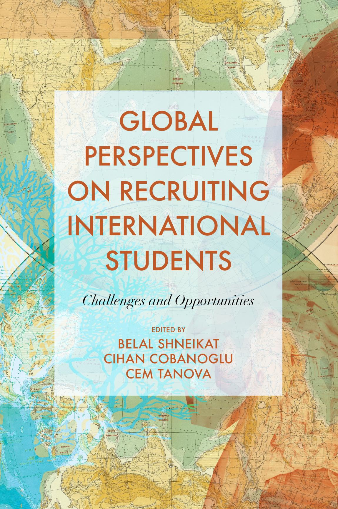

<!-- A2.R41 | source: papers_json/A2.R41/ -->

<!-- page 2 -->

## **Global Perspectives on Recruiting ** **International Students**

<!-- page 3 -->

<!-- page 4 -->

## **Global Perspectives on ** **Recruiting International ** **Students: Challenges and ** **Opportunities**

## EDITED BY

## **BELAL SHNEIKAT**

*University of Kyrenia, Cyprus*

## **CIHAN COBANOGLU**

*University of South Florida, USA*

&

## **CEM TANOVA**

*Eastern Mediterranean University, Cyprus*

<!-- page 5 -->

Emerald Publishing Limited Howard House, Wagon Lane, Bingley BD16 1WA, UK

First edition 2021

Editorial matter and selection © 2021 Belal Shneikat, Cihan Cobanoglu, Cem Tanova. Published under exclusive license by Emerald Publishing Limited. Individual chapters copyright © 2021 Emerald Publishing Limited.

## **Reprints and permissions service**

Contact: permissions@emeraldinsight.com

No part of this book may be reproduced, stored in a retrieval system, transmitted in any form or by any means electronic, mechanical, photocopying, recording or otherwise without either the prior written permission of the publisher or a licence permitting restricted copying issued in the UK by The Copyright Licensing Agency and in the USA by The Copyright Clearance Center. Any opinions expressed in the chapters are those of the authors. Whilst Emerald makes every effort to ensure the quality and accuracy of its content, Emerald makes no representation implied or otherwise, as to the chapters' suitability and application and disclaims any warranties, express or implied, to their use.

## **British Library Cataloguing in Publication Data**

A catalogue record for this book is available from the British Library

ISBN: 978-1-83982-519-4 (Print) ISBN: 978-1-83982-518-7 (Online) ISBN: 978-1-83982-520-0 (Epub)

ISOQAR certifiedManagement System,awarded to Emeraldfor adherence toEnvironmentalstandardISO 14001:2004.

Certificate Number 1985
ISO 14001

<!-- page 6 -->

## **Contents**

About the EditorsviiAbout the ContributorsixPrefacexii**Chapter 1 Key Factors in the Selection of an Educational
Tourism Destination**
*Melissa Rikiatou Kana Kenfack and Ali Öztüren*1**Chapter 2 Study Hard but Do Tour to See the World:
Tourism of Chinese Students who Studied in the United States**
*Carol Huang and Connie Chuyun Hu*37**Chapter 3 The Role of Social Media Marketing Activities
on International Students' Brand Preference: A Study on
English-Speaking Universities of Germany**
*Hasan Evrim Arici and Nagihan Cakmakoglu Arici*51**Chapter 4 Use of Web Analytics and Social Listening to
Attract International Students**
*Rakhi Tripathi*65**Chapter 5 Promoting the Internationalisation of
Students in University Strategic Goals: A Case Study**
*Carla Del Gesso*81**Chapter 6 Exploring Institutional Culture and Its
Impact on International Student Recruitment Capabilities**
*Melissa James*97**Chapter 7 Recruiting Educational Tourists from Countries
Under International Sanctions: The Case of Iranian Education
Market**
*Cahit Ezel*111Chapter 8
Geopolitics and Global Events: International
Student Recruitment in a Time of Disruption
Joseph M. Stokes123Chapter 9
Challenges to Admission for Indonesian
Sponsored Applicants to a US Graduate Program in Education
Adrian Rodgers139Chapter 10
The Qualitative Study of Factors Influencing
to International Students' Satisfaction: The Case of a Private
University in Turkey
Ayşe Collins, Zeynep Goknil Sanal and Aygil Takır153Chapter 11
Are Chinese Students Studying at European
Universities Satisfied? Performance and Challenges
Marta Melguizo-Garde and Ana Yetano173Chapter 12
How to Integrate International Students into
the Local Society and How That Will Affect Their Satisfaction
Level
Janet M. Howes187Chapter 13
Living Closely Together but in Parallel -
Multi-dimensional Challenges to the Integration of
International Students in a Danish 'Muscle' Town
Annette Aagaard Thuesen and Eva Mærsk197Chapter 14
The Impact of Cultural Adjustment on
International Student Recruitment and First-Year Success
Clayton Smith213Chapter 15
International Chinese Students' Cultural
Experience and Cultural Support in the UK
Yimeng Zhang231Chapter 16
The Future of International Student Recruitment
Belal Shneikat243Index255

<!-- page 7 -->

<!-- page 8 -->

## **About the Editors**

**Belal Shneikat** is an Assistant Professor in Business Administration at The University of Kyrenia. He holds BSc in Regional Planning and MBA from Al- Balqa' Applied University in Jordan and PhD in Business Administration from Eastern Mediterranean University in North Cyprus. He served as International Admissions Recruiter for several years and recruited thousands of international students from Asia, Africa and Europe. His areas of interest are educational tourism, entrepreneurship and human–computer interaction. His research appeared in journals like *The Service Industries Journal*, *Online Information Review*, *Tourism * *Management Perspectives* and *Journal of the Knowledge Economy*.

**Cihan Cobanoglu** is the McKibbon Endowed Chair Professor School of Hospitality and Tourism Management, Muma College of Business at the University of South Florida, who also serves as the Director of the M3 Center for Hospitality Technology and Innovation and coordinator of International Programs for the School of Hospitality and Tourism Management. He is a renowned hospitality and tourism technology expert. Dr Cobanoglu is a Fulbright Specialist commissioned by the Fulbright Commission which is part of the US Department of State's Bureau of Educational and Cultural Affairs (ECA) and World Learning (2018–2021). He is a Certified Hospitality Technology Professional (CHTP) commissioned by Hospitality Financial & Technology Professionals (HFTP) and Educational Institute of American Hotel & Lodging Association (AHLA). He is the Editor of the *Journal of Hospitality and Tourism Technology* (JHTT) (Indexed in SSCI and Scopus), Editor of the *Journal of Global Business Insights* (JGBI), Associate Editor of *Tourism Review* (world's oldest tourism journal, indexed in SCCI and Scopus) and a co-author of 6 books and 10 conference proceedings. He is also currently serving as the President of the Association of North America Higher Education International (ANAHEI).

**Cem Tanova** is currently a Professor of Management in Eastern Mediterranean University. After completing his Bachelor's in Management and Master's in Public Administration degrees in Northern Michigan University in Michigan, USA, he received his Doctorate in Management and Organizations from Cukurova University in Adana Turkey. Dr Tanova held many academic leadership positions in his career. He has served as the Vice Rector for International Affairs, Dean of the Faculty of Business and Economics, the Department Head of Business Administration and the Chair of the Continuing Education Center in Eastern

<!-- page 9 -->

## *viii* *About the Editors*

Mediterranean University. His research interests include human resource management, recruitment methods, voluntary turnover, organisational justice and cognitive styles. His research appeared in journals including *International Journal * *of Human Resource Management*, *International Journal of Hospitality Manage**ment* and *Service Industries Journal*.

<!-- page 10 -->

## **About the Contributors**

**Hasan Evrim Arici** is a Lecturer at EU Business School. His current research interests include leadership, HRM and organisational behaviours. His work has been published in international journals, such as *Journal of Hospitality Marketing & * *Management* and *International Journal of Contemporary Hospitality Management*.

**Nagihan Cakmakoglu Arici** studied PhD in Tourism Management. She is currently working for the T.R. General Consulate Stuttgart, Germany. Her research interests are in consumer behaviours, tourist experiences, e-marketing and business administration. She also carried out a number of international projects funded by EU.

**Ayse Collins** is an Associate Professor at Bilkent University, Ankara, Turkey. She has her PhD from the Middle East Technical University, Ankara, Turkey, where her thesis won the 'Thesis of the Year' award. Her research interests cover human resources management, labour law, curriculum development, performance evaluation, inclusion, social inclusion, disability, and arts. She is the member of editorial boards of several international and national journals.

**Cahit Ezel**, PhD in Tourism Management, is an Assistant Professor at Eastern Mediterranean University, Faculty of Tourism. Dr. Ezel had worked at various administrative positions at EMU Rector's Office and travelled extensively in Middle-East, Asia and Europe. Dr. Ezel has special interest in internationalization of higher education, developing international academic partnerships and strategic planning at higher education institutions. His current research interest focus on educational tourism, internationalization of higher education, and student satisfaction.

**Carla Del Gesso**, PhD in Business Administration, is an Adjunct Professor of Public Management and Accounting at the Department of Economics, University of Molise, Italy. She has significant experience in teaching and research in the field of management and accounting of public organisations and social enterprises. Her primary research interests include public sector governance and performance information disclosures.

**Janet M. Howes,** PhD, is an Assistant Professor of Business Administration and the Director of the Sport Management and Promotion Program at the University of Saint Joseph in West Hartford, CT. Dr Howes' PhD is in Sport Administration and teaches in the business and sport management programs.

<!-- page 11 -->

**Connie Chuyun Hu** is a PhD Candidate (ABD) in the Department of Educational Leadership and Policy Studies and a Graduate Teaching Assistant in the School of Education and the Department of East Asian Literatures and Cultures at the University of Kansas. Her research is on IT and IT instruction.

**Carol Huang** is currently teaching at the City College of New York and CUNY Graduate Center. She used to serve as the research director for Asian American and Asian Research Institute of CUNY. Her research interests include educational policy, Asian American education, multiculturalism and dual language schools.

**Melissa James** is an Associate Professor at the University of Prince Edward Island's Faculty of Business and specialises in research, strategy and marketing. Her current research focuses on public sector marketing in higher education with a focus on the impact of internationalisation on higher education institutions.

**Melissa Rikiatou Kana Kenfack** is an enthusiast of sustainability in tourism. Aside from receiving her Bachelor's degree in tourism and hospitality management and master's degree in Tourism Management at Eastern Mediterranean University, North Cyprus, she participated in some laudable projects on tourism sustainability. She is currently pursuing her second master's degree in marketing.

**Eva Mærsk** is a PhD student at the Danish Centre for Rural Research at the University of Southern Denmark and department of Cultural Geography at Groningen University. Her PhD project research is about student mobility and youth culture in the context of peripheral urban study cities.

**Marta Melguizo-Garde**, PhD, is a Senior Lecturer in Applied Economics at the University of Zaragoza, is the Vicedean for Quality and belongs to the Public Economics research group (http://www.economiapublica.net/). Her research interests include the tax planning, public policy and taxes, education and social policies. She has published in leading academic journals.

**Ali Öztüren** is a Professor of Tourism Management and currently working as vice dean in the Faculty of Tourism at Eastern Mediterranean University. He is on executive boards of various national and international academic projects and events, on referee boards of many international and national journals, and advisory boards of academic and social organisations.

**Adrian Rodgers** is an Associate Professor in Teaching and Learning at The Ohio State University. His areas of interest are pre-service and in-service teacher education with a focus on literacy, international education and qualitative research. He has published books with Teachers College Press and Pearson and in journals such as *Teaching and Teacher Education*.

**Zeynep Goknil Sanal** is a freelance researcher and activist based in Ankara, Turkey. She completed her PhD at the Middle East Technical University on curriculum

<!-- page 12 -->

development; however, her research and activism is focussed on human rights issues including women's rights, children's rights and disabled rights.

**Clayton Smith** has held senior enrolment management positions at four postsecondary institutions in the United States and Canada. He is currently Associate Professor in the Faculty of Education at the University of Windsor. Over the course of his career, Dr Smith has amassed significant knowledge and expertise in strategic enrolment management.

**Joseph M. Stokes** is the University Registrar at Ontario Tech University, and an Adjunct Professor in the Faculty of Education. His portfolio includes the leadership of strategic enrolment management, and the university's international office Dr. Stokes has led work across the post-secondary sector on governance, strategic enrolment management, and student retention and success.

**Aygil Takır** is an Education Scholar with professional experience in some of the public, nongovernmental and academic institutions. She earned her PhD in Curriculum and Instruction in Middle East Technical University. As a researcher, Dr Takır's research mainly focuses on curriculum studies, migration, contemporary issues in education and higher education.

**Annette Aagaard Thuesen**, PhD, is an Associate Professor at the Danish Centre for Rural Research at the University of Southern Denmark. Her current research lies in governance and democratic aspects of student migration, partnership organising for change, community-led local development, co-creation of village plans and rural health.

**Rakhi Tripathi** is an Associate Professor in Information Technology and the Head of the Centre for Digital Innovation at FORE School of Management, Delhi, India. Her areas of research are Digital Technologies, Social Media Analytics, Social Listening and E-government. The primary objective of her research is to use Digital technologies to serve the society. Several research papers have been published in national as well as international reputed journals, conferences and books. She has been awarded 'Outstanding Women in Science' in the field of Information Technology in 2018 by Venus International Foundation, Chennai, India.'

**Ana Yetano**, PhD, is Professor in Accounting at the University of Zaragoza, is the Vicedean for Internationalisation and belongs to the Gespublica Research Group (http://gespublica.unizar.es). Her research interests are in public sector performance measurement, accounting and auditing. She has published in leading international journals.

**Yimeng Zhang** is a current PhD Candidate in Education (Teaching English to Speakers of Other Languages, TESOL) at the University of Exeter. Her research interest includes internationalisation in education, second language acquisition, as well as gender equality in education.

<!-- page 13 -->

<!-- page 14 -->

## **Preface**

As we observe the tremendous growth in the internationalisation of higher education, we not only see larger number of students who wish to study abroad but also institutions that wish to attract international students. This book provides an in depth look at the competition among countries and universities in the process of recruiting international students. Thus, it can provide invaluable information for policy makers, researchers as well as students who wish to understand internationalisation of higher education.

Recruitment of international students provide numerous benefits and opportunities for both the host communities and the students. While the international students contribute to the cultural, economic and social welfare of the host community, they gain from being exposed to a new environment, develop their skills in adaptability and their proficiency in a new language which will improve their prospects for employment. Overall, the opportunities from meeting of ideas and cultures will spark innovation and open many opportunities.

The book brings together the most up-to-date and comprehensive scholarly contributions on recruiting international students written by authors representing a variety of geographical and academic backgrounds. The book covers a wide range of topics such as educational tourism, role of social media in recruiting international students, internationalisation and institutionalisation, challenges to admission, satisfaction of international students, and integration and cultural adjustment.
