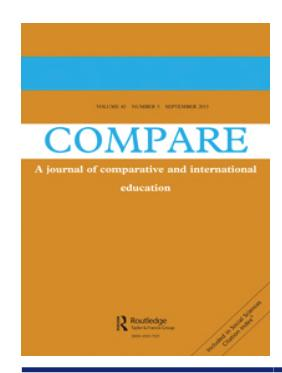
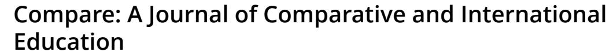
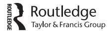

<!-- A2.R44 | source: papers_json/A2.R44/ -->

**ISSN: 0305-7925 (Print) 1469-3623 (Online) Journal homepage:****[ www.tandfonline.com/journals/ccom20](https://www.tandfonline.com/journals/ccom20?src=pdf)**

## **Education policy borrowing in China: has the West** **wind overpowered the East wind?**

**Charlene Tan & Catherine S.K. Chua**

**To cite this article:** Charlene Tan & Catherine S.K. Chua (2015) Education policy borrowing in China: has the West wind overpowered the East wind?, Compare: A Journal of Comparative and International Education, 45:5, 686-704, DOI: [10.1080/03057925.2013.871397](https://www.tandfonline.com/action/showCitFormats?doi=10.1080/03057925.2013.871397)

**To link to this article: **[https://doi.org/10.1080/03057925.2013.871397](https://doi.org/10.1080/03057925.2013.871397)

| Image: Calendar icon | Published online: 27 Jan 2014. |
| --- | --- |
| Image: Document with pencil icon | Submit your article to this journal Image: External link icon |
| Image: Bar chart icon | Article views: 8137 |
| Image: Document with magnifying glass icon | View related articles Image: External link icon |
| Image: CrossMark logo | View Crossmark data Image: External link icon |
| Image: Two documents icon | Citing articles: 18 View citing articles Image: External link icon |

<!-- page 2 -->

## Education policy borrowing in China: has the West wind overpowered the East wind?

Charlene Tan* and Catherine S.K. Chua

Policy and Leadership Studies, National Institute of Education, Nanyang Technological University, Singapore

Recent education reform in China reflects the global trend of education policy borrowing from Anglophone countries such as the USA. The reform in China essentially advocates shifting from knowledge reproduction and didacticism to knowledge construction by students through a learner-centredness approach. Aware of the trend of borrowing policy from 'Western' countries, some educators in China use the proverb 'the West wind has overpowered the East wind' to describe this phenomenon. This paper examines the cultural factors that influence education policy borrowing in China by drawing upon Johnson's metaphors of the 'politics of selling' and the 'politics of gelling'. This paper argues that there exist fundamental cultural differences between Western and Chinese perspectives on the nature and transmission of knowledge that make education policy transfer in China challenging. This paper further proposes that China borrow education policy judiciously by integrating foreign and indigenous sources of knowledge, teaching and learning.

Keywords: China; education policy borrowing; politics of gelling; politics of selling

## Introduction

A major trend in education reform today is for policymakers to introduce educational changes based on their students' performance in international testing and national assessment (Kamens and McNeely [2010)](#page-17-0). The tendency is to borrow education policies and practices that are perceived to have worked elsewhere, especially in reference societies such as Finland (for its impressive performance in the Programme for International Student Assessment) and the USA (for its reputation in creativity, innovation and enterprise). Policy borrowing takes place within a continuum of educational transfer, from imposed educational transfer at one end, to voluntary adoption of foreign examples, models and discourses at the other (Phillips and Ochs [2004](#page-18-0); Steiner-Khamsi [2000](#page-18-0)). It covers 'the whole range of issues

> ^*^Corresponding author. Email: [charlene.tan@nie.edu.sg](mailto:charlene.tan@nie.edu.sg)

<!-- page 3 -->

relating to how the foreign example is used by policy makers at all stages of the processes of initiating and implementing educational change' (Phillips and Ochs [2003](#page-18-0), 451). Different writers have highlighted various aspects of policy borrowing, such as the four principal stages of the policy borrowing process (Phillips and Ochs [2004)](#page-18-0), the theory of policy attraction (Phillips [2004)](#page-17-0), outcomes-based education (Steiner-Khamsi [2006](#page-18-0); Steiner-Khamsi, Silova, and Johnson [2006](#page-18-0); Steiner-Khamsi and Stolpe [2006](#page-18-0)) and the politics of policy borrowing and lending (Steiner-Khamsi [2002](#page-18-0), 2004).

By drawing upon two metaphors introduced by Johnson ([2006)](#page-17-0), this paper explores the role of culture in recent education policy borrowing in China. The research data for this paper were collected primarily from a literature review, interviews and questionnaires from 2011 to 2013. For the literature review, key policy papers and research papers written by Chinese academics and educators, newspaper articles, school documents and printed materials from China, as well as entries on Chinese websites, were analysed. With respect to the interviews, 14 semi-structured focus-group interviews were conducted with 10 school principals, 18 vice-principals, 33 teachers, 20 students and three district education officers from Shanghai. Questionnaires were administered to another 17 school principals and 10 vice-principals from Shanghai, as well as seven vice-principals, 12 heads of department and six teachers from Beijing. The paper begins with an introduction to the role of culture in educational policymaking and Johnson's theoretical framework. This is followed by a critical discussion of recent curriculum reform and education policy borrowing in China.

## The role of culture and education policy

The word 'culture' is defined as the lenses that people inherit from their past that are then used to make sense of the world. The factors that make up a culture include 'symbols, language, values and meanings, beliefs, norms, rituals and material objects' (Wadham, Pudsey, and Boyd [2007,](#page-19-0) 6). These are shared by a community and function as symbolic markers that help to define one's identity. Essentially, 'culture is a design for living or, more precisely, a complex whole consisting of objects, values, and other characteristics that people acquire as members of a society' (Thio [2003,](#page-19-0) 42).

The cultural dimension of a society plays an important part in the construction of educational policy as 'culture shapes education, and education shapes culture' (Wadham, Pudsey, and Boyd [2007](#page-19-0), 1). Moreover, policymaking is fundamentally a political issue. According to Ball ([1990)](#page-17-0), education policy is often infused with economic, political and social demands – it is not separated from social and economic policies. As every society is required to prepare its young for their future, schools (and education) are therefore important social institutions that impart the desired knowledge and skills, enhance social mobility, promote national unity and

<!-- page 4 -->

provide custodial care (Thio [2003](#page-19-0)). In other words, the culture of the school reflects the overall culture of that society. Therefore, it is important to pay attention to the social actors in the policy process, the historical moment in which a policy is drawn and the structural realities that support the implementation process (Stein [2004)](#page-18-0).

A number of writers have noted the central role of culture when translating and mediating a policy from one context to another (e.g. see Green [1999;](#page-17-0) Koh [2011;](#page-17-0) Lingard [2010](#page-17-0); Phillips [2012](#page-17-0); Steiner-Khamsi and Waldow [2012;](#page-18-0) Takayamaa and Apple [2008](#page-18-0); Tan [2013a](#page-19-0)). Green [(1999](#page-17-0)), in his study of the impact of globalisation on education in Europe and East Asia, notes that 'the structures of national systems are fundamentally determined by national differences in industrial structures and labour markets arrangements, in political traditions and institutions, and in cultures of citizenship and knowledge' (61, as cited in Koh [2011,](#page-17-0) 269). It follows that policymakers need to guard against simplistic policy transfer and borrowing without considering and incorporating indigenous sociocultural (counter-)factors.

## Johnson's metaphors of the 'politics of selling' and the 'politics of gelling'

Johnson [(2006](#page-17-0)) relies on metaphors to illustrate and illuminate the phenomena of educational borrowing and transferring in a globalised context. Altogether he introduces five metaphors: 'the politics of telling', 'the politics of rebelling', 'the politics of compelling', 'the politics of selling' and 'the politics of gelling'. This paper focuses on the last two metaphors as the first three are primarily concerned with educational transfer and the relationship between occupied territories and the imperial powers during and after the colonial period.

The 'politics of selling' describes developing countries that have more control over their policy environments. These countries enter into an education 'market' in which policies are 'sold', often by developed countries, on the premise that these policies are likely to promote the countries' national economic growth and global competitiveness. The politics of selling offers relative autonomy for states to strategically 'buy' selected educational policies.

The 'politics of gelling' refers to a process in which indigenous and foreign sources of knowledge are crystalised and a new economy of knowledge is created and strengthened. This metaphor involves a wider set of interest groups, including the government, industry and educational institutions, that set new agendas for education by combining the global and local. It is important to note that the politics of gelling represents a country's goal of combining various sources of knowledge through collaboration with different interest groups, rather than achieving that goal. Often, the politics of gelling is also accompanied by tensions, conflicts and challenges from internal and external sources. Gelling is especially pertinent in view of the

<!-- page 5 -->

prevailing assumption in a knowledge-based economy that technology provides unquestioned benefits to a homogenous set of ready-made consumers across countries, regardless of the social contexts and the processes into which it enters. This is why local cultural factors play a significant role in mediating and vitiating curriculum reform.

Johnson's politics of selling and politics of gelling fit into the literature review of education policy borrowing in respect of cultural factors. This is because the processes of selling and gelling are not context-free and unproblematic, but are influenced by local cultural conditions (Tan [2010](#page-18-0)). As noted by Lingard ([2010)](#page-17-0), a locality's effort to introduce education change, whether it is to 'buy' or 'gel' foreign educational policy, always occurs in vernacular ways mediated by contextual histories, politics and cultures. In other words, cultural factors such as a country's national histories, its political ideologies, national aspirations and even its habitus can shape and contribute to a culture-specific education policy terrain of education policy making (Koh [2011](#page-17-0)).

## Recent curriculum reform in China

The current curriculum reform is the eighth of its kind in China since 1949. The first decade after the establishment of the People's Republic of China in 1949 witnessed the introduction of educational system, approaches and teaching materials adapted from the Soviet model. Since then, education in China has been characterised by knowledge reproduction and transmission, standardisation in teaching, learning and assessment, and didacticism. Education policy borrowing from the former USSR in China has contributed towards China's adoption of the ideologies of socialism, social and political stability and centralised state control. In 1958, the government launched an 'education revolution' to signal its determination to promote socialist and agrarian education. That lasted until the Cultural Revolution, which occurred from 1966 to 1976, and which had all universities closed and most intellectuals imprisoned or sentenced to hard labour. The educational system was rebuilt after 1976 and a national high school exam was introduced in 1977. Modern education reforms began in 1985 when then Chinese leader Deng Xiaoping stressed the need to develop human talent through education reforms (for details of the curriculum reforms in China, see Anon [[2005](#page-16-0)]).

Current curriculum reform in China is encapsulated by the slogan 'quality-oriented education' (suzhi jiaoyu). Often contrasted with 'exam-oriented education' (yingshi jiaoyu), quality-oriented education signals China's focus on reforming its educational system against the backdrop of economic globalisation. The former Premier Wen Jiabao maintained that China needs to comprehensively promote quality-oriented education, deepen curriculum and teaching reform, innovate teaching mindset, teaching content and teaching methods, to raise the students' learning ability, practical ability and innovative ability (Shanghai Academy of Educational Sciences [2010)](#page-18-0).

<!-- page 6 -->

To achieve the vision of 'quality-oriented education', the Chinese government has introduced drastic changes to the curriculum, pedagogy and assessment in China, with variations across provinces and municipalities. First, the curriculum includes not just the usual exam subjects but new subjects, programmes and activities conducted both inside and outside the school to meet the students' different interests and learning abilities. Secondly, greater school autonomy is accompanying the change in curriculum to ensure that this new approach is successful. The Chinese government has adopted a more decentralised and tripartite system in which a series of measures and structures are implemented for schools in different states and provinces, and these schools hold responsiblity to customise their curriculum for their individual needs (Deng [2011)](#page-17-0). Essentially, schools are gradually being given more decision-making power and autonomy in the way they govern their own school affairs as, 'the decentralisation has taken place in all aspects of the system, including administration, finance, curriculum, examination and enrollment' (Zhao and Qiu [2012,](#page-19-0) 315).

In addition to the traditional nation-based curriculum and locality-based curriculum is school-based curriculum. All schools are given about one-third of their curricula to design and implement their own subjects, programmes and activities. This means that more roles and responsibilities are given to school principals to launch new courses on extra-curricular activities, community projects and research by collaborating with museums, social centres, research centres, universities and institutions of higher learning. To support this massive transformation, extensive support has been provided to the teachers through the 'Continuous Education Project'. Teachers are provided with professional development support to equip them with the necessary skills and competences to introduce these new changes in schools as teachers are crucial agents who will translate the policies into actions in the classroom (Xu [2009](#page-19-0)).

Another key area of change is pedagogy. A teacher-centred approach should therefore be replaced by a new form of learning that promotes student-centred learning and the development of personal autonomy and collaboration. Examples of learner-centred pedagogies are small-group discussion, individual project work, debate and fieldwork. Complementing the reforms in curriculum and pedagogy is the mode of assessment. While summative and written exams will remain relevant for China, the authorities expect schools to introduce formative and alternative assessments. Examples of innovative assessment modes include experiments, oral presentations, poster displays, forums and seminars and student publications. Overall, we can identify the new and multiple concepts of curriculum in the curriculum reform in China, shifting from 'curriculum' as synonymous with topics listed in the syllabus to be tested in exams in the past, to 'curriculum' as classroom engagement, innovation, creativity, inquiry and community services, and so on.

<!-- page 7 -->

Similar to other ideals in reforms, the vision of 'quality-oriented education' is debated among scholars, teachers and parents in China. The first controversy over 'quality-oriented education' is that it remains unclear to Chinese educators and members of the public exactly what 'quality-oriented education' means and whether it is incompatible with 'exam-oriented education'. To the Chinese government, 'quality-oriented education' means producing the creative talents needed to transform China into an innovationdriven society. As Chinese students are generally perceived to be less creative and competitive compared to their Western peers, the Chinese government hopes to produce more graduates who are fit for local and global employment (Farrell and Grant [2005](#page-17-0)). However, what are the specific qualities to be inculcated in the students through a 'quality-oriented education'? What are the appropriate courses, programmes and activities needed to nurture these qualities in the students? It appears that different stakeholders in China have different and sometimes contradictory responses to these questions.

Secondly, despite the state's aim to replace 'exam-oriented education' with 'quality-oriented education', the former remains entrenched in the psyche and behaviour of the masses. This is due primarily to the prevailing exam-driven culture whereby the priority of educational stakeholders is for the students to ace the exams, especially the college entrance exam (gaokao) to qualify for a place in a prestigious university. As rightly noted by Zhao and Qiu [(2012](#page-19-0)), 'structures are easier than cultural changes': as long as what the students, parents and teachers value does not change much, '[t]est-oriented education, which has been one of primary targets of the reforms, remains strong' (320). Unsurprisingly, a report by the Ministry of Education in 2006, while pointing out that some Chinese teachers have changed their teaching practices to be more student-centred, acknowledges that 'quality education is loudly spoken but test-oriented education gets the real attention' (as cited in Zhao [2007](#page-19-0), 73; also see Tan [2011,](#page-18-0) [2012,](#page-19-0) [2013a)](#page-19-0). In addition, due to the uneven economic development in different parts of China, different states and provinces have varying capacities to customise and develop their education system. As a result, there have been unplanned activities at the local level, with some generating positive results and others creating negative impacts that affect the learning and general well-being of the students. Overall, this has created inequality and chaos and has produced unequal results and public discontent (Zhao and Qiu [2012](#page-19-0)).

## Education policy borrowing in China: has the West wind overpowered the East wind?

A key question in education policy borrowing for China is the relevance and applicability of foreign policies and practices, in particular, those from the 'West' for the Chinese context. Johnson's metaphors of the politics of

<!-- page 8 -->

selling and the politics of gelling provide helpful conceptual tools for our analysis.

## The politics of selling

We can identify the politics of selling in China as it has been a willing and autonomous buyer of selected education policies 'sold' by developed and especially Anglophone countries. China entered an education 'market' in which policies are 'sold' on the premise that these policies are likely to promote its national economic growth and global competitiveness. The current curriculum reform in China reflects neo-liberal education policies and practices such as decentralisation, school autonomy, student-centred teaching, critical and innovative thinking and real-life application. Education policy borrowing from the 'West' is motivated by the realities and demands of globalisation.

A case in point is the document for curriculum reform in Shanghai, a pioneer in educational changes in China. The document, entitled 'Synopsis of Shanghai's middle and long term education reform and development plan (2010–2020)', makes direct reference to worldwide trends in education, in countries such as the USA, which strive for equal opportunity in the classroom and lifelong education and emphasise application, integration, flexibility and students' character development (Shanghai Municipal Education Commission [2010)](#page-18-0). In light of these developments, the document adds that Shanghai should therefore strive to 'achieve modern education, establish a learning society, to inspire everyone to develop his potential, be world-class in educational development and human capital utilisation' by the year 2020 (Shanghai Municipal Education Commission [2010,](#page-18-0) 5 [for more details on curriculum reform in Shanghai, see Tan [2013a]](#page-19-0)).

Aware of the trend of borrowing policy from 'Western' countries such as the USA, educators in China use the proverb 'Western wind has overpowered Eastern wind' [xifeng yadao dongfeng] to describe this phenomenon (Jin [2007,](#page-17-0) 137). This proverb expresses the preference of the Chinese policymakers for 'Western' rather than indigenous education policies and practices. A number of Chinese academics have critiqued the Western-centric nature of education policy borrowing in China. For example, Wu [(2007](#page-19-0)) claims that the curriculum reform blindly 'copies Western educational ideology, ignores local Chinese conditions, and [consequently] undermines the knowledge base' in the Chinese context (164). Shen ([2006](#page-18-0)) avers that the act of simplistically and mechanically policy borrowing in China will only lead to 'swallowing food without digestion [shiying buhua]' (177). Zhong (2007) concurs that the curriculum reform has been viewed as 'not suitable for Chinese conditions' (117). Against a backdrop of policy borrowing in China, the rest of this paper takes a closer look at the cultural disparities between Western and Chinese perspectives on the nature and acquisition of knowledge.

<!-- page 9 -->

## The nature of knowledge: knowledge reproduction or construction?

The education reform in China advocates shifting from knowledge reproduction and didacticism to knowledge construction by students through a learner-centredness approach. As noted earlier, recent policy initiatives in China promote knowledge construction whereby learners actively construct their own understanding and knowledge of the world through their experiences and reflections. Underpinning this constructivist philosophy is the assumption that knowledge is fluid, constructive and subjective. However, educators in China traditionally value knowledge reproduction rather than knowledge construction as they see knowledge as relatively fixed, essentialised and objective. Consequently, Chinese educators generally privilege objectivity, the natural sciences and textual transmission, rather than subjectivity, the humanities and a focus on the living experiences of the learner.

The preference for knowledge reproduction in China is linked to the historical and political socio-conditions in the country. Guided by the educational ideology of Russian educator Kairov since the early 1950s, the curriculum in China is defined as school subjects, the subjects are defined as teaching materials, the teaching materials are defined as knowledge points and, consequently, teaching is narrowly defined as the transmission of knowledge points. The 'knowledge points' are the essential content students need to learn for the subjects and could be further divided into foundational points [jichudian], core points [hexindian], difficult points [nandian] and so on. Xie and Carspecken [(2008)](#page-19-0), in their content analysis of the mathematics curriculum in China, conclude that the curriculum is premised on the ideology of dialectical materialism that underlines teacher instruction, student discipline, one correct answer to most mathematics problems and social dependency. Wu and Singh ([2004)](#page-19-0) claim that dialectical materialism in China is, 'subject to political controls that shape the behaviour and belief of those working within knowledge communities, including teachers and students', resulting in 'a disciplined society, albeit not without contestation, which accords with the demands of political control by the communist authorities' (34).

The primacy placed on knowledge reproduction in China's educational system has had a direct impact on the process and method in which knowledge is transmitted and tested. Underpinned by teacher-centredness, classroom-centredness and text-centredness, examinations in China primarily assess the students' knowledge of the text as taught by the teacher in the classroom. The focus on the knowledge points of a subject means that what is taught in teacher training institutions and schools is relatively narrow and in-depth. Liu and Qi ([2006)](#page-17-0) maintain that the teacher preparation programme in China places a greater emphasis on a solid foundation of subject matter expertise compared to that in the USA. In terms of classroom teaching, many Chinese teachers follow the following five steps in teaching:

<!-- page 10 -->

revise the old topic, tune into the new topic, explain new knowledge, practise and consolidate, and set an assignment (Zhong and Jiang [2004)](#page-19-0). The accent on content mastery means that not only must teachers be content experts, but students are also expected to master the content and demonstrate their competency in tests and exams.

Besides knowledge reproduction, educators in China also emphasise knowledge transmission – they view knowledge not as constructed by but passed on to a learner from an expert. The 'expert' in the schooling context is the teacher-scholar. That the teacher is seen as the repository of knowledge is illustrated in a well-known proverb in China, and that is, 'to give a student a cup of water, a teacher should have a bucket of water' [Yaogei xuesheng yibieshui, jiaoshi ziji yinggai you yitongshui]. As explained by Chinese academic Chen Guishen: 'It means a teacher should be familiar with not only the teaching materials, but also the wider background knowledge relevant to the teaching materials' (Chen 2009, 97). A 'good' teacher in China is one who transmits knowledge to his students by focusing on the logical, systematic and complete aspects of knowledge contained in the subjects. Shangguan [(2005](#page-18-0)) observes that, 'our country's education focuses on the amount of accumulated knowledge … only after you have established a complete knowledge structure and have a strong foundation then can you carry out innovative activities' (Shangguan [2005,](#page-18-0) 216). Complementing the focus on knowledge reproduction and transmission is the ideology of behaviourism. Zhong ([2006)](#page-19-0), averring that recent curriculum reform plans in China are based on the perspectives of animal learning psychology, argues that these texts and plans 'emphasise behaviorism, treating education and learning process as mere training' (372–373).

Cognisant of the cultural differences between Western and Chinese perspectives on the nature and transmission of knowledge, some Chinese academics have cautioned against a wholesale adoption of foreign educational ideas and practices. Jin ([2007)](#page-17-0) asserts that 'a main problem is, foreign ideas, no matter how good, are still borrowed, and we should not blindly copy them' (137). Commenting on the shift towards a 'Western' conception of knowledge, Cai and Jin [(2010](#page-17-0)) posit:

The change in ideology [in the curriculum reform] has led to a change in the terms used for our new curriculum. There arise many unfamiliar ideas, such as dialogue, interaction, participation, experience, exploration, discovery …. These ideas are educational words from developed countries, England and America. Hence they are reasonable with practice in the West but are far from reality for Chinese education. … But these ideologies cannot be completely transported and used, they need to be integrated with China's national conditions. But in reality, such integration has not taken place, and there exists progressive ideology from other countries coming into conflict with China's traditional educational culture. (98)

<!-- page 11 -->

## The transmission of knowledge: teacher-centred or student-centred?

Besides the question of the nature of knowledge, there is also the issue of how knowledge is transmitted. The curriculum reform shifts the focus from a teacher-centred approach, whereby the teacher is the content expert, to a student-centred approach, in which the students take the lead in learning. The reform aims to transform the current knowledge transmission approach that focuses on students studying primarily for passing the exams and learning passively through didactic teaching. For example, the Shanghai authority hopes to get schools to, 'move away from repetitive and mechanistic rotelearning towards increased student participation, real-life experience, capacity in communications and teamwork, and ability to acquire new knowledge and to analyse and solve problems' (OECD [2011](#page-17-0), 90). By giving students more avenues to experience, research and discover knowledge, the spotlight is on 'student-directed research, practical experience and interaction with others by encouraging students to actively inquire, experiment, innovate and pursue excellence' (Shanghai Municipal Education Commission [2010](#page-18-0)).

Nonetheless, there is a disparity between the approach advocated by the curriculum reform and the traditional approach practised in China. First, the curriculum reform demands a fundamental change in the relationship between teachers and students. Rather than the teachers as the repositories of knowledge, they are now co-creators of knowledge, guides and facilitators of the students' active learning. However, such a change in mindset is difficult as the relationship between teachers and students has culturally been unequal. As mentioned, the primary role of a teacher in students' learning process has been predominantly that of content expert, knowledge transmitter and moral judge; teachers in China have absolute authoritative influence on the students' lifelong development. Shangguan [(2005](#page-18-0)) points out that, 'Chinese generally love "face" [mianzi] so teachers are not willing to admit that they are wrong in front of their students since doing so will harm one's authoritative image, afraid of losing the students' respect' (190). Moreover, these Chinese teachers grew up in a traditional learning environment and therefore they tend to be fixed in their ways of thinking and actions. Consequently, teacher-directed teaching and knowledge transmission tend to rely on high-stakes examinations to test learning outcomes, and adopt uniform standards to appraise students. This traditional teaching method is so culturally entrenched that teachers in China would likely return to their familiar and habituated teaching behaviour, such as the lecture style in class.

Likewise for Chinese students, they are neither used to investigating questions raised by the teacher, nor discovering answers for themselves through their own observation and reflection. They are even more unwilling to challenge the teacher and textbooks and generally lack questioning, discriminating, reflective and creative abilities. To be sure, the strength of a teacher-centred approach is that it helps students to quickly grasp a

<!-- page 12 -->

discipline's overview and main principles. But it tends to over-emphasise knowledge education and neglect nurturing ability and inspiring the soul. A vice-principal of a school in Shanghai explains that:

China has many skills and techniques that are secret manuals passed down from the ancestors, but the transmitter only teaches how to do, what it is, and [does] not allow the learner to think much and ask much, the learner will gradually [develop a habit] to do what the master teaches, and never think about the reason for doing it – no awareness of thinking. (Zhou 2010, 66)

Cai and Jin [(2010)](#page-17-0) explain how the contrast between Chinese and Western ideologies influences thinking, teaching and learning:

For our new curriculum reform to be implemented smoothly, and reach its target, it needs a loose and supportive environment. … Overall, Western culture demonstrates individualism, and Chinese culture demonstrates socialism. … The focus of the 'doctrine of the mean' on pursuing stability and avoiding change has led to China's feudal society being built on a stable foundation, and the whole society becomes legalistic, blindly trusting in power and authority, and lacking the courage to deviate. Such a thinking that seeks stability is contrasted with the West's focus on questioning, critiquing, going beyond one's tradition, seeking to be different and to change. The Chinese thinking is closed-minded and conservative, restricts a creative spirit, and hinders the creation of new things and thinking. (93–94)

Adding to the culture of teacher-centred approach is the difficulty Chinese educators face in operationalising the principles of curriculum reform. Our interviews with Chinese educators inform us that they often find themselves handicapped in their endeavour to promote student-centred learning due to the prevailing exam-driven culture. Although the curriculum reform has introduced a diverse curriculum with learner-centred pedagogies and alternative assessment, the reality, as perceived by the students, parents, principals and teachers, is that success in the high-stakes exams that test the students' mastery of exam subjects is still most important. That the high-stakes exam is predominantly carried out through pen-and-paper rather than authentic assessment further accentuates the general perception that student-centred pedagogies such as oral presentation and project work are less important than drilling for exams.

Confronted with the demand to produce high exam scores, many principals and teachers face the constant challenge of juggling student-centred teaching under the curriculum reform with exam-focused and didactic teaching. Furthermore, Chinese parents still judge school principals, teachers and the reputation of schools based on their schools' examination scores rather than on their student-centred activities. This shows that examination-oriented education remains culturally entrenched in China. One principal who was interviewed said:

<!-- page 13 -->

Some education administration departments, in inspecting a school's work, use college entrance rates as the 'hard indicator' for competition between districts and education bureaus. Some even have a yearly contract with the school, and reward or punish the school based on the situation. … So the students' schoolwork results do not just determine the students' future and destiny, they also determine the success and failure of the teachers, the school and even the district's education standards.

Many schools therefore circumvent and mediate the curriculum reform by channelling substantial amounts of time and effort to the exam subjects at the expense of the non-examined subjects.

Some Chinese parents are also not supportive of their children taking up or spending too much time on non-examined subjects that promote studentcentred teaching, experiential learning and research projects. This is due to the parents' concern that these activities may take time away from studying for exams, especially the college entrance exam (gaokao). Some junior secondary students interviewed said:

When we want to do creative things, our parents will tell us we cannot do that, all we need to do is our homework.

My parents and grandparents all told me that exam scores are the most important, and the rest are not very important.

Echoing the students' sentiments, a teacher noted:

Parents will allow their children to take part in activities initially, but they will say stop this and that later because of the exams.

As long as high-stakes exams remain, the fierce competition among parents for high-performing schools and prestigious universities will remain. A common saying among the Chinese is that 'the exam is the baton' [kaoshi shi zhihuibang] – an exam functions like a conductor's baton in an orchestra that determines how the music score is to be played. Given the prevailing realities in China, it is difficult for educators to promote student-centred learning in schools.

## Recommendation: towards the politics of gelling

This paper recommends that China borrows education policy through the politics of gelling by judiciously integrating foreign and indigenous sources of knowledge, teaching and learning involving diverse interest groups. Such integration is not the same as the practice of 'Chinese learning as the substance, Western learning as the function' (zhongxue weiti, xixue weiyong) adopted in China in the past. Since the mid-nineteenth century, China has been adopting a self-strengthening policy of external borrowing and grafting. Chinese scholars during the Qing dynasty, such as Zhang Zhidong

<!-- page 14 -->

(1837–1909), Kang Youwei (1858–1927) and Liang Qichao (1873–1929), championed the learning of Western knowledge, techniques, sciences and technology to complement the study of Chinese culture and history (Guo [2006)](#page-17-0).

Our proposal of integrating foreign and indigenous sources of knowledge, teaching and learning is distinct from the practice of 'Chinese learning as the substance, Western learning as the function' in two main ways. First, the integration of foreign and Chinese sources is not about the selection of 'useful' Western knowledge, technology and skills while ignoring their cultural underpinnings. Rather, the politics of gelling requires policymakers and educators to analyse and harmonise appropriate elements of foreign and indigenous knowledge, teaching and learning, in both their substance and functions. Scholars could engage in a comparative study of Chinese and Western literature to identify shared ideas and practices. One such scholar is Wm Theodore de Bary ([2013)](#page-17-0), who integrates Chinese, Western and other sources into one curriculum that upholds the values of global humanity and civility. Another suggestion is for researchers to explore, interrogate and (re) interpret Chinese traditions and philosophies so as to offer an alternative to the dominant teacher-centred, text-centred and classroom-centred paradigm in China. For example, McEwan, Yang, and Xu [(2008](#page-17-0)), through their study of a Confucian classic, Xue Ji [Records of Learning], debunk the view that ancient Chinese educational ideas and practices value obedience to authority over individual inquiry, memorisation over comprehension and uniformity over diversity.

The second difference between our proposal of the integration of foreign and Chinese sources and the practice of 'Chinese learning as the substance, Western learning as the function' is our emphasis on the need for policymakers and educators to consult various interest groups in constructing and gelling together new forms of knowledge and practices. The interest groups should include educational stakeholders from all segments of society, both within and outside China. Such consultation with various stakeholders will remove the, 'discrepancy between the top-down and foreign impositions of theory, policy and rhetoric, on the one hand, and the bottom-up imperatives of learning practice and knowledge application within local contexts of performance' (Cameron [2004,](#page-17-0) 343). The politics of gelling also means exploring culturally appropriate ways for teachers in China to move from being perceived as repositories of knowledge to being co-creators of knowledge and facilitators of learning, while retaining their traditional status in society. Gelling also makes it possible for students in China to participate actively and question authoritative sources in a contextually sensitive way without being perceived as disrespectful.

It is important to note that some Chinese scholars and educators have alluded to the politics of gelling in education policy borrowing. For example, Chinese scholars such as Tao Xingzhi (1891–1946), who propagated

<!-- page 15 -->

'democratic education', and Chen Heqin (1892–1982), who introduced the theory of 'living education', reconstructed Chinese educational beliefs and practices by incorporating appropriate Pragmatist elements into them (Guo [2006)](#page-17-0). Contemporary Chinese educator Zhang Mingxuan advocates combining the Chinese emphasis on knowledge mastery with the Western emphasis on thinking abilities (Anon [2011](#page-16-0)). Others also call for a conception and implementation of 'Chinese-type' rather than 'Western-type' curriculum theory that allows teachers to autonomously reflect, construct and apply their own theory when implementing the curriculum reform (Anon [2005](#page-16-0)). Chinese academics Cai and Jin ([2010)](#page-17-0) maintain that:

only when the ideology of the new curriculum has interacted and is integrated into one with these social cultural accumulation would the new curriculum be suitable for China's local culture … a new cultural campaign to develop the ideology, thought, mindset and culture needed by the reform. (94)

Reflecting the incipient move towards the politics of gelling, some schools in China have already experimented with this 'East-West synthesis' in teaching and learning. One example is what we call the 'student-centred and teacher-dominated approach'. This approach engages student-centred activities such as small-group discussions, oral presentations, experimentation, debates, creative works and application of learning to real life – characteristics of 'Western' teaching and learning – while retaining the Chinese emphasis on teacher-directed teaching, textual transmission and memorisation. In this approach, the Chinese teachers, while keen to encourage knowledge construction and learner-centredness in their students, have no intention of imitating their Western counterparts. One teacher put it this way:

I think Western countries emphasise experiential teaching. Experiential teaching certainly has its merits, but I think theoretical teaching, our traditional way of transmission teaching, has its relevance too.

What these Chinese teachers choose to do is to continue their traditional method of teacher-directed teaching, albeit shortening it to just a component of the lesson (what they call 'intensive teaching') so that sufficient time is set aside for student participation in class activities. The result is that teachers are able, with varying degrees of success, to combine introducing engaging and innovative courses as required by the education reform with providing strong content knowledge to prepare students for their exams.

What is interesting about the 'student-centred and teacher-dominated approach' is that it is firmly rooted in the ancient Chinese educational tradition. This approach draws from a historical and cultural source that is significant, as 'culture shapes education, and education shapes culture' (Wadham, Pudsey, and Boyd [2007](#page-19-0), 1). As noted earlier, for any policy

<!-- page 16 -->

borrowing to be sustainable and effective, it has to find resonance with indigenous beliefs and practices. Although the 'student-centred' approach is more commonly found in Western countries, it can be traced back to the teachings and example of Confucius. The Analects records Confucius prompting his students to engage in knowledge construction by actively asking questions and thinking for themselves (Tan [2013b)](#page-19-0). Particularly, Confucius expresses his disappointment with his disciple Yanhui for not voicing his own views: 'Yanhui is of no help to me; he does not dislike anything I say' (Analects 11.4). Confucius defines a good learner as one who reflectively and persistently pursues a satisfactory answer. Modelling such a belief, he shares as follows: 'A peasant asked me something and my mind was empty; I attacked the question from both ends until I got everything out of it' (Analects 9.8).

Rather than relying on knowledge transmission and didacticism, Confucius believes in learner-centred pedagogy. He asserts that a teacher should only provide the initial point of learning and prompt the students to draw their own conclusions, subsequently:

I do not enlighten a person who is not striving to understand; I do not provide the words to a person who is not already struggling to speak. If I have raised one corner and the person does not come back with the other three corners, I will not teach that person again. (Analects 7.8)

It is noteworthy that Confucius combines knowledge construction and learner-centredness with directive teaching, textual transmission and memorisation. The Analects records Confucius instructing his students from the classics and exhorting his disciples to memorise the ancient texts as a form of content mastery. We should not, however, confuse memorisation with rote-memorisation, which is objected to by Confucius: 'If a person can recite three hundred Songs but is unable to perform an official duty entrusted to him, and unable to exercise his initiative when sent abroad, what good are the many Songs to him?' (Analects 13.5). His point is that one should memorise the Songs with understanding so that the person would be able to draw ethical lessons from them and apply them to his or her life. Overall, we see that the 'student-centred and teacher-dominated approach' is an instance of gelling where indigenous sources of knowledge, teaching and learning (in this case, Confucius' teachings and example) are integrated with foreign sources (knowledge construction and student-centred pedagogies that are borrowed from the West).

It should be clarified that our references to the terms 'Western', 'Eastern' and 'Chinese' in this paper do not imply that we believe that there are homogeneous, essentialised and unchanging 'Western', 'Eastern' and 'Chinese' traditions. On the contrary, we are aware of the diversity and evolving nature within each tradition. Having said that, we also believe that there are

<!-- page 17 -->

general characteristics belonging to a particular tradition that make that tradition distinctive. As seen in the case of the Chinese tradition, we have highlighted the pervasive cultural beliefs in knowledge reproduction and didacticism within an exam-driven culture. Of course, we are aware that not all Chinese students, teachers, parents and other stakeholders subscribe to the cultural beliefs and practices discussed in this paper – there have been and will always be alternative voices in China (and elsewhere) calling for alternative forms of education that underscore knowledge construction by the students and learner-centredness. These people, including past and present educators such as Tao Xingzhi and Zhang Mingxuan, are the potential change agents for the current curriculum reform in China.

## Conclusion

Our case study of education policy borrowing in China demonstrates that policy borrowing may converge and diverge as policies are indigenised. The institutional and cultural contexts of schooling are critical factors for the effectiveness of curriculum reforms in China (Deng [2011](#page-17-0)). However, China's educational reformers have not adequately analysed the sociocultural constraints in China. As a result, classroom practices as a whole have remained relatively unchanged for many years. This paper has argued that there exist fundamental cultural differences between Western and Chinese perspectives on the nature and transmission of knowledge that make education policy transfer in China challenging. This paper further proposed that China borrow education policy judiciously by gelling foreign and indigenous sources of knowledge, teaching and learning. More research could be done by comparativists on the possibility, promises and pitfalls of integrating external and local socio-cultural ideas and practices against a backdrop of education policy borrowing. The extent of the success of such integration in China will determine whether the 'West wind' will overpower the 'East wind' in China's education policy borrowing.

## Acknowledgements

We thank the two reviewers for their helpful comments on an earlier draft.

## References

Anon. 2005. "Xin Zhongguo Kecheng Gaige De Lishi Huigu [Historical Review of New Chinese Curriculum Reform]." Education and Vocation. Accessed March 3, 2012. [http://tech.hzedu.net/Template/message3.aspx?id=33331](http://tech.hzedu.net/Template/message3.aspx?id=33331)

Anon. 2011. The Truth behind Shanghai Students Topping PISA [Shanghai Xueshen Quanqiu PISA Ceshi Diyi Beihou]. Accessed March 20, 2012. [http://](http://www.360doc.com/content/11/0206/23/1658863_91073277.shtml) [www.360doc.com/content/11/0206/23/1658863_91073277.shtml](http://www.360doc.com/content/11/0206/23/1658863_91073277.shtml)

<!-- page 18 -->

- Ball, S. J. 1990. Politics and Policy Making in Education: Explorations in Policy Sociology. London: Routledge.
- de Bary, W. T. 2013. The Great Civilised Conversation: Education for a World Community. New York: Columbia University Press.
- Cai, B., and Y. Jin. 2010. "Woguo Jichu Jiaoyu Gaige De Xianshi Jingyu Yu Weilai Jueze [Realistic Circumstances and Future Choices of Reforms in Basic Education in China]." Journal of Shanghai Normal University (Philosophy & Social Sciences Edition) 39 (1): 92–102.
- Cameron, R. 2004. "From Old to New Learning: Global Imperatives, Exemplary Asian Dilemmas and ICT as a Key to Cultural Change in Education." Globalisation, Societies and Education 2 (3): 337–353.
- Chen, G. 2009. Honest Words about Curriculum [Kecheng shihua]. Shanghai: East China Normal University.
- Deng, Z. Y. 2011. "Curriculum Making in the New Curriculum Reform: Structure, Process and Meaning." In Curriculum Reform in China: Changes and Challenges, edited by H.-B. Yin and J. C.-K. Lee, 31–46. New YorkNY: Nova Science.
- Farrell, D., and A. J. Grant. 2005. "Addressing China's Looming Talent Shortage." The McKinsey Quarterly. Accessed July 15, 2013. [http://www.mckinsey.com/](http://www.mckinsey.com/insights/china/addressing_chinas_looming_talent_shortage) [insights/china/addressing_chinas_looming_talent_shortage](http://www.mckinsey.com/insights/china/addressing_chinas_looming_talent_shortage)
- Green, A. 1999. "Education and Globalization in Europe and East Asia: Convergent and Divergent Trends." Journal of Education Policy 14 (1): 55–71.
- Guo, Q.-J. 2006. A History of Chinese Educational Thought. Beijing: Foreign Languages Press.
- Jin, S. 2007. "Curriculum Reform: A Major Project That Cannot Be Accomplished in a Hurry [Kecheng Gaige: Yixiang Buneng Jiyu Qiucheng De Panda Gongcheng]." In Reflections on Education in China [Fansi Zhongguo Jiaoyu], edited by Qiquan Zhong and Wu Guoping, 136–140. Shanghai: East China Normal University Press.
- Johnson, D. 2006. "Comparing the Trajectories of Educational Change and Policy Transfer in Developing Countries." Oxford Review of Education 32 (5): 679–696.
- Kamens, H. D., and C. L. McNeely. 2010. "Globalisation and the Growth of International Testing and National Assessment." Comparative Education Review 54 (1): 5–25.
- Koh, A. 2011. "Singapore's 'Global Assemblage': Digging into the Culture of Education Policy Making." Critical Studies in Education 52 (3): 267–278.
- Lingard, B. 2010. "Policy Borrowing, Policy Learning: Testing Times in Australian Schooling." Critical Studies in Education 51 (2): 129–147.
- Liu, P., and C. Qi. 2006. "Examining Teacher Preparation in P.R. China and the US: A Preliminary Comparative Study." International Education 35 (2): 5–26.
- McEwan, H., L. X. Yang, and D. Xu. 2008. "Conceptions of Teaching and Learning: Philosophy East and West." Paper presented at the 11th biennial conference on education and multicultural understanding, Kyoto University, Japan, August 9–12.
- OECD (Organisation for Economic Co-operation and Development). 2011. Strong Performers and Successful Reformers in Education: Lessons from PISA for the United States. Paris: OECD.
- Phillips, D. 2004. "Toward a Theory of Policy Attraction in Education." In The Global Politics of Educational Borrowing and Lending, edited by G. Steiner-Khamsi, 54–69. New York: Teachers College Press.

<!-- page 19 -->

- Phillips., D. 2012. The Perils of Policy Borrowing. Centre for Education Research and Policy. Accessed March 12, 2013. [https://cerp.aqa.org.uk/perspectives/per](http://https://cerp.aqa.org.uk/perspectives/perils-policy-borrowing) [ils-policy-borrowing](http://https://cerp.aqa.org.uk/perspectives/perils-policy-borrowing)
- Phillips, D., and K. Ochs. 2003. "Processes of Policy Borrowing in Education: Some Explanatory and Analytical Devices." Comparative Education 39 (4): 451–461.
- Phillips, D., and K. Ochs. 2004. Educational Policy Borrowing: Historical Perspectives. Oxford: Symposium Books.
- Shangguan, Z. M. 2005. Jiaoyu De Guoji Shiye [Education's International Vision]. Shanghai: East China Normal University Press.
- Shanghai Academy of Educational Sciences. 2010. "Quanguo Jiaoyu Gongzuo Huiyi Quxing Hu Jintao and Wen Jiabao Fabiao Zhongyao Jianghua Guan Qinglin, Li Changchun, Xi Jinping, Li Keqiang, Zhou Yongkang Chuxi [Organisation of the National Education Conference, Hu Jintao and Wen Jiabao Made Important Speeches, Guan Qinglin, Li Changchun, Xi Jinping, Li Keqiang, Zhou Yongkang Attended]." Accessed March 2, 2012. [http://www.cnsaes.org/homepage/](http://www.cnsaes.org/homepage/html/resource/res02/841.html) [html/resource/res02/841.html](http://www.cnsaes.org/homepage/html/resource/res02/841.html)
- Shanghai Municipal Education Commission. 2010. "Shanghaishi Zhongchangqi Jiaoyu Gaige He Fazhan Guihua Gangyao (2010–2020 [Synopsis of Shanghai's Middle and Long Term Education Reform and Development Plan (2010– 2020)]." Accessed March 2, 2012. [http://www.shmec.gov.cn/html/xxgk/201009/](http://www.shmec.gov.cn/html/xxgk/201009/301122010002.php) [301122010002.php](http://www.shmec.gov.cn/html/xxgk/201009/301122010002.php)
- Shen, Y. 2006. Kecheng Pingjia [Classroom Appraisal]. Beijing: Beijing Normal University Press.
- Stein, S. 2004. The Culture of Education Policy. London: Teachers College Press.
- Steiner-Khamsi, G. 2000. "Transferring Education, Displacing Reforms." In Discourse Formation in Comparative Education, edited by J. Schriewer, 155–187. Frankfurt: Peter Lang.
- Steiner-Khamsi, G. 2002. "Re-Framing Educational Borrowing as a Policy Strategy." In Internationalisierung–Internationalisation, edited by M. Caruso and H.-E. Tenorth, 57–89. Frankfurt/M and New York: Peter Lang.
- Steiner-Khamsi, G., ed. 2004. The Global Politics of Educational Borrowing and Lending. New York: Teachers College Press.
- Steiner-Khamsi, G. 2006. "The Economics of Policy Borrowing and Lending: A Study of Late Adopters." Oxford Review of Education 32 (5): 665–678.
- Steiner-Khamsi, G., I. Silova, and E. M. Johnson. 2006. "Neoliberalism Liberally Applied: Educational Policy Borrowing in Central Asia." In Education Research and Policy: Steering the Knowledge-Based Economy, edited by J. Ozga, T. Seddon, and T. Popkewitz, 217–245. New York: Routledge.
- Steiner-Khamsi, G., and I. Stolpe. 2006. Educational Import: Local Encounters with Global Forces in Mongolia. New York: Palgrave Macmillan.
- Steiner-Khamsi, G., and F. Waldow. 2012. World Yearbook of Education 2012: Policy Borrowing and Lending in Education. London: Routledge.
- Takayamaa, K., and M. W. Apple. 2008. "The Cultural Politics of Borrowing: Japan, Britain, and the Narrative of Educational Crisis." British Journal of Sociology of Education 29 (3): 289–301.
- Tan, C. 2010. "Educational Policy Trajectories in an Era of Globalisation: Singapore and Cambodia." Prospects: Quarterly Review of Comparative Education 40 (4): 465–480.
- Tan, C. 2011. "Framing Educational Success: A Comparative Study of Shanghai and Singapore." Education, Knowledge and Economy 5 (3): 155–166.

<!-- page 20 -->

- Tan, C. 2012. "The Culture of Education Policy Making: Curriculum Reform in Shanghai." Critical Studies in Education 53 (2): 153–167.
- Tan, C. 2013a. Learning from Shanghai: Lessons on Achieving Educational Success. Dordrecht: Springer.
- Tan, C. 2013b. Confucius. London: Bloomsbury.
- Thio, A. 2003. Sociology: A Brief Introduction. 5th ed. Boston, MA: Allyn and Bacon.
- Wadham, B., J. Pudsey, and R. Boyd. 2007. Culture and Education. Frenchs Forest, NSW: Pearson Education Australia.
- Wu, G. 2007. "Why Be Confident about Curriculum Change? [Weishenme Dui Kebian Chongman Xinxing?]" In Reflections on Education in China [Fansi Zhongguo Jiaoyu], edited by Q. Zhong and G. Wu, 164–166. Shanghai: East China Normal University Press.
- Wu, J., and M. Singh. 2004. "'Wishing for Dragon Children': Ironies and Contradictions in China's Education Reform and the Chinese Diaspora's Disappointments with Australian Education." The Australian Educational Researcher 31 (2): 29–44.
- Xie, X., and P. F. Carspecken. 2008. Philosophy, Learning and the Mathematics Curriculum: Dialectical Materialism and Pragmatism Related to Chinese and U.S. Mathematics Curriculums. Rotterdam: Sense Publishers.
- Xu, Y. 2009. "School-Based Teacher Development through a School-University Collaborative Project: A Case Study of a Recent Initiative in China." Journal of Curriculum Studies 41 (1): 49–66.
- Zhao, Y. 2007. "China and the Whole Child." Educational Leadership 64 (8): 70–73.
- Zhao, Y., and W. Qiu. 2012. "Policy Changes and Educational Reforms in China: Decentralisation and Marketization." On the Horizon 20 (4): 313–323.
- Zhong, Q. 2006. "Curriculum Reform in China: Challenges and Reflections." Frontiers of Education in China 1 (3): 370–382.
- Zhong, Q. 2007. "Curriculum Reform: Challenges and Reflections [Kecheng Gaige: Tiaozhan Yu Fansi]." In Reflections on Education in China [Fansi Zhongguo Jiaoyu], edited by Q. Zhong and G. Wu, 113–122. Shanghai: East China Normal University Press.
- Zhong, Q., and M. Jiang. 2004. "Xinkecheng Beijingxia Jiaoxue Gaige De Jiazhi Quxiang Ji Lujing [The Value Inclination and Path of Teaching Reform in the Light of the New Curriculum]." Jiaoyu Yanjiu 8: 32–35.
- Zhou, W. 2010. "'Honesty' and 'Trust' in Chinese Traditional Culture [Zhongguo Chuantong Wenhuazhong De 'cheng' and 'xing']." In Practical Research for School-Based Training Curriculum Based on Three-in-One Form of 'Teaching, Subject Research, Training' ['Jiaoxue, Keyan, peixun' Sanwei Yiti Xiaoben Yanxiu Kechenghua De Shijian Yanjiu], edited by Q. Tang, 53–78. Shanghai: Shanghai University of Finance and Economics Press.
