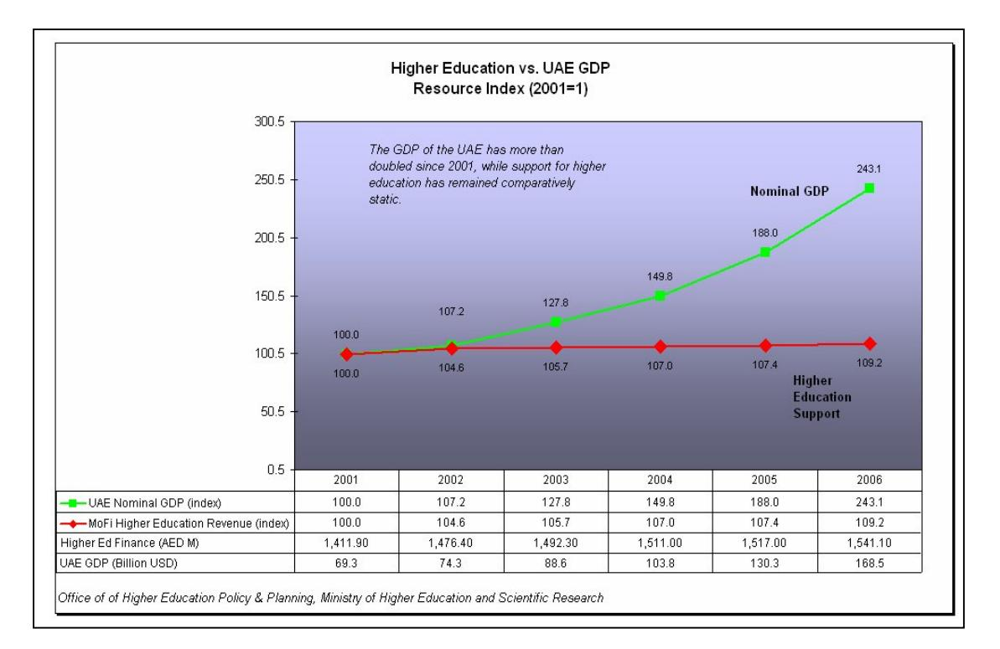
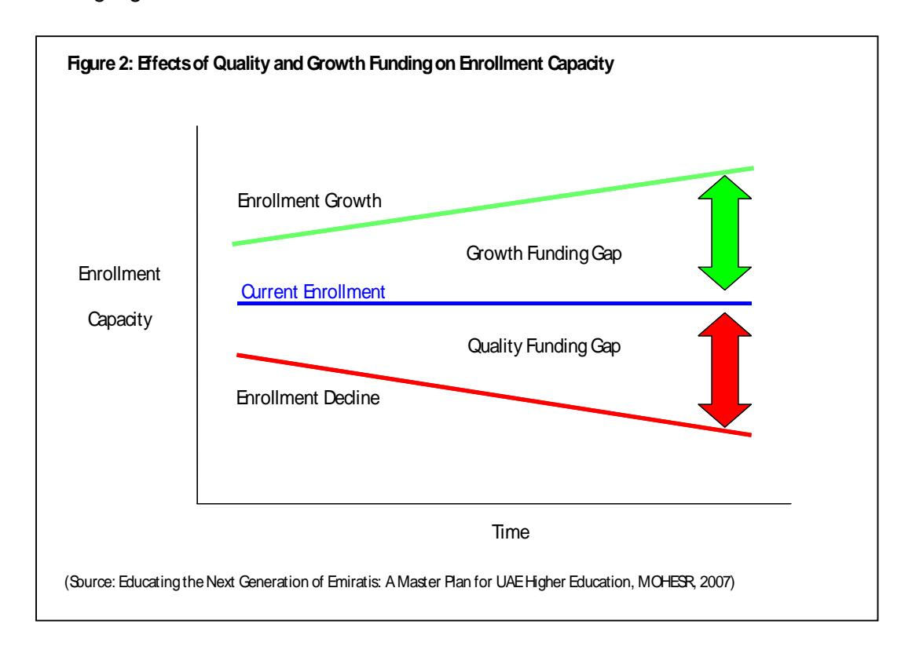

<!-- A2.R46 | source: papers_json/A2.R46/ -->

## **Research & Occasional Paper Series: CSHE.13.07** **UNIVERSITY OF CALIFORNIA, BERKELEY** **http://cshe.berkeley.edu**

## **THE UNITED ARAB EMIRATES:** **Policy Choices Shaping the Future of** **Public Higher Education**

## **August 2007**

## **Warren H. Fox, Ph.D.**

Office of Higher Education Policy and Planning Ministry of Higher Education and Scientific Research Abu Dhabi, United Arab Emirates

*Copyright 2007 Warren H. Fox, all rights reserved*

## ABSTRACT

The United Arab Emirates (UAE) is in the midst of tremendous economic development. With a rapidly changing economy, it is increasingly important for this expatriate dependent country to start training a native, modern workforce with the skills required to enter the workplace. The UAE must continue improving and developing their higher education system if it wants to create graduates with the training and education required to compete with students and workers from overseas. This paper will describe the UAE's higher education system, as well as current and potential obstacles for UAE universities to overcome, focusing on issues such as funding concerns and student access.

## **The United Arab Emirates:** **Policy Choices Shaping the Future of Public Higher Education**

*The Economist* reported on a "multi-billion-dollar windfall" in the Middle East for Gulf countries as the price of oil went past $60 a barrel. It chronicled record levels of income, and in turn record levels of investment in the six Gulf Cooperation Council countries. (The Economist, 2005). For the UAE, one report predicts that revenue increases "might be in the region of USD 50 billion to USD 100 billion over the next decade." (Jane's, 2007). This allows the United Arab Emirates to channel funds into property development, construction, the stock market, banking, shipping, and other areas of the expanding economy. Diversifying and developing the economy of the UAE have become national goals.

As the UAE pursues the development of new economic sectors such as tourism, shopping, banking, business services, real estate, and commercial sales, it must also consider the workforce needed to enable such expansion. The UAE is very successful at importing expatriate sector talent, as a large majority of the employees in the private sector are from other countries. A key policy and strategic issue for the future is the ability to educate and train Emiratis for positions of leadership, ownership, and employment and staffing in the new economy of their country.

<!-- page 2 -->

The Federal colleges and universities, the United Arab Emirates University, Zayed University, and the Higher Colleges of Technology, as part of the Ministry of Higher Education and Scientific Research, are the foundation for the enrollment of Emiratis and their preparation for employment. Emirati students, over 34,000, enroll at no cost in programs from the diploma level to the baccalaureate degree, and graduate programs are available with tuition as well. However, building and maintaining the capacity of these institutions to enroll all national students in quality program has become a challenge for the future. Key policy choices need to be made to increase the capacity of tertiary education and improve social and economic benefits for the country. Although oil revenues are high, national investment in public higher education has not kept pace with fiscal needs.

## **Higher Education Policy**

The UAE is rapidly developing into a regional and global model for economic and social development, and higher education's ability to contribute is critical. The United Arab Emirates, since the establishment of the UAE University in Al Ain, in 1976, has made outstanding progress in higher education, expanding possibilities for Emiratis and providing quality programs. The federal higher education campuses are positioned to build on their accomplishments for the future depending upon federal fiscal and policy decisions. As Emiratis comprise approximately twenty percent of the total population of over four million, it is imperative that UAE citizens attain high levels of education in order to provide leadership for the country's future and a talented workforce for its growing economy. Higher education can increase employment opportunities for success for men and women and serve national progress.

UAE leaders from the public and private sectors expect the national colleges and universities to strengthen, diversify, and support the country's economic development. Because of rapid change in the region and in the Emirates, the future success of the UAE depends upon an educated workforce and a high quality higher education system. However, a crisis in funding exists, and investment in the Higher Colleges of Technology, Zayed University, and the United Arab Emirates University is urgently needed. To retain and achieve quality programs for UAE development, a key strategic goal, funding must be increased – appropriations per student have fallen below international standards.

Internationally, the forces of globalization are creating an environment which demands that UAE citizens possess a wide array of new skills in order to function effectively in the new millennium. These forces are impacting all facets of education in the UAE, placing heavier demands on students, straining existing facilities and underscoring the need for the society to have a sustained and expanded commitment to education.

In the fall of 2003, His Excellency Sheikh Nahayan Mabarak Al Nahayan, Minister of Higher Education and Scientific Research recognized this issue and initiated a special national level planning group aimed at advancing national educational policy in the UAE. This Planning Group recommended creation of a Steering Committee to guide what was envisioned as a very broad and sustained effort at reviewing national education policy. On March 28, 2004, the Steering Committee issued a Report titled "Higher Education and the Future of the UAE" which addressed the most urgent areas of inquiry that the committee had reviewed. The Report presented a series of

<!-- page 3 -->

findings and recommendations that relate to higher education policy that served as the impetus for the current comprehensive plan for higher education in the UAE.

In the important area of education policy coordination, the Committee found that:

There are no Federal policies or practices requiring broad coordination of missions, degrees, organizations, or programs between or among federal institutions. "While there is coordination of application processes, ...there is no coordination function or position at the Ministry for the Federal institutions." (MOHE, 2004). It recommends the creation of federal policy, as decisions were campus based and unrelated to each other.

These and other considerations led the Committee to recommend the creation of an Office of Higher Education Policy and Planning for Federal institutions within the Ministry of Higher Education. The Office was established in July of 2004 and has been tasked with accomplishing the effective coordination of education policy and the development of long range plans to improve the capacity of the Ministry of Higher Education and Scientific Research to implement effective policies that meet the changing needs of the UAE. The challenge, however, given the stratified nature of political leadership, and the traditions of the federal campuses, is to integrate a system view of policy decisions. Traditional social relationships are strong and influential, data for decisions are often lacking, and collaboration is only now beginning.

Responding to this need, the policy office created the strategic plan of the Ministry, "Educating the Next Generation of Emiratis: A Master Plan for UAE Higher Education", which was published in 2007, and clearly delineates national goals to

- 1. Provide access and educational opportunity for all Emiratis,
- 2. Provide high quality education, and
- 3. Contribute to UAE economic development.

The later goal states "The academic programs and research efforts of the UAE system of higher education shall better link to national needs of the economy, prepare Emirates for participation in the private sector, and expand leadership in energy production and economic development research." (MOHE, 2007). The achievement of this goal is critical to raise the number of Emiratis employed in the private sector, and in supporting and expanding their impact on growth.

## **Key Issues for UAE Higher Education**

As outlined in the strategic plan, four key historic decisions were made in the 1970's in the UAE that shaped the character and structure of higher education in the country. These policies honor the values and practices of an Arab nation but also recognize modern demands of international education. They also have a major impact on the fiscal needs of public higher education that exist to this day. There are four original pillars of policy for the UAE:

- The UAE would build and operate its own universities, separated by gender.
- A qualified mostly international faculty would be employed.

<!-- page 4 -->

- Instruction would be in English.
- Education was to be for all qualified Emiratis, and would include women. (MOHE, 2007)

These key decisions were the pillars upon which federal higher education was established, and they continue to serve the nation. They contribute to higher costs than other countries because importing faculty has higher fixed costs brought on because of the need to provide housing and transportation home each year, and separating campus facilities by gender increases both capital costs and number of faculty. However, they also contribute to broad access and quality instruction. And they are policy choices based on cultural values and social expectations of the country. These are legitimate policies for a country with the fiscal resources to support such policy choices if it chooses to do so.

## **Strategic Fundamentals: Funding and Access for UAE Citizens**

The number of Emiratis is increasing and more UAE citizens have recognized the importance of education; this has led to a steady increase in the number of applicants for admission to Federal higher education institutions in the UAE. Enrollment is expected to increase by approximately 10,000 students over the next 10 years, and 20,000 by 2020. (MOHE, 2007). The consequences of this trend were noted by the Advisory Committee for Planning of Higher Education in the United Arab Emirates a decade ago. Established by His Excellency Sheikh Nahayan Mabarak Al Nahayan in 1996, the Committee observed that there was a crisis in higher education because of chronic under funding and the projected increases in student enrollment. These concerns now appear to be well founded. Data developed by the Ministry of Higher Education's Office of Higher Education Policy and Planning suggest that the capacity of the higher education system to provide access to all qualified students has not only been reached, but exceeded. This was published in a report, "Funding Students First: Access to Quality Higher Education Programs in the United Arab Emirates". (MOHE, 2004)

As is the case in any country, the adequacy of support for higher education depends upon two key factors; enrollment and inflation. As enrollment increases, without commensurate increases in financial support, the revenue per student declines.

<!-- page 5 -->

Similarly, the "real" value of static revenue - even with unchanging enrollment- would usually drop over time as the actual purchasing power of revenue declines.

Table 1 estimates the purchasing power of funds allocated by the UAE Ministry of Finance to the country's three federal institutions of higher education.

Enrollment from 2000-01 to 2005-06 grew by approximately 16 percent across the UAE. By comparison, the real revenue declined by an estimated 14 percent. Together, enrollment and inflation conspired to decrease the real value of federal support per student, as it declined by over a quarter (26 percent) between 2001 and 2006.

Source: Institutional reports and Ministry of Higher Education and Scientific Research

The funding situation is leading to less than desirable outcomes for access and quality for UAE students. Per student expenditures as a percentage of GDP are low compared to other countries. This lack of funding results in students being turned away, or being placed in institutions that do not have the funds to adequately meet their needs. In order to be competitive with other countries and to achieve international standards, an increase to a level of over 3.5% in GDP funding for higher education should occur in the UAE. (MOHE, 2004).

Economic and GDP growth have been substantial in the UAE over the last several years. Since 2000, nominal GDP for the UAE has more than doubled by 2006. As Figure 1 below demonstrates, over the same time period higher education funding has been comparatively flat. Clearly the capacity for higher levels of support exists, though policy decisions have not been made for fiscal increases.

<!-- page 6 -->

***Figure 1: Higher Education vs. UAE GDP***

If allowed to continue, the present situation is likely to have significant consequences for UAE society. Frustrated students, unable to meet their educational goals, may opt for other activities that will either misuse or under use their capacities. Students that do not have the chance to achieve their potential in the higher educational system are likely to be marginalized in the increasingly global and sophisticated economy that is now characteristic of the UAE.

The UAE needs to be committed to maintaining high quality programs, at Zayed University, United Arab Emirates University, and the Higher Colleges of Technology, otherwise students and the country will not benefit from higher education, and top students will migrate to competitive institutions. There are many measures of quality in higher education. Among the more important of these are well-prepared student applicants, adequate funding, highly qualified faculty, modern facilities, state of the art information technology, accreditation by external agencies, and preparedness of graduates for the job market.

If graduates of UAE institutions of higher education are to compete successfully in the global marketplace for jobs in the private sector, the above measures of quality must be present. High quality institutions of higher education are central to the UAE becoming more self-sufficient and to increasing the attractiveness of UAE graduates to private industry.

<!-- page 7 -->

The following chart depicts the erosion of quality and capacity in UAE's higher education institutions resulting from increased student demand and a decade of inflation erosion. Without funding to close the quality gap, the number of un-served students will increase annually. Without funding of the growth gap, increasing student enrollment demand cannot be met. The **closing of both of these gaps** will ensure access by all eligible national students to a high quality higher education and is a strategic goal.

In addition to funding to adequately support approximately 20,000 new students that are anticipated out to the year 2020, it will also be necessary to support the quality of education the students receive. (MOHE, 2007).

In an important policy development, and in recognition of the funding issue for public higher education, in early 2007 the Ministry of Presidential Affairs commissioned a study of financing of federal institutions. This is an indication of awareness by policy makers of fiscal shortfalls that affect primarily access of Emirati students, and program quality. The study explored enrollment trends and Ministry of Finance and Industry appropriations over time. Funding alternatives are being considered, including a possible funding formula based on the number of students, though final recommendations are not yet available. However, there are possibilities that improved funding levels could be achieved, most likely with increased accountability and reporting requirements on budgeting and student outcomes. The government is demonstrating interest in improved data on institutional performance, student information, accountability, and planning.

## **Federalism and Emirate Programs**

The United Arab Emirates is a federation of seven emirates, joined together since 1973 into the country of the UAE. Nation building and federal activities have continued since then in all sectors, including health and education. In 1996, the

<!-- page 8 -->

Ministry of Higher Education and Scientific Research was established to deal with the institutions, UAE University, Zayed University, and the Higher Colleges of Technology. It also provides admissions services through the National Admissions and Placement Office (NAPO), licenses private institutions, and is responsible for the scholarship program for Emiratis.

The Ministry of Education for primary and secondary education is far larger, oversees ten educational zones and seven hundred schools. The decades old trend of federal capacity building has now been affected by emirate based units and organizations interested in local issues, specialized programs, and local control. Dubai, for example, began the Dubai Education Council in 2005 to address school reform, and created the Knowledge Village, a free zone for higher education campuses. In addition, Abu Dhabi created the Abu Dhabi Education Council which is dealing with the emirate's educational priorities. The Emirate of Sharjah has created community colleges and independent universities including the American University of Sharjah.

Potential exists for these entities to have major influence on higher education decisions and policy within their jurisdiction. Already emirates have begun programs on school reform, school management, and teacher education, and have established colleges and universities or entered into agreements with private providers. However, there has neither been effective collaboration among these organizations, nor joint planning.

As these policy units are relatively new, their long term impact is yet to be determined, but it is clear that local emirate initiatives and policies will have a significant impact upon the future of higher education in the UAE. The situation results in a more crowded policy environment and makes national policy more difficult to plan and implement. The trend is towards decentralization and increased local control.

## **Ensure Quality Education and Promote College Readiness**

The quality of education is critical to the future of the UAE. Quality overlaps all the other issues relating to higher education in the UAE. A system that does not meet internationally accepted standards of quality—in its staffing, in its programs, in instructional technology and in its graduates—will not serve society well. Failure to maintain standards in all of these areas means that the job market will not welcome degree holders as readily, and this will in turn lead to students making other choices about their education. In order to certify quality, both the United Arab Emirates University and Zayed University are exploring accreditation from a United States regional accrediting body, and are receiving accreditation for specialized programs such as engineering and education.

The report "Higher Education and the Future of the UAE"- notes that only five percent of those employed in the private sector are UAE graduates. As the report notes, the data are not sufficient to fully confirm this situation, but such a low participation rate in the private sector is cause for concern. This is particularly true if the low participation rate is in part attributable to private sector estimations of the educational achievements of UAE higher education graduates. (MOHE, April, 2004)

While the qualifications of graduates are important to the success of the UAE higher education system, another important factor that must be considered is the capacity of students to successfully complete what should be a demanding curriculum. This

<!-- page 9 -->

depends in large part on the extent to which incoming students have been provided with the skills to learn at the university level. It is clear that a large number of students are not ready to work at the college level. Scores on the CEPA (Common Educational Proficiency Assessment) test show that far too many students do not have the necessary competencies in English to do college level work. The scores are a strong predictor of success and every effort must be made to provide students at K-12 with the tools needed for a successful higher education experience.

At the same time, the resources that are now spent by the higher education system on remedial courses in an effort to bring a large number of students up to an acceptable proficiency in English actually divert funds and attention from the core mission of a university. A strategic advantage will emerge with lower demand for readiness programs.

Also, continued support for information technology (IT) is central to the effective delivery of instruction, the storage and retrieval of information, and research. Computer and information technology have revolutionized higher education, and the capacity to both utilize technology and plan for change is critical for UAE campuses. The federal institutions have set examples for the use of computer technology in improving learning, and through computers in instruction, networking, web based resources, and the use of laptops at ZU, HCT, and UAEU. The potential for further collaboration efforts among the campuses for digital libraries, learning centers, and "smart" classrooms is high. Technology contributes to innovation in teaching and learning and library services. Improving student skills in computer technology and the use of information technology should be a high priority for higher education.

## **Expand the Participation of Males in Higher Education**

Of the many policy issues that are confronting the higher education system in the UAE, the twenty eight percent of male students in higher education is one of the most troubling. There are many reasons for this low level of male enrollment in the higher education system, and correcting the problem will require policy initiatives that will demand significant resources and require a cooperative effort among many institutions in the UAE. Before initiating major policy changes, the dimensions of the problem and its causes must be carefully assessed.

Data developed by the Institutional Planning Unit and the Admission and Registration Department of UAEU indicate that male enrollment has lagged behind female enrollment for the past twenty years. A 2004 Survey by the National Admissions and Placement Office (NAPO) showed that "Over half of the male students (current school leavers) who have been approved for admission at the UAEU and HCT for September 2003 did not show up for registration." (NAPO, 2004).

Interviews conducted during the development of this report suggest that there are many reasons for this low rate of male enrollment; young males have more opportunities available to them, such as joining the military, the police, participating in a family or other business, or working in some capacity for the government.

Other commenters expressed the view that young men perceive it takes a long time to complete a higher education program. The requirement to have demonstrated competency in English has acted as a deterrent, because at least a year must be spent getting to a level that will allow college level work. The academic progress requirements were also identified as a possible hindrance to male enrollment.

<!-- page 10 -->

## **Improve Tertiary Relationships with the Private Sector**

Major efforts must be undertaken to increase the low percentage of nationals employed by the private sector. UAE citizens have become more aware of the value of education and increasingly understand the importance that education has in economic life. A very strong motivation for pursuing higher education is the prospect of those life long economic benefits that accompany higher education. The higher education system of the UAE, like all educational systems elsewhere, must have a close and durable relationship with the economic life of the country. The effort to establish and maintain relationships with the private sector has become part of the daily activity of UAE educational institutions. The long run success of these institutions depends on the acceptance of its graduates by private organizations who value them for the skills and knowledge they have acquired through participating in the higher education system. Referring to a report by the International Labor Organization, one author observed that the report "insists that training and education were at the heart of Southeast Asia's economic miracle and could well provide a way out of under-development and poverty for millions of workers." (Abdelkarim and Haan, 2002).

To serve as competent members of the UAE workforce, workplace skills are required of UAE nationals. Program graduates of HCT, UAEU, and ZU, from the diploma level to graduate degrees, should posses the skills needed to be a productive member of an organization. In addition to the attributes gained from the program of study or academic major, a workforce curriculum could be expanded within general education and major courses in our campus offerings. A proposed definition of workforce skills is outlined below:

## **Workforce Skills**

- Teamwork Contribute continuously to the success of the team, and work well with
- others Communication Posses the ability to communicate in writing and orally effectively to co-workers
- Problem-solving Posses the capacity to understand, analyze, and solve problems
- Computer Literacy Demonstrate basic computer related skills
- Productivity Demonstrate time on task, commitment to the success of the organization, and demonstrate output

These skills, coupled with higher education knowledge, will enable UAE citizens to more fully contribute to the economic future of the country.

In addition to providing graduates who can participate in the economy, the UAE also must continue to expand its capacity to serve the private sector's need for technical assistance and applied research. All components of the higher education system have established programs of cooperative and applied research. The effort of the Center for Externally Funded Research and Consultancy of UAEU is one example of this activity and the Center of Excellence for Applied Research and Technology at the Higher Colleges of Technology and the Institute for Applied Research at Zayed University are others. However, what is lacking is a clear list of national priorities for research and a competitive funding program with federal funding at international

<!-- page 11 -->

levels. The Master Plan for UAE Higher Education contains a proposal for such a program.

## **Campus Missions, Non-Federal Institutions, and a Comprehensive Education Policy**

A review of the mission statements of the Federal universities indicates some similarity. It may be that it suggests some duplicative effort which may hinder the most effective allocation of resources to meet the nation's educational objectives. Review of the missions of these institutions to determine how best to meet national needs through a coordinated system is part of the system master planning process.

Also, the role of the higher education system in what is referred to as "lifelong learning" should be articulated. At present, admissions policy and program offerings do not support lifelong enrollment. It is not necessary that this be a lead responsibility of these institutions, but what is needed is some sense of the contribution they and other institutions are expected to make in this important area of education. As Emiratis in the workforce discover they may need to re-enter education, additional enrollment demand will be put on the campuses.

The UAE's economic growth and high level of expatriates has contributed to the growth in the number of private institutions offering educational programs. In addition to the higher education system institutions (UAEU, ZU, and HCT), local institutions operated at the Emirate level and private institutions operating throughout the country have created a climate of competition for the best students. And with important strategic policy implications, in the aggregate over forty of these schools, enroll more students than does the UAE national higher education system with over 40,000 students.

Non-Federal institutions may provide additional access for Emiratis and this capacity should be taken into account when policies are determined for student access. Private sector institutions may also offer UAE citizens the chance to pursue education in areas not available in the UAE system or at locations that are more convenient to their homes. This sector also permits students who did not pursue their studies immediately following graduation from K-12 to have additional options for post secondary educational experiences.

The UAE through its ministry licensing system of the Commission for Academic Accreditation has made a concerted effort to provide consumer protection through the careful review of those private institutional programs that are on offer in the UAE. However, with the growth of free zones and the entry of a large number of institutions into the educational market, the licensing system is challenged to screen institutions that choose to operate in the free zones and do not seek licenses issued by the UAE. Clearly, the UAE must provide consumer protection to its citizens through a policy that makes judgments about the quality of the programs being offered by these institutions.

The growth in educational opportunity carries with it the need to assure quality and the requirement that institutions have as their first priority the long term success of their students. In a relatively free and brisk educational market, assuring that these long term benefits take precedence over short term returns will be a challenge for the UAE.

<!-- page 12 -->

## **Information and Data Systems for Better Education**

In higher education, and education in general in the UAE, obtaining timely, accurate data is a challenge. The country is only thirty five years old, and government structure to publish public records and data is still improving. A culture of planning and data analysis needs to be expanded. A complex and growing system of higher education will require accurate, and timely information to support it. A comprehensive data base on higher education gives opportunities for better decision-making and an opportunity to demonstrate accountability of stated goals and objectives. As the UAE takes on additional challenges — providing students with better career counseling, making judgments about changes in curricula, or adopting new programs—the need for data will increase. As its administrative responsibilities grow and the need for financial and other types of data expands, there will be a concomitant need to organize and manage the data so that they are useful to program managers, enjoy the confidence of top policy makers, and illuminate the higher educations system for UAE citizens.

The Office of Higher Education Policy and Planning in the Ministry of Higher Education and Scientific Research has established a new data centre that addresses this need. The National Admissions and Placement Office also has data on student applications and admissions. Reports such as the UAEU Statistical Yearbook and Students and Graduates Statistics published by the Institutional Research and Planning Unit and the Admission and Registration Department are good examples of valuable products from the non-Federal institutions.

However, it appears that higher education institutions could make better use of labor market information in their planning for future programs. In part, this may be due to the relatively modest amounts of labor market information available. Efforts have been initiated to expand the range of information available; however, these attempts have not been brought to fruition because of both a lack of sufficient funding and changing priorities within the Ministry of Labor. However, data do exist which could be used, but at present, collection, coordination, and analysis of available data is dispersed and sporadic. (Abdelkarim and Haan, 2002).

To develop a comprehensive portrait of higher education in the UAE, it will be necessary to expand information collection requirements to include those institutions offering programs in the private sector. The Ministry of Higher Education and Scientific Research is currently gathering such information.

## **Conclusion**

From the national perspective, the United Arab Emirates is committed to a key goaleconomic diversification- which in the long run will be increasingly dependent upon an educated workforce. Energy related income has and will provide the foundation, but sustainability is only possible with qualified employees. For Emiratis, a key factor is the increased capacity of its higher education system to provide access to quality programs. Tertiary education capacity building involves adequate facilities, instructional space such as laboratories and classrooms, information technology, and most important, internationally qualified faculty. Budgeting for this requirement requires additional financial support from the federal government. All Emiratis do not have access to higher education because they may not have completed high school, lack English and Maths skills, or the universities lack space due to fiscal constraints.

<!-- page 13 -->

Since federal allocations have remained relatively stable since 2000, and inflation and enrollment growth have exceeded spending effectiveness, increased funding is needed, or enrollment caps needs to be implemented. In fact, enrollment has been limited, with approximately 2000 students being turned away in 2005-2006. To achieve the major goal of providing access for Emiratis requires federal policies and action for increased funding. Delaying action limits student and national capacity to profit from and contribute to social and economic progress.

Comprising twenty percent of the population, it is critical that Emiratis enroll in and graduate from college or university in order to have the opportunity to claim their place in the economic structure of the future UAE. The education and development of its human resources is the key to the nation's prosperity for its citizens. The next generation of Emiratis deserves no less.

<!-- page 14 -->

## **References**

- Abdelkarim, Abbas and Haan, Hans, "Skills and Training in the UAE: The Need for and the Dimensions of Institutional Intervention", Policy Research Paper No. 5, Center for Labour Market Research and Information, Dubai, January, 2002 p. 17.
- __________, "Establishing a Labour Market Information System in the UAE: Understanding the Needs and Identifying Structures". Policy Research Paper No. 9. Center for Labour Market Research and Information, Dubai, April, 2002.
- Gulf News, "Inflation to Rein in UAE Growth", Monday, May 14, 2007, p. 38.
- Jane's, Defence Weekly, Jane's Information Group Limited, February, 2007, p. 38.
- Knight, Jane, Internationalization of Higher Education: New Directions, New Challenges, The International Association of Universities, October, 2006.
- MOHE, "Funding Students First, Access to Quality Higher Education Programs in the United Arab Emirates", Office of Higher Education Policy and Planning, October, 2004.
- MOHE, Ministry of Higher Education and Scientific Research, "Educating the Next Generation of Emiratis: A Master Plan for UAE Higher Education", Office of Higher Education Policy and Planning, January, 2007.
- MOHE, Ministry of Higher Education and Scientific Research, "Higher Education and the Future of the UAE", Office of Higher Education Policy and Planning, 2004.
- NAPO, National Admissions and Placement Office, "Third Annual Survey of the No Shows", February, 2004.
- The Economist, August 6, 2005, p. 36.
- UAE Yearbook 2007, Ministry of Presidential Affairs and National Media Council, Trident Press, London, 2007.
