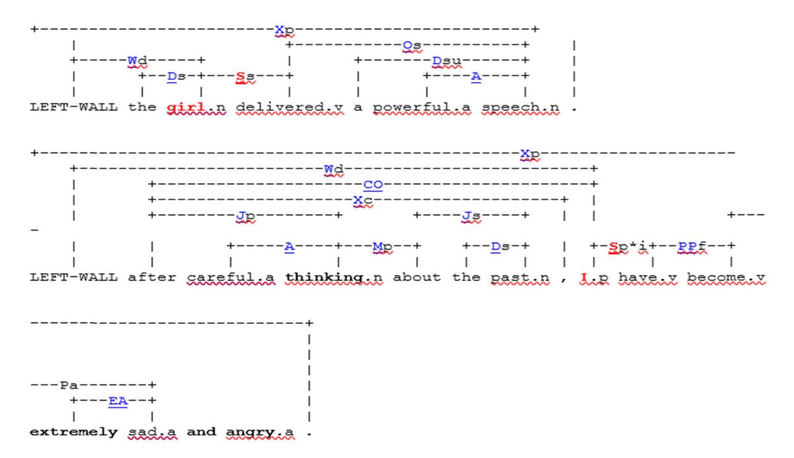
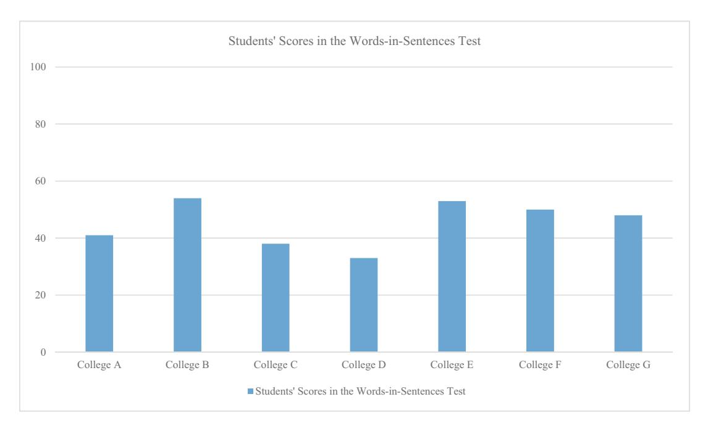

<!-- A3.R03 | source: papers_json/A3.R03/ -->

## Research Article

Emad A. S. Abu-Ayyash and Doaa Hamam*

## The declarative–procedural knowledge of grammatical functions in higher education ESL contexts: Fiction and reality

[https://doi.org/10.1515/opli-2022-0242](https://doi.org/10.1515/opli-2022-0242) received November 15, 2022; accepted June 22, 2023

Abstract: The present article purported to gain insights about English as a second language (ESL) learners' knowledge of grammatical functions at the declarative and the procedural levels in the higher education context, and argued that the dialogue between the types of knowledge calls for more attention. The study utilised a Words-in-Sentences Test that was administered to 841 ESL students in seven colleges and universities in three Arab countries: United Arab Emirates, Jordan and Oman. The test was used to measure the participants' declarative knowledge of grammatical functions. The participants' test scores were then correlated with their essay writing scores to find if there is a significant correlation between the two, and thus gain insight into the relationship between the declarative knowledge and the procedural knowledge of grammatical functions. Finally, a qualitative analysis was conducted on nine essays to gain an in-depth understanding of this relationship. The findings indicated that the university participants' declarative knowledge of grammatical functions was below the expected level and that there was a significant correlation between the learners' test scores and writing scores. In addition, intriguing themes emerged from the qualitative analysis. Together, the findings are anticipated to spark more research on grammatical function knowledge among university students in ESL contexts.

Keywords: grammatical functions, declarative knowledge, procedural knowledge, grammar in higher education, grammar among ESL learners

# 1 Introduction

The initial impetus for this article came from a casual conversation with a friend who worked as a lecturer of English at a private college in the United Arab Emirates. He was describing an "awkward" situation where some of his students passed a short test on the difference between the simple past tense and the present perfect tense, yet used the two tenses interchangeably when they wrote without any distinction. He wondered, "why does a student who has the knowledge about these two tenses use them mostly inaccurately when he/she writes?" Given the intricacy of second language acquisition, the issue raised should not be very surprising.

English as a second language (ESL) learners face a vast array of challenges that are in large part pertinent to the competence in and the use of English grammatical structures (Abduh et al.[ 2021](#page-13-0), James[ 2013)](#page-13-1). From their attempts to learn the various grammatical forms (declarative knowledge), to the complexities of putting what they have learnt into actual written or oral production (procedural knowledge), ESL learners encounter

Emad A. S. Abu-Ayyash: Department of Education/TESOL, The British University in Dubai, Dubai, United Arab Emirates

> ^* ^Corresponding author: Doaa Hamam, Department of General Studies, Higher Colleges of Technology, Dubai, United Arab Emirates, e-mail:[ dhamam@hct.ac.ae](mailto:dhamam@hct.ac.ae)

<!-- page 2 -->

numerous challenges along the way. In essence, "Knowing about language as a grammatical system, which involves knowing the rules underlying syntax, semantics, and phonology, is not a sufficient condition for knowing how to use the language functionally" (O'Malley et al.[ 1990](#page-14-0), 73), indicating a gap between knowing grammar and being able to use it in production (Johnston and Goettsch[ 2000)](#page-13-2).

ESL University students at all levels make grammatical errors of all sorts, which affects the overall quality of their work. Atashian and Al-Bahri ([2018](#page-13-3)) emphasised that grammar is a big challenge for university students, especially in academic writing. Their study found that verb tense-related errors were the most prevalent. Singh et al. ([2017](#page-14-1)) found that ESL tertiary students' errors pertaining to subject–verb agreement and the use of tenses are recurrent. In a study surveying 228 undergraduate theses in the Indonesian context, Sugeng [(2016](#page-14-2)) found that grammatical errors pertaining to verbs, subject–verb agreement, predicates, and clause structure were prevalent in students' writing. Another study analysing the oral productions of university students in 126 interactions found that the students made errors in prepositions, questions, articles, plural forms, subject–verb agreement, and tense which are very common (Ting et al.[ 2010)](#page-14-3). The findings of Sugeng ([2016](#page-14-2)) and Ting et al. [(2010)](#page-14-3) were supported by other studies conducted in ESL contexts at universities (e.g. Abduh et al.[ 2021,](#page-13-0) Alghazo and Alshraideh[ 2020](#page-13-4), Eng et al.[ 2020](#page-13-5)). It is worth noting here that the prevalence of errors in verb phrases is not a matter of L1 interference because the participants in these studies came from different L1 backgrounds.

Before proceeding, though, it is essential that we define what we exactly take as grammar and as grammatical functions. Grammar has for long attracted the attention of linguists, certainly ever since the 1950s Chomsky and has even become "the vortex around which many controversies in language teaching have swirled" (Larsen-Freeman[ 2003,](#page-13-6) 9). Quite understandably, with all the theoretical-and-practical-based controversies that surround grammar, it is normal to find fine-grained differences in defining it. At the heart of these debates, though, there is an agreement to view grammar as rules governing morphology and syntax (morphosyntactic features), with the former being about word formation and the latter word order (Freeborn[ 1995,](#page-13-7) Schenck[ 2017,](#page-14-4) Thornbury[ 1999)](#page-14-5). In addition to this focus, grammar is viewed as rules pertaining to classifications, or categories (noun, verb, and preposition) and the relationships between them (Hudson[ 2003,](#page-13-8) Newson[ 2006)](#page-13-9).

Of particular importance to the present article is the view that one main feature of grammar is "its meaning-making potential" (Thornbury[ 1999](#page-14-5), 3). To elaborate, the words "George" and "me" have different functions in the following utterances, therefore leading to different meanings at the sentence level.

Dana phoned George and me last night. George sent me an email yesterday.

This article focuses on the functions that words and phrases play in sentences. This part of grammar relates to how the words are organised to produce meaningful sentences (Cook[ 2013)](#page-13-10). In this sense, words in sentences hold functions, such as subject, direct object, indirect object, preposition, article, and object of preposition (Newson [2006)](#page-13-9). Knowledge of the functions of words is essential to understand the meanings of sentences and to produce accurate ones, thus making this kind of knowledge influential at the declarative and procedural levels. Grammatical functions have been the focus of copious research articles that approached the topic from different angles and that addressed it vis-à-vis various languages. Examples include the interplay between grammatical functions and tone in San Maka (Perekhvalskaya[ 2021](#page-14-6)), grammatical functions of verb complements in Mandarin Chinese (Yong[ 1997](#page-14-7)), and grammatical functions in Indonesian relative clauses (Sari et al.[ 2017](#page-14-8)).

However, the relationship between the declarative knowledge and the procedural knowledge of grammatical functions is a complicated one so we rarely find attempts to address the dialogue between the two in a single study. The levels of the declarative–procedural knowledge of grammatical functions can be perceived as a tripartite knowledge pyramid [(Figure 1)](#page-2-0) along which learners are distributed in the following way: 1) The top layer consists of students possessing both the declarative and the procedural knowledge, 2) the second layer includes students possessing either one, and 3) the third layer houses students possessing neither one.

The top layer entails that some students have the declarative knowledge of grammar and can transfer and use this knowledge in their oral and writing productions, thus possessing the procedural knowledge as well. For example, the students know what an indirect object is and they can use it correctly when they write and

<!-- page 3 -->

speak. The alignment between the declarative knowledge and the procedural knowledge may lead to the overproduction of some linguistic forms and functions (Gass[ 2013)](#page-13-11).

The second layer on the pyramid is bidirectional. Within this layer, there are two categories of ESL learners. The first category consists of learners who possess the procedural knowledge of grammatical functions, but not the underlying declarative knowledge, for example using the indirect object in speech or writing but not being able to identify it in a sentence. This is known in the literature as tacit knowledge, where the learners do not know consciously what they know unconsciously (Weisler and Milekic[ 2000](#page-14-9)). In this case, "knowledge is said to be represented implicitly when it is inferred to exist from individuals' systematic behaviour, though these individuals are unaware of the content of their knowledge" (Paradis[ 2009](#page-14-10), 3). The second category consists of ESL learners who possess declarative knowledge of grammatical functions, but not procedural knowledge, for example being able to identify the indirect object in a sentence, yet not using this function in speech or writing. This is known in the literature as the inert knowledge problem, where "knowledge that is gained in (formal lessons in) the classroom remains inactive or inert when put into service (in communication within and) outside the classroom" (Larsen-Freeman[ 2003,](#page-13-6) 8). The inert knowledge problem is usually characterised by avoidance, where students tend to avoid using certain forms due to their complexity (Dagut and Laufer[ 1985](#page-13-12), Gass[ 2013)](#page-13-11).

The third layer on the pyramid entails that the students do not possess the knowledge of the grammatical functions and cannot use them, for example not being able to identify the indirect object in a sentence and not being able to use it in writing or speech. This kind of low-profile declarative–procedural knowledge may, quite understandably, lead to the underrepresentation of certain functions in learners' productions.

This article attempts to explore ESL university students' distribution across the three layers and to further understand the dialogue between the declarative knowledge and the procedural knowledge. The overall argument of the current article highlights the importance of this interaction, which becomes abundantly clear in the typical cases where ESL university students fail to put their declarative knowledge of grammatical functions into accurate application when they speak or write. To understand the declarative knowledge further, a Words-in-Sentences Test was developed, validated, and administered to 841 first-year students in seven universities and colleges in three Arab countries (United Arab Emirates, Jordan, and Oman). The test is not new in the general format since similar tests were developed earlier, following suit of the pioneering Words-in-Sentences Test that was created in 1959 by John B. Caroll as Part IV of the modern language aptitude test, which "has remained in continuous use ever since" (Stansfield and Reed[ 2004](#page-14-11), 44). The test sought to measure the ability to understand the functions of particular words in sentences (Lightbown and Spada[ 2008)](#page-13-13) by requiring the examinees to select one word out of five used in a sentence. That word had to correspond in grammatical function to a word used in a stimulus sentence (Gass[ 2013](#page-13-11)). The present article utilised the same discretion, and a 15-item test was developed to measure students' declarative knowledge of grammatical functions in ESL higher education contexts.

The results obtained from the test led to important insights into the students' levels of declarative knowledge of the main grammar constructs. The results from the test were then correlated with the students' writing scores, which were obtained from their instructors, to see whether the declarative knowledge of grammar correlated with their writing scores. Then, nine pieces of writing were selected for qualitative document

<!-- page 4 -->

analysis to understand the students' procedural knowledge in relation to the same grammatical constructs used in the Words-in-Sentences Test. This analysis sought to identify and fathom the themes and/or problematic areas pertinent to grammatical functions among ESL University students.

## 1.1 Statement of the problem

In the three Arab countries where the university students who participated in this study come from, students get English classes almost every day over at least 12 years. This lengthy period of linguistic exposure in the language classrooms can be considered more than ample to support substantial learning of grammatical forms and functions. This is fiction. Reality is that several factors affect the learning of grammatical functions, such as the teaching methods, feedback, aptitude, and learner personality (Lightbown and Spada[ 2008)](#page-13-13). Therefore, despite the lengthy period of exposure to English, Arab ESL university students can still face a number of difficulties pertinent to grammatical functions. The importance of understanding and using grammatical functions has been established in the literature at different levels, including the order of words and understanding the meaning of sentences and utterances (Crystal[ 2006,](#page-13-14) Thornbury[ 1999)](#page-14-5).

According to a host of studies, these difficulties are diverse and are imbricated within Arab learners' productions at all levels (Altheneyan and Boayrid[ 2019)](#page-13-15) in diverse contexts (Al Masri and Abu-Ayyash[ 2020](#page-13-16)). The procedural knowledge of grammar was found deficient in the writing productions of Arab university students in several Arab countries, for example Oman (Atashian and Al-Bahri[ 2018)](#page-13-3), Lebanon (Scott and Tucker [1974](#page-14-12)), United Arab Emirates (Fareh[ 2014)](#page-13-17), and Iraq (Al-Shujairi and Tan[ 2017](#page-13-18)). The declarative knowledge of grammar attracted fewer, yet equally enthusiastic, researchers who sought to investigate the awareness of English grammar among learners and teachers. One such study was conducted in Indonesia (Marzulina et al. [2019](#page-13-19)). The focus of the study was parts of speech (noun, verb, adjective, adverb, pronoun, determiner, preposition), and one finding was that the participants showed difficulty and made errors in the identification of these categories. Taken together, the issues found in ESL university learners' declarative knowledge and procedural knowledge seem to indicate that the teaching and learning of English grammar has not been effective and that in order to understand the issue in a comprehensive way, more studies need to explore the dialogue between the two types of knowledge in ESL contexts, which the present study seeks to endeavour.

## 1.2 Research questions

- 1. What is the current status of the ESL university students' declarative knowledge of grammatical functions as revealed by their scores in the Words-in-Sentences Test?
- 2. Is there a correlation between ESL university students' scores in the Words-in-Sentences Test and their writing scores?
- 3. What are the themes pertaining to the declarative knowledge and the procedural knowledge of grammatical functions as revealed by the Words-in-Sentences Test and the writing samples?

## 1.3 Significance

Until recently, research on grammar in the ESL context focused almost exclusively on either the declarative knowledge (e.g. Marzulina et al.[ 2019)](#page-13-19) or the procedural knowledge (e.g. Altheneyan and Boayrid[ 2019](#page-13-15), Fareh [2014](#page-13-17), Kampookaew[ 2020](#page-13-20)), not the dialogue between both types. In order to fully understand the interplay between the two, it is important to study whether ESL learners actually have knowledge of grammatical functions and how this mirrors their written productions. It is equally important to figure out whether or

<!-- page 5 -->

not there is a correlation between their declarative knowledge and procedural knowledge of grammar. The present study is anticipated to trigger more research on the interaction between the declarative knowledge and the procedural knowledge of grammatical functions that would flesh out the findings of this article.

# 2 Materials and methods

This study aimed to explore the declarative and procedural knowledge of grammatical functions among university students. The concurrent mixed-methods design was used in instrumentation and data analysis. The utilisation of qualitative measures in tandem with quantitative ones aimed for significance enhancement, which "involves the use of qualitative techniques in order to maximise researchers' interpretations of quantitative data" (Leech and Onwuegbuzie[ 2007,](#page-13-21) 561). According to Collins et al. [(2006](#page-13-22)), significance enhancement may take different forms, such as expanding the interpretation of data and clarifying why the outcomes did or did not occur, which are two main reasons why both quantitative and qualitative strategies were used in this article. To serve the overarching aim of the article, three research questions were developed. This part of the article sheds light on the materials and the methodology used to glean the data necessary to answer the research questions.

The first research question was "What is the current status of the ESL university students' declarative knowledge of grammatical functions as revealed by their scores in the Words-in-Sentences Test?" The instrument used to answer this question was a Words-in-Sentences Test that was developed by the researchers ([Appendix)](#page-15-0). This test was composed of 15 multiple-choice questions of five items each to select from. The items tested selected ten grammatical functions (subject, subordinating conjunctive, object of preposition, direct object, noun modifier, subject complement, object complement, prepositional phrase head, predicator, and adjective modifier) that correspond to various word classes. The selected grammatical functions, the corresponding word classes, the number of test items, and the distribution of these in the test are shown in[ Table 1](#page-4-0).

For each one of the 15 test items, a stimulus sentence was written with one word underlined, and another sentence with five words underlined and labelled from A to E. The participants were asked to choose from the second sentence the word that has the same grammatical function as the one underlined in the stimulus sentence. The tests were scored manually by the researchers and were given a mark each out of 15 based on the number of correct answers. The scores from the test were used to answer the first research question pertaining to the students' declarative knowledge of grammatical functions. This test was administered to 841 university ESL students, who were all in their first year.

The second research question was "Is there a correlation between ESL university students' scores in the Words-in-Sentences Test and their writing scores?" In order to answer this question, the students' scores in the Words-in-Sentences Test were correlated with their writing scores retrieved from the universities they studied at using Pearson Correlation Analysis.

<!-- page 6 -->

The third research question was "What are the themes pertaining to the declarative knowledge and the procedural knowledge of grammatical functions as revealed by the Words-in-Sentences Test and the writing samples?" This question was put forward to find the most salient themes pertaining to university students' declarative and procedural knowledge of grammatical functions. The answer to this question involved the use of qualitative content analysis (Leech and Onwuegbuzie[ 2007](#page-13-21)), which lent itself to an in-depth examination of participants' responses to the Words-in-Sentences Test and their written essays. A number of themes were generated from this analysis. These themes were discussed in terms of the three layers of the declarative– procedural knowledge pyramid presented earlier in order to generate practical implications about the dialogue between the two types of knowledge. This analysis specifically involved nine participants that represent the three levels of achievement in their essay and test scores – three essays from each level as shown in [Table 2.](#page-5-0)

It can be realised that the first two questions can offer a partial explanation of some aspects of the learners' knowledge of grammatical functions and how this type of knowledge statistically correlates with their writing scores. Thus, it was sensible to examine authentic language data to see how well this knowledge accounts for the production of these grammatical functions in writing; therefore, the third research question, which calls for qualitative analysis, was put forward in order to get more well-informed and profound understanding about the declarative–procedural knowledge of grammatical functions by identifying the most stand-out issues and thus opening eyes on further research opportunities in this area.

## 2.1 Sampling

The selection of the Arab countries and the universities within them was based on nonprobability, convenience sampling. Although these universities do not represent the broader context of the Arab countries and higher education institutions, they still represent the main characteristic the researcher sought to study, which is the grammatical functions in an ESL higher education context. Eventually, the researcher could achieve consent from seven universities distributed in three Arab countries (UAE, Oman, and Jordan) to participate in this study. The selection of the 841 students who participated in the study was based on their availability and their willingness to take the Words-in-Sentences Test. This can be considered a typical case sample (Lodico et al.[ 2010)](#page-13-23) since the participating students have common characteristics and experiences shared among many other first-year university students in the Arab world. To elaborate, all the participants have completed at least 12 years of schooling in an ESL context, and are at an international english language testing system band level between 5 and 6.[ Table 3](#page-6-0) provides information about the number of universities in each country, and the number and gender of the participants in each university. This sample was used to gather data about the first and second research questions.

Sampling done to gather data for the third research question involved purposive, criterion-based sampling. The criterion set for selection was that the level of the nine participants should be diverse as per the

|  |  |  |  | Table 2: Scores of the participants in the qualitative analysis |  |
| --- | --- | --- | --- | --- | --- |

|  | Participants | Writing essay score/100 | Words-in-Sentences Test score/15 (%) |
| --- | --- | --- | --- |
| High-achievers | S1 | 92 | 13 (86.6) |
| S2 | 86 | 11 (73.3) |  |
| S3 | 85 | 11 (73.3) |  |
| Mid-achievers | S4 | 56 | 8 (53.3) |
| S5 | 65 | 8 (53.3) |  |
| S6 | 60 | 8 (53.3) |  |
| Low-achievers | S7 | 41 | 4 (26.6) |
| S8 | 40 | 5 (33.3) |  |
| S9 | 42 | 5 (33.3) |  |

<!-- page 7 -->

Words-in-Sentences Test and the writing essay. Therefore, three students who fall within the three academic levels each (low, mid, and high) were selected based on their scores in both instruments. The rationale behind setting this criterion was that for the qualitative analysis, it was important to get in-depth information about the themes, covering all academic levels.[ Table 4](#page-6-1) outlines the academic level, the participants, the colleges, their scores in the essay, and their scores in the Words-in-Sentences Test. The participants were selected from Colleges A and B as they agreed to share samples of written essays.

## 2.2 Test validity

The validity of the Words-in-Sentences Test was established in the following way. All 15 pairs of items were inserted into Carnegie Mellon University's "Parse a Sentence" Programme (Temperley et al.[ 2016](#page-14-13)). The test construct validity was established by two means: 1) ensuring that the underlined word in the stimulus sentence has the intended function, and 2) ensuring that only one word out of the five words underlined in the second sentence has the same function of the underlined word in the stimulus sentence. For example, the first pair in the Words-in-Sentences Test sought to test the students' declarative knowledge of subject as shown below:

i. The **girl** delivered a powerful speech.

The results from the "Parse a Sentence" analysis showed that the underlined word in the stimulus sentence "girl" was subject, and that only one word, which was "I," out of the five underlined in the

<!-- page 8 -->


*Figure 2: Parsing analysis for the first pair of sentences in the Words-in-Sentences Test.*

second sentence was subject, too.[ Figure 2](#page-7-0) shows the grammatical functions as revealed by the parsing analysis for pair 1.

# 3 Results

The first research question was about the current status of the students' declarative knowledge of grammatical functions. The results of the students in the Words-in-Sentences Test show that the declarative knowledge of the grammatical functions of words recorded a low average of 6.8 out of 15, as shown in[ Table 5](#page-7-1):

The actual scores in the Words-in-Sentences Test per college are shown in[ Figure 3](#page-8-0).

It can be clearly seen from[ Figure 3](#page-8-0) that none of the universities scored an average that goes beyond 60%, with two universities even scoring averages below 40%. This is a clear indication that the university students' declarative knowledge of grammatical functions falls between weak and adequate.

The second research question sought to find whether or not there was a correlation between ESL university students' scores in the Words-in-Sentences Test and their writing scores. Overall, there was a

| Institution | Number of responses | Average score in the Words-in-Sentences Test |
| --- | --- | --- |
| College A | 110 | 6.2 |
| College B | 300 | 8.2 |
| College C | 247 | 5.8 |
| College D | 80 | 5.05 |
| College E | 43 | 8.02 |
| College F | 40 | 7.5 |
| College G | 21 | 7.2 |
| Overall | 841 | 6.8 |

<!-- page 9 -->


*Figure 3: Students' scores in the Words-in-Sentences Test.*

significant correlation between the test scores and the writing scores, indicating that knowledge of grammatical functions can be an index to writing quality. The correlation results showed that the students who were top scorers in the writing test were also top scorers in the Words-in-Sentences Test, which also applied to midscorers and low scorers with minor exceptions.[ Table 6](#page-8-1) shows a detailed description of the correlations.

On a cautious note, while a strong correlation was established between the participants' scores in the Words-in-Sentences Test and writing, no claims are made about a causality relationship, that poor identification of the functions of words leads to poor quality of writing since the latter can be the result of many other factors, such as the teaching methods used. Having established the correlation, it is now handy to consider the qualitative analysis of the students' declarative–procedural knowledge of grammatical functions, hence, the findings of the third research question: What are the themes pertaining to the declarative knowledge and the procedural knowledge of grammatical functions as revealed by the Words-in-Sentences Test and the writing samples?

The qualitative analysis of the data from the Words-in-Sentences Test and the nine essays revealed a number of issues that have been classified under themes within the three layers of knowledge. The themes found through the qualitative analysis are presented below.

<!-- page 10 -->

## 3.1 Theme 1: The correspondence between the declarative knowledge and the procedural knowledge and the students' academic level

In cases where the declarative knowledge of certain grammatical functions existed, low-achievers, mid-achievers, and high-achievers in the Words-in-Sentences Test manifested the ability to transfer the declarative knowledge into procedural knowledge by actually reflecting the functions of the grammatical forms they know in their essays. For example, items 1, 8, and 14 in the test address the function of Subject. Student 2, who achieved relatively good scores in the written essay and the Words-in-Sentences Test, 81 and 66.6, respectively, got correct responses in all these three items, indicating a good declarative knowledge of this function. This competence was also evident at the procedural knowledge level since the student was able to use a variety of forms in the Subject slot in several sentences in her essay. Following are some examples:

```
I always wonder how she manages the entire task. (Pronoun)
My mother is somebody whom…(Common noun)
Having a mom like her is a blessing. (Gerund phrase)
```

The same tendency was found in mid-achievers. For example, S5, whose writing score was 65 and Words-in-Sentences Score 53.3, achieved correct answers in all the three items corresponding to the Subject function, items 1, 8, and 14, in the test and showed the ability to use that function accurately and abundantly in the essay as shown in the following examples.

```
All the people in this life like to do something great.
I like science, medicine, thinking and writing.
…and he is the father of the modern medicine
```

Similarly, S6, who provided correct answers to items 2 and 4 about subordinating conjunctions used these correctly in her essays as shown in this example:

```
[…] everyone talks highly about him as he helps everyone in need.
```

Even students who scored low marks in the Words-in-Sentences Test and the writing essay showed that if they possessed the declarative function of a certain grammatical category, they could use it in the right way at the procedural level. For example, Student 7, who scored 41/100 in the essay and 4/15 in the Words-in-Sentences Test, and Student 9, who scored 42/100 in the essay and 5/15 in the Words-in-Sentences Test, both got the right answer to item 3 (object of preposition) and were able to use the function in several instances in the correct way in their essays. Examples from both essays include "in the first place," "in our town," "for the future," "about Dubai," "in his life," and "in protecting the environmen.t"

Within this theme, the analysis of the essays revealed that the grammatical functions available in the declarative knowledge and the procedural knowledge were substantially abundant in the essays. In addition to the functions of subject and object of preposition discussed earlier, prepositional phrase head and noun modifier were two more grammatical functions that were abundant in essays. It was noticed that prepositional phrase heads were used abundantly, and in the majority of cases correctly, in the essays across the three layers. To illustrate, S7 used 17 prepositional phrase heads accurately. The prepositional phrase heads used were like, of, in, around, related to, for, about, and as. Another grammatical function that was evidently abundant in essays was noun modifier. For example, S6 responded correctly to item 13 in the test, and she used the corresponding grammatical function abundantly in her essay. The following examples show a good range of diversity and complexity, using superlative forms and compound forms of noun modifiers:

```
He is the most important member.
…the difficult and important things in our life.
…to live a happy and comfortable life.
…he is also a good husband.
```

<!-- page 11 -->

…he is a humble and polite man.

Since the first layer of the knowledge pyramid consists of students who possess the declarative knowledge of grammatical functions and who are able to transfer it to procedural knowledge, Theme 1 can be taken as a strong representation of this layer.

## 3.2 Theme 2: Absence or limited usage

This set of findings relates to the students who seemed to lack both types of knowledge within the knowledge pyramid. The findings from this category were straightforward as one theme emerged from the data, which is absence or limited usage. It was obvious that the students who lacked the declarative knowledge in one grammatical function did not use it in their written essays, or if they did, used it in very limited instances. For example, the grammatical functions pertaining to subordinating conjunctions and the object complement were completely absent from the essay of S7, who gave incorrect answers to items 2 and 10 in the Words-in-Sentences Test, which were about identifying the subordinating conjunction and the object complement, respectively. It was also noticed that S5 provided incorrect answers to items 2 and 4 (subordinating conjunctions), and these were absent from the student's essay, who opted for using simple sentences all through his essay. Consider this stretch from the essay:

I consider The scientist Avicenna (Ibn Sina) as my role model, he is a physician, astronomer, philosopher, thinker and writer, he is the father of the modern medicine, he created extensive corpus of works during what commonly known as the Islamic Golden Age.

Similarly, it was noticed that S5 responded incorrectly to item 13 about adjective modifier and that this grammatical function occurred only once in the student's essay "…commonly known as."

## 3.3 Theme 3: Avoidance

This theme emerged in cases where the participants showed good declarative knowledge of certain grammatical functions, yet did not use the same functions in their essays, hence avoidance. A clear case was S2 and S3, who answered the two items involving subordinating conjunctions in the test, Items 2 and 4, correctly, yet did not use any instance of subordinating conjunctions in their essays.

## 3.4 Theme 4: Fluency overtaking declarative knowledge

This theme emerged from the data in instances, though few, where participants used a grammatical function correctly in their essays while they responded incorrectly to the corresponding item in the Words-in-Sentences Test. For example, S2 provided an incorrect answer to item 7 in the test "Our neighbours wanted to move to a new house," which tested declarative knowledge of direct object in the infinitive form after "want." However, the same participant used this function correctly as shown in:

[…] you want to be like them.

Likewise, S5, a mid-achiever, provided an incorrect response to item 3 in the Words-in-Sentences test, which addressed the grammatical function of object of preposition. However, the student used this function accurately in many instances in his essay. Examples of the correct usages include "in this life," "for them," "around them," and "because of that."

<!-- page 12 -->

# 4 Discussion

The present study has revealed that ESL University students' declarative knowledge of grammatical functions is below the average pass score of 7.5 out of 15. This finding is alarming as it indicates that the 12+ years of exposure to English in the classrooms was not very productive in terms of acquiring the necessary, let alone basic, grammatical functions by the majority of the participants. This was patent in the findings of the first research question and is in agreement with the findings from previous research (e.g. Altheneyan and Boayrid [2019](#page-13-15), Nuruzzaman et al.[ 2018,](#page-13-24) Sugeng[ 2016](#page-14-2), Ting et al.[ 2010)](#page-14-3). A feasible explanation of this finding could be that new ESL classroom trends are more apt for communicative language teaching, which does not prefer explicit teaching of grammar. The present study also found a strong and significant correlation between the students' scores in the Words-in-Sentences Test and their scores in essays, which indicated that their declarative knowledge of grammatical functions was substantially mirrored in their procedural knowledge. This finding is in harmony with the findings of several studies that found problems in ESL students' written productions at the grammatical level (e.g. Al-Shujairi and Tan[ 2017](#page-13-18), Fareh[ 2014](#page-13-17), Setiyorini et al.[ 2020)](#page-14-14).

The issues revealed by the qualitative analysis of the students' tests and essays were revealed on a number of counts. It was noticed that whenever there was a correspondence between the declarative knowledge and the procedural knowledge, it could happen irrespective of the participants' academic level (Theme 1). That is to say, even low achievers were, in many cases, able to use functions they knew – as revealed by the Wordsin-Sentences Test – in their essays correctly. It is worth noting that these grammatical functions showed instances of abundant use in some essays, which shores up the claim that the alignment between the declarative knowledge and the procedural knowledge may lead to abundant use (Gass[ 2013](#page-13-11)). The abundant use found in some essays cannot be explained in terms of easiness, though. For example, 700 university students (around 83%) out of 841 answered item 1 in the Words-in-Sentences Test, which addresses subject, correctly, compared to only less than 20% of the participants (163 out of 841) who answered item 10 in the Words-in-Sentences Test, which addressed object complement, correctly. Despite this, both grammatical functions were abundant. Therefore, it is worth considering why ESL learners use certain grammatical functions more than others although the declarative knowledge and the procedural knowledge both exist and given that easiness is not the cause.

The findings within Theme 2 (Absence or limited knowledge) are not difficult to explain since this theme emerged in essays written by students who lacked the declarative knowledge of certain grammatical functions as per the findings from the Words-in-Sentences Test. Obviously, this theme represents the third layer on the pyramid, which entails that the students possess neither the declarative knowledge nor the procedural knowledge of the grammatical functions.

The findings within the second layer were revealing apropos the nature of the relationship between the declarative knowledge and the procedural knowledge. The finding about the avoidance (Theme 3) strategy used by some high scorers in the written essay, for example S2 not using subordinating conjunctions, corroborates claims about ESL learners' avoiding the use of certain L2 forms due to the difficulty the learners find with these forms (Dagut and Laufer[ 1985](#page-13-12), Gass[ 2013)](#page-13-11). According to Laufer and Eliasson ([1993](#page-13-25), 36) "What is avoided is typically a target language word or structure that is perceived as difficult by the learners." These university students apparently avoided the use of complex structures in order to produce writing that is free of errors and thus achieve a high score; this strategy was effective as reflected by the high scores these students achieved in writing, partly due to the avoidance strategy. However, this issue can also be taken as an indication that avoidance equates with difficulty when it occurs in high-quality pieces of writing. In the case of S2, subordinating conjunctions may not have been easy to use without the risk of making errors and compromising the mark, a claim that is strongly supported by the data from the Words-in-Sentences Test, which revealed that only 409 students out of 841 could answer item 4 correctly. Therefore, the theme of avoidance can be taken as an instance of the inert knowledge problem where the declarative knowledge, though present, is not translated into procedural knowledge (Gass[ 2013](#page-13-11), Larsen-Freeman[ 2003](#page-13-6)).

Another finding within this layer was that fluency took over accuracy (Theme 4). Some essays have witnessed correct usages of certain functions that were incorrectly answered in the Words-in-Sentences Test. Such was the case of S2 who used the direct object correctly in her essay, yet answered the corresponding item incorrectly in the test. A sensible explanation of this could be that the involved form "want + to +

<!-- page 13 -->

infinitive" is very common in ESL students' productions and is used more often. The high exposure to and usage of this grammatical function made it possible for some students to use it correctly despite their lack of declarative knowledge about the same function. A similar explanation can be given to the cases where the participants used the object of preposition function correctly in their essays, yet responded incorrectly to item 3 about the same function in the Words-in-Sentences Test, for example, S5. Therefore, the theme "fluency overtaking declarative knowledge" can be tightly linked to the tacit knowledge, where the unconscious or procedural knowledge was not manifested in the conscious, or declarative, knowledge (Paradis[ 2009](#page-14-10), Weisler and Milekic[ 2000](#page-14-9)). While possessing the procedural knowledge has much to commend in it, tacit knowledge has been problematised by a constant stream of research that has investigated the importance of focus on form (e.g. Basturkmen et al.[ 2004,](#page-13-26) Ellis[ 2005,](#page-13-27) Valeo and Spada[ 2016](#page-14-15)) and noticing grammatical forms and functions in the ESL learning process (e.g. Ellis[ 2005](#page-13-27), Gass[ 2013,](#page-13-11) Saville-Troike[ 2006)](#page-14-16). Taken together, those studies emphasised the importance of focusing on form and noticing grammatical functions in ESL, which makes possessing the procedural knowledge alone insufficient to acquire the language in full since the declarative knowledge is likely to be compromised.

# 5 Conclusions and implications

The current study sought to understand the declarative and procedural knowledge dialogue in the area of grammatical functions among ESL university students. The overall argument of this study was that the dialogue between the declarative knowledge and the procedural knowledge of grammatical functions among ESL University students was ineffective. To make the analysis as straightforward as possible, the learners were classified into three categories based on the alignment between their declarative knowledge and procedural knowledge of grammatical functions, using the visual of a three-layer pyramid. It was found that the majority of the students who took part in this study have not acquired most of the grammatical functions as per the Words-in-Sentences Test results. The significant correlation between the grammatical functions and the writing scores of the participants revealed that the problem extends beyond the declarative knowledge to the procedural knowledge of these functions. The qualitative analysis has revealed a number of issues within the three layers of the knowledge pyramid, pertaining to four themes: the correspondence between the declarative knowledge and the procedural knowledge and the students' academic level, absence or limited usage, avoidance and fluency overtaking declarative knowledge.

While the findings of this study are revealing in terms of ESL university students' declarative knowledge and procedural knowledge of grammatical functions, we should not be tempted to generalise the findings as the intricate dialogue between the two types of knowledge needs to go through more investigations in different higher education contexts. Still, the findings of the present study can serve as an eye opener for language teachers in other ESL contexts, who might assume that the students who possess the declarative knowledge of grammar can use it accurately and therefore rely on test scores to determine their students' levels. In addition, based on the findings of the present study, a number of recommendations can be forwarded in terms of further areas of research. The issue of overproduction of certain grammatical functions calls for further exploration. This study found that when the students possessed both the declarative knowledge and the procedural knowledge of grammatical functions, these were used abundantly. Since this could not be interpreted in terms of easiness, it is worth conducting more studies to provide a clear explanation. Another area for further exploration can be designing experimental studies to measure the impact of teaching grammatical functions on students' achievement in writing, thus taking this study's findings about correlations a step further to examine causality.

Funding information: The work was funded by the British University in Dubai, under Project EDU038.

Author contributions: All authors have accepted responsibility for the entire content of this manuscript and approved its submission.

<!-- page 14 -->

Conflict of interest: The authors state no conflict of interest.

Data availability statement: The data sets analysed during the current study are available with the first author on reasonable request.

## References

Abduh, Amirullah, Syarifuddin Dollah, Murni Mahmud, and Rosmaladewi Rosmaladewi. 2021. "Grammatical errors in essay writing of EFL university bilingual students: Suggested strategies for correction." Asian EFL Journal 8(2), 141–55.

Alghazo, Khitam Mohameed and Mohamed Khaliefah Alshraideh. 2020. "Grammatical errors found in English writing: A study from Al-Hussein Bin Talal University." International Education Studies 13(9), 1–9. doi:[ 10.5539/ies.v13n9p1](https://doi.org/10.5539/ies.v13n9p1).

Al Masri, Hayat and Emad AS Abu-Ayyash. 2020. "Second language acquisition from Syrian refugees' perspectives: Difficulties and solutions." Open Linguistics 6(1), 372–85. doi:[ 10.1515/opli-2020-0025](https://doi.org/10.1515/opli-2020-0025).

Al-Shujairi, Yasir Bdaiwi Jasim and Helen Tan. 2017. "Grammar errors in the writing of Iraqi English language learners." International Journal of Education and Literacy Studies 5(4), 122–30. doi:[ 10.7575/aiac.ijels.v.5n.4p.122](https://doi.org/10.7575/aiac.ijels.v.5n.4p.122).

Altheneyan, Aseel and Nora F. Boayrid. 2019. "Writing errors among Arab EFL learners: A review of literature. International Journal of Linguistics 11(5), 319–29. doi:[ 10.5296/ijl.v11i5.15294](https://doi.org/10.5296/ijl.v11i5.15294).

Atashian, Soheil and Khairiya Al-Bahri. 2018. "Towards Arab students' grammatical errors in academic writing & their perceptions." Arab World English Journal (AWEJ). Proceedings of 1st MEC TESOL Conference 140–5. doi:[ 10.24093/awej/MEC1.10.](https://doi.org/10.24093/awej/MEC1.10)

Basturkmen, Helen, Shawn Loewen, and Rod Ellis. 2004. "Teachers' stated beliefs about incidental focus on form and their classroom practices." Applied Linguistics 25(2), 243–72. doi:[ 10.1093/applin/25.2.243.](https://doi.org/10.1093/applin/25.2.243)

Collins, Kathleen MT, Anthony J. Onwuegbuzie, and Ida L. Sutton. 2006. "A model incorporating the rationale and purpose for conducting mixed-methods research in special education and beyond." Learning Disabilities: A Contemporary Journal 4(1), 67–100.

Cook, Vivian. 2013. Second language learning and language teaching. London: Routledge.

Crystal, David. 2006. How language works: How babies babble words change meaning and languages live or die. New York: Harry N. Abrams. Dagut, Menachem and Batia Laufer. 1985. "Avoidance of phrasal verbs—A case for contrastive analysis." Studies in Second Language Acquisition 7(1), 73–9. doi:[ 10.1017/S0272263100005167](https://doi.org/10.1017/S0272263100005167)

Eng, Lin Siew, Chen Luyue, and Chang Kuan Lim. 2020. "A comparison of the English grammatical errors of Chinese undergraduates from China and Malaysia." International Journal of Instruction 13(1), 931–50. doi:[ 10.29333/iji.2020.13160a.](https://doi.org/10.29333/iji.2020.13160a)

Ellis, Rod. 2005. Instructed second language acquisition: A literature review. Wellington, Australia: Research Division, Ministry of Education. Fareh, Shehdeh. 2014. "Macrolinguistic errors in Arab EFL learners' essays." Procedia-Social and Behavioral Sciences 141, 923–33. doi:[ 10.1016/j.sbspro.2014.05.161](https://doi.org/10.1016/j.sbspro.2014.05.161)

Freeborn, Dennis. 1995. A course book in English grammar: Standard English and the dialects. London: Bloomsbury Publishing. Gass, Susan M. 2013. Second language acquisition. New York: Routledge.

Hudson, Richard. 2003. English grammar. London: Routledge.

James, Carl. 2013. Errors in language learning and use: Exploring error analysis. London: Routledge.

Johnston, Bill, and Karin Goettsch. 2000. "In search of the knowledge base of language teaching: Explanations by experienced teachers." Canadian Modern Language Review 56(3), 437–68. doi:[ 10.3138/cmlr.56.3.437.](https://doi.org/10.3138/cmlr.56.3.437)

Kampookaew, Parima. 2020. "An analysis of grammatical errors made by Thai EFL university students in an EAP writing Class: Issues and recommendations." Reflections 77(2), 245–73.

Larsen-Freeman, Diane. 2003. Teaching language: From grammar to grammaring. Boston: Heinle & Heinle.

Laufer, Batia and Stig Eliasson. 1993. What causes avoidance in L2 learning: L1-L2 difference, L1-L2 similarity or L2 complexity? Studies in Second Language Acquisition 15(1), 35–48. doi:[ 10.1017/S0272263100011657.](https://doi.org/10.1017/S0272263100011657)

Leech, Nancy L., and Anthony J. Onwuegbuzie. 2007. "An array of qualitative data analysis tools: A call for data analysis triangulation." School Psychology Quarterly 22(4), 557–84. doi:[ 10.1037/1045-2830.22.4.557](https://doi.org/10.1037/1045-2830.22.4.557).

Lightbown, Patsy M. and Nina Spada. 2008. How languages are learned. Oxford: Oxford university press, 2021.

Lodico, Marguerite G., Dean T. Spaulding, and Katherine H. Voegtle. 2010. Methods in educational research: From theory to practice. San Francisco: John Wiley & Sons.

Marzulina, Lenny, Amirul Mukminin, Dian Erlina, Annisa Astrid, Ni'matul Ajriyah, Muhamad Holandiyah, and Akhmad Habibi. 2019. The grammatical awareness of student teachers: The case of an English education study program in Indonesia. Universal Journal of Educational Research 7(9), 1847–59. doi:[ 10.13189/ujer.2019.070902](https://doi.org/10.13189/ujer.2019.070902).

Newson, Mark. 2006. Basic English syntax with exercises. Budapest: Bölcsész Konzorcium.

Nuruzzaman, Mohammed, A. B. M. Shafiqul Islam, and Israt Jahan Shuchi. 2018. "An analysis of errors committed by Saudi non-English major students in the English paragraph writing: A study of comparisons." Advances in Language and Literary Studies 9(1), 31–9. doi:[ 10.7575/aiac.alls.v.9n.1p.31](https://doi.org/10.7575/aiac.alls.v.9n.1p.31).

<!-- page 15 -->

O'malley, J. Michael, Michael J. O'Malley, and Anna Uhl Chamot. 1990. Learning strategies in second language acquisition. Cambridge: Cambridge University Press.

Paradis, Michel. 2009. Declarative and procedural determinants of second languages. Amsterdam: John Benjamins Publishing.

Perekhvalskaya, Elena. 2021. "Grammatical functions of tone in San Maka." Mandenkan 65, 333–48. doi:[ 10.4000/mandenkan.2574](https://doi.org/10.4000/mandenkan.2574).

Sari, Anggun Melati, Andayani Andayani, and Sumarlam Sumarlam. 2017. Grammatical functions in Indonesian relative clauses in foreign students' writing. Humanus 16(2), 163–76. doi:[ 10.24036/humanus.v16i2.7855](https://doi.org/10.24036/humanus.v16i2.7855).

Schenck, Andrew. 2017. "Learning to improve grammar instruction through comprehensive analysis of past research." International Review of Applied Linguistics in Language Teaching 55(2), 165–95. doi:[ 10.1515/iral-2015-0038](https://doi.org/10.1515/iral-2015-0038).

Scott, Margaret Sue and G. Richard Tucker. 1974. "Error analysis and English‐language strategies of Arab students." Language learning 24(1), 69–97. doi:[ 10.1111/j.1467-1770.1974.tb00236.x](https://doi.org/10.1111/j.1467-1770.1974.tb00236.x).

Setiyorini, Tri Jampi, Puspa Dewi, and Edi Sunjayanto Masykuri. 2020. "The grammatical error analysis found in students' composition." Lensa 10(2), 218–33. doi:[ 10.26714/lensa.10.2.2020.218-233.](https://doi.org/10.26714/lensa.10.2.2020.218-233)

Saville-Troike, Muriel. 2006. Introducing second language acquisition. Cambridge: Cambridge University Press.

Singh, Charanjit Kaur Swaran, Amreet Kaur Jageer Singh, Nur Qistina Abd Razak, and Thilaga Ravinthar. 2017. "Grammar errors made by ESL tertiary students in writing." English Language Teaching 10(5), 16–27. doi:[ 10.5539/elt.v10n5p16.](https://doi.org/10.5539/elt.v10n5p16)

Stansfield, Charles W., and Daniel J. Reed. 2004. "The story behind the modern language aptitude test: An interview with John B. Carroll (1916-2003)." Language Assessment Quarterly 1(1), 43–56. doi:[ 10.1207/s15434311laq0101_4.](https://doi.org/10.1207/s15434311laq0101_4)

Sugeng, Bambang. 2016. "Common grammatical errors in the use of English as a foreign language: A case in students' undergraduate thesis." LITERA 15, 111–9. doi:[ 10.21831/ltr.v15i1.10415.](https://doi.org/10.21831/ltr.v15i1.10415)

Temperley, Davy, Daniel Sleator, and John Lafferty. 2016. Parse a sentence [online]. Link Grammar.[ https://www.link.cs.cmu.edu/link/](https://www.link.cs.cmu.edu/link/submit-sentence-4.html) [submit-sentence-4.html.](https://www.link.cs.cmu.edu/link/submit-sentence-4.html) [Accessed 10 December 2019].

Thornbury, Scott. 1999. How to teach grammar. Harlow: Pearson Education Limited.

Ting, Su-Hie, Mahanita Mahadhir, and Chang Siew-Lee. 2010. "Grammatical errors in spoken English of university students in oral communication course." GEMA Online Journal of Language Studies 10(1), 53–69.

Valeo, Antonella and Nina Spada. 2016. "Is there a better time to focus on form? Teacher and learner views." TESOL Quarterly 50(2), 314–39. doi:[ 10.1002/tesq.222.](https://doi.org/10.1002/tesq.222)

Weisler, Steven and Slavoljub P. Milekic. 2000. Theory of language. Massachusetts: MIT Press.

Yong, Shin. 1997. "The grammatical functions of verb complements in Mandarin Chinese." Linguistics 35(1), 1–24. doi:[ 10.1515/ling.1997.](https://doi.org/10.1515/ling.1997.35.1.1) [35.1.1.](https://doi.org/10.1515/ling.1997.35.1.1)

<!-- page 16 -->

## Appendix

## Words-in-Sentences Test.

Look at the following two sentences.

Ahmed has a nice personality.
She likes to go camping in the desert at weekend.

In sentence ii, the word 'She' has the same grammatical function as the word 'Ahmed' in sentence i. They both act as the subject of the sentence. Who has...? Ahmed. Who likes...? She.

Decide which of the underlined words in sentence ii fulfills the same grammatical function of the word boldfaced and underlined in Sentence i. On the answer sheet provided, circle the letter in one of the boxes marked A, B, C, D, or E. Please, attempt all questions.

| 1. | i. The **girl** delivered a powerful speech. ii. After careful thinking about the past, I have become extremely sad and ABCD angry. E |
| --- | --- |
| 2. | i. We could not take part in the event as we arrived late. ii. Mary's mark came as a surprise to her because she prepared very well AB for the test and read so many resources. DE |
| 3. | i. Despite the heavy rain, they managed to go in a picnic. ii. In a well-written essay about animal rights, she was able to develop her AB argument in a highly convincing manner although she did not feel well or CDE the day of the assignment. |
| 4. | i. John said that Mary learnt three languages. |
| 5. | i. My father gave me a present. ii. When he left the country, the young woman's son wrote her the most moving letter that she had ever received.                   A |
| 7. | i. Our neighbors wanted to move to a new house. ii. To face problems is a very common and unwanted reality, and everyone |
| 8. | i. Do you know the answer to his question? ii. I had almost finished all the tasks before my father left for work. |
| 11. | i, Ben left quickly after the exam. |
|  | ii. They selected only \frac{\text{three}}{A} articles for \frac{\text{their}}{B} research \frac{\text{after}}{C} they went |
|  | through tens of resources \frac{\text{from}}{D} various \frac{\text{databases}}{E}. |
| 12. | i, I moved to a village in the countryside. |
|  | ii. I value \frac{\text{making}}{A} friends a lot as my father \frac{\text{tells}}{B} us \frac{\text{moving}}{C} stories about |
|  | how friends \frac{\text{help}}{D} \frac{\text{each other}}{E}. |
| 13. | i, Scanning is a very useful reading technique. |
|  | ii. Copper is \frac{\text{used}}{A} for \frac{\text{electrical}}{B} circuits because it is a \frac{\text{highly}}{C} \frac{\text{efficient}}{D} |
|  | electrical \frac{\text{conductor}}{E}. |
| 14. | i, Gardening can be a very enjoyable work. |
|  | ii. With mates \frac{\text{coming}}{A} from different \frac{\text{parts}}{B} of the \frac{\text{world, Russel}}{C} is not the |
|  | only \frac{\text{international}}{D} student in his \frac{\text{department}}{E}. |
| 15. | i, Peter lives in an inn. |
|  | ii. A \frac{\text{waiter}}{A} in our \frac{\text{neighborhood}}{B} restaurant \frac{\text{broke}}{C} \frac{\text{four}}{D} glasses \frac{\text{when}}{E} he |
