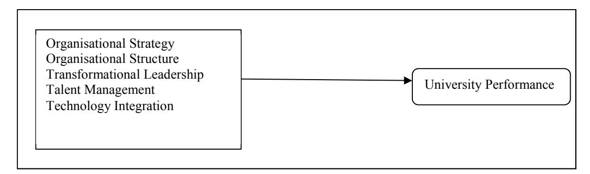

<!-- A3.R04 | source: papers_json/A3.R04/ -->

## **Resource-Based View, Strategic Factors and University ** **Performance **

Ahmed Abubakar^1^ Haim Hilman^2^ 1.Federal University Kashere, Gombe State, Nigeria 2.College of Business, Universiti Utara Malaysia

## **Abstract **

This study enhances the body of knowledge by remodelling the connection of strategic issues surrounding university performance by applying an underpinning theory that best explained the relationship. The paper reveals the interrelationship of organisational strategy, structure, transformational leadership, talent management, technology integration and university performance that could underpin by resource-based view. The study seeks to provide rational consideration on the integration of above-mentioned variables. As a significant contribution to the body of knowledge, it expands the competitiveness theory and strategy theory development. Furthermore, provides implications to the researchers and practitioners regarding the role of underlying theory in remodelling organizations' strategic direction.

**Keywords: **Resource-Based View, Strategic Factors, University Performance.

## **INTRODUCTION **

While there is no doubt that education and training is a good thing in its right, the increasing levels of education have contributed to economic growth, through both a productivity effect and a participation effect, with the latter being particularly important (Karmel, 2014). In another study, Khattak (2012) supported the view that education contributes to economic growth, which recommended that nations and government should keep education on top priority in public policies as higher education develop high skill labour for nation building. What's more, scientific discoveries prompting modern advancements, in particular through scholarly turn offs, give an excellent picture of universities contributing to economic development (Hatakenaka, 2015). Also, education has set a top priority in emerging economies, and many strive to form partnerships with world-leading universities (Luxbacher, 2013). Also, changes in the worldwide economy saw in the course of recent decades have made it progressively clear that the nature of advanced education speaks to a foundation in any methodology for national improvement (Bajunid, 2011; Hallinger, 2014). Universities can play a less immediate yet vital monetary part by putting forward the social, cultural, and scholarly tone of a local area (Hatakenaka, 2015). Also, reputable and research-oriented universities are considered key to gain entry into current knowledge economy that leads to economic growth and productivity of both developed and developing countries (Altbach, 2009).

However, despite this importance of higher education, universities are not performing strongly in global comparisons. Based on the world university ranking, many universities across different countries and continent are left out, with some having a very low placement. The trend of placement of institutions in the universities ranking shows a few having more or less permanent positions on top in the league table consistently. They include Massachusetts Institute of Technology (MIT), University of Cambridge, Harvard University and Stanford University. Others are University of Oxford, California Institute of Technology, and Imperial College London among others (Academic Ranking World University [ARWU], 2015; Quacquarelli Symonds world university rankings [QS], 2015; Ranking web of universities [Webometrics], 2015; Times Higher Education World University Ranking [THE], 2015). All these universities at the top ranking are from the united state of America (USA) and United Kingdom (UK).

Literature has shown that strong leadership that carries the entire stakeholder along, good vision, mission and goals of the institution, and a clearly articulated strategic plan to make an interpretation of the vision into solid projects and targets are variables that decide higher performance in the universities (Perry & Sherlock, 2008). However, examining the relationship in the framework proposed in this study seems not specifically addressed in the literature. Where organisational strategy, structure, transformational leadership style, talent management, and technology integration is matched as strategic factors that stand as independent variables and their impact on university performance. Therefore, this study attempts to address this in the literature and pursue to bridge the existing research gap.

Specifically the main objective or purpose of this study discusses the rational consideration on integration of these strategic factors through theoretical background. The discussion on underpinning theories is very significant to strengthen the interrelationship among the variables in the study. This study discusses comprehensively about the underlying theory that are supporting the integration of organisational strategy, structure, transformational leadership style, talent management, and technology integration (independent variables) on university performance (dependent variable). By doing so, the researchers are justifying and establishing the strong relationship of these strategic factors that could remodel universities' strategic direction.

<!-- page 2 -->

## **REVIEW OF LITERATURE **

Over the years, various theories were used in discussing the relationship of strategic factors and performance. Some of them include industrial organization theory (IO), dynamic capabilities (DC) transaction cost theory, and resource based view (RBV), others are game theory, agency theory, and contingency theory. This study utilised RBV to remodel the overall organization's strategies for university setup.

## **Strategic Factors **

University setting are complex in nature and the role of strategy in attaining competitive advantage is up paramount importance. Kenny (2005) describe strategic factors across sectors to be the tools that can address the needs not just of private sector profit-seeking organisations, but also of non-profit organisations from both the public and private sectors. Therefore, this study proposes to develop a framework that examines the effect of strategic factors on university performance. Such factors include the strategy of an organisation, organisation structure, transactional leadership, talent management, and technology integrations alongside the theory that can best explain the interrelationship among the variables.

Notwithstanding, these factors are essential in determining the performance of higher education institution in general. This is because universities, in particular, are knowledge-based institutions with research, teaching and learning as the fundamental functions (Sirvanci, 2004). To successfully perform this function there is an obvious need of having good strategy that clearly spell the action plan and associated allocation of resources required to achieve stated goals (Kavale, 2012), with a good system of structural network relationship and roles throughout the university that will utilised the available talent, and integrate technology with a performing leader that will harness all employees and other resources to have a competitive advantage in the environment for better performance (Mills, Platts & Bourne, 2003). These strategic factors have individually played significantly in attaining optimum organisational performance (Bacha, 2014; Brush, 2015; Csaszer, 2012; Saffarzadeh & Jandaghi, 2013; Taie, 2015; Wu, 2015). Based on the above the following subsection discusses Resource-Based View as theory that underpinned the relationship among the variables.

## **Resource-Based View **

Resource-Based View (RBV) is used in this study in directing and shaping the research, and the theory asserts that organisations can have a competitive advantage through the development of resources that are peculiar and diversely distributed (Barney, 1991). RBV has no single accepted definition. Hence, the term resources and capabilities are used interchangeably (Ringim, Razalli & Hasnan, 2012). RBV defines resources as assets, processes, and capability. Barney (1991) posited that organisation's sustainable performance advantage by securing rare resources of economic value and the ones that competitor and cannot easily imitate, duplicate, or substitute. Organisation with uncommon resources ought to have the capacity to influence them for their particular benefit. Amit and Schoernaker (1998) expressed that resources are organisational resources that are processed through possession and control while capabilities are said to be organisation's ability to merge resources and sufficiently utilize them.

The RBV collected works pointed out that organisations could obtain economic benefit as the basis of unique business assets that are valued, rare, difficult to replicate and not compatible with other resources (Barney, 1991; Ringim et al., 2012). RBV identifies that some possessions may lead to the attainment of organisational goals while others do not. Therefore, the fundamental challenge is for the organisations are to identify these resources that will lead to goal realization of the overall performance (Wade & Hulland, 2004).

The RBV could underpin the interrelationship among the variables of this study by explaining the relationship between the organisations resources and sustenance of modest advantage of superior firm performance (Barney, 1991; Fahy, 2000; Ringim at al. 2012). Resources are given different categorization by so many researchers, some of it includes Mills et al. (2003), where they classified resources as follows: tangible resources, such as financial, organisational, physical and technological; Knowledge resource, such as system and procedural resources; skills and experience; network resources and potential dynamic capabilities; cultural values and resources; and intangible resources, such as innovation, human resources and reputation. More so, Fahy and Smithee (1999) and Fahy (2000) classified resources as tangible, intangible and capabilities. The RBV has a focus on organisation to develop and deploy its core resources for an effective and efficient result attainment (Harrison, Hitt, Hoskisson & Ireland, 2001). Therefore, resources are organisational input injected into the production process to improve competitiveness and performance.

## **DISCUSSION **

In accordance to the purpose of this study, to shape the relationship among strategic factors, this study used resource-based view with the fundamental focus on resources such as talent; technology; knowledge, like skills and experience of the leader; system and procedural resources, like the structure; cultural values; and other strategies employed to have a competitive advantage in the environment for better performance (Mills et al.,

<!-- page 3 -->

2003). Organisations using such resources are at an advantage of using internal competence with a view of acquiring the necessary strength and capability in implementing the formulated strategy for them to achieve their fundamental goals. The impacts of such strategies are seen through organisational ability in gaining competitive advantage and at the same time remain relevant in the immediate environment and beyond. Figure 1 clearly illustrated the conceptual framework of this study.

## **IMPLICATIONS AND CONCLUSION **

The present study contributes to competitiveness theory and strategy theory development by remodelling the organizational strategies. Several key conclusions can be drawn from the present study. First, this study attempts to explain the relationship of strategic factors (strategy of an organisation, organisation structure, transactional leadership, talent management, and technology integrations) as internal resources on performance. as largely hold by resource-based view. Second, for the practitioners or the university management, this study provides information to pursue the right organizational recourses by highlighting the links and alignment between strategic factors and performance. However, this study presents the implications based on the logical view of underlying theory, so the matter of this study required further investigation to empirically indicate the relationship among these strategic factors towards performance of higher institutions with particular reference to universities in order to achieve competitive advantage in the present university ranking.

## **REFERENCES**

- Academic Ranking World University (2015). *Methodology*. Retrived from http://www.shanghairanking.com/ARWU-Methodology-2015.html.
- Altbach, P. G. (2009). Peripheries and centers: Research universities in developing countries. *Asia Pacific * *Education Review*, *10*(1), 15-27.
- Amit, R., & Schoemaker, P. J. (1998). Z Strategic assets and organisational rent. *Strategic Management Journal*, *14*, 33-46.
- Bacha, E. (2014). The relationship between transformational leadership, task performance and job characteristics. *Journal of Management Development*,*33*(4), 410-420.
- Bajunid, I.A. (2011). Leadership in the reform of Malaysian universities: Analysing the strategic role of the Malaysian Qualifications Agency. *Journal of Higher Education Policy and Management*, *33*(3), 253– 265.
- Barney, J. (1991). Firm resources and sustained competitive advantage. *Journal of Management*, *17*(1), 99-120.
- Brush, C. G. (2015). Export entry in small companies: Effects of timing on strategy and performance. *Journal of * *Small Business Strategy*, *7*(3), 53-68.
- Csaszar, F. A. (2012). Organisational structure as a determinant of performance: Evidence from mutual funds. *Strategic Management Journal*, *33*(6), 611-632.
- Fahy, J. (2000). The resource-based view of the firm: some stumbling-blocks on the road to understanding sustainable competitive advantage. *Journal of European Industrial Training*, *24*(2/3/4), 94-104.
- Fahy, J., & Smithee, A. (1999). Strategic marketing and the resource based view of the firm. *Academy of * *Marketing Science Review*, *10*(1), 1-21.
- Hallinger, P. (2014). Riding the tiger of world university rankings in East Asia: where are we heading?. *International Journal of Educational Management*, *28*(2), 230-245.
- Harrison, J. S., Hitt, M. A., Hoskisson, R. E., & Ireland, R. D. (2001). Resource complementarity in business combinations: Extending the logic to organisational alliances. *Journal of Management*, *27*(6), 679-690.
- Hatakenaka, S. (2015). The role of higher education institutions in innovation and economic development. *International Higher Education*, (47).

<!-- page 4 -->

- Karmel, T. (2014). *The contribution of education to economic growth in Australia, 1997-2009*. National Centre for Vocational Education Research.
- Kavale, S. (2012). The connection between strategy and structure. *International Journal of Business and * *Commerce*, *1*(6), 60-70.
- Kenny, G. (2005). *Strategic planning and performance management: develop and measure winning strategy*. Routledge.
- Khattak, N. U. R. (2012). The contribution of education to economic growth: evidence from Pakistan. *International Journal of Business and Social Science*, *3*(4), 145-151.
- Luxbacher, G. (2013). World University Rankings: How much influence do they really have? *The Guardian*. Retrieved from http://www.theguardian.com
- Mills, J., Platts, K., & Bourne, M. (2003). Applying resource-based theory: methods, outcomes and utility for managers. *International Journal of Operations and Production Management*, *23*(2), 148-166.
- Perry, N., & Sherlock, D. (2008). *Quality improvement in adult vocational education and training: transforming * *skills for the global economy*. Kogan.
- Quacquarelli Symonds world university rankings (2015). Methodology. Retrieved from http://www.topuniversities.com/university-rankings-articles.
- Ranking Web of Universities (2015). Ranking Web of Universities: Methodology. Retrived from http://www.webometrics.info/en/Methodology.
- Ringim, K. J., Razalli, M. R., & Hasnan, N. (2012). Critical success factors for business process management for small and medium banks in Nigeria. *Business and Management Review*, *2*(1), 83-91.
- Saffarzadeh, S., & Jandaghi, G. (2013) The relationship between strategy, structure, and performance in food industries. *European Journal of Scientific Research*, *102*(1), 85-93.
- Sirvanci, M. B. (2004). TQM implementation: Critical issues for TQM implementation in higher education. *The * *TQM Magazine, 16*(6), 382-386.
- Taie, E. S. M. S. (2015). Talent Management is the Future Challenge for Healthcare Managers for Organisational Success. *American Research Journal of Nursin, 1*(1), 18-27.
- Times Higher Education world university ranking (2015). *Methodology*. Retrieved from https://www.timeshighereducation.com.
- Wade, M., & Hulland, J. (2004). Review: The resource-based view and information systems research: Review, extension, and suggestions for future research. *MIS Quarterly*, *28*(1), 107-142.
- Wu, S. J. (2015). The impact of quality culture on quality management practices and performance in Chinese manufacturing firms. *International Journal of Quality & Reliability Management*, *32*(8), 799-814.
