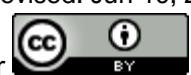

<!-- A3.R07 | source: papers_json/A3.R07/ -->

## Right of Issuing Bank to be Subrogated to the Applicant of Letter of Credit Under the Insurance Contracts

## Derar Al-Daboubi

This article discusses the case where the efforts of the issuing bank prove futile to recovering the payment - paid to the beneficiary - from the applicant of the letter of credit. In particular, when the sold goods the subject matter of the letter of credit - received damaged or lost. This scenario is envisaged when the applicant refuses to make the payment imposed under the letter of credit. The necessity of discussing this matter is to clarify whether or not the issuing bank can be subrogated to the beneficiary's rights acquired under insurance contract. The analysis will focus on the English law and Uniform Customs & Practice for Documentary Credits (UCP600), in order to illuminate the legal grounds on which the issuing bank can stand so as to enjoy such rights, through which the paid fund can be reimbursed.

## KEY WORDS

- ~ Issuing bank
- ~ Letter of Credit
- ~ Subrogation
- ~ Insurance contract
- ~ UCP600

British University in Dubai, Faculty of Business and Law, Dubai, UAE

e-mail:[ deraraldaboubi@yahoo.com](mailto:deraraldaboubi@yahoo.com) doi: 10.7225/toms.v11.n02.013

Received: Jun 29, 2021 / Revised: Jun 19, 2022 / Accepted: Oct 4, 2022 / Published: Oct 21, 2022

This work is licensed under

<!-- page 2 -->

## 1. INTRODUCTION

Letter of Credit is one of the main instruments used by international merchants for the purpose of achieving payments through intermediation of the banking sector. This tool of payment has been innovated to facilitate the sale of goods contract concluded in the international commercial realm in order to guarantee the payment imposed upon purchaser according to the contract of sale. The issuing bank, at the request and for the account of the applicant of letter of credit, must abide by drafts or demands for payment if the presented documents are consistent with the contents of the letter of credit. Namely, the letter of credit is a document through which the issuing bank undertakes - independently from underlying contract - to make the payment in exchange for specific documents required to be surrendered by a beneficiary. Therefore, it is argued that this document should involve three different legal relationships: first, the relation between the applicant and beneficiary, the relation of the applicant with the issuing bank, and the relation between the issuing bank and the beneficiary.

The letter of credit, as an instrument of payment, agreed upon between the contracting parties to an international sale contract, is normally exposed to the risk of non-payment through non-compliance. One of the risk aspects lies in the case where the issuing bank fails to recover the sum - paid to the beneficiary - from the applicant and thus, the issuing bank will seek to be subrogated to the securities of the applicant. The issuing bank may have a recourse to the indemnification available to the applicant in case the insured goods are lost or damaged. This case has not been addressed, either under English law or under UCP600, and hence the present paper seeks to clarify the legal basis upon which the issuing bank can rely, so as to be subrogated to the indemnification provided for the applicant under the insurance contract and then, explain the proper time after which the issuing bank can avail from the compensation provided in this case. The study will be concluded with some suggestions in order to illuminate the legal position of the issuing bank, which is considered to be a third party to the insurance contract.

## 2. THE ESSENCE OF SUBROGATION RIGHT

Before addressing the effect of the subrogation right that might be invoked by the issuing bank of the letter of credit under the contract of insurance, it is important to shed some light on the definition of subrogation, upon the legal basis on which the issuing bank can stand in order to be subrogated to the indemnifications to which the assured (applicant of the letters of credit) is entitled against the insurance under the insurance contract.

## 2.1. Definition of Subrogation

Subrogation is deemed to be one of the oldest of equitable principles that have not been changed,7 which is defined as an operation whereby a person can step into another person's shoes for legal purposes, or a procedure through which the person, who has assumed the commitment of another, obtains the rights of that person vis-à-vis third parties.8 In other words, one can assume that subrogation is the right that enables the party, who has paid the debt of another, to exercise all of the rights and remedies to which the creditor is entitled

> ^&^lt;sup>1. Alan Ward and Gerard Mccormack, Subrogation and Bankers' Autonomous Undertakings, 116 L.Q.R. 121(2000).

> ^&^lt;sup>2. Michael Evan Avidon, Subrogation in the Letter of Credit Context, 56 *Brook. L. Rev.* 130(1990).

> ^&^lt;sup>3. J. Francois Scholts, The Duty on the Bank Issuing a Letter of Credit to Return the Documents: Legal Perspectives from Canada, England and South Africa, (*L.L.m*/ *University of Johannesburg*) 5(2014).

> ^&^lt;sup>4. Roberto Luis Farias Garcia, The Autonomy Principle of Letters of Credit, 3(1) Mexican Law Review 72(2009).

> ^&^lt;sup>5. Roberto Bergami, The Link Between Incoterms 2000 and Letter of Credit Documentation Requirement and Payment Risk, 1(4) *Journal of Business Systems*, *Governance and Ethics* 59(2006).

> ^6. ^James J. White, Rights of Subrogation in Letters of Credit Transactions, 41 St. Louis U. L.J. 55(1996).

> ^&^lt;sup>7 See Mason v. Sainsburys (1782) 3 Doug 61.

> ^&^lt;sup>8 Ward and Mccormack, supra note 1, at. 124.

<!-- page 3 -->

vis-à-vis the original debtor.[9](#page-2-0) Therefore, it is assumed that rights transfer form one party to another through subrogation, regardless of the fact that the person has not assigned those rights to the transferee, or that the transferee has not attained the consent of the transferor.[10](#page-2-1)

It has further been assumed that:

"The underwriter is entitled to the advantage of every right of the assured, whether such right consists in the contract, fulfilled or unfulfilled, or in the remedy for tort capable of being insisted upon or already insisted upon, or in any other right whether, by way of condition or otherwise, legal or equitable, which can be, or has been exercised or has accrued, and whether such right could or could not be enforced by the insurer in the name of the assured by the exercise or acquiring of which right or condition the loss against which the assured is insured can be, or has been diminished." [11](#page-2-2)

Another perspective argues that subrogation doctrine can be divided into two types. First, conventional subrogation that can be imposed by the agreement of the contracting parties, while the second is the legal subrogation imposed by operation of law, regardless of the absence of the agreement of contracting party on such right.[12](#page-2-3)

It is worth mentioning that subrogation is applicable in the context of the insurance contracts, where the insurer - who has indemnified the assurance for the damages caused by the tortfeasor- would be subrogated to the rights of action granted to the injured party (assured) against the tortfeasor.[13](#page-2-4) Subrogation is also envisaged under surety, in which the surety of whoever has paid out the debt can be subrogated to the right of creditor vis-à-vis the principal debtor, though the creditor is not entitled to the rights of action in terms of the debt borne by the principal debtor.[14](#page-2-5) However, for the purpose of substantiating the invoked right of subrogation, it is necessary to illuminate the legal grounds on which such right can rely.

## 2.2. Legal Basis of Subrogation Under Letter of Credit

Prior to addressing the interrelationship between letter of credit and insurance contract, the discussion necessitates to identify the legal grounds entitling the bank to be subrogated to the applicant of the letter of credit, as an assured party under the insurance contract. Subrogation right has been enshrined in section 79(1) of Marine Insurance Act (MIA) 1906, which provides the following:

"Where the insurer pays for a total loss, either of the whole, or in the case of goods of any apportionable part, of the subject-matter insured, he thereupon becomes entitled to take over the interest of the assured in whatever may remain of the subject-matter so paid for, and he is thereby subrogated to all the rights and remedies of the assured in and in respect of that subject-matter, as from the time of the casualty causing the loss".

According to this paragraph, the insurer's right of subrogation can be exercised in the context of total loss. The insurer's right of subrogation has further been recognised in the context of partial loss, as provided in section 79(2) of MIA 1906 Act, which states:

> ^9^ Mary Pappas, Reconciling Standby Letters of Credit and the Principles of Subrogation in Section 509, 7 *BANKR. DEV. J.* 230-231(1990).

> ^10^ *Orakpo v. Manson Investments Ltd,* [1978] A.C. 95.

> ^11^ *Castellain v. Preston* (1883) LR 11 QBD 380.

> ^12^ *Pearlman v. Reliance Ins. Co*., 371 U.S. 132, 136 n.12 (1962). Pappas, supra note 8, at. 230.

> ^13^ Ward and Mccormack, supra note 1, at. 124. *Simpson v. Thomson* (1877) LR 3 App Cas 279.

<!-- page 4 -->

"Subject to the foregoing provisions, where the insurer pays for a partial loss, he acquires no title to the subject-matter insured, or such part of it as may remain, but he is thereupon subrogated to all rights and remedies of the assured in and in respect of the subject-matter insured as from the time of the casualty causing the loss, in so far as the assured has been indemnified, according to this Act, by such payment for the loss".

It can be inferred from this section that the insurer enjoys the same rights of subrogation, regardless of the fact that whether the loss has been total or partial. However, this section regulates the insurer's right of subrogation, not the right of subrogation a third party may enjoy, such as the right of subrogation the bank may invoke in the context of a letter of credit. English courts, however, have adopted two bases for the purpose of justifying subrogation under letter of credit. The first basis was the unjust enrichment.[15](#page-3-0) According to this principle, if the injured party was compensated under both insurance policy and an action brought against the tortfeasor, the injured would be unjustly enriched at the expense of the insurer and also, if the injured has only been compensated under the insurance policy and the insurer was deprived of subrogation, the tortfeasor would further be unjustly enriched at the expense of the insurer as well[.16](#page-3-1) Namely, the principle of subrogation shall entitle the insurers to occupy the assured's legal position in order to reimburse the expenses they have paid, but this shall not entitle the insurer to recover an amount exceeding that which has already been paid to the assured, except in the case of abandonment.[17](#page-3-2)

The second basis, however, consists in the expectations of the parties of whether those issues can be invoked in order to expan the scope of subrogation.[18](#page-3-3) Despite the fact that the English authorities have grounded subrogation principle on unjust enrichment, this basis was clearly explained in *Boscawen v. Bajwa,**[19](#page-3-4)* *, *in which the unjust enrichment was established on the Law of Restitution. According to Millett L.J.:

"The equity arises from the conduct of the parties on well settled principles and in defined circumstances which make it unconscionable for the defendant to deny the proprietary interest claimed by the plaintiff".[20](#page-3-5)

The subrogation doctrine has also been established on the restitution law and the reversal of the unjust enrichment in several cases, such as *Lord Napier and Ettrick v. Hunter,**[21](#page-3-6)* and *Banque Financière de la Cité* *v. * *Parc (Battersea) Ltd.**[22](#page-3-7)* It is a well-known fact that subrogation operates as a remedial means, particularly when a restitutionary relief results in an unjust enrichment[.23](#page-3-8) However, the U.S. authorities has presumed that in order for the subrogee to benefit from the subrogation doctrine, they should have previously satisfied the following requirements:[24](#page-3-9) (1) the subrogee must have paid out the whole debt for which they were not mainly responsible; (2) the subrogee should not act as a mere volunteer; (3) subrogation should be exercised without prejudice to the rights of others; (4) the subrogee should not be the wrongdoer.[25](#page-3-10)

> ^15^ *Orakpo v. Manson Investments Ltd, *[1978] A.C. 95 at p. 104*; Lipkin Gorman v. Karpnale Ltd,* [1991] A.C. 548; *Boscawen v. Bajwa,* [1996] 1 W.L.R. 328.

> ^16^ Ward and Mccormack, supra note 1, at. 123.

> ^17^ *Yorkshire Insurance Co v. Nisbet Shipping* Co Ltd [1961] 1 Lloyds Rep. 479. See John Dunt, *Marine Cargo Insurance*, 1nd edn, New York: Informa, 2013, p. 522.

> ^18^ Id. at. 126.

> ^19^ [1996] 1 W.L.R. 328. Goff and Jones, *Law of Restitution* 88-90 (2009). See also, Dobbs, D. Law of Remedies: Damages-Equity-Restitution (3rd Ed. 1993) 405.

> ^20^ [1996] 1 W.L.R. 328 at p. 335. See also, *Napier and Ettrick v. Hunter* [1993] 1 Lloyds Rep. 197 (HL).

> ^21^ [1993] A.C. 713.

> ^22^ [1999] 1 A.C. 221. M. Hoyle, 'Failure for Consideration: Re-Analysing jurisdiction in Unjust Enrichment Claims', (2020) 83(5) *MLR* 1026.

> ^23^ John F. Dolan, 'A Study of Subrogation Mostly in Letter of Credit and Other Abstract Obligation Transactions', (1999) 64 *MO. L. REV* 791.

> ^24^ See *Golden Eagle Insurance Co. v. First Nationwide Fin. Corp*., 26 Cal. App. 4th 160, 169 (1994); *Prairie State National Bank v. United * *States, *164 U.S. 227, 230 (1896); *Ridge v. Smothers* (In re Smothers), 60 Bankr. 733 (Bankr. W.D. Ky. 1986). Pappas, supra note 8, at. 230- 231; White, supra note 6, at. 55.

<!-- page 5 -->

## 3. IMPLICATIONS OF THE INTERRELATIONSHIP BETWEEN LETTER OF CREDIT AND INSURANCE CONTRACT

It is admitted that the letter of credit has been innovated with a view to facilitating the international sale of goods, as it encourages the seller to enter into several international sale contracts because of the security feature of the letter of credit.[26](#page-4-0) Through this feature, the seller will be guaranteed that the fund, as agreed upon between the applicant (purchaser) and the seller (beneficiary), will be paid out.[27](#page-4-1)

The interplay between international sale contact and letter of credit can be realised through the obligation of payment imposed upon the purchaser by virtue of the sale contract. Namely, the relation between letter of credit and international sale contract lies in the function of the letter of credit as a tool of payment, which can be used to discharge the obligation of payment imposed by virtue of international sale of goods.[28](#page-4-2) The interplay is not only observed with the sale contract, rather the letter of credit might also be linked to another relation with a third party. This can be noted in the insurance contract, concluded in the context of the international sale contract, whereby the purchaser would be entitled to compensation if the goods have been damaged or lost. However, the letter of credit may entitle the bank issuer of that the letter of credit would benefit from the compensation provided via the insurance contract. This can be availed from the right of the issuing bank to be subrogated to the rights of the applicant under insurance contract, which could be substantiated under the law of restitution.

## 3.1. Relationship Between Letters of Credit and Contract of Insurance

As mentioned earlier, the letter-of-credit consists of three parts: 1- the applicant or customer, who asks the issuing bank to issue a letter of credit for them; 2- the Bank who shall issue the letter of credit upon the request of the applicant; 3- the beneficiary, who will be entitled to draw the credit, the subject matter of the letter of credit, which must be received by the beneficiary against the presentation of particular documents. However, those parties are also contracting parties to other kinds of contracts, such as insurance contract, contract of carriage of goods, and sale of goods contract. The seller (beneficiary under the letter of credit) and purchaser (applicant of the letter of credit) are the parties to the sale of goods contract, but each one of them might be a contracting party to the contract of carriage of goods entered into with a carrier. In other words, the seller (beneficiary under the letter of credit) is considered to be a shipper under contract of carriage of goods if they should have entered into any of the contracts of CIP, CIF, CFR, DDP, DPU or DAP. This is because the seller under these contracts is obliged to conclude the contract of carriage of goods on behalf of the purchaser.[29](#page-4-3) In contrast, the purchaser (applicant of the letter of credit) is a party to the contract of carriage of goods under FOB, FAS, EXW, FCA, under each one of which the purchaser shall conclude the contract of carriage of goods.[30](#page-4-4) Moreover, the beneficiary and applicant under the letter of credit might further be in the position of the contracting parties to the insurance contract. The position of both parties of the insurance contract is also decided upon the terms and condition of the sale contract. For example, the seller shall be the assured party under the insurance contract if the sale contract involves insurance contract, such as the case under CIF and CIP contracts.[31](#page-4-5) However, under other types of sales the purchaser performs the duty of both beneficiary and

> ^26^ Avidon, supra note 2, at. 130. 27 Ward and Mccormack, supra note 1, at. 121.

> ^28^ Scholts, supra note 3, at. 5.

> ^29^ Roberto Bergami, 'Managing Incoterms 2010 Risks: Tension with Trade and Banking Practices', (2013) 6(3) *Int J. Economics and Business* 326. See Article A4 of the CIF, CFR, DAP, DPU, DDP, CIP and CPT.

> ^30^ Id. at. 326. See Article A4 of FOB, FAS, FCA and EXW.

<!-- page 6 -->

assured, as the purchaser is obliged to conclude the insurance contract by himself. This is observed under FOB, CFR, EXW, FAS, CPT, DDP, DAP, DPU and FCA.[32](#page-5-0)

The overlap between these contracts might give rise to misunderstanding of the obligations of the parties involved in each contract and therefore it is necessary to clarify the right of indemnification conferred on the purchaser (applicant of the letter of credit) by virtue of the insurance contract. This must be undertaken before to addressing the right of subrogation that could be invoked by the issuing bank of the letter of credit against the insurer.

According to the provisions of the insurance contract, the beneficiary (the purchaser) shall be entitled to the compensation for the loss or damage that the sold goods have sustained, regardless of whether the assured is the seller or the purchaser under the sale contract. Therefore, it can be inferred that the applicant of the letter of credit would always be the beneficiary under insurance contract, which might be concluded with them or with the seller as the sale contract may provide. However, the applicant may refuse to make the payment imposed under the letter of credit due to the loss or damages that the sold goods have sustained. Therefore, it has been suggested that the issuing bank should accurately investigate the applicant 's credit and financial reputation, prior to contract a letter of credit.[33](#page-5-1) This scenario would lead to a question of how the bank can recover the payment made to the beneficiary by virtue of the letter of credit.

Subrogation principle might be one of the means that could be used for the purpose of reimbursing the fund paid by the issuing bank to the beneficiary in accordance with the letter of credit.

## 3.2. Subrogation Right of the Issuing Bank under the Insurance Contract

It is interesting to say that the right of the issuing bank to be reimbursed by the consumer (applicant of the letter of credit) entails that the issuing bank should not infringe the terms of the letter of credit.[34](#page-5-2) The reimbursement for the payment made by the issuing bank under the letter of credit could be achieved through the principle of subrogation, which may stand on the principle of party autonomy, as a well-established principle under the letter of credit. This principle of party autonomy has been recognised in Article 4 of USP 600.

It is worth mentioning that the doctrine of autonomy aiming at confining the function of the bank, under the letter of credit, merely to the documents checking,[35](#page-5-3) and the transmission of funds to the beneficiary, remains valid, as the bank is not required to clarify the underlying contractual situation, except in the case of fraud.[36](#page-5-4) It can therefore be concluded that the narrowing down of the obligation of bank under the letter of credit will protect the issuing bank from potential risks, while also enabling them to fulfil the obligations imposed under the letters of credit within reasonable time.[37](#page-5-5) In spite of the autonomous feature of the letter of credit, the issuing bank can be subrogated to the applicant of the beneficiary under the insurance contract, as such subrogation can be based on the restitution law. [38](#page-5-6) This is because the issuing bank should be entitled to recover the payment

> ^32^ This obligation is imposed by virtue of Article A5 of FOB, CFR, EXW, FAS, CPT, DDP, DAP, DPU, FCA, DDP, DAP and DPU of the Incoterms Rules 2020.

> ^33^ Yan Hao and Ling Xiao, Risk Analysis of Letter of Credit/Based on Principles of 'Independence' and 'Strict Compliance, 4(9) *International * *Journal of Business and Social Science* 209(2013).

> ^34^ Avidon, supra note 2, at. 130.

> ^35^ Bergami, supra note 5, at. 59. This commitment has been enshrined in article 14(a) of UCP 600.

> ^36^ Hamed Alavi, Comparative Study of Issuing Bank's Obligations towards Beneficiary of the Letter of Credit under UCO 600 and English Law, 2(3) *Hasanuddin Law Review* 300-301(2016). Christopher Hare, Not so Black and White: The limits of the Autonomy Principle, 63 *The * *Cambridge Law Journal* 288(2004); Gerard MacCormack et al., Subrogation and Banker' Autonomous Undertakings, 116 *Law Quarterly * *Review* 141(2000); Ward and Mccormack, supra note 1, at. 140.

> ^37^ Garcia, supra note 4, at. 75-76; Ward and Mccormack, supra note 1, at. 140; Janet Alph, The USP 600: Documentary Credits in the Twenty-first Century. Accessed on 24 October 2020., Available at:

> [https://www.researchgate.net/publication/30053492_The_UCP_600_documentary_credits_in_the_twenty-first_century>](https://www.researchgate.net/publication/30053492_The_UCP_600_documentary_credits_in_the_twenty-first_century)

<!-- page 7 -->

paid to the seller (beneficiary under the letter of credit) and therefore, they will try to avail from various resources so as to return back the fund paid from their account to the beneficiary. One of the means that can be used in this regard is the recourse of the goods insurer, whereby the issuing bank can be subrogated to the insured's right against the goods insurer. This conclusion can be grounded on the argument that the issuing bank has unvoluntarily paid the whole debt of the applicant against the seller (beneficiary). In addition, the subrogation under these circumstances is exercised without prejudice to the rights of others.

However, it should be taken into consideration that the issuing bank would not be entitled for subrogation, unless the applicant had already acquired the right of indemnification, as a beneficiary under the insurance contract. Namely, in order for the issuing bank to be subrogated to the applicant (beneficiary under insurance contract), the issuing bank should prove that the damage or loss has been undertaken after the risk had been transferred to the applicant.

According to the English law it is necessary to distinguish between a transfer of risk under non-consumer sales and consumer sales. The risk under non-consumer sales shall pass to the purchaser at the same time the property transfers to the purchaser.[39](#page-6-0) This rule is enshrined in s. 20(1) of the English Sale of Goods Act 1979, which states:

"Unless otherwise agreed, the goods remain at the seller's risk until the property in them is transferred to the buyer, but when the property in them is transferred to the buyer, the goods are at the buyer's risk, whether the delivery has been made or not".

According to this section, the time of transfer of risk shall first be determined on the basis of the principle of Parties Autonomy, but such time should be linked to the time of passing of property, if contracting parties did not agree on the time of transforming of risk.[40](#page-6-1) Therefore, it is conceivable that - under an express agreement – that the risk might pass to the purchaser, even though the property has not yet been attained by the purchaser.[41](#page-6-2) Contrary to this scenario, such an agreement could also result in transferring the risk after the property has been acquired by the purchaser.[42](#page-6-3) Namely, the risk might be on the seller's part, although the property was transferred to the purchaser.[43](#page-6-4)

However, English Sale of Goods Act 1979 adopts another basis in terms of passing of risk under consumer sales. This can be understood from s. 20(1)(4), which provides:

"In a case where the buyer deals as consumer or, in Scotland, where there is a consumer contract in which the buyer is a consumer, subsection (1) to (3) above must be ignored and the goods must remain at the seller's risk, until they are delivered to the consumer".

It is noted from this section that the English law adopts a basis different from that which is adopted under non-consumer contract, provided that the transfer of risk has taken place under consumer contract. One can infer that the risk transfers to the purchaser, under consumer contract once the goods delivery is achieved, unlike the passage of risk under non-consumer contract in which the risk is transferred when the property is acquired by the purchaser. The divergence of the rule of passage of risk, under both non-consumer sales and consumer sales, can further be derived from s. 29(2) of English Consumer Act 2015:

> ^39^ Twigg-Flesner, Canavan and MacQueen, H. *Atiyah and Adam' Sale of Goods* (13th Ed. 2016) 350.

> ^40 ^Id. at. 352-353.

> ^41^ *Sterns Ltd v Vickers Ltd* [1923] 1 KB 78.

> ^42^ *Head v Tattersall* (1870) LR 7 Ex 7.

<!-- page 8 -->

"The goods remain at the trader's risk until they come into the physical possession of: (a) the consumer; or (b) a person identified by the consumer to take possession of the goods".

It can be understood from this section that the risk should not be transformed to the consumer purchaser, unless the goods have duly been handed over to the consumer or to a party deputised by the consumer to take over such delivery.

One can conclude that the rule of transfer of property has to be clarified for the purpose of identifying the time at which the risk passed to the applicant under the non-consumer sale contracts. Therefore, it would be easy to determine whether or not the issuing bank can be subrogated to the applicant so as to be reimbursed for the payment made by issuing bank to the seller under letter of credit, i.e., determining the time of passing of property is an elementary requirement for the issuing bank to receive the compensation to which the beneficiary is entitled under the insurance contract.

According to s. 17 of English Sale of Goods Act 1979: "(1) Where there is a contract for the sale of specific or ascertained goods, the property in them is transferred to the buyer at such time as the parties to the contract intend it to be transferred; (2) For the purpose of ascertaining the intention of the parties concerned it shall be adhered to the terms of the contract, the conduct of the parties, and the circumstances of the case".

It can be inferred from the provisions of this section that the property shall pass to the purchaser at the same time intended in the sale contract,[44](#page-7-0) but if such agreement has not been made, the property will pass to the purchaser once the seller ascertains the unascertained, as it can be inferred from s. 16 of English Sale of Goods Act 1979.[45](#page-7-1) According to this section:

"Subject to section 20A below, where there is a contract for the sale of unascertained goods no property in the goods is transferred to the buyer unless and until the goods are ascertained".

If the subject-matter of the sale contract is the ascertained cargo, then the ownership shall transfer in them at the time the sale contract has been concluded between the seller and the purchaser.[46](#page-7-2) It can therefore be argued that the risk will pass to the purchaser (applicant of the letter of credit) at the same time agreed upon between the applicant and the seller (beneficiary under letter of credit). If no agreement has been made in this regard, the passage of risk shall be considered when the unascertained goods are ascertained or identified, or when the sale contract is concluded in terms of the ascertained goods.

It can be safely inferred that the issuing bank can be subrogated to the applicant in the insurance contract, provided that the loss of cargo or its damage have materialised after the risk had passed to the applicant - the beneficiary under insurance contract - i.e., at the same time of transfer of property agreed upon in the contract of sale.[47](#page-7-3) In the absence of such agreement the risk shall pass once the seller has ascertained the unascertained goods,[48](#page-7-4) or at the conclusion time of the contract of sale in terms of the ascertained goods. However, the subrogation cannot be exercised when the damage or loss has taken place prior the passage of risk, as it can be established on the maxim of '*nemo dat quod non habet'*, which means that "no one gives what they do not have". [49](#page-7-5)

> ^44^ Ingeborg Schwenzer and Pascal Hachem, 'Sphere of Application and General Provisions' in *Schwenzer, I & Schlechtriem: Commentary * *on the UN Convention on the International Sale of Goods (CISG)* 92 (Beck/Hart/Nomos 2016). See *Ginzberg v Barrow Haematite Steel Co* [1966] 1 Lloyd's Rep 343; Twigg-Flesner, Canavan and Hector MacQueen, supra note 39, at. 320.

> ^45^ Twigg-Flesner, Canavan and Hector MacQueen, supra note 39, at. 330-334. 46 This can be derived from Rule 1 of s. 18 of English Sale of Goods Act 1979.

> ^47^ The inference has been derived from s. 17 of English Sale of Goods Act 1979. 48 s. 16 of English Sale of Goods Act 1979.

<!-- page 9 -->

## 4. CONCLUSION

It can be concluded from the aforesaid discussion that the right of the issuing bank to have a recourse to a third party can be justified under the doctrine of subrogation. The paper has found that one of the routes that can be followed by the issuing bank, to recover the payment made to the seller (beneficiary under letter of credit), lies in the right of subrogation exercised by the issuing bank in the context of the insurance contract. Under these circumstances the issuing bank will be subrogated to the rights of the beneficiary (applicant of the letter of credit) vis-à-vis. However, the study has reached a conclusion that neither English case law nor UCP 600 have as yet properly addressed this kind of subrogation.

The study has also suggested that the right of the issuing bank to be subrogated to the beneficiary under insurance contract can be substantiated on the basis of the general rules of subrogation adopted by the English courts. Therefore, the study has found that the principle of unjust enrichment that can be grounded on the law of restitution can be a solid ground for the issuing bank to be legally subrogated to the rights of the beneficiary under the insurance contract. In this case the issuing bank can recover the amount of funds paid to the beneficiary under the letter of credit when the goods, damaged or lost, and no way whatsoever of recovering the paid fund from the applicant side.

## CONFLICT OF INTEREST

The author(s) declared no potential conflicts of interest with respect to the research, authorship, and/or publication of this article.

<!-- page 10 -->

## REFERENCES

Alavi, H., 2016. Comparative Study of Issuing Bank's Obligations towards Beneficiary of the Letter of Credit under UCO 600 and English Law, Hasanuddin Law Review. 2(3), 300-301.

Alph, J., 2007. The UCP 600: Documentary Credits in the Twenty-first Century. Available at: [https://www.researchgate.net/publication/30053492_The_UCP_600_documentary_credits_in_the_twenty](https://www.researchgate.net/publication/30053492_The_UCP_600_documentary_credits_in_the_twenty-first_century)[first_century.](https://www.researchgate.net/publication/30053492_The_UCP_600_documentary_credits_in_the_twenty-first_century)

Avidon, M.E., 1990. Subrogation in the Letter of Credit Context, Brook. L. Rev. 56, pp. 129-138.

Balavar, E., 2014. The Doctrine of Nemo Dat Quod Non Habet and Its Exceptions, J. Appl. Environ. Biol. Sci. 4(5), pp. 7-14.

Bergami, R., 2006. The Link Between Incoterms 2000 and Letter of Credit Documentation Requirement and Payment Risk, Journal of Business Systems, Governance and Ethics 1(4), pp. 51-60.

Bergami, R., 2013. Managing Incoterms 2010 Risks: Tension with Trade and Banking Practices, Int J. Economics and Business. 6(3), pp. 307-336.

Dobbs, D., 1993. Law of Remedies: Damages-Equity-Restitution

Dolan, J.F., 1999. A Study of Subrogation Mostly in Letter of Credit and Other Abstract Obligation Transactions', MO. L. REV. 64, 789-835.

Dunt, J., 2013. Marine Cargo Insurance, New York: Informa.

Garcia, R.L.F., 2009. The Autonomy Principle of Letters of Credit, Mexican Law Review 3(1). pp. 67-96.

Goff and Jones, 2009. Law of Restitution. London: Sweet & Maxwell.

Hao, Y. & Xiao, L. Risk Analysis of Letter of Credit/Based on Principles of 'Independence' and 'Strict Compliance, International Journal of Business and Social Science 4(9), 199-209.

Hare, C., 2004. Not so Black and White: The limits of the Autonomy Principle, The Cambridge Law Journal. 63, pp. 271-293.

Hoyle, M., 2020. Failure for Consideration: Re-Analysing jurisdiction in Unjust Enrichment Claims', MLR. 83(5), 1012-1034.

MacCormack, G. et al., 2000. Subrogation and Banker' Autonomous Undertakings, Law Quarterly Review 116, pp. 134-152.

Pappas, M., 1990. Reconciling Standby Letters of Credit and the Principles of Subrogation in Section 509, BANKR. DEV. J. 7, pp. 227-243.

Scholts, J.F., 2014. The Duty on the Bank Issuing a Letter of Credit to Return the Documents: Legal Perspectives from Canada, England and South Africa, (L.L.m/ University of Johannesburg). pp. 1-45.

Schwenzer, Ingeborg and Hachem, Pascal., 2016 'Sphere of Application and General Provisions. In Schwenzer, I & Schlechtriem: Commentary on the UN Convention on the International Sale of Goods (CISG) 92 (Germany: Beck/Hart/Nomos).

<!-- page 11 -->

Twigg-Flesner, Canavan & MacQueen, H., 2016. Atiyah and Adam' Sale of Goods. London: Pearson.

Ward, A. & Mccormack, G., 2000. Subrogation and Bankers' Autonomous Undertakings, L.Q.R. 116, pp. 121-146.

White, J.W., 1996. Rights of Subrogation in Letters of Credit Transactions, St. Louis U. L.J. 41, pp. 47- 74.

