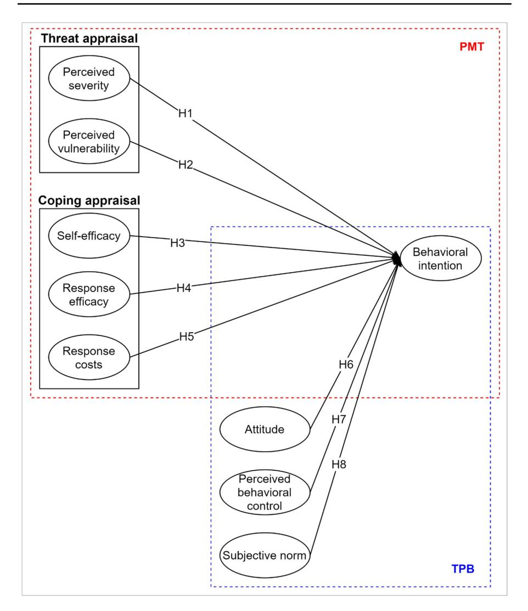
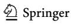
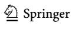
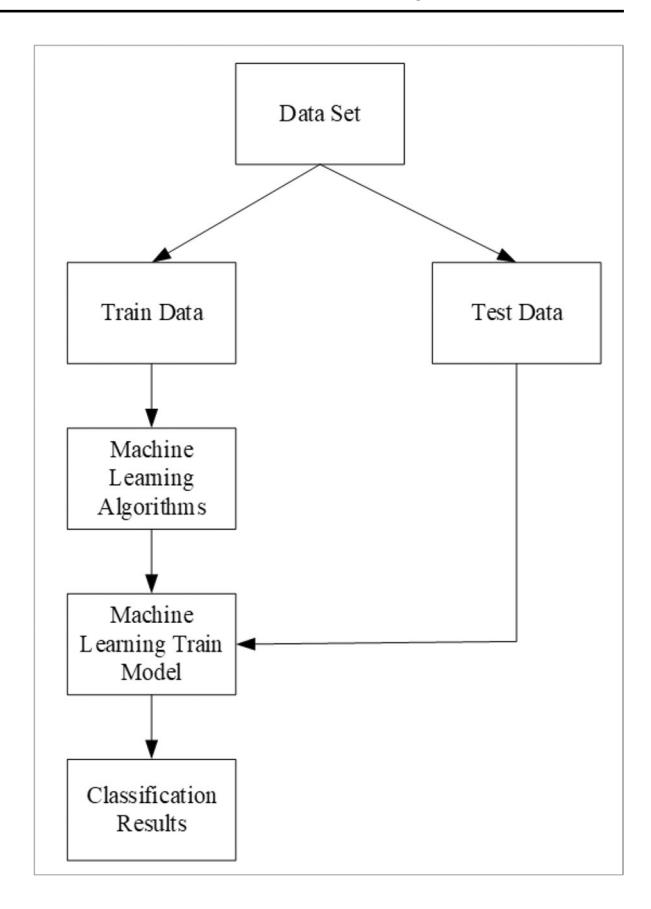
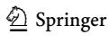
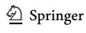
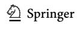

<!-- A3.R09 | source: papers_json/A3.R09/ -->

## **Towards a wearable education: Understanding ** **the determinants afecting students' adoption of wearable ** **technologies using machine learning algorithms**

**Mostafa Al‑Emran1,2** **[ ·](http://orcid.org/0000-0002-5269-5380)**** Maryam N. Al‑Nuaimi3** ** · Ibrahim Arpaci4** ** · ** **Mohammed A. Al‑Sharaf****5,6 · Bokolo Anthony Jnr.7**

Accepted: 16 August 2022 / © The Author(s), under exclusive licence to Springer Science+Business Media, LLC, part of Springer Nature 2022 Published online: 31 August 2022

## **Abstract**

The emergence of wearable technologies, including smartwatches, has received a considerable attention from scholars across several sectors. However, there is a scarcity of knowledge regarding the determinants afecting the adoption of these wearables in education. Therefore, this research aims to propose a theoretical research model through the integration of the theory of planned behavior (TPB) and protection motivation theory (PMT) to understand the students' behavioral intention to use smartwatches in learning activities. Through the use of machine learning classifcation algorithms, the proposed model has been validated using data collected via an online survey from 511 university students. The results indicated that perceived severity, perceived vulnerability, self-efcacy, response efcacy, subjective norm, attitude, and perceived behavioral control have a signifcant positive impact on students' behavioral intention to use smartwatches for educational purposes. Besides, response cost was found to have a signifcant negative efect on students' behavioral intention. The evidence from these fndings provides the policy-makers in higher educational institutions with a clear vision of the most efective policies and best practices to enhance the capacity and potential use of these wearables in educational activities. The theoretical contributions and practical implications were also discussed.

**Keywords** Smartwatches · Wearable technologies · TPB · PMT · Machine learning

<!-- page 2 -->

## **1** **Introduction**

The emergence of smartwatches represents a considerable improvement in the feld of wearable technology (Nascimento et al., [2018](#page-18-0)). As per the International Data Corporation (IDC), smartwatches accounted for 44.2% of the whole wearables market in 2018, and its share is predicted to reach 47.1% in 2023 (IDC, [2019)](#page-17-0). Smartwatches are wearable devices dedicated to accomplishing diferent tasks to assist users in dealing with their daily activities (Hsiao & Chen, [2018](#page-17-1)). Apart from functioning as a fashion gadget and time-notifcation, smartwatches provide several functions, including tracking workouts, receiving Apps notifcations, making phone calls, and communicating with peers (Krey et al., [2019](#page-17-2)).

In education, there has been an increasing interest in the employment of smart wearable devices in learning activities (Al-Emran, [2021;](#page-15-0) Al-Emran et al., [2020)](#page-15-1). Wearable devices, including smartwatches, smartphones, smart glasses, and smart clothing, have witnessed signifcant developments and increasingly becoming prevalent in learning activities (Alexander et al.,[ 2019](#page-15-2)). These wearables could be used to make educational experiences intrinsically motivating and more relevant to youth culture. Smartwatches, in particular, could be used to track learners' activities and share their achievements (Elton, [2019](#page-16-0)). In addition, smartwatches could be utilized to play multiple educational games and record instructional activities.

Regardless of its numerous functions, some smartwatches do not have a robust historical record when it comes to security (Symanovich, [2019](#page-18-1)). Some of these devices might sufer from insufcient user authentication. Moreover, the severity of security threats might infuence the adoption of smartwatches for educational purposes. Therefore, the question of how security concerns would infuence the students' adoption of smartwatches remains unanswered. On the other side of the coin, ignoring the role of users' behavior could lead to the omission of fascinating explanations of technology adoption (Kaplan, [1992](#page-17-3)). Psychological factors have the potential to explain the impact of users' nature on their adoption behaviors (Abraham et al., [2013)](#page-15-3). Thus, the question of how psychological factors would afect the students' adoption of smartwatches is still unexplored.

While security concerns and psychological factors are important issues, surprisingly little is known about how these two issues could afect students' behavioral intention to use smartwatches for educational purposes. This argument is supported by the review analysis provided in a recent study (Bölen, [2020](#page-16-1)), in which the security concerns and psychological factors have not yet been studied to understand the learners' intention to utilize smartwatches for learning activities. In response to these gaps, this study aims to propose a theoretical model through the integration of two well-known theoretical models in the felds of security and psychology, namely "protection motivation theory (PMT)" (Rogers, [1975)](#page-18-2) and "theory of planned behavior (TPB)" (Ajzen, [1991)](#page-15-4). The integration of these two models has already been validated in several studies conducted earlier (Hina et al.,[ 2019;](#page-17-4) Ifnedo, [2012](#page-17-5); Wang et al.,[ 2019)](#page-18-3). However, smartwatches have other distinct characteristics (Al-Emran et al., [2021)](#page-15-5), and we could expect that the determinants afecting students' adoption would be diferent as well.

<!-- page 3 -->

## **2 Research model and hypotheses development**

To investigate the impact of security concerns and psychological factors on the behavioral intention to use smartwatches for educational purposes among university students, the current study proposes a theoretical model, which incorporates constructs derived from two well-established theoretical frameworks, namely PMT and TPB. From the standpoint of the PMT (Rogers, [1975)](#page-18-2), it has been posited that the behavioral intention to use smartwatches is infuenced by perceived severity, perceived vulnerability, self-efcacy, response efcacy, and response costs. From the lenses of the TPB (Ajzen, [1991](#page-15-4)), the theory postulates that attitudes, perceived behavioral control, and subjective norm are the salient signifcant predictors of the behavioral intention to use smartwatches for educational purposes. Figure [1](#page-3-0) depicts the proposed research model, along with the relationships among the underlying constructs.

## **2.1 Perceived severity**

Perceived severity (PS) of threat is defned as "the degree of physical harm, psychological harm, social threats, economic harm, dangers to others rather than oneself, and even threats to other species" (Rogers & Prentice-Dunn, [1997](#page-18-4)). Previous studies revealed that PS has a signifcant positive efect on the behavioral intention to comply with information systems security policy (Burns et al., [2017](#page-16-2); Vance et al., [2012](#page-18-5)). Further, PS was found to positively infuence the behavioral intention to perform malware avoidance behavior (Dang-Pham & Pittayachawan, [2015](#page-16-3)) and mobile devices security compliance (Thompson et al., [2017)](#page-18-6). In this research, it can be suggested that students would avoid security incidents while using smartwatches if they have a keen awareness of the severity of the underlying threats. Hence, this research posits the following hypothesis:

H1: Perceived severity has a signifcant positive impact on students' behavioral intention to use smartwatches.

## **2.2 Perceived vulnerability**

Perceived vulnerability (PV) denotes "the conditional probability that the threatening event will occur provided that no adaptive behavior is performed or there is no modifcation of an existing behavioral disposition" (Rogers & Prentice-Dunn, [1997)](#page-18-4). Prior research showed that PV had a signifcant positive efect on the behavioral intention to adopt online banking (Jansen & van Schaik,[ 2018](#page-17-6)), IS security (Warkentin et al., [2016)](#page-19-0), cloud computing services (Ab Rahman & Choo, [2015)](#page-15-6), and smartwatches (Al-Emran et al., [2021](#page-15-5)). In this context, students would be motivated to avoid security incidents while using smartwatches if they perceived its vulnerability. Therefore, this research hypothesizes the following:

<!-- page 4 -->

***Fig.** **1 **Research model*

H2: Perceived vulnerability has a signifcant positive impact on students' behavioral intention to use smartwatches.

## **2.3 Self

2.5 Perceived behavioral control**

Self-efcacy (SE) refers to "the belief in one's own capacity to organize and guide the courses of action required to tackle certain situations in the immediate future" (Wood & Bandura, [1989)](#page-19-1). It is postulated that the higher the degree of self-efcacy beliefs, the higher an individual is likely to adopt a coping behavior (Rogers, [1975)](#page-18-2).

<!-- page 5 -->

Prior research revealed that SE had a signifcant positive relationship with the intention to engage in safe electronic communications (Doane et al.,[ 2016](#page-16-4)), and the intention to comply with IS security of home computers and mobile devices (Thompson et al., [2017](#page-18-6)). It has also been concluded in the previous literature that SE had a signifcant positive impact on the behavioral intention to adopt IS security (Doane et al., [2016](#page-16-4); Ifnedo, [2012;](#page-17-5) Vance et al., [2012;](#page-18-5) Verkijika, [2018)](#page-18-7) and mobile apps (Balapour et al., [2019)](#page-16-5). Accordingly, this research presumes the following:

H3: Self-efcacy has a signifcant positive impact on students' behavioral intention to use smartwatches.

## **2.4 Response efcacy**

Response efcacy (RE) is conceptualized as "the perceived efectiveness of the recommended risk preventative behaviours" (Rogers, [1975](#page-18-2), [1985)](#page-18-8). It has been demonstrated in several studies carried out earlier that RE has a signifcant positive association with the behavioral intention to adopt online banking (Jansen & van Schaik, [2018](#page-17-6)), anti-malware software (Blythe & Coventry, [2018](#page-16-6)), and Facebook password protection (Kusyanti et al., [2019)](#page-17-7). Hence, this research suggests the following:

H4: Response efcacy has a signifcant positive impact on students' behavioral intention to use smartwatches.

## **2.5 Response costs**

Response costs (RC) could refer to any costs (e.g., efort, time, difculty, and sideefects) associated with the recommended behavior (Rogers & Prentice-Dunn, [1997](#page-18-4)). RC is the perceived painfulness of the amount of work involved in implementing the recommended response (Rogers, [1975)](#page-18-2). From the lens of PMT, the perceived costs would impede the behavioral intentions to achieve the recommended coping behavior (Rogers,[ 1975](#page-18-2)). Previous research pointed out that RC has a signifcant negative infuence on the behavioral intention to use quick response (QR) codes (Yang et al., [2017b)](#page-19-2), IS security (Menard et al.,[ 2017](#page-17-8)), and "Bring Your Own Device (BYOD)" practices (Dang-Pham & Pittayachawan, [2015)](#page-16-3). Thus, this research presumes the following:

H5: Response costs has a signifcant negative impact on students' behavioral intention to use smartwatches.

## **2.6 Attitude**

Attitude refers to "the degree to which a person has a favorable or unfavorable evaluation or appraisal of the behavior in question" (Ajzen,[ 1991)](#page-15-4). Several empirical studies conducted in the past have confrmed the positive relationship between attitude and the behavioral intention to adopt diferent technologies, including m-learning

<!-- page 6 -->

(Buabeng-Andoh, [2018;](#page-16-7) Li & Wang, [2018](#page-17-9)), e-learning (Fan et al., [2019;](#page-16-8) Revythi & Tselios, [2019;](#page-18-9) Tan, [2015;](#page-18-10) Tan & Hsu, [2017,](#page-18-11) [2018)](#page-18-12), e-tutoring websites (Tan, [2019)](#page-18-13), and smartwatch (Bölen, [2020;](#page-16-1) Chuah et al.,[ 2016](#page-16-9); Hsiao et al.,[ 2016](#page-17-10); Hsiao & Chen, [2018](#page-17-1); Jung et al., [2016;](#page-17-11) Kim, [2016;](#page-17-12) Kim & Shin, [2015;](#page-17-13) Nascimento et al., [2018)](#page-18-0). Further, Arpaci ([2019)](#page-16-10) found that attitude signifcantly predicts the behavioral intention to use mobile cloud computing services using machine learning classifcation algorithms. Hence, this research suggests the following:

H6: Attitude has a signifcant positive impact on students' behavioral intention to use smartwatches.

## **2.7 Perceived behavioral control**

Perceived behavioral control (PBC) refers to "people's perception of the ease or difculty of performing the behavior of interest" (Ajzen, [1991)](#page-15-4). Previous studies emphasized the signifcant positive infuence of behavioral control on the behavioral intention to adopt several technologies, including smartphones (Shin & Kim, [2019](#page-18-14)), mobile shopping (Prodanova et al., [2018](#page-18-15)), travel smartphone applications (Ghaderi et al., [2019)](#page-16-11), and smart home services (Yang et al., [2017a)](#page-19-3). Accordingly, this research suggests the following:

H7: Perceived behavioral control has a signifcant positive impact on students' behavioral intention to use smartwatches.

## **2.8 Subjective norm**

Subjective norm (SN) refers to "the perceived social pressure to perform or not to perform the behavior" (Ajzen, [1991)](#page-15-4). Previous research trials have confrmed the signifcant positive impact of subjective norm on the behavioral intention to adopt smartwatches (Bautista et al., [2018)](#page-16-12), smart-connected sport products (Porter & Heppelmann, [2014)](#page-18-16), e-learning (Tan, [2013)](#page-18-17), and mobile Web 2.0 (Dalvi-Esfahani et al., [2020](#page-16-13)). Moreover, Al-Maroof et al. [(2020](#page-15-7)) indicated that subjective norm positively predicts the intention to use WhatsApp stickers using machine learning classifcation algorithms. Hence, this research proposes the following:

H8: Subjective norm has a signifcant positive impact on students' behavioral intention to use smartwatches.

## **3 Research methodology**

## **3.1 Context and subjects**

The data was collected through an online survey circulated among the students enrolled at fve diferent universities in Malaysia. The data was collected between

<!-- page 7 -->

November 2019 and January 2020. The participating students were informed that their entries will not be disclosed and will only be used for the purpose of this study. The convenience sampling technique was used in this study. The online survey was sent by email to 5000 students. Among those, only 533 students successfully flled out the survey. After screening the collected data, 22 responses were eliminated due to the large number of missing values. Thus, a total number of 511 valid responses were kept for fnal analysis.

## **3.2 Research instrument**

An online survey comprising two sections was employed to measure the students' behavioral intention to use smartwatches. The frst section consists of questions related to gather information concerning students' demographics, while the second section involves the items related to measuring the factors in the research model. A fve-point Likert scale with values ranging from "1 = strongly disagree" to "5 = strongly agree" was followed to measure the items of each factor. The items used to measure perceived severity were adapted from Foth et al. [(2012](#page-16-14)) and Lee and Larsen [(2009](#page-17-14)), whereas the items used to measure perceived vulnerability were adapted from Lee ([2011)](#page-17-15) and Ameen et al. ([2020)](#page-16-15). Besides, the items used to measure selfefcacy were adapted from Compeau and Higgins ([1995)](#page-16-16), whereas the items used to measure response efcacy and response costs were adapted from Lee and Larsen [(2009](#page-17-14)) and Ameen et al. ([2020)](#page-16-15). Further, the items used to measure the attitude and behavioral intention were adapted from Davis ([1989)](#page-16-17) and Venkatesh and Bala [(2008](#page-18-18)). In addition, the items used to measure the perceived behavioral control were adapted from Morris and Venkatesh ([2000)](#page-17-16), while the items used to measure the subjective norm were adapted from Venkatesh and Bala [(2008](#page-18-18)) and Morris and Venkatesh [(2000](#page-17-16)). The constructs and their relevant items are detailed in the[ Appendix.](#page-13-0)

## **4 Results**

## **4.1 Descriptive analysis**

The participants of this research were university students registered at fve diferent universities in Malaysia. 55.6% of the participants were females, while 44.4% of them were males. The majority of the participants was aged between 18 and 22 years old, with 60.7%. Concerning the specialization of the participated students, 65.8% of the participants were enrolled under the faculties of technology, followed by those enrolled under the faculties of engineering with 18.4%, faculties of management with 10.2, and faculties of science with 5.6%.

## **4.2 Internal reliability and validity**

We have used Cronbach's Alpha to measure the reliability of the instrument items. In line with the accepted values of Cronbach's Alpha, a value of 0.7 and above should

<!-- page 8 -->

|  |  | Table 1 Descriptive statistics, normality, and reliability |  |
| --- | --- | --- | --- |
|  |  |  |  |

be ascertained (Hair et al., [2010](#page-17-17)). The reliability analysis suggested high internal reliability with a Cronbach's alpha value of 0.889 (total scale). Further, the kurtosis and skewness values were lower than ±3.0, which suggests that the data were normally distributed. The descriptive statistics, normality, and reliability results were demonstrated in Table[ 1](#page-7-0).

Campbell and Fiske ([1959)](#page-16-18) suggested two measures to evaluate the construct validity. Campbell and Fiske ([1959)](#page-16-18) argued that convergent validity is "the degree of confdence that a trait is well measured by its indicators", whereas discriminant validity is "the degree to which measures of diferent traits are unrelated". Accordingly, the convergent validity was assessed by testing the composite reliability (CR) and average variance extracted (AVE) measures. As per the readings in Table [2,](#page-7-1) all the CR values were above 0.70, and most of the AVE values were higher than 0.50, which indicates that the convergent validity is confrmed. Further, the square roots of the AVE values (diagonal elements in Table [2)](#page-7-1) were higher than the correlation estimates, which indicates that the discriminant validity is also established.

<!-- page 9 -->

## **4.3 Hypothesis testing**

This research employs the supervised machine learning classifcation algorithms to investigate the hypothesized relationships. Weka (v. 3.8.4) was used to analyze the data (*N*=511) by employing the cross-validation (10 Folds) test mode (Frank et al., [2009](#page-16-19)) using the default hyper-parameters. The decision-tree (LMT), rulelearner (DecisionTable), meta-classifer (LogicBoost), lazy-classifer (LWL), logistic-regression (Logistic), and Bayes classifer (BayesNet) were used to test the predictive model. The model predicted the dependent variable by the eight numeric features (i.e., PS, PV, SE, RE, RC, SN, A, and PBC). The dependent variable (BI) has discrete values and is classifed as low (*N*=135), medium (*N*=299), or high (*N*=77) by using the Mean±SD combination. Table [3 ](#page-8-0)shows a sample of the 511 responses for the eight independent variables (features) and the dependent variable (BI).

Figure [2](#page-9-0) shows the block diagram of the applied methods. After cleaning and transforming the dataset, machine learning algorithms were used to classify and predict the dependent variable (BI) based on eight attributes (features). Using a 10-folds cross-validation method, the predictive model was trained on 90% of the dataset and tested with the remaining 10%. Experimental evaluations were performed based on classifcation results, including the Correctly Classifed Instances (CCI) and Kappa.

Table [4 ](#page-9-1)indicates that the logistic model tree (LMT) has a better performance in predicting the behavioral intention to use smartwatches based on the eight attributes. The LMT predicted the behavioral intention with an accuracy of 73.19%. The LMT has a better performance in the FP rate (.302), TP rate (.732), precision (.726), and ROC area (.786). Further, the fndings indicated that the attributes of perceived severity (PS), perceived vulnerability (PV), self-efcacy (SE), response efcacy (RE), response costs (RC), attitude (A), perceived behavioral control (PBC), and subjective norm (SN) can predict the behavioral intention (BI) with an accuracy of more than 70% in most cases. Therefore, H1, H2, H3, H4, H5, H6, H7, and H8 were all supported.

Table [5](#page-10-0) shows classifcation errors, including the Mean Absolute Error (MAE), Cohen's Kappa, Root Relative Squared Error (RRSE), Root Mean Squared Error (RMSE), and Relative Absolute Error (RAE). The higher the Kappa statistics and

<!-- page 10 -->

***Fig.** **2 **Block diagram of the applied methods*

***Table** **4 **Predicting the behavioral intention with TPB and PMT constructs*

<!-- page 11 -->

| Table 5 Classification errors |  |  |  |  |  |
| --- | --- | --- | --- | --- | --- |
| Classifier | Kappa statistic | MAE | RMSE | RAE % | RRSE % |
| BayesNet | .4438 | .235 | .3957 | 62.3091 | 91.1699 |
| Logistic | .4723 | .2666 | .3683 | 70.6777 | 84.8528 |
| LWL | .4023 | .2954 | .3842 | 78.3056 | 88.5249 |
| LogicBoost | .4853 | .255 | .3698 | 67.5935 | 85.1941 |
| DecisionTable | .4656 | .2857 | .375 | 75.739 | 86.3874 |

LMT .4751 .2765 .3682 73.2926 84.8348

the lower the RMSE value, the better the model ft (Arpaci et al.,[ 2021](#page-16-20)). The results indicated that LogicBoost is the most robust algorithm for the predictive model.

## **5 Discussion**

This research investigated the infuence of security concerns and psychological factors on students' behavioral intention to use smartwatches for educational activities through the lenses of PMT and TPB. The results confrmed the appropriateness of both PMT and TPB in explaining the students' intentions to employ smartwatches for educational purposes. The results suggested that there is a signifcant and positive relationship exists between perceived severity and students' behavioral intention to use smartwatches. Similar to the prior studies (Lee, [2011;](#page-17-15) Meso et al.,[ 2013](#page-17-18)), the more serious students perceive the degree of security consequences resulting from using smartwatches, the more likely they would intend to use these devices. This result is also analogous with the previous fndings, which suggested that the severity of the threat has a considerable impact on users' intentions to employ security countermeasures and behaviors (Vance et al.,[ 2012](#page-18-5)).

In line with the outcomes of prior research trials (Lee, [2011;](#page-17-15) Warkentin et al., [2016](#page-19-0)), there is a signifcant association between perceived vulnerability and students' behavioral intention to use smartwatches. This fnding suggests that perceived vulnerability factor is an issue if the student perceived the smartwatch to be valuable. This is based on the evidence that students' awareness of vulnerability is related to the likelihood of being exposed to an unwanted threat when using smartwatches for educational purposes. Therefore, the likelihood of student's behavior of using the smartwatch increases when he/she perceives vulnerability as lower (Lee,[ 2011](#page-17-15)).

Self-efcacy has a signifcant infuence on students' behavioral intention to use smartwatches, which indicates that students' knowledge of the threats and risks existing in smartwatches would afect their intention to use these wearables for educational purposes. This fnding is consistent with the outcomes noticed in a prior study (Lee,[ 2011](#page-17-15)), which indicated that self-efcacy in information security explains 40% of the variance in users' intention. Therefore, if students have confdence in their ability to be secured in using smartwatches as a recommended action with no difculties, they would be more likely to use these wearables for educational activities (Balapour et al.,[ 2019](#page-16-5)).

<!-- page 12 -->

Consistent with the existing literature (Blythe & Coventry, [2018](#page-16-6); Jansen & van Schaik,[ 2018;](#page-17-6) Lee, [2011)](#page-17-15), this study showed that there is a signifcant positive association between response efcacy and students' behavioral intention to use smartwatches. Based on the fndings of a previous study (Meso et al., [2013](#page-17-18)), response efcacy has a positive infuence on users' intentions to preserve themselves and others, where users who perceive high measures of response efcacy, and perceive that smartwatches are efective in education, would exhibit a greater intention to use them. In that, students might use smartwatches if they believe that they will provide an efective means to improve learning (Lee,[ 2011](#page-17-15)).

Additionally, as predicted by the PMT and consistent with earlier studies (Dang-Pham & Pittayachawan, [2015](#page-16-3); Menard et al., [2017)](#page-17-8), response cost was shown to be a signifcant negative predictor of students' behavioral intention to use smartwatches. Students will hesitate to use smartwatches if they realize that they should dedicate a large amount of money, efort, and time while using them. Also, the conclusions derived from the prior research trials suggested a signifcant negative infuence of response costs on usage behaviors (Lee,[ 2011](#page-17-15); Meso et al.,[ 2013)](#page-17-18). In that, the higher the cost perceived by students, the less likely they are willing to utilize these wearables for educational activities (Lee,[ 2011)](#page-17-15).

The results showed that students' attitudes have a signifcant positive efect on their behavioral intention to use smartwatches. This result comes in line with the outcomes reported in prior studies (Bölen, [2020](#page-16-1); Chuah et al., [2016](#page-16-9)). Likewise, users' attitudes towards the use of smartwatches are based on the beliefs formed when they associate their behavior with certain perceptions, outcomes, or consequences (Vafaei-Zadeh et al., [2019](#page-18-19)). One possible explanation for this would be the users' beliefs, which are directly infuenced by their positive or negative feelings towards smartwatches and their intended behavior to use them (Bautista et al.,[ 2018;](#page-16-12) Jnr et al., [2020](#page-17-19)).

Consistent with the prior investigations (Bautista et al., [2018](#page-16-12); Vafaei-Zadeh et al., [2019](#page-18-19)), this research pointed out that there is a signifcant positive association between perceived behavioral control and students' behavioral intention to use smartwatches. The behavioral control concentrates on the degree of difculty in using smartwatches and assesses if students can achieve their learning activities using these wearables. Moreover, this result postulates that students are more likely to utilize smartwatches if they believe that they had the competences to use these devices to perform the educational tasks and available resources.

Consistent with the TPB, the results showed that the subjective norm positively infuenced students' intention to use smartwatches for educational purposes. This fnding supports the TPB and afords evidence for the belief through which students' use of smartwatches is based on the opinion of others' agreement or disagreement to use (Bautista et al., [2018)](#page-16-12). Therefore, the opinions of infuential people play a crucial role in infuencing the behavioral intention to use (Vafaei-Zadeh et al., [2019](#page-18-19)).

<!-- page 13 -->

## **6 Conclusion**

## **6.1 Theoretical contributions**

This research posits several theoretical contributions. First, the proposed model is based on the integration of two of the most cited theories in the domains of psychology and security: the TPB and the PMT. While the fusion of these two theories was already validated in previous studies (Hina et al., [2019](#page-17-4); Ifnedo, [2012;](#page-17-5) Wang et al., [2019](#page-18-3)), validating the proposed model in the domain of wearable technologies in general and smartwatches, in specifc, is a new dimension that was not explored in the existing literature. Thus, it is believed that this research would add credit to the validation of these two theories in new emerging technology. Second, by exploring the psychological factors and security concerns, this research would broaden the existing knowledge with the determinants afecting the use of smartwatches at the individual level. Third, most of the prior adoption studies have empirically validated the UTAUT, TAM, and IDT for explaining the consumers' intention to use wearable devices (Lunney et al., [2016;](#page-17-20) Talukder et al., [2019;](#page-18-20) Wu et al., [2016)](#page-19-4). However, this research goes beyond the understanding of consumers' intention to use smartwatches in contexts other than education by exploring the students' intention to use these wearables in higher education. Fourth, unlike most of the previous studies that employed structural equation modeling (SEM) techniques, this research applies machine learning classifcation algorithms to validate the proposed model. Thus, it is believed that the successful application of this approach in examining the relationships among the constructs would open the door for future research to use this method for validating other theoretical models.

## **6.2 Practical implications**

This study sheds some light on what impacts students' behavioral intention to use smartwatches for educational purposes through the integration of PMT and TPB, and thus, several practical implications could be derived from the results of this research. First, this research extends the understanding of the determinants afecting the students' adoption of smartwatches in higher educational institutions, and hence, provides the policy-makers in these institutions with a clear vision of the most efective policies and best practices to enhance the capacity and potential use of these wearables in educational activities. Second, higher education teachers or teaching material developers may consider the results of this research when they design learning activities and teaching materials with smartwatches to strengthen learning efectiveness.

Third, given the importance of response cost in afecting the students' intention to use smartwatches in educational activities, educators should not put much pressure on the students while preparing their teaching materials. That is, the higher the eforts in using these wearables, the less the students' intentions to use them for learning activities. Fourth, in spite of the widespread use of smartwatches for

<!-- page 14 -->

several purposes like communication and health, the use of these wearables has not been adequately explored in the context of higher education. Therefore, the outcomes derived from this study pointed out that students are open to the employment of these devices in their learning activities. Fifth, university students may obtain a comprehensive understanding of the prominent factors afecting their adoption of smartwatches to enhance their willingness to use these wearables in learning activities. In addition, this study suggests that students should follow the guidelines and policies put forward by their institutions to use these wearables in their learning activities securely.

## **6.3 Limitations and future work**

This research throws up some limitations which need to be accounted for future trials. First, it was unfortunate that this research did not evaluate the impact of moderating factors (e.g., gender, age) on the relationship between TPB and PMT constructs and the intention to use smartwatches. This would be an interesting direction for future research. Second, this research was limited by the data collected from university students only. What is furtherly needed is to evaluate the educators' intention to use smartwatches as a means for delivering the learning materials to students. This would provide a comprehensive picture of using these wearables in educational activities. Third, the target of this research was restricted to the sole use of students from one country (Malaysia). Therefore, it is suggested that future trials might involve students from diferent countries to further understand the factors afecting their behavioral intentions.

## **Appendix: Constructs and items**

## **Perceived severity**

PS1: I believe that learning material stored on a smartwatch is vulnerable to security incidents.

PS2: I believe that the productivity of smartwatch is threatened by security incidents.

PS3: I believe that the proftability of smartwatch is threatened by data protection incidents.

PS4: I believe that smartwatch can allow remote access to learning materials.

PS5: I believe that smartwatch can be used to download learning materials.

## **Perceived vulnerability**

PV1: Smartwatch could be vulnerable to security incidents.

PV2: Smartwatch could be susceptible to security incidents.

PV3: A security problem to my personal data could occur if I don't comply with the institution's.

<!-- page 15 -->

smartwatch security policy.

## **Self

The user wants me to correct the heading levels in the provided JSON. I need to identify the correct heading level (h1-h6) for each section based on the numbering scheme and general document structure. I will only output the blocks that need changes. If no changes are needed, I will output **

SE1: It would be easy for me to use the smartwatch by myself.

SE2: I could adopt the smartwatch even if there is no one around to tell me what to do as I go.

SE3: I could adopt the smartwatch if I could contact someone when I got stuck.

## **Response efcacy**

RE1: Smartwatch can successfully prevent security incidents.

RE2: Smartwatch is the best solution for counteracting security problems.

RE3: If we use the smartwatch in our study, we can minimize the threat of security incidents.

RE4: Compliance with smartwatch security policy reduces the security threat to my personal data.

## **Response costs**

RC1: Smartwatch is expensive to purchase and operate.

RC2: We have to frequently upgrade our smartwatches to download learning materials.

RC3: Security incidents can slow down the smartwatch performance.

RC4: Compliance with smartwatch security policy would require a considerable investment of efort other than time.

## **Attitude**

A1: Using smartwatch is a good idea.

A2: I have a generally favorable attitude toward using smartwatch.

A3: I like the idea of using smartwatch in learning.

A4: Overall, using smartwatch is benefcial.

## **Perceived behavioral control**

PBC1: I have control over using smartwatch in learning activities.

PBC2: I have the necessary resources to use the smartwatch.

PBC3: I have the necessary knowledge to use the smartwatch.

## **Subjective norm**

SN1: Colleagues who infuence my behavior think that I should use smartwatch in learning.

<!-- page 16 -->

- SN2: Colleagues who are important to me, think that I should use smartwatch in learning. SN3: My instructors think that I should use smartwatch in learning.SN4: The university management thinks that I should use smartwatch in learning.
- SN5: In general, university management has supported the use of smartwatch in learning.

## **Behavioral intention**

BI1: I intend to start using the smartwatch to interact with my colleagues and lecturers.

- BI2: I intend to continue using the smartwatch frequently.
- BI3: I will strongly recommend the use of smartwatch to my peers.
- BI4: Overall, I intend to continue using the smartwatch in my future learning.

**Data availability** The datasets generated during and/or analyzed during the current study are available from the corresponding author on reasonable request.

## **Declarations**

**Confict of interest** The authors declare that they have no confict of interest.

## **References**

- Ab Rahman, N. H., & Choo, K. K. R. (2015). Factors infuencing the adoption of cloud incident handling strategy: A preliminary study in Malaysia. *2015 Americas Conference on Information Systems, * *AMCIS 2015*.
- Abraham, C., Boudreau, M. C., Junglas, I., & Watson, R. (2013). Enriching our theoretical repertoire: The role of evolutionary psychology in technology acceptance. *European Journal of Information * *Systems.* [https://doi.org/10.1057/ejis.2011.25](https://doi.org/10.1057/ejis.2011.25)
- Ajzen, I. (1991). The theory of planned behavior. *Organizational Behavior and Human Decision Pro**cesses, 50*(2), 179–211.
- Al-Emran, M. (2021). Evaluating the use of smartwatches for learning purposes through the integration of the technology acceptance model and task-technology ft. *International Journal of Human–Com**puter Interaction*.[ https://doi.org/10.1080/10447318.2021.1921481](https://doi.org/10.1080/10447318.2021.1921481)
- Al-Emran, M., Al-Maroof, R., Al-Sharaf, M. A., & Arpaci, I. (2020). What impacts learning with wearables? An integrated theoretical model. *Interactive Learning Environments*, 1–21. [https://doi.org/10.](https://doi.org/10.1080/10494820.2020.1753216) [1080/10494820.2020.1753216](https://doi.org/10.1080/10494820.2020.1753216).
- Al-Emran, M., Granić, A., Al-Sharaf, M. A., Ameen, N., & Sarrab, M. (2021). Examining the roles of students' beliefs and security concerns for using smartwatches in higher education. *Journal of Enter**prise Information Management, 34*(4), 1229–1251.[ https://doi.org/10.1108/JEIM-02-2020-0052](https://doi.org/10.1108/JEIM-02-2020-0052)
- Alexander, B., Ashford-Rowe, K., Barajas-Murph, N., Dobbin, G., Knott, J., McCormack, M., & Weber, N. (2019). EDUCAUSE Horizon Report 2019 Higher Education Edition. *EDUCAUSE Horizon * *Report 2019 Higher Education Edition*, 3–41.
- Al-Maroof, R. A., Arpaci, I., Al-Emran, M., Salloum, S. A., & Shaalan, K. (2020). Examining the acceptance of WhatsApp stickers through machine learning algorithms. In *Recent advances in intelligent * *systems and smart applications* (pp. 209–221). Springer.

<!-- page 17 -->

- Ameen, N., Tarhini, A., Shah, M. H., & Madichie, N. O. (2020). Employees' behavioural intention to smartphone security: A gender-based, cross-national study. *Computers in Human Behavior*, *104*. [https://doi.org/10.1016/j.chb.2019.106184](https://doi.org/10.1016/j.chb.2019.106184).
- Arpaci, I. (2019). A hybrid modeling approach for predicting the educational use of mobile cloud computing services in higher education. *Computers in Human Behavior, 90*, 181–187.[ https://doi.org/10.](https://doi.org/10.1016/j.chb.2018.09.005) [1016/j.chb.2018.09.005](https://doi.org/10.1016/j.chb.2018.09.005)
- Arpaci, I., Huang, S., Al-Emran, M., Al-Kabi, M. N., & Peng, M. (2021). Predicting the COVID-19 infection with fourteen clinical features using machine learning classifcation algorithms. *Multime**dia Tools and Applications, 80*, 11943–11957. [https://doi.org/10.1007/s11042-020-10340-7](https://doi.org/10.1007/s11042-020-10340-7)
- Balapour, A., Reychav, I., Sabherwal, R., & Azuri, J. (2019). Mobile technology identity and self-efcacy: Implications for the adoption of clinically supported mobile health apps. *International Jour**nal of Information Management.* [https://doi.org/10.1016/j.ijinfomgt.2019.03.005](https://doi.org/10.1016/j.ijinfomgt.2019.03.005)
- Bautista, J. R., Rosenthal, S., Lin, T. T. C., & Theng, Y. L. (2018). Predictors and outcomes of nurses' use of smartphones for work purposes. *Computers in Human Behavior*. [https://doi.org/10.1016/j.chb.](https://doi.org/10.1016/j.chb.2018.03.008) [2018.03.008](https://doi.org/10.1016/j.chb.2018.03.008)
- Blythe, J. M., & Coventry, L. (2018). Costly but efective: Comparing the factors that infuence employee anti-malware behaviours. *Computers in Human Behavior, 87*, 87–97. [https://doi.org/10.1016/j.chb.](https://doi.org/10.1016/j.chb.2018.05.023) [2018.05.023](https://doi.org/10.1016/j.chb.2018.05.023)
- Bölen, M. C. (2020). Exploring the determinants of users' continuance intention in smartwatches. *Tech**nology in Society.* [https://doi.org/10.1016/j.techsoc.2019.101209](https://doi.org/10.1016/j.techsoc.2019.101209)
- Buabeng-Andoh, C. (2018). Predicting students' intention to adopt mobile learning. *Journal of Research * *in Innovative Teaching & Learning.*
- Burns, A. J., Posey, C., Roberts, T. L., & Benjamin Lowry, P. (2017). Examining the relationship of organizational insiders' psychological capital with information security threat and coping appraisals. *Computers in Human Behavior*. [https://doi.org/10.1016/j.chb.2016.11.018](https://doi.org/10.1016/j.chb.2016.11.018)
- Campbell, D. T., & Fiske, D. W. (1959). Convergent and discriminant validation by the multitrait-multimethod matrix. *Psychological Bulletin, 56*(2), 81–105.
- Chuah, S. H. W., Rauschnabel, P. A., Krey, N., Nguyen, B., Ramayah, T., & Lade, S. (2016). Wearable technologies: The role of usefulness and visibility in smartwatch adoption. *Computers in Human * *Behavior*.[ https://doi.org/10.1016/j.chb.2016.07.047](https://doi.org/10.1016/j.chb.2016.07.047)
- Compeau, D. R., & Higgins, C. A. (1995). Computer self-efcacy: Development of a measure and initial test. *MIS Quarterly, 19*(2), 189–211. [https://doi.org/10.2307/249688](https://doi.org/10.2307/249688)
- Dalvi-Esfahani, M., Wai Leong, L., Ibrahim, O., & Nilashi, M. (2020). Explaining students' continuance intention to use Mobile web 2.0 learning and their perceived learning: An integrated approach. *Journal of Educational Computing Research Research, 57*(8), 1956–2005.
- Dang-Pham, D., & Pittayachawan, S. (2015). Comparing intention to avoid malware across contexts in a BYOD-enabled Australian university: A protection motivation theory approach. *Computers and * *Security.* [https://doi.org/10.1016/j.cose.2014.11.002](https://doi.org/10.1016/j.cose.2014.11.002)
- Davis, F. (1989). Perceived usefulness, perceived ease of use, and user acceptance of information technology. *MIS Quarterly, 13*(3), 319–340. [https://doi.org/10.2307/249008](https://doi.org/10.2307/249008)
- Doane, A. N., Boothe, L. G., Pearson, M. R., & Kelley, M. L. (2016). Risky electronic communication behaviors and cyberbullying victimization: An application of protection motivation theory. *Comput**ers in Human Behavior*. [https://doi.org/10.1016/j.chb.2016.02.010](https://doi.org/10.1016/j.chb.2016.02.010)
- Elton, K. (2019). *How smart watches could revolutionalize the education industry*. The Innovation Enterprise. [https://channels.theinnovationenterprise.com/articles/how-smart-watches-could-revolution](https://channels.theinnovationenterprise.com/articles/how-smart-watches-could-revolutionalize-the-education-industry) [alize-the-education-industry](https://channels.theinnovationenterprise.com/articles/how-smart-watches-could-revolutionalize-the-education-industry)
- Fan, R. D., Juinn, P., & Tan, B. (2019). Application of Information Technology in Preschool Aesthetic Teaching from the perspective of sustainable management. *Sustainability, 11*(7), 2179. [https://doi.](https://doi.org/10.3390/SU11072179) [org/10.3390/SU11072179](https://doi.org/10.3390/SU11072179)
- Foth, M., Schusterschitz, C., & Flatscher-Thöni, M. (2012). Technology acceptance as an infuencing factor of hospital employees' compliance with data-protection standards in Germany. *Journal of Public * *Health, 20*(3), 253–268.[ https://doi.org/10.1007/s10389-011-0456-9](https://doi.org/10.1007/s10389-011-0456-9)
- Frank, E., Hall, M., Holmes, G., Kirkby, R., Pfahringer, B., Witten, I. H., & Trigg, L. (2009). Weka-a machine learning workbench for data mining. In *Data Mining and Knowledge Discovery Handbook*. [https://doi.org/10.1007/978-0-387-09823-4_66](https://doi.org/10.1007/978-0-387-09823-4_66).
- Ghaderi, Z., Hatamifar, P., & Ghahramani, L. (2019). How smartphones enhance local tourism experiences? *Asia Pacifc Journal of Tourism Research.* [https://doi.org/10.1080/10941665.2019.1630456](https://doi.org/10.1080/10941665.2019.1630456)

<!-- page 18 -->

- Hair, J. F., Anderson, R. E., Babin, B. J., & Black, W. C. (2010). *Multivariate data analysis: A global * *perspective*. Pearson.
- Hina, S., Panneer Selvam, D. D. D., & Lowry, P. B. (2019). Institutional governance and protection motivation: Theoretical insights into shaping employees' security compliance behavior in higher education institutions in the developing world. *Computers and Security.* [https://doi.org/10.1016/j.cose.](https://doi.org/10.1016/j.cose.2019.101594) [2019.101594](https://doi.org/10.1016/j.cose.2019.101594)
- Hsiao, K. L., & Chen, C. C. (2018). What drives smartwatch purchase intention? Perspectives from hardware, software, design, and value. *Telematics and Informatics.* [https://doi.org/10.1016/j.tele.2017.](https://doi.org/10.1016/j.tele.2017.10.002) [10.002](https://doi.org/10.1016/j.tele.2017.10.002)
- Hsiao, C.-H., Chang, J.-J., & Tang, K.-Y. (2016). Exploring the infuential factors in continuance usage of mobile social apps: Satisfaction, habit, and customer value perspectives. *Telematics and Informat**ics, 33*(2), 342–355.
- IDC. (2019). *IDC forecasts steady double-digit growth for wearables as new capabilities and use cases * *expand the market opportunities*. [https://www.idc.com/getdoc.jsp?containerId=prUS44930019](https://www.idc.com/getdoc.jsp?containerId=prUS44930019). Accessed 16 March 2021.
- Ifnedo, P. (2012). Understanding information systems security policy compliance: An integration of the theory of planned behavior and the protection motivation theory. *Computers and Security.* [https://](https://doi.org/10.1016/j.cose.2011.10.007) [doi.org/10.1016/j.cose.2011.10.007](https://doi.org/10.1016/j.cose.2011.10.007)
- Jansen, J., & van Schaik, P. (2018). Testing a model of precautionary online behaviour: The case of online banking. *Computers in Human Behavior*. [https://doi.org/10.1016/j.chb.2018.05.010](https://doi.org/10.1016/j.chb.2018.05.010)
- Jnr, B. A., Majid, M. A., & Romli, A. (2020). A generic study on green IT/IS practice development in collaborative enterprise: Insights from a developing country. *Journal of Engineering and Technol**ogy Management, 55*.[ https://doi.org/10.1016/j.jengtecman.2020.101555](https://doi.org/10.1016/j.jengtecman.2020.101555)
- Jung, Y., Kim, S., & Choi, B. (2016). Consumer valuation of the wearables: The case of smartwatches. *Computers in Human Behavior*.[ https://doi.org/10.1016/j.chb.2016.06.040](https://doi.org/10.1016/j.chb.2016.06.040)
- Kaplan, S. (1992). Environmental preference in a knowledge-seeking, knowledge-using organism. In J. H. Barkow, L. Cosmides, & J. Tooby (Eds.), *The adapted mind: Evolutionary psychology and the * *generation of culture* (pp. 581–598). Oxford University Press.
- Kim, K. J. (2016). Round or Square? How Screen Shape Afects Utilitarian and Hedonic Motivations for Smartwatch Adoption. In *Cyberpsychology, Behavior, and Social Networking*.[ https://doi.org/10.](https://doi.org/10.1089/cyber.2016.0136) [1089/cyber.2016.0136.](https://doi.org/10.1089/cyber.2016.0136)
- Kim, K. J., & Shin, D. H. (2015). An acceptance model for smart watches: Implications for the adoption of future wearable technology. *Internet Research*. [https://doi.org/10.1108/IntR-05-2014-0126](https://doi.org/10.1108/IntR-05-2014-0126)
- Krey, N., Chuah, S. H.-W., Ramayah, T., & Rauschnabel, P. A. (2019). How functional and emotional ads drive smartwatch adoption. *Internet Research*. [https://doi.org/10.1108/intr-12-2017-0534](https://doi.org/10.1108/intr-12-2017-0534)
- Kusyanti, A., Ayu Catherina, H. P., & Lia Sari, Y. A. (2019). Protecting Facebook password: Indonesian users' motivation. *Procedia Computer Science.* [https://doi.org/10.1016/j.procs.2019.11.231](https://doi.org/10.1016/j.procs.2019.11.231)
- Lee, Y. (2011). Understanding anti-plagiarism software adoption: An extended protection motivation theory perspective. *Decision Support Systems.* [https://doi.org/10.1016/j.dss.2010.07.009](https://doi.org/10.1016/j.dss.2010.07.009)
- Lee, Y., & Larsen, K. R. (2009). Threat or coping appraisal: Determinants of SMB executives′ decision to adopt anti-malware software. *European Journal of Information Systems.* [https://doi.org/10.1057/](https://doi.org/10.1057/ejis.2009.11) [ejis.2009.11](https://doi.org/10.1057/ejis.2009.11)
- Li, Y., & Wang, L. (2018). Using iPad-based mobile learning to teach creative engineering within a problem-based learning pedagogy. *Education and Information Technologies, 23*(1), 555–568. [https://doi.](https://doi.org/10.1007/s10639-017-9617-y) [org/10.1007/s10639-017-9617-y](https://doi.org/10.1007/s10639-017-9617-y)
- Lunney, A., Cunningham, N. R., & Eastin, M. S. (2016). Wearable ftness technology: A structural investigation into acceptance and perceived ftness outcomes. *Computers in Human Behavior*. [https://doi.](https://doi.org/10.1016/j.chb.2016.08.007) [org/10.1016/j.chb.2016.08.007](https://doi.org/10.1016/j.chb.2016.08.007)
- Menard, P., Bott, G. J., & Crossler, R. E. (2017). User motivations in protecting information security: Protection motivation theory versus self-determination theory. *Journal of Management Information * *Systems.* [https://doi.org/10.1080/07421222.2017.1394083](https://doi.org/10.1080/07421222.2017.1394083)
- Meso, P., Ding, Y., & Xu, S. (2013). Applying protection motivation theory to information security training for college students. *Journal of Information Privacy and Security.* [https://doi.org/10.1080/15536](https://doi.org/10.1080/15536548.2013.10845672) [548.2013.10845672](https://doi.org/10.1080/15536548.2013.10845672)
- Morris, M. G., & Venkatesh, V. (2000). Age diferences in technology adoption decisions: Implications for a changing work force. *Personnel Psychology, 53*(2), 375–403. [https://doi.org/10.1111/j.1744-](https://doi.org/10.1111/j.1744-6570.2000.tb00206.x) [6570.2000.tb00206.x](https://doi.org/10.1111/j.1744-6570.2000.tb00206.x)

<!-- page 19 -->

- Nascimento, B., Oliveira, T., & Tam, C. (2018). Wearable technology: What explains continuance intention in smartwatches? *Journal of Retailing and Consumer Services, 43*, 157–169.
- Porter, M. E., & Heppelmann, J. E. (2014). How smart, connected products are transforming competition. In *Harvard Business Review*.
- Prodanova, J., San-Martín, S., & Jimenez, N. (2018). Are you technologically prepared for mobile shopping? *Service Industries Journal.* [https://doi.org/10.1080/02642069.2018.1492561](https://doi.org/10.1080/02642069.2018.1492561)
- Revythi, A., & Tselios, N. (2019). Extension of technology acceptance model by using system usability scale to assess behavioral intention to use e-learning. *Education and Information Technolo**gies, 24*(4), 2341–2355.
- Rogers, R. W. (1975). A protection motivation theory of fear appeals and attitude change1. *The Jour**nal of Psychology, 91*(1), 93–114.[ https://doi.org/10.1080/00223980.1975.9915803](https://doi.org/10.1080/00223980.1975.9915803)
- Rogers, R. W. (1985). Attitude change and information integration in fear appeals. *Psychological * *Reports, 56*(1), 179–182. [https://doi.org/10.2466/pr0.1985.56.1.179](https://doi.org/10.2466/pr0.1985.56.1.179)
- Rogers, R. W., & Prentice-Dunn, S. (1997). Protection motivation theory. In *Handbook of health * *behavior research 1: Personal and social determinants* (pp. 113–132).
- Shin, W., & Kim, H. K. (2019). What motivates parents to mediate Children's use of smartphones? An application of the theory of planned behavior. *Journal of Broadcasting and Electronic Media.* [https://doi.org/10.1080/08838151.2019.1576263](https://doi.org/10.1080/08838151.2019.1576263)
- Symanovich, S. (2019). *Smart watches and internet security: Are my wearables secure?* [https://us.](https://us.norton.com/internetsecurity-iot-how-to-protect-your-connected-wearables.html) [norton.com/internetsecurity-iot-how-to-protect-your-connected-wearables.html](https://us.norton.com/internetsecurity-iot-how-to-protect-your-connected-wearables.html). Accessed 16 March 2021.
- Talukder, M. S., Chiong, R., Bao, Y., & Hayat Malik, B. (2019). Acceptance and use predictors of ftness wearable technology and intention to recommend: An empirical study. *Industrial Manage**ment and Data Systems, 119*(1), 170–188.[ https://doi.org/10.1108/IMDS-01-2018-0009](https://doi.org/10.1108/IMDS-01-2018-0009)
- Tan, P. J. B. (2013). Applying the UTAUT to understand factors afecting the use of English e-learning websites in Taiwan. *SAGE Open, 3*(4), 2158244013503837. [https://doi.org/10.1177/21582](https://doi.org/10.1177/2158244013503837) [44013503837](https://doi.org/10.1177/2158244013503837)
- Tan, P. J. B. (2015). English e-learning in the virtual classroom and the factors that infuence ESL (English as a second language): Taiwanese citizens' acceptance and use of the modular objectoriented dynamic learning environment. *Social Science Information, 54*(2), 211–228. [https://doi.](https://doi.org/10.1177/0539018414566670) [org/10.1177/0539018414566670](https://doi.org/10.1177/0539018414566670)
- Tan, P. J. B. (2019). An empirical study of how the learning attitudes of college students toward English E-tutoring websites afect site sustainability. *Sustainability, 11*(6), 1748. [https://doi.org/10.](https://doi.org/10.3390/SU11061748) [3390/SU11061748](https://doi.org/10.3390/SU11061748)
- Tan, P. J. B., & Hsu, M. H. (2017). Understanding the needs and criteria of employees in the electronics industry for English e-learning website programmes. *2017 12th IEEE Conference on Indus**trial Electronics and Applications (ICIEA)*, *2018*-*February*, 504–509. [https://doi.org/10.1109/](https://doi.org/10.1109/ICIEA.2017.8282897) [ICIEA.2017.8282897](https://doi.org/10.1109/ICIEA.2017.8282897).
- Tan, P. J. B., & Hsu, M. H. (2018). Designing a system for English evaluation and teaching devices: A PZB and TAM model analysis. *Eurasia Journal of Mathematics, Science and Technology Educa**tion, 14*(6), 2107–2119.[ https://doi.org/10.29333/EJMSTE/86467](https://doi.org/10.29333/EJMSTE/86467)
- Thompson, N., McGill, T. J., & Wang, X. (2017). "Security begins at home": Determinants of home computer and mobile device security behavior. *Computers and Security.* [https://doi.org/10.](https://doi.org/10.1016/j.cose.2017.07.003) [1016/j.cose.2017.07.003](https://doi.org/10.1016/j.cose.2017.07.003)
- Vafaei-Zadeh, A., Thurasamy, R., & Hanifah, H. (2019). Modeling anti-malware use intention of university students in a developing country using the theory of planned behavior. *Kybernetes, 48*(8), 1565–1585.[ https://doi.org/10.1108/K-05-2018-0226](https://doi.org/10.1108/K-05-2018-0226)
- Vance, A., Siponen, M., & Pahnila, S. (2012). Motivating IS security compliance: Insights from habit and protection motivation theory. *Information and Management.* [https://doi.org/10.1016/j.im.](https://doi.org/10.1016/j.im.2012.04.002) [2012.04.002](https://doi.org/10.1016/j.im.2012.04.002)
- Venkatesh, V., & Bala, H. (2008). Technology acceptance model 3 and a research agenda on interventions. *Decision Sciences, 39*(2), 273–315. [https://doi.org/10.1111/j.1540-5915.2008.00192.x](https://doi.org/10.1111/j.1540-5915.2008.00192.x)
- Verkijika, S. F. (2018). Understanding smartphone security behaviors: An extension of the protection motivation theory with anticipated regret. *Computers and Security.* [https://doi.org/10.1016/j.](https://doi.org/10.1016/j.cose.2018.03.008) [cose.2018.03.008](https://doi.org/10.1016/j.cose.2018.03.008)
- Wang, Y., Liang, J., Yang, J., Ma, X., Li, X., Wu, J., Yang, G., Ren, G., & Feng, Y. (2019). Analysis of the environmental behavior of farmers for non-point source pollution control and management:

<!-- page 20 -->

An integration of the theory of planned behavior and the protection motivation theory. *Journal of * *Environmental Management.* [https://doi.org/10.1016/j.jenvman.2019.02.070](https://doi.org/10.1016/j.jenvman.2019.02.070)

Warkentin, M., Johnston, A. C., Shropshire, J., & Barnett, W. D. (2016). Continuance of protective security behavior: A longitudinal study. *Decision Support Systems.* [https://doi.org/10.1016/j.dss.2016.](https://doi.org/10.1016/j.dss.2016.09.013) [09.013](https://doi.org/10.1016/j.dss.2016.09.013)

Wood, R., & Bandura, A. (1989). Social cognitive theory of organizational management. *Academy of * *Management Review.* [https://doi.org/10.5465/amr.1989.4279067](https://doi.org/10.5465/amr.1989.4279067)

Wu, L. H., Wu, L. C., & Chang, S. C. (2016). Exploring consumers' intention to accept smartwatch. *Computers in Human Behavior*.[ https://doi.org/10.1016/j.chb.2016.07.005](https://doi.org/10.1016/j.chb.2016.07.005)

Yang, H., Lee, H., & Zo, H. (2017a). User acceptance of smart home services: An extension of the theory of planned behavior. *Industrial Management and Data Systems.* [https://doi.org/10.1108/](https://doi.org/10.1108/IMDS-01-2016-0017) [IMDS-01-2016-0017](https://doi.org/10.1108/IMDS-01-2016-0017)

Yang, J., Zhang, Y., & Lanting, C. J. M. (2017b). Exploring the impact of QR codes in authentication protection: A study based on PMT and TPB. *Wireless Personal Communications.* [https://doi.org/10.](https://doi.org/10.1007/s11277-016-3743-5) [1007/s11277-016-3743-5](https://doi.org/10.1007/s11277-016-3743-5)

**Publisher's note** Springer Nature remains neutral with regard to jurisdictional claims in published maps and institutional afliations.

Springer Nature or its licensor holds exclusive rights to this article under a publishing agreement with the author(s) or other rightsholder(s); author self-archiving of the accepted manuscript version of this article is solely governed by the terms of such publishing agreement and applicable law.

## **Authors and Afliations**

**Mostafa Al‑Emran1,2** **[ ·](http://orcid.org/0000-0002-5269-5380)**** Maryam N. Al‑Nuaimi3** ** · Ibrahim Arpaci4** ** · ** **Mohammed A. Al‑Sharaf****5,6 · Bokolo Anthony Jnr.7**

Maryam N. Al-Nuaimi maryam@buc.edu.om

Ibrahim Arpaci iarpaci@bandirma.edu.tr

Mohammed A. Al-Sharaf alsharaf@ieee.org

Bokolo Anthony Jnr. anthony.bokolo@ife.no

- ^1^ Faculty of Engineering & IT, The British University in Dubai, Dubai, United Arab Emirates
- ^2^ Department of Computer Techniques Engineering, Dijlah University College, Baghdad, Iraq
- ^3^ Department of English Language, Al Buraimi University College, Al Buraimi, Oman
- ^4^ Department of Software Engineering, Faculty of Engineering and Natural Sciences, Bandirma Onyedi Eylul University, 10200 Balıkesir, Turkey
- ^5^ Department of Information Systems, Azman Hashim International Business School, Universiti Teknologi Malaysia, 81310 Skudai, Johor, Malaysia
- ^6^ Department of Business Analytics, Sunway University, Bandar Sunway 47500, Selangor, Malaysia
- ^7^ Department of Applied Data Science, Institute for Energy Technology, Os Alle 5, Halden 1777, Norway

