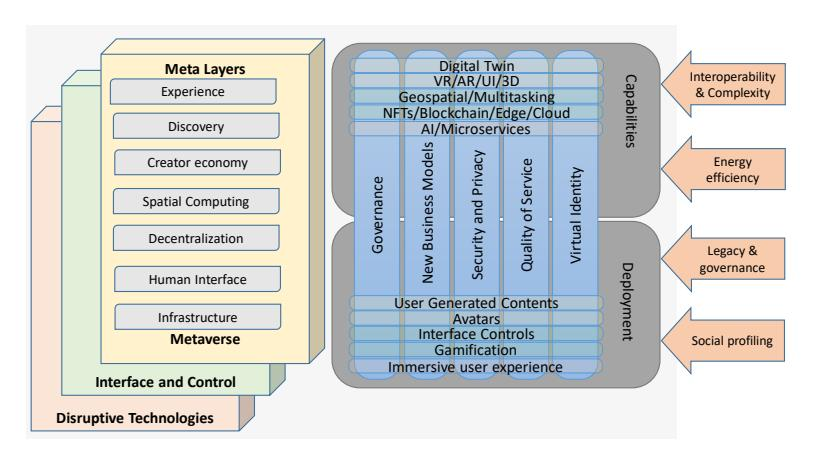
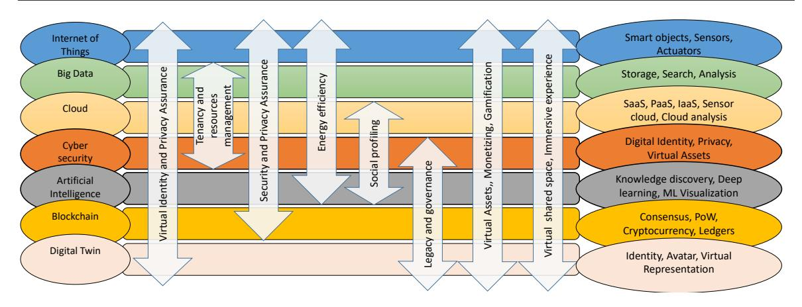

<!-- A3.R11 | source: papers_json/A3.R11/ -->

ISSN: 2088-8708, DOI: 10.11591/ijece.v15i2.pp2211-2223 ❒ 2211

## The role of disruptive technologies in the metaverse worlds: state of the art survey

Jamal N. Al-Karaki1,2, Amjad Gawanmeh^3^ , Ahmed Awad^4^ , Natnael Zerai^1^

College of College of Interdisciplinary Studies, Zayed University, Abu Dhabi, United Arab Emirates Computer Engineering Department, The Hashemite University, Zarqa, Jordan College of Engineering and IT, University of Dubai, Dubai, United Arab Emirates Department of IT, Faculty of Engineering and IT, British University of Dubai, Dubai, United Arab Emirates

## Article Info

## *Article history:*

Received Mar 11, 2024 Revised Nov 25, 2024 Accepted Dec 14, 2024

## *Keywords:*

Big data Big data analytics Healthcare Internet of things Personalised healthcare Point-of-care devices

## ABSTRACT

The metaverse has emerged as an immersive and interactive virtual world that has the potential to revolutionize various industries. The use of disruptive technologies, such as blockchain, artificial intelligence (AI), digital twin, internet of things (IoT), cloud, big data, and cybersecurity, has and will play a significant role in enhancing the capabilities of the metaverse. This paper provides a stateof-the-art survey on the role of disruptive technologies in the metaverse. The paper presents a taxonomy of the use of disruptive technologies in the metaverse and a comprehensive literature review on the application areas of the metaverse in education, healthcare, tourism, gaming, and smart cities. The paper compares the adoption of technologies in the metaverse and identifies current and future research directions. The paper contributes to understanding disruptive technologies' potential in the metaverse. It provides insights for researchers, practitioners, and policymakers to explore the opportunities and challenges of the metaverse.

*This is an open access article under the* *CC BY-SA* *license.*

## *Corresponding Author:*

Jamal N. Al-Karaki

College of College of Interdisciplinary Studies, Zayed University

Abu Dhabi, United Arab Emirates

Computer Engineering Department, The Hashemite University

Zarqa, Jordan

Email: Jamal.Al-Karaki@zu.ac.ae

## 1. INTRODUCTION

Coined by Neal Stephenson in his 1992 novel "Snow Crash," the metaverse is a term describing a virtual universe without physical limitations, offering an immersive escape from real-life [[1]](#page-9-0). Recent technological advancements, particularly in virtual reality (VR), augmented reality (AR), Blockchain, and artificial intelligence (AI), have propelled the metaverse concept into popularity. Rooted in early virtual worlds like Second Life and World of Warcraft, the metaverse has evolved beyond these limited platforms. Today, it envisions a fully immersive universe across various devices, allowing seamless transitions between physical and virtual realms. Anticipated functionalities include socializing, business transactions, gaming, attending events, and earning a livelihood. metaverse's evolution has been driven by several factors: advances in technology, changing social norms, and the need for new forms of human interaction and collaboration. Technological advances As society increasingly digitizes, the metaverse is seen as a natural extension of our online lives, offering new opportunities for self-expression, community building, and economic growth.

*Journal homepage:* *http://ijece.iaescore.com*

<!-- page 2 -->

The ambitious metaverse concept necessitates the integration of diverse technologies to craft a lifelike virtual world seamlessly. Achieving this objective entails metaverse developers embracing disruptive technologies like blockchain, artificial intelligence, virtual and augmented reality, 5G networks, and cloud computing. The primary rationale for incorporating these technologies is to ensure scalability and interoperability. The extensive computing power required for real-time interactions, complex simulations, and other functionalities in a fully operational metaverse is addressed through technologies like blockchain, ensuring security and transparency in digital assets and transactions. Virtual and augmented reality enhance user experience, while artificial intelligence and machine learning contribute to the metaverse's adaptive intelligence based on user behavior. The speed and low latency of 5G networks guarantee a smooth user experience, and cloud computing provides the requisite infrastructure for the metaverse's growth. Adopting disruptive technologies is pivotal for the metaverse's success, facilitating the creation of a functional and captivating virtual world. Figure[ 1](#page-1-0) shows expected growth in the metaverse market value.

*Figure 1. The expected metaverse market value in billion USD [[2]](#page-9-1)*

The paper contributions include a comprehensive survey of the role of disruptive technologies, namely, blockchain, digital twin, IoT, cloud, big data, cybersecurity, and ai in the upcoming metaverse world presented where the use cases/applications, benefits, and challenges of each technology are discussed. A taxonomy of the use of disruptive technologies is created and analyzed, where the impact of each disruptive technology is described, and related literature is summarized. The paper also presents a detailed comparison of the adoption of technologies in the metaverse. Finally, the current and future research directions in adopting disruptive technologies are also discussed and insights are presented.

The rest of the paper is organized as follows. Section 2 presents a state-of-the-art literature review of the role of disruptive technologies in the upcoming metaverse world is presented. A taxonomy of the use of disruptive technologies is developed and analyzed in section 3, where the impact of each disruptive technology is described. Section 4 presents a detailed comparison of technologies adoption in the metaverse. The current and future research directions in adopting disruptive technologies are discussed in section 5. The paper concludes with insights on the role of disruptive technologies in section 6.

## 2. LITERATURE REVIEW

In this section, we survey related work including some of the survey papers compiled in this area. Furthermore, we will elaborate on implementing different disruptive technologies and their role in building metaverse. There are many fields and areas in which metaverse will play a great role, but for this paper, we will focus on some of the following areas.

## 2.1. Metaverse in education

The metaverse can redefine education by providing new and immersive ways of learning. For instance, virtual classrooms where students can explore complex topics and collaborate with their peers and teachers,

<!-- page 3 -->

and immersive educational experiences that are difficult to replicate in the real world. The metaverse can also overcome geographical barriers and provide personalized learning experiences that cater to individual needs and preferences [[3]](#page-9-2).

Kye *et al.* [[4]](#page-9-3) explore using the metaverse for education with examples of using augmented reality in medical education. They highlight benefits, *e.g.,* new social communication and immersive experiences, but also point out limitations like weaker social connections and potential maladaptation. Shu and Gu [[5]](#page-9-4) investigates the effectiveness of a smart education model enabled by the edu-metaverse in enhancing English language learning outcomes. Results show that the engaged students demonstrated better performance than those in traditional instruction. The study suggests improving teaching scenarios, focusing on core literacybased assessment, and enhancing teachers' knowledge of the edu-metaverse to facilitate smart learning. Lee and Hwang [[6]](#page-9-5) explore how pre-service English teachers can use VR-making (VRM) and a metaverse platform to design technology-enhanced learning environments. It finds that engagement with VRM can improve technological readiness and digital citizenship and lead to perceived pedagogical benefits, promoting sustainable education.

The use of the metaverse as a framework for e-learning environments is proposed in [[7]](#page-9-6), where a virtual learning environment called e-learning environment (ELEM) is introduced. The authors discuss the challenges faced by current e-learning systems based on the metaverse and suggest a framework for the metaverse specifically for e-learning. Lee *et al.* [[8]](#page-9-7) proposes a VR metaverse system for practical classes in remote education due to COVID-19. The results show that the proposed system is more effective in acquiring knowledge than a video training method [[9]](#page-9-8).

## 2.2. Metaverse in healthcare

By creating virtual environments that simulate real-world medical situations in the metaverse, healthcare professionals can be trained and educated in a safe and immersive way. Patients can benefit from remote consultations and treatments. Moreover, the metaverse can facilitate medical research and drug development by providing a platform for simulating and testing new treatments.

The current applications of the metaverse in the healthcare industry is reviewed in [[10]](#page-9-9). The review covers sub-domains of: telemedicine, clinical care, education, mental health, physical fitness, veterinary, and pharmaceuticals, highlighting technical issues and solutions in each domain. The authors discuss research challen ges that hinder the widespread adoption of metaverse technology in healthcare. Petrigna and Musumeci [[11]](#page-9-10) presents a literature review on the use of the metaverse in healthcare. This indicates the limited research on the topic and discusses potential applications in health promotion, education and training, and research. Gondal [[12]](#page-9-11) explores how the metaverse, enabled by Blockchain and Web3 technologies, can revolutionize healthcare by creating a virtual space for preventive-, personalized-healthcare, and collaborative treatment programs. Similarly, Chengoden *et al.* [[13]](#page-9-12) reviews the potential applications of the metaverse in healthcare, including medical diagnosis, patient monitoring, training, surgeries, and therapeutics. The authors also identify challenges and provide recommendations for future research directions. Risks and benefits from the metaverse for healthcare are discussed in [[14]](#page-9-13). The discussion includes the use of AI-enabled technology to transform clinical workflows and the risks for privacy and discriminatory outcomes. The authors recommend the development of regulatory frameworks to ensure ethical standards are upheld.

## 2.3. Metaverse in tourism

Virtual tourism is being revolutionized by the metaverse, providing immersive and interactive experiences for travelers. This allows people to explore destinations that may be inaccessible in real life, enhancing their understanding and appreciation of cultural landmarks and heritage sites. In addition, personalized travel recommendations and customized itineraries can also be generated to meet individual preferences and needs.

Monaco and Sacchi [[15]](#page-9-14) discuss the potential benefits and challenges of the metaverse in the tourism food and wine sectors. The authors highlight the impact of the metaverse on tourism sectors. Other research [[16]](#page-9-15) also explores the potential impact of the metaverse on the hospitality and tourism industry. The authors propose a conceptual framework for creating metaverse experiences and identify research gaps and potential agenda items that could benefit industry players. The work in [[17]](#page-9-16) reports on their experiments on how mixed reality (MR) can be used to enhance cultural heritage tourism experiences for Generation Z travelers. They interviewed 18 Gen Z guests. Results show that MR technology can support the co-creation of experiences between developers, service providers, destination marketing organizations (DMOs), and consumers.

<!-- page 4 -->

## 2.4. Metaverse in gaming

The metaverse has transformed the gaming industry by providing a highly immersive and interactive virtual world for gamers. Players can create and customize their own avatars and explore vast virtual landscapes, interacting with other players and digital objects. The metaverse offers new and exciting gameplay possibilities, including virtual sports and events, live concerts, and interactive storytelling experiences.

The work in [[18]](#page-9-17) discusses the potential challenges and considerations for the gaming industry as it moves towards a metaverse model. It highlights the importance of ecological responsibility and suggests measures that need to be implemented to protect minors and limit harmful content. Park and Kim [[19]](#page-9-18) discusses the potential of the metaverse as a medium for sustainable education and identifies five world types that can be used for creating gameful experiences to enhance learning motivation. The study suggests that these world types can be utilized in educational design created using the metaverse to provide innovative educational environments and achieve sustainable development goals.

## 2.5. Metaverse in smart city

The metaverse virtual representation of cities enables live tracking and control of urban services, including transport networks, utility systems, and security operations. Residents benefit from tailored services that deliver personalized route suggestions and timely alerts about community events. Allam *et al.* [[20]](#page-9-19) discusses the potential opportunities and challenges of the metaverse in smart cities, emphasizing environmental, economic, and social sustainability. Suanpang *et al.* [[21]](#page-10-0) presents a new open metaverse platform called the "extensible metaverse" that promotes the concept of a smart travel destination as a new approach to using innovative information technology to support the hospitality and destination tourism industries. Allam *et al.* [[22]](#page-10-1) explore the potential contributions of the metaverse to environmental, economic, and social sustainability goals in the context of smart cities. They acknowledge the ethical, human, social, and cultural concerns that need to be addressed and offer insights for urban policymakers.

## 3. TAXONOMY OF USE OF DISRUPTIVE TECHNOLOGIES IN METAVERSE

In this section, we discuss seven disruptive technologies that we believe are foundational for the success and the adoption of the metaverse. These technologies are further explored in Table[ 1](#page-3-0) brief explanation of each and a comparison of the categories. Table[ 2](#page-4-0) shows the taxonomy of the disruptive technologies in relation metaverse along with referenced papers. It demonstrates the main focuses of the cited papers.

Table 1. Disruptive technologies and their relation to the metaverse

| Disruptive technology | Explanation in relation with metaverse |
| --- | --- |
| metaverse and blockchain | Blockchain technology is used in the metaverse to create secure and decentralized applications and transactions. |
| metaverse and AI | AI is used in the metaverse to enable natural language processing, computer vision, and other intelligent features. |
| metaverse and digital twin | Digital Twin technology are used in the metaverse to enable realistic simulations and interactions with virtual objects. |
| metaverse and IoT | IoT is used in the metaverse to enable real-time monitoring and control of physical systems and objects. |
| metaverse and cloud | Cloud can be used to host and deliver the infrastructure, applications, and services that power the virtual world. For example, cloud-based services can be used to support the development and deployment of metaverse applications and games. |
| metaverse and big data | Big data systems can be used to analyze the vast amount of data generated in the metaverse to help identify patterns, trends, and insights to inform the design, development, and deployment of metaverse applications and services. |
| metaverse and cybersecurity | Cybersecurity is essential to protect the virtual world and its users from cyber threats. This includes securing user data and personal information, protecting virtual assets, and preventing unauthorized access to the virtual world. |
| metaverse and non-fungible token (NFT) | Ownership of digital content such as digital art, virtual real estate, and in-game items. NFTs enable creators to monetize their creations, prove ownership, and establish a history of ownership, thereby increasing their value and enabling their trading. |

<!-- page 5 -->

## 3.1. The role of blockchain in metaverse

MetaChain [[23]](#page-10-2) is a newly proposed blockchain-based framework that addresses the challenges metaverse applications face. The framework uses smart contracts to manage interactions between metaverse service providers and metaverse users and includes a sharing scheme to improve scalability. Using Stackelberg's game theory, an incentive mechanism is also developed to reward users for their contributions to the metaverse, attracting more resources and users. Wei [[26]](#page-10-4) propose gemiverse, a blockchain-based platform for professional certification and tourism services that aims to address challenges in the traditional tourism industry. Gemiverse offers specialized solutions and focuses on building immersive experiences for users. The platform aims to become the first edutainment platform where players can turn their passion for career learning into real assets. It combines career simulations and socially-focused games to engage players, and players can earn NFT and tokens while learning.

A blockchain-based signature exchange protocol for the fair exchange of digital signatures in the metaverse is proposed in [[24]](#page-10-22). The authors introduce a staking and time-out mechanism to ensure the protocol is decentralized, verifiable, efficient, and autonomous. The authors conduct experiments on the live test network of Ethereum and demonstrate that DFSE is feasible and efficient. Gadekallu *et al.* [[29]](#page-10-6) provide a comprehensive survey of the applications of Blockchain technology in the metaverse, discussing how Blockchain can help address challenges in various aspects, including data acquisition, storage, sharing, interoperability, and privacy preservation. The paper investigates the impact of blockchain on key-enabling technologies in the metaverse, such as Internet-of-Things, digital twins, multi-sensory and immersive applications, artificial intelligence, and big data. Yang *et al.* [[30]](#page-10-7) provide a comprehensive overview of the integration of blockchain and artificial intelligence (AI) in the metaverse, discussing the current state-of-the-art studies in the areas of digital creation, digital assets, digital currency, and digital market, as well as the use of AI algorithms in the creation of avatars, non-player characters, and AI-based activities within the metaverse. Additionally, the paper explores the role of Blockchain in the metaverse and its use in cryptocurrency, transaction characteristics, Blockchain-empowered markets and authentication, and governance.

A survey of the role of blockchain and intelligent networking technologies in the development of the metaverse is presented in [[25]](#page-10-3). The survey discusses the development trend, characteristics, and architecture of the metaverse, followed by a review of existing work on blockchain, networking, and the combination of the two technologies, including overviews, applications, and challenges. Maksymyuk *et al.* [[27]](#page-10-23) propose a novel framework for managing decentralized service provision in the metaverse of things (MoT), which involves synchronized data flows from operators and wearable devices. The method is based on dynamic fine-grained data flow allocation and service selection using NFTs, which can be traded over the blockchain among users and operators in a decentralized mobile network environment.

## 3.2. The role of AI in metaverse

MetaAID is proposed in [[33]](#page-10-9) as a flexible metaverse AI technology framework, which supports the development of digital twins and virtual humans using various AI technologies. The framework includes com-

<!-- page 6 -->

mon functional modules and interfaces for different industries, and the experimental results demonstrate that it can support AI technologies in developing metaverse applications in different industries. Ali *et al.* [[31]](#page-10-24) propose using the metaverse, artificial intelligence, and Blockchain technology to create a secure and immersive healthcare system where patient data is stored on the Blockchain and analyzed by explainable AI models for disease diagnosis and prediction. Chang *et al.* [[34]](#page-10-10) discuss the potential of integrating 6G-enabled edge AI into the metaverse and propose three new edge-metaverse architectures that leverage 6G-enabled edge AI to overcome resource and computing constraints. The paper also highlights the technical challenges facing the integration of 6G-enabled edge AI into the metaverse and provides a comprehensive introduction to advanced methods for addressing these challenges. Huynh-The *et al.* [[32]](#page-10-8) explore AI's role in the metaverse's development and foundation. The authors provide a preliminary overview of AI and its role in the metaverse, followed by an investigation of AI-based methods related to six technical aspects (natural language processing, machine vision, blockchain, networking, digital twin, and neural interface) and their potential for the metaverse. The authors also explore several AI-aided applications, such as healthcare, manufacturing, smart cities, and gaming, and how they can be deployed in virtual worlds. Ali *et al.* [[36]](#page-10-11) explores the role of artificial intelligence (AI) in the development and foundation of the metaverse and investigates AI-based methods for the metaverse. The paper also explores several AI-aided applications and how they can be deployed in virtual worlds. The work in [[35]](#page-10-25) explores the use of simulation and virtualization technologies, artificial intelligence diagnostic tools, and metaverse healthcare systems in 3D immersive environments, which is instrumental in diagnostic and therapeutic services, enabling remote patient monitoring in decentralized 3D VR environments.

## 3.3. The role of digital twin in metaverse

Banaeian and Rad [[37]](#page-10-12) explore the digital twins use in the metaverse and propose a three-layer architecture for linking the physical world to the metaverse. Security and privacy challenges of using digital twins in the metaverse are discussed, focusing on using Blockchain and non-fungible tokens. Lv *et al.* [[38]](#page-10-13) discuss using digital twins to map tangible and intangible real-world objects to the metaverse, including social relations models. The paper highlights the potential of digital twins to reshape the physical world into a virtual digital space and provides technical support for constructing the metaverse. The application of digital twins technology and the metaverse in fluid machinery is discussed in [[39]](#page-10-14). The work in [[40]](#page-10-15) proposes using digital twins to assess and monitor personal health based on factors such as behavioral, vital signs, or observed symptoms.

## 3.4. The role of IoT in metaverse

Zhang *et al.* [[41]](#page-10-16) propose a framework that integrates metaverse and intelligent transportation systems to improve driving safety and decrease traffic accidents. Hancock [[43]](#page-10-18) discusses using virtual and augmented reality technologies, medical imaging devices, wearable biometric sensors, and AI-enabled healthcare delivery in immersive 3D virtual worlds and multisensory environments. They highlight the potential benefits of using these technologies in healthcare,e.g., remote patient monitoring. The work in [[44]](#page-10-19) discusses wearable healthcare monitoring devices, 3D medical imaging data, and virtualized care systems in the decentralized and interconnected metaverse. The potential of using virtual reality technology and wearable devices to diagnose and treat health issues remotely in the metaverse is reviewed in [[42]](#page-10-17). An approach for converging physical and cyber worlds through the IoT-inspired metaverse is presented in [[45]](#page-10-20). The authors present six typical IoT applications in the metaverse and four pillar technologies, including responsible AI, high-speed data communications, cost-effective mobile edge computing, and digital twins. They highlight requirements for building IoT-inspired metaverse and discuss the open issues and challenges.

## 3.5. The role of cloud in metaverse

A hybrid fog-edge computing architecture for metaverse applications is proposed in [[46]](#page-10-21) that leverages edge devices to reduce latency and improve visualization quality and can effectively solve issues associated with centralized metaverse architectures. In the same line, Cai *et al.* [[47]](#page-11-8) discusses how metaverse applications will accelerate the merging of the cloud into the network, leading to highly distributed compute- and dataintensive networks becoming universal compute platforms. The work describes the requirements of metaverse applications and outlines a comprehensive cloud network flow mathematical framework for end-to-end optimization and control. A comprehensive overview of the metaverse, covering its development status, technical framework, social framework, hyperspace, social and temporal-spatial characteristics, first application areas, challenges, and problems, is presented in [[48]](#page-11-0). Allison *et al.* [[49]](#page-11-1) discuss scalability challenges in using immersive 3D virtual worlds for education and explore the possibility of using cloud computing to support high,

<!-- page 7 -->

short-lived peak demand. It presents performance results of cloud-based virtual world hosting and develops a context for deploying immersive education environments to meet scalability challenges.

## 3.6. The role of big data in metaverse

The work in [57] explores the potential of big data and metaverse technology in improving business operations, particularly in Indonesia. The authors suggest that these technologies can help businesses understand consumer behavior, needs, and wants, improving efficiency and reducing costs. However, there are still challenges to adoption, including a lack of available talent and infrastructure. The recent developments in big data technologies and their applications to the metaverse are surveyed in [50]. The survey investigates key areas of application and technologies adopted in the virtual world sector, suggesting that big data and metaverse technology will merge and become the most influential areas in the following decades.

## 3.7. The role of cyber security in metaverse

Pooyandeh *et al.* [51] discuss the importance of cybersecurity in an AI-based metaverse, highlighting vulnerabilities and attack types. Biometric data is the most vulnerable aspect of the network. The paper suggests integrating blockchain to reduce risks associated with biometric authentication. The work in [52] surveys existing security and privacy countermeasures and outlines open research directions for building future secure and privacy-preserving metaverse systems. Figure 2 shows integrating the metaverse layered architecture with disruptive technologies. A secure and efficient data-sharing scheme for metaverse healthcare systems using attribute-based encryption (ABE) is proposed in [53], which supports constant encryption computation overhead through a multi-server structure and provides cipher text validity and equivalence detection for secure deduplication. The proposed scheme ensures the freshness of healthcare data while increasing the utilization of the medical center's private server.

*Figure 2. The integration of the metaverse layered architecture with disruptive technologies*

## 3.8. The role of NFT in metaverse

Hwang [54] examines the effectiveness of incorporating a metaverse in maker education, specifically creating NFTs and a virtual exhibition. The study found that participants who received the metaverse treatment showed improvement in creative cognition, a sense of achievement, and ownership of their products. The paper suggests expanding the thinking, making, sharing, improving (TMSI) model to thinking, making, improving, owning, and sharing (TMIOS) to include ownership as a key aspect of maker education. The work in [55] discusses how money, possessions, and ownership change as consumption shifts to the digital and virtual realm. The paper examines the role of cryptocurrencies, algorithmic collectibles, and NFTs in this shift and their implications for artists, art institutions, buyers, and investors. New forms of ownership, such as fractional ownership and fractionalized property rights are aslo explored.

The challenges and prospects for intellectual property (IP) lawyers in the digitalized world of NFTs and the metaverse are discussed in [56]. The paper examines the role of IP laws in protecting these assets. The work argues that this technological advancement presents both promise and peril for content creators and consumers and that IP lawyers have an important role in navigating the legal challenges that arise. In addition, Kahramann [28] explores the development of virtual life and the positive and negative effects of the metaverse

<!-- page 8 -->

on people and real life. Technologies such as blockchain, deepfake, cryptocurrency, avatar, and NFT are covered.

## 4. COMPARISON OF THE ADOPTION OF TECHNOLOGIES IN METAVERSE

In this section, we will compare metaverse's disruptive technologies. When comparing and contrasting these categories, there are a few key dimensions to consider: i) definition and scope, ii) application, and iii) challenges. Table[ 3](#page-7-0) shows a briefly explained comparison. The disruptive technologies discussed above have several applications in different areas. Table[ 4](#page-7-1) shows how much impact or application those technologies have on some areas. Figure[ 3](#page-8-0) shows the challenges and opportunities that arise for various disruptive technologies when used in the metaverse context.

Table 3. Compare and contrast metaverse disruptive technologies

|  | Description and scope | Application | Challenges |
| --- | --- | --- | --- |
| Metaverse and blockchain | The integration of blockchain technology with the metaverse for secure and scalable decentralized transactions. | Secure and decentralized transactions, ownership of virtual assets, digital identity, and reputation systems. | Scalability, interoperability, and regulatory issues. |
| Metaverse and AI | The use of AI to speed up the creation of lifelike virtual environments. | Enhancing user experience, intelligent agents, and generating realistic virtual environments for different domains. | Privacy, trustworthiness, and security. |
| Metaverse and digital twin | Creating and managing virtual replicas of physical objects and environments in the metaverse. | Remote monitoring, simulation, and analysis of physical objects and environments, as well as virtual prototyping and testing. | Data integration and synchronization between physical and virtual worlds, ensuring the accuracy and reliability of digital twins. |
| Metaverse and IoT | Enabling seamless interaction between the physical and virtual worlds. | Seamless interaction between physical and virtual worlds, as well as new applications in healthcare, transportation, and entertainment. | Interoperability and compatibility between IoT devices and platforms, privacy and security. |
| Metaverse and cloud | Enable users to access virtual environments from anywhere in the world. | Gaming, social networking, e-commerce, education, and healthcare. | Data volumes, scalability, and availability. |
| Metaverse and big data | Collection, analysis, and visualization of data within virtual environments. | Virtual market research, personalized advertising, predictive analytics, insights gaining, and informed decisions. | Data volume, velocity, variety, veracity, and value. |
| Metaverse and cybersecurity | Secure virtual transactions, communication, and protection against virtual threats. | Secure virtual transactions, communication, collaboration, and protection against virtual threats like malware and cyberattacks. | Identification and protection against virtual threats, compliance with relevant data protection and privacy laws. |
| Metaverse and NFT | Ownership of virtual assets, authenticity, provenance, and their monetization within the metaverse. | Digital arts, virtual games, virtual marketplaces. | Cross-environment asset tracking and ownership history, scalability of transactions, as they rely on blockchains. |

Table 4. Innovative applications of disruptive technologies

| No. | Innovative application | Cloud | IoT | Digital twin | Cyber Sec | Big data | AI | Block chain |
| --- | --- | --- | --- | --- | --- | --- | --- | --- |
| 1 | Retail powerhouse platform | Low | High | High | Medium | High | High | Medium |
| 2 | Service marketing | Medium | Low | Medium | High | High | High | Medium |
| 3 | Customer support and engagement | Medium | Low | Medium | High | High | High | Medium |
| 4 | Smart cities | Medium | High | High | Medium | High | High | High |
| 5 | Health and safety | High | High | High | High | High | High | High |
| 6 | Digital 3D printing | Low | High | High | High | Medium | High | Low |
| 7 | Critical facility monitoring | Low | High | High | High | Medium | High | Medium |
| 8 | Supply chain | Medium | High | High | High | Medium | High | High |
| 9 | Digital currency | Low | Low | Medium | Medium | High | Medium | High |
| 10 | Autonomous driving | Medium | High | High | High | High | High | Medium |
| 11 | Electric cars charging | Low | Medium | High | Medium | High | High | Medium |
| 12 | Virtual augmented reality | Medium | High | High | High | High | High | Medium |
| 13 | Crowd monitoring | Medium | High | High | High | High | High | Medium |
| 14 | Genomics applications | Low | Low | High | High | Medium | High | Medium |
| 15 | Pandemic response | Medium | High | High | High | High | High | Medium |
| 16 | Mass vaccination | Medium | High | High | High | High | Medium | Medium |

<!-- page 9 -->

*Figure 3. Disruptive technologies opportunities and challenges in the metaverse*

## 5. CURRENT AND FUTURE RESEARCH DIRECTIONS

A crucial research gap in the metaverse field is developing a fully functional version. Existing versions have limited scope, necessitating further research for infrastructure, standards, and protocols to ensure seamless integration of virtual worlds. Disruptive technologies like AI and Blockchain contribute to features such as intelligent agents and decentralized virtual economies. Yet, challenges arise from the virtual world's scale, complexity, and decentralization. In the following, we discuss in more detail the research gaps.

- a. Technical infrastructure: metaverse research focuses on scalable and secure technical infrastructure, emphasizing the challenge of a decentralized system for digital asset creation. Technologies like Blockchain are explored. Efficient protocols for communication, data exchange, and resource management within the metaverse are also crucial areas of investigation.
- b. User experience: the metaverse's success relies on a user-friendly experience with an immersive interface. Designing for accessibility, including users with disabilities, is a challenge. Researchers explore technologies like virtual reality, augmented reality, and natural language processing for more intuitive user experiences.
- c. Social dynamics: in the metaverse, understanding social dynamics involves researching identity systems for privacy, trust mechanisms for safety, and the impact of social norms and cultural differences on user behavior.
- d. Accessibility: the metaverse should be accessible to everyone, regardless of their abilities. Researchers could explore ways to create virtual environments that are accessible to people with disabilities, and develop assistive technologies that can enhance the user experience for everyone.
- e. Governance: in the decentralized metaverse, effective governance is crucial. This includes standards for interoperability, dispute resolution protocols, and community governance mechanisms. Researchers explore models like decentralized autonomous organizations (DAOs) for transparent and democratic metaverse governance.
- f. Economic models: the metaverse is expected to generate new economic opportunities, and there is a need to develop sustainable and equitable economic models that can benefit all stakeholders. This includes the development of mechanisms for creating and exchanging digital assets, protocols for micropayments, and models for revenue sharing. Researchers are exploring new economic models, such as tokenization and NFTs, to create new economic opportunities in the metaverse.
- g. Legal and regulatory frameworks: as the metaverse grows, legal frameworks are needed to cover intellectual property, liability, and jurisdiction. This includes regulations for digital assets, virtual currencies, and dispute resolution. Researchers explore innovative legal structures like smart contracts and decentralized arbitration for a transparent metaverse.
- h. Ethical considerations: The metaverse prompts ethical considerations on behavior, privacy, and security, requiring guidelines. This involves ethical virtual and augmented reality standards, responsible data use, and user treatment. Researchers explore digital ethics and ethical AI frameworks for a responsible metaverse.

<!-- page 10 -->

## 6. CONCLUSION

The metaverse, a transformative digital frontier, has the potential to revolutionize interactions across various industries. It creates an immersive virtual world by combining disruptive technologies such as blockchain, AI, IoT, digital twin, cybersecurity, cloud, and big data. Blockchain enables secure peer-to-peer transactions and virtual asset ownership, while AI enhances realism in the metaverse. IoT connects physical objects to the virtual world, and digital twin technology creates replicas for training and simulation. Cybersecurity safeguards user data, and cloud and big data handle vast amounts of information. However, the metaverse poses challenges, particularly in cybersecurity and data privacy. Robust measures are needed to address hacking and fraud; clear guidelines are essential for user data protection. The metaverse is a dynamic and transformative realm, requiring careful consideration of disruptive technologies and challenges to ensure a secure and inclusive future. The metaverse will play a very important role in revolutionizing different industry areas like real estate, healthcare, education, entertainment, retail, gaming, smart cities, tourism, banking systems, and communication, and more research and development are needed to utilize and maximize the potentials of the metaverse.

## REFERENCES

- [1] Matthew sparkes, "What is a metaverse?," *New Scientist*, vol. 251, p. 18, 2021.
- [2] PPrecedence research, "Metaverse market size to surpass USD 5,028.57 billion by 2033 snippet," precedenceresearch.com, 2023 https://www.precedenceresearch.com/metaverse-market, (accessed Mar 11, 2024)
- [3] J. N. Al-Karaki, M. Omar, A. Gawanmeh, and A. Jones, "Advancing cybersecurity education and training: practical case study of running capture the flag (CTF) on the metaverse vs. physical settings," in *2023 In**ternational Conference on Intelligent Metaverse Technologies & Applications (iMETA)*, 2023, pp. 1–7, doi: 10.1109/iMETA59369.2023.10294722.
- [4] B. Kye, N. Han, E. Kim, Y. Park, and S. Jo, "Educational applications of metaverse: Possibilities and limitations," *Journal of Educational Evaluation for Health Professions*, vol. 18, Dec. 2021, doi: 10.3352/jeehp.2021.18.32.
- [5] X. Shu and X. Gu, "An empirical study of a smart education model enabled by the edu-metaverse to enhance better learning outcomes for students," *Systems*, vol. 11, no. 2, 2023, doi: 10.3390/systems11020075.
- [6] H. Lee and Y. Hwang, "Technology-enhanced education through vr-making and metaverse-linking to foster teacher readiness and sustainable learning," *Sustainability*, vol. 14, no. 8, 2022, doi: 10.3390/su14084786.
- [7] N. A. Dahan, M. Al-Razgan, A. Al-Laith, M. A. Alsoufi, M. S. Al-Asaly, and T. Alfakih, "Metaverse framework: a case study on e-learning environment (ELEM)," *Electronics*, vol. 11, no. 10, 2022, doi: 10.3390/electronics11101616.
- [8] H. Lee, D. Woo, and S. Yu, "Virtual reality metaverse system supplementing remote education methods: based on aircraft maintenance simulation," *Applied Sciences*, vol. 12, no. 5, 2022, doi: 10.3390/app12052667.
- [9] B. AlDhanhani, M. Daradkeh, A. Gawanmeh, S. Atalla, and S. Miniaoui, "Metaverse adoption in UAE higher education: A hybrid SEM-ANN approach," in *2023 International Conference on Intelligent Metaverse Technologies &* *Applications (iMETA)*, 2023, pp. 1–7.
- [10] G. Bansal, K. Rajgopal, V. Chamola, Z. Xiong, and D. Niyato, "Healthcare in metaverse: a survey on current metaverse applications in healthcare," *IEEE Access*, vol. 10, pp. 119914–119946, 2022, doi: 10.1109/AC-CESS.2022.3219845.
- [11] L. Petrigna and G. Musumeci, "The metaverse: a new challenge for the healthcare system: a scoping review," *Journal* *of Functional Morphology and Kinesiology*, vol. 7, no. 3, p. 63, 2022, doi: 10.3390/jfmk7030063.
- [12] V. Gondal, "Metaverse & healthcare," *Voice & Data*, Jun. 2022.
- [13] R. Chengoden *et al.*, "Metaverse for healthcare: a survey on potential applications, challenges and future directions," *IEEE Access*, vol. 11, pp. 12765–12795, 2023, doi: 10.1109/ACCESS.2023.3241628.
- [14] C. Curtis and C. E Brolan, "Health care in the metaverse," *Wiley Online Library*, Nov. 2022.
- [15] S. Monaco and G. Sacchi, "Travelling the metaverse: potential benefits and main challenges for tourism sectors and research applications," *Sustainability*, vol. 15, no. 4, p. 3348, Feb. 2023, doi: 10.3390/su15043348.
- [16] D. Gursoy, S. Malodia, and A. Dhir, "The metaverse in the hospitality and tourism industry: an overview of current trends and future research directions," *Taylor & Francis*, May 2022.
- [17] D. Buhali and N. Karatay, "Mixed reality (MR) for generation z in cultural heritage tourism towards metaverse," *Information and Communication Technologies in Tourism*, pp. 16–27, 2022.
- [18] Sophie Goossens and John P Feldman, "Gaming in the metaverse – An NFT-powered revolution?," *Intellectual Prop**erty & Technology Law Journal*, vol. 33, no. 10, pp. 3–1, 2021.
- [19] S. Park and S. Kim, "Identifying world types to deliver gameful experiences for sustainable learning in the metaverse," *Sustainability*, vol. 14, no. 3, 2022, doi: 10.3390/su14031361.
- [20] Z. Allam, A. Sharifi, E. Simon, D. Jones, and J. Krogstie, "The metaverse as a virtual form of smart cities: opportunities and challenges for environmental, economic, and social sustainability in urban futures," *Smart Cities*, vol. 5, no. 3, 2022.

<!-- page 11 -->

- [21] P. Suanpang, C. Niamsorn, P. Pothipassa, T. Chunhapataragul, T. Netwong, and K. Jermsittiparsert, "Extensible metaverse implication for a smart tourism city," *Sustainability*, vol. 14, no. 21, 2022, doi: 10.3390/su142114027.
- [22] Z. Allam, A. Sharifi, S. E. Bibri, D. S. Jones, and J. Krogstie, "The metaverse as a virtual form of smart cities: opportunities and challenges for environmental, economic, and social sustainability in urban futures," *Smart Cities*, vol. 5, no. 3, pp. 771–801, 2022, doi: 10.3390/smartcities5030040.
- [23] C. T. Nguyen, D. T. Hoang, D. N. Nguyen, and E. Dutkiewicz, "Metachain: a novel blockchain-based framework for metaverse applications," in *2022 IEEE 95**th* *Vehicular Technology Conference: (VTC2022-Spring)*, 2022, doi: 10.1109/vtc2022-spring54318.2022.9860983.
- [24] J. Chen, H. Xiao, M. Hu, and C. M. Chen, "A blockchain-based signature exchange protocol for metaverse," *Future* *Generation Computer Systems*, vol. 142, pp. 237–247, 2023, doi: 10.1016/j.future.2022.12.031.
- [25] Y. Fu, C. Li, F. R. Yu, T. H. Luan, P. Zhao, and S. Liu, "A survey of blockchain and intelligent networking for the metaverse," *IEEE Internet of Things Journal*, vol. 10, no. 4, pp. 3587–3610, 2023, doi: 10.1109/JIOT.2022.3222521.
- [26] D. Wei, "Gemiverse: the blockchain-based professional certification and tourism platform with its own ecosystem in the metaverse," *International Journal of Geoheritage and Parks*, vol. 10, no. 2, pp. 322–336, Jun. 2022, doi: 10.1016/j.ijgeop.2022.05.004.
- [27] T. Maksymyuk, J. Gazda, G. Bugar, V. Gazda, M. Liyanage, and M. Dohler, "Blockchain-empowered service man- ´ agement for the decentralized metaverse of things," *IEEE Access*, vol. 10, pp. 99025–99037, 2022, doi: 10.1109/AC-CESS.2022.3205739.
- [28] M. E. Kahramann, "Widespread virtual life with blockchain, deepfake, avatar, cryptocurrency, NFT and metaverse," *International Journal of Cultural and Social Studies (IntJCSS)*, vol. 8, no. 1, Jun. 2022.
- [29] T. R. Gadekallu *et al.*, "Blockchain for the metaverse: a review," *Future Generation Computer Systems*, vol. 143, pp. 401–419, 2023.
- [30] Q. Yang, Y. Zhao, H. Huang, Z. Xiong, J. Kang, and Z. Zheng, "Fusing blockchain and AI with metaverse: a survey," *IEEE Open Journal of the Computer Society*, vol. 3, pp. 122–136, 2022, doi: 10.1109/OJCS.2022.3188249.
- [31] S. Ali *et al.*, "Metaverse in healthcare integrated with explainable AI and blockchain: enabling immersiveness, ensuring trust, and providing patient data security," *Sensors*, vol. 23, no. 2, Jan. 2023, doi: 10.3390/s23020565.
- [32] T. Huynh-The, Q. V. Pham, X. Q. Pham, T. T. Nguyen, Z. Han, and D. S. Kim, "Artificial intelligence for the metaverse: a survey," *Engineering Applications of Artificial Intelligence*, vol. 117, 2023, doi: 10.1016/j.engappai.2022.105581.
- [33] H. Zhu, "MetaAID: a flexible framework for developing metaverse applications via AI technology and human editing," *arXiv:2204.01614*, Apr. 2022.
- [34] L. Chang *et al.*, "6G-enabled edge ai for metaverse: challenges, methods, and future research directions," *Journal of* *Communications and Information Networks*, vol. 7, no. 2, pp. 107–121, 2022.
- [35] B. Carey, "Simulation and virtualization technologies, artificial intelligence diagnostic tools, and metaverse healthcare systems in 3D immersive environments," *American Journal of Medical Research*, vol. 9, no. 2, pp. 9–24, 2022.
- [36] M. Ali, F. Naeem, G. Kaddoum, and E. Hossain, "Metaverse communications, networking, security, and applications: research issues, state-of-the-art, and future directions," *IEEE Communications Surveys & Tutorials*, 2023, doi: 10.1109/COMST.2023.3347172.
- [37] S. B. Far and A. I. Rad, "Applying digital twins in metaverse: User interface, security and privacy challenges," *Journal of Metaverse*, vol. 2, no. 1, pp. 8–15, 2022.
- [38] Z. Lv, S. Xie, Y. Li, M. Shamim Hossain, and A. El Saddik, "Building the metaverse by digital twins at all scales, state, relation," *Virtual Reality & Intelligent Hardware*, vol. 4, no. 6, pp. 459–470, 2022, doi: 10.1016/j.vrih.2022.06.005.
- [39] B. Yang, S. Yang, Z. Lv, F. Wang, and T. Olofsson, "Application of digital twins and metaverse in the field of fluid machinery pumps and fans: a review," *Sensors*, vol. 22, no. 23, Nov. 2022, doi: 10.3390/s22239294.
- [40] Y.-T. Song and J. Qin, "Metaverse and personal healthcare," *Procedia Computer Science*, vol. 210, pp. 189–197, 2022, doi: 10.1016/j.procs.2022.10.136.
- [41] H. Zhang, G. Luo, Y. Li, and F.-Y. Wang, "Parallel vision for intelligent transportation systems in metaverse: challenges, solutions, and potential applications," *IEEE Transactions on Systems, Man, and Cybernetics: Systems*, pp. 1–14, 2022, doi: 10.1109/TSMC.2022.3228314.
- [42] R. Barnes, "Healthcare diagnosis and treatment in the metaverse: remote sensing algorithms, networked wearable devices, and virtual patient data," *American Journal of Medical Research*, vol. 9, no. 2, p. 41, 2022, doi: 10.22381/ajmr9220223.
- [43] K. Hancock, "Virtual healthcare visits, wearable devices and ambient sensors, and biomedical big data in the metaverse environment," *American Journal of Medical Research*, vol. 9, no. 2, pp. 73–88, 2022.
- [44] M. Newell, "Wearable healthcare monitoring devices, 3D medical imaging data, and virtualized care systems in the decentralized and interconnected metaverse," *American Journal of Medical Research*, vol. 9, no. 2, 2022.
- [45] K. Li *et al.*, "When internet of things meets metaverse: convergence of physical and cyber worlds," *IEEE Internet of* *Things Journal*, vol. 10, no. 5, pp. 4148–4173, 2023, doi: 10.1109/JIOT.2022.3232845.
- [46] N. Aung, S. Dhelim, L. Chen, H. Ning, L. Atzori, and T. Kechadi, "Edge-enabled metaverse: the convergence of

<!-- page 12 -->

- metaverse and mobile edge computing," *Tsinghua Science and Technology*, vol. 29, no. 3, pp. 795–805, 2023.
- [47] Y. Cai, J. Llorca, A. M. Tulino, and A. F. Molisch, "Compute-and data-intensive networks: the key to the metaverse," in *1* *st* *International Conference on 6G Networking*, 2022, pp. 1–8. doi: 10.1109/6GNet54646.2022.9830429.
- [48] H. Wang *et al.*, "A survey on the metaverse: The state-of-the-art, technologies, applications, and challenges," *IEEE* *Internet of Things Journal*, vol. 10, no. 16, pp. 14671–14688, 2023, doi: 10.1109/JIOT.2023.3278329
- [49] C. Allison, I. Oliver, A. Miller, J. McCaffery, and C. Davies, "From metaverse to MOOC: can the cloud meet scalability challenges for open virtual worlds?," in *Proceedings of the 8**th* *Immersive Education Summit*, 2013.
- [50] H. Zhang, S. Lee, Y. Lu, X. Yu, and H. Lu, "A survey on big data technologies and their applications to the metaverse: past, current and Future," *Mathematics*, vol. 11, 2023, doi: 10.3390/math11010096.
- [51] M. Pooyandeh, H. Ki-Jin, and I. Sohn, "Cybersecurity in the AI-based metaverse: a survey," *Applied Sciences*, vol. 12, no. 24, p. 12993, 2022.
- [52] Y. Wang *et al.*, "A survey on metaverse: fundamentals, security, and privacy," *IEEE Communications Surveys &* *Tutorials*, vol. 25, no. 1, pp. 319–352, 2022.
- [53] T. Zhang, J. Shen, C. F. Lai, S. Ji, and Y. Ren, "Multi-server assisted data sharing supporting secure deduplication for metaverse healthcare systems," *Future Generation Computer Systems*, vol. 140, pp. 299–310, 2023, doi: 10.1016/j.future.2022.10.031.
- [54] Y. Hwang, "When makers meet the metaverse: effects of creating NFT metaverse exhibition in maker education," *Computers and Education*, vol. 194, 2023, doi: 10.1016/j.compedu.2022.104693.
- [55] R. Belk, M. Humayun, and M. Brouard, "Money, possessions, and ownership in the metaverse: NFTs, cryptocurrencies, Web3 and wild markets," *Journal of Business Research*, vol. 153, pp. 198–205, Aug. 2022, doi: 10.1016/j.jbusres.2022.08.031.
- [56] G. Nwaeze, "NFTs and metaverse: Exploring the challenges and prospects for IP lawyers in the digitalized world," *SSRN*, Aug. 2022.
- [57] G. S. Depari, E. Shu, and I. Indra, "Big data and metaverse toward business operations in Indonesia," *Jurnal Ekonomi*, 2022.

## BIOGRAPHIES OF AUTHORS

Jamal N. Al-Karaki is currently a full professor at Zayed University, UAE. He received the a Ph.D. degree in electrical/computer engineering with research excellence award from the Iowa State University, USA. He has a vast expertise as a researcher, educator, and academic administrator including leadership positions such as college Dean, Director of IT, Co-Founder and Division Head at various institutes. He led the development some national centers as well as undergraduate program and graduate programs in the general area of computing. He is also serving as accreditation team chair and member for UAE CAA, NQA, and ABET. He published 90+ refereed technical articles in scholarly international journals and conference proceedings. He has been listed among top 2% highly cited researchers worldwide in his domain and also a member of Mohammad Bin Rashed Academy for Scientists. He also attended/gained reputable professional certificates (*e.g.*, CISSP, OSCP, ECSA, GMOB, CHFI, RHCSA, and CCNA security). He also served on the editorial board of some international journals and as publicity chair and technical program committee member of several International conferences and workshops. His main research interests include all aspects of computing and technology and their applications for better life. Dr. Al-Karaki is a senior member of IEEE and member of ACM and Tau Beta Pi. He can be contacted at email: jamal.al-karaki@zu.ac.ae.

Amjad Gawanmeh is a professor at the University of Dubai, UAE and Affiliate Adjunct Professor at Concordia University, Montreal, Canada. He received his Ph.D. degrees from Concordia University in 2008; respectively. He has two edited books, 3 book chapters, more than 40 peer reviewed Scopus indexed journal papers, and more than 65 peer reviewed conference papers. He worked at Khalifa University from 2010 until 2019, before joining the University of Dubai on January 2020. He was visiting scholar at Syracuse University, University of Quebec, and Concordia University. He is the Editor in Chief for the International Journal of Cyber-Physical Systems (IJCPS) IGI, an associate editor for IEEE Access Journal, Springer nature Journal of Reliable Intelligent Environments, and Human-centric Computing and Information Sciences Journal, Springer. He acted as guest editor for several special issues. He is on the reviewer board for several journals in IEEE, Elsevier, Wiley, and many others. He acted as a member of the executive committee for IPCCC conference. He has co-chaired several conference workshops and special sessions organized in key conferences including Globecom, ICC, ICDCS, IPCCC, Healthcom, WoWMoM, ISNCC, and WiMob. He is senior IEEE member, IEEE GRSS Chapter chair, and IEEE UAE section conference coordinator. He can be contacted at email: amjad.gawanmeh@ud.ac.ae.

<!-- page 13 -->

Ahmad Awad is an associate professor of AI and data science at the British University in Dubai. Formerly, Dr. Awad was a professor of Big Data at the Institute of Computer Science, University of Tartu, Estonia. Before that, Dr. Awad was an associate professor of Information Systems at the Faculty of Computers and Artificial Intelligence at Cairo University, Egypt. He is also an adjunct professor at the School of Information Technology and Computer Science, Nile University, Egypt. Ahmed got his Ph.D. from Hasso-Plattner Institute, Potsdam University, Germany, in 2010. Before that, he got his B.Sc. and M.Sc. degrees from Cairo University in 2000 and 2003, respectively. Ahmed's research interests are big stream processing, complex event processing, online machine learning, edge computing, and applications, especially in business process management. Dr. Awad has over 60 publications in international journals, conferences, and workshops. He can be contacted at email: ahmed.awad@buid.ac.ae.

Natnael Zerai is a recent Cybersecurity Graduate from Zayed University, UAE. He is a highly motivated researcher and honor graduate with a commitment to excellence and a strong background in information technology. He graduated with Bachelor of Science in Information Technology [Cyber Security], Zayed University with honors. His research interests spans all areas of cyber security and their applications. He can be contacted at email: M80007968@zu.ac.ae.
