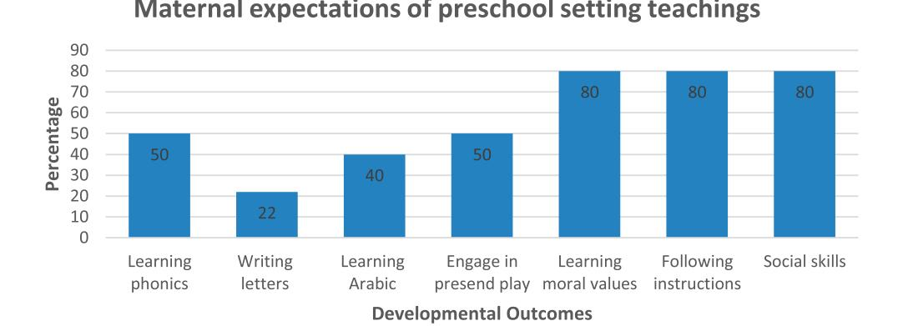
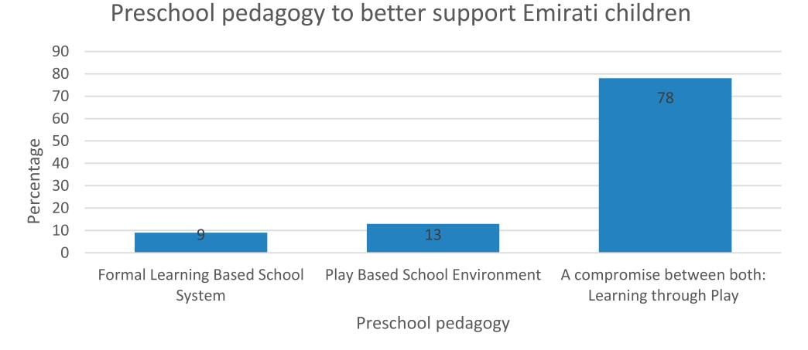
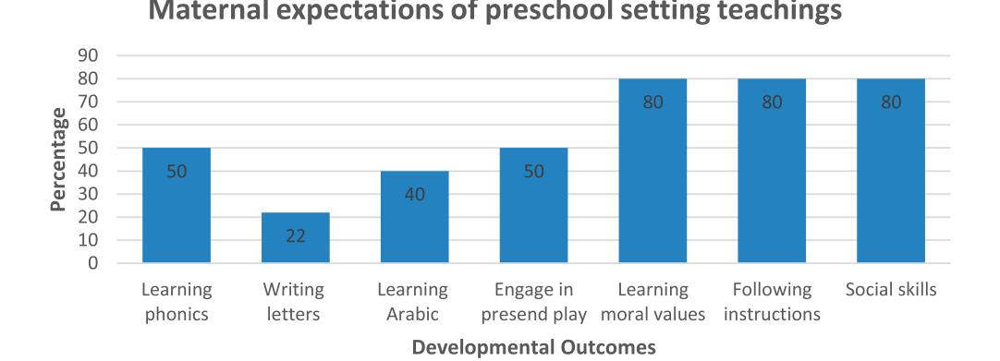
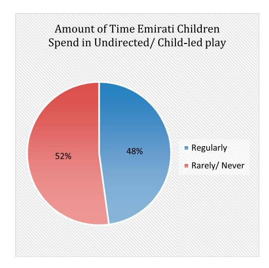

<!-- A3.R12 | source: papers_json/A3.R12/ -->

## **Child** **Care** **in** **Practice**

**ISSN: 1357-5279 (Print) 1476-489X (Online) Journal homepage: ****[www.tandfonline.com/journals/cccp20](https://www.tandfonline.com/journals/cccp20?src=pdf)**

## **The** **Play-based** **Behaviours** **of** **Emirati** **Preschool** **Children:** **Cultural** **Perspective** **into** **Early** **Childhood Education**

**Dana Al-Qinneh & Emad A. S. Abu-Ayyash**

**To** **cite** **this** **article:** Dana Al-Qinneh & Emad A. S. Abu-Ayyash (2022) The Play-based Behaviours of Emirati Preschool Children: Cultural Perspective into Early Childhood Education, Child Care in Practice, 28:3, 394-410, DOI: [10.1080/13575279.2020.1816531](https://www.tandfonline.com/action/showCitFormats?doi=10.1080/13575279.2020.1816531)

**To** **link** **to** **this** **article:** [https://doi.org/10.1080/13575279.2020.1816531](https://doi.org/10.1080/13575279.2020.1816531)

| Image: Calendar icon Published online: 14 Oct 2020. |
| --- |
| Image: Pencil and document icon Submit your article to this journal Image: External link icon |
| Image: Bar chart icon Article views: 2777 |
| Image: Magnifying glass and document icon View related articles Image: External link icon |
| Image: CrossMark logo View Crossmark data Image: External link icon |
| Image: Two documents icon Citing articles: 3 View citing articles Image: External link icon |

<!-- page 2 -->

## The Play-based Behaviours of Emirati Preschool Children: Cultural Perspective into Early Childhood Education

Dana Al-Qinneha and Emad A. S. Abu-Ayyash ^b^

a Creative Nest Nursery, Dubai, the United Arab Emirates; ^b^ Faculty of Education, The British University in Dubai, Dubai, the United Arab Emirates

Current policy and curriculum guides for early education centres in the United Arab Emirates advocate for play-based practices similar to those in the West. However, best practice reforms must reflect a sociocultural perspective and suit the context of application. The main objectives of this research were to provide insight into Emirati maternal values on play, to analyse behavioural factors, and to suggest policies that better support them. Results revealed that 52% of Emirati children rarely or never engage in undirected play and that while Emirati mothers were aware of the significance of play, they were less aware of "child-led" play practices, how to facilitate undirected play at home and the significance of their role in scaffolding play. Furthermore, the undervaluing of free play by Emirati mothers, upsets traditional play paradigms with 80% of mothers believing that a blend between knowledge learning and play learning would be better fit for their children. We argue that curriculum decisions ought to take into account the cultural context and parental psychology of Emirati mothers and children when constructing preschool curricula.

## KEYWORDS

Play-based behaviours; Emirati children; play-based practices; teaching practices; cultural play; child-led play

## Introduction

In recent years there has been a surge in interest in play-based preschool settings across Western schools (Bertrand, [2007;](#page-15-0) Theobald et al., [2015)](#page-17-0). This growing area of research in the field of early childhood education is a direct attribute to the relevance and significance that "play" plays in a child's life. We have long known that the construct of play in the early years is instrumental in the development of social, cognitive, emotional and language skills in children (Celeste, [2006](#page-15-1); UNICEF, [2018)](#page-17-1). Aside from the developmental benefits it holds, it is a natural and holistic activity that evolves continuously throughout childhood, providing children with opportunities to take lead in exploring real experiences and in constructing knowledge (Lee, Md-Yunus, Son, & Meadows, [2009](#page-16-0)). As such, it is widely accepted among Western early childhood practitioners that best practice with regards to teaching preschool children is to adopt a play-based approach to learning (Ali, Constantino, Hussain, & Akhtar, [2018;](#page-15-2) Celeste, [2006)](#page-15-1).

However, no single pedagogy, from a sociocultural perspective, can merely be applied to all contexts. Western pedagogies that are widely accepted as being

<!-- page 3 -->

effective in supporting the play behaviours of children and their needs cannot easily be applied in the United Arab Emirates (UAE) with the expectation that they would work in the same manner without considering Emirati social and cultural contexts (Li, Rao, & Tse, 2012). Acknowledging such, there are at least three reasons to study the cultural context of children's play. First, understanding which cultural variations exists highlights societal values underpinned in play. By using them to compose and shape our practice, we are building a curriculum that enhances cultural pride among learners (Shim, Herwig, & Shelley, 2001). Second, the beliefs and practices of a nation should never be replaced by imported philosophies, and understanding how different cultures believe in and practise play should be well accounted for (Fabes, Hanish, & Martin, 2003). Third, in various cultures, the social organisations of families are ever changing. These dynamics shape how play is being incorporated at home and understanding these ensures a smooth transition for early childhood children from home to preschools (Marfo & Biersteker, 2010).

Current studies on the pretend play behaviours of children are restricted to European-American children, leading to a generalised account of pretend play behaviours applied to children across a plethora of cultures and backgrounds (Shahidi, 2010).

## Significance of the study for children in the UAE

Within the last decade, the early childhood education sector in Dubai has received a huge surge in growth. Over the span of 13 years, the number of children enrolled in preschools across the emirate of Dubai increased by 25% (Karaman, 2011), impacting the dynamics and need for early child care facilities in Dubai. However, despite the increased number of Emirati children attending preschools, very few researchers have focused on how these children can be better supported within their classrooms and how their needs can be addressed while taking into account social and contextual values that influence their play behaviours.

## **Research objectives **

This study aims to serve two purposes: (1) to provide insight into Emiratis mother's influence on their children's play habits by examining most common culturalspecific practices and (2) to analyse behavioural factors based on Emirati mothers' responses by looking at the social and functional patterns of behaviour amongst Emirati mothers.

## Relevance of study

The Ministry of Education (MOE) in the UAE is committed to transforming the early childhood sector and to supporting best outcomes for future success of children in the country. The current framework proposed advocates for a child-centred learning approach. However, a holistic approach to development is done by supporting all areas of child development equally, including cultural and religious values (Morrissey & Warner, 2007), and current research fails to provide perspective of values held by mothers of children in the UAE for their inclusion.

<!-- page 4 -->

## Literature review

Child-inspired learning and teaching is a relatively new model in early years' facilities and research, specifically in the Emirati context. While there is an increasing awareness and interest into children's play behaviours and best practice in terms of the teaching and the learning of young children (Bubikova-Moan, Hjetland, & Wollscheid, 2019; Kinkead-Clark, 2019; Taylor & Boyer, 2020), studies focusing on Emirati children's needs and behaviours have yet to be undertaken although an abundance on the influence of culture on play behaviours has been shared.

## A policy perspective on child-led play within nurseries in the UAE

In recent years, Dubai has developed much of its policy in the area of early childhood care and education through revisions and amendments to their expectations and regulations (Karaman, 2011). The national quality framework within the UAE defines play as a central component to the education, well-being and development of a child (Karaman, 2011). However, play is a construct subjective to a child's experience, upbringing and developmental stage.

Preschool institutions which adopt a more "formal" school pedagogy and curriculum, emphasise more on measurable academic outcomes concerning areas of development in literacy and numeracy rather than pedagogies embedded in play and exploration (Edwards & Usher, 2007), however the majority of these are slowly being replaced by play-based models (Karaman, 2011).

## Play-based behaviours from cultural perspective

Contributions from research done in the last 20 years have attempted to link culture and pretend play habits together (Farver, 1993; Roopnarine, Johnson, & Hooper, 1994). They have since argued that while play is a universal activity, it is heavily regulated by cultural issues within varying contexts (Lancy, 2007). Gaskins, Haight, and Lancy (2007) found that within a village in Mexico, cultural pressures had placed an emphasis on academics and formal child learning sessions rather than on play, and as such, in schools, child learning had replaced play opportunities, and children were found to lack primitive play behaviours observed in children elsewhere.

Across various cultures, play is regarded as a social function that children enter with their peers or surrounding adults, such as parents, aunts, uncles, and grandparents (Roopnarine et al., 1994). However, significant differences are observed amongst different cultural communities in the play companions made available to children (Haight, Wang, Fung, Williams, & Mintz, 1999). Within the context of Chinese children, caregivers, parents and siblings often make themselves available to play and facilitate play opportunities with the children; as a result, children within those contexts are more articulate with regards to pretend play behaviours and base play off of real-life experiences (Fung, 1994). Similarly, Irish children and Turkish children (Farver & Wimbarti, 1995) are often reported playing with their peers and demonstrate healthy personal, social and emotional skills as opposed to children within Latino families, who are reported to spend the majority of their time playing in isolation (Lindsay, Greaney,

<!-- page 5 -->

Sussner, Pfeiffer, & Peterson, [2014)](#page-16-8). Therefore, while play tends to develop in a universal manner across children, cultural variations are prominent (Roopnarine et al., [1994](#page-16-6)).

## Cultural contexts in teaching practice

Given that a general consensus exists regarding play as a means for learning within Western early childhood discourses, it comes as no surprise to see child-directed activities inspired by play ideas in areas such as Northern Italy (Reggio Emilia) and New Zealand (Te Whariki) (Praliming-Samuelsson & Johansson, [2006](#page-16-9)). However, despite the wide-spread attention these play-based curriculums have received for empowering children to exercise freedom of choice, autonomy and independence (Bennett, Wood, & Rogers, [1997)](#page-15-13), some researchers argue that without taking into account the complexity and diversity of the interactions at home, practitioners would not have taken into account the pragmatic imperatives that facilitating lessons based on play requires (Rogers, [2010](#page-16-10)). Additionally, research has shown that while play is an effective strategy for educators to promote learning, it does not necessary work for all children (Brooker, [2002)](#page-15-14). Rogers [(2010](#page-16-10)) argues that while countries like the UK, USA and New Zealand have found success in implementing play-based frameworks, others have not.

## Method

This was an exploratory study that placed significant importance on the lives of underrepresented populations in a saturated field by bringing to light cultural considerations, experiences, habits and maternal values. The subsequent subsections delineate the various methodological choices made to serve the study objectives.

## Data collection methods

Our study utilised a mixed-methods design including both qualitative and quantitative measures and triangulated the data-gathering instruments (Feilzer, [2010)](#page-15-15), employing a questionnaire and an interview to serve the two purposes of this study: (1) to provide insight into Emirati mother's influence on their children's play habits (quantitatively) and (2) to analyse behavioural factors based on Emirati mothers' responses (qualitatively). Mixed-methods research designs are ideal for assessing and uncovering what people belonging from a particular group think, feel and do (Mukherji & Albon, [2010](#page-16-11)). In order to address the research aims, the primary mixed methods design utilised was convergent design whereby findings from both the qualitative (phone interview process) and quantitative (online questionnaire) were collected and assessed. Both sets of data were then separately analysed and then compared side-by-side in order to validate their perspectives and draw stronger conclusions on suggested curriculum regimes (Wisdom & Creswell, [2013)](#page-17-3).

## Questionnaire design

The questionnaire was circulated online through the nursery's primary means of communication: The Parent Application. A cover letter explaining the purpose and aims

<!-- page 6 -->

of the research preceded the questionnaire link, along with consent to participate. The questionnaire was designed in order to ensure respondent anonymity, reach a larger audience and to ask a wider range of questions in order to gather as much information as possible on living arrangements, play habits and opinions as needed to unearth for this study. Anonymity and confidentiality disclosures aimed to reassure participants and increase the truthfulness of the responses.

The questionnaire questions were adapted from previous research studies on children's play behaviours and influencing cultural factors (Lindsay et al., 2014; Shahidi, 2010). The questionnaire was used to collect information on an Emirati mother's influence on their children's play habits and to assess the behavioural factors that dominated Emirate children's play. The first of 5 sections sought to collect information regarding the demographics of participants, such as: gender, parent educational level, occupation and living arrangements. The second section: Home Life, included multiple choice questions regarding which playmates their children spent the most time with, bed time routines and hours spent playing and with whom and Likert scale questions regarding their level of satisfaction with their children's current play companions and their influence on their children's behaviours. The third section: Child's Environment, included ample open-ended questions in order to learn about which items their children used for play the most in addition to Likert scales to disclose their level of satisfaction with their child's current preschool setting and the activities they most valued for developmental outcomes. The fourth section: Understanding Play as a Construct, included open-ended questions to gather in-depth responses regarding their views on the purpose of playing, the importance of playing with their children and the benefits of play-based learning. The last section: Pretend Play Behaviours, included multiple choice questions regarding the themes their children undertook during play and positive and negative behaviours observed in their children during their play. While close-ended, Likert scale and multiple-choice questions are ideal due to their ease of analysis, openended questions provided us with in-depth knowledge and understanding on participants' views and ideologies, which could not have been gained through the other means.

## Sampling method

Voluntary response sampling was used for logistics issues as it provided us with a timeefficient and inexpensive means to gather the data required. A cohort of 208 mothers were selected as the target group for the purpose of this study and provided with the link to the survey. A total of 35 mothers took part in the study 29 Emirati (83%), 5 Western (14%), and 1 Pakistani (3%) (Table 1). This study focused on the results obtained from the 29 Emirati mothers.

## Phone interview process

The second methodology conducted was phone-interviews for parents involved in the questionnaire. Parents were provided with the opportunity to comment or elaborate on questions. The questions asked were the ones included in the questionnaire as open-ended questions for participants to respond to. However, given that the majority of respondents' first language was Arabic and that the survey was written in English,

<!-- page 7 -->

| Table 1 | . Democ | raphics | of i | participants | s. |
| --- | --- | --- | --- | --- | --- |

| Demographics | Frequency (N = 35) | Percentage |  |  |
| --- | --- | --- | --- | --- |
|  |  |  |  |  |
| GENDER of CHILD |  |  |  |  |
| Female | 18 | 51.43% |  |  |
| Male | 17 | 48.57% |  |  |
| AGE of CHILD |  |  |  |  |
| Range | 1.2-3.11 years |  |  |  |
| Mean | 3.22 years |  |  |  |
| ETHNICITY |  |  |  |  |
| Emirati | 29 | 82.86% |  |  |
| Western | 5 | 14.28% |  |  |
| Egyptian, Syrian, Palestinian or Lebanese | 0 | 0.00% |  |  |
| Pakistani or Indian | 1 | 2.86% |  |  |
| Other | 0 | 0.00% |  |  |
| EDUCATION LEVEL of PARENTS |  |  |  |  |
|  | MOTHER | FATHER |  |  |
| Highschool Diploma | 1 | 2.86% | 6 | 17.14% |
| Higher Certifications | 1 | 2.86% | 0 |  |
| College or University Degree | 25 | 71.43% | 20 | 57.14% |
| Masters | 6 | 17.14% | 7 | 20.00% |
| Post Graduate or PHD Level | 2 | 5.71% | 2 | 5.71% |
| None | 0 |  | 0 |  |

many parents felt more comfortable speaking in their mother tongue. Noting the possibility of bias through phone-interviews, conscious effort from the researchers was employed to ask the questions as written in the questionnaire and document answers verbatim and then code them as they originated (by frequency of words and themes). Answers were analysed in the native language, passages intended for use in text were translated by the researchers. This was done in order to preserve the meaning conveyed by the mothers and interpreted for the findings (Polkinghorne, 2007). In order to preserve confidentiality, identifiers and tape recordings were not collected. Providing participants with the option of elaborating via interview on their responses definitely enriched the quality of responses collected as asserted by Seale, Charteris-Black, MacFarlane, and McPherson (2010).

## Findings and discussion

The two dimensions explored for the purpose of this study were play behaviours and maternal values while incorporating an exploration into cultural practices which affect parenting styles. Researchers have long asserted that varying cultural practices greatly influence the quality and outcome of a child's play (Pazzagli, 2011; Samuelsson & Fleer, 2009). Within the context of a literature review that was conducted on the specific play behaviours of Emirati children and their maternal values, no research was located. As such, this research was able to gather preliminary data on a group of individuals unheeded in literature.

## **Questionnaire findings **

Questionnaires were distributed to the 208 mothers, and collected both quantitative and qualitative results. A total of 29 Emirati mothers took part in this study. The results were as follows.

<!-- page 8 -->

## Quantitative results

Quantitative data sets collected were analysed through the use of SPSS and Microsoft Excel. The number of responses were tallied to determine quantity same responses and percentages. The mother's educational levels were on average having attained at least a Bachelor's degree. Mothers were stay-at-home housewives (8%) or employed (92%). The percentage of single child families was 7%, compared to 93% of multi-children households. It is also noteworthy to mention that the majority of mothers indicated they were employed and only 10% of Emirati mothers indicated taking time off after child-rearing to be with children, compared to 90% that went back to work after the 45-day maternity leave period. This was a significant finding as it highlighted the dependency of Emirati families on the help of extended family and nannies with regards to care and play with their children and also provided us with indication as to why 63% of mothers reported to spending 1 h or less playing with their children.

## Living arrangements and participant demographics

We first surveyed Emirati mothers about their current living arrangements and found that 60% of Emirati children lived in an extended family household. In extended family living arrangements, family members, such as cousins of similar ages, can play together and engage in pretend play when appropriate [(Table 2)](#page-7-0).

Over 50% of Emirati families indicated living with nannies, while all of Emirati respondents indicated having a nanny help with child-rearing. 90% of the mothers who participated in this study maintained a professional career; as such, a nanny was not only a source of help for families, but also a form of support while the mothers were away. Klein, Graesch, and Izquierdo ([2009](#page-16-16)) report that children in families who hire domestic help or nannies tend to be less independent and exert consistency than children without. Most probably, this is due to the children not having to partake in the basic everyday tasks that families without help include their children in. Only 24% of Emirati mothers indicated that their preschool children help with basic chores. Early childhood facilities in Dubai that attempt to use play as both a social and cognitive driving agent then face issues in conflicting home and school philosophies, especially with regards to trying to facilitate real-life pretend play experiences (such as pretend cooking, shopping or cleaning).

## Emirati mothers' developmental expectations of preschool settings in the UAE

Emirati mothers' expectations of their children's preschool systems could prove to be very useful to newly adopted play-based schools' curriculums. 50% or less of mothers valued

<!-- page 9 -->

their children learning ABC's, the Arabic language, and writing letters versus 80% who valued learning values, social skills, and following/ listening to instructions [(Figure 1](#page-8-0)).

One example of using their outlined expectations to tailor education would be in planning to incorporate teachings of accepted social norms in early childhood schools. Emirati mothers report that they value teachings of accepted social norms more than academic values. This, however, is not novel, as Fung ([1994)](#page-15-11) reports in his study that Chinese mothers often use play to incorporate teachings on acceptable and unacceptable social norms and outlines respectful behaviours and habits. This can be achieved through the implementation of moral studies lessons and in making an effort to maintain children's national identity through cultural awareness.

Undirected play is the result of following the child's interest and lead in dictating their own play and narratives. However, 52% of surveyed Emirati mothers indicated that their children "rarely" or "never" spent any time engaged child-led play ([Figure 2](#page-9-0)). Some Emirati mothers explained that their children typically enjoyed having access to an adult around (relative, parent or nanny) leading/ guiding their play, were unaware of how to facilitate undirected play, or were unsure of what "child-led play" was or how to support it at home. As a result, Emirati children in preschool settings then ought to receive ample support via modelling on how to engage in pretend play habits.

## Qualitative results

Qualitative results regarding mothers' ideologies on play were collected through openended questions hosted via phone interviews after the submission of the questionnaire. The questions asked in the interviews for elaboration were the same ones outlined in the survey. Answers were then categorised and analysed using qualitative data analysis by identifying repeated words or topics, coding them by theme, merging responses and then identifying frequency of ideas or thoughts to understand their experiences and recognise patterns. The results were as follows.

## Play beliefs of Emirati mothers

The majority of Emirati mothers surveyed revealed that they believed play was a social function rather than a cognitive function. Their understanding of why children

*Figure 1. Emirati mothers' expectations of developmental outcomes from preschool.*

<!-- page 10 -->

*Figure 2. Amount of time Emirati children spend in undirected/child-led play.*

entered in pretend play was for "connecting with other children" and "socializing with them," rather than "learning about the world they live in" (Table 3).

Emirati mothers in general disclosed that they were not able to play with their children as often as they would like. Some reasons provided by mothers for not participating in play with their children included "time restrictions," "clashing nursery and working hours," their "work commitments and schedules" and lastly, being unsure of "how to play" with their children or that they preferred to let someone else fill that role, such as a sibling, friend or nanny (Table 4). When mothers did not consider themselves "play partners" for their children, children were less likely to engage in pretend play

<!-- page 11 -->

habits, such as in Indian, Turkish, Guatemalan and American (Goncu, Mistry, & Mosier, 2000) and Latino/Mexican communities (Farver, 1993).

## Parents role and involvement in children's play

The cultural values and norms maintained by parents shape the parent's level of participation and interaction in their child's play (Parmar, Harkness, & Super, 2004; Roopnarine, 2011). Chao (2000) states that the goals parents have for their children are called "socialization goals-shared beliefs", which they try to reach within their cultural community as part of a shared belief system they acquire through socialisation. Socialisation goals shared through cultural communities can affect things, such as the level of participation by parents during children's play activities and how invested or how much time they spend on scaffolding their children's play (Roopnarine, 2011). While all Emirati mothers reported that their presence during their children's play sessions is "good for [their] children" or "very important", less than half of mothers made themselves available for 1 h or more during play a day.

Farver (1993) reports that American mothers readily joined in their children's play and extended on their play behaviours, believing that their play directly contribute to their children's growth. Similarly, mothers within German communities generally participate in their children's play activities more due to their belief that it strengthens their children's growth and development (Rothbaum & Trommsdorff, 2008). However, not only studies report children across varying cultures having their mothers present during their play, Haight et al. (1999) report that while Chinese mothers were available, they only used their presence to support social lessons or extending on morals, rather than to engage in their children's play.

Emirati mothers surveyed revealed that nursery friends and nannies as well as extended family members were their children's most frequent play partners. Haight et al. (1999) stated that the specific ways in which communities are made up, yields different interactions between the people in that community. This is seen through the regular interactions reported by Emirati mothers and their children's extended family members and domestic help. Thus, we would expect that the type of scaffolding that children receive from the two different social circles are different. Furthermore, children who spend an abundance of time with maids who often speak a different language, or who are not native Arabic or English speakers, often do not receive any type of scaffolding (Karaman, 2011).

<!-- page 12 -->

Siegler et al. ([2017](#page-16-20)) reports that a parent's choice in play partners for their children is influenced by many cultural values. Cultures which value independence and autonomy more, such as American-European, provide more peer experiences through play groups, enrolment in nursery or preschool settings or after school programmes, while cultures where inter-dependence is more valued such as among Japanese-Australians, extended family interactions are encouraged. When comparing this to the data collected from mothers in this study, we see Emirati mothers resembling mothers within inter-dependent cultures, who seekmore relative interactionsfor their children as opposed to peers. One possible reason for this is the sense of comfort of having your child play with children with the same shared social or moral value system that Emirati parents get when their children play with their own kin versus whenmeeting a group of mothers and children at a play group.

## Social function of play

The social function of play plays a huge role in dictating what children play with and the themes they carry out. Through an analysis of Emirati mothers' responses on questions pertaining to the social function of play, the following main values were quoted: "it is a pleasurable activity that the child undergoes," "it allows them to interact with others," "make friends" and "make happiness" "learn social values and morals in fun way." These findings were in harmony with sentiments shared by Korean mothers who reported that play is a pleasurable activity for children (Farver & Wimbarti, [1995](#page-15-12)). Korean mothers are reported as seeing little value in play preschool systems and favoured the more traditional learning-based systems (Farver & Wimbarti, [1995](#page-15-12)). Conversely, the Emirati mothers surveyed, who shared the same sentiments on play, revealed that a combination of learning and play preschool systems were the most effective [(Figure 3)](#page-11-0).

## Cultural practice and cross-cultural comparisons

In schools in America, play is often seen and used as a means to improve a child's social and cognitive abilities and as such, play is huge part of preschool systems as well as a

*Figure 3. Emiratis mothers' responses to preschool pedagogy system they most prefer.*

<!-- page 13 -->

child's home presence (Tamis-LeMonda, Bornstein, & Baumwell, [2001)](#page-17-4). Correspondingly, research carried out on American children and their maternal values, shows that parents, particularly American mothers, invest an ample amount of time in promoting their children's self-skills and imaginative play by being present during play sessions as well as extending their children's play through inquiry-based questions and provocations (Tamis-LeMonda et al., [2001)](#page-17-4). However results revealed that within the context of Emirati children, mothers were "unaware" of how to facilitate undirected play and were described as having "no independence" with regards to directing their own play. Mothers were also unaware of how to extend on children's play. In contrast, Parmar et al. [(2004)](#page-16-17) explains that American mothers often use every opportunity possible to extend their child's cognitive growth, through incorporating learning in basic everyday tasks. As such, we see a unity established between the maternal values, the children's play behaviours and schools teaching ethos. When comparing this found knowledge on Emirati children and current preschool teaching ethos we note a gap.

## Conclusion

## Significance of results obtained

The results highlight the different ways in which Emirati children's play behaviours are influenced. Utilising this knowledge can help educators, policy makers and curriculum leads in identifying the gaps between at home life and school environment and the areas in which Emirati children ought to be supported more in order to ensuring maximum child development and growth outcomes in preschools in the UAE.

## Major findings

This study aims to contribute and increase both the current understanding of the universal aspects of play and the cultural differences and variations which shape children's play behaviours. The problem with using universal claims to describe play behaviours lies in that they ignore contrasting actualities about children, their experiences and cultural upbringings which play enormous roles in shaping their play behaviours. While play undoubtedly is developed through universal properties, the cultural components contributing to play must not be overlooked (Roopnarine et al., [1994](#page-16-6)). In current research children's play behaviours is narrowly described by frameworks of European and American cultures which support play-based pedagogic views and goals in school settings. In order to offer a line of new insight to the literature surrounding children's play, a unique and rigorous look into the play behaviours of Emirati children was taken.

This small cross-cultural study helps in giving us a glimpse of the variation in views concerning the value that play has on children's lives. In turn, these views affect factors such as the quality, the nature or the frequency of parent and child play interactions. Additionally, it offers us preliminary information on the role that parents in the Emirates play in their children's development. It also reveals information regarding maternal views on educational approaches and teaching styles. In undertaking this analysis of the play behaviours of Emirati children, who are gravely underrepresented in

<!-- page 14 -->

literature my aim has been to uncover the dominant practises of play surrounding Emirati children and their maternal views on early childhood education.

## Recommendations

The following are recommendations made with respect to the findings of this research:

- 1. This study found that 80% of Emirati mothers believe that a compromise between knowledge-based learning and play-based learning is the most optimal curriculum for their children. As a result, I recommend that all play-based early childhood institutes discuss and spread awareness of the benefits of child-led play by opening dialogues with parents.
- 2. This study revealed that 60% of Emirati children never or rarely engage in pretend play due to contextual constraints, as a result I recommend that Emirati dominated early-childhood centres tailor current Western educational curriculums to their Emirati children by taking into account their revealed needs and providing them with support and modelling on play behaviours expected.
- 3. Adult-directed and facilitated play was the most common play type reported by Emirati mothers that their children underwent. As such, I recommend that preschools and stakeholders host community events in hopes of addressing this badgering need for advocation of child-led play.

## Implications for policy and practice in UAE

Despite the fact that child play has long been considered a vital component of best practice within early years settings, it is not necessarily accepted by all parents, policy makers or educators. Within a range of varying social and cultural contexts, this can be challenged (Ailwood, 2003; McNaughton & Corr, 2004; Rogers, 2010). While play is a key component to teaching and learning, it is certainly not the only preferred or effective strategy for teaching children (Brooker, 2002). The findings of this study provide early childhood educators, policy makers and leaders in Dubai and the Emirates a better understanding of the maternal values, developmental goals, outcomes, expectations and behaviours of Emirati children under their care. As an early childhood educator my goal would be to educate Emirati parents about the benefits of unstructured and unregulated child-play, and devise a curriculum that incorporates all the traits of a play-based facility yet supports their needs through the use of modelling.

## Implications on a global scale

The implications of this paper set the tones in making the first steps in tailoring Western pedagogy's and adapted curriculums to the specific needs of Emirati children, in particular at an Emirati national dominated preschool in Dubai. This paper outlines the benefits of unstructured play and begins to open up a discussion between Emirati mothers and educators about the value in following children's interest in their play and allowing them ample time to engage in their play. It also begins in explaining the Western

<!-- page 15 -->

Pedagogy's implemented in their children's education institutes. As well as highlights the needs of Emirati children and mothers to policy makers and describes cultural factors, social norms and maternal values all crucial to understanding the children receiving the curriculums they implement.

## Future directions

It is my recommendation that further studies on the play-based behaviours of Emirati children are carried out using larger sample sizes to increase the ability of generalisation and validity of responses gathered. I also recommend that more attention is given on classroom observation of these children in education settings to further assess the appropriate changes to curriculum and teaching needs.

## Limitations

This study carries some limitation within which the results reported ought to be interpreted with knowledge of. First, as with the majority of convenience sampling studies, results yielded are often not a representative of entire populations. Secondly, due to a sample size of 29 Emirati mothers, results of the study may not be generalisable.

However, we would ponder what the implications would be if these results were replicated to larger samples and underrepresented children in literature. What significance would the results hold to early childcare specialists and educators? What would they mean for understanding play behaviour, especially child development on a wider scale?

## Disclosure statement

No potential conflict of interest was reported by the author(s).

## Funding

The work obtained for the purpose of this research paper did not require/ receive funding.

## Notes on contributors

Dana Al-Qinneh achieved her M.A in Education/ Management and Leadership from the British University in Dubai, United Arab Emirate in 2019 and her B.A degree in Medical Rational Science from the University of Toronto, Ontario, Canada in 2014. She currently works as a Curriculum Coordinator at Creative Nest Nursery in Dubai, United Arab Emirates, where she worked previously as a classroom teacher and team lead. Her research interests include best practice in early childhood education, child-led learning and play-based practices.

Emad A. S. Abu-Ayyash achieved his Ph.D degree in Education/TESOL from the British University in Dubai, United Arab Emirates in 2016, his M.A. degree in translation from Yarmouk University in Irbid, Jordan in 2007 and his B.A. degree in English literature and linguistics from Yarmouk University in Irbid, Jordan in 1996. He currently holds the position of assistant professor in the faculty of education at the British University in Dubai. His research interests and publications include, but are not restricted to, the following areas: discourse analysis, teaching and learning, translation, assessment, and TESOL.

<!-- page 16 -->

## **ORCID **

*Emad A. S. Abu-Avvash* http://orcid.org/0000-0002-6860-3233

## References

- Ailwood, J. (2003). Governing early childhood education through play. Contemporary Issues in Early Childhood, 4(3), 286-299.
- Ali, E., Constantino, K. M., Hussain, A., & Akhtar, Z. (2018). The effects of play-based learning on early childhood education and development. Journal of Evolution of Medical and Dental Sciences, 7(43), 6808-6811.
- Bennett, N., Wood, E., & Rogers, S. (1997). Teaching through play: Teachers' thinking and classroom practice. Buckingham: Open University Press.
- Bertrand, J. (2007). Preschool programs: Effective curriculum. Comments on Kagan and Kauerz and on Schweinhart. In Encyclopedia on early childhood development (pp. 1-7).
- Brooker, L. (2002). Starting school: Young children learning cultures. London: McGraw-Hill Education.
- Bubikova-Moan, J., Hjetland, H. N., & Wollscheid, S. (2019). ECE teachers' views on play-based learning: A systematic review. European Early Childhood Education Research Journal, 27(6), 776-800.
- Celeste, M. (2006). Play Behaviors and social interactions of a child who is blind: In theory and practice. Journal of Visual Impairment & Blindness, 100(2), 75-90.
- Chao, R. K. (2000). The parenting of immigrant Chinese and European American mothers: Relations between parenting styles, socialization goals and parental practices. Journal of Applied Developmental Psychology, 21(2), 233-248.
- Edwards, R., & Usher, R. (2007). Globalisation and pedagogy: Space, place and identity. Abingdon: Routledge.
- Fabes, R. A., Hanish, A., & Martin, C. L. (2003). Children at play: The role of peers in understanding the effects of child care. Child Development, 74(4), 1039-1043.
- Farver, J. A. (1993). Cultural differences in scaffolding pretend play: A comparison of American and Mexican mother-child and sibling-child pairs. In K. MacDonald (Ed.), Parent-child play: Descriptions and implications (pp. 349–366). Albany, NY: SUNY Press.
- Farver, J. A., & Wimbarti, S. (1995). Indonesian children's play with their mothers and older siblings. Child Development, 66(5), 1493-1503.
- Feilzer, M. Y. (2010). Doing mixed methods research pragmatically: Implications for the rediscovery of pragmatism as a research paradigm. Journal of Mixed Methods Research, 4(1), 6-16.
- Fung, H. H. (1994). The socialization of shame in young Chinese children (Unpublished doctoral thesis). University of Chicago.
- Gaskins, S., Haight, W., & Lancy, D. F. (2007). The cultural construction of play. In A. Goncu, & S. Gaskins (Eds.), Play and development: Evolutionary, sociocultural, and functional perspectives (pp. 179-202). Mahwah, NJ: Lawrence Erlbaum.
- Goncu, A., Mistry, J., & Mosier, C. (2000). Cultural variations in the play of toddlers. *International **Journal of Behavioral Development*, 24(3), 321–329.
- Haight, W. L., Wang, X., Fung, H. H., Williams, K., & Mintz, J. (1999). Universal, developmental, and variable aspects of young children's play: A cross-cultural comparison of pretending at home. Child Development, 70(6), 1477-1488.
- Karaman, J. (2011). Early childhood education in Dubai. Dubai School of Government Policy Brief, 23, 1-12.
- Kinkead-Clark, Z. (2019). Exploring children's play in early years learning environments; what are the factors that shape children's play in the classroom? Journal of Early Childhood Research, 17 (3), 177-189.

<!-- page 17 -->

- Klein, W., Graesch, A. P., & Izquierdo, C. (2009). Children and chores: A mixed-methods study of children's household work in Los Angeles families. Anthropology of Work Review, 30(3), 98-109.
- Lancy, D. F. (2007). Accounting for variability in mother-child play. American Anthropologist, 109 (2), 273-284.
- Lee, I., Md-Yunus, S., Son, W., & Meadows, M. (2009). An exploratory case study of young children's interactive play behaviors with a non-English speaking child. Early Child Development and Care, 179(8), 1055-1066.
- Li, H., Rao, N., & Tse, S. K. (2012). Adopting western pedagogies for Chinese literacy instruction: Case studies of Hong Kong, Shenzhen and Singapore preschools. Early Education and Development, 23(4), 603-621.
- Lindsay, A. C., Greaney, M. L., Sussner, K. M., Pfeiffer, M. E., & Peterson, K. E. (2014). Sociocultural, organizational, and community level influences on physical activity levels of Latino preschool-age children: A qualitative study. International Journal of Child Health and Nutrition, 3(1), 27–40.
- Marfo, K., & Biersteker, L. (2010). Exploring culture, play, and early childhood education practice in African contexts. In S. Rogers (Ed.), Rethinking play and pedagogy in early childhood education: Concepts, contexts and cultures (pp. 73-85). London: Routledge.
- McNaughton, N., & Corr, P. J. (2004). A two-dimensional neuropsychology of defense: Fear/ anxiety and defense distance. Neuroscience & Biobehavioral Reviews, 28(3), 285-305.
- Morrissey, T. W., & Warner, M. E. (2007). Why early care and education deserves as much attention, or more, than prekindergarten alone. Applied Developmental Science, 11(2), 57-70.
- Mukherji, P., & Albon, D. (2010). Research methods in early childhood: An introductory guide. London: SAGE Publications Ltd.
- Parmar, P., Harkness, S., & Super, C. M. (2004). Asian and Euro-American parents' ethno-theories of play and learning: Effects on preschool children's home routines and school behavior. International Journal of Behavioral Development, 28(2), 97-104.
- Pazzagli, C. (2011). Which is the contribution of the attachment to the psychopathology? Giornale Italiano di Psicologia, 4, 823-828.
- Polkinghorne, D. (2007). Validity issues in narrative research. Qualitative Inquiry, 13(4), 471-486. Praliming-Samuelsson, I., & Johansson, E. (2006). Play and learning - Inseparable dimensions in preschool practice. Early Child Development and Care, 176(1), 47-65.
- Rogers, S. (Ed.). (2010). Rethinking play and pedagogy in early childhood education: Concepts, contexts and cultures. London: Routledge.
- Roopnarine, J. L. (2011). Cultural variations in beliefs about play, parent-child play, and children's play: Meaning for childhood development. In A. Pellegrini (Ed.), The Oxford handbook of the development of play (pp. 19–37). Oxford: Oxford University Press.
- Roopnarine, J. L., Johnson, J. E., & Hooper, F. H. (Eds.). (1994). Children's play in diverse cultures. Albany: State University of New York Press.
- Rothbaum, F., & Trommsdorff, G. (2008). Development of emotion regulation in cultural context. In M. Vanderkerckhove, C. v. Scheve, S. Ismer, S. Jung, & S. Kronast (Eds.), Regulating emotions: Cultural, social necessity, and biological inheritance (pp. 85–120). Malden, MA: Blackwell.
- Samuelsson, I. P., & Fleer, M. (Eds.). (2009). Play and learning in early childhood settings: International perspectives. Dordrecht: Springer.
- Seale, C., Charteris-Black, J., MacFarlane, A., & McPherson, A. (2010). Interviews and Internet forums: A comparison of two sources of qualitative data. Qualitative Health Research, 20(5), 595-606.
- Shahidi, B. (2010). Pretend play of young children in North Tehran: A descriptive cultural study of children's play and maternal values (Unpublished doctoral thesis). University of California.
- Shim, S., Herwig, J. E., & Shelley, M. (2001). Preschoolers' play behaviours with peers in classroom and play-ground settings. Journal of Research in Childhood Education, 15(2), 149-163.
- Siegler, R. S., DeLoache, J. S., Eisenberg, N., Gershoff, E. T., Saffran, T., & Leaper, C. (2017). How children develop (5th ed.). New York: Worth Publishers.

<!-- page 18 -->

Tamis-LeMonda, C. S., Bornstein, M. H., & Baumwell, L. [(2001)](#page-12-0). Maternal responsiveness and children's achievement of language milestones. Child Development, 72(3), 748–767.

Taylor, M. E., & Boyer, W. ([2020)](#page-3-6). Play-based learning: Evidence-based research to improve children's learning experiences in the kindergarten classroom. Early Childhood Education Journal, 48, 127–133.

Theobald, M., Danby, S., Einarsdóttir, J., Bourne, J., Jones, D., Ross, S., … Carter-Jones, C. ([2015)](#page-1-1). Children's perspectives of play and learning for educational practice. Education Sciences, 5, 345–362.

UNICEF. [(2018)](#page-1-3). Learning through play. New York: Author.

Wisdom, J., & Creswell, J. W. [(2013](#page-4-6)). Mixed methods: Integrating quantitative and qualitative data collection and analysis while studying patient-centered medical home models. Rockville, MD: Agency for Healthcare Research and Quality.
