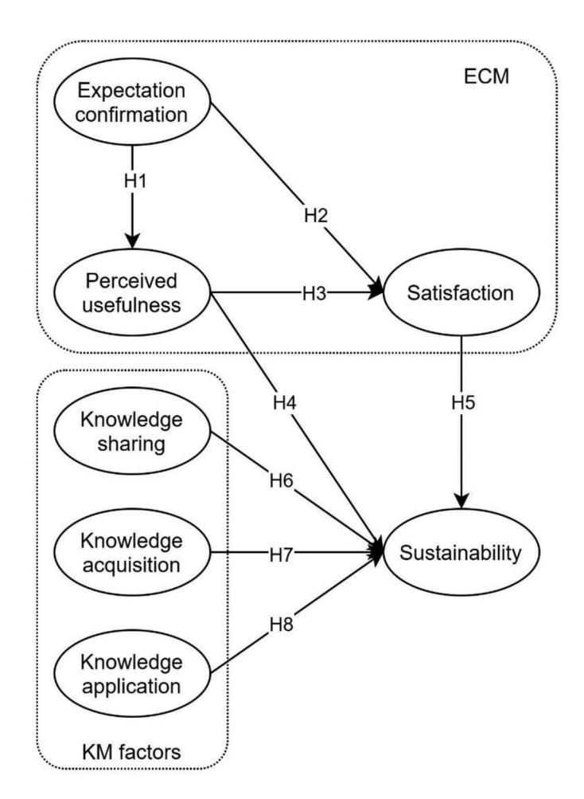
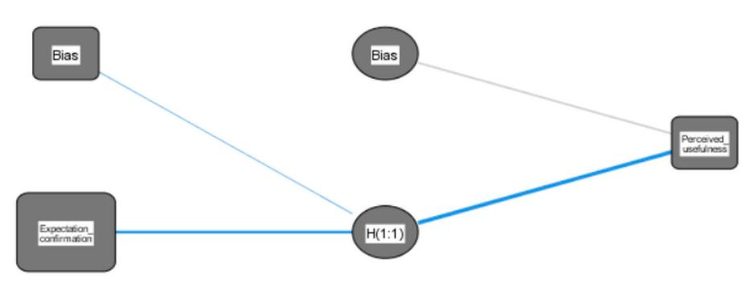
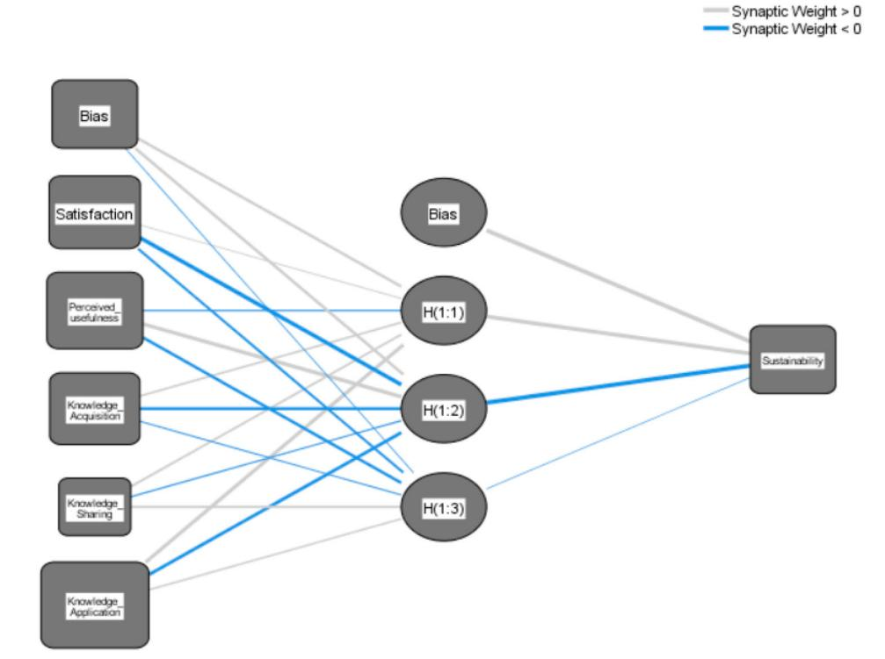
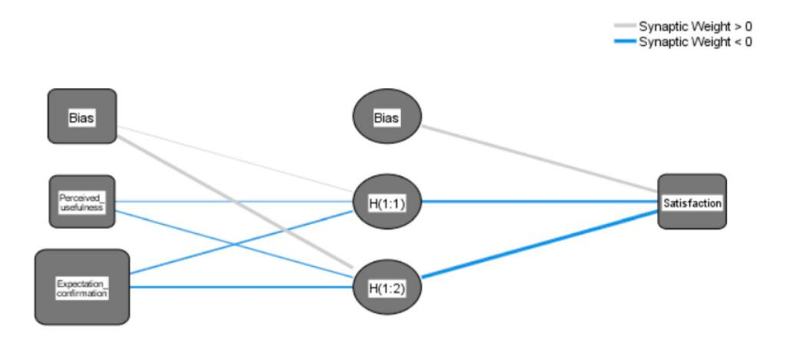

<!-- A3.R13 | source: papers_json/A3.R13/ -->

## **Interactive** **Learning** **Environments**

**ISSN: 1049-4820 (Print) 1744-5191 (Online) Journal homepage:****[ www.tandfonline.com/journals/nile20](https://www.tandfonline.com/journals/nile20?src=pdf)**

## **Understanding** **the** **impact** **of** **knowledge** **management factors on the sustainable use of AI****based chatbots for educational purposes using a** **hybrid** **SEM-ANN** **approach**

**Mohammed** **A.** **Al-Sharafi,** **Mostafa** **Al-Emran,** **Mohammad** **Iranmanesh,** **Noor** **Al-Qaysi,** **Noorminshah** **A.** **Iahad** **&** **Ibrahim** **Arpaci**

**To** **cite** **this** **article:** Mohammed A. Al-Sharafi, Mostafa Al-Emran, Mohammad Iranmanesh, Noor Al-Qaysi, Noorminshah A. Iahad & Ibrahim Arpaci (2023) Understanding the impact of knowledge management factors on the sustainable use of AI-based chatbots for educational purposes using a hybrid SEM-ANN approach, Interactive Learning Environments, 31:10, 7491-7510, DOI:[ 10.1080/10494820.2022.2075014](https://www.tandfonline.com/action/showCitFormats?doi=10.1080/10494820.2022.2075014)

**To** **link** **to** **this** **article:** [https://doi.org/10.1080/10494820.2022.2075014](https://doi.org/10.1080/10494820.2022.2075014)

*[Calendar icon]* Published online: 11 May 2022.*[Pencil icon]* Submit your article to this journal *[External link icon]**[Bar chart icon]* Article views:3989*[Magnifying glass on document icon]* View related articles *[External link icon]**[Crossmark logo]* View Crossmark data *[External link icon]**[Two documents icon]* Citing articles: 100View citing articles *[External link icon]*

<!-- page 2 -->

## Understanding the impact of knowledge management factors on the sustainable use of Al-based chatbots for educational purposes using a hybrid SEM-ANN approach

Mohammed A. Al-Sharafi 10 a, Mostafa Al-Emran 10 b,c, Mohammad Iranmaneshd, Noor Al-Oaysi De, Noorminshah A, Jahada,f and Ibrahim Arpacig

aDepartment of Information Systems, Azman Hashim International Business School, Universiti Teknologi Malaysia, Skudai, Malaysia; bFaculty of Engineering & IT, The British University in Dubai, Dubai, UAE; cDepartment of Computer Techniques Engineering, Dijlah University College, Baghdad, Iraq; dSchool of Business and Law, Edith Cowan University, Joondalup, WA, Australia: eFaculty of Art, Computing & Creative Industry, Universiti Pendidikan Sultan Idris, Tanjung Malim, Malaysia; fInformation Systems, Faculty of Science and Technology, Universitas Airlangga, Surabaya, Indonesia; 9Department of Software Engineering, Faculty of Engineering and Natural Sciences, Bandirma Onvedi Evlul University, Balıkesir, Turkey

Artificial intelligence (AI)-based chatbots have received considerable attention during the last few years. However, little is known concerning what affects their use for educational purposes. This research, therefore, develops a theoretical model based on extracting constructs from the expectation confirmation model (ECM) (expectation confirmation, perceived usefulness, and satisfaction), combined with the knowledge management (KM) factors (knowledge sharing, knowledge acquisition, and knowledge application) to understand the sustainable use of chatbots. The developed model was then tested based on data collected through an online survey from 448 university students who used chatbots for learning purposes. Contrary to the prior literature that mainly relied on structural equation modeling (SEM) techniques, the empirical data were analyzed using a hybrid SEM-artificial neural network (SEM-ANN) approach. The hypotheses testing results reinforced all the suggested hypotheses in the developed model. The sensitivity analysis results revealed that knowledge application has the most considerable effect on the sustainable use of chatbots with 96.9% normalized importance, followed by perceived usefulness (70.7%), knowledge acquisition (69.3%), satisfaction (61%), and knowledge sharing (19.6%). Deriving from these results, the study highlighted a number of practical implications that benefit developers, designers, service providers, and instructors.

## ARTICLE HISTORY

Received 10 November 2021 Accepted 1 May 2022

## **KEYWORDS **

Artificial intelligence; chatbots; conversational agents; sustainability; education; artificial neural network

## 1. Introduction

With the flourishing of artificial intelligence (AI) applications, chatbots or conversational agents that are based on natural language processing (NLP) techniques have become very popular in many sectors (Huang & Chueh, 2021). Chatbots are computer programs that receive natural language text as input and give the best intelligent response (Abdul-Kader & Woods, 2015). These computer programs were designed to convincingly simulate human behavior. Rather than merely building a human-like innovative application, Al-based chatbots were regarded as powerful digital assistants

<!-- page 3 -->

that perform various tasks, discuss topics, and answer a large number of queries (Smutny & Schreiberova, [2020)](#page-19-0).

Inspired by Alan Turing's test (Turing, [1950](#page-19-1)), researchers have designed several conversational agents. For instance, Weizenbaum developed the first chatbot named Eliza in 1966 at MIT. Eliza receives hand-crafted scripts as textual inputs and searches for the most appropriate response with intelligent phrasing by means of pattern matching (Weizenbaum, [1966)](#page-20-0). While Eliza can chat with humans within a constrained domain, most of the users supposed that they were interacting with a person. Parry was another chatbot designed by Colby to behave like a paranoid person (Colby, [1975](#page-17-0)). Parry has a rule-based structure that is similar to Eliza but with a better understanding capability, controlling structure, and simulating emotions. Alice, "Artificial Linguistic Internet Computer Entity", allows its users to customize their chatbots by using an "Artificial Intelligence Markup Language" (Wallace, [2009)](#page-19-2). Although Alice can maintain a dialogue for a limited period of time, it was awarded as the most human-like system.

The use of AI-based chatbots brings a lot of opportunities to the educational sector (Hwang & Chang, [2021)](#page-18-1). For instance, these intelligent chatbots may provide students with access to information at anywhere and anytime settings. Chatbots enable students to have personalized assistance by remembering the previous conversations. Chatbots also provide students with immediate feedback in a human-like way. Given the unique capabilities of chatbots, students can employ them in knowledge management and performing their learning activities.

Scientific research on chatbots began to appear in indexed journals by 2003, with an increased number of publications in the last five years. As per the search conducted in August 2021, there are 813 publications, which include the keywords "chatbots" or "chatbot" within the publication titles indexed in the Web of Science database (2003–2021). The bibliometric network analysis results with the VOSviewer software showed that the most used keywords in the publications were "chatbot" (f = 324), "chatbots" (f = 153), "artificial intelligence" (f = 77), "natural language processing" (f = 51), and "conversational agent" (f = 36). [Figure 1](#page-3-0) shows the existing research focus of AI-based chatbot studies. By thoroughly examining those studies, several research gaps were observed. First, the bibliometric network analysis indicated an increased number of studies focusing on chatbots in recent years. However, a limited number of studies focused on the educational use of chatbots. Second, understanding what affects the adoption and use of AI-based chatbots is still in its early stage, specifically in the educational sector (Hwang & Chang, [2021](#page-18-1)). Third, the majority of the previous studies concentrated on the consumers' use of chatbots in utilitarian services (Rese et al., [2020;](#page-19-3) Selamat & Windasari, [2021)](#page-19-4), and disregarded their employment in instructional activities. Fourth, prior research has focused on the individualistic socio-technical contexts (Hwang & Chang, [2021)](#page-18-1), and shed insufficient exposure to collectivistic contexts.

To handle the existing research gaps, an integrated model is developed based on extracting constructs from the expectation confirmation model (ECM) (expectation confirmation, perceived usefulness, and satisfaction) (Bhattacherjee, [2001](#page-17-1)), combined with the knowledge management (KM) factors (knowledge sharing, knowledge acquisition, and knowledge application). The developed model aims to understand what affects the sustainable use of AI-based chatbots for learning purposes in a new collectivistic context.

## 2. Research model and hypotheses development

To examine the students' sustainable use of AI-based chatbots for instructional purposes, an integrated model is developed based on extracting constructs from the ECM (expectation confirmation, perceived usefulness, and satisfaction), combined with the KM factors (knowledge sharing, knowledge acquisition, and knowledge application). The combination of those factors stems from two main reasons. First, the ECM's core constructs, including expectation confirmation, perceived usefulness, and satisfaction, have been widely used in the past to measure the sustainable use of IT innovations (Bhattacherjee, [2001)](#page-17-1). Since AI-based chatbots are relatively new, it is believed that using

<!-- page 4 -->

*Figure 1. Research focus of AI-based chatbot studies.*

those factors would provide an insightful understanding of the sustainable use of chatbots by students. Second, KM factors were included in the theoretical model because the use of chatbots is sustained if students perceive that these conversational agents enable them to acquire, share, and apply their knowledge effectively. While KM factors were initially dedicated to measure technology adoption at the organizational level (García-Sánchez et al., [2017;](#page-18-2) Lin & Lee, [2005)](#page-18-3), the recent literature supported their role at the individual level (Al-Emran et al., [2021](#page-17-2); Arpaci et al., [2020)](#page-17-3). [Figure 2](#page-4-0) shows the developed theoretical model.

## 2.1. Expectation confirmation

Expectation confirmation refers to "users' perceptions of the congruence between the expectation of information system usage and its actual performance" (Bhattacherjee, [2001](#page-17-1)). If the pre-usage expectations of the users are met after the actual experience, it indicates that their pre-experience expectations are confirmed (Eren, [2021)](#page-17-4). When actual experience surpasses the pre-usage expectation of individuals, they will have a positive perception about the usefulness of the system (Li & Fang, [2019)](#page-18-4). The previous studies have validated the positive influence of expectation confirmation on perceived usefulness in various contexts, such as internet banking (Rahi et al., [2020)](#page-19-5), social networking systems (Ambalov, [2021)](#page-17-5), and online learning (Wang et al., [2021](#page-20-1)). In the context of intelligent chatbots, prior research validated the positive influence of expectation confirmation on perceived usefulness (Nguyen et al., [2021)](#page-19-6). Accordingly, we proposed that if the performance of chatbots satisfies students' expectations, they are more likely to find these agents as a useful tool for learning purposes. Hence, we suggest the following:

H1. Expectation confirmation positively influences the perceived usefulness of chatbots for learning purposes.

<!-- page 5 -->

*Figure 2. Research model.*

Previous studies found a positive association between expectation confirmation and satisfaction (Dai et al., [2020;](#page-17-6) Khayer & Bao, [2019](#page-18-5)). It is claimed that expectation confirmation is one of the key determinants of satisfaction (Pereira & Tam, [2021)](#page-19-7). When a system meets the pre-usage expectations of the users, they feel satisfied with that system (Gupta et al., [2020)](#page-18-6). It is asserted that satisfaction with chatbots is derived from expectation confirmation (Eren, [2021](#page-17-4); Li et al., [2021)](#page-18-7). Accordingly, it can be expected that students become satisfied with a chatbot if it meets their expectations and contributes to their learning experience. Hence, this study proposes the following:

H2. Expectation confirmation positively influences the satisfaction of using chatbots for learning purposes.

## 2.2. Perceived usefulness

Perceived usefulness refers to "the degree to which a person believes that using a particular system would enhance his/her job performance" (Davis, [1989](#page-17-7)). The association between perceived usefulness and satisfaction has been confirmed in the previous post-adoption studies (Rahi et al., [2020](#page-19-5); Yan et al., [2021](#page-20-2)). It is argued that perceived usefulness is a critical driver of satisfaction in the post-adoption stage (Jumaan et al., [2020](#page-18-8)). In the context of intelligent chatbots, the positive influence of perceived usefulness on satisfaction was validated (Ashfaq et al., [2020)](#page-17-8). The students

<!-- page 6 -->

may use chatbots for various purposes, such as improving learning efficiencies (Wu et al., [2020)](#page-20-3), enhancing peer communication skills (Hwang & Chang, [2021](#page-18-1)), and finding responses to their questions (Pérez et al., [2020](#page-19-8)). Thus, students are more likely satisfied with chatbots if these agents can meet their needs. Thus, the study suggests the following:

H3. Perceived usefulness positively influences satisfaction with chatbots for learning purposes.

The studies on technology post-adoption behaviors consistently have regarded perceived usefulness as an influential antecedent of continuous usage intention (Liébana-Cabanillas et al., [2021](#page-18-9); Pereira & Tam, [2021)](#page-19-7). According to the ECM and technology continuance theory (TCT), perceived usefulness is a significant determinant of continuous usage intention (Rahi et al., [2020](#page-19-5)). Students' post-experience belief about the chatbot's ability to facilitate the learning process and enhance learning outcomes forms perceived usefulness at the post-adoption stage (Winkler & Söllner, [2018)](#page-20-4). Accordingly, the belief that technology enhances performance motivates the users to continue using that technology (Jumaan et al., [2020](#page-18-8)). It is expectable that if students perceive chatbots are useful, they will continue using them in the future. Therefore, the study proposes the following:

H4. Perceived usefulness positively influences the sustainable use of chatbots for learning purposes.

## 2.3. Satisfaction

Satisfaction refers to "the affective response that an individual derives from their prior IT usage experience" (Jumaan et al., [2020)](#page-18-8). Satisfaction is the consequence of comparing expectations about product performance and its actual performance (Yan et al., [2021)](#page-20-2). The influence of satisfaction on continuous usage intention has been confirmed in various contexts, including learning management systems (Ashrafi et al., [2020)](#page-17-9), fitness and health apps (Chiu et al., [2020)](#page-17-10), mobile banking (Foroughi et al., [2019](#page-18-10)), and mobile government services (Mandari & Koloseni, [2021)](#page-19-9). Satisfaction is the main driver of continuous usage intention (Zhang et al., [2021](#page-20-5)). Earlier research found that satisfaction with the use of chatbots has a positive effect on continuous usage intention (Ashfaq et al., [2020;](#page-17-8) Li et al., [2021](#page-18-7)). In line with the previous studies, we proposed that students' satisfaction with chatbots triggers their intention to continue using these agents in instructional activities. Hence, we propose the following:

H5. Satisfaction positively influences the sustainable use of chatbots for learning purposes.

## 2.4. Knowledge sharing

Knowledge sharing refers to "the process of disseminating various resources among the individuals taking part in specific activities" (Al-Emran & Teo, [2020)](#page-17-11). Knowledge sharing is a critical practice in the learning process and leads to knowledge creation through knowledge transfer among learners (Feiz et al., [2019)](#page-18-11). The peers actively interact and exchange their explicit and tacit knowledge with each other (Lin & Huang, [2020)](#page-18-12). Knowledge sharing is an integral part of knowledge management and significantly influences academic quality (Wu et al., [2021](#page-20-6)). The previous studies found a positive relationship between the knowledge sharing attribute of an information system and its adoption rate (Arpaci et al., [2020;](#page-17-3) El Said, [2015](#page-17-12)). The ability of a system to facilitate knowledge sharing triggers the intention to adopt the system (Al-Emran, Mezhuyev & Kamaludin, [2018](#page-16-1); Al-Emran & Mezhuyev, [2019;](#page-16-2) Al-Emran & Teo, [2020](#page-17-11)). Accordingly, this study proposed that if students believe that chatbots facilitate the process of knowledge sharing with classmates and instructors, they will have a higher intention to sustain the use of these agents. Therefore, we suggest the following:

H6. Knowledge sharing positively influences the sustainable use of chatbots for learning purposes.

<!-- page 7 -->

## 2.5. Knowledge acquisition

Knowledge acquisition refers to "the processes that use existing knowledge and capture new knowledge" (Lee et al., [2007](#page-18-13)). Knowledge acquisition is a critical component of knowledge management and the learning process (Al-Emran, Mezhuyev, Kamaludin, & AlSinani, [2018;](#page-17-13) Cukurova et al., [2018)](#page-17-14). The association between information systems' ability to facilitate knowledge acquisition and the adoption of the system has been validated in the literature (Arpaci et al., [2020;](#page-17-3) García-Sánchez et al., [2017](#page-18-2)). In the context of e-learning, knowledge acquisition is found as a significant antecedent of e-learning adoption (Al-Emran & Teo, [2020](#page-17-11)). Chatbots enhance the efficiency and effectiveness of micro-learning processes and can boost information acquisition and retention by 20% (Vázquez-Cano et al., [2021](#page-19-10)). Intelligent chatbots are able to personalize the process of learning based on the academic achievements of learners (Farkash, [2018)](#page-17-15). Chatbots also facilitate the process of finding and acquiring knowledge from the course material, previous discussions in forums, and other resources of information. For instance, chatbots can be used in libraries to facilitate the interaction between students and library and ease the knowledge acquisition process (Sheth et al., [2019)](#page-19-11). It is expectable that the positive influence of chatbots on the process of acquiring new knowledge motivates the students to continue using chatbots. Hence, we suggest the following:

H7. Knowledge acquisition positively influences the sustainable use of chatbots for learning purposes.

## 2.6. Knowledge application

Knowledge application refers to "the process that enables the individuals to access the knowledge smoothly via the existing efficient storage and retrieval techniques" (Arpaci et al., [2020)](#page-17-3). The knowledge application attribute of technology significantly influences the adoption and usage rate (Al-Emran & Mezhuyev, [2019](#page-16-2)). Knowledge application is an important factor that students consider when deciding to use and continue using e-learning systems (Al-Emran & Teo, [2020](#page-17-11)). Knowledge application is found as a significant determinant of students' performance and intention to use m-learning systems (Al-Emran & Mezhuyev, [2019)](#page-16-2). Accordingly, if the students find chatbots as a helpful agent that supports knowledge application in the learning activities and assignments, they are more likely to continue using these conversational agents. Hence, we propose the following:

H8. Knowledge application positively influences the sustainable use of chatbots for learning purposes.

## 3. Research methodology

A cross-sectional timeframe was used by employing an online survey to collect data from students studying at four Malaysian public universities for validating the proposed model and testing the hypothesized relationships. An online questionnaire using Google Forms was considered the best method to collect the data since face-to-face interactions with the students were restricted due to the lockdown imposed to contain the COVID-19 pandemic. All the participants were current users of chatbots. Students access these conversational agents through the university's student support services. AI-based chatbots can turn a lecture into a series of messages to present it as a normal chat conversation. Faculty members from Malaysian public universities were invited to distribute the survey link to their students during the second semester of the academic year 2020–2021. Students were assured that their participation in the study is not mandatory and that all responses will be kept confidential and anonymous. The questions were constructed in a required-answer format to avoid missing data issues.

The non-probability sampling method was used as there is no sampling frame available for this group of individuals, and there is no equal opportunity of selecting the elements or units in the population (Sekaran & Bougie, [2010](#page-19-12); Tongco, [2007)](#page-19-13). Therefore, convenience sampling was used in this study, in which participants were chosen based on their availability and accessibility at a specific time (Creswell & Creswell, [2017](#page-17-16); Sekaran & Bougie, [2010](#page-19-12)). In the end, 448 valid questionnaires

<!-- page 8 -->

were received. To avoid non-response bias in the collected data, the first 100 respondents were compared to the last 100 respondents by performing t-tests as suggested by (Armstrong & Overton, [1977)](#page-17-17). The results of the t-tests showed no significant differences between the early and late respondents. Accordingly, this study was not influenced by non-response bias. Harman's test was also conducted because common method variance can be a problem in self-reported studies. The results did not reveal any issues as the most variance explained by the single factor was 40.44%, which is lower than the 50% cut-off value as recommended by (Podsakoff et al., [2003)](#page-19-14).

The English language was used as the mode of communication in the designed questionnaire survey. The questionnaire is comprised of two sections. The first section captured the demographic information (i.e. gender, age, educational level, and the level of experience in using chatbots), while the second section contained 28 items, which were measured using a five-point Likert scale ranging from (1 = "strongly disagree" to 5 = "strongly agree"). The scales used to measure knowledge acquisition (KA1–KA5), knowledge sharing (KS1–KS5), and knowledge application (KAP1–KAP4) were adapted from past studies (Al-Emran et al., [2021;](#page-17-2) Arpaci et al., [2020)](#page-17-3). The scale used for measuring perceived usefulness (PU1–PU3) was adapted from (Venkatesh & Bala, [2008](#page-19-15)). The scales of expectation confirmation (EC1–EC4), satisfaction (STS1–STS4), and sustainability (SUST1–SUST3) constructs were adapted from (Bhattacherjee, [2001;](#page-17-1) Gangwar & Date, [2016](#page-18-14)). The constructs and their corresponding items are listed in the Appendix.

For the respondents' profile, 54.5% were men, and 45.5% were females. The age structure of the respondents was as follows: 18–24 years old (59.2%), 25–34 years old (26.8%), 35–44 years old (8.9%), and 5.1% for those above 45 years old. Regarding the education level of the respondents, 19% have a university diploma, 56.7% have a bachelor's degree, and 24.3% have postgraduate degrees (i.e. Master's and Ph.D.). Considering the level of experience in using chatbots for learning activities, most respondents (41.3%) have 1–2 years of experience, followed by those (38.6%) who have less than 1 year of experience. In comparison, 20.1% reported that they have more than two years of experience.

The proposed model in this study is tested using a two-stage analytical method that combines the partial least squares-structural equation modeling (PLS-SEM) with an artificial neural network (ANN). It is argued that the combined SEM-ANN technique contributes significantly to the field of information systems, and could be the next methodological research paradigm (Lee et al., [2020](#page-18-15)). Being an exploratory rather than confirmatory study, this research considered PLS-SEM as a better choice than the covariance-based SEM approach (CB-SEM). The complexity of the developed model and the large number of involved indicators necessitated the use of the PLS-SEM approach in the first stage (Hair, Matthews et al., [2017;](#page-18-16) Hair et al., [2016](#page-18-17); Ramayah et al., [2018)](#page-19-16). It is imperative to report that the data were non-normally distributed. Still, they were not too far from the threshold values of normality, as extremely non-normal data expose problems in evaluating the parameters' significance. Yet, this does not affect the final results as PLS-SEM does not require the data to be normally distributed (Hair, Hollingsworth et al., [2017;](#page-18-18) Hair et al., [2016](#page-18-17)). Although PLS-SEM is robust against non-normal distribution, it cannot examine the non-linear relationships between constructs. Hence, this issue is addressed by combining the ANN approach with PLS-SEM for the ranking of the normalized importance of the significant variables (Al-Shihi et al., [2018;](#page-17-18) Kalinić et al., [2021](#page-18-19); Qasem et al., [2020)](#page-19-17). The combined SEM-ANN approach allows the identification of both linear and non-linear relationships among the variables to better explain the sustainable use of chatbots for learning activities.

## 4. Results

To validate the research model and test the proposed research hypotheses, a two-stage analytical method (SEM-ANN) is used in this study. The PLS-SEM approach was employed by assessing the reliability and validity of indicators and constructs. This is aimed at the assessment of the measurement model before validating the structural model for assessing the relationships (hypotheses) between the constructs. The ANN was then employed to explore the important factors affecting the sustained use of chatbots. By applying the ANN approach, this research identified the

<!-- page 9 -->

complex linear and non-linear relationships between the factors of the proposed model. It is imperative to report that ANN can perform more accurate predictions than most of the existing regression methods (Lee et al., [2020;](#page-18-15) Qasem et al., [2020)](#page-19-17).

## 4.1. Measurement model assessment

The measurement model was formed for the assessment of the validity and reliability of the constructs and indicators through measuring the internal consistency reliability, convergent validity, and discriminant validity (Hair, Matthews et al., [2017](#page-18-16); Hair et al., [2016;](#page-18-17) Ratnam et al., [2014](#page-19-18)). Cronbach's alpha (CA) and composite reliability (CR) were used to measure the internal consistency reliability of the constructs. The CA values, as seen in [Table 1](#page-8-0), are ranged from 0.804 to 0.909, while the CR values are ranged from 0.872 to 0.932. Both CA and CR values exceeded the benchmark limit of 0.70 (Hair et al., [2016](#page-18-17)), indicating strong reliability between the measures. The convergent validity was checked through the outer loadings of the indicators and the average variance extracted (AVE). [Table 1](#page-8-0) demonstrates that the convergent validity is accomplished in this study as the factor loadings were >0.708 and the AVE values were > 0.50 (Hair et al., [2016)](#page-18-17).

The discriminant validity explains the extent to which constructs are distinct from each other. In this study, the discriminant validity was assessed using the Heterotrait-Monotrait (HTMT) ratio (Henseler et al., [2015](#page-18-20)). As shown in [Table 2,](#page-9-0) the HTMT criterion was met as all the values are below the 0.85 ceiling value.

## 4.2. Structural model assessment

The collinearity between the variables was first evaluated before the assessment of the structural model to ensure no lateral collinearity issues in the structural model (Hair et al., [2016](#page-18-17); Ramayah

|  |  | **Table 1. Reliability and convergent validity results.** |  |  |
| --- | --- | --- | --- | --- |
|  |  |  |  |  |

| Constructs | Indicators | Loadings | Cronbach's Alpha | CR | AVE |
| --- | --- | --- | --- | --- | --- |
| Expectation confirmation | EC1 | 0.752 | 0.854 | 0.902 | 0.698 |
| EC2 | 0.846 |  |  |  |  |
| EC3 | 0.887 |  |  |  |  |
| EC4 | 0.850 |  |  |  |  |
| Knowledge acquisition | KA1 | 0.835 | 0.909 | 0.932 | 0.734 |
| KA2 | 0.807 |  |  |  |  |
| KA3 | 0.910 |  |  |  |  |
| KA4 | 0.859 |  |  |  |  |
| KA5 | 0.870 |  |  |  |  |
| Knowledge application | KAP1 | 0.818 | 0.804 | 0.872 | 0.630 |
| KAP2 | 0.777 |  |  |  |  |
| KAP3 | 0.798 |  |  |  |  |
| KAP4 | 0.781 |  |  |  |  |
| Knowledge sharing | KS1 | 0.706 | 0.854 | 0.896 | 0.634 |
| KS2 | 0.856 |  |  |  |  |
| KS3 | 0.837 |  |  |  |  |
| KS4 | 0.737 |  |  |  |  |
| KS5 | 0.833 |  |  |  |  |
| Perceived usefulness | PU1 | 0.901 | 0.883 | 0.928 | 0.810 |
| PU2 | 0.912 |  |  |  |  |
| PU3 | 0.887 |  |  |  |  |
| Satisfaction | STS1 | 0.727 | 0.838 | 0.891 | 0.673 |
| STS2 | 0.863 |  |  |  |  |
| STS3 | 0.874 |  |  |  |  |
| STS4 | 0.811 |  |  |  |  |
| Sustainability | SUST1 | 0.863 | 0.836 | 0.902 | 0.754 |
| SUST2 | 0.915 |  |  |  |  |
| SUST3 | 0.825 |  |  |  |  |

<!-- page 10 -->

et al., [2018)](#page-19-16). Prior research noted that despite meeting the discriminant validity during the outer model assessment, lateral collinearity issues might often be misleading (Kock, [2015,](#page-18-21) [2018](#page-18-22)). Therefore, this requires further investigation. As seen in [Table 3](#page-9-1), the issue of collinearity between the predictor constructs was not a concern in the structural model (VIF < 3.33). Next, this study utilized a bootstrapping technique of 5000 re-samples to assess the structural model by computing the beta (β), t-values, coefficient of determination (R^2^ ), effect sizes (f 2 ), and predictive relevance (Q^2^ ) (Cohen, [1988;](#page-17-19) Hair et al., [2016](#page-18-17)).

The results in [Table 3](#page-9-1) indicated that all the proposed hypotheses were supported. In that, perceived usefulness was predicted by expectation confirmation (H1: β = 0.564, t = 20.186), while satisfaction was predicted by expectation confirmation (H2: β = 0.556, t = 9.093) and perceived usefulness (H3: β = 0.287, t = 5.330). Sustainability was predicted by perceived usefulness (H4: β = −0.320, t = 7.114), satisfaction (H5: β = 0.388, t = 5.447), knowledge sharing (H6: β = 0.155, t = 3.287), knowledge acquisition (H7: β = 0.290, t = 6.056), and knowledge application (H8: β = 0.489, t = 10.796). The PLS-SEM results in [Table 3](#page-9-1) indicate that the theorized model is statistically meaningful because the coefficients of determination (R^2^ ) for the three endogenous constructs accounted for a large total variance (R^2^ = 0.318 for perceived usefulness, R^2^ = 0.571 for satisfaction, and R^2^ = 0.632 for sustainability) (Cohen, [1988](#page-17-19); Hair et al., [2016)](#page-18-17).

The effect sizes (f 2 ) were also calculated as seen in [Table 3](#page-9-1) by following the guidelines of (Cohen, [1988)](#page-17-19). Based on the f ^2^ results in [Table 3](#page-9-1), the perceived usefulness has a small effect size on satisfaction with a value of 0.131. However, expectation confirmation has a large effect size on perceived usefulness and satisfaction constructs with the values of 0.465 and 0.492, respectively. Further, the findings reveal a medium effect size of satisfaction on sustainability (f ^2^ = 0.191). A small effect size with f ^2^ values of 0.144, 0.045, and 0.096 was also observed for perceived usefulness, knowledge sharing, and knowledge acquisition, respectively, on sustainability. Further, knowledge application has a large effect size on sustainability, with an f ^2^ value of 0.351.

<!-- page 11 -->

The predictive relevance (Q^2^ ) was also achieved in the structural model with the cross-validated redundancy results of the three endogenous variables (based on the blindfolding procedure with an omission distance of 7). As per the readings in [Table 3,](#page-9-1) the Q^2^ values were all greater than 0 (sustainability Q2= 0.471, perceived usefulness Q^2^ = 0.255, and satisfaction Q^2^ = 0.376).

## 4.3. ANN results

PLS-SEM was used in the first stage of this study to test the hypothesized relationships and understand the factors that affect students' sustainable use of AI-based chatbots for learning purposes. In the second stage, the ANN analysis approach is employed to rank the factors affecting the sustainable use of chatbots. As reported previously (Alkawsi et al., [2021;](#page-17-20) Kalinić et al., [2021;](#page-18-19) Lee et al., [2020](#page-18-15); Ooi et al., [2018;](#page-19-19) Qasem et al., [2020](#page-19-17); Sharma et al., [2021)](#page-19-20), this study chooses the ANN because it outperforms the traditional statistical tools, such as multiple linear regression, binary logistics regression, and SEM in detecting both linear and non-linear relationships, rather than merely measuring the linear relationships.

A typical neural network is comprised of an input layer, one or more hidden layers, and an output layer. For the output and hidden neurons, the sigmoid function was used as the activation function. The range of the input and output neurons was maintained within [0, 1] for better model performance (Kalinić et al., [2021;](#page-18-19) Liu et al., [2012;](#page-19-21) Sharma et al., [2021](#page-19-20)). The issue of overfitting was avoided by adopting a ten-fold cross-validation technique in the ANN models, in which the training phase involved 90% of the data while the remaining 10% was used for the testing phase (Alshamaila et al., [2013;](#page-17-21) Kalinić et al., [2021](#page-18-19)). The developed research model in this study has three endogenous constructs, namely sustainability, satisfaction, and perceived usefulness. Thus, the research model was decomposed into three ANN models, as seen in Figures 3–5. As depicted in [Figure 3](#page-11-0), the first ANN model has five input layers; those representing the exogenous constructs, namely perceived usefulness, satisfaction, knowledge sharing, knowledge acquisition, and knowledge application, and one output layer (sustainability). The second ANN model, as demonstrated in [Figure 4,](#page-11-1) has two input layers, including expectation confirmation and perceived usefulness, and one output layer (satisfaction). As shown in [Figure 5](#page-12-0), the third ANN model has one input layer (expectation confirmation) and one output layer (perceived usefulness).

The accuracy of the three developed ANN models was validated by determining the root mean square of error (RMSE), which is a common accuracy measure used in earlier research (Abbasi et al., [2021;](#page-16-3) Al-Shihi et al., [2018;](#page-17-18) Alkawsi et al., [2021](#page-17-20); Gangwar et al., [2015](#page-18-23); Lee et al., [2020;](#page-18-15) Nguyen et al., [2014;](#page-19-22) Qasem et al., [2020;](#page-19-17) Sharma et al., [2021](#page-19-20)). The RMSE represents the error in the training and testing phases. Based on the readings in [Table 4](#page-12-1), the average RMSE of the ANN models was relatively small for the three neural network models: 0.073, 0.070, and 0.121 for the training data and 0.074, 0.062, and 0.121 for the testing data. This indicates a high prediction accuracy of the models in predicting the number of endogenous constructs, including satisfaction, sustainability, and perceived usefulness. Thus, it is believed that the ANN models developed in this study have achieved accurate and reliable results.

## 4.4. Sensitivity analysis

The model sensitivity analysis determines the variations in the endogenous constructs based on the changes in the exogenous constructs associated with the model (Al-Shihi et al., [2018](#page-17-18); Chong, [2013](#page-17-22); Kalinić et al., [2021](#page-18-19)). In this study, the contribution of each predictor to the sustained use of chatbots was evaluated via sensitivity analysis. In that, the relative importance of the factors and their normalized importance (NI) were calculated. The sensitivity analysis results in [Table 5](#page-12-2) indicate that knowledge application (NI = 96.9%) is the most influencing exogenous construct on predicting the sustained use of chatbots, followed by perceived usefulness (NI = 70.7%), knowledge acquisition (NI = 69.3%), satisfaction (NI = 61%), and knowledge sharing (NI = 19.6%).

<!-- page 12 -->

Labels
Values

Hidden layer activation function
Sigmoid

Output layer activation function
Sigmoid

*Figure 3. ANN model 1.*

Labels
Values

Hidden layer activation function
Sigmoid

Output layer activation function
Sigmoid

*Figure 4. ANN model 2.*

<!-- page 13 -->

| Labels | Values ||:---|:---|| Hidden layer activation function | Sigmoid || Output layer activation function | Sigmoid |

*Figure 5. ANN model 3.*

<!-- page 14 -->

## 5. Discussion

It is claimed that chatbots are valuable tools for sustaining the educational process, as they provide ongoing solutions for social, economic, and environmental issues, which represent the three pillars of sustainability (Ahamer, [2016](#page-16-4)). This research is conducted with the aim of studying the determinants affecting the sustainable use of AI-based chatbots for learning purposes. To achieve this aim, an integrated model is developed based on extracting factors from the ECM (expectation confirmation, perceived usefulness, and satisfaction), combined with the KM factors (knowledge sharing, knowledge acquisition, and knowledge application). The model was then validated based on data collected from university students using a hybrid SEM-ANN approach.

The results showed that expectation confirmation positively influences the perceived usefulness of chatbots for learning purposes, which supports the results found in prior research (Nguyen et al., [2021)](#page-19-6). This could be explained by the fact that the performance of a chatbot for learning activities determines the student's satisfaction towards using it for such activities. Students tend to find the intelligent chatbot useful for learning activities when its performance meets their expectations. The results also supported the positive impact of expectation confirmation on the satisfaction of using chatbots. This result is aligned with the previous literature reporting that satisfaction is derived from expectation confirmation (Eren, [2021](#page-17-4); Li et al., [2021](#page-18-7)). As such, chatbots are supposed to meet students' expectations to help them become satisfied, contributing to their learning experience. In other words, once the students find chatbots perform well as expected, they will feel more satisfied in using these conversational agents in performing various learning activities.

Perceived usefulness was found to positively influence students' satisfaction with using chatbots, which strongly agrees with the recent literature validating the positive influence of perceived usefulness on satisfaction (Ashfaq et al., [2020](#page-17-8)). This means if chatbots are designed to help students in enhancing their performance and productivity, students would feel more satisfied in using these agents in their learning processes. It was also found that perceived usefulness positively influences the sustainable use of chatbots for learning purposes. This confirms the results of a previous study, which supported the belief that when the technology improves users' performance, they will be encouraged to continue using that technology (Jumaan et al., [2020)](#page-18-8). The results indicated that users' satisfaction with chatbots positively influences the sustainable use of these agents for learning purposes. This result agrees with the results found in prior studies that supported the correlation between users' satisfaction and their continuous usage intention (Ashfaq et al., [2020](#page-17-8); Li et al., [2021)](#page-18-7). This implies that the more satisfied users are with using chatbots, the more likely to sustain the use of these conversational agents for educational purposes.

It was found that knowledge sharing positively influences the sustainable use of chatbots for learning purposes, which is aligned with the results found in previous studies (Al-Emran & Mezhuyev, [2019;](#page-16-2) Al-Emran & Teo, [2020](#page-17-11)). One possible explanation could be the need for sharing information and resolving doubts to make chatbots very useful in educational environments (Villegas-Ch et al., [2020](#page-19-23)). In that, these conversational agents can be used for lifelong learning, as students are engaged with their learning activities without spending extra money or extra time on updating one's knowledge to a specific concept (Dascalu et al., [2019)](#page-17-23). If students believe that those intelligent chatbots facilitate the process of knowledge sharing with classmates and instructors, they will have a higher intention to continue using them in the future.

Additionally, the results found that knowledge acquisition positively influences the sustainable use of chatbots for learning purposes. This supports the belief that chatbots can help students in acquiring new knowledge, which motivates them to continue using these agents in performing learning activities (Sheth et al., [2019](#page-19-11)). If these chatbots are developed based on machine learning algorithms that understand students' needs in acquiring the relevant information to their studies, they will have a higher intention to sustain using these agents in the future. The results also supported the role of knowledge application in positively influencing the sustainable use of chatbots

<!-- page 15 -->

7504

for learning purposes, which comes in line with the conclusions drawn in recent studies (Al-Emran & Mezhuyev, [2019;](#page-16-2) Al-Emran & Teo, [2020](#page-17-11)). Deriving from the empirical data, the ANN results showed that knowledge application was the most influential factor in predicting the sustainable use of chatbots. When chatbots enable students to access and apply the acquired knowledge in performing learning activities and assignments, they are more likely to continue using these intelligent agents in the future.

## 6. Conclusion

## 6.1. Theoretical contributions

The current study provides several theoretical contributions. First, this study is one of the early attempts to explore the determinants affecting the sustainable use of chatbots by university students through the lenses of the ECM's core constructs and KM factors. In other words, these constructs were incorporated into a new simplified theoretical model to examine what affects the sustainable use of intelligent chatbots for learning activities. Second, while extensive research has been conducted on chatbots in recent years, no single study exists which adequately evaluated the key factors influencing users' sustainable use of chatbots in general and educational purposes in particular. Thus, this research sheds new light on the role of perceived usefulness, satisfaction, expectation confirmation, and KM factors in strengthening the users' sustainable use of chatbots for learning activities.

Third, contrary to the existing literature that examined the determinants affecting the use of chatbots in individualistic societies (Ashfaq et al., [2020;](#page-17-8) Rese et al., [2020)](#page-19-3), this study is believed to add new insights into the sustainable use of chatbots in unexplored collectivistic contexts like Malaysia. Fourth, unlike the prior literature which supported the role of KM factors in affecting the sustainability of various technologies at the organizational level (Abbas & Sağsan, [2019;](#page-16-5) de Guimaraes et al., [2018)](#page-17-24), this research confirms the role of KM in affecting the sustainable use of new intelligent agents like chatbots at the individual level.

## 6.2. Practical implications

This research has several practical implications for developers, designers, service providers, and instructors. First, this study tackled the factors influencing the sustainable use of AI-based chatbots for learning purposes. Therefore, these factors should be tested before being implemented by developers and designers to ensure that students have an engaging experience for sustaining the use of chatbots. Careful attention needs to be paid by developers and designers to make chatbots more practical, reliable, and reasonable in assisting learning activities. This can be achieved by offering better interactive functions to satisfy learners' needs and meet their expectations of casual, natural, and humanized conversations with these agents. Rather than merely developing chatbots using the rule-based approach, developers need to build these conversational agents based on machine learning algorithms to personalize answers and offer the best user experience.

Second, as perceived usefulness is one of the significant factors affecting the sustainable use of chatbots for learning purposes, service providers must, when designing chatbots, focus on features that would provide users with reliable information to the fullest unique features, such as the ability to learn and browse at "anytime anywhere" settings, and provide personalized chat notifications regarding the latest information and updates. This can attract students with low experience to master the use of chatbots. Third, our findings revealed that students tend to be satisfied with a simple and relevant service that they regard as useful. Hence, instructors are required to create some diversity and include enjoyable tasks to enhance students' satisfaction. As students do not feel satisfied when they have feelings of boredom or frustration,

<!-- page 16 -->

chatbots should not merely offer simple answers. However, with more mental effort, a more complex system may be more effective for learners and consequently increase their productivity. Fourth, service providers are required to pay special attention to perceived usefulness, expectation confirmation, and KM variables and ensure that these factors are met for the demographic profile of the learners to increase the sustainable use of chatbots for learning purposes.

## 6.3. Limitations and future work

While our study provides meaningful implications, some limitations should also be acknowledged. First, understanding what impacts the sustainable use of chatbots was mainly based on data collected through questionnaire surveys. Conducting interviews with students in future attempts may give more insightful explanations of the correlations among the factors. Second, due to the nature of this research which targeted only the actual users of chatbots, we have used the convenience sampling technique in selecting the participants. However, this technique restricts the generalization of the results to other participants or contexts. Therefore, generalizing the results should be treated with caution. Third, it is practically impossible to incorporate all the variables into a specific research model. Due to the recency of the topic, the adoption of AI-based chatbots calls for more empirical studies to understand what impacts their use and sustainability for learning purposes in the long term.

## Acknowledgement

The principal author, Mohammed A. Al-Sharafi, is grateful for the continued support from the Research Management Centre (RMC) in Universiti Teknologi Malaysia in the form of the Post-Doctoral Fellowship Scheme under the "Professional Development Research University Grant, Vote Number: 05E50".

## Disclosure statement

No potential conflict of interest was reported by the author(s).

## Notes on contributors

Mohammed A. Al-Sharafi is currently working at the Department of Information Systems, Azman Hashim International Business School, Universiti Teknologi Malaysia. He obtained his Ph.D. degree in Information Systems from the Faculty of Computing, Universiti Malaysia Pahang, Malaysia. He has MSc degree in Management Information System from Yarmouk University, Jordan. He has over 45 publications published in different journals, conferences, and book chapters. Most of his publications were indexed under the ISI Web of Science and Scopus. Dr. Al-Sharafi received the firstclass "excellent publication award" in February 2020, in recognition of the outstanding number of publications from the Faculty of Computing, Universiti Malaysia Pahang. He has also received the best paper award from several national and international conferences. His research activities currently encompass the impact of emerging technologies in individuals, organizations, and society (e.g. AI, Chatbot, cloud computing, Blockchain, OSNs, Big data, and IoT), and Quantitative Methods in Information Systems research.

Mostafa Al-Emran is currently working in the Faculty of Engineering & IT at The British University in Dubai, UAE. He received his Ph.D. degree in Computer Science from Universiti Malaysia Pahang, the MSc degree in Informatics from The British University in Dubai (with distinction), and the BSc degree in Computer Science from Al Buraimi University College (with honors). He is among the top 2% scientists in the world, according to the reports published by Stanford University in October 2020 and October 2021. He has published over 100 research articles, and his main contributions have appeared in highly reputed journals, such as International Journal of Information Management, Computers & Education, Computers in Human Behavior, Telematics and Informatics, Technology in Society, Journal of Enterprise Information Management, Interactive Learning Environments, International Journal of Human–Computer Interaction, Multimedia Tools and Applications, and Journal of Educational Computing Research, among many others. Most of his publications were indexed under the ISI Web of Science and Scopus. He has edited a number of books published by Springer. He is also a certified recognized reviewer by several leading journals in Elsevier. His current research interests include Human–Computer Interaction, Knowledge Management, Educational Technology, and Artificial Intelligence.

<!-- page 17 -->

Mohammad Iranmanesh is a senior lecturer affiliated with the School of Business and Law, Edith Cowan University. His research interests are interface of Information Systems (IS) and Sustainability, focusing on impacts of digital transformation on sustainability and determinants of digitalization. He has published more than 100 articles in a range of leading academic journals.

Noor Al-Qaysi received the BA degree with honors in translation from Al Buraimi University College and the Master's degree in education (Teaching of English to Speakers of Other Languages) from The British University in Dubai. She is currently pursuing the PhD degree in information technology education at Universiti Pendidikan Sultan Idris. Her main research interests include educational technology, social media, and technology acceptance.

Noorminshah A. Iahad graduated from the University of Manchester for her PhD in Informatics in 2008. She graduated from the University of Manchester Institute of Science & Technology (UMIST) in 2002 following her BSc Information Technology graduation from Universiti Malaya. She has supervised Masters and PhD students in the areas such as Health Informatics, Gamification, E-learning, Mobile learning, and Computer Supported Project Based Learning. Nine PhD students and 4 Masters students have graduated under her supervision. Three of her PhD students have been awarded Best Postgraduate Student Award. She has led various research projects and won 1 silver medal awards at UTM level, 1 gold award at the National level, and 1 Silver Medal Ward at the International level. She is currently the IT Manager at the Department of Deputy Vice Chancellor (Research & Innovation). She was the Secretary of Malaysia Association for Information Systems from 2017 to 2018 and is also currently a member of IEEE.

Ibrahim Arpaci is currently an Associate Professor in the Department of Software Engineering at Bandirma Onyedi Eylul University. He holds a BSc in Computer Education and Instructional Technology (2005) from Anadolu University, a MSc in Information Systems (2009) and a PhD in Information Systems (2013) both from Middle East Technical University. He was a visiting scholar at Ryerson University, Ted Rogers School of Information Technology Management, Toronto, ON, Canada (2012–2013). His academic works focus on how computational technology interacts with psychological, educational, and cultural dynamics. His research interests are in Information Systems, Educational Technology, and Cyberpsychology. His publications have appeared in leading academic journals including British Journal of Educational Technology, Telematics & Informatics, Computers in Human Behavior, Medical Internet Research, Personality and Individual Differences, Internet Research, and Cyberpsychology, Behavior, and Social Networking. He received the Best Paper Award in the European and Mediterranean Conference on Information Systems (EMCIS, 2009). He received the Distinguished Researcher Award from London Journals Press (UK, 2019). He was recognized as one of the World's Top 2% Scientists by Stanford University in 2020, listed among the most influential scientists in the world, published in Public Library of Science Biology (PLOS Biology).

## ORCID

Mohammed A. Al-Sharafi [http://orcid.org/0000-0003-0726-6031](http://orcid.org/0000-0003-0726-6031) Mostafa Al-Emran [http://orcid.org/0000-0002-5269-5380](http://orcid.org/0000-0002-5269-5380) Noor Al-Qaysi [http://orcid.org/0000-0002-6668-421X](http://orcid.org/0000-0002-6668-421X)

## References

Abbas, J., & Sağsan, M. ([2019](#page-14-0)). Impact of knowledge management practices on green innovation and corporate sustainable development: A structural analysis. Journal of Cleaner Production, 229, 611–620. [https://doi.org/10.1016/J.](https://doi.org/10.1016/J.JCLEPRO.2019.05.024) [JCLEPRO.2019.05.024](https://doi.org/10.1016/J.JCLEPRO.2019.05.024)

Abbasi, G. A., Tiew, L. Y., Tang, J., Goh, Y.-N., & Thurasamy, R. [(2021)](#page-10-0). The adoption of cryptocurrency as a disruptive force: Deep learning-based dual stage structural equation modelling and artificial neural network analysis. PLoS ONE, 16(3), 1–26. [https://doi.org/10.1371/journal.pone.0247582](https://doi.org/10.1371/journal.pone.0247582)

Abdul-Kader, S. A., & Woods, J. C. ([2015](#page-1-0)). Survey on chatbot design techniques in speech conversation systems. International Journal of Advanced Computer Science and Applications, 6(7), 72–80. [https://doi.org/10.14569/IJACSA.](https://doi.org/10.14569/IJACSA.2015.060712) [2015.060712](https://doi.org/10.14569/IJACSA.2015.060712)

Ahamer, G. [(2016)](#page-13-0). GISS and GISP facilitate higher education and cooperative learning design. In Geospatial research: Concepts, methodologies, tools, and applications (pp. 810–833). IGI Global. [https://doi.org/10.4018/978-1-4666-](https://doi.org/10.4018/978-1-4666-9845-1.ch037) [9845-1.ch037](https://doi.org/10.4018/978-1-4666-9845-1.ch037)

Al-Emran, M., & Mezhuyev, V. [(2019)](#page-5-0). Examining the effect of knowledge management factors on mobile learning adoption through the use of importance-performance map analysis (IPMA). In International conference on advanced intelligent systems and informatics (pp. 449–458). Springer. [https://doi.org/10.1007/978-3-030-31129-2_41](https://doi.org/10.1007/978-3-030-31129-2_41)

Al-Emran, M., Mezhuyev, V., & Kamaludin, A. [(2018)](#page-5-0). Students' perceptions towards the integration of knowledge management processes in M-learning systems: A preliminary study. International Journal of Engineering Education, 34(2), 371–380.

<!-- page 18 -->

- Al-Emran, M., Mezhuyev, V., & Kamaludin, A. ([2021](#page-3-1)). Is M-learning acceptance influenced by knowledge acquisition and knowledge sharing in developing countries? Education and Information Technologies, 26(3), 2585–2606. [https://doi.](https://doi.org/10.1007/S10639-020-10378-Y) [org/10.1007/S10639-020-10378-Y](https://doi.org/10.1007/S10639-020-10378-Y)
- Al-Emran, M., Mezhuyev, V., Kamaludin, A., & AlSinani, M. ([2018](#page-6-0), February 8–10). Development of M-learning application based on knowledge management processes. 2018 7th International Conference on Software and Computer Applications (ICSCA 2018) (pp. 248–253). Kuantan, Malaysia. [https://doi.org/10.1145/3185089.3185120](https://doi.org/10.1145/3185089.3185120)
- Al-Emran, M., & Teo, T. [(2020](#page-5-1)). Do knowledge acquisition and knowledge sharing really affect e-learning adoption? An empirical study. Education and Information Technologies, 25(3), 1983–1998. [https://doi.org/10.1007/s10639-019-10062-w](https://doi.org/10.1007/s10639-019-10062-w)
- Al-Shihi, H., Sharma, S. K., & Sarrab, M. [(2018)](#page-7-0). Neural network approach to predict mobile learning acceptance. Education and Information Technologies, 23(5), 1805–1824. [https://doi.org/10.1007/s10639-018-9691-9](https://doi.org/10.1007/s10639-018-9691-9)
- Alkawsi, G. A., Ali, N., Mustafa, A. S., Baashar, Y., Alhussian, H., Alkahtani, A., Tiong, S. K., & Ekanayake, J. [(2021)](#page-10-1). A hybrid SEM-neural network method for identifying acceptance factors of the smart meters in Malaysia: Challenges perspective. Alexandria Engineering Journal, 60(1), 227–240. [https://doi.org/10.1016/j.aej.2020.07.002](https://doi.org/10.1016/j.aej.2020.07.002)
- Alshamaila, Y., Papagiannidis, S., & Li, F. ([2013)](#page-10-2). Cloud computing adoption by SMEs in the north east of England: A multi-perspective framework. Journal of Enterprise Information Management, 26(3), 250–275. [https://doi.org/10.](https://doi.org/10.1108/17410391311325225) [1108/17410391311325225](https://doi.org/10.1108/17410391311325225)
- Ambalov, I. A. [(2021)](#page-3-2). An investigation of technology trust and habit in IT use continuance: A study of a social network. Journal of Systems and Information Technology, 23(1), 53–81. [https://doi.org/10.1108/JSIT-05-2019-0096](https://doi.org/10.1108/JSIT-05-2019-0096)
- Armstrong, J. S., & Overton, T. S. ([1977](#page-7-1)). Estimating nonresponse bias in mail surveys. Journal of Marketing Research, 14 (3), 396–402. [https://doi.org/10.1177/002224377701400320](https://doi.org/10.1177/002224377701400320)
- Arpaci, I., Al-Emran, M., & Al-Sharafi, M. A. ([2020](#page-3-1)). The impact of knowledge management practices on the acceptance of Massive Open Online Courses (MOOCs) by engineering students: A cross-cultural comparison. Telematics and Informatics, 54, 1–12. [https://doi.org/10.1016/J.TELE.2020.101468](https://doi.org/10.1016/J.TELE.2020.101468)
- Ashfaq, M., Yun, J., Yu, S., & Loureiro, S. M. C. [(2020)](#page-4-1). I, Chatbot: Modeling the determinants of users' satisfaction and continuance intention of AI-powered service agents. Telematics and Informatics, 54, 1–17. [https://doi.org/10.1016/](https://doi.org/10.1016/J.TELE.2020.101473) [J.TELE.2020.101473](https://doi.org/10.1016/J.TELE.2020.101473)
- Ashrafi, A., Zareravasan, A., Savoji, S. R., & Amani, M. ([2020](#page-5-2)). Exploring factors influencing students' continuance intention to use the learning management system (LMS): A multi-perspective framework. Interactive Learning Environments, 1–23. [https://doi.org/10.1080/10494820.2020.1734028](https://doi.org/10.1080/10494820.2020.1734028)
- Bhattacherjee, A. [(2001](#page-2-0)). Understanding information systems continuance: An expectation-confirmation model. MIS Quarterly, 25(3), 351–370. [https://doi.org/10.2307/3250921](https://doi.org/10.2307/3250921)
- Chiu, W., Cho, H., & Chi, C. G. ([2020](#page-5-2)). Consumers' continuance intention to use fitness and health apps: An integration of the expectation–confirmation model and investment model. Information Technology & People, 34(3), 978–998. [https://doi.org/10.1108/ITP-09-2019-0463](https://doi.org/10.1108/ITP-09-2019-0463)
- Chong, A. Y. L. ([2013](#page-10-3)). Predicting m-commerce adoption determinants: A neural network approach. Expert Systems with Applications, 40(2), 523–530. [https://doi.org/10.1016/j.eswa.2012.07.068](https://doi.org/10.1016/j.eswa.2012.07.068)
- Cohen, J. [(1988)](#page-9-2). Statistical power analysis for the behavioral sciences. Lawrence Earlbaum Associates. [https://doi.org/10.](https://doi.org/10.1234/12345678) [1234/12345678](https://doi.org/10.1234/12345678)
- Colby, K. M. [(1975)](#page-2-1). Artificial paranoia: A computer simulation of paranoid processes. Elsevier.
- Creswell, J. W., & Creswell, J. D. [(2017)](#page-6-1). Research design: Qualitative, quantitative, and mixed methods approaches. Sage Publications.
- Cukurova, M., Bennett, J., & Abrahams, I. [(2018)](#page-6-0). Students' knowledge acquisition and ability to apply knowledge into different science contexts in two different independent learning settings. Research in Science & Technological Education, 36(1), 17–34. [https://doi.org/10.1080/02635143.2017.1336709](https://doi.org/10.1080/02635143.2017.1336709)
- Dai, H. M., Teo, T., Rappa, N. A., & Huang, F. ([2020](#page-4-2)). Explaining Chinese university students' continuance learning intention in the MOOC setting: A modified expectation confirmation model perspective. Computers & Education, 150, 1–16. [https://doi.org/10.1016/J.COMPEDU.2020.103850](https://doi.org/10.1016/J.COMPEDU.2020.103850)
- Dascalu, M. I., Lazarou, E., & Constantin, V. F. ([2019](#page-13-1)). Technology model to support the initiation of innovation artefacts. In Kravets, A., Groumpos, P., Shcherbakov, M., & Kultsova, M. (Eds.), Conference on creativity in intelligent technologies and data science (pp. 278–287). Springer. [https://doi.org/10.1007/978-3-030-29743-5_22](https://doi.org/10.1007/978-3-030-29743-5_22)
- Davis, F. [(1989](#page-4-3)). Perceived usefulness, perceived ease of use, and user acceptance of information technology. MIS Quarterly, 13(3), 319–340. [https://doi.org/10.2307/249008](https://doi.org/10.2307/249008)
- de Guimaraes, J. C. F., Severo, E. A., & de Vasconcelos, C. R. M. ([2018](#page-14-0)). The influence of entrepreneurial, market, knowledge management orientations on cleaner production and the sustainable competitive advantage. Journal of Cleaner Production, 174, 1653–1663. [https://doi.org/10.1016/J.JCLEPRO.2017.11.074](https://doi.org/10.1016/J.JCLEPRO.2017.11.074)
- El Said, G. R. [(2015)](#page-5-3). Understanding knowledge management system antecedents of performance impact: Extending the task-technology fit model with intention to share knowledge construct. Future Business Journal, 1(1), 75–87. [https://](https://doi.org/10.1016/j.fbj.2015.11.003) [doi.org/10.1016/j.fbj.2015.11.003](https://doi.org/10.1016/j.fbj.2015.11.003)
- Eren, B. A. [(2021)](#page-3-3). Determinants of customer satisfaction in chatbot use: Evidence from a banking application in Turkey. International Journal of Bank Marketing, 39(2), 294–311. [https://doi.org/10.1108/IJBM-02-2020-0056](https://doi.org/10.1108/IJBM-02-2020-0056)
- Farkash, Z. [(2018)](#page-6-2). Higher education chatbot: Chatbots are the future of higher education. Chatbots Life.

<!-- page 19 -->

- Feiz, D., Soltani, M. D., & Farsizadeh, H. [(2019)](#page-5-4). The effect of knowledge sharing on the psychological empowerment in higher education mediated by organizational memory. Studies in Higher Education, 44(1), 3–19. [https://doi.org/10.](https://doi.org/10.1080/03075079.2017.1328595) [1080/03075079.2017.1328595](https://doi.org/10.1080/03075079.2017.1328595)
- Foroughi, B., Iranmanesh, M., & Hyun, S. S. [(2019)](#page-5-5). Understanding the determinants of mobile banking continuance usage intention. Journal of Enterprise Information Management, 32(6), 1015–1033. [https://doi.org/10.1108/JEIM-10-](https://doi.org/10.1108/JEIM-10-2018-0237) [2018-0237](https://doi.org/10.1108/JEIM-10-2018-0237)
- Gangwar, H., & Date, H. [(2016)](#page-7-2). Understanding cloud computing adoption: A model comparison approach. Human Systems Management, 35(2), 93–114. [https://doi.org/10.3233/hsm-150857](https://doi.org/10.3233/hsm-150857)
- Gangwar, H., Date, H., & Ramaswamy, R. [(2015)](#page-10-1). Developing a cloud-computing adoption framework. Global Business Review, 16(4), 632–651. [https://doi.org/10.1177/0972150915581108](https://doi.org/10.1177/0972150915581108)
- García-Sánchez, E., García-Morales, V. J., & Bolívar-Ramos, M. T. ([2017](#page-3-4)). The influence of top management support for ICTs on organisational performance through knowledge acquisition, transfer, and utilisation. Review of Managerial Science, 11(1), 19–51. [https://doi.org/10.1007/s11846-015-0179-3](https://doi.org/10.1007/s11846-015-0179-3)
- Gupta, A., Yousaf, A., & Mishra, A. ([2020)](#page-4-4). How pre-adoption expectancies shape post-adoption continuance intentions: An extended expectation-confirmation model. International Journal of Information Management, 52, 1–13. [https://](https://doi.org/10.1016/J.IJINFOMGT.2020.102094) [doi.org/10.1016/J.IJINFOMGT.2020.102094](https://doi.org/10.1016/J.IJINFOMGT.2020.102094)
- Hair, J. F., Hult, G. T. M., Ringle, C., & Sarstedt, M. [(2016)](#page-7-3). A primer on partial least squares structural equation modeling (PLS-SEM). Sage Publications.
- Hair, J. F., Matthews, L. M., Matthews, R. L., & Sarstedt, M. ([2017](#page-7-4)). PLS-SEM or CB-SEM: Updated guidelines on which method to use. International Journal of Multivariate Data Analysis, 1(2), 107–123. [https://doi.org/10.1504/ijmda.](https://doi.org/10.1504/ijmda.2017.087624) [2017.087624](https://doi.org/10.1504/ijmda.2017.087624)
- Hair, J., Hollingsworth, C. L., Randolph, A. B., & Chong, A. Y. L. ([2017](#page-7-3)). An updated and expanded assessment of PLS-SEM in information systems research. Industrial Management & Data Systems, 117(3), 442–458. [https://doi.org/10.1108/](https://doi.org/10.1108/IMDS-04-2016-0130) [IMDS-04-2016-0130](https://doi.org/10.1108/IMDS-04-2016-0130)
- Henseler, J., Ringle, C. M., & Sarstedt, M. ([2015](#page-8-1)). A new criterion for assessing discriminant validity in variance-based structural equation modeling. Journal of the Academy of Marketing Science, 43(1), 115–135. [https://doi.org/10.](https://doi.org/10.1007/s11747-014-0403-8) [1007/s11747-014-0403-8](https://doi.org/10.1007/s11747-014-0403-8)
- Huang, D. H., & Chueh, H. E. [(2021)](#page-1-1). Chatbot usage intention analysis: Veterinary consultation. Journal of Innovation & Knowledge, 6(3), 135–144. [https://doi.org/10.1016/J.JIK.2020.09.002](https://doi.org/10.1016/J.JIK.2020.09.002)
- Hwang, G. J., & Chang, C. Y. [(2021)](#page-2-2). A review of opportunities and challenges of chatbots in education. Interactive Learning Environments, 1–14. [https://doi.org/10.1080/10494820.2021.1952615](https://doi.org/10.1080/10494820.2021.1952615)
- Jumaan, I. A., Hashim, N. H., & Al-Ghazali, B. M. ([2020](#page-4-5)). The role of cognitive absorption in predicting mobile internet users' continuance intention: An extension of the expectation-confirmation model. Technology in Society, 63, 1– 10. [https://doi.org/10.1016/J.TECHSOC.2020.101355](https://doi.org/10.1016/J.TECHSOC.2020.101355)
- Kalinić, Z., Marinković, V., Kalinić, L., & Liébana-Cabanillas, F. [(2021)](#page-7-0). Neural network modeling of consumer satisfaction in mobile commerce: An empirical analysis. Expert Systems with Applications, 175, Article 114803. [https://doi.org/10.](https://doi.org/10.1016/j.eswa.2021.114803) [1016/j.eswa.2021.114803](https://doi.org/10.1016/j.eswa.2021.114803)
- Khayer, A., & Bao, Y. ([2019](#page-4-2)). The continuance usage intention of Alipay: Integrating context-awareness and technology continuance theory (TCT). The Bottom Line, 32(3), 211–229. [https://doi.org/10.1108/BL-07-2019-0097](https://doi.org/10.1108/BL-07-2019-0097)
- Kock, N. ([2015](#page-9-3)). Common method bias in PLS-SEM: A full collinearity assessment approach. International Journal of E-Collaboration, 11(4), 1–10. [https://doi.org/10.4018/ijec.2015100101](https://doi.org/10.4018/ijec.2015100101)
- Kock, N. [(2018)](#page-9-3). Should bootstrapping be used in PLS-SEM? Toward stable P-value calculation methods. Journal of Applied Structural Equation Modeling, 1(2), 2590–42211.
- Lee, C., Lee, G., & Lin, H. [(2007)](#page-6-3). The role of organizational capabilities in successful e-business implementation. Business Process Management Journal, 13(5), 677–693. [https://doi.org/10.1108/14637150710823156](https://doi.org/10.1108/14637150710823156)
- Lee, V. H., Hew, J. J., Leong, L. Y., Tan, G. W. H., & Ooi, K. B. ([2020](#page-7-5)). Wearable payment: A deep learning-based dual-stage SEM-ANN analysis. Expert Systems with Applications, 157, 1–15. [https://doi.org/10.1016/j.eswa.2020.113477](https://doi.org/10.1016/j.eswa.2020.113477)
- Li, C. Y., & Fang, Y. H. [(2019)](#page-3-5). Predicting continuance intention toward mobile branded apps through satisfaction and attachment. Telematics and Informatics, 43, 1–13. [https://doi.org/10.1016/J.TELE.2019.101248](https://doi.org/10.1016/J.TELE.2019.101248)
- Li, L., Lee, K. Y., Emokpae, E., & Yang, S. B. [(2021)](#page-4-6). What makes you continuously use chatbot services? Evidence from Chinese online travel agencies. Electronic Markets, 31(3), 1–25. [https://doi.org/10.1007/S12525-020-00454-Z](https://doi.org/10.1007/S12525-020-00454-Z)
- Liébana-Cabanillas, F., Singh, N., Kalinic, Z., & Carvajal-Trujillo, E. [(2021)](#page-5-6). Examining the determinants of continuance intention to use and the moderating effect of the gender and age of users of NFC mobile payments: A multi-analytical approach. Information Technology and Management, 22(2), 133–161. [https://doi.org/10.1007/S10799-021-00328-6](https://doi.org/10.1007/S10799-021-00328-6)
- Lin, C. Y., & Huang, C. K. ([2020](#page-5-7)). Understanding the antecedents of knowledge sharing behaviour and its relationship to team effectiveness and individual learning. Australasian Journal of Educational Technology, 36(2), 89–104. [https://doi.](https://doi.org/10.14742/AJET.4549) [org/10.14742/AJET.4549](https://doi.org/10.14742/AJET.4549)
- Lin, H. F., & Lee, G. G. ([2005)](#page-3-4). Impact of organizational learning and knowledge management factors on e-business adoption. Management Decision, 43(2), 171–188. [https://doi.org/10.1108/00251740510581902](https://doi.org/10.1108/00251740510581902)

<!-- page 20 -->

- Liu, L., Hu, G., Huang, Z., & Peng, Y. [(2012)](#page-10-4). White cloud or black cloud: Opportunity and challenge of spectrum sharing on cloud computing. 2012 International Conference on Frontiers of Advanced Materials and Engineering Technology, FAMET 2012 (Vols. 430–432, pp. 1290–1293). [https://doi.org/10.4028/www.scienti](https://doi.org/10.4028/www.scientific.net/AMR.430-432.1290)fic.net/AMR.430-432.1290
- Mandari, H., & Koloseni, D. ([2021](#page-5-5)). Examining the antecedents of continuance usage of mobile government services in Tanzania. International Journal of Public Administration, 1–13. [https://doi.org/10.1080/01900692.2021.1945622](https://doi.org/10.1080/01900692.2021.1945622)
- Nguyen, D. M., Chiu, Y. T. H., & Le, H. D. [(2021)](#page-3-6). Determinants of continuance intention towards banks' chatbot services in Vietnam: A necessity for sustainable development. Sustainability, 13(14), 1–24 [https://doi.org/10.3390/](https://doi.org/10.3390/SU13147625) [SU13147625](https://doi.org/10.3390/SU13147625)
- Nguyen, T. D., Nguyen, D. T., & Cao, T. H. ([2014](#page-10-1)). Acceptance and use of information system: E-learning based on cloud computing in Vietnam. Information and Communication Technology-EurAsia Conference (pp. 139–149). [https://](https://doi.org/10.1007/978-3-642-55032-4_14) [doi.org/10.1007/978-3-642-55032-4_14](https://doi.org/10.1007/978-3-642-55032-4_14)
- Ooi, K. B., Lee, V. H., Tan, G. W. H., Hew, T. S., & Hew, J. J. [(2018)](#page-10-5). Cloud computing in manufacturing: The next industrial revolution in Malaysia? Expert Systems with Applications, 93, 376–394. [https://doi.org/10.1016/j.eswa.](https://doi.org/10.1016/j.eswa.2017.10.009) [2017.10.009](https://doi.org/10.1016/j.eswa.2017.10.009)
- Pereira, R., & Tam, C. ([2021](#page-4-7)). Impact of enjoyment on the usage continuance intention of video-on-demand services. Information & Management, 58(7), 1–11. [https://doi.org/10.1016/J.IM.2021.103501](https://doi.org/10.1016/J.IM.2021.103501)
- Pérez, J. Q., Daradoumis, T., & Puig, J. M. M. ([2020](#page-5-8)). Rediscovering the use of chatbots in education: A systematic literature review. Computer Applications in Engineering Education, 28(6), 1549–1565. [https://doi.org/10.1002/CAE.22326](https://doi.org/10.1002/CAE.22326)
- Podsakoff, P. M., MacKenzie, S. B., Lee, J. Y., & Podsakoff, N. P. ([2003](#page-7-6)). Common method biases in behavioral research: A critical review of the literature and recommended remedies. Journal of Applied Psychology, 88(5), 879–903. [https://](https://doi.org/10.1037/0021-9010.88.5.879) [doi.org/10.1037/0021-9010.88.5.879](https://doi.org/10.1037/0021-9010.88.5.879)
- Qasem, Y. A. M., Asadi, S., Abdullah, R., Yah, Y., Atan, R., Al-Sharafi, M. A., & Yassin, A. A. [(2020](#page-7-0)). A multi-analytical approach to predict the determinants of cloud computing adoption in higher education institutions. Applied Sciences (Switzerland), 10(14), Article 4905. [https://doi.org/10.3390/app10144905](https://doi.org/10.3390/app10144905)
- Rahi, S., Khan, M. M., & Alghizzawi, M. [(2020)](#page-3-7). Extension of technology continuance theory (TCT) with task technology fit (TTF) in the context of Internet banking user continuance intention. International Journal of Quality & Reliability Management, 38(4), 986–1004. [https://doi.org/10.1108/IJQRM-03-2020-0074](https://doi.org/10.1108/IJQRM-03-2020-0074)
- Ramayah, T., Cheah, J., Chuah, F., Ting, H., & Memon, M. A. [(2018)](#page-7-4). Partial least squares structural equation modeling (PLS-SEM) using SmartPLS 3.0: An updated guide and practical guide to statistical analysis (2nd ed.). Pearson.
- Ratnam, K. A., Dominic, P. D., & Ramayah, T. [(2014)](#page-8-2). A structural equation modeling approach for the adoption of cloud computing to enhance the Malaysian healthcare sector. Journal of Medical Systems, 38(8), Article 82. [https://doi.org/](https://doi.org/10.1007/s10916-014-0082-5) [10.1007/s10916-014-0082-5](https://doi.org/10.1007/s10916-014-0082-5)
- Rese, A., Ganster, L., & Baier, D. [(2020)](#page-2-3). Chatbots in retailers' customer communication: How to measure their acceptance? Journal of Retailing and Consumer Services, 56, 1–14. [https://doi.org/10.1016/J.JRETCONSER.2020.102176](https://doi.org/10.1016/J.JRETCONSER.2020.102176)
- Sekaran, U., & Bougie, R. [(2010)](#page-6-1). Research methods for business: A skill building approach. John Wiley & Sons. [https://doi.](https://doi.org/10.1016/0024-6301(93)90168-F) [org/10.1016/0024-6301(93)90168-F](https://doi.org/10.1016/0024-6301(93)90168-F)
- Selamat, M. A., & Windasari, N. A. [(2021](#page-2-4)). Chatbot for SMEs: Integrating customer and business owner perspectives. Technology in Society, 66, 1–12. [https://doi.org/10.1016/J.TECHSOC.2021.101685](https://doi.org/10.1016/J.TECHSOC.2021.101685)
- Sharma, A., Dwivedi, Y. K., Arya, V., & Siddiqui, M. Q. ([2021](#page-10-6)). Does SMS advertising still have relevance to increase consumer purchase intention? A hybrid PLS-SEM-neural network modelling approach. Computers in Human Behavior, 124, 1–16. [https://doi.org/10.1016/J.CHB.2021.106919](https://doi.org/10.1016/J.CHB.2021.106919)
- Sheth, A., Yip, H. Y., Iyengar, A., & Tepper, P. ([2019](#page-6-4)). Cognitive services and intelligent chatbots: Current perspectives and special issue introduction. IEEE Internet Computing, 23(2), 6–12. [https://doi.org/10.1109/MIC.2018.2889231](https://doi.org/10.1109/MIC.2018.2889231)
- Smutny, P., & Schreiberova, P. ([2020](#page-2-5)). Chatbots for learning: A review of educational chatbots for the Facebook messenger. Computers & Education, 151, 1–11. [https://doi.org/10.1016/J.COMPEDU.2020.103862](https://doi.org/10.1016/J.COMPEDU.2020.103862)
- Tongco, M. D. C. [(2007)](#page-6-5). Purposive sampling as a tool for informant selection. Ethnobotany Research and Applications, 5, 147–158. [https://doi.org/10.17348/era.5.0.147-158](https://doi.org/10.17348/era.5.0.147-158)
- Turing, A. M. ([1950](#page-2-6)). Computing machinery and intelligence. Mind; A Quarterly Review of Psychology and Philosophy, 49 (236), 433–460. [https://doi.org/10.1093/mind/LIX.236.433](https://doi.org/10.1093/mind/LIX.236.433)
- Vázquez-Cano, E., Mengual-Andrés, S., & López-Meneses, E. [(2021)](#page-6-6). Chatbot to improve learning punctuation in Spanish and to enhance open and flexible learning environments. International Journal of Educational Technology in Higher Education, 18(1), 1–20. [https://doi.org/10.1186/S41239-021-00269-8](https://doi.org/10.1186/S41239-021-00269-8)
- Venkatesh, V., & Bala, H. ([2008](#page-7-7)). Technology acceptance model 3 and a research agenda on interventions. Decision Sciences, 39(2), 273–315. [https://doi.org/10.1111/j.1540-5915.2008.00192.x](https://doi.org/10.1111/j.1540-5915.2008.00192.x)
- Villegas-Ch, W., Arias-Navarrete, A., & Palacios-Pacheco, X. ([2020](#page-13-2)). Proposal of an architecture for the integration of a chatbot with artificial intelligence in a smart campus for the improvement of learning. Sustainability, 12(4), Article 1500. [https://doi.org/10.3390/su12041500](https://doi.org/10.3390/su12041500)
- Wallace, R. S. ([2009](#page-2-7)). The anatomy of ALICE. In Epstein, R., Roberts, G., & Beber, G. (Eds.), Parsing the Turing test (pp. 181– 210). Springer Science. [https://doi.org/10.1007/978-1-4020-6710-5_13](https://doi.org/10.1007/978-1-4020-6710-5_13)

<!-- page 21 -->

- Wang, T., Lin, C. L., & Su, Y. S. (2021). Continuance intention of University students and online learning during the COVID-19 pandemic: A modified expectation confirmation model perspective. Sustainability, 13(8), Article 4586. https://doi. org/10.3390/SU13084586
- Weizenbaum, J. (1966). ELIZA—A computer program for the study of natural language communication between man and machine. Communications of the ACM, 9(1), 36-45, https://doi.org/10.1145/365153.365168
- Winkler, R., & Söllner, M. (2018). Unleashing the potential of chatbots in education: A state-of-the-art analysis. Academy of Management Annual Meeting.
- Wu, E. H. K., Lin, C. H., Ou, Y. Y., Liu, C. Z., Wang, W. K., & Chao, C. Y. (2020). Advantages and constraints of a hybrid model K-12 E-learning assistant chatbot. IEEE Access, 8, 77788-77801. https://doi.org/10.1109/ACCESS.2020.
- Wu, W. Y., Lee, L. Y., Quynh Phan, N. V., Qomariyah, A., & Nguyen, P. T. (2021). The influential factors and consequences of knowledge sharing for expatriates. International Journal of Emerging Markets, 1-23. https://doi.org/10.1108/IJOEM-12-2019-1042
- Yan, M., Filieri, R., Raguseo, E., & Gorton, M. (2021). Mobile apps for healthy living: Factors influencing continuance intention for health apps. Technological Forecasting and Social Change, 166, 1-13. https://doi.org/10.1016/J.TECHFORE. 2021.120644
- Zhang, W., Zhang, W., Wang, C., & Daim, T. U. (2021). What drives continuance intention of disruptive technological innovation? The case of e-business microcredit in China. Technology Analysis & Strategic Management, 1-14. https://doi.org/10.1080/09537325.2021.1932798

## **Appendix. Constructs and items **

| Constructs | Codes | Items |
| --- | --- | --- |
| Knowledge acquisition | KA1 | "Chatbot application facilitates the process of acquiring knowledge from the course material." |
| KA2 | "Chatbot application facilitates the process of acquiring knowledge through discussions." |  |
| KA3 | "Chatbot application allows me to generate a new knowledge based on my existing knowledge." |  |
| KA4 | "Chatbot application enables me to acquire the knowledge through various resources." |  |
| KA5 | "Chatbot application assists me to acquire the knowledge that suits my needs." |  |
| Knowledge sharing | KS1 | "Chatbot application allows me to share knowledge with my instructors and classmates." |
| KS2 | "Chatbot application supports various types of discussions." |  |
| KS3 | "Chatbot application facilitates the process of knowledge sharing at anytime anywhere settings." |  |
| KS4 | "Chatbot application enables me to share different types of resources with my instructors and classmates." |  |
| KS5 | "Chatbot application facilitates the collaborative learning process." |  |
| Knowledge application | KAP1 | "Chatbot application provides me with instant access to various types of knowledge." |
| KAP2 | "Chatbot application enables me to apply the knowledge in performing the learning activities and assignments." |  |
| KAP3 | "Chatbot application allows me to integrate different types of knowledge." |  |
| KAP4 | "Chatbot application can help us for better managing the course materials within the university." |  |
| Perceived usefulness | PU1 | "Performance of chatbot is of benefit to me." |
| PU2 | "The advantages of chatbot outweigh the disadvantages." |  |
| PU3 | "Overall, functions offered by chatbot are useful to me." |  |
| Expectation confirmation | EC1 | "My experience with using chatbot was better than what I expected." |
| EC2 | "The service level provided by chatbot was better than what I expected." |  |
| EC3 | "The benefits of using chatbot were better than what we expected." |  |
| EC4 | "Overall, most of my expectations from using chatbot were confirmed." |  |
| Satisfaction | STS1 | "My experience of using chatbot was very satisfying." |
| STS2 | "My experience of using chatbot was very pleasing." |  |
| STS3 | "My experience of using chatbot was very contenting." |  |
| STS4 | "My experience of using chatbot was very delightful." |  |
| Sustainability | SUST1 | "I intend to continue using chatbot rather than discontinue its use." |
| SUST2 | "I intend to continue using chatbot than other alternative means." |  |
| SUST3 | "If I could, I would like to sustain my use of chatbots." |  |
