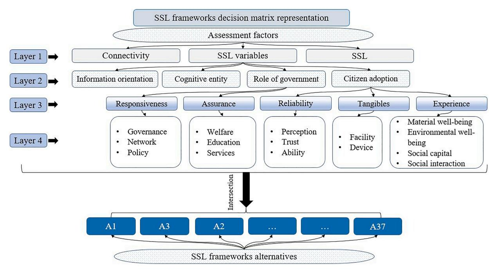
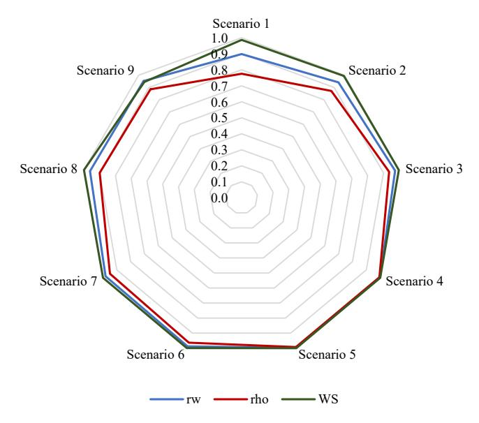
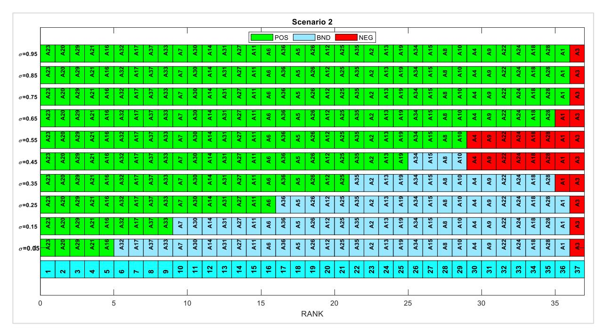
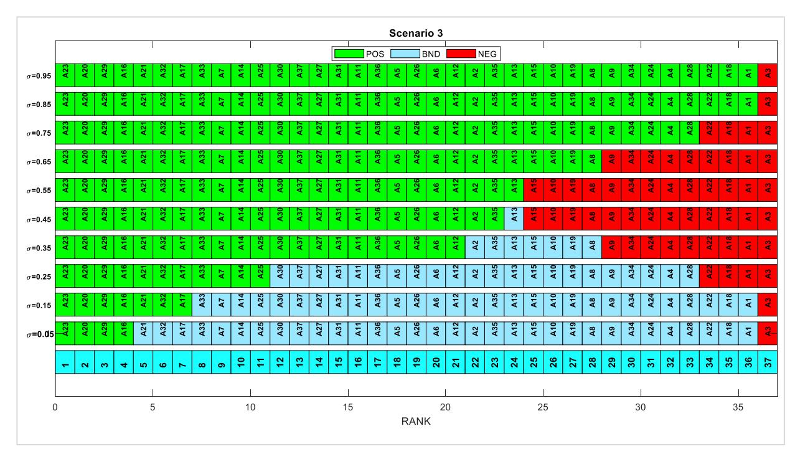
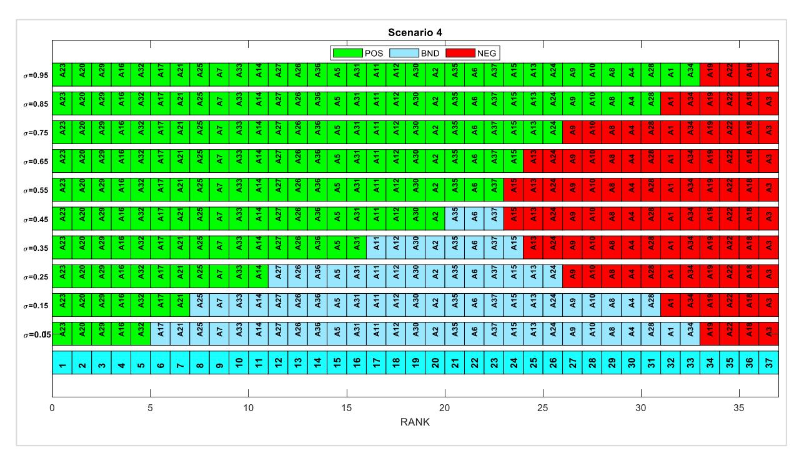
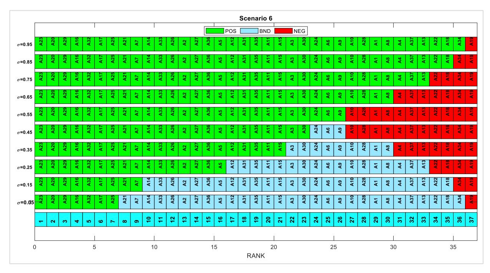
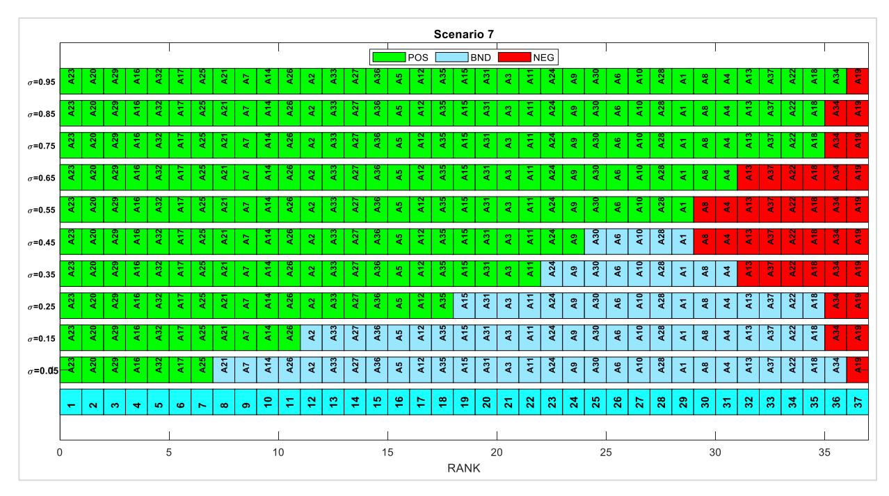
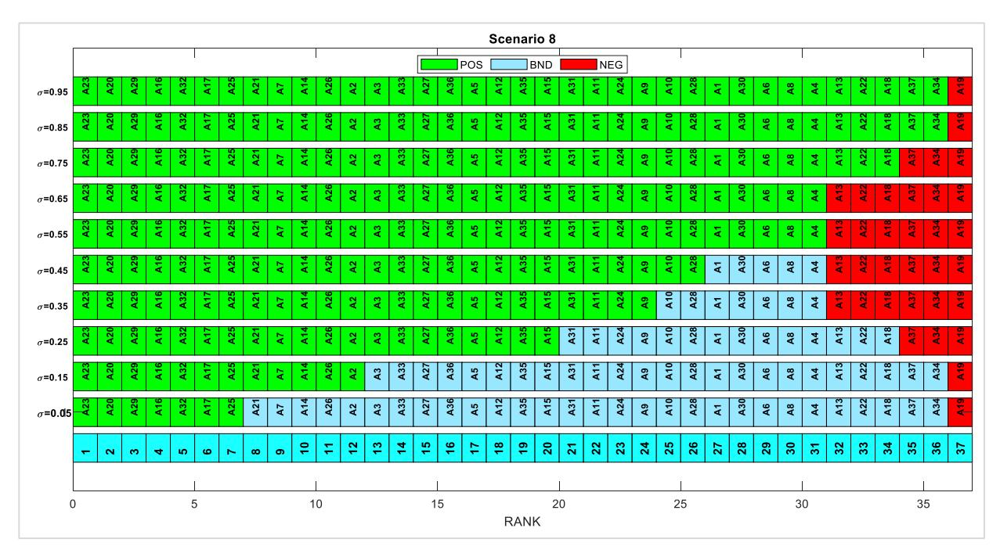
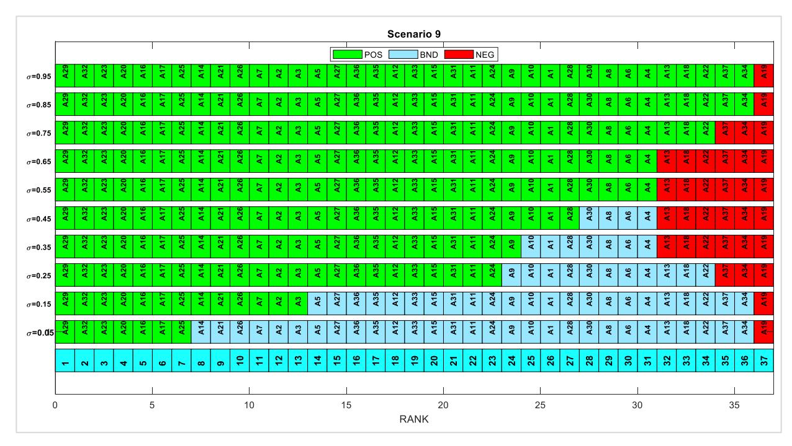

<!-- A3.R16 | source: papers_json/A3.R16/ -->

FISEVIER

Contents lists available at ScienceDirect

## **Information Sciences **

journal homepage: www.elsevier.com/locate/ins




## Three-way decision-based conditional probabilities by opinion scores and Bayesian rules in circular-Pythagorean fuzzy sets for developing sustainable smart living framework

Hassan A. Alsattar <sup>a,b</sup>, Sarah Qahtan <sup>c</sup>, Nahia Mourad <sup>d</sup>, A.A. Zaidan <sup>e</sup>, Muhammet Deveci <sup>f,g,h,*</sup>, Chiranjibe Jana <sup>i</sup>, Weiping Ding <sup>j,*</sup>

- a Department of Business Administration, College of Administrative Science, The University of Mashreq, 10021 Baghdad, Iraq
- <sup>b</sup> MEU Research Unit, Middle East University, Amman, Jordan
- <sup>c</sup> Department of Computer Center, College of Health and Medical Techniques, Middle Technical University, 10047 Baghdad, Iraq
- <sup>d</sup> Faculty of Engineering & IT, British University in Dubai, Dubai, United Arab Emirates
- e SP Jain School of Global Management, Lidcombe, Sydney, NSW 2141, Australia
- f Department of Industrial Engineering, Turkish Naval Academy, National Defence University, 34940 Tuzla, Istanbul, Turkey
- g Royal School of Mines, Imperial College London, London SW7 2AZ, UK
- <sup>h</sup> Department of Electrical and Computer Engineering, Lebanese American University, Byblos, Lebanon
- i Department of Applied Mathematics with Oceanology and Computer Programming, Vidyasagar University, Midnapore 721102, India
- <sup>j</sup> School of Information Science and Technology, Nantong University, Nantong 226019, China

## ARTICLE INFO

## Keywords:
Circular-Pythagorean Fuzzy Sets
Conditional Probabilities by Opinion Scores
method
FWZIC
MCDM
Sustainable smart living
Three-Way Decisions

## ABSTRACT

Sustainable smart living (SSL) is a crucial component in the emergence of smart cities. These cities offer potential solutions to address pressing urban challenges, including traffic congestion, energy consumption and environmental degradation. Recently, many SSL frameworks have been developed based on multiple factors. However, no framework can simultaneously address all these factors. Furthermore, no research has ranked and graded the identified SSL frameworks to select the most sustainable framework. These are considered challenging tasks. To address these challenges, three-way decisions (TWD) and multicriteria decision-making (MCDM) can serve as a valuable solution for city planners and decision-makers. This study introduces TWD-based MCDM as novel conditional probabilities by opinion scores (CPOS) within the context of circular-Pythagorean fuzzy sets (C-PFSs), namely, C-PFSs-CPOS method, to estimate the conditional probability of each alternative. Additionally, Bayesian decision theory within a C-PFS environment is employed to construct the decision thresholds for each alternative. Furthermore, the prioritisation of factors that impact the ranking and grading of SSL frameworks is achieved through the application of the fuzzy-weighted zero-inconsistency (FWZIC) method within a C-PFS environment, namely, C-PFS-FWZIC method. A total of 37 SSL frameworks (alternatives) are evaluated on the basis of 19 assessment factors (criteria) distributed in 4 layers. Results show that six alternatives exhibit a high level of sustainability, as evidenced by their position in the positive region, whereas two alternatives consistently fall within the negative region for all \sigma values. At \sigma = 0.05, the remaining SSL framework alternatives are positioned within the boundary region. When \sigma value increases to a range of 0.55–0.59, TWD is transformed into a two-way decision-

> ^* ^Corresponding authors at: Department of Industrial Engineering, Turkish Naval Academy, National Defence University, 34940 Tuzla, Istanbul, Turkey (Muhammet Deveci); School of Information Science and Technology, Nantong University, Nantong 226019, China (Weiping Ding).

E-mail addresses: muhammetdeveci@gmail.com (M. Deveci), jana.chiranjibe7@gmail.com (C. Jana), dwp9988@163.com (W. Ding).

<!-- page 2 -->

making. Sensitivity and correlation analyses are conducted to evaluate the stability and robustness of the proposed methods.

## **1.** **Introduction **

Urban life has become smarter with automated systems and services and digitalised networks and communication through the diffusion of technology [[1]](#page-30-0). This rapid smart urbanisation, driven by a massive input of smart information and communication technology for the uses of software, servers, computing and big data, aims to deliver a higher-quality life and improved prosperity for urban citizens[ [2].](#page-30-0) The patterns of the social and professional lives of humans are changing[ [3,4].](#page-30-0) The populations of urban areas are forecast to increase to up to six billion by 2050 [[5].](#page-30-0) The exponential growth of city populations is predicted to be continuous as a consequence of people seeking an excellent education and further career opportunities. The scalability of smart cities in relation to the expansion of services and infrastructure that are responsive to the exponential growth of populations has become essential[ [6].](#page-30-0)

The emergence of smart cities as a potential solution to tackle the challenges of urbanisation, including but not limited to traffic congestion, energy consumption and environmental degradation, has gained significant attention [[7]](#page-30-0). Smart cities strive to enhance the general well-being of their inhabitants, optimise urban systems and promote economic development through the integration of cutting-edge technology, inventive solutions and sustainable practices [[8]](#page-30-0). The efficacy of these endeavours is contingent upon the degree to which individuals adopt and integrate sustainable smart living (SSL) processes[ [9]](#page-30-0).

A primary obstacle encountered in the implementation of SSL projects is comprehending and integrating the multiple requirements, preferences and expectations of citizens [[10].](#page-30-0) Ensuring that the solutions offered are in line with the values and priorities of the community is of utmost importance because it will have a significant impact on the degree of citizen adoption. In this context, multicriteria decision-making (MCDM) can serve as a valuable solution for city planners and decision-makers to assess the relationship between smart cities and citizen adoption. This solution can aid in making well-informed decisions[ [11]](#page-30-0) when designing and executing efficient smart city initiatives.

Whilst MCDM techniques, such as the Technique for Order of Preference by Similarity to Ideal Solution (TOPSIS) [[12,13]](#page-30-0) and VlseKriterijuska Optimizacija I Komoromisno Resenje (VIKOR), are suitable for prioritising alternatives, they are inappropriate for ascertaining the grade[ [14,15].](#page-30-0) These methods consider the distance between alternatives and ideal solutions, but they do not take into account the potential decision threshold and probability[ [16]](#page-30-0). Nevertheless, the problem at hand could be addressed by implementing three-way decisions (TWDs) [[17]](#page-30-0). Furthermore, the normalisation requirement, comparison numbers, inconsistency, unnatural comparisons, number of mathematical computations and informational uncertainty are limitations presented in these MCDM methods [[18].](#page-30-0)

Therefore, we are motivated to propose a novel MCDM method that leverages TWD within the context of circular-Pythagorean fuzzy sets (C-PFSs) [[19]](#page-30-0) to address the problems pertaining to the selection and grading of SSL frameworks. This study introduces a novel approach, namely, conditional probabilities by opinion scores (CPOS) within the context of C-PFSs, which is referred to as the C-PFS-CPOS method. This innovative approach is designed to estimate the conditional probability of each alternative in decision-making scenarios. Additionally, Bayesian decision theory within a C-PFS environment (C-PFVs) is employed to construct the decision thresholds for each alternative. Furthermore, the prioritisation of factors that impact the selection and grading of SSL frameworks is achieved through the application of the fuzzy-weighted zero-inconsistency (FWZIC) method within a C-PFS environment.

The primary benefits of introducing the C-PFS-CPOS method for grading alternatives by utilising TWD can be summarised as follows: The proposed approach demonstrates proficiency in managing dynamic and uncertain situation information. Additionally, it has the ability to transform conventional ranking outcomes into objective classification results through the implementation of TWD. Furthermore, the method can adaptively incorporate the acquisition of situation information by adjusting the risk avoidance coefficient. On this basis, the key contributions and innovations presented in this paper can be outlined as follows:

- (1) This paper proposes a decision matrix for SSL frameworks, which are 37 SSL frameworks (alternatives) and 19 assessment factors (criteria) distributed in 4 layers. This matrix serves as a dataset within the context of this research, and it assists city planners and decision-makers in understanding and facilitating the relationship between smart cities and citizen adoption of SSL initiatives.
- (2) This paper focuses on the prioritisation of factors that influence the selection and grading of SSL frameworks. To achieve this, the FWZIC method is extended within a C-PFS environment, which is referred to as C-PFS-FWZIC.
- (3) This study develops TWD-based MCDM to rank and grade SSL frameworks based on a novel ranking method, namely, C-PFS-CPOS, for the estimation of the conditional probability and C-PFVs to establish decision thresholds for weighting the decision matrix, offering a robust mechanism for ranking and selection.

The organisation of the remaining sections is as follows: Section 2 provides an overview of the most pertinent literature. Section 3 outlines the basic concepts for C-PFSs and TWD.[ Section 4 ](#page-6-0)reports and discusses the outcomes of TWD-based MCDM methods. Section 5 conducts sensitivity and correlation analyses to evaluate the robustness and sensitivity of the proposed method.[ Section 6](#page-16-0) presents the results and discussion.[ Section 7](#page-18-0) concludes this article.

<!-- page 3 -->

## **2.** **Related works **

## *2.1.* *Assessment factors of SSL frameworks *

The adoption of smart city initiatives by citizens is influenced by various factors, and several SSL frameworks have been suggested in academic literature to fulfil them[ [20,21]](#page-30-0). The assessment of these frameworks generally centres on the extent to which they take into account these influential factors[ [22]](#page-30-0). Recently,[ [9]](#page-30-0) conducted a study to assess 37 SSL frameworks, with a focus on 3 key factors: connectivity, SSL variables (including information orientation, cognitive entity, role of government and citizen adoption [[23])](#page-30-0) and SSL. The centrality of connectivity in SSL fosters interactive engagement amongst variables, promoting interconnection and facilitating smart living [[24]](#page-31-0). The study highlighted the importance of an information orientation in the infrastructure, which can facilitate cognitive entities that enable humans to respond to environmental changes [[20]](#page-30-0). The role of government as a smart service provider was also emphasised, with a focus on ensuring accessibility, productivity and effectiveness of services to promote equity for all citizens [[22].](#page-30-0) The concept of citizen adoption was explored, with a particular emphasis on the importance of reliability, tangibility and experience in promoting citizen satisfaction and fulfilment within a smart city context[ [25].](#page-31-0) The SSL factors refer to the ability of the SSL frameworks to provide SSL for citizens[ [20].](#page-30-0) The evaluation employed a range of descriptive terms, including 'none', 'mentioned', 'considered', 'considered in depth' and 'explored', which presumably pertain to the extent to which the frameworks account for the diverse factors that influence citizen adoption[ [9].](#page-30-0)

Despite the existence of these SSL frameworks, no superior SSL frameworks have simultaneously addressed all these factors. No research has ranked and graded the identified SSL frameworks to determine which are the most and least sustainable ones based on all factors, which is considered a research gap. The ranking and grading of SSL frameworks are challenging tasks. Regarding the ranking challenge, three assessment concerns must be addressed to fill this research gap. Firstly, multiple factors must be considered. Secondly, these factors must be prioritised based on their importance level. Thirdly, variance in data must be considered when assessing SSL frameworks. Consequently, determining the most and least SSL frameworks is a difficult MCDM problem. Scholars have developed numerous MCDM approaches for choosing the optimal alternative amongst a list of alternatives. With regard to the grading challenge, the existing MCDM methods consider regions between options and ideal solutions, but they do not take into account the relationship potency decision boundary and probability [[16]](#page-30-0). Nevertheless, the problem at hand could be addressed by implementing TWD. Therefore, the integration of TWD and MCDM methods is necessary to fill the existing research gap and address the problem's complexity.

## *2.2.* *TWDS *

The concept of TWD is essential within the context of decision-making theory. The utilisation of decision-making techniques employing the TWD approach can furnish a comprehensive ranking of alternatives and categorise them based on three distinct decision rules. Furthermore, TWD theory considers the potential costs/losses associated with various actions, mirroring the reality of decisionmaking processes. Thus, the utilisation of TWD in decision-making has garnered significant attention from scholars who have conducted research in this area[ [26,27]](#page-31-0).

The TWD model was initially proposed by Yao[ [17]](#page-30-0) as a means of explaining the principles underlying decision-theoretic rough sets (RSs). These three decision rules correspond to acceptance (positive rules [POS]), delayed decisions (boundary rules [BND]) and rejection (negative rules [NEG]). However, the initial TWD model exhibits certain limitations in various aspects, including the determination of decision threshold, the approach of computing conditional probabilities in fuzzy settings and the handling of numerical data [[14]](#page-30-0). The determination of decision thresholds can be achieved through two primary approaches. The first method involves the utilisation of preference coefficients and the measurement of the distance from ideal points to determine losses. Subsequently, a formula derived from Bayesian decision-making under a fuzzy environment is employed to establish the thresholds [[28].](#page-31-0) An alternative approach involves utilising an optimisation procedure to establish thresholds, i.e. utilising a risk loss matrix that is subjective in nature[ [29].](#page-31-0) The calculation of conditional probability in TWD often involves the utilisation of various MCDM techniques, such as TOPSIS and VIKOR, which are commonly employed in academic research[ [14,15]](#page-30-0).

## *2.3.* *MCDM techniques *

Various MCDM techniques have been widely utilised in diverse scientific domains [30–[32]](#page-31-0). These techniques have been categorised into mathematical techniques (e.g. TOPSIS and VIKOR) and human techniques (e.g. analytic hierarchy process [AHP] and best–worst method)[ [18,33,34].](#page-30-0) The limitations of mathematical techniques are as follows: (i) The process of normalisation is a crucial component in decision-making research to standardise various evaluation scales by converting their values into dimensionless figures. Academics have utilised diverse techniques for data normalisation to arrive at a conclusive determination, employing methods such as vector, linear and linear–max–min normalisation. Diverse normalisation techniques produce distinct scales that modify the behaviour of data and ultimately influence the final decision [[35].](#page-31-0) (ii) The process of selecting positive and negative ideal solutions in TOPSIS is predicated on the highest and lowest values, respectively. However, this particular scenario may not be generally applicable given possible exceptions to its validity. For instance, the optimal value for measuring blood pressure lies within the range delineated by the

<!-- page 4 -->

maximum and minimum values[ [18]](#page-30-0). (iii) The mathematical techniques do not have the ability to ascertain the precise weighting of the evaluation factors. Consequently, an external mechanism (i.e. human techniques) is necessary to prioritise the evaluation factors[ [11]](#page-30-0).

The limitations of human techniques are as follows: (i) The key issue associated with human techniques lies in the possible inconsistencies in factor weighting, which result from pairwise comparisons [[36].](#page-31-0) The credibility of the priorities calculated through AHP depends on the pairwise comparison matrices successfully passing a consistency test. These matrices, used for pairwise comparisons, consist of numerical elements whose values are assigned by decision-makers, drawing on their professional knowledge and expertise[ [37]](#page-31-0). However, such matrices may exhibit inconsistencies owing to gaps in knowledge and experience, as well as the intricate nature of the decision problem. In scenarios in which a comparison involves a scale from 1 to 9, the decision-makers must delineate how many times a particular factor surpasses other factors[ [38]](#page-31-0). (ii) The comparison becomes cognitively demanding given the unusual nature of subjective comparisons. In other words, comparing two unrelated factors is not an innate process and thus constitutes a significant challenge[ [18].](#page-30-0) (iii) The considerable time commitment required for pairwise and reference comparisons of diverse factors further complicates this approach[ [39]](#page-31-0).

Furthermore, mathematical and human techniques exhibit limitations in their ability to effectively manage the uncertainty and imprecision of data [[40,41].](#page-31-0) The FWZIC method, introduced by [[42],](#page-31-0) has outperformed other MCDM human techniques, which is attributed to its unique ability to accurately determine the weights of criteria with zero inconsistency. The original version of FWZIC exhibits limitations in its ability to effectively manage the uncertainty and imprecision of data stemming from expert hesitancy. FWZIC has been expanded to accommodate imprecise and ambiguous issues by applying it to various fuzzy environments[ [36,43],](#page-31-0) including neutrosophic fuzzy sets (FSs), Pythagorean FSs (PFSs), cubic PFSs, interval type 2 trapezoidal FSs, dual-hesitant FSs, q-rung orthopair FSs, T-spherical FSs and Pythagorean m-polar FSs. Notwithstanding the notable endeavours made, the unresolved matter of uncertainty and imprecision in information persists.

To adequately tackle all the issues mentioned earlier, a comprehensive solution is required. This calls for the development of a novel MCDM mathematical technique that can effectively integrate the notion of an ideal solution, obviate the requirement for normalisation and reduce the comparison numbers. The methodology ought to strive towards the establishment of reasonable and implicit comparisons, prevent inconsistency, avoid unnatural comparisons and necessitate a minimal number of mathematical computations. Furthermore, the suggested method must consider informational uncertainty. Therefore, this study aims to propose a novel MCDM technique that utilises the notion of an ideal solution and opinion matrix as a means to overcome the identified issues. Because the proposed method is based on the opinions of decision-makers, it is capable of producing reasonable and logical decisions.

## *2.4.* *FS theory *

The notion of FS was formulated by employing a function, commonly referred to as a membership function, which assigns a numerical value ranging from 0 to 1 to represent the degree of membership of elements. This approach has been adopted to address the issue of ambiguity that arises in practical problems. The theory of FS, as proposed by Zadeh [[44]](#page-31-0), has proven to be effective in managing diverse forms of uncertainty. As a result, numerous scholars have conducted extensive research on this theory to effectively model uncertainty. Subsequently, Atanassov[ [45] ](#page-31-0)introduced the notion of intuitionistic FS (IFS) as a generalisation of FS, in which the degrees of membership and nonmembership are taken into account.

Yager[ [46] ](#page-31-0)introduced PFSs as an effective MCDM tool to investigate a broad context for expressing uncertainty. This concept serves as a generalisation of IFS. A PFS is defined by the degrees of membership and nonmembership, which satisfies the condition that the sum of the squares of these degrees must not exceed 1. In addition, a PFS exhibits a quadratic form, which implies that a PFS possesses the ability to extend the scope of alteration in the degrees of membership and nonmembership to the unit circle. Consequently, it surpasses an IFS in its capacity to illustrate uncertainty.

Various categories of FSs are analysed using points, pairs of points or triples of points from the closed interval [[1].](#page-30-0) This approach enhances the accuracy of the decision-making process because it necessitates experts to allocate precise numerical values. Atanassov [[47] ](#page-31-0)introduced the notion of circular IFSs (C-IFSs) as a means of overcoming the limitations imposed by IFS. C-IFSs are denoted by a circular shape which symbolises the imprecision inherent in the degrees of membership and nonmembership. The representation of the membership and nonmembership of individual elements to a C-IFS is depicted as a circular shape, in which the centre of the circle is denoted by a pair of non-negative real numbers. The sum of these real numbers must not exceed 1. C-IFSs enable a complicated alteration of membership and nonmembership degrees, thereby facilitating the expression of uncertainty.

Recently, Bozyigit ˘ et al.[ [19]](#page-30-0) introduced the concept of C-PFSs and C-PFVs. This novel concept serves as a comprehensive extension of C-IFSs and PFSs. C-PFS is a graphical representation consisting of a circular shape that denotes the degrees of membership and nonmembership. The circle centre comprises non-negative real numbers, denoted as *u *and *ν*, and is subject to the condition that their sum of squares must not exceed 1. C-PFS exhibits greater ability in representing the imprecision of uncertain data owing to its unique structure that facilitates the modelling of information through circular points defined by a specific centre and radius. Consequently, the implementation of C-PFS enables experts to assess alternatives within a broader and more adaptable space, thereby facilitating the formulation of more refined and complicated decisions. In this study, we are motivated to propose TWD-based MCDM methods under a homogenised fuzzy environment (i.e. C-PFS) to estimate the conditional probability of alternatives and determined decision thresholds.

<!-- page 5 -->

## 3. Basic concepts

## 3.1. C-pfss

PFSs use circular representations with a central point (u_p(x_i), v_p(x_i)) to denote the degrees of membership and nonmembership of an element to an FS. This approach offers greater flexibility in defining the condition of the set (u_p(x_i))^2 + (v_p(x_i))^2 \le 1 than numerical representations. This notation extends not only the idea of PFS but also the concept of C-IFS. The sensitivity of the decision-making process has increased because decision-makers are now able to attain circles with certain characteristics rather than exact numerical values. PFSs and C-PFSs are defined as follows:

**Definition 1.** ([46]:) PFS A in X is expressed as

$$ A = \{ \langle x, u_A(x), v_A(x) \rangle : x \in X \},\ $$

where u_A, v_A: X \rightarrow are the degrees of membership and nonmembership functions, respectively, with the following condition:

$$ u_A^2(x) + v_A^2(x) \le 1 $$

Consequently, a Pythagorean fuzzy value (PFV) is represented by the pair p=\langle u_p, v_p \rangle.

The utilisation of fuzzy terms is a prevalent approach for acquiring PFVs. Frequently, the assessment grade chosen is either 5, 7 or 9. This study employs the five-grade term scale, which is presented in Table 1.

**Definition 2.** ([19]:) Let r \in C-PFS A_r in X is expressed as follows:

$$ A_r = \{ \langle x, u_A(x), v_A(x); r \rangle : x \in X \}, $$

where u_A, v_A : X \rightarrow with the condition that u_A^2 + v_A^2 \leq 1.

Variable 'r' represents the radius of a circle centred at point (u_A(x), v_A(x)) located in the plane. The circular representation depicts the degrees of membership and nonmembership of element \times within set X.

**Definition 3.** ([19]:) Let u_p, v_p be functions with codomain [0,1], subject to the condition u_p^2 + v_p^2 \le 1 and r_p \in [0,1]. A C-PFV is represented by the triple p = \langle u_p, v_p; r_p \rangle. A set of C-PFVs can be regarded as a C-PFS.

**Proposition 1..** For finite set X, let \{\langle u_{i,1}, v_{i,1} \rangle, \langle u_{i,2}, v_{i,2} \rangle, \dots, \langle u_{i,k_i}, v_{i,k_i} \rangle\} be a set of assigned PFVs for x_i \in X, then following [19],

$$
A_r = \left\{ \langle x_i, u(x_i), v(x_i); r_i \rangle : x_i \in X \right\} is a C-PFS, where \langle u(x_i), v(x_i) \rangle = \left\langle \sqrt{\frac{\sum_{j=1}^{k_i} u_{ij}^2}{k_i}}, \sqrt{\frac{\sum_{j=1}^{k_i} v_{ij}^2}{k_i}} \right\rangle, andr_i = \min \left\{ \max_{1 \leq j \leq k_i} \sqrt{\left(u(x_i) - u_{i,j}\right)^2 + \left(v(x_i) - v_{i,j}\right)^2}, 1 \right\}
$$

with 0 \le r_i \le 1 for each i.

**Definition 4.** ([19]:) Let \{p_i = \langle u_i, v_i \rangle : i = 1, \dots, n\} be a collection of PFVs. The algebraic arithmetic aggregation operator can be expressed in the following manner:

$$
PA(p_1, \dots, p_n) = \left\langle \sqrt{1 - \prod_{i=1}^n \left(1 - u_i^2\right)^{\frac{1}{n}}}, \prod_{i=1}^n v_i^{\frac{1}{n}} \right\rangle
$$

**Definition 5:** The score function of a C-PFV in A_r can be expressed as follows:

$$ Score = u_A^2(x) - v_A^2(x) - r^2(x) $$

**Definition 6.** ([48]:) The divergence between C-PFSs A_r = \{\langle x, u_A(x), v_A(x); r \rangle : x \in X \} and B_t = \{\langle x, u_B(x), v_B(x); t \rangle : x \in X \}, which is the Hamming distance, is expressed as follows:

<!-- page 6 -->


***Fig. 1.** Representation of the proposed TWD-based MCDM.*

<!-- page 7 -->

$$
\xi(A_r, B_t) = \frac{1}{2} \cdot \left( \left| u_A^2(x) - u_B^2(x) \right| + \left| v_A^2(x) - v_B^2(x) \right| + \left| r^2(x) - t^2(x) \right| \right).
$$

## 3.2. TWD based on decision-theoretic RSs

TWD has demonstrated proficiency in providing semantic interpretation to the POS, NEG and BND regions within RS theory. Additionally, this model exhibits strong capabilities in processing uncertain information and performing accurate classification.

**Definition 7.** ([17]:) Let U be a nonempty finite set, and let R \subseteq U \times U be an equivalence relation defined on U. The rough approximation space, denoted as apr = (U,R), is defined as follows: Set U is partitioned by equivalence relation R, resulting in quotient set U/R = \{[x]|x \in U\}. Given a pair of thresholds (\alpha,\beta), that satisfy the condition 0 \le \beta < \alpha \le 1, lower and upper approximations of X \subseteq U based on probability RS theory are defined by Equations (1) and (2), respectively.

$$
apr_{(a,\beta)}(X) = \{x \in UPr(X|s[x]) \geqslant \alpha\} 
(1)
$$

$$ a\bar{p}r_{(a,\beta)}(X) = \{x \in UPr(X|[x]) | \beta \} (2) $$

where Pr(X[[x]) = |[x] \cap X|/|[x]| represents the concept of conditional probability. Based on the values of (\alpha, \beta), U can be categorised into three distinct regions by thresholds, expressed as

$$
POS(X) = \{x \in UPr(X|[x]) \geqslant \alpha\}. 
(3)
$$

$$
BND(X) = \{x \in U\beta < Pr(X|[x]) \mid \alpha\} 
(4)
$$

$$ NEG(X) = \{x \in UPr(X|[x]) \le \beta\} (5) $$

Yao [17] aimed to provide a sensible semantic interpretation of the three regions by integrating decision RS theory with Bayesian decision procedure. This approach included two kinds of states and three possible actions. State set \Omega comprises two distinct states, namely, X and \neg X, which respectively denote the presence or absence of the object in X. Set A = \{a_P, a_B, a_N\} denotes the action set, comprising three distinct actions: a_P signifies the elements of X that belong to POS(X), a_B signifies the elements of X that belong to POS(X), and A_N signifies the elements of X that belong to NEG(X).

Table 2 presents the loss values associated with actions a_P, a_B and a_N for objects belonging to X and \neg X. Specifically, \lambda_{PP}, \lambda_{BP} and \lambda_{NP} correspond to the loss values for actions a_P, a_B and a_N, respectively, when the object falls in X; \lambda_{PN}, \lambda_{BN} and \lambda_{NN} represent the loss values for actions a_P, a_B and a_N, respectively, when the object falls in \neg X. The loss function typically adheres to the following inequalities: 0 \le \lambda_{PP} \le \lambda_{BP} \le \lambda_{NP} and 0 \le \lambda_{NN} \le \lambda_{BN} \le \lambda_{PN}.

The TWD rules can be written in the following manner:

$$ (P) if Pr(X[x]) \geqslant \alpha, then x \in POS(X); $$

$$ (B) if \beta < Pr(X[x]) \langle \alpha, then x \in BND(X); (7) $$

$$ (N) if Pr(X[x]) \leq \beta, then x \in NEG(X); $$

where \alpha = \frac{\lambda_{PN} - \lambda_{BN}}{(\lambda_{PN} - \lambda_{BN}) + (\lambda_{BP} - \lambda_{PP})}, and \beta = \frac{\lambda_{BN} - \lambda_{NN}}{(\lambda_{BN} - \lambda_{NN}) + (\lambda_{NP} - \lambda_{BP})}.

## 4. TWD-based MCDM methods

The main methods employed in this study comprise TWD, FWZIC and CPOS within the context of C-PFSs, as shown in Fig. 1. In Section 4.1, a decision matrix is constructed for SSL frameworks. The FWZIC approach has been expanded in the context of C-PFSs to prioritise the factors that impact the selection and grading of SSL frameworks, as outlined in Section 4.2. Sections 4.3 presents the TWD based on the novel C-PFS-CPOS method. In Section 4.3.1, the C-PFS-CPOS method is utilised to determine the conditional probability of each SSL framework. The determination of decision thresholds for TWD is explained in Section 4.3.2.

## 4.1. Decision matrix for SSL frameworks

A decision matrix for SSL frameworks has been constructed to serve as a dataset for proposed methods to select and grade identified alternatives. According to [36], a decision matrix can be created by utilising a root article as the foundation. In light of this, [9] is regarded as the root article in the present study. The process of constructing the matrix can be simply outlined in the subsequent steps:

Step 1: The SSL framework alternatives are examined and identified. The systematic review undertaken by [9] identified a total of 37 SSL frameworks. In this study, these frameworks are ranked and graded based on their sustainability performance, with the most sustainable frameworks receiving higher rankings and grades. This ranking and grading process allows the researchers to compare and identify the frameworks that demonstrate the highest level of sustainability and those that are comparatively less sustainable.

<!-- page 8 -->


*Fig. 2. Representation of the decision matrix for SSL frameworks*

Step 2: The assessment factors pertaining to SSL framework alternatives have been scrutinised and delineated. According to [9], SSL frameworks can be evaluated based on four layers of assessment factors. The initial layer encompasses connectivity, SSL variables and SSL. The SSL variables cover the information orientation, cognitive entity, role of government and citizen adoption within the second layer. Under the role of government, the third layer includes responsiveness and assurance, whilst under citizen adoption, it comprises reliability, tangibles and experience. The fourth layer incorporates various components, such as governance, network and policy pertaining to responsiveness; welfare, education and services under assurance; perception, trust and ability under reliability; facility and device under tangibles; and material well-being, environmental well-being, social capital and social interaction under experience. Fig. 2 shows the assessment factors of SSL frameworks.

**Step 3**: The decision matrix for SSL frameworks is derived by the intersection of the SSL framework alternatives (Step 1) with their corresponding assessment factors (Step 2). Fig. 2 depicts the SSL frameworks' decision matrix representation.

## 4.2. Weight calculation by C-PFS-FWZIC method

In this study, the FWZIC method [42] is developed within the context of C-PFSs to allocate weights to the assessment factors across the four layers. The implementation of C-PFS-FWZIC involves the following steps:

**Step 1:** The initial step involves the examination and classification of SSL frameworks' assessment factors. The assessment factors predetermined for SSL frameworks are analysed and categorised, as demonstrated in Section 4.1.

**Step 2**: A minimum of three experts who possess expertise in the relevant field of study are identified and selected to create a structured expert judgement (SEJ) group. Subsequently, the data collection form is carefully formulated and endorsed by the nominated experts for assessment. The fuzzy terms in Table 1 are utilised by the experts to express their perspectives on each factor.

**Step 3**: The process of constructing an expert decision matrix (EDM), denoted by (D_{kj})_{1 \le k \le K, 1 \le j \le n}, is performed in this step. Each expert (E_k) evaluates all the identified factors (C_j)_{1 \le j \le n}, as expressed in Eq. (9). The fuzzy terms gathered from the data collection form in the preceding step are transformed into numerical grades to facilitate subsequent analysis.

$$
EDM = \begin{bmatrix} D_{11} & \cdots & D_{1n} \\ \vdots & \ddots & \vdots \\ D_{K1} & \cdots & D_{Kn} \end{bmatrix}. \tag{9}
$$

**Step 4**: This step entails the creation of C-PFS–EDM. Initially, the numerical grades utilised in EDM are substituted with the fuzzy values (PFVs) given in Table 1. This study employs C-PFSs instead of PFSs, resulting in the transformation of PFVs within PFS-EDM into C-PFVs. This transformation is achieved by computing the radius using Proposition 1 and circular centre using Definition 4.

Step 5: The score of SSL frameworks' assessment factors (s_i) is calculated using the score function of C-PFS given in Definition 5.

<!-- page 9 -->

**Step 6**: The sum of weights assigned to all factors within a layer must be equal to 1. Hence, Eq. (10) is employed to recalibrate the score values for ascertaining the final weight of the assessment factors.

$$ w_j = s_j \frac{\sum_{j=1}^n s_j}{} (10) $$

The pseudocode of the C-PFS-FWZIC method is given in Algorithm 1.

```
Algorithm 1: C-PFS-FWZIC method
```

```
Step 1: Examination and classification of SSL frameworks.
3:
 Step 2: Select a SEJ group.
4: Identify E
 Step 3: Construct EDM
6: n \leftarrow length(C)
7: K \leftarrow length(E)
 For j = 1:n do
 For k = 1: K do
9:
 EDM[k,j] \leftarrow AF(E_k,C_j)
10:
 End for
11:
12: End for
13: Step 4: Fuzzification.
14: For j = 1:n do
15:
 For k = 1: K do
 [u[k,j],v[k,j]] \leftarrow PFV(EDM[k,j])
16:
 p[k,j] \leftarrow \left[ u[k,j], v[k,j] \right]
17:
18:
 End for
19: End for
20: For j = 1:n do
 \tilde{u}[j] \leftarrow \sqrt{(\sum_{k=1}^K u[k,j]^2)/K}
21:
 \tilde{v}[j] \leftarrow \sqrt{(\sum_{k=1}^{K} v[k,j]^2)/K}
22:
 R[j] \leftarrow \max_{1 \leq k \leq N} \sqrt{(\tilde{u}[j] - u[k,j])^2 + (\tilde{v}[j] - v[k,j])^2}
23:
24:
 r[i] \leftarrow \min(R[i],1)
25: End for
26: For j = 1:n do
27:
 \left[\hat{u}[j], \hat{v}[j]\right] \leftarrow \text{PA}(p[1, j], \dots, p[K, j])
 \hat{p}[j] \leftarrow [\hat{u}[j], \hat{v}[j], r(j)]
28:
29: End for
30: Step 5: Calculate the score of each framework.
31: For j = 1:n do
32:
 s_i \leftarrow Score(\hat{p}[j])
33: End for
34: For j = 1:n do
35:
 w_i = s_i / \sum_{1}^{n} s_i
36: End for
```

<!-- page 10 -->

## 4.3. TWD based on the novel C-PFS-CPOS method and Bayesian decision rules

This section discusses the novel C-PFS-CPOS method based on TWD. Let A = \{A_1, A_2, \cdots A_m\} be the available alternatives and C = \{C_1, C_2, \cdots, C_n\} be the possible assessment factors. The formulated decision matrix of the SSL frameworks represented in Eq. (11) along with the determined weights of the assessment factors are fed to the C-PFS-CPOS method.

$$
\mathscr{M} = \begin{pmatrix} M_{11} & M_{12} & \cdots & M_{1n} \\ M_{21} & M_{22} & \cdots & M_{2n} \\ \vdots & \vdots & \ddots & \vdots \\ M_{m1} & M_{m2} & \cdots & M_{mn} \end{pmatrix} 
(11)
$$

## 4.3.1. Determining conditional probability based on the C-PFS-CPOS method

The C-PFS-CPOS method is utilised to calculate the scoring values that determine the conditional probability of each alternative. It has the ability to generate reasonable probabilities by opting for the optimal solution for each factor in the decision matrix and subsequently contrasting it with all other values under the same factor, thereby creating an opinion matrix that is grounded on the expertise of specialists. The main computational procedures of the C-PFS-CPOS method are explained below.

**Step 1**: The initial step involves the conversion of the decision matrix into an opinion matrix. Three subject matter experts are enlisted to develop opinion matrices for this endeavour. The experts utilise five fuzzy terms to conduct a comparison based on the differences, as shown as follows:

a. The optimal value of each factor is selected and expressed as

$$
M^* = \left(\max_{1 \le i \le m} M_{ij} \lor \min_{1 \le i \le m} M_{ij} \lor cv_j\right)_{1 \le j \le n},\tag{12}
$$

where max denotes the benefit factor, whilst min represents the cost factor. The critical value (cv_j) is situated between the maximum and minimum values. The derivation of (cv_i) is based on the assessment of the experts. This study did not identify any critical value.

b. The comparison of the optimal value of a particular factor with other values within the same factor is facilitated by the enlisted experts. The degree of difference between the optimal value and other values for each factor is established through the utilisation of five distinct fuzzy terms, specifically ND, SD, Di, BD, and HD, as outlined in Table 1. The comparisons carried out are represented below:

$$
Op_{Lang} = \left(M_{ij} \ge \widetilde{M}_{j}\right) \underset{1 \le i \le m}{\underline{\leq} i \le m}, \tag{13}
$$

where \geq denotes a comparison that has been conducted. This procedure results in the production of three matrices of opinions, each originating from a different expert, as illustrated in the following equation:

$$
Op_{Lang} = \begin{bmatrix} op_{11} & \cdots & op_{1n} \\ \vdots & \ddots & \vdots \\ op_{m1} & \cdots & op_{mn} \end{bmatrix}. \tag{14}
$$

Step 2: The opinion matrices undergo a conversion process to become fuzzy opinion matrices. The fuzzy terms present in the matrices of opinions are replaced with the PFVs presented in Table 1. Given that the FSs utilised in this study are C-PFSs instead of PFSs, the PFVs present in the fuzzy opinion matrices are transformed into C-PFVs through the computation of the radius using Proposition 1 and the circular centre using Definition 4. This process results in a unified C-PFS opinion matrix \begin{pmatrix} p_{ij} \\ 1 \le i \le m \end{pmatrix}, with p_{ij} = \langle u_{ij}, v_{ij} \rangle and v_{ij} = v_{ij} \rangle with v_{ij} = v_{ij} \rangle and v_{ij} = v_{ij} \rangle with v_{ij} = v_{ij} \rangle and v_{ij} = v_{ij} \rangle with v_{ij} = v_{ij} \rangle and v_{ij} = v_{ij} \rangle with v_{ij} = v_{ij} \rangle and v_{ij} = v_{ij} \rangle with v_{ij} = v_{ij} \rangle and v_{ij} = v_{ij} \rangle and v_{ij} = v_{ij} \rangle with v_{ij} = v_{ij} \rangle and v_{ij} = v_{ij} \rangle and v_{ij} = v_{ij} \rangle with v_{ij} = v_{ij} \rangle and v_{ij} = v_{ij} \rangle with v_{ij} = v_{ij} \rangle and v_{ij} = v_{ij} \rangle with v_{ij} = v_{ij} \rangle and v_{ij} = v_{ij} \rangle and v_{ij} = v_{ij} \rangle and v_{ij} = v_{ij} \rangle with v_{ij} = v_{ij} \rangle and v_{ij} = v_{ij} \rangle and v_{ij} = v_{ij} \rangle and v_{ij} = v_{ij} \rangle and v_{ij} = v_{ij} \rangle and v_{ij} = v_{ij} \rangle and v_{ij} = v_{ij} \rangle and v_{ij} = v_{ij} \rangle and v_{ij} = v_{ij} \rangle and v_{ij} = v_{ij} \rangle and v_{ij} = v_{ij} \rangle and v_{ij} = v_{ij} \rangle and v_{ij} = v_{ij} \rangle and v_{ij} = v_{ij} \rangle and v_{ij} = v_{ij} \rangle and v_{ij} = v_{ij} \rangle and v_{ij} = v_{ij} \rangle and v_{ij} = v_{ij} \rangle and v_{ij} = v_{ij} \rangle and v_{ij} = v_{ij} \rangle and v_{ij} = v_{ij} \rangle and v_{ij} = v_{ij} \rangle

v_{ij}; r_{ij} >.

**Step 3**: The score (S_i) value of each alternative is calculated by utilising the weight values (w_j)_{1 \le j \le n} derived from C-PFS-FWZIC using the following equation:

$$
S_i = \sum_{i=1}^n w_j \frac{\xi\left(p_j^{\text{max}}, p_{ij}\right)}{\xi\left(p_j^{\text{max}}, p_j^{\text{min}}\right)}. (15)
$$

The divergence of C-PFS (Definition 6) is utilised to calculate \xi(p_j^{\max}, p_{ij}), which represents the divergence between the positive ideal solution and the values of the unified C-PFS opinion matrix, and \xi(p_j^{\max}, p_j^{\min}), which represents the divergence between the positive and negative ideal solutions. For benefit factors, the values for p_j^{\max} and p_j^{\min} are (1, 0, 0) and (0, 1, 1), respectively, where (j = 1, 2, \cdots n). Conversely, in cases in which the factor is considered a cost, the values for p_j^{\max} and p_j^{\min} are (0, 1, 1) and (1, 0, 0), respectively, for the same range of j variables. For rescaling purposes, the following equation is applied:

$$ Q_i = S_i / \max_{1 \le i \le m} S_i \tag{16} $$

<!-- page 11 -->

**Step 4**: The conditional probability for each alternative is calculated as

$$ Pr(X|A_i) = 1 - Q_i. (17) $$

## 4.3.2. Threshold generation based on Bayesian decision rules

The TWD model is expanded in this study under the C-PFS context to establish a broad threshold. The primary calculation process is outlined as follows:

**Step 1**: A matrix representing the loss function of alternatives A_i is created within the context of factors C_j, with each element p_{ij} denoting the corresponding loss value.

$$
\lambda(p_{ij}) = \begin{pmatrix} \lambda_{PP}^{ij} & \lambda_{PN}^{ij} \\ \lambda_{BP}^{ij} & \lambda_{BN}^{ij} \\ \lambda_{NP}^{ij} & \lambda_{NN}^{ij} \end{pmatrix} = \begin{pmatrix} 0 & \xi(p_{ij}, p_j^{max}) \\ \sigma\xi(p_{ij}, p_j^{min}) & \sigma\xi(p_{ij}, p_j^{max}) \\ \xi(p_{ij}, p_j^{min}) & 0 \end{pmatrix}, \tag{18}
$$

$$ for i = 1, 2, \dots, m; i = 1, 2, \dots, n. $$

The risk avoidance coefficient, denoted by \sigma, is a variable that must adhere to the condition of 0 \le \sigma < 1. It indicates the level of confidence that experts have in their ability to comprehend factor data. As the level of certainty increases, the value of \sigma increases proportionally.

**Step 2**: A loss matrix is created for alternatives A_i with respect to factors C, taking into account the weights of factors derived from C-PFS-FWZIC.

$$
\lambda_{i} = \begin{pmatrix} 0 & \sum_{j} w_{j} \xi\left(p_{ij}, p_{j}^{max}\right) \\ \sum_{j} \sigma w_{j} \xi\left(p_{ij}, p_{j}^{min}\right) & \sum_{j} \sigma w_{j} \xi\left(p_{ij}, p_{j}^{max}\right) \\ \sum_{j} w_{j} \xi\left(p_{ij}, p_{j}^{min}\right) & 0 \end{pmatrix}. \tag{19}
$$

**Step 3**: The values of \alpha and \beta, which represent the threshold values for the TWD method, are determined.

$$
\alpha_{i} = \frac{(1 - \sigma) \sum_{j} w_{j} \xi\left(p_{ij}, p_{j}^{max}\right)}{(1 - \sigma) \sum_{i} w_{j} \xi\left(p_{ij}, p_{i}^{max}\right) + \sum_{i} \sigma w_{i} \xi\left(p_{ij}, p_{i}^{min}\right)}, \alpha = \frac{\left(\sum_{i=1}^{m} \alpha_{i}\right)}{m}.
(20)
$$

$$
\beta_i = \frac{\sum_j \sigma w_j \xi\left(p_{ij}, p_j^{max}\right)}{\sum_i \sigma w_i \xi\left(p_{ij}, p_j^{max}\right) + (1 - \sigma)\sum_i w_j \xi\left(p_{ij}, p_i^{min}\right)}, \beta = \frac{\left(\sum_{i=1}^m \beta_i\right)}{m}.
(21)
$$

Step 4: The TWD rule is generated. The TWD rules for SSL frameworks, which are the (P), (B), and (N) rules, can be derived based on the description in Section 3.2 outlined in Eqs. (6)–(8).

The pseudocode of the TWD method is given in Algorithms 2.1 and 2.2.

## Algorithm 2.1: Conditional probability based on the C-PFS-CPOS method.

```
// Identify n attributes (C), m alternatives (A), K experts (E) and the decision matrix (M)
 1: Step 1.1: Construct the fuzzified opinion matrix.
 2: For k = 1:K do
 For i = 1:n do
 4:
 M^*[j,k] \leftarrow \max\{M[i,j,k]\} | min\{M[i,j,k]\}
 5:
 For i = 1:m do
 6.
 Op[i,j,k] \leftarrow M[i,j,k] \ge M^*[j,k]
 [u[i,j,k],v[i,j,k]] \leftarrow PFV(Op[i,j,k])
 8.
 p[i,j,k] \leftarrow [u[i,j,k],v[i,j,k]]
 End for
 10.
 End for
 11: End for
 12: Step 1.2: Generate a single opinion matrix.
 13: For i = 1 : m do
 \widetilde{u}[i,j] \leftarrow \sqrt{\left(\sum_{k=1}^{K} u[i,j,k]^2\right)/K}
 \widetilde{v}[i,j] \leftarrow \sqrt{\left(\sum_{k=1}^{K} v[i,j,k]^2\right)/K}
```

<!-- page 12 -->

## (continued)

*Algorithm 2.1: Conditional probability based on the C-PFS-CPOS method.*

```
R[i,j] \leftarrow \max_{1 \leq k \leq V} \sqrt{\left(\widetilde{u}[j] - u[k,j]\right)^2 + \left(\widetilde{v}[j] - v[k,j]\right)^2}
17:
18.
 r[i,j] \leftarrow \min(R[j],1)
19:
 [\widehat{u}[i,j],\widehat{v}[i,j]] \leftarrow PA(p[i,j,1], \dots, p[i,j,K])
20:
 \widehat{p}[i,j] \leftarrow [\widehat{u}[i,j], \widehat{v}[i,j], r(i,j)]
21: End for
22: End for
23: Step 1.3: Calculate the alternatives' score.
24: Identify w %; w is the vector of weights calculated from the C-P-FWSIC method.
25: For i = 1 : n do
26: p^{\max}[j] \leftarrow \{(0,1,1) | (1,0,0)\}
27: p^{\min}[j] \leftarrow \{(0,1,1) | (1,0,0)\}
28: End for
29: For i = 1 : m do
30: S[i] \leftarrow \sum_{j=1}^{n} w_j \xi(p^{\max}[j], \widehat{p}[i,j]) / \xi(p^{\max}[j], p^{\min}[j])
31: End for
32: For i = 1 : m do
33: Q[i] \leftarrow S[i] / \max S[i]
34: End for
35: Step 1.4: Calculate the alternatives' conditional probability.
36: For i = 1 : m \text{ do}
37: \Pr[i] \leftarrow 1 - Q[i]
38: End for
```

## Algorithm 2.2: Generation of threshold for TWD.

```
// Identify the aggregated fuzzy opinion matrix \hat{p} and the alternatives' conditional probability Pr from Algorithm 2.1
 1: Step 2.1: Create a loss matrix for the alternatives within the factor's context.
 2: Identify \sigma
 3: For i = 1 : m do
 4: For j = 1 : n do
 Q^{\max}[i,j] \leftarrow \xi(p^{\max}[j], \widehat{p}[i,j])
 5:
 Q^{\min}[i,j] \leftarrow \xi(p^{\min}[j], \widehat{p}[i,j])
 6.
 7: End for
 8: End for
 9: Step 2.2: Create a loss matrix for the alternatives.
 10: For i = 1 : m do
 11:
 \lambda_{PP}[i] \leftarrow 0
 \lambda_{PN}[i] \!\leftarrow\! \textstyle \sum_{j=1}^n w_j Q^{\max}[i,j]
 12:
 13:
 \lambda_{BP}[i] \leftarrow \sigma \sum_{j=1}^{n} w_j Q^{\min}[i,j]
 \lambda_{BN}[i] \leftarrow \sigma \sum_{j=1}^{n} w_j Q^{\max}[i,j]
 14.
 \lambda_{NP}[i] \!\leftarrow\! \textstyle \sum_{j=1}^n w_j Q^{\min}[i,j]
 15:
 16:
 \lambda_{NN}[i] \leftarrow 0
 17: End for
 18: Step 2.3: Determine the threshold values.
 19: For i = 1 : m do
 20:
 \alpha[i] \leftarrow (\lambda_{PN}[i] - \lambda_{BN}[i]) / (\lambda_{PN}[i] - \lambda_{BN}[i] + \lambda_{BP}[i])
 21:
 \beta[i] \leftarrow (\lambda_{BN}[i]) / (\lambda_{BN}[i] + \lambda_{NP}[i] - \lambda_{BP}[i])
 22: End for
 23: Step 2.4: Generate the TWD rules.
 24: For i = 1 : m \text{ do}
 25: If Pr[i] \ge \alpha[i] then
 A[i] in the positive class
 26.
 27: Elseif \beta[i] < \Pr[i] \langle \alpha[i] then
 28:
 A[i] in the boundary class
 29: Elseif Pr[i] \leq \beta[i] then
 30:
 A[i] in the negative class
```

31: **Endif** 32: **End for **

<!-- page 13 -->

**Information Sciences 649 (2023) 119681**

<!-- page 14 -->

## **5.** **Results and discussion **

## *5.1.* *Results of the decision matrix for SSL frameworks *

The construction of the decision matrix for SSL frameworks utilised in this study involves the intersection of the SSL frameworks and their corresponding assessment factor lists. The decision matrix utilised for the selection and grading of SSL frameworks is presented in[ Table A.1](#page-19-0), which can be found in [Appendix A](#page-30-0). As outlined in Section 2.1, the SSL frameworks were evaluated by [[9] ](#page-30-0)with respect to the identified factors, utilising a set of five descriptive terms, namely, 'none', 'mentioned', 'considered', 'considered in depth', and 'explored'. In the current study, the term 'none' is substituted with the numerical value of '1', whilst the term 'mentioned' is replaced with the numerical value of '2'. Similarly, the term 'considered' is replaced with the numerical value of '3', whilst the term 'considered in depth' is substituted with the numerical value of '4'. Additionally, the term 'explored' is replaced with the numerical value of '5'. The constructed matrix is utilised in the C-PFS-CPOS approach for the computation of scoring values, which are used to estimate the conditional probability of each alternative. The following section reports the weighting findings for the assessment attributes of SSL frameworks derived using the C-PFS-FWZIC method.

## *5.2.* *Weighting results for assessment attributes *

This study's second aim is to prioritise the factors that influence the selection and grading of SSL frameworks. The prioritisation process for the identified factors using the C-PFS-FWZIC method has been outlined in[ Section 4.2](#page-7-0). The overall outcomes of the C-PFS-FWZIC method are reported in this section. The consistency and certainty of the weighted factors are the primary benefits of developing the C-PFS-FWZIC method. Upon examining and classifying the assessment factors of SSL frameworks, the SEJ group is established, comprising three expert individuals with prior knowledge in SSL and citizen adaptation. The data are gathered from each expert by using the endorsed data collection form and fuzzy terms given in[ Table 1.](#page-4-0) The preferences of the three experts in fuzzy terms are reported in[ Table 3](#page-12-0).

The fuzzy terms are converted into numerical grades for constructing EDM, as reported in[ Table A.2 ](#page-20-0)in[ Appendix A.](#page-30-0) Subsequently, the numerical grades within EDM are substituted with the associated PFVs given in[ Table 1](#page-4-0), which requires the transformation of PFVs initially present in the fuzzy EDM to C-PFVs. This step is accomplished by implementing[ Proposition 1](#page-4-0) and [Definition 4.](#page-4-0) Then, the C-PFVs undergo a defuzzification process by utilising the score function of C-PFS, as outlined in [Definition 5](#page-4-0). The resulting scores are subjected to rescaling via Eq.[ (10) ](#page-8-0)to derive the final weight of each factor. Table 4 reports the weight value across each layer and the final weight values of the assessment factors that influence the selection and grading of SSL frameworks.

The SSL factor is identified as the most influential factor in layer 1, followed by SSL variables and connectivity factors in order of importance. The factor that exerts the greatest influence in layer 2 is the information orientation factor, which is followed by the cognitive entity factor, the role of government factor and the citizen adoption factor. The two most prominent factors in layer 3 are responsiveness and assurance, followed by experience, reliability and tangibles factors in terms of influence. The fourth layer exhibits trust as the most prominent factor, whilst material well-being and social interaction are the least influential factors. The distribution of weights amongst the remaining factors varies between the most and least influential ones.

<!-- page 15 -->


***Fig. 3.** Grading results for SSL frameworks.*

<!-- page 16 -->

The final weight of the factors is determined by performing a multiplication operation on the factors and their respective subfactors across all four layers. For instance, the weight of F10 is determined through a computation involving the weight values of SSL variables (0.3355), citizen adoption (0.1595), reliability (0.2740) and perception factors (0.2426). The SSL factor, denoted as F19, is the most influential factor amongst the 19 assessment factors, with a weight value of 0.4343. Conversely, F12, which encompasses the SSL variables, citizen adoption, reliability and ability factors, is the least influential factor, with a weight value of 0.0033. The distribution of weights amongst the remaining factors varies between the most and least influential factors.

## *5.3.* *Conditional probability results *

This study introduces a novel ranking method, referred to as the C-PFS-CPOS method, which aims to estimate the conditional probability of each SSL framework. The initial step of the process entails the transformation of the decision matrix into an opinion matrix. For this undertaking, a team of three experts in the relevant subject matter are engaged to create matrices of opinions. The experts employ a set of five different fuzzy terms, namely, ND, SD, Di, BD, and HD, as defined in[ Table 1,](#page-4-0) to carry out the comparison based on differences.[ Table A.3](#page-21-0) in[ Appendix A ](#page-30-0)presents the matrix opinions derived from the preferences of the three experts. Based on their preferences, the score (*Si*) value of each alternative is calculated using Eq.[ (15) ](#page-9-0)by utilising the weight values derived from C-PFS-FWZIC. Then, these score values are rescaled using Eq. [(16).](#page-9-0) The conditional probability for each alternative is calculated using Eq. [(17).](#page-10-0) The overall results are reported in [Table 5](#page-14-0).

According to the results given in [Table 5](#page-14-0), A23 ranks as the most promising alternative because it obtains the highest probability value of 0.8714. Subsequent to A23, the order of occurrence is A20, A29, A16, A32 and A17, with corresponding probabilities of 0.8623, 0.8293, 0.7842, 0.7331, and 0.7150, respectively. A19 is ranked in the lowest position (*Rank* = 37) because of its comparatively lower probability value, followed by A22 and A18. The remaining SSL frameworks are ranked between the first and last alternatives.

## *5.4.* *TWD and grading results *

In accordance with Steps 1–4 outlined in[ Section 4.3.2,](#page-10-0) the computation of thresholds *α *and *β *for TWD is carried out across 10 distinct values of *σ*. When evaluating SSL frameworks, a smaller value should be used for σ because of the substantial uncertainty involved in determining which alternative falls in the POS, BND and NEG classifications. By contrast, the factors that influence the selection and grading of SSL frameworks are relatively estimated, allowing for *σ *to be assigned a higher value. As a result, this study is carried out across 10 levels, with *σ *values of 0.05, 0.15, 0.25, 0.35, 0.45, 0.55, 0.65, 0.75, 0.85 and 0.95, which accounts for certainty and uncertainty and provides a comprehensive analysis of TWD, as shown in[ Fig. 3.](#page-14-0) The overall thresholds *α *and *β *for all σ values are reported in [Table A.4 ](#page-25-0)in[ Appendix A.](#page-30-0)

The findings depicted in[ Fig. 3 ](#page-14-0)indicate that A23, A20, A29, A16, A32 and A17 exhibit a high level of sustainability, as evidenced by their position in the POS region, whereas A19 and A18 consistently fall within the NEG region for all *σ *values. At *σ* = 0*.*05, the remaining SSL framework alternatives are positioned within the BND region. This region necessitates particular consideration to mitigate the factors that may contribute to the unsustainability of smart living. When *σ *value increases to a range of 0.55–0.59, TWD is transformed into two-way decision-making (i.e. POS or NEG).

<!-- page 17 -->


***Fig. 4.** Classification results for SSL frameworks in Scenario 1.*


***Fig. 5.** rw, WS and rho values of SSL frameworks across nine scenarios.*

## **6.** **Sensitivity and correlation analyses **

This section conducts sensitivity and correlation analyses to evaluate the robustness and sensitivity of the proposed method. The sensitivity analysis involves modifying the weight values of factors that influence the selection and grading of SSL frameworks, following Kirkwood and Kahraman's guidelines [[49,50].](#page-31-0) The resulting ranking order and classification outcomes of each SSL framework are then examined. Thus, new weight lists (WLs) of the evaluation factors are determined by utilising the following equation:

$$ w_c = w_c^o - \alpha_c \times \delta, \tag{22} $$

<!-- page 18 -->

where

$$ \frac{a_c = w_c^o}{1 - w_s^o},\tag{23} $$

$$
-w_{\nu}^{0}\hat{a}\otimes \frac{1}{2}\delta\hat{a}\otimes \frac{1}{2}1-w_{\nu}^{0}, \tag{24}
$$

and

w_s^0 represents the weight assigned to the most impactful factor, w_c^0 denotes the initial weight assigned to the evaluation factors as determined by the C-P-FWZIC method, \alpha_c denotes the elasticity weight coefficient, and \delta represents the range of modification for the weight values of the factors. The weight assigned to the most impactful factor is w_s = 1 - \sum_{c=1}^{19} c_{c} \le w_c.

Table 4 indicates that F19 exhibits the greatest degree of influence in this study because it possesses the highest weight value (W_{F19}=0.4343). Accordingly, \alpha_c values of the evaluation factors are calculated. In addition, the range of modification (\delta) is determined to be between -0.4343 and 0.5657. Finally, nine WLs (WL<sub>1</sub>, WL<sub>2</sub>, ..., WL<sub>9</sub>) of the evaluation factors are determined for this test. The summation of the weights of factors across each WL should meet the condition \sum w_c = 1. Table 6 reports the new WLs and \alpha_c values of evaluation factors.

According to the new WLs for each SSL framework, the new ranking and classification of the SSL frameworks are calculated, and nine scenarios are produced. The effect of the new WLs on the SSL frameworks' ranking order and classification is demonstrated in Figs. 4 and B.1–B.8 in Appendix B. Subsequently, the new ranking and classification of SSL frameworks are compared with their initial ranking and classification. The main purpose of conducting a sensitivity analysis is to assess the degree of sensitivity of the proposed methods to modifications in the weights assigned to the evaluation factors.

Based on the ranking outcomes, the variances between the original and new rankings in Scenarios 1–9 are 95%, 92%, 81%, 49%, 43%, 59%, 68%, 68% and 81%, respectively. In Scenario 1, the factor with the greatest influence, namely, F19, is assigned a weight of 0. Conversely, in Scenario 9, the factor with the greatest influence is assigned the total weight, whilst the weights of the remaining factors are set to 0. Consequently, the outcomes of the ranking and classification are significantly altered. The results of Scenario 1 indicate that four SSL frameworks, namely, A23, A20, A21 and A29, demonstrate a notable degree of sustainability, as indicated by

<!-- page 19 -->

their position in the POS region. Conversely, A3 consistently falls within the NEG region across all σ values, as illustrated in[ Fig. 4.](#page-16-0) The results of Scenario 9 indicate that seven SSL frameworks, namely, A29, A32, A23, A20, A16, A17 and A25, demonstrate a notable degree of sustainability, as indicated by their position in the POS region. Conversely, A19 consistently falls within the NEG region across all σ values, as illustrated in[ Fig. B.8](#page-29-0) in[ Appendix B](#page-30-0). In comparison with the initial classification outcomes ([Fig. 3](#page-14-0)), an expansion in the POS and BND regions is observed, whereas a reduction in the NEG region is noted. A similar finding is observed in[ Figs. B.1-B.7 ](#page-26-0)in [Appendix B.](#page-30-0)

For correlation analysis, weighted Spearman's rank correlation coefficient (rw), rank similarity coefficient (WS) and Spearman's rank correlation coefficient (rho) are used to evaluate the strength and orientation (positive or negative) of the correlation between the initial and new rankings. [Fig. 5](#page-16-0) provides a clear representation of rw, WS and rho values for SSL frameworks across nine distinct scenarios.

This study finds a significant and positive correlation between the initial and new rankings in nine different scenarios based on WLs (WL1-WL9). rw values range from 0.9 to 1, whilst WS values remain constant at 1 across all scenarios, except scenario 9. rho values range from 0.8 to 1. The arithmetic means of rw, WS and rho values are calculated to be 1, 1 and 0.9, respectively, indicating a strong and positive correlation.

## **7.** **Comparative analysis **

This section provides a comparative analysis of the TWD-based MCDM methods proposed in this study, namely, C-PFS-CPOS and C-PFS-FWZIC, and PFSs-entropy and PFSs-VIKOR employed in a prior study[ [14].](#page-30-0) The comparison is grounded upon a set of 18 distinct points. Our study is compared with the aforementioned study because both studies focused on the examination of ranking issues, including the consideration of multiple evaluation factors, the prioritisation of factors and the presence of variance in data. Additionally, both studies aimed to address the issue associated with grading in each respective case study. A further comparative analysis is conducted between the present study and the prior study[ [11] ](#page-30-0)with respect to theoretical aspects.[ Table 7](#page-17-0) presents the 18 comparison points.

Based on the comparative findings outlined in[ Table 7,](#page-17-0) the present study and prior study [[14]](#page-30-0) have successfully fulfilled the initial four points (100%) under the application aspect. In terms of weighting method, both studies addressed the issue of inconsistency related to the weighting methods, and neither study required pairwise comparisons.

In contrast to the weighting method employed in the previous study, the weighting method utilised in the present study is distinguished by its straightforward implementation and its independence from data analysis. The weighting method in the present study possesses inherent characteristics that enhance transparency. The level of transparency in the weighting method within the context of MCDM pertains to the extent to which the process of decision-making and the allocation of weights to criteria are evident, comprehensible and explicit. The concept pertains to the extent to which decision-makers' preferences and judgements can be effectively understood and conveyed to others involved in the decision-making process affected by the decisions. The weighting method in the present study provides a degree of adaptability in accommodating a wide range of perspectives and values. By contrast, the weighting method in the prior study may exhibit limited flexibility in accommodating expert preferences. Furthermore, the issues related to uncertainties and imprecisions that arise from data or expert preferences in the weighting method of both studies have been effectively addressed. Nevertheless, the present study demonstrates a broader range of options in the utilisation of C-PFSs with the weighting method compared with the utilisation of PFSs with the weighting method in the prior study. Therefore, the present study fulfils seven out of seven points (100%), whereas the prior study satisfied only three out of seven points (42.9%).

In terms of the employment of TWD, the methods of conditional probability and threshold generation are compared. The present study indicates that the C-PFS-CPOS method lacks the ability to determine the relative importance of evaluation factors. Hence, the present study fulfils six out of seven points, accounting for 85.7% of the points. Similarly, the prior study's implementation of the PFSs-VIKOR method was unable to ascertain the relative importance of evaluation factors. The prior study necessitated the implementation of the PFSs-VIKOR method, which involved the normalisation process. It also employed the VIKOR method in conjunction with PFSs for conditional probability and threshold generation, which lacked the wide range of options available with C-PFSs. Hence, the prior study met only three out of seven points, accounting for 42.9% of the points.

Overall, the present study successfully obtains 94.4% of the total points, specifically 17 out of 18 points, with a shortfall of only 5.6% represented by 1 point. By contrast, the prior study achieved a score of only 44.4% by meeting 8 out of 18 points, failing to meet the remaining 10 points, accounting for 55.6% of the total. The aforementioned findings suggest that the present study has successfully devised a rigorous approach to rank and grade SSL frameworks and ascertain the most efficient framework by considering key comparative points.

## **8.** **Conclusion **

The utilisation of MCDM and TWD methods for ranking and grading SSL frameworks provides essential managerial implications. These implications encompass the facilitation of decision-making processes, risk management, stakeholder engagement and the extraction of insights from best practises. The process of ranking and grading SSL frameworks can potentially offer managers a clear differentiation between acceptable, rejectable and uncertain options. The attainment of clarity can prove to be a crucial factor in facilitating the process of making well-informed decisions regarding SSL frameworks. Moreover, the process of ranking and grading

<!-- page 20 -->

**Information Sciences 649 (2023) 119681**

<!-- page 21 -->

**Information Sciences 649 (2023) 119681**

<!-- page 22 -->

***Table A3 **Opinion matrices based on the preferences of three experts.*

22

| Expert 1 |  |  |  |  |  |  |  |  |  |  |  |  |  |  |  |  |  |  |
| --- | --- | --- | --- | --- | --- | --- | --- | --- | --- | --- | --- | --- | --- | --- | --- | --- | --- | --- |
| SSL framework alternatives | Connectivity SSL Variables |  |  |  |  |  |  |  |  |  |  |  |  |  |  |  |  |  |
| Information Orientation | Cognitive entity | Role of Government | Citizen Adoption |  |  |  |  |  |  |  |  |  |  |  |  |  |  |  |
| Responsiveness | Assurance | Reliability | Tangibles | Experience |  |  |  |  |  |  |  |  |  |  |  |  |  |  |
| Governance | Network | Policy | Welfare | Education | Services | Perception | Trust | Ability | Facility | Device | Material Well-being | Environmental Well-being | Social Capital | Social Interaction |  |  |  |  |
| A1 | 3 | 4 | 4 | 2 | 1 | 4 | 1 | 1 | 2 | 2 | 1 | 1 | 3 | 1 | 2 | 4 | 4 | 5 |
| A2 | 2 | 5 | 2 | 1 | 5 | 1 | 1 | 1 | 5 | 1 | 1 | 2 | 1 | 5 | 1 | 1 | 1 | 1 |
| A3 | 5 | 4 | 2 | 3 | 4 | 4 | 1 | 2 | 5 | 1 | 1 | 2 | 2 | 2 | 1 | 1 | 4 | 1 |
| A4 | 2 | 5 | 2 | 4 | 4 | 3 | 1 | 4 | 4 | 2 | 1 | 3 | 1 | 2 | 1 | 1 | 1 | 1 |
| A5 | 2 | 3 | 1 | 2 | 4 | 2 | 1 | 3 | 5 | 1 | 1 | 1 | 1 | 2 | 1 | 1 | 1 | 1 |
| A6 | 2 | 3 | 1 | 5 | 2 | 3 | 2 | 3 | 5 | 3 | 1 | 1 | 1 | 1 | 1 | 4 | 3 | 1 |
| A7 | 2 | 3 | 1 | 5 | 1 | 5 | 1 | 1 | 5 | 1 | 2 | 1 | 1 | 3 | 1 | 1 | 2 | 1 |
| A8 | 4 | 3 | 2 | 3 | 3 | 2 | 1 | 3 | 5 | 1 | 2 | 2 | 1 | 4 | 1 | 1 | 1 | 2 |
| A9 | 3 | 3 | 2 | 5 | 1 | 4 | 1 | 1 | 5 | 1 | 3 | 2 | 1 | 3 | 2 | 3 | 1 | 1 |
| A10 | 3 | 3 | 2 | 2 | 2 | 2 | 1 | 3 | 4 | 1 | 1 | 3 | 2 | 3 | 1 | 1 | 1 | 3 |
| A11 | 2 | 3 | 2 | 2 | 3 | 1 | 1 | 1 | 5 | 1 | 4 | 2 | 2 | 2 | 1 | 1 | 1 | 2 |
| A12 | 2 | 3 | 4 | 5 | 3 | 3 | 1 | 1 | 3 | 2 | 1 | 2 | 1 | 3 | 1 | 1 | 1 | 1 |
| A13 | 2 | 3 | 3 | 1 | 2 | 5 | 1 | 4 | 2 | 2 | 1 | 3 | 1 | 2 | 2 | 4 | 1 | 1 |
| A14 | 3 | 3 | 1 | 1 | 3 | 1 | 1 | 1 | 3 | 1 | 1 | 2 | 1 | 5 | 2 | 2 | 1 | 2 |
| A15 | 3 | 3 | 4 | 2 | 2 | 2 | 1 | 4 | 5 | 1 | 1 | 2 | 3 | 3 | 2 | 4 | 1 | 1 |
| A16 | 1 | 3 | 1 | 3 | 4 | 2 | 1 | 1 | 3 | 1 | 1 | 4 | 1 | 1 | 1 | 2 | 1 | 1 |
| A17 | 2 | 3 | 1 | 1 | 4 | 1 | 1 | 1 | 3 | 1 | 2 | 1 | 1 | 2 | 1 | 1 | 1 | 5 |
| A18 | 3 | 3 | 4 | 2 | 3 | 5 | 1 | 2 | 4 | 1 | 2 | 2 | 1 | 1 | 1 | 2 | 1 | 2 |
| A19 | 4 | 3 | 1 | 1 | 2 | 1 | 1 | 5 | 5 | 2 | 3 | 2 | 1 | 2 | 1 | 1 | 1 | 5 |
| A20 | 1 | 3 | 1 | 1 | 2 | 1 | 1 | 1 | 5 | 1 | 1 | 2 | 1 | 3 | 1 | 1 | 1 | 2 |
| A21 | 1 | 3 | 1 | 3 | 1 | 1 | 1 | 2 | 4 | 2 | 1 | 2 | 1 | 3 | 2 | 2 | 2 | 4 |
| A22 | 2 | 3 | 5 | 1 | 3 | 1 | 1 | 4 | 5 | 2 | 1 | 4 | 2 | 1 | 1 | 4 | 1 | 1 |
| A23 | 1 | 3 | 1 | 5 | 1 | 1 | 1 | 1 | 3 | 1 | 1 | 2 | 1 | 1 | 1 | 1 | 1 | 4 |
| A24 | 2 | 3 | 3 | 3 | 2 | 3 | 1 | 3 | 4 | 2 | 1 | 2 | 2 | 1 | 2 | 1 | 4 | 4 |
| A25 | 2 | 3 | 1 | 2 | 1 | 5 | 2 | 1 | 1 | 2 | 1 | 1 | 1 | 1 | 4 | 1 | 1 | 1 |
| A26 | 3 | 3 | 1 | 2 | 1 | 2 | 1 | 2 | 3 | 2 | 1 | 2 | 1 | 2 | 1 | 2 | 1 | 1 |
| A27 | 2 | 3 | 1 | 5 | 2 | 3 | 1 | 2 | 2 | 1 | 1 | 1 | 2 | 1 | 1 | 1 | 2 | 2 |
| A28 | 3 | 3 | 2 | 2 | 4 | 2 | 2 | 2 | 3 | 2 | 2 | 1 | 1 | 2 | 2 | 2 | 2 | 2 |
| A29 | 1 | 3 | 4 | 1 | 1 | 2 | 1 | 1 | 4 | 1 | 1 | 3 | 1 | 1 | 1 | 1 | 1 | 1 |
| A30 | 1 | 3 | 1 | 5 | 1 | 4 | 2 | 2 | 5 | 1 | 2 | 1 | 1 | 2 | 1 | 1 | 3 | 2 |
| A31 | 2 | 3 | 2 | 2 | 3 | 1 | 1 | 1 | 5 | 1 | 1 | 2 | 1 | 2 | 1 | 4 | 1 | 1 |
| A32 | 2 | 3 | 4 | 2 | 2 | 1 | 1 | 1 | 2 | 1 | 1 | 1 | 2 | 2 | 1 | 1 | 1 | 1 |
| A33 | 1 | 3 | 2 | 4 | 4 | 3 | 2 | 4 | 5 | 1 | 1 | 1 | 1 | 1 | 1 | 1 | 1 | 2 |
| A34 | 3 | 3 | 2 | 4 | 3 | 1 | 1 | 3 | 5 | 1 | 4 | 1 | 5 | 3 | 1 | 1 | 2 | 2 |
| A35 | 2 | 3 | 2 | 4 | 2 | 2 | 2 | 1 | 4 | 1 | 1 | 1 | 1 | 1 | 1 | 1 | 4 | 2 |
| A36 | 2 | 3 | 2 | 1 | 2 | 1 | 1 | 1 | 4 | 2 | 4 | 3 | 1 | 2 | 1 | 1 | 1 | 2 |
| A37 | 1 | 3 | 1 | 4 | 2 | 2 | 1 | 4 | 4 | 1 | 3 | 1 | 1 | 3 | 2 | 3 | 3 | 3 |

<!-- page 23 -->

## **Table A3 **(*continued* )

Expert 2

| Expert 1 |  |  |  |  |  |  |  |  |
| --- | --- | --- | --- | --- | --- | --- | --- | --- |
| SSL framework alternatives | Connectivity | SSL Variables | SSL |  |  |  |  |  |
| Information Orientation | Cognitive entity | Role of Government | Citizen Adoption | Tangibles | Experience |  |  |  |
| Responsiveness | Assurance | Reliability | Facility | Device Material | Material Well-being | Environmental Well-being | Social Capital | Social Interaction |
| Governance | Network | Policy | Welfare | Education | Services | Perception | Trust | Ability |

| SSL framework alternatives | Connectivity SSL Variables |  |  |  |  |  |  |  |  |  |  |  |  |  |  |  |  |  |
| --- | --- | --- | --- | --- | --- | --- | --- | --- | --- | --- | --- | --- | --- | --- | --- | --- | --- | --- |
| Information Orientation | Cognitive entity | Role of Government | Citizen Adoption | Social Capital | Social Interaction |  |  |  |  |  |  |  |  |  |  |  |  |  |
| Responsiveness | Assurance | Reliability | Tangibles | Experience |  |  |  |  |  |  |  |  |  |  |  |  |  |  |
| Governance | Network | Policy | Welfare | Education | Services | Perception | Trust | Ability | Facility | Device | Material Well-being | Environmental Well-being |  |  |  |  |  |  |
| A1 | 3 | 4 | 3 | 2 | 1 | 2 | 1 | 1 | 2 | 2 | 1 | 1 | 2 | 1 | 2 | 2 | 3 | 5 |
| A2 | 2 | 5 | 2 | 1 | 5 | 1 | 1 | 1 | 5 | 1 | 1 | 2 | 1 | 5 | 1 | 1 | 1 | 1 |
| A3 | 5 | 4 | 2 | 3 | 4 | 2 | 1 | 2 | 5 | 1 | 1 | 2 | 4 | 3 | 1 | 1 | 2 | 1 |
| A4 | 2 | 5 | 3 | 4 | 4 | 3 | 1 | 4 | 4 | 2 | 1 | 3 | 1 | 2 | 1 | 1 | 1 | 1 |
| A5 | 2 | 4 | 1 | 2 | 3 | 2 | 1 | 2 | 5 | 1 | 1 | 1 | 1 | 2 | 1 | 1 | 1 | 1 |
| A6 | 2 | 3 | 1 | 5 | 3 | 2 | 4 | 3 | 5 | 3 | 1 | 1 | 1 | 1 | 1 | 2 | 3 | 1 |
| A7 | 2 | 3 | 1 | 5 | 1 | 5 | 1 | 1 | 5 | 1 | 2 | 1 | 1 | 2 | 1 | 1 | 3 | 1 |
| A8 | 2 | 3 | 2 | 3 | 2 | 2 | 1 | 4 | 5 | 1 | 2 | 2 | 1 | 4 | 1 | 1 | 1 | 2 |
| A9 | 3 | 5 | 2 | 5 | 1 | 4 | 1 | 1 | 5 | 1 | 3 | 2 | 1 | 2 | 3 | 2 | 1 | 1 |
| A10 | 3 | 5 | 2 | 2 | 4 | 2 | 1 | 3 | 2 | 1 | 1 | 3 | 3 | 3 | 1 | 1 | 1 | 2 |
| A11 | 2 | 3 | 2 | 4 | 3 | 1 | 1 | 1 | 5 | 1 | 3 | 2 | 4 | 4 | 1 | 1 | 1 | 2 |
| A12 | 2 | 4 | 2 | 5 | 3 | 3 | 1 | 1 | 3 | 2 | 1 | 2 | 1 | 2 | 1 | 1 | 1 | 1 |
| A13 | 2 | 4 | 3 | 1 | 2 | 5 | 1 | 2 | 2 | 2 | 1 | 3 | 1 | 2 | 2 | 3 | 1 | 1 |
| A14 | 3 | 2 | 1 | 1 | 3 | 1 | 1 | 1 | 2 | 1 | 1 | 2 | 1 | 5 | 2 | 2 | 1 | 2 |
| A15 | 3 | 4 | 3 | 4 | 2 | 2 | 1 | 4 | 5 | 1 | 1 | 2 | 2 | 2 | 2 | 2 | 1 | 1 |
| A16 | 1 | 5 | 1 | 2 | 2 | 4 | 1 | 1 | 3 | 1 | 1 | 2 | 1 | 1 | 1 | 2 | 1 | 1 |
| A17 | 3 | 3 | 1 | 1 | 3 | 1 | 1 | 1 | 3 | 1 | 2 | 1 | 1 | 2 | 1 | 1 | 1 | 5 |
| A18 | 3 | 4 | 4 | 3 | 3 | 5 | 1 | 3 | 4 | 1 | 2 | 2 | 1 | 1 | 1 | 2 | 1 | 2 |
| A19 | 2 | 4 | 1 | 1 | 4 | 1 | 1 | 5 | 5 | 2 | 3 | 2 | 1 | 3 | 1 | 1 | 1 | 5 |
| A20 | 1 | 2 | 1 | 1 | 2 | 1 | 1 | 1 | 5 | 1 | 1 | 2 | 1 | 3 | 1 | 1 | 1 | 2 |
| A21 | 1 | 3 | 1 | 3 | 1 | 1 | 1 | 2 | 3 | 2 | 1 | 2 | 1 | 2 | 2 | 2 | 3 | 2 |
| A22 | 2 | 5 | 5 | 1 | 2 | 1 | 1 | 2 | 5 | 2 | 1 | 4 | 3 | 1 | 1 | 3 | 1 | 1 |
| A23 | 1 | 2 | 1 | 5 | 1 | 1 | 1 | 1 | 2 | 1 | 1 | 4 | 1 | 1 | 1 | 1 | 1 | 2 |
| A24 | 3 | 5 | 4 | 4 | 2 | 3 | 1 | 4 | 4 | 2 | 1 | 2 | 2 | 1 | 2 | 1 | 3 | 2 |
| A25 | 4 | 5 | 1 | 2 | 1 | 5 | 2 | 1 | 1 | 2 | 1 | 1 | 1 | 1 | 2 | 1 | 1 | 1 |
| A26 | 2 | 5 | 1 | 2 | 1 | 4 | 1 | 4 | 2 | 3 | 1 | 2 | 1 | 2 | 1 | 4 | 1 | 1 |
| A27 | 2 | 5 | 1 | 5 | 2 | 3 | 1 | 4 | 2 | 1 | 1 | 1 | 2 | 1 | 1 | 1 | 2 |  |

A28 3 5 3 4 2 4 2 3 3 2 2 1 1 2 4 2 2 2 3

<!-- page 24 -->

Expert 3

| SSL framework alternatives | Connectivity SSL Variables |  |  |  |  |  |  |  |  |  |  |  |  |  |  |  |  |  |  |
| --- | --- | --- | --- | --- | --- | --- | --- | --- | --- | --- | --- | --- | --- | --- | --- | --- | --- | --- | --- |
| Information Orientation | Cognitive entity | Role of Government | Citizen Adoption |  |  |  |  |  |  |  |  |  |  |  |  |  |  |  |  |
| Responsiveness | Assurance | Reliability | Reliability | Tangibles | Experience |  |  |  |  |  |  |  |  |  |  |  |  |  |  |
| Governance | Network | Policy | Welfare | Education | Services | Perception | Trust | Ability | Perception | Trust | Ability | Facility | Device | Material Well-being | Environmental Well-being | Social Capital | Social Interaction |  |  |
| A1 | 3 | 4 | 4 | 4 | 1 | 2 | 1 | 1 | 3 | 4 | 1 | 1 | 3 | 1 | 4 | 3 | 3 | 5 | 2 |
| A2 | 3 | 5 | 2 | 1 | 5 | 1 | 1 | 1 | 5 | 1 | 1 | 2 | 1 | 5 | 1 | 1 | 1 | 1 | 2 |
| A3 | 5 | 4 | 2 | 3 | 3 | 2 | 1 | 4 | 5 | 1 | 1 | 2 | 2 | 2 | 1 | 1 | 2 | 1 | 2 |
| A4 | 3 | 5 | 2 | 3 | 4 | 3 | 1 | 4 | 4 | 2 | 1 | 3 | 1 | 3 | 1 | 1 | 1 | 1 | 3 |
| A5 | 4 | 4 | 1 | 3 | 3 | 2 | 1 | 3 | 5 | 1 | 1 | 1 | 1 | 2 | 1 | 1 | 1 | 1 | 3 |
| A6 | 2 | 3 | 1 | 5 | 2 | 3 | 2 | 3 | 5 | 3 | 1 | 1 | 1 | 1 | 1 | 2 | 4 | 1 | 3 |
| A7 | 2 | 3 | 1 | 5 | 1 | 5 | 1 | 1 | 5 | 1 | 3 | 1 | 1 | 3 | 1 | 1 | 2 | 1 | 2 |
| A8 | 4 | 4 | 2 | 2 | 3 | 4 | 1 | 3 | 5 | 1 | 2 | 2 | 1 | 4 | 1 | 1 | 1 | 2 | 3 |
| A9 | 3 | 5 | 2 | 5 | 1 | 4 | 1 | 1 | 5 | 1 | 3 | 2 | 1 | 2 | 3 | 2 | 1 | 1 | 3 |
| A10 | 3 | 5 | 2 | 2 | 3 | 2 | 1 | 2 | 4 | 1 | 1 | 3 | 2 | 3 | 1 | 1 | 1 | 2 | 4 |
| A11 | 2 | 4 | 2 | 4 | 2 | 1 | 1 | 1 | 5 | 1 | 2 | 3 | 2 | 4 | 1 | 1 | 1 | 2 | 2 |
| A12 | 2 | 3 | 4 | 5 | 3 | 3 | 1 | 1 | 3 | 3 | 1 | 2 | 1 | 2 | 1 | 1 | 1 | 1 | 3 |
| A13 | 3 | 3 | 3 | 1 | 2 | 5 | 1 | 2 | 2 | 2 | 1 | 2 | 1 | 2 | 2 | 2 | 1 | 1 | 3 |
| A14 | 3 | 2 | 1 | 1 | 3 | 1 | 1 | 1 | 2 | 1 | 1 | 3 | 1 | 5 | 4 | 4 | 1 | 4 | 2 |
| A15 | 3 | 3 | 2 | 4 | 2 | 4 | 1 | 3 | 5 | 1 | 1 | 2 | 3 | 2 | 4 | 2 | 1 | 1 | 3 |
| A16 | 1 | 5 | 1 | 3 | 2 | 2 | 1 | 1 | 3 | 1 | 1 | 2 | 1 | 1 | 1 | 2 | 1 | 1 | 1 |
| A17 | 2 | 3 | 1 | 1 | 4 | 1 | 1 | 1 | 3 | 1 | 2 | 1 | 1 | 2 | 1 | 1 | 1 | 5 | 1 |
| A18 | 3 | 3 | 2 | 2 | 3 | 5 | 1 | 3 | 2 | 1 | 4 | 2 | 1 | 1 | 1 | 2 | 1 | 2 | 4 |

<!-- page 25 -->

<!-- page 26 -->

**Information Sciences 649 (2023) 119681**

<!-- page 27 -->


***Fig. B1.** Classification results for SSL frameworks in Scenario 2.*


***Fig. B2.** Classification results for SSL frameworks in Scenario 3.*

SSL frameworks empowers managers to make informed decisions that are considerably aligned with the expectations and preferences of various stakeholders, such as residents, investors and other parties involved in SSL projects. The process of ranking and grading SSL frameworks may provide improved functionalities in the assessment and management of risks, thereby enabling managers to detect potential risks within SSL frameworks and formulate strategies to alleviate them. This process holds potential benefits for researchers and developers in the future.

<!-- page 28 -->


***Fig. B3.** Classification results for SSL frameworks in Scenario 4.*


***Fig. B4.** Classification results for SSL frameworks in Scenario 5.*

Furthermore, ranking and grading SSL frameworks for the sustainability domain can provide guidance for managerial decisionmaking, resource allocation and performance monitoring. This process promotes a sustainable culture and continuous improvement, establishing the organisation as an industry leader in sustainable practises.

This study is subject to certain limitations. Firstly, only the C-PFS score function was employed to develop the C-PFS-FWZIC and C-P-CPFO1S methods. Secondly, the determination of conditional probabilities and threshold rules for TWD relied solely on C-PFS

<!-- page 29 -->


***Fig. B5.** Classification results for SSL frameworks in Scenario 6.*


***Fig. B6.** Classification results for SSL frameworks in Scenario 7.*

divergence, which is a measure of the Hamming distance. Thirdly, the experts were given equal weight irrespective of their level of expertise. The construction of the SSL frameworks' opinion matrix and EDM involved the utilisation of solely five grades and fuzzy terms.

Nevertheless, these limitations could be resolved in future research to provide more comprehensive and practical suggestions for ranking and grading SSL frameworks. The C-PFS-FWZIC and C-PFS-CPOS methods could be experimented with another score functions. An alternative approach could be employed to determine the conditional probabilities and threshold rules for TWD through

<!-- page 30 -->


***Fig. B7.** Classification results for SSL frameworks in Scenario 8.*


***Fig. B8.** Classification results for SSL frameworks in Scenario 9.*

another divergence method. Experts might be classified and assigned weights according to their level of expertise. Moreover, the construction of SSL framework opinion matrix and EDM could be achieved through the utilisation of either 7 or 10 fuzzy terms and grades. Ultimately, the issues of missing or absent data and immeasurable factors, including binomial factors (yes/no responses), polynomial factors (such as colour gradations), textual factors (like brand names) and categorical factors (interval values or ranges), could be solved by the utilising C-PFS-CPOS method.

<!-- page 31 -->

## **CRediT authorship contribution statement **

**Hassan A. Alsattar: **Conceptualization, Data curation, Validation, Formal analysis, Investigation, Writing – original draft, Writing – review & editing, Visualization. **Sarah Qahtan: **Conceptualization, Data curation, Validation, Formal analysis, Investigation, Writing – original draft, Writing – review & editing, Visualization. **Nahia Mourad: **Conceptualization, Data curation, Validation, Formal analysis, Investigation, Writing – original draft, Writing – review & editing, Visualization. **A.A. Zaidan: **Conceptualization, Data curation, Validation, Formal analysis, Investigation, Writing – original draft, Writing – review & editing, Visualization. **Muhammet ** **Deveci: **Conceptualization, Validation, Writing – original draft, Writing – review & editing, Visualization. **Chiranjibe Jana: **Validation, Writing – original draft, Writing – review & editing. **Weiping Ding: **Supervision, Validation, Writing – original draft, Writing – review & editing.

## **Declaration of Competing Interest **

The authors declare that they have no known competing financial interests or personal relationships that could have appeared to influence the work reported in this paper.

## **Data availability **

No data was used for the research described in the article.

## **Appendix A **

## **Appendix B **

## **References **

- [1] [E. Araral, Why do cities adopt smart technologies? Contingency theory and evidence from the United States, Cities 106 (2020) 102873](http://refhub.elsevier.com/S0020-0255(23)01266-5/h0005).
- [2] S. Malodia, A. Dhir, M. Mishra, Z.A. Bhatti, Future of e-Government: An integrated conceptual framework, Technol. Forecast. Soc. Change 173 (2021) 121102, [https://doi.org/10.1016/j.techfore.2021.121102](https://doi.org/10.1016/j.techfore.2021.121102).
- [3] F.T. Neves, M. de Castro Neto, M. Aparicio, The impacts of open data initiatives on smart cities: A framework for evaluation and monitoring, Cities 106 (2020) 102860, [https://doi.org/10.1016/j.cities.2020.102860](https://doi.org/10.1016/j.cities.2020.102860).
- [4] I. Baranovski, S. Stankovski, G. Ostoji´c, V. Nikoli´c, M. Simonovi´c, M. Stanojevi´c, Toward a smart ecosystem with automated services, Facta Universitatis Mech. Eng. Series (2022), [https://doi.org/10.22190/FUME220525033B](https://doi.org/10.22190/FUME220525033B).
- [5] K. Huang, X. Li, X. Liu, K.C. Seto, Projecting global urban land expansion and heat island intensification through 2050, Environ. Res. Lett. 14 (11) (2019) 114037, [https://doi.org/10.1088/1748-9326/ab4b71.](https://doi.org/10.1088/1748-9326/ab4b71)
- [6] M.A. Ahad, S. Paiva, G. Tripathi, N. Feroz, Enabling technologies and sustainable smart cities, Sustain. Cities Soc. 61 (2020) 102301,[ https://doi.org/10.1016/j.](https://doi.org/10.1016/j.scs.2020.102301) [scs.2020.102301.](https://doi.org/10.1016/j.scs.2020.102301)
- [7] I. Bouzguenda, C. Alalouch, N. Fava, Towards smart sustainable cities: A review of the role digital citizen participation could play in advancing social sustainability, Sustain. Cities Soc. 50 (2019) 101627, [https://doi.org/10.1016/j.scs.2019.101627.](https://doi.org/10.1016/j.scs.2019.101627)
- [8] M. Kashef, A. Visvizi, O. Troisi, Smart city as a smart service system: Human-computer interaction and smart city surveillance systems, Comput. Hum. Behav. 124 (2021) 106923, [https://doi.org/10.1016/j.chb.2021.106923](https://doi.org/10.1016/j.chb.2021.106923).
- [9] M.J. Nikki Han, M.J. Kim, A critical review of the smart city in relation to citizen adoption towards sustainable smart living, Habitat Int. 108 (2021) 102312, [https://doi.org/10.1016/j.habitatint.2021.102312.](https://doi.org/10.1016/j.habitatint.2021.102312)
- [10] A.K.M.B. Haque, B. Bhushan, G. Dhiman, Conceptualizing smart city applications: Requirements, architecture, security issues, and emerging trends, Expert. Syst. 39 (2022), [https://doi.org/10.1111/exsy.12753.](https://doi.org/10.1111/exsy.12753)
- [11] M.J. Baqer, H.A. AlSattar, S. Qahtan, A.A. Zaidan, M.A.M. Izhar, I.T. Abbas, A decision modeling approach for data acquisition systems of the vehicle industry based on interval-valued linear diophantine fuzzy set, Int. J. Inf. Technol. Decis. Mak. (2023), [https://doi.org/10.1142/S0219622023500487.](https://doi.org/10.1142/S0219622023500487)
- [12] Q.M. Yas, H.A. Karim, Comprehensive Insights into Evaluation and Benchmarking of Real-time Skin Detectors: Review, Open Issues & Challenges, and Recommended Solutions, Measurement 114 (2018) 243–260, [https://doi.org/10.1016/j.measurement.2017.09.027](https://doi.org/10.1016/j.measurement.2017.09.027).
- [13] N.M. Napi, M.A. Alsalem, Medical emergency triage and patient prioritisation in a telemedicine environment: a systematic review, Health Technol. 9 (2019)
- 679–700, [https://doi.org/10.1007/s12553-019-00357-w](https://doi.org/10.1007/s12553-019-00357-w). [14] Y. Yang, H. Wang, Y. Zhao, L.i. Zhang, Y. Li, Three-way decision approach for water ecological security evaluation and regulation coupled with VIKOR: A case
- study in Beijing-Tianjin-Hebei region, J. Clean. Prod. 379 (2022) 134666,[ https://doi.org/10.1016/j.jclepro.2022.134666.](https://doi.org/10.1016/j.jclepro.2022.134666) [15] J. Song, Z. He, L. Jiang, Z. Liu, X. Leng, Research on hybrid multi-attribute three-way group decision making based on improved VIKOR model, Mathematics 10
- (2022) 10, [https://doi.org/10.3390/math10152783.](https://doi.org/10.3390/math10152783) [16] Y. Gao, D.-S. Li, H. Zhong, A novel target threat assessment method based on three-way decisions under intuitionistic fuzzy multi-attribute decision making environment, Eng. Appl. Artif. Intel. 87 (2020) 103276, [https://doi.org/10.1016/j.engappai.2019.103276.](https://doi.org/10.1016/j.engappai.2019.103276)
- [17] Y. Yao, X. Deng, Sequential three-way decisions with probabilistic rough sets, in: Proceedings of the 10th IEEE International Conference on Cognitive Informatics and Cognitive Computing, ICCI*CC 2011. 180 (2011) 120–125. https://doi.org/10.1109/COGINF.2011.6016129.
- [18] M.M. Salih, B.B. Zaidan, A.A. Zaidan, Fuzzy decision by opinion score method, Appl. Soft Comput. J. 96 (2020) 106595, [https://doi.org/10.1016/j.](https://doi.org/10.1016/j.asoc.2020.106595) [asoc.2020.106595](https://doi.org/10.1016/j.asoc.2020.106595).
- [19] M.C. Bozyigit, ˘ [M. Olgun, M. Ünver, Circular Pythagorean fuzzy sets and applications to multi-criteria decision making, ArXiv E-Prints. (2022).](http://refhub.elsevier.com/S0020-0255(23)01266-5/h0095)
- [20] J. Macke, J.A. Rubim Sarate, S. de Atayde Moschen, Smart sustainable cities evaluation and sense of community, J. Clean. Prod. 239 (2019), 118103,[ https://](https://doi.org/10.1016/j.jclepro.2019.118103) [doi.org/10.1016/j.jclepro.2019.118103.](https://doi.org/10.1016/j.jclepro.2019.118103)
- [21] H. Manchester, G. Cope, Learning to be a smart citizen, Oxf. Rev. Educ. 45 (2019) 224–241, [https://doi.org/10.1080/03054985.2018.1552582](https://doi.org/10.1080/03054985.2018.1552582).
- [22] A. Sokolov, N. Veselitskaya, V. Carabias, O. Yildirim, Scenario-based identification of key factors for smart cities development policies, Technol. Forecast. Soc. Change 148 (2019), 119729, [https://doi.org/10.1016/j.techfore.2019.119729](https://doi.org/10.1016/j.techfore.2019.119729).
- [23] [A. Mostashari, F. Arnold, M. Mansouri, M. Finger, Cognitive cities and intelligent urban governance, Netw. Indus. Q. 13 (2011) 4](http://refhub.elsevier.com/S0020-0255(23)01266-5/h0115)–7.

<!-- page 32 -->

- [24] [J. Lee, H. Lee, Developing and validating a citizen-centric typology for smart city services, Gov. Inf. Q. 31 (2014) S93](http://refhub.elsevier.com/S0020-0255(23)01266-5/h0120)–S105.
- [25] M. Lytras, A. Visvizi, Who uses smart city services and what to make of it: Toward interdisciplinary smart cities research, Sustainability (Switzerland). 10 (6) (2018), 1998, [https://doi.org/10.3390/su10061998.](https://doi.org/10.3390/su10061998)
- [26] F. Jia, P. Liu, A novel three-way decision model under multiple-criteria environment, Inf. Sci. (N Y). 471 (2019) 29–51,[ https://doi.org/10.1016/j. ](https://doi.org/10.1016/j.ins.2018.08.051) [ins.2018.08.051](https://doi.org/10.1016/j.ins.2018.08.051).
- [27] J. Pang, X. Guan, J. Liang, B. Wang, P. Song, Multi-attribute group decision-making method based on multi-granulation weights and three-way decisions, Int. J. Approx. Reason. 117 (2020) 122–147, [https://doi.org/10.1016/j.ijar.2019.11.008.](https://doi.org/10.1016/j.ijar.2019.11.008)
- [28] P. Liu, Y. Wang, F. Jia, H. Fujita, A multiple attribute decision making three-way model for intuitionistic fuzzy numbers, Int. J. Approx. Reason. 119 (2020) 177–203, [https://doi.org/10.1016/j.ijar.2019.12.020.](https://doi.org/10.1016/j.ijar.2019.12.020)
- [29] D. Ye, D. Liang, P. Hu, Three-way decisions with interval-valued intuitionistic fuzzy decision-theoretic rough sets in group decision-making, Symmetry (Basel). 10 (7) (2018) 281,[ https://doi.org/10.3390/sym10070281](https://doi.org/10.3390/sym10070281).
- [30] F.M. Jumaah, A.K. Hamzah, R. Bahbibi. Decision-making solution based multi-measurement design parameter for optimization of GPS receiver tracking channels in static and dynamic real-time positioning multipath environment. Measurement, 118, 83–95 (2018).[ https://doi.org/10.1016/j.measurement.2018.](https://doi.org/10.1016/j.measurement.2018.01.011) [01.011](https://doi.org/10.1016/j.measurement.2018.01.011).
- [31] M. Moslem, H. Solieman, L. Oubahman, S. Duleba, T. Senapati, F. Pilla, Assessing Public Transport Supply Quality: A Comparative Analysis of Analytical Network Process and Analytical Hierarchy Process, J. Soft. Comput. Decis. Anal. 1 (2023) 124–138, [https://doi.org/10.31181/jscda11202311](https://doi.org/10.31181/jscda11202311).
- [32] K.R. Saeed, A. Ala, M.Y. Nejad, Enhancement the Performance of Multi-Level and Multi-Commodity in Supply Chain: A Simulation Approach, J. Soft. Comput. Decis. Anal. 1 (2023) 18–38, [https://doi.org/10.31181/jscda1120232.](https://doi.org/10.31181/jscda1120232)
- [33] H. Fazlollahtabar, N. Kazemitash, Green supplier selection based on the information system performance evaluation using the integrated best-worst method, Facta Universitatis, Series: Mech. Eng. 19 (2021) 345–360, [https://doi.org/10.22190/FUME201125029F](https://doi.org/10.22190/FUME201125029F).
- [34] Ç. Karamas¸a, D. Karabasevic, D. Stanujkic, A.R. Kookhdan, A.R. Mishra, M. Ertürk, An extended single-valued neutrosophic AHP and MULTIMOORA method to evaluate the optimal training aircraft for flight training organizations, Facta Universitatis, Series: Mech. Eng. 19 (2021) 555–578, [https://doi.org/10.22190/ ](https://doi.org/10.22190/FUME210521059K) [FUME210521059K](https://doi.org/10.22190/FUME210521059K).
- [35] O.S. Albahri, H.A. AlSattar, S. Garfan, S. Qahtan, A.A. Zaidan, I.Y.Y. Ahmaro, A.H. Alamoodi, B.B. Zaidan, A.S. Albahri, M.S. Al-Samarraay, A.N. Jasim, M. J. Baqer, Combination of fuzzy-weighted zero-inconsistency and fuzzy decision by opinion score methods in pythagorean m-polar fuzzy environment: A case study of sing language recognition systems, Int. J. Inf. Technol. Decis. Mak. (2022) 1–29, [https://doi.org/10.1142/s0219622022500183.](https://doi.org/10.1142/s0219622022500183)
- [36] S. Qahtan, K. Yatim, H. Zulzalil, M.H. Osman, A.A. Zaidan, H.A. Alsattar, Review of healthcare industry 4.0 application-based blockchain in terms of security and privacy development attributes: Comprehensive taxonomy, open issues and challenges and recommended solution, J. Netw. Comput. Appl. 209 (2023) 103529, [https://doi.org/10.1016/J.JNCA.2022.103529](https://doi.org/10.1016/J.JNCA.2022.103529).
- [37] Y. Sato, K.H. Tan, Inconsistency indices in pairwise comparisons: an improvement of the Consistency Index, Ann. Oper. Res. 326 (2) (2023) 809–830,[ https://](https://doi.org/10.1007/s10479-021-04431-3) [doi.org/10.1007/s10479-021-04431-3](https://doi.org/10.1007/s10479-021-04431-3).
- [38] S. Qahtan, H.A. Alsattar, A.A. Zaidan, M. Deveci, D. Pamucar, D. Delen, Performance assessment of sustainable transportation in the shipping industry using a qrung orthopair fuzzy rough sets-based decision making methodology, Expert Syst. Appl. 223 (2023) 119958, [https://doi.org/10.1016/J.ESWA.2023.119958](https://doi.org/10.1016/J.ESWA.2023.119958).
- [39] S. Qahtan, H.A. Alsattar, A.A. Zaidan, M. Deveci, D. Pamucar, D. Delen, W. Pedrycz, Evaluation of agriculture-food 4.0 supply chain approaches using Fermatean probabilistic hesitant-fuzzy sets based decision making model, Appl. Soft. Comput. 138 (2023) 110170, [https://doi.org/10.1016/J. ](https://doi.org/10.1016/J.ASOC.2023.110170) [ASOC.2023.110170](https://doi.org/10.1016/J.ASOC.2023.110170).
- [40] H.A. Ibrahim, A.A. Zaidan, S. Qahtan, B.B. Zaidan, Sustainability assessment of palm oil industry 4.0 technologies in a circular economy applications based on interval-valued Pythagorean fuzzy rough set-FWZIC and EDAS methods, Appl. Soft. Comput. 136 (2023) 110073, [https://doi.org/10.1016/J. ](https://doi.org/10.1016/J.ASOC.2023.110073) [ASOC.2023.110073](https://doi.org/10.1016/J.ASOC.2023.110073).
- [41] S.F. Ismael, A.H. Alias, A.A. Zaidan, B.B. Zaidan, H.A. Alsattar, S. Qahtan, O.S. Albahri, M. Talal, A.H. Alamoodi, R.T. Mohammed, Toward sustainable transportation: a pavement strategy selection based on the extension of dual-hesitant fuzzy multicriteria decision-making methods, IEEE Trans. Fuzzy Syst. 31 (2023) 380–393,[ https://doi.org/10.1109/TFUZZ.2022.3168050](https://doi.org/10.1109/TFUZZ.2022.3168050).
- [42] R.T. Mohammed, A.A. Zaidan, R. Yaakob, N.M. Sharef, R.H. Abdullah, B.B. Zaidan, O.S. Albahri, K.H. Abdulkareem, Determining importance of many-objective optimisation competitive algorithms evaluation criteria based on a novel fuzzy-weighted zero-inconsistency method, Int. J. Inf. Technol. Decis. Mak. 21 (2022) 195–241, [https://doi.org/10.1142/S0219622021500140.](https://doi.org/10.1142/S0219622021500140)
- [43] A. Alamleh, O.S. Albahri, A.A. Zaidan, A.H. Alamoodi, A.S. Albahri, B.B. Zaidan, S. Qahtan, A.R. binti Ismail, R.Q. Malik, M.J. Baqer, A.N. Jasim, M.S. Al-Samarraay, Multi-attribute decision-making for intrusion detection systems: a systematic review, Int. J. Inf. Technol. Decis. Mak. 22 (01) (2023) 589–636, [https://doi.org/10.1142/S021962202230004X.](https://doi.org/10.1142/S021962202230004X)
- [44] L.A. Zadeh, Fuzzy sets, Inf. Control 8 (1965) 338–353,[ https://doi.org/10.1016/S0019-9958(65)90241-X](https://doi.org/10.1016/S0019-9958(65)90241-X).
- [45] K. Atanassov, G. Gargov, Interval valued intuitionistic fuzzy sets, Fuzzy Set. Syst. 31 (1989) 343–349, [https://doi.org/10.1016/0165-0114(89)90205-4.](https://doi.org/10.1016/0165-0114(89)90205-4)
- [46] R.R. Yager, Pythagorean fuzzy subsets, Proceedings of the 2013 Joint IFSA World Congress and NAFIPS Annual Meeting, IFSA/NAFIPS 2013. (2013) 57–61. https://doi.org/10.1109/IFSA-NAFIPS.2013.6608375.
- [47] K.T. Atanassov, C. Kahraman, Circular intuitionistic fuzzy sets, J. Intell. Fuzzy Syst. 39 (5) (2020) 5981–5986, [https://doi.org/10.3233/JIFS-189072](https://doi.org/10.3233/JIFS-189072).
- [48] F. Xiao, W. Ding, Divergence measure of Pythagorean fuzzy sets and its application in medical diagnosis, Appl. Soft. Comput. 79 (2019) 254–267,[ https://doi.](https://doi.org/10.1016/j.asoc.2019.03.043) [org/10.1016/j.asoc.2019.03.043.](https://doi.org/10.1016/j.asoc.2019.03.043)
- [49] J.H. Klein, C.W. Kirkwood, Strategic decision making multiobjective decision analysis with spreadsheets, J. Oper. Res. Soc. 49 (1998) 96, [https://doi.org/](https://doi.org/10.2307/3010661) [10.2307/3010661](https://doi.org/10.2307/3010661).
- [50] Y.R. Kahraman, Robust Sensitivity Analysis for Multi-Attribute Deterministic Hierarchical Value Models, Air Force Inst of Tech Wright-Pattersonafb OH. (2002).
