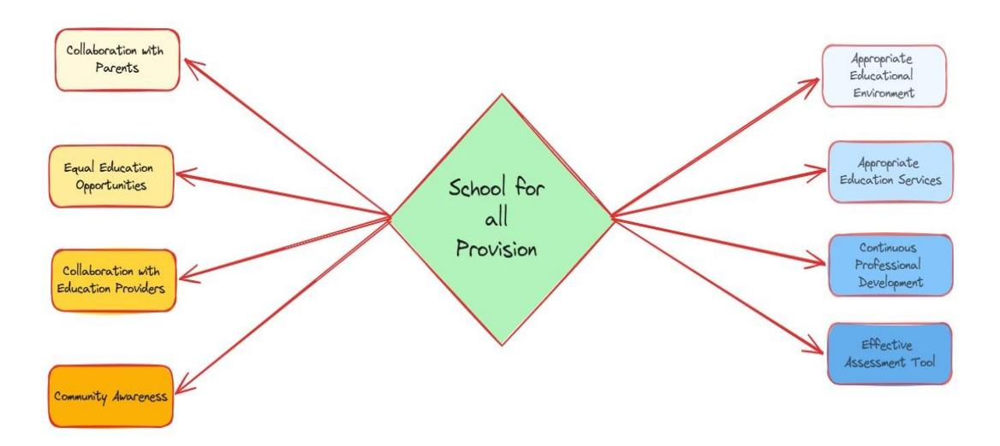
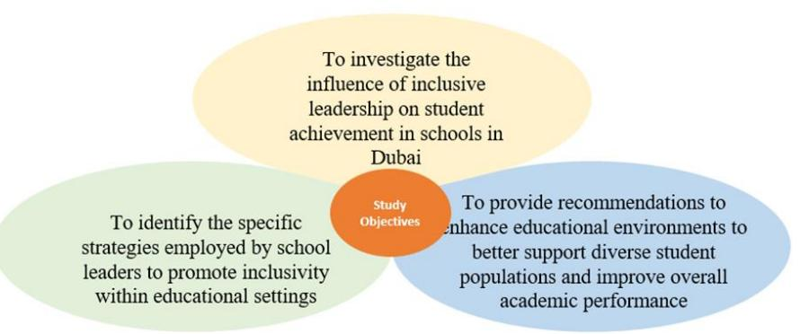
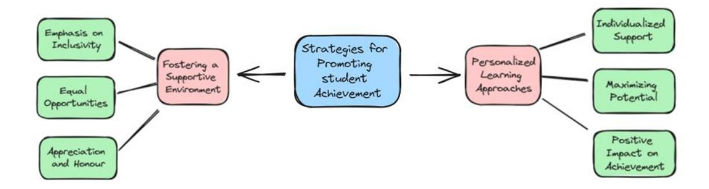
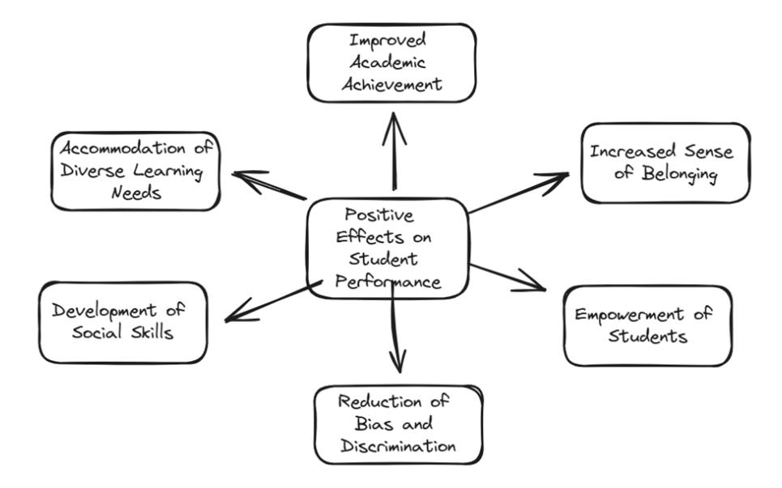
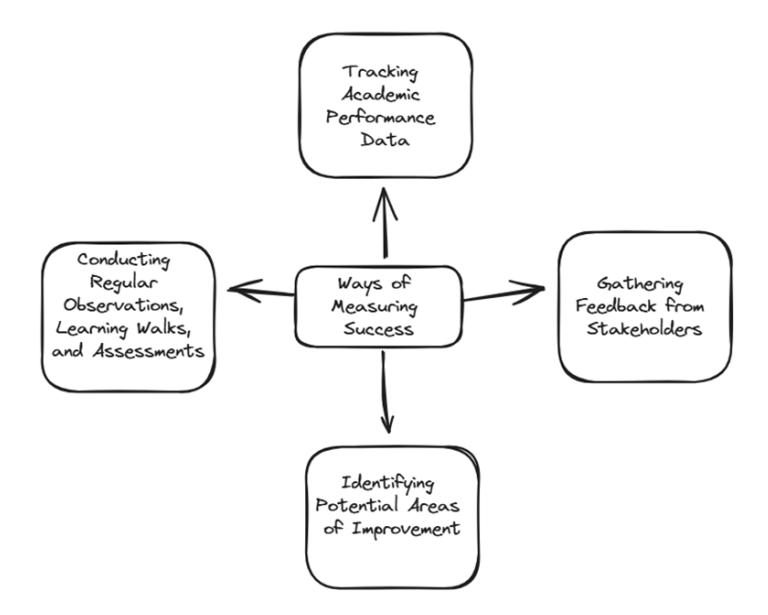
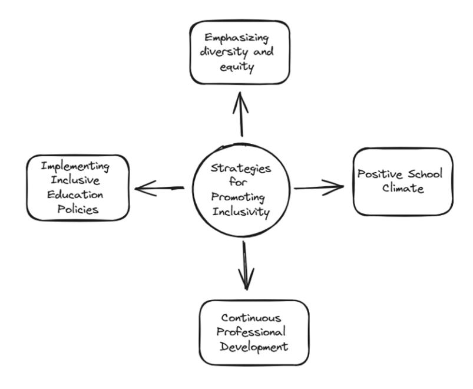

<!-- A3.R19 | source: papers_json/A3.R19/ -->

## **The Influence of Inclusive Leadership on Student Achievement ** **in Dubai Schools from Inclusion Leaders' Perspectives**

Muntaha Badawieh^1^ Abdulai Abukari ^1^

1. Faculty of Education, The British University in Dubai, P. O. Box 345015, Dubai, UAE

*Corresponding author's email: [23000570@student.buid.ac.ae](mailto:23000570@student.buid.ac.ae)

<!-- page 2 -->

**The Influence of Inclusive Leadership on Student **

**Achievement in Dubai Schools from Inclusion Leaders' **

**Perspectives**

**Abstract**

Inclusive leadership significantly contributes to the success of the school community, so

it reflects positively on overall school dynamics by implementing practices so that all

learners, including students with disabilities and special education conditions, have equal

prospects for academic success. However, despite the recognition of the importance of

inclusive practices, there is a need to understand how inclusive leadership specifically

influence students' achievement. This paper focuses on understanding how inclusive

leadership influence students' academic achievements and its overall impact on school

dynamics. Based on two Ministry of Education private schools in Dubai, the paper

utilises a qualitative research approach in which in-depth semi-structured interviews were

conducted with two heads of inclusion from different private schools in Dubai.

Participants were purposively selected based on their expertise and experience in leading

inclusive initiatives within their respective schools. Data collected from interviews was

analyzed thematically. The finding shows that inclusive leadership plays an important

role in promoting student achievement, in addition to fostering inclusivity in educational

settings.

**Keywords:**

**Keywords: **inclusive leadership, inclusive education, SEND, inclusion

© 2024 Journal for Researching Education Practice and Theory

41

<!-- page 3 -->

## **1. Introduction**

In the United Arab emirates Inclusion has gained a crucial importance in the educational setting during the last decade due to its significance of including the students with disabilities and special educational needs who labelled as students of determination in the UAE by giving them equal education opportunity with their same aged peers despite their background, cultural differences and their educational performance (Jackson 2020), by providing them with provisions within the school setting that aimed to address their individual needs. Over the years many laws and legislation have been released to structure a formal education system (Kippels & Ridge 2019), which aims to protect the rights of those majority of students and guarantee their equal access to education (Gaad 2019). In 2006, the UAE introduced Law No. 29, which was a groundbreaking legislation focused on protecting the educational rights of individuals with diverse educational needs (Anati & Ain 2012). This legislation was a crucial step towards promoting inclusivity and ensuring access to appropriate educational opportunities (Badawieh, Abukari & Gaad 2023).

Following the enactment of Law No. 29, in 2010, the Ministry of Education MOE has lunched the "school for all provision initiative" to create comprehensive guidelines for schools in order to provide best provisions for students who will benefit from inclusive education and tailored programs (Usman 2019). Furthermore, this initiative has been developed in collaboration with the Ministry of Social Affairs and aimed to enhance

<!-- page 4 -->

inclusion in education by providing a handbook for policymakers, educators, and school leaders that includes essential guidelines for fostering an inclusive educational atmosphere for all learners including the students of determination (Alborno & Gaad 2014). (See Figure 1).

***Figure 1** *The School for all Provision**

## **1.1 Context Statement**

Dubai, as a rapidly growing cosmopolitan city, is home to a diverse population with varying cultural backgrounds and educational needs. In this context, understanding the inclusive leadership influence on students' achievement is crucial for ensuring that schools in Dubai are adequately equipped with all needed resources for high quality education.

<!-- page 5 -->

## **1.2** **Statement of the Research Problem**

In Dubai schools, inclusive leadership is a significant element in creating educational atmosphere that promotes diversity and inclusivity for all students (Massouti, Rashaida, & Alhosani 2024). In this context, understanding the positive impact of inclusive leadership on students' achievement is crucial for ensuring school's success (Addison 2019). However, despite acknowledging the significance of inclusive practices, there is a necessity to understand how inclusive leadership positively influence students' academic achievements and overall school performance (Massouti, Shaya, & Abukhait 2023). This goes back to the core objective of this research, which aims "to explore how inclusive leadership practices influence students' academic success in two schools located in Dubai." The study seeks to offer crucial recommendations and valuable insights for enhancing educational achievements for all learners in Dubai schools.

## **1.3 Study Purpose and Objectives**

The central goal of this research is to investigate the influence of inclusive leadership practices and how it particularly impact students' achievement in two schools in Dubai. By exploring the perspectives of inclusion leaders by conducting semi-structured interviews to collect data in order to identify the effective strategies implemented by schools' inclusion leaders for promoting inclusivity within schools' settings by focusing on three study objectives. The first study objective involves examining how leadership

<!-- page 6 -->

practices that prioritize inclusivity impact the academic performance and overall success of students within the educational setting. The second study objective focuses on identifying the specific strategies employed by school leaders to promote inclusivity within educational settings. This includes exploring the various approaches, policies, and initiatives implemented by school administrators. The third study objective aims to provide recommendations to enhance educational environments to better support diverse student populations and improve overall academic performance. (See figure 2)

***Figure 2** *Study Objectives**

## **1.4 Research Questions**

Main research question:

How does inclusive leadership influence student achievement in Dubai schools?

To effectively address the main research question, three sub-questions will be

<!-- page 7 -->

explored and answered in detail:

- 1. What are the strategies adhered by school inclusion leaders to promote inclusivity in context of Dubai schools?
- 2. How does inclusive leadership influence students' achievements?
- 3. What are the recommendations to enhance educational environments to better support diverse student populations and improve overall academic performance?

## **1.5 Rationale of Study**

Professional rationale as a head of inclusion in a school in Dubai, understanding the impact of inclusive leadership and its influence on students' achievement is crucial. Thus, by conducting this study the researcher will gain valuable insights on effective strategies the inclusion leaders in other schools in Dubai adhere that promote inclusivity, and address the needs of diverse learners, and ultimately improve academic outcomes and achievements.

## **1.6 Significance of the Study**

46 © 2024 Journal for Researching Education Practice and Theory This research holds importance in shedding light on inclusive leadership's role in influencing students' achievements and their experiences within school settings. Hence, by exploring how inclusive practices influence student outcomes and identifying effective strategies implemented by inclusion leaders for promoting inclusivity, the findings can inform decision-making processes to enhance educational environments to better support

<!-- page 8 -->

diverse student populations and improve overall academic performance.

## **1.7 Definitions of Key Terms**

*Inclusion in Education*

Inclusion in Education proposes the significance of including students with unique and special education conditions into the regular educational setting by providing them with essential provision to succeed (Lieberman, Houston-Wilson & Grenier 2024). This involve providing those students with needed accommodations or modifications to thrive academically, socially, and behaviourally (Kushwaha et al., 2024). Furthermore, the goal of inclusion can be reached through creating an educational environment where all students feel appreciated, welcome, and valued, regardless of any barriers they may have (Badawieh, Abukari & Gaad 2023).

*Inclusive leadership*

Inclusive leadership is a management approach that to aims to create a community where all individuals are respected, valued, and included (Kuknor & Bhattacharya 2022). In the context of educational institutions like schools, this leadership approach significantly contributes to formulate an empowering and supportive educational climate for learners and the key stakeholders (Carter & Abawi 2018).

*Inclusive education*

Inclusive education is a practice that embraces the full engagement of all students,

© 2024 Journal for Researching Education Practice and Theory

<!-- page 9 -->

including students with individual educational needs, in age-appropriate education classrooms (Bessarab et al., 2023). Furthermore, the inclusive education philosophy insets that all learners are competent learners, regardless of any challenges or barriers they may face (Barnard & Henn 2023). This means that schools and classrooms operate under the belief that all students can succeed and learn, just like their non-disabled peers (Gaad, 2019).

## *SEND*

SEND stands for Special Educational Needs and Disabilities. When a student has special condition that hinder their ability to access the school curriculum and campus (Elhoweris & Efthymiou 2020). In such cases, the school is required to intervene to provide appropriate support for the student to access the school environment and curriculum effectively (Gaad, 2019). With the context of inclusive education those students are eligible for special education provision that tailored to meet the identified individual needs for each learner within the school setting (Badawieh, Abukari & Gaad 2023).

48 © 2024 Journal for Researching Education Practice and Theory This study encompasses five distinct chapters. The first chapter typically lays the foundation for the research, providing background information and setting the context for the subsequent chapters. The second chapter delves into the analysis of existing literature about leadership, including the theoretical framework and review of related literature. Third chapter focuses on Methodology, detailing the research approach and plan. In the

<!-- page 10 -->

fourth chapter, findings from semi-structured interviews are presented and analyzed. Lastly, chapter 5, includes recommendations and discussion which provided based on the findings to offer insights, implications, and suggestions for future research or practical applications.

## **2 Literature Review** **and Theoretical Framework**

## **2.1 Instructional Leadership Theory (IL)**

Research indicates that Instructional leadership is identified as a crucial characteristic of successful schools (Ma & Marion 2021). Some academic literature from worldwide educational settings suggests that students' academic performance is predominantly shaped by the teaching methods employed in the classroom and the leadership style adopted by educators (Munna 2023). According to Rodrigues & Ávila de Lima (2024) this theory encompasses various models and approaches to leadership that focus on improving teaching and learning within educational settings such as prompting effective communication and a culture of continuous professional development.

Additionally, Instructional Leadership underscores the significance of school leaders in bolstering and improving instructional methods to ultimately elevate student academic performance (Day, Gu & Sammons 2016). Rodrigues & Ávila de Lima (2024) claimed that this theory posits that school leaders, such as principals, significantly contributes to shaping the teaching atmosphere, setting high expectations for both teachers and students,

<!-- page 11 -->

monitoring progress, and providing support for instructional improvement which are a crucial element of Instructional Leadership. For instance, when principal and school leaders regularly observe classroom instruction to ensure that teachers are following best practices and providing high-quality education to students and being actively involved in the teaching process, in this regards they set a clear example for teachers to follow in their classrooms and emphasizes the importance of continuous improvement.

Furthermore, Instructional leadership theory is vital for driving improvements in student achievement by cultivating an environment that encourages ongoing learning and development within the school community (Kilag & Sasan 2023). For instance, by focusing on enhancing teaching practices, setting high expectations, and providing necessary support, instructional leaders can positively impact the quality of education provided to students (Kemethofer, Helm, & Warwas 2022). Furthermore, instructional leadership theory underscores the significance of effective leadership in promoting student success through targeted efforts to enhance teaching practices and create a positive learning environment (Day, Sammons & Gorgen 2020).

Rodrigues & Ávila de Lima (2024) in their study on instructional leadership from leaders' perspectives highlighted Four crucial elements of leadership practices that significantly impact students' overall learning where leaders can steer their organizations towards success:

1. Provide a sense of purpose and direction for the organization towards common

<!-- page 12 -->

goal.

- 2. Developing people through training, mentorship, coaching, and providing growth opportunities.
- 3. Structuring the company in a way that aligns with its strategic objectives and enhances efficiency.
- 4. Overseeing teaching methodologies, curriculum development, student engagement strategies, and assessment practices.

In summary, it is crucial to recognize the significant impact instructional leadership has on shaping the educational environment in schools and its vital influence on student achievement and overall school dynamics. This is achieved by emphasizing the diverse responsibilities of school leaders in promoting educational excellence through effective teaching methods, maintaining high academic standards, supporting teachers, and fostering collaborative teamwork where all stakeholders can thrive.

## **2.2 Transformational Leadership Theory**

Transformational Leadership Theory is a well-known leadership approach that focuses on the role of leaders in leading and how they can act as an ideal model for motivating and inspiring their followers to achieve exceptional results (Nabi, Liu & Hasan 2023). This theory posits that effective leaders can create significant change by formulating a powerful vision, providing individualized support, promoting motivation, and encouraging a positive organizational community (Shields, 2017).

<!-- page 13 -->

Furthermore, in the educational setting, transformational leadership principles have been linked to enhance student performance, achievement, and increase students' commitment (Tan, Dimmock & Walker 2024). However, it is important to note that effective transformational leadership pivot on contextual aspects such as the nature of task or situation, as well as followers' characteristics, and the leader's personality (Bakker et al., 2023). For instance, school leaders who embody the principles of Transformational Leadership Theory can significantly impact the school environment and students' overall outcomes by consistently communicating a compelling vision for academic excellence to teachers, students, and parents, these leaders set an example for others to follow. The result will be reflected on school environment where teachers are motivated to excel, students are engaged in their learning process, and overall academic performance improves significantly.

According to Sustiyatik (2023) transformational leaders are able to establish an emotional connection with their employees, nurturing loyalty and commitment through charisma. Furthermore, they have clear vision on how to lead and motivate their followers to succeed (Bakker et al., 2023). Moreover, emotional intelligence is also crucial for transformational leaders as it enables them to enhance their comprehension and control of their own emotions and those of the people they lead (Munir, Shakeel & Waheed 2023). For instance, if the school principal regularly engages in one-on-one meetings with leaders who follow him to understand their individual needs, challenges,

<!-- page 14 -->

aspirations, showing empathy and support, that will lead to nurturing loyalty and commitment among the school leaders and teaching staff.

## **2.3 Inclusive Leadership Influence on Students' Achievement**

In the context of education, the concept of inclusion is increasingly being recognized as crucial element in the leadership process (Precey & Mazurkiewicz 2013). Mbua (2023) emphasized that inclusion is a significant challenge that continues to gain prominence in the educational setting.

In order to achieve inclusivity in school setting the school leaders must adheres to Inclusive leadership styles which encompasses essential practices aimed at promoting inclusive education at school community and lead to enhance education for all (Uy et al., 2024). However, these practices include raising awareness within the school community on the rights of all students, educating teachers, administrators and all stakeholders working with the children and developing system for effectively implement inclusive education and overall school polices (Massouti, Shaya & Abukhait 2023).

Moreover, while inclusive leadership involves fostering positive relationships among students from diverse backgrounds, much research has indicated that inclusive leadership behaviours, such as promoting collaboration, providing support for diverse learners particularly reflects on student achievement (Hollowell 2019). According to Óskarsdóttir (2020) inclusive leadership practices positively influence student engagement, motivation,

<!-- page 15 -->

and academic performance. Furthermore, Inclusive leadership involves fostering attitudes and behaviors that actively work to eliminate obstacles for individuals who are vulnerable to discrimination and social marginalization (Mbua 2023). Moreover, effective leaders need to be able to critically analyze institutional systems and attitudes, challenge biased or harmful policies and practices, and ensure student well-being (Mbua 2023).

## **3 Methodology**

Research methodology refers to the planned and systematic approach employed in conducting research studies (Mohajan, 2018). Furthermore, the methodology is crucial in conducting research as it delineates the specific steps and procedures that researchers will adhere to in order to carry out their study, and it ensures that researchers remain focused on their research objectives and stay on course throughout the study (Creswell & Creswell, 2017).

## **3.1 Research Approach **

A qualitative research approach has been employed in this study by holding two in-depth, semi-structured interviews with two inclusion leaders in Dubai schools regarding inclusive practices, strategies implemented, and their influence on students' achievement by understanding the perception of the participants. This approach enables the researcher to get an overview of the surrounding inclusive leadership practices in

<!-- page 16 -->

Dubai schools and their influence on student achievement.

## **3.2 Research Site and Access **

This study was carried out in two MoE private schools in Dubai. Prior to initiating the interviews, the researcher obtained signed consent from the principals (Appendix A) to gain access to the schools' premises. This step ensured that all necessary permissions were granted, and ethical considerations were met.

## **3.3 Data Collection Plan **

The researchers utilized in-depth semi-structured interviews as a method for data collection with two inclusion leaders from two different MoE private schools in Dubai (Creswell & Creswell (2017). Furthermore, by conducting semi-structured interviews, researchers can gain insight into participants' experiences and attitudes towards a specific phenomenon (Saunders et al., 2015). Thus, the interviews gave a chance for the researchers to gather data in flexible way while ensuring that key topics related to inclusive leadership and student achievement were covered. Furthermore, each interview was carried out in a one-on-one setting to encourage open and detailed responses from the participants.

## Sampling Strategy

• Purposive Sampling: The participants were chosen depended on their expertise

<!-- page 17 -->

and experience in leading inclusion at their schools.

• *Inclusion Criteria:* The participant must have inclusive initiatives experience within their respective schools.

## **3.4 Data Analysis **

The research employed thematic analysis method to analyse the interview transcripts and identify recurring patterns and themes within the data. Thematic analysis is a method that enables researchers to analyse the collected data in the form of visual or textual information in a flexible way (Dawadi 2021). The researchers selected this method because it allows for a systematic but flexible approach to analysing the collected date and helps in uncovering insights into the perspectives of inclusion leaders on the research topic.

The data collected was analyzed by the researchers, who focused on four specific areas:

- 1. Strategies Implemented by Inclusive Leaders to Promote Student Achievement
- 2. Positive Effects of Inclusive Leadership Practices on Student Performance
- 3. Measuring Success of Inclusive Leadership Initiatives in Student Achievement
- 4. Strategies Employed by School Leaders to Promote Inclusivity

## **3.5 Limitations**

1. Small sample size of inclusion leaders interviewed.

<!-- page 18 -->

- 2. Potential bias in self-reported data from interviewees.
- 3. Difficulty in generalizing findings to all Dubai schools due to unique contextual factors.
- 4. Challenges in measuring the lasting effects of inclusive leadership on student achievement.

## **3.6 Ethical Consideration **

Ethical considerations were utmost importance throughout all phases of this research. All participants were provided with informed consent, to ensure their confidentiality and anonymity and researcher has ensured that informed consent is obtained from the participants before conducting the interviews (Appendix B). The researcher stuck to the principles of beneficence and non-maleficence when interacted with participants to maintain ethical standards and safeguard their rights during the research process. Participation was entirely voluntary and was addressed in the informed consent provided to participants. Confidentiality and anonymity of the participants were maintained throughout the research process. Additionally, any personal or sensitive information shared by the participants handled with care and respect.

## **4 Findings **

Findings from semi-structured interviews with inclusion leaders underscored the significant role of inclusive leadership in promoting student achievement, in addition to fostering inclusivity in educational settings. Summarized in the table below.

<!-- page 19 -->

## **4.1 Strategies Employed by School Leaders to Promote student Achievement**

The inclusion leaders highlighted several strategies they have implemented to promote student achievement. These strategies include creating a Supportive Environment where the leaders emphasized fostering an environment that promotes support to ensure all students feel appreciated and honoured through giving equal opportunities for all. Additionally, they mentioned implementing personalized learning approaches, ensuring every student receives the necessary support to excel will reflect positively on students' academic achievement.

<!-- page 20 -->

Furthermore, the participants focused on conducting continuous professional sessions for teachers. For instance, one educational leader has demonstrated her impactful role in delivering professional development sessions that cover all aspects of inclusive education. These sessions have been designed to address the unique needs of each teacher, enabling them to effectively differentiate instructional activities within their classrooms. Hence, by tailoring teaching methods to cater to individual students' abilities and learning styles, teachers were better equipped to build an inclusive learning environment where each student can thrive and succeed. This approach not only support students with diverse learning needs but also enhances classroom engagement that leading to fostering a more inclusive and effective educational experience for all (See figure 3).

***Figure 3** *Strategies Employed by School Leaders to Promote Student Achievement**

## **4.2 Positive Effects of Inclusive Leadership Practices on Student Performance**

Inclusive leadership practices have been identified as essential components of

<!-- page 21 -->

effective educational institutions. The leaders in this context have shared specific instances of how these practices have positively influenced student performance and overall well-being. For example, one of the inclusion leaders regularly checks in with students from diverse backgrounds and actively seeks their input on school policies which positively contributed to create a sense of belonging and empowerment to those students which reflected significantly on their achievements.

Firstly, effective inclusive leadership has resulted in enhanced educational experience for students through the provision of necessary accommodations and curriculum adaptation, both leaders shared successful stories of their leadership style influence on students achieves. For instance, one leader shared an example of a student with dyslexia who was struggling with reading assignments. By providing the student with text-to-speech software and additional time on exams, the leader enabled the student to access the same learning opportunities as their peers, ultimately leading to academic success. Moreover, the leader mentioned implementing a flexible seating policy in their classroom, which benefited students with ADHD by allowing them to move around during lessons, thereby improving their focus and engagement in learning which positively reflect on their well-being. For example, under the flexible seating policy, students are given a choice of where they can sit during lessons. This includes traditional desks and chairs, as well as alternative options such as bean bags, exercise balls, and standing desks. This policy is designed to reduce barriers to learning for each student by

<!-- page 22 -->

allowing them to find a seating arrangement that best suits their learning style. However, for students with ADHD, this flexibility has proven particularly beneficial in improving concentration levels and increase their engagement in learning activities.

Moreover, Inclusive leadership practices have been demonstrated to enhance social and emotional well-being for each student. Both leaders mentioned that all classrooms are differentiated based on individual needs, ensuring that all students receive appropriate instruction and support. Additionally, assessments are accommodated for students based on their level of performance, which can create a more equitable classroom atmosphere that raises everyone's self-esteem and lets them feel happy and included. Both leaders emphasized that such practices had a positive impact on students' confidence during exams, which reflected in their marks.

One leader shared an example of a student who was initially reluctant to participate in class discussions due to anxiety. Through individualized attention and accommodations tailored to the student's needs, the leader helped raise the student's confidence and encouraged them to engage more actively in class activities, and this not only led to improved academic performance but also helped foster a sense of self-worth and well-being for the student. (See figure 4)

<!-- page 23 -->

***Figure 4 ** *Positive Effects of Inclusive Leadership Practices on Student Performance**

## **4.3 Determining Success of Inclusive Leadership Initiatives in Student Achievement**

To determine the success of the inclusive leadership initiatives in terms of student achievement, the leaders mentioned using various metrics, including tracking academic performance data to assess the impact of their initiatives on student achievement, gathering feedback from students, parents, and teachers through surveys, conducting regular observations, learning walks, and assessments for monitoring in order to identify any potential areas of improvement.

One approach that has been mentioned by both leaders to track students' academic performance, involved analysing grades, attendance rates, and standardized test scores.

<!-- page 24 -->

For instance, they mentioned that comparing the academic performance data of students before and after the implementation of inclusive leadership initiatives provided accuracy of the students' data regarding their achievements. Furthermore, regular observations, learning walks, and assessments were also crucial practices the leaders used to implement for monitoring progress and identifying potential areas for improvement.

To encapsulate, these methods allowed the inclusion leaders to directly observe classroom practices and interactions between students and teachers to collect data on student engagement levels, teacher effectiveness, and overall school climate, which significantly helped them make informed decisions about adjusting their strategies to better support student achievement. (See Figure 5)

***Figure 5** *Measuring Success of Inclusive Leadership Initiatives in Student Achievement**

<!-- page 25 -->

## **4.4 Strategies Employed by School Leaders to Promote Inclusivity**

The school leaders shared steps they have taken to promote inclusivity within the educational environment for all students, such as emphasizing diversity and equity within the school community to ensure every student feels included and valued. Moreover, developing and putting into practice inclusive education policies that address the entails of diverse learners and promote a sense of belonging. These policies are designed to address the unique challenges and requirements of students from different backgrounds, abilities, and learning styles.

Additionally, the school leaders mentioned that they worked towards providing additional support and resources for diverse learners, including offer specialized programs, services, provisions, and accommodations. For instance, leaders mentioned the importance of implementing the English Language Learners (ELL) program within their respected schools, which aimed to provide intensive English language instruction to students who have not yet attained a satisfactory level of proficiency in the English language as well as content area instruction that tailored to their individual needs by providing them with extra pull-out support sessions, where those students are attending ELL classes during the school day in addition to their regular classes. Thus, by providing such support, the schools can ensure that each student is provided with equitable opportunities for academic, behavioural, and social success. (See Figure 6)

<!-- page 26 -->

***Figure 6 ** *Strategies Employed by School Leaders to Promote Inclusivity**

## **5 Conclusion**

The findings from semi-structured interviews highlighted the significance of leaders role in promoting student achievement and fostering inclusivity in educational settings. Thus, by implementing effective strategies such as creating a supportive learning environment, providing tailored support to diverse learners, measuring success through relevant metrics, addressing discrimination proactively, and promoting cultural awareness, school leaders can enhance student outcomes and cultivate a more inclusive school community. This finding point is consistent with the study by Hollowell (2019) Future research could focus on conducting cross-cultural comparative studies to examine how

<!-- page 27 -->

inclusive leadership practices vary across different cultural contexts for generalization of the findings and identify best practices that can be applied in diverse educational settings worldwide.

Future studies could further explore the nuances of inclusive leadership across different cultural contexts to enrich our understanding of its impact on student achievement. Additionally, it is strongly suggested to expand the sample size which can be achieved by reaching out to more schools and inclusion leaders within Dubai to gather a more diverse range of perspectives to enhance the generalizability and reliability of the research findings. Additionally, comparing inclusive leadership practices and student achievement outcomes in various school settings, researchers can identify common trends or differences that may exist across different school contexts. Moreover, examining common trends or disparities in how inclusive leadership is implemented and its impact on student success across various educational contexts, scholars can identify best practices that transcend specific environments. Such comparative studies can shed light on universal principles of effective inclusive leadership that are applicable across diverse school settings.

<!-- page 28 -->

## **References**

- Addison, M. P. (2019). How Private International School Leaders Meet The National Education Transformation Agenda In Dubai.
- Elhoweris, H., & Efthymiou, E. (2020). Inclusive and special education in the Middle East. In Oxford Research Encyclopedia of Education.
- Alborno, N. E., & Gaad, E. (2014). 'I ndex for I nclusion': a framework for school review in the U nited A rab E mirates. British Journal of Special Education, 41(3), 231-248.
- Anati, N. M., & Ain, A. (2012). Including students with disabilities in UAE schools: A descriptive study. International journal of special education, 27(2), 75-85.
- Badawieh, M. (2023). Examine the effectiveness of developing and implementing the individual education plan for students of determination in one private school in Dubai and the impact on their inclusivity in the regular classroom setting: A Case Study (Doctoral dissertation, The British University in Dubai).
- Badawieh, M., Abukari, A., & Gaad, E. (2023, May). Educating Learners with SEND in One Private Mainstream School in Dubai: Effectiveness and Challenges of Policy Implementation. In BUiD Doctoral Research Conference 2022: Multidisciplinary Studies (pp. 57-66). Cham: Springer Nature Switzerland.
- Bakker, A. B., Hetland, J., Olsen, O. K., & Espevik, R. (2023). Daily transformational leadership: A source of inspiration for follower performance?. European

<!-- page 29 -->

- Management Journal, 41(5), 700-708.
- Barnard, R. W., & Henn, R. H. (2023). Overcoming Learning Obstacles: Strategies for Supporting Students with Diverse Needs. Open Access Library Journal, 10(8), 1-14.
- Bessarab, A., Antonenko, I., Turubarova, A., Smoliak, V., & Morenko, O. (2023). Inclusive education:: strategies and methods of implementation in the context of modern pedagogy. Cadernos de Educação Tecnologia e Sociedade, 16(se2), 165-177.
- Bush, T. (2020). Theories of educational leadership and management.
- Carter, S., & Abawi, L. A. (2018). Leadership, inclusion, and quality education for all. Australasian Journal of Special and Inclusive Education, 42(1), 49-64.
- Cotterill, T. (2023). A Student Guide to the SEND Code of Practice: Exploring Key Areas of Need. Taylor & Francis.
- Council for Exceptional Children. (2021). What is Special Education? Retrieved from https://www.cec.sped.org/what-is-special-education/
- Creswell, J. W., & Creswell, J. D. (2017). Research design: Qualitative and mixed methods approaches (4th ed.). Sage Publications.
- Dawadi, S. (2021). Thematic analysis approach: A step by step guide for ELT research practitioners. Journal of NELTA, 25(1-2), 62-71.
- Day, C., Gu, Q., & Sammons, P. (2016). The impact of leadership on student

<!-- page 30 -->

- outcomes: How successful school leaders use transformational and instructional strategies to make a difference. Educational administration quarterly, 52(2), 221-258.
- Day, C., Sammons, P., & Gorgen, K. (2020). Successful School Leadership. Education development trust.
- Gaad, E. (2019). Educating learners with special needs and disabilities in the UAE: Reform and innovation. Education in the United Arab Emirates: Innovation and Transformation, 147-159.
- Hollowell, C. (2019). Culturally responsive school leadership: How principals use culturally responsive leadership strategies to develop engaging and inclusive school environments for all students (Doctoral dissertation, Brandman University).
- Jackson, K. M. (2020). A Comparative Study of Leadership Styles in International Special and General Education Schools in the United Arab Emirates.
- Kemethofer, D., Helm, C., & Warwas, J. (2022). Does educational leadership enhance instructional quality and student achievement? The case of Austrian primary school leaders. International Journal of Leadership in Education, 1-25.
- Kilag, O. K. T., & Sasan, J. M. (2023). Unpacking the Role of Instructional Leadership in Teacher Professional Development. Advanced Qualitative Research, 1(1), 63-73.

<!-- page 31 -->

- Kippels, S., & Ridge, N. (2019). The growth and transformation of K–12 education in the UAE. Education in the United Arab Emirates: Innovation and transformation, 37-55.
- Kuknor, S. C., & Bhattacharya, S. (2022). Inclusive leadership: new age leadership to foster organizational inclusion. European Journal of Training and Development, 46(9), 771-797.
- Kushwaha, R. K., Tripathi, A., Singh, C., & Yadav, M. K. (2024). Inclusive Education. Blue Rose Publishers.
- Lieberman, L. J., Houston-Wilson, C., & Grenier, M. (2024). Strategies for inclusion: Physical education for everyone. Human Kinetics.
- Ma, X., & Marion, R. (2021). Exploring how instructional leadership affects teacher efficacy: A multilevel analysis. Educational Management Administration & Leadership, 49(1), 188-207.
- Massouti, A., Shaya, N., & Abukhait, R. (2023). Revisiting leadership in schools: Investigating the adoption of the Dubai inclusive education policy framework. *Sustainability*, *15*(5), 4274.
- Massouti, A., Al-Rashaida, M., & Alhosani, M. (2024). A qualitative study on Dubai's inclusive education policy from school leaders' perspectives. Sustainability, 16(3), 1252.
- Mbua, E. M. (2023). Principal leadership: Raising the achievement of all learners in

<!-- page 32 -->

- inclusive education. American Journal of Education and Practice, 7(1), 1-25.
- Ministry of Education (MOE). (2010). School for All: General rules for the provision of special education programs and services (Public & Private Schools) [online]. UAE: Dubai. [Accessed 11 June 2024]. Available at: [http://www.moe.gov.ae/English/Documents/Rules/SNrulesEn.pdf](http://www.moe.gov.ae/English/Documents/Rules/SNrulesEn.pdf)
- Ministry of Social Affairs. (2006). UAE Federal Law No. 29 of the year 2006 on the Rights of People with Special Needs. UAE: Ministry of Social Affairs Publications [Online]. [Accessed 5 June 2024]. Available at: [https://u.ae/en/information-and-services/education/education-for-people-with-spe](https://u.ae/en/information-and-services/education/education-for-people-with-special-needs) [cial-needs](https://u.ae/en/information-and-services/education/education-for-people-with-special-needs)
- Mohajan, H. K. (2018). Qualitative research methodology in social sciences and related subjects. Journal of economic development, environment and people, 7(1), 23-48.
- Munir, S., Shakeel, M., & Waheed, K. Z. (2023). The importance of Emotional Intelligence for Transformational Leaders: a critical analysis. Pakistan Journal of Humanities and Social Sciences, 11(1), 332-339.
- Munna, A. S. (2023). Instructional leadership and role of module leaders. International Journal of Educational Reform, 32(1), 38-54.
- Nabi, M. N., Liu, Z., & Hasan, N. (2023). Examining the nexus between transformational leadership and follower's radical creativity: the role of creative

<!-- page 33 -->

- process engagement and leader creativity expectation. International Journal of Emerging Markets, 18(10), 4383-4407.
- Óskarsdóttir, E., Donnelly, V., Turner-Cmuchal, M., & Florian, L. (2020). Inclusive school leaders–their role in raising the achievement of all learners. Journal of Educational Administration, 58(5), 521-537.
- Precey, R., & Mazurkiewicz, G. (2013). Leadership for inclusion: An overview. Leadership for inclusive education, 105-119.
- Rodrigues, H. P. C., & Ávila de Lima, J. (2024). Instructional leadership and student achievement: school leaders' perspectives. International Journal of Leadership in Education, 27(2), 360-384.
- Saunders, M., Lewis-Peacock J., & Thornhill A.(2015). Research methods for business students: A practical guide (7th ed.). Pearson Education Limited.
- Shields, C. M. (2017). Transformative leadership in education: Equitable and socially just change in an uncertain and complex world. Routledge.
- Sustiyatik, E. (2023). The dual pillars of academic excellence: Transformational leadership and organizational commitment. Journal of Innovation in Business and Economics, 7(01), 79-88.
- Tan, C. Y., Dimmock, C., & Walker, A. (2024). How school leadership practices relate to student outcomes: Insights from a three-level meta-analysis. Educational Management Administration & Leadership, 52(1), 6-27.

<!-- page 34 -->

- Usman, F. M. (2019). From disabling concepts to enabling policies: rethinking inclusion of students with special needs in Dubai's private schools (Doctoral dissertation, Doctoral thesis, University of Calgary]. PRISM: University of Calgary's Digital Repository.
- Uy, F., Andrin, G., Vestal, P., Malbas, M., Barcelo, M. N., & Kilag, O. K. (2024). Empowering Education: The Impact of Democratic School Leadership on Educational Outcome. International Multidisciplinary Journal of Research for Innovation, Sustainability, and Excellence (IMJRISE), 1(3), 178-184.

<!-- page 35 -->

## **Appendices **

## Appendix A: Consent form from school principal

Dear Principal,

I am a postgraduate student undertaking a **PhD at The British University in Dubai** and I am conducting research for my doctoral research. Here is a brief introduction to my research:

The aim of this research focuses on understanding the influence of inclusive leadership on student achievement in Dubai schools and its impact on fostering an educational system that promotes excellence, equity, and inclusivity. The main research question guiding this study is:

"How does inclusive leadership influence student achievement in Dubai schools?"

The objectives of this study are as follows:

- 1. To investigate the influence of inclusive leadership on student achievement in schools in Dubai.
- To identify the specific strategies employed by school leaders to promote inclusivity within educational settings.
- To provide recommendations to enhance educational environments to better support diverse student populations and improve overall academic performance.

This study will employ a qualitative research approach to gain an in-depth understanding of the research problem through conducting semi-structured interviews with inclusion leaders.

Thematic analysis will be employed to identify patterns, themes, and insights from the interview transcripts.

Purposive sampling will be used to select participants. The participants will be selected based on their expertise and experience in leading inclusion at the school.

I assure you that all necessary ethical considerations will be strictly adhered to throughout the research process. The data collected will be handled with utmost confidentiality and used solely for academic purposes.

Please complete the form at the bottom of this letter and return it to the researcher. If you would like to receive more information about the study, please contact me at 0543588300.

Thank you,

Muntaha Badawieh

Doctor of Education in Special and Inclusive Education

The British University in Dubai.

CONSENT FORMschool:....................................□ I give permission for the research being carried out by Muntaha Badawieh at The British University in Dubai.□ I do NOT give permission for the research being carried out by Muntaha Badawieh at The British University in DubaiSignature(s) of principal:....................................Date:....................................PLEASE RETURN THIS FORM TO YOUR CHILD'S CLASS TEACHER OR DIRECTLY TO THE RESEARCHER

<!-- page 36 -->

## Appendix B: Semi- structured interview guide

Semi-Structured Interview Guide: "The Influence of Inclusive Leadership on Students Achievement in Dubai Schools from Inclusion Leaders' Perspectives"

## Introduction:

- 1. Can you please introduce yourself and your role as an inclusion leader in the school?
- 2. How long have you been working as an inclusion leader, and what motivated you to pursue this role?

## Inclusive Leadership Practices:

- 3. What does inclusive leadership mean to you in the context of a school environment?
- 4. Could you describe some specific strategies or practices you implement to promote inclusivity within the school community?
- How do you ensure that all students, including those with diverse needs, feel valued and supported in the learning environment?

## Impact on Student Achievement:

- 6. In your opinion, how does inclusive leadership contribute to enhancing student achievement in Dubai schools?
- 7. Can you share any success stories or examples where inclusive leadership has positively impacted student outcomes?
- 8. Have you noticed any specific academic or social improvements among students as a result of inclusive leadership practices?

## Challenges and Opportunities:

- 9. What are some challenges you face as an inclusion leader when implementing inclusive practices in the school?
- 10. How do you collaborate with other stakeholders, such as teachers, parents, and administrators, to overcome these challenges?
- 11. Are there any opportunities for further growth or improvement in promoting inclusive leadership within the school setting?

## Professional Development and Support:

- 12. What kind of training or professional development opportunities have helped you enhance your skills as an inclusion leader?
- 13. Do you receive adequate support from school management or external organizations to effectively carry out your role as an inclusion leader?

## Future Outlook:

- 14. How do you envision the future of inclusive leadership in Dubai schools, and what changes would you like to see in this area?
- 15. What advice would you give to aspiring inclusion leaders who aim to make a positive impact on student achievement through inclusivity?

<!-- page 37 -->

## **Appendix C: Participant Informed Consent **

I am a postgraduate student undertaking a PhD at The British University in Dubai and I am conducting research for my doctoral study. Here is a brief introduction to my research:

The aim of this research focuses on understanding the influence of inclusive leadership on student achievement in Dubai schools and its impact on fostering an educational system that promotes excellence, equity, and inclusivity. The main research question guiding this study is:

**Research Question:** "*How does inclusive leadership influence student achievement in Dubai schools?*"

**Study Description:** This study aims to explore the relationship between inclusive leadership practices in educational settings and student achievement within Dubai schools. By participating in this research, you will be contributing valuable insights to the field of education and leadership. Your participation involves engaging in a semi-structured interview that will last for 15 minutes.

Your participation in this study is voluntary. You have the right to withdraw at any time without providing a reason. Your responses will be kept confidential and anonymous. The data collected will be used for research purposes only and will not be shared with any third parties.

By participating in this study, you will contribute to advancing knowledge in the field of education and leadership. Additionally, you may gain a deeper understanding of inclusive leadership practices and their impact on student achievement. There is no risks associated with participating in this study.

If you have any questions or concerns about the research study, please feel free to contact **Muntaqa Badawieh** at [23000570@student.buid.ac.ae](mailto:23000570@student.buid.ac.ae).

By signing below, you acknowledge that you have read and understood the information provided above and voluntarily agree to participate in this research study.

above and voluntarily agree to participate in this research study.Participant's Signature:Date:
