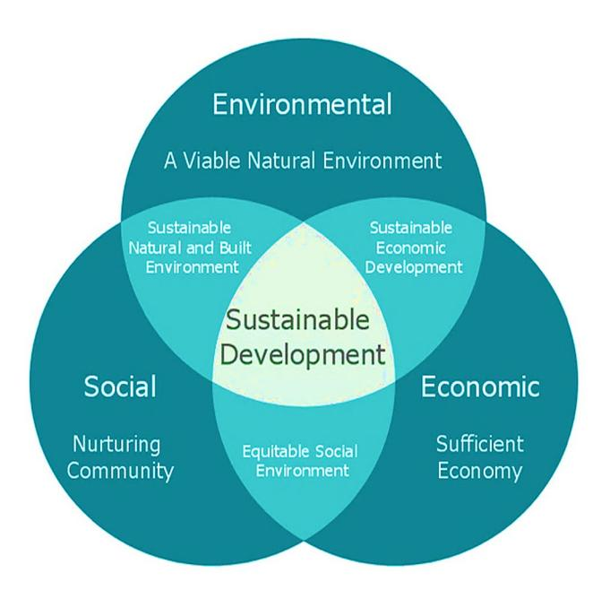
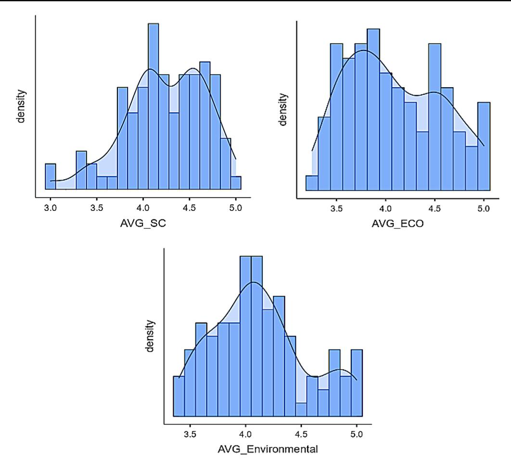
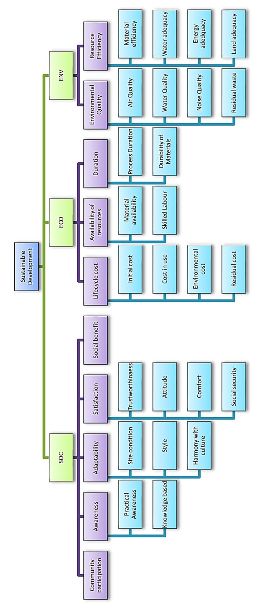
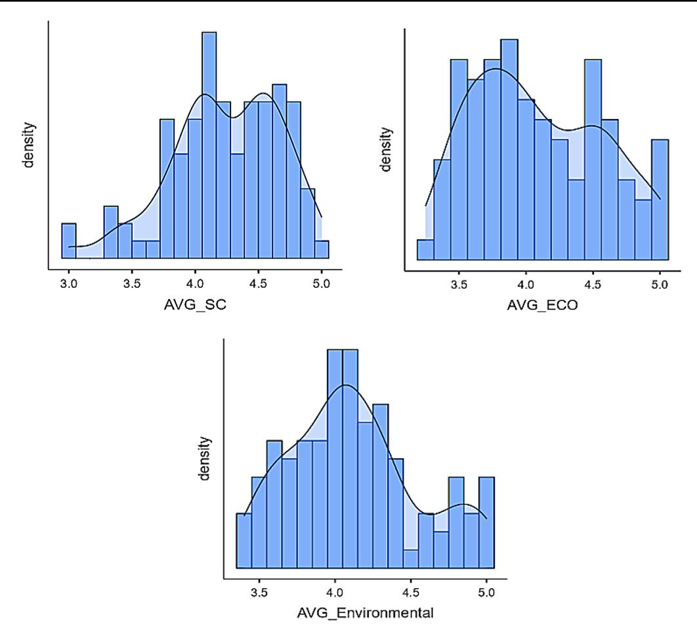
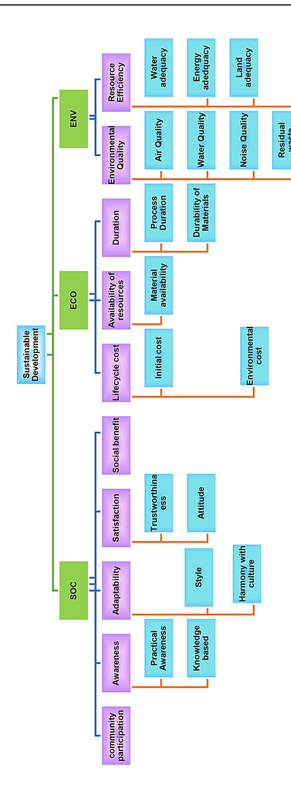
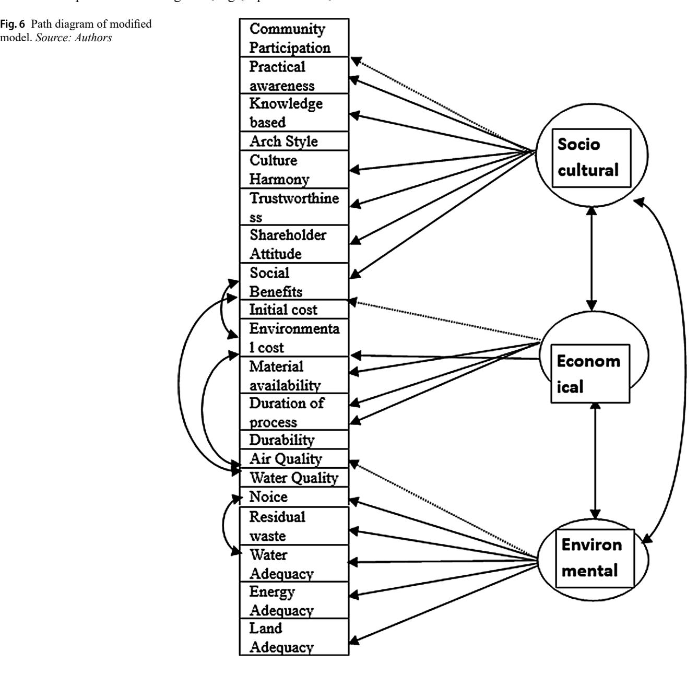

<!-- A3.R24 | source: papers_json/A3.R24/ -->

## **RESEARCH**

## **Sustainable development factors in building engineering systems: do ** **demographic factors matter?**

**Priji Biju****^1^** ** · Nahia Mourad****^1^** ******· Ahmed Mohamed Habib****[2](https://orcid.org/0000-0003-1728-6028)**

Received: 27 November 2024 / Accepted: 19 February 2025 / Published online: 25 March 2025 © The Author(s), under exclusive licence to Springer Nature Switzerland AG 2025

## **Abstract**

Sustainable engineering builds systems, products, and processes that are socially, environmentally, and economically viable to fulfil the promise of a balanced approach to achieve the net zero emission targets of the world to mitigate climate change impacts. Owing to the multidisciplinary nature of sustainable development, sustainability efforts involve concepts, principles, and methods from engineering, social sciences, economics, social psychology, biological sciences, ecology, and physical sciences. Hence, scientific analysis is required to define inter-item relationships and identify differences based on the demographic features of professionals. The lack of such studies in the literature represents the main gap covered by this study. In this context, a methodology was designed and applied by surveying 101 professionals from various engineering disciplines in the UAE's construction sector. The results confirmed a significant correlation among sociocultural (SOC), economic (ECO), and environmental (ENV) sustainability factors. The findings revealed that the distributions of SOC, ECO, and ENV were the same across gender, specialisation, and experience categories. Moreover, the distributions of ECO and ENV were the same across age categories, except for the distribution of SOC, which differed across age categories, favouring groups over 25 years of age. These findings would support stakeholders in the construction sector in developing sustainable engineering building systems. The proposed methodology can be used in other areas to help stakeholders establish sustainable systems based on the SOC, ECO, and ENV factors.

**Keywords** Sustainability · Environment · Social responsibility · Governance · Economic

## **Introduction (2019)**

Sustainable development has become a critical issue in the global landscape, as the world faces unprecedented challenges related to climate change, resource depletion, and environmental degradation. The need to balance economic growth, social well-being, and environmental protection has become increasingly urgent as the consequences of

Priji Biju 23001165@student.buid.ac.ae

Nahia Mourad nahia.mourad@gmail.com

Ahmed Mohamed Habib dr_ahmedhabib@yahoo.com

- ^1^ Faculty of Engineering & IT, The British University in Dubai, Dubai, United Arab Emirates
- ^2^ Accounting and Finance, Independent Research, Zagazig, Egypt

unsustainable practices have become more severe and farreaching (Habib, [2024)](#page-15-0). Strong governance and regulatory frameworks have a significant impact on improving environmental conditions and reducing greenhouse gas emissions (Barra & Falcone, [2024](#page-14-0)). This highlights the need to holistically and integrated address the environmental, social, and governance (ESG) dimensions of development (Habib & Mourad, [2024;](#page-15-1) Qian & Liu,[ 2024](#page-15-2)).

Sustainability is crucial not only for improving organisations' image but also for increasing their value. Researchers on a global level have shown that economic, political, institutional, behaviour, and technological factors can affect a country's adoption of a sustainable approach. This multifaceted concept has gained significant attention as investors, governments, and interest groups have become more aware of the ESG impacts of business activities (Agrawal et al., [2024;](#page-14-1) Barra & Falcone, [2024](#page-14-0)). Consequently, many companies have started developing their business strategy agendas as an integral component of their business strategies,

<!-- page 2 -->

recognising the need to address critical dimensions (Chen, [2024](#page-14-2); Habib et al., [2024)](#page-15-1).

Sustainable building construction techniques are advocated to promote economic growth in the building sector while reducing the environmental and social impacts. Encouraging people to live in a healthy environment with better social, economic, and environmental conditions is the goal of the expansive and intricate concept of sustainability (Akadiri et al., [2012)](#page-14-3). Economic factors like the upfront cost of sustainable construction may resist or delay the implementation of environmentally friendly solutions due to market risk aversion in the competitive real estate world. Financial incentives like tax rebates and green financing, higher cost for fossil fuels and circular economy is advocated through cross -country comparisons (Errichiello et al., [2025)](#page-14-4). The scope of sustainable development, which focuses on the interplay between the economic, social, and environmental aspects of sustainability and the variables that influence them, is reflected in its multidisciplinary principles (Dadashpoor & Padash, [2019a](#page-14-5)).

Sustainable building construction techniques have become increasingly important owing to concerns regarding environmental impacts, resource depletion, and climate change. The construction industry has attempted to reduce its negative environmental impacts by adopting innovative materials, designs, and construction practices. To secure a sustainable future, the building industry must adopt a multidisciplinary approach that addresses several features, including energy conservation, better material utilisation, reduced material waste, and pollution and emissions control (Joe Opoku et al.,[ 2017](#page-15-3)).

The dynamic and all-encompassing character of sustainable development necessitates an ongoing process of assessing new and developing trends, and a constant way to promote community involvement, conflict resolution, and strategy updates (Biswas & Ghosh, [2019a)](#page-15-4). Environmental efficiency depends on key aspects of institutional quality, such as political stability, government efficacy, corruption control, and regulatory quality. Sustainable behaviours are influenced by a number of factors, including gender, age, education, income, and work position. It has been shown that women are more likely to engage in green consumption. This highlights the need to explore the differences in the approach of stakeholders from various demographic boundaries on the perception of sustainable practices (Barra & Falcone, [2023](#page-14-6); Falcone & Fiorentino, [2024](#page-15-5)). Hence, scientific research to develop and validate frameworks for sustainable development and identify stakeholders for the flawless implementation and maintenance of the system is required for net zero carbon footprint development goals.

Sustainable development is a multi-dimensional concept. First, it should be intergenerational, as per Brundland's

report; second, it needs to ensure economic, social, and environmental factors; and finally, sustainable development cannot be achieved locally. Thus, global prospects must be planned (Wiebe, [2012)](#page-15-6). This study aimed to identify the inter-item relationships among the factors of sustainable development. Engineers, social scientists, and physical scientists have contributed ideas, theories, and techniques to sustainability. Therefore, a systematic and scientific approach is required for research in the field of sustainable development in building engineering systems, especially in terms of how the decision to implement SOC, ECO, and ENV sustainable construction practices differ depending on the demographic features of the professionals, which is an underexplored topic.

The structure of this study is as follows: Sect. 2 explores the literature and identifies conceptual frameworks that can be adopted for the research. Section 3 outlines the methodology adopted for the analysis. Section 4 details the analysis of the results, followed by the discussion under Sect. 5. The final conclusion and remarks are reported in Sect. 6.

## **Literature review**

Given the significant impact of construction on human activity and the environment, the construction industry plays a crucial role in sustainable development (Zimon et al., [2024](#page-15-7)). Sustainable construction reduces the environmental footprint of buildings, while promoting social and economic well-being. A key aspect of sustainable construction is the incorporation of sustainable development principles into the building design (Willar et al., [2021)](#page-15-8). Structural engineers can contribute to sustainable construction by considering factors such as embodied energy and life cycle energy usage in structures (Passoni et al.,[ 2022](#page-15-9)). Sustainable construction is essential for improving the quality of life, minimising pollution, and adapting buildings for future needs. Therefore, the construction industry must rapidly adapt to the broader environmental and social agendas presented by sustainable development.

Integrating sustainability principles into construction projects from the conceptual stage onwards is necessary to successfully implement them in the later stages of development. According to a study grounded in the sustainable triple bottom line principle, which encompasses resource conservation, cost efficiency, and design for human adaptation, sustainable building construction techniques will promote economic growth in the building sector while reducing environmental impact. This suggests that every novel design strategy considers how each decision affects the natural and cultural resources of local, regional, and global environments (Dadashpoor & Padash,[ 2019a)](#page-14-5).

<!-- page 3 -->

An extensive sustainability planning process usually generates several opportunities to improve the quality of life of surrounding communities and provide access to clean water and air, encouraging community participation and health. The primary attributes of sustainability are intergenerational equality, equilibrium among the three sustainability pillars, a connection to global issues rather than just local or regional issues and its dynamic and encompassing nature. The success of urban planning and architecture in sustainable development is ensured by coordinated efforts to change legislation, the introduction of new technologies, a change in public awareness regarding consumption, behavioural outlooks, knowledge raising and community involvement (Biswas & Ghosh, [2019a](#page-15-4)).

An extensive sustainability planning process usually generates several opportunities to improve the quality of life of surrounding communities and provide access to clean water and air, thereby encouraging community participation and health. The primary attributes of sustainability are intergenerational equality, equilibrium among the three sustainability pillars, connection to global issues rather than just local or regional issues, and its dynamic and encompassing nature. The success of urban planning and architecture in sustainable development is ensured by coordinated efforts to change legislation, introduce new technologies, and change public awareness regarding consumption, behavioural outlooks, knowledge raising, and community involvement (Chiamaka & Aduwo, [2019)](#page-14-7).

Integrated management systems fulfil more of the United States' development goals. In addition to quality management systems, integrated management systems ensure that most elements are met by organisations certified by multiple standards to meet sustainable development goals (SDG). These include environmental management, occupational health and safety, and energy-management systems. According to a study of Malaysian universities, the successful application of ISO 9001 can help achieve sustainable development initiatives. The Quality Management System gradually enhances a certified organisation's ability to produce reliable services and goods that satisfy client needs and relevant legal and regulatory requirements (Zimon et al., [2024;](#page-15-7) Surisetti et al., [2021)](#page-15-10). The durability and strength

of building materials are essential for an environmentally friendly infrastructure. Therefore, in addition to economic and environmental considerations, researchers at the Cochin University of Science and Technology suggest that technological sustainability should also be a determining factor in sustainable development (Thomas et al., [2023)](#page-15-11).

## **Research method**

The methodology adopted for this research is a statistical analysis of data obtained by a stakeholder survey. The parameters to be considered in the survey questionnaire were identified from a verified conceptual framework adopted through a literature review. The three pillars of sustainability, social, environmental, and economic factors, were often observed to be supported by political, institutional, behavioural, and technological factors as well (Barra & Falcone, [2024](#page-14-0); Parris & Kates, [2003;](#page-15-12) Thomas et al., [2023)](#page-15-11). Hence, a conceptual framework with factors and items was derived from two basic conceptual diagrams incorporating common factors was identified for the data collection. The Driver-Pressure-State-Impact-Response (DPSIR) scheme proposed by the European Economic Area (EEA) for representing sustainability indicators that link human activities to environmental status was found to be a useful tool for identifying the stakeholders of the subject under study (Smeets et al., [2019;](#page-15-13) Stanners et al., [2019)](#page-15-14). Thus, a 5-point Likert scale survey was conducted among professionals from various fields of construction engineering in Dubai with varying demographic statuses to acquire data on the items for the analysis (Joshi et al., [2015)](#page-15-4). The pathway adopted for the research is demonstrated in the Fig. [1.](#page-2-0)

Thus, the quantitative research in this study followed the methodology described below:

- i. Adopting a verified conceptual framework from a literature review.
- ii. Identifying the factors and items of the framework.
- iii. Preparation of survey questionnaire incorporating all the items in the framework.
- iv. Data collection through a 5-point Likert scale survey.

***Fig. 1** Pathway adopted for the research*

<!-- page 4 -->

v. Statistical analysis of the survey data using the JAMOVI software tool (Ahmed,[ 2021](#page-14-8); ŞAHİN & AYBEK, [2020](#page-15-16)).

## **Conceptual diagram**

Conceptual frameworks are used to understand a research problem and direct the study's development and analysis. It provides a framework that connects different theories, concepts, and ideas within the field of study and serves as a guide for structuring and conceptualising the work. The conceptual framework recommended for sustainable development, with the three pillars of sustainability as factors, is represented by a Venn diagram, as shown in Fig. [2.](#page-3-0) The triple-bottom-line principle of sustainability, namely resource conservation, cost efficiency, and design for human adaptation, was considered in the conceptual framework and recommended for design teams to maintain a balance among economic, social and environmental factors of sustainability (Dadashpoor & Padash, [2019a](#page-14-5); Akadiri et al.,[ 2012](#page-14-3)).

As mentioned earlier, a recent study recommended a conceptual framework incorporating technological sustainability as a basic contributing factor because technologies for strong and durable materials are mandatory for sustainable development (Thomas et al., [2023](#page-15-11)). The conceptual framework for this research was adopted (Fig. [3)](#page-4-0) after a literature review of the above two conceptual diagrams as Sociocultural, Environmental and Economic factors were well represented by different items in the conceptual diagram in Fig. [3.](#page-4-0) The technological sustainability factor (Thomas et al., [2023)](#page-15-11) was excluded from this research because the

***Fig. 2** Venn diagram for sustainable development. *Source*: (Biswas & Ghosh,[ 2019a](#page-15-4))*

researchers did not confirm its validation. Thus, the research topic, sustainable development, was analyzed with three factors: SOC, ENV, and ECO, ten sub-factors, and twentyfive items. Community participation, awareness, adaptability, satisfaction, and social benefits were considered under the sociocultural factor and had nine sub-items to represent the factor more elaborately. Similarly, ECO has lifecycle cost, resource availability, and project duration as sub-factors and eight items to characterize the economic factor of sustainability. Environmental quality and the efficiency of the resources to meet the development requirements were considered under ENV in the framework considered for the study.

Thus, the conceptual framework adopted for this research has three factors, ten subfactors, and many items under the subfactors. SOC, ECO, and ENV factors were the identified key factors that illustrate sustainable development. Eleven items were identified for the SOC dimension, and eight and ten items were identified for the ECO and ENV dimensions, respectively, to comprehend the factors thoroughly. Twentynine survey questions were prepared to gather information on the perception of various aspects of sustainable development from the stakeholders of varying demographic features.

## **Data collection**

A survey questionnaire was prepared as given in the Appendix with respect to all items in the conceptual diagram in Fig. [3](#page-4-0). Along with demographic factors like gender, age, specialization, and experience in the construction sector; twenty-nine questions covering all key aspects of sustainable development were incorporated in the survey. Separate sections were provided in the questionnaire for each key factor and participants responded to the items using a fivepoint Likert scale: 5 for Strongly Agree, 4 for Agree, 3 for Neutral, 2 for Disagree, and 1 for Strongly Disagree (Joshi et al.,[ 2015](#page-15-4); Nyutu et al.,[ 2021](#page-15-15)). For example, the following question was used in the survey to collect information about the first item in the conceptual framework:

Do you believe community participation in the developmental activities is required for sustainable development?

The driver–pressure–state–impact–response (DPSIR) scheme proposed by EEA is a valuable tool for representing environmental sustainability indicators that link human activities to environmental status. Hence, stakeholders who could decide on material and energy use during development were identified as participants in the survey. Professionals working in different engineering fields, such as

<!-- page 5 -->

***Fig. 3** Conceptual Framework for sustainable development. Source: (Thomas et al.,[ 2023](#page-15-11)) with the exclusion of technological sustainability factor*

<!-- page 6 -->

Source: Authors

architects, design engineers, field construction managers, MEP engineers, and cost estimators, were approached for feedback on the factors contributing to the three pillars of sustainable development. An online survey designed with 33 questions, including demographic details, received 101 responses.

## **Statistical analysis**

JAMOVI was used in this study (i). to check the reliability of the survey (ii). To confirm the fitness of the model with data for representation of the population, (iii) obtain inferential statistics of the data, (iv) evaluate the correlation among the components of the model, and (iv) conduct a regression analysis to check the relationship among the independent and dependent variables of the model (Ahmed, [2021](#page-14-8); ŞAHİN & AYBEK, [2020)](#page-15-16).

Primary analysis was done for the descriptive statistics of the data, and frequency, mean, median, and standard deviation were calculated. Shapiro-Wilk test was then conducted to understand the central tendency of the data, and a p-value less than 0.05 rejected the null hypothesis, and the results were compared with the histogram plots (Nyutu et al.,[ 2021](#page-15-15)). The reliability, confirmability, and efficacy of the data were then analyzed to confirm the adequacy of the survey and the fitness of the factors to the model. Required modifications were then applied to the conceptual framework considered for the study and correlation and difference analyses were done to demonstrate the inter-item relationship among the

| Descriptives | SOC | ECO | ENV |
| --- | --- | --- | --- |
| N | 101 | 101 | 101 |
| Missing | 0 | 0 | 0 |
| Mean | 4.24 | 4.09 | 4.12 |
| Median | 4.27 | 4.00 | 4.10 |
| Standard Deviation | 0.432 | 0.481 | 0.424 |
| Minimum | 3 | 3.25 | 3.40 |
| Maximum | 5 | 5 | 5 |
| Shapiro-Wilk W | 0.964 | 0.949 | 0.957 |
| Shapiro-Wilk p | 0.007 | <0.001 | 0.002 |

Source: Authors

key pillars of sustainability and effect of demographic factors on sustainable concepts.

The following research hypothesis were developed to support the research questions:

*H1*. There is a difference in SOC, ECO, and ENV across categories of gender.

*H2*. There is a difference in SOC, ECO, and ENV across categories of age.

*H3*. There is a difference in SOC, ECO, and ENV across categories of specialization.

*H4*. There is a difference in SOC, ECO, and ENV across categories of experience.

## **Results**

## **Descriptive statistics**

Descriptive statistics of the demographic data were analysed. The frequency table and central tendency of the dataset results are summarised in Tables [1](#page-5-0) and [2.](#page-5-1)

Of the 101 responses received, 65% were from male engineers, and 35% were from female engineers. Evaluation of the central tendency and dispersion of data showed that the mean and median for all the factors were between 4 and 4.27, with a low standard deviation varying from 0.424 to 0.481.

The data sample was subjected to the Shapiro-Wilk test to determine if a random sample was drawn from a normal Gaussian probability distribution (Souza et al., [2023](#page-14-9)). A p-value below 0.05 leads to the rejection of the null hypothesis that the data follow a normal distribution. The test results indicate a low p-value (<0.05), which provides sufficient evidence to reject the null hypothesis.

In addition, the histogram and density plots shown in Fig. [4](#page-6-0) confirm the non-normal characteristics of the distribution. The graphs show that the data have a bimodal and skewed distribution. A bimodal distribution may indicate that the dataset consists of two or more distinct groups, which may be analysed separately if appropriate (Elal-Olivero et

<!-- page 7 -->

***Fig. 4** Histogram and density plots of the data. *Source: Authors**

al., [2020](#page-14-10)). This can be seen in the frequency table of the demographic data in Table [1.](#page-5-0)

## **Reliability, efficacy and fit analyses**

Reliability analysis examines the model's inter-item reliability or internal consistency concerning the analogously scored observed data. Cronbach's alpha is principally used to describe reliability or internal consistency, which quantifies the degree of interrelatedness among a group of items by comparing the amount of shared variance or covariance among the items (Zakariya, [2022)](#page-15-18). The results, with an alpha value of 0.875, indicate that the survey was reliable. Analysts commonly use benchmark value of 0.7 Cronbach's alpha statistical measure. At this level and beyond, the items exhibit sufficient consistency to suggest that the measure is dependable (Taber, [2018)](#page-15-19).

Moreover, we used confirmatory factor analysis (CFA), which is a statistical technique used to evaluate the efficacy of the measurement model. This enables an empirical examination of the premise that there is a correlation between observed variables and their latent constructs (Hox, [2021](#page-15-20)).

In addition, it helps determine how well the model with sample data represents the population. The factor loading results have a p-value of less than 0.05, proving that all variables are significant in the model (Table [3](#page-7-0)).

In addition, we used the chi-square test and comparative fit measures to compare the observed results with the expected results and check the model fit (Franke et al., [2012](#page-15-17)). A p-value less than the significance level rejects the null hypothesis that the model is an exact fit according to the undefined *χ* ^2^-test. The comparative test results provide a comparative fit index (CFI) of 0.693, Tucker-Lewis's index (TLI) equal to 0.667, and root mean square error approximation (RMSEA) value of 0.083, which can be compared with the recommended coefficients for a significant fit measure. The recommended values for a good fit measure are CF1>0.9, TLI>0.9, and RMSEA<0.5. The observed values, as shown in Table [4,](#page-7-1) lead to the rejection of an exact fit measure and are unsatisfactory fit measure values. This indicates the need for model modification.

The model was modified with factor loading modification indices to remove the least fitting variables, and residual

<!-- page 8 -->

Note: a fixed parameter

*Source: Authors*

Source: Authors

covariance modification indices to apply errors. The final model is shown in Fig. [5.](#page-8-0)

Furthermore, after modification, the results provided an agreeable fit measure, as shown in Table [5](#page-9-2).

A path diagram shows the patterns of the relationships between variables in statistical analysis. Figure [6 ](#page-9-3)shows a path diagram of the modified model between the latent and observed variables. Circles or ovals represent latent variables, and rectangles in the path diagram represent observed variables. The single-headed arrows denote causation, and the two-headed arrows denote the correlation between the variables and residual co-variances.

## **Correlation analysis**

The correlation among the three pillars of sustainability, namely SOC, ECO, and ENV factors, was tested by deriving a correlation matrix. The p-values observed within the correlation matrix (Table [6](#page-9-0)) provided significant evidence to confirm the correlation between them.

## **Normality and homogeneity analyses**

Tables [7](#page-9-1) and [8](#page-10-0) show the normality and homogeneity tests, respectively. The average values of SOC, ECO, and ENV dimensions were considered for the same. The low p-value of the normality test (Table [7)](#page-9-1) illustrates that there is significant evidence to reject the null hypothesis that data is normally distributed.

In the homogeneity test (Table [8)](#page-10-0), the environmental sustainability factor had a low p-value, and the null hypothesis of the equal variance assumption was rejected. Hence, The Mann-Whitney U test and the Kruskal-Wallis One-Way ANOVA test for non-normal data are applied to test the research hypotheses.

<!-- page 9 -->

***Fig. 5** Conceptual diagram for modified model. *Source: Authors**

<!-- page 10 -->

Source: Authors

## **Differences analyses**

model. *Source: Authors*

Differences analyses are performed to investigate the research objectives in terms of disparities in sustainable construction practices across gender, age, specialization,

Note: * is significant at the 5% level

*Source: Authors*

Note: A low p-value suggests a violation of the assumption of normality

*Source: Authors*

<!-- page 11 -->

Note: A low p-value suggests a violation of the assumption of equal variances

*Source: Authors*

and experience categories. The results of these tests are summarised in Tables [9](#page-10-2),[ 10](#page-10-1),[ 11](#page-11-0) and[ 12](#page-11-1).

Table [9 ](#page-10-2)presents the Mann-Whitney U test results, which demonstrate the statistical distinctions in the distributions of SOC, ECO, and ENV across gender categories. The test findings revealed that the distributions of SOC (P-value=0.273), ECO (P-value=0.326), and ENV (P-value=0.562) were the same across the gender categories. Therefore, *H1* was not supported at a significance level of 0.05. This is evident from the results of the mean ranks of the two groups for all dimensions of sustainability, where the average of the male group in terms of the SOC dimension was 53.37, which is close to the average of the female group in terms of that dimension, which was 46.72. The male group obtained an average score of 53.12 in terms of ECO dimension, while the female group obtained an average of 47.17. Finally, in

terms of the ENV dimension, the male group obtained an average of 49.75, whereas the female group obtained an average of 53.26.

Table [10 ](#page-10-1)presents the Kruskal-Wallis test results, which demonstrate the statistical distinctions in the distributions of SOC, ECO, and ENV across age categories. The findings revealed that the distributions of SOC (P-value=0.021) differed across age categories, favouring groups over 25 years of age, especially the 26—35-year-old group. Moreover, the findings revealed that the distributions of ECO (P-value=0.205) and ENV (P-value=0.280) were the same across age categories. Therefore, *H2* was partially supported at a significance level of 0.05.

Table [11](#page-11-0) presents the Kruskal-Wallis test results, which demonstrate the statistical distinctions in the distributions of SOC, ECO, and ENV across specialization categories. The test findings revealed that the distributions of SOC (P-value=0.238), ECO (P-value=0.263), and ENV (P-value=0.156) were the same across the specialization categories. Therefore, *H3* was not supported at a significance level of 0.05. Hence, there is no difference in SOC, ECO, and ENV across categories of specialization.

Table [12](#page-11-1) presents the Kruskal-Wallis test results, which demonstrate the statistical distinctions in the

Source: Authors

Note: * is significant at the 5% level

*Source: Authors*

<!-- page 12 -->

Source: Authors

Source: Authors

<!-- page 13 -->

distributions of SOC, ECO, and ENV across experience categories. The test findings revealed that the distributions of SOC (P-value=0.718), ECO (P-value=0.805), and ENV (P-value=0.200) were the same across the experience categories. Therefore, *H4* was not supported at a significance level of 0.05. Hence, there is no difference in SOC, ECO, and ENV across categories of experience.

## **Discussion**

JAMOVI is a fitting software tool for statistical analysis of quantitative research. Its user-friendly interface helps researchers to identify trends and interitem relationships with data without a hassle. The software imposes confirmation on the reliability, normality and homogeneity of the data collected through surveys for confirming the suitability of tests for the analysis. The data collected through a 5-point Likert scale for this research confirms the reliability but dispersion analysis of the sample revealed a non-normal tendency of the data. Data from distinctive demographic groups is observed to be the reason for the bimodal and skewed nature of the data.

Confirmatory factor analysis of the conceptual framework adopted through the literature review confirmed the significance of all the factors in the proposed framework. However, the fit measures failed to confirm the fitness of the model as a whole. Hence, factor modifications, as observed in a post hoc analysis, such as removing some items and applying residual covariance modification indices or errors, were required to confirm the model's fitness with the population. This could be due to the difference in the sample nature and method of data collection of this study from the research that developed the adopted conceptual framework.

This study is aimed to identify the right stakeholders for the successful employment of sustainable practices in building construction and management. Hence, the statistical analysis in this research was done to check whether the choice of sustainable development practices in building engineering system varies according to the demographic factors of decision makers such as developers, engineers and architects. Inferential statistical analysis performed to establish the correlation between sample and population provided results which confirmed the irrelevance of demographic factors such as gender, age, area of specialization and years of experience in the decisions on sustainable development. This observation indicates that irrespective of the technological background or practical experience the stakeholders of construction industry are in the same league for adopting sustainable construction practices to achieve net zero goals.

A correlation test performed confirmed the significant correlation between the three pillars of sustainability – SOC, ECO, and ENV. In addition, differences analyses conducted to investigate the research objectives in terms of disparities in sustainable construction practices across gender, age, specialisation, and experience categories demonstrated that the distributions of SOC, ECO, and ENV were the same across gender, specialization, and experience categories. Factor wise observations are discussed below:

## **Demographic factors on socio-cultural sustainability**

The statistical analysis was done to comprehend whether the decision to consider socio-cultural factors of sustainability in building construction differs due to demographic factors such as gender, age, areas of specialization, and years of experience in construction. The results revealed no significant difference in the dispersal of distributions between both genders, different areas of specialization, and different years of experience. However, a substantial difference in the dispersal of distributions among various age groups could be observed.

## **Demographic factors on economic sustainability**

The trend of the statistical distribution of responses regarding economic sustainability shows no significant difference between different sectors of all demographic factors considered for the research. As per the research's observations, gender, age, areas of specialization, or experience do not make any difference in the decision-making process regarding adopting economic sustainability factors in building construction.

## **Demographic factors on environmental ** **sustainability**

The difference analysis of the dispersal distribution of environmental sustainability factors also provided the same results as economic sustainability factors and confirmed the insignificance of demographic factors in the successful adoption and implementation of environmental factors for sustainable development.

These findings would enhance the conceptual framework of sustainable development in building construction and interior fit-out works. The observation results favoured male candidates within the 26–35 age group, and the role of developers was found to be significant for all three pillars of sustainable development. The research results can be helpful for policymakers and implementation agencies in identifying the ideal team for sustainable building construction and development. The results align with the findings of a

<!-- page 14 -->

similar research on the sustainable lifestyle (SLS) among the Vietnamese people, which revealed that age, gender, and income are not associated with the SLS of Vietnamese people (Nguyen et al.,[ 2023](#page-15-21)).

## **Conclusion and policy recommendations**

Innovation and technological progress are essential for implementing sustainable practices and policies to achieve sustainable development goals and net-zero carbon-emission targets. Decision-makers in the infrastructure development industry play a pivotal role in implementing environmentally friendly, economically viable, and socially sustainable solutions in the construction industry. This research investigated how different factors of sustainable development are interrelated in building engineering systems and whether the decision to implement SOC, ECO, and ENV factors of sustainable construction practices differs depending on the demographic features of the professionals. The results of the analysis of data collected from the identified stakeholders established that most decisions on sustainable development methodologies will not differ because of variations in demographic factors. This research also established a significant correlation between the three pillars of sustainability and proposed a more structured analysis of the impact of economic concerns on overall sustainable development. The findings support stakeholders in the construction sector in developing sustainable engineering building systems through a team of professionals with optimal demographic indices and a verified conceptual framework. Promoting SOC, ECO, and ENV factors in building systems with innovative construction-related regulations that promote sustainable engineering building systems is imperative.

Through engineering building systems and climate change policies, stakeholders can be rewarded and empowered to design sustainable building systems that adapt SOC, ECO, ENV, and climate to promote sustainable development. Innovation strategies in the construction industry must be founded on the overall outlook of SOC, ECO, and ENV factors and be cognizant of technological changes to provide sustainable engineering building systems that fulfil stakeholders' needs, including developers and investors.

This study had some limitations. It was designed and applied to the UAE construction sector, but future research may include other sectors and factors, such as technology, artificial intelligence, and green finance. The proposed methodology can be used in different areas to help stakeholders establish sustainable systems based on the SOC, ECO, and ENV factors. The data sample size was small for an authentic statistical analysis of 33 items of the study;

hence, a larger data set with equal representation from all demographic variances could refine the research.

## **Appendix**

## **Sustainable development**

This survey is meant for pure academic purpose as part of PhD in Sustainable Built Environment. It is intended to quantitatively analyze key indicative parameters of sustainable development that helps developers and designers to implement such practices. Your feedback depending on the experience in the field of engineering is requested.

## **Survey questions**

## **Section 1- SOC sustainability**

- 1. Do you believe community participation in the developmental activities is required for sustainable development?
- Strongly Agree.
- Agree.
- Neutral.
- Disagree.
- Strongly Disagree.
- 2. Practical experience is effective way for making awareness about sustainability.
- 3. Conducting trainings is the efficient way for making awareness about sustainability.
- 4. Sustainable design should be incompatible with the regional conditions like topography and climate.
- 5. Sustainable design should be in-line with architectural style of the locality.
- 6. Sustainable design should be in harmony with the culture of the region.
- 7. Reliability on new technological solutions will encourage the stake holders to implement them for sustainable development.
- 8. Attitude of stake holders play a major role in the implementation of sustainable practices in construction.
- 9. Quality of life of the inhabitancy will be better with the implementation of sustainable principles.
- 10. Do you believe sustainable development ensures social security?
- 11. Do you believe sustainable practices need to be promoted with policy initiatives monetary benefits / incentives?

<!-- page 15 -->

## **Section 2: ECO sustainability**

- 1. For ensuring economical sustainability initial cost of the material at site should be a major parameter.
- 2. For ensuring economical sustainability cost of the material while in use like operation and maintenance cost should be a major concern.
- 3. For ensuring economical sustainability the environmental cost or carbon foot print of the material should be a major concern.
- 4. For ensuring economical sustainability the reuse or recycle potential of the material at the end of life should be a major concern.
- 5. Locally available & pre used material availability plays a vital role in meeting the sustainable practice requirements in construction.
- 6. Skilled labour is a mandatory requirement for the implementation of sustainable features.
- 7. Duration of technological options will not affect the economical sustainability of the projects.
- 8. Durability of materials and technical solutions will impact the economical sustainability of the project.

## **Section 3: ENV sustainability**

- 1. If air quality parameters are within the limits, the project can be stated as environmentally sustainable.
- 2. Water quality is the main parameter for ensuring environmental sustainability.
- 3. Noice pollution is a major threat to environmental sustainability.
- 4. The amount of quality residual waste generated by the adoption of specific technological solution is an indication of environmental sustainability.
- 5. Material efficiency: use of local / recycled / pre-used materials is a key indicator of sustainable development.
- 6. Extraction of raw materials and minerals by destroying the natural land mass is an environmental impact due to construction.
- 7. Sustainability can be guaranteed by adopting energy efficient practices.
- 8. Embodied energy is the key indicator for energy efficiency in sustainable development.
- 9. Operational energy is the key indicator in sustainable development.
- 10. Water conservation should be considered for sustainable development.

**Author contributions** PB conceived the project topic, planning, literature review, fundamental analysis, the framework and statistical analysis, data collection and analysis, wrote the abstract, introduction,

literature review, hypothesis formulation, results, discussion and conclusion. N M conceived the project planning, framework, hypotheses, analysis of results, reviewed the manuscript. A H reviewed the literature review, contributed in literature review, statistical analysis, empirical results and manuscript.

**Funding** The authors have not disclosed any funding.

**Data availability** No datasets were generated or analysed during the current study.

## **Declarations**

**Competing interests** The authors declare no competing interests.

## **References**

- Agrawal, N., Modgil, S., & Gupta, S. (2024). ESG and supply chain finance to manage risk among value chains. *Journal of Cleaner * *Production*, *471*, 143373. [https://doi.org/10.1016/j.jclepro.2024.](https://doi.org/10.1016/j.jclepro.2024.143373) [143373](https://doi.org/10.1016/j.jclepro.2024.143373)
- Ahmed, A. A. (2021). A Beginners Review of Jamovi Statistical Software for Economic Research. [https://www.researchgate.net/publ](https://www.researchgate.net/publication/354077071) [ication/354077071](https://www.researchgate.net/publication/354077071)
- Akadiri, P. O., Chinyio, E. A., & Olomolaiye, P. O. (2012). Design of a sustainable Building: A conceptual framework for implementing sustainability in the Building sector. *Buildings*, *2*(2), 126–152. [ht](https://doi.org/10.3390/buildings2020126) [tps://doi.org/10.3390/buildings2020126](https://doi.org/10.3390/buildings2020126)
- Barra, C., & Falcone, P. M. (2023). Cross country comparisons of environmental efficiency under institutional quality. Evidence from European economies. *Journal of Economic Studies*, *51*(9), 75–111. [https://doi.org/10.1108/JES-05-2023-0264](https://doi.org/10.1108/JES-05-2023-0264)
- Barra, C., & Falcone, P. M. (2024). Environmental performance of countries. Examining the effect of diverse institutional factors in a metafrontier approach. *Socio-Economic Planning Sciences*, 95. [https://doi.org/10.1016/j.seps.2024.101972](https://doi.org/10.1016/j.seps.2024.101972)
- Biswas, S., & Ghosh, M. (2019a). Sustainability in Architecture and Planning: Consumption and Behavior, in International Journal of Architecture and Infrastructure Planning. www.journalspub.com.
- Chen, C. (2024). Development of green business strategies through green dynamic capabilities and environmental regulation: Empirical evidence from the construction sector. *Journal of Cleaner * *Production*, *438*, 140826. [https://doi.org/10.1016/j.jclepro.2024.](https://doi.org/10.1016/j.jclepro.2024.140826) [140826](https://doi.org/10.1016/j.jclepro.2024.140826)
- Chiamaka, U., & Aduwo, E. B. (2019). Evaluation of sustainability concepts in public housing projects in ogun state, nigeria. Journal of Physics: Conference Series, 1378(4). [https://doi.org/10.1088/1](https://doi.org/10.1088/1742-6596/1378/4/042076) [742-6596/1378/4/042076](https://doi.org/10.1088/1742-6596/1378/4/042076)
- Dadashpoor, P., & Padash, A. (2019a). A conceptual framework for implementing sustainability in the building design. In *Interna**tional Journal of Advances in Mechanical and Civil Engineering* (Issue 6). [http://iraj.in](http://iraj.in)
- de Souza, R. R., Toebe, M., Mello, A. C., & Bittencourt, K. C. (2023). Sample size and Shapiro-Wilk test: An analysis for soybean grain yield. *European Journal of Agronomy*, *142*, 126666. [https://doi.o](https://doi.org/10.1016/j.eja.2022.126666) [rg/10.1016/j.eja.2022.126666](https://doi.org/10.1016/j.eja.2022.126666)
- Elal-Olivero, D., Olivares-Pacheco, J. F., Venegas, O., Bolfarine, H., & Gómez, H. W. (2020). On properties of the bimodal Skew-Normal distribution and an application. *Mathematics*, *8*(5), 703. [http](https://doi.org/10.3390/math8050703) [s://doi.org/10.3390/math8050703](https://doi.org/10.3390/math8050703)
- Errichiello, G., Falcone, P. M., & Popoyan, L. (2025). Navigating climate policy: The influence of lobbying trends and narratives in

<!-- page 16 -->

- Europe. *Environmental Science and Policy*. [https://doi.org/10.10](https://doi.org/10.1016/j.envsci.2024.103974) [16/j.envsci.2024.103974](https://doi.org/10.1016/j.envsci.2024.103974). 163.
- Falcone, P. M., & Fiorentino, R. (2024). Nudging towards sustainability: Exploring the role of behavioral interventions in circular bioeconomy development for the fashion industry. *Corporate Social * *Responsibility and Environmental Management*. [https://doi.org/1](https://doi.org/10.1002/csr.2983) [0.1002/csr.2983](https://doi.org/10.1002/csr.2983)
- Franke, T. M., Ho, T., & Christie, C. A. (2012). The Chi-Square test. *American Journal of Evaluation*, *33*(3), 448–458. [https://doi.org/](https://doi.org/10.1177/1098214011426594) [10.1177/1098214011426594](https://doi.org/10.1177/1098214011426594)
- Habib, A. M. (2024). Financial Development and Corporate Governance Efficiency: An Overview of MENA (pp. 147–169). [https://](https://doi.org/10.1142/9781800614734_0006) [doi.org/10.1142/9781800614734_0006](https://doi.org/10.1142/9781800614734_0006)
- Habib, A. M., & Mourad, N. (2024). The influence of environmental, social, and governance (ESG) practices on US firms' performance: Evidence from the coronavirus crisis. *J Knowl Econ*, *15*(1), 2549–2570. [https://doi.org/10.1007/s13132-023-01278-w](https://doi.org/10.1007/s13132-023-01278-w)
- Habib, A. M., Yang, G., & Cui, Y. (2024). Do competitive strategies affect working capital management efficiency? Business Process Management Journal, ahead-of-print(ahead-of-print). [https://doi.](https://doi.org/10.1108/BPMJ-12-2023-0953) [org/10.1108/BPMJ-12-2023-0953](https://doi.org/10.1108/BPMJ-12-2023-0953)
- Hox, J. J. (2021). Confirmatory Factor Analysis. In The Encyclopedia of Research Methods in Criminology and Criminal Justice (pp. 830–832). Wiley. [https://doi.org/10.1002/9781119111931.ch158](https://doi.org/10.1002/9781119111931.ch158)
- Joe Opoku, D. G., Ayarkwa, J., & Agyekum, K. (2017). A CON-CEPTUAL FRAMEWORK OF PUSH FACTORS FOR IMPLEMENTING ENVIRONMENTALLY SUSTAINABLE CONSTRUCTION PRACTICES. [https://www.researchgate.net/](https://www.researchgate.net/publication/317267431) [publication/317267431](https://www.researchgate.net/publication/317267431)
- Joshi, A., Kale, S., Chandel, S., & Pal, D. (2015). Likert scale: Explored and explained. *British Journal of Applied Science & Technology*, *7*(4), 396–403. [https://doi.org/10.9734/bjast/2015/14975](https://doi.org/10.9734/bjast/2015/14975)
- Nguyen, P. M., Chu, M. T., & Nguyen, M. D. (2023). Role of Demographic Factors in Shaping Sustainable Lifestyles: An Empirical Study in Vietnam. Green and Low-Carbon Economy. [https://doi.](https://doi.org/10.47852/bonviewGLCE32021397) [org/10.47852/bonviewGLCE32021397](https://doi.org/10.47852/bonviewGLCE32021397)
- Nyutu, E. N., Cobern, W. W., & Pleasants, B. A. S. (2021). Correlational study of student perceptions of their undergraduate laboratory environment with respect to gender and major. *International * *Journal of Education in Mathematics Science and Technology*, *9*(1), 83–102. [https://doi.org/10.46328/ijemst.1182](https://doi.org/10.46328/ijemst.1182)
- Parris, T. M., & Kates, R. W. (2003). Characterizing and measuring sustainable development. *Annual Review of Environment and * *Resources*, *28*, 559–586. [https://doi.org/10.1146/annurev.energy.](https://doi.org/10.1146/annurev.energy.28.050302.105551) [28.050302.105551](https://doi.org/10.1146/annurev.energy.28.050302.105551)
- Passoni, C., Caruso, M., Marini, A., Pinho, R., & Landolfo, R. (2022). The role of life cycle structural engineering in the transition towards a sustainable Building renovation: Available tools and research needs. *Buildings*, *12*(8), 1107. [https://doi.org/10.3390/b](https://doi.org/10.3390/buildings12081107) [uildings12081107](https://doi.org/10.3390/buildings12081107)
- Qian, Y., & Liu, Y. (2024). Improve carbon emission efficiency: What role does the ESG initiatives play? *Journal of Environmental *

- *Management*, *367*, 122016. [https://doi.org/10.1016/j.jenvman.2](https://doi.org/10.1016/j.jenvman.2024.122016) [024.122016](https://doi.org/10.1016/j.jenvman.2024.122016)
- ŞAHİN, M., & AYBEK, E. (2020). Jamovi: An easy to use statistical software for the social scientists. *International Journal of Assess**ment Tools in Education*, *6*(4), 670–692. [https://doi.org/10.2144](https://doi.org/10.21449/ijate.661803) [9/ijate.661803](https://doi.org/10.21449/ijate.661803)
- Smeets, E., Weterings, R., Bosch, P., Büchele, M., & Gee, D. (2019). Environmental indicators: Typology and overview. [http://europa](http://europa.eu.int) [.eu.int](http://europa.eu.int)
- Stanners, D., Bosch, P., Dom, A., Gabrielsen, P., Gee, D., Martin, J., Rickard, L., & Weber, J. L. (2019). Frameworks for Environmental Assessment and Indicators at the EEA.
- Surisetti, D. S., Kulkarni, S., & Naveen, K. (2021). Sustainable development initiatives through ISO 9001:2015. *International Trans**action Journal of Engineering*, *12*(8), 1–10. [https://doi.org/10.14](https://doi.org/10.14456/ITJEMAST.2021.156) [456/ITJEMAST.2021.156](https://doi.org/10.14456/ITJEMAST.2021.156)
- Taber, K. S. (2018). The use of Cronbach's alpha when developing and reporting research instruments in science education. *Research in * *Science Education*, *48*(6), 1273–1296. [https://doi.org/10.1007/s1](https://doi.org/10.1007/s11165-016-9602-2) [1165-016-9602-2](https://doi.org/10.1007/s11165-016-9602-2)
- Thomas, R. V., Nair, D. G., & Enserink, B. (2023). Conceptual framework for sustainable construction. *Architecture Structures and * *Construction*, *3*(1), 129–141. [https://doi.org/10.1007/s44150-02](https://doi.org/10.1007/s44150-023-00087-8) [3-00087-8](https://doi.org/10.1007/s44150-023-00087-8)
- Wiebe, K. S. (2012). Quantitative assessment of sustainable development and growth in sub-Saharan Africa [maastricht university].[ h](https://doi.org/10.26481/dis.20120615kw) [ttps://doi.org/10.26481/dis.20120615kw](https://doi.org/10.26481/dis.20120615kw)
- Willar, D., Waney, E.V.Y., Pangemanan, D.D.G., & Mait, R.E.G. (2021). Sustainable construction practices in the execution of infrastructure projects: The extent of implementation. *Smart and * *Sustainable Built Environment*, *10*(1), 106–124. [https://doi.org/1](https://doi.org/10.1108/SASBE-07-2019-0086) [0.1108/SASBE-07-2019-0086](https://doi.org/10.1108/SASBE-07-2019-0086)
- Zakariya, Y. F. (2022). Cronbach's alpha in mathematics education research: Its appropriateness, overuse, and alternatives in estimating scale reliability. *Frontiers in Psychology*, *13*. [https://doi.org/1](https://doi.org/10.3389/fpsyg.2022.1074430) [0.3389/fpsyg.2022.1074430](https://doi.org/10.3389/fpsyg.2022.1074430)
- Zimon, G., Habib, A. M., & Haluza, D. (2024). Does the quality management system affect working capital management efficiency? Evidence from Polish firms. *Cogent Business & Management*, *11*(1), 1–18. [https://doi.org/10.1080/23311975.2023.2292787](https://doi.org/10.1080/23311975.2023.2292787)

**Publisher's note** Springer Nature remains neutral with regard to jurisdictional claims in published maps and institutional affiliations.

Springer Nature or its licensor (e.g. a society or other partner) holds exclusive rights to this article under a publishing agreement with the author(s) or other rightsholder(s); author self-archiving of the accepted manuscript version of this article is solely governed by the terms of such publishing agreement and applicable law.

