<!-- A3.R28 | source: papers_json/A3.R28/ -->

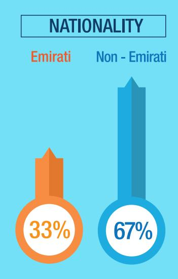

## Annual Review 2019

<!-- page 2 -->

<!-- page 3 -->

## CONTENT

CONTENT1-INTRODUCTION BY THE CHANCELLOR2-BUID-UK UNIVERSITIES ALLIANCE & PROFESSIONAL ACCREDITATION3-THE UNIVERSITY COUNCIL4-GENERAL NEWS5-ACCREDITATION AND MEMBERSHIP6-CUTTING-EDGE RESEARCH7-PROGRAMMES8-ACADEMIC AND PROFESSIONAL COLLABORATION, AND LINKS WITH INDUSTRY9-AWARDS10-INTERNATIONAL REACH11-COMMUNITY OUTREACH

<!-- page 4 -->

## INTRODUCTION BY THE CHANCELLOR

## HIS HIGHNESS SHEIKH **AHMED BIN SAEED AL MAKTOUM **

It is with great pleasure that I introduce this annual review of The British University in Dubai. BUiD has now developed into a leading research-based university, built on the sound foundations established in its formative years. It is led by an influential and informed Council and a staff of experienced academics and administrators. All are working towards meeting the objectives set for BUiD by the Dubai Law #5/2003 as re-affirmed by Ruler's Decree #7/2015.

I congratulate the seventh cohort of Doctoral graduates who in 2019 joined the growing number of students who have completed their postgraduate degrees at BUiD and have made a difference in their workplace, actively participating in international research, knowledge development, and innovation. I would also like to congratulate the staff of the University who taught and encouraged them. BUiD is now the foremost university in the UAE in terms of the number of postgraduate alumni and students pursuing research-based degrees. This is a significant intellectual force for positive social development.

Strong support received from commercial and public sector bodies continues to be of vital importance, and to

the benefit of students. In turn, BUiD is supporting both public and private sectors in meeting requirements for a qualified workforce of UAE nationals. One third of BUiD students are Emirati; the remaining student body consists of 30 other nationalities. This provides for a truly cross-cultural and intellectually stimulating learning environment. BUiD's contribution to the community is also growing, with continuing emphasis on sustainable economic development, corporate social responsibility, effective professional practice, and educational inclusivity.

## I would like to thank the founders, current contributors

and all those who have enabled BUiD to achieve the successes set out in this review. I thank the Minister of Education — Higher Education Affairs for his support and encouragement, the UK Universities Alliance, other academic partners, and the external examiners for their sound contribution to the development of BUiD in its pursuit of world-class standards for higher education and advanced learning. I thank the members of the University Council, Senate, Advisory Groups, the Vice-Chancellor and his staff including the Registrar and Chief Administrative Officer.

<!-- page 5 -->

## **BUID-UK UNIVERSITIES ALLIANCE **

The British University in Dubai (BUiD) was established in 2003 to be the region's leading research-based university, facilitating world-class education, training and research, BUiD is licensed by the UAE Ministry of Education – Higher Education Affairs to award its own degrees. Its qualifications are also recognised internationally by NARIC. BUID's internal quality assurance includes processes that ensure our programmes and students' achievements are of standards on a par with those of our UK partner universities (the University of Edinburgh, the University of Glasgow, and the University of Manchester). The UK Universities Alliance collaborates with BUiD within a Concordat agreement that provides a comprehensive framework for the strategic direction and governance of the Alliance.

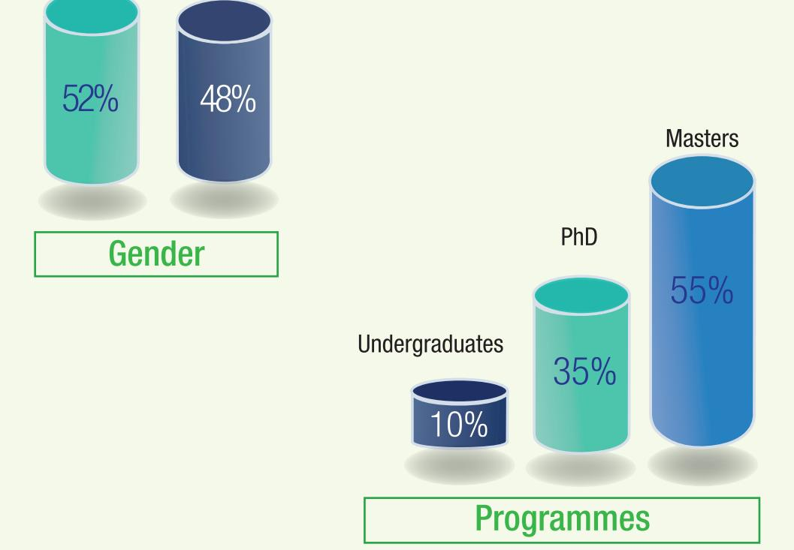

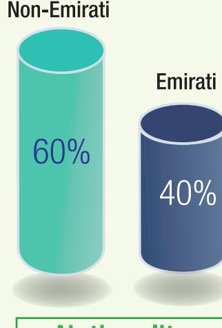

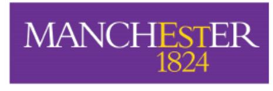

The University of Manchester

## PROFESSIONAL ACCREDITATION

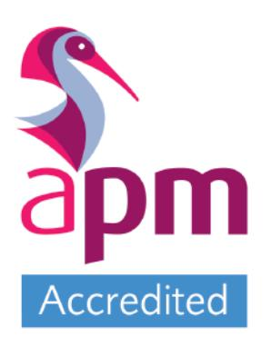

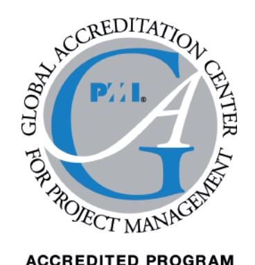

ACCREDITED PROGRAM

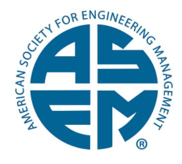

<!-- page 6 -->

## THE UNIVERSITY COUNCIL

His Highness Sheikh Mohammed bin Rashid Al Maktoum, Vice President and Prime Minister of the UAE, and Ruler of Dubai issued Decree #7/2015 appointing new Council Members of The British University of Dubai chaired by His Highness Sheikh Ahmed bin Saeed Al Maktoum.

**President** - Dubai Civil Aviation Authority

Chairman - Dubai Airports

Chairman & CEO - Emirates Group

Chancellor - BUiD

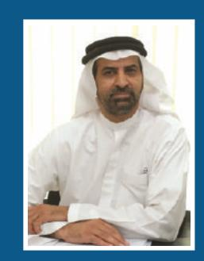

Professor Abdullah Alshamsi Vice Chancellor - BUID

ChairmanAl Maktoum College of Higher Education

Director
 Office of
 H.H. Sheikh Hamdan
 bin Rashid AlMaktoum

Chief of Creativity, Happiness and Innovation KHDA

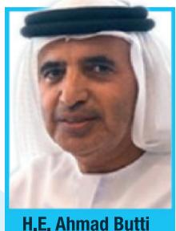

Al Muhairbi

*Council of Energy*

Chairman and Chief Executive Officer
 British Business Group of Dubai and the
 Northern Emirates

Managing DirectorDubai Holding

**Country Director**Rolls-Royce
International, UAE

Secretary General

**Dubai Supreme **

■ General Manager
Senior Executive Vice
President, Head of
Wholesale Banking
Emirates National Bank of
Dubai (Emirates NBD)

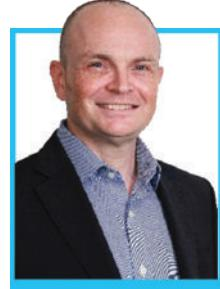

**Grant Porter **

*Chief Executive Officer
 Atkins, Middle East & Africa*

***Hugh Martin ***

<!-- page 7 -->

## GENERAL NEWS

## BUiD celebrates its 15th anniversary

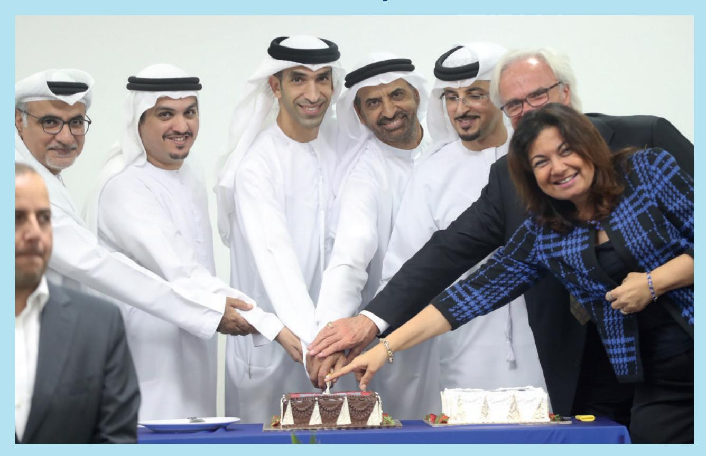

BUID marked its 15th anniversary with a celebration which was attended by His Excellency Dr Thani Ahmed Al Zeyoudi, Minister of Climate Change and Environment, and His Excellency Hesham Khalifa Al Qaizi, Chief Executive Officer of the Knowledge Fund Establishment, the University's major contributing partner. The celebration was also attended by members of the University Council including Graham Outterside, Country Director, Rolls-Royce International, UAE, and Gavin Anderson, Director of the British Council, UAE. Founders and partners who attended included Faisal Al Raisi, Director of Business Development, Etihad Energy Services Company (Etihad ESCO), Shadi Al-Kadi, Director of Programme Management at TAQATI, and Mohammad Abdullah, DIAC and Dubai Knowledge General Manager.

The Vice Chancellor, Professor Abdullah Alshamsi, gave the guests a brief presentation about BUiD's history and its future plans. Recognition awards were given to the longest serving members of staff in appreciation of their role in the University's success.

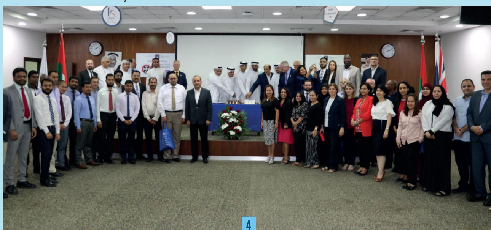

<!-- page 8 -->

## BUID celebrates its fourteenth cohort of Masters and PhD graduates

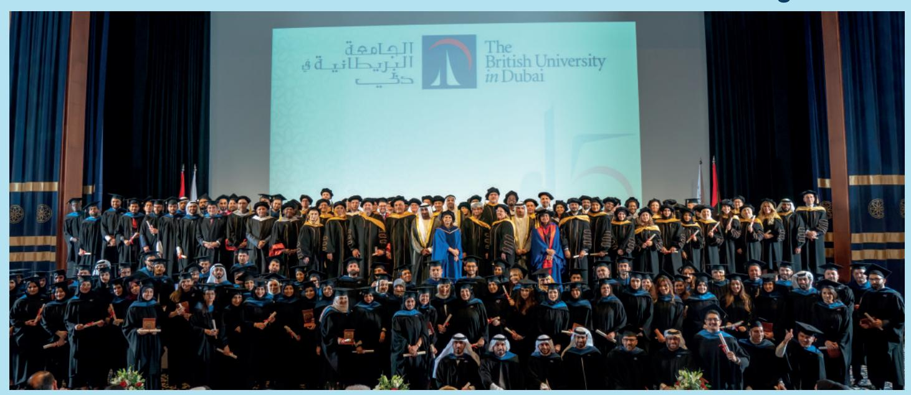

Under the Chancellorship of His Highness Sheikh Ahmed bin Saeed Al Maktoum, President of the Dubai Civil Aviation Authority and CEO and Chairman of the Emirates Group, The British University in Dubai celebrated the graduation of its 14th cohort of doctoral and Masters graduates at the Cultural and Scientific Association.

The Ceremony was attended by His Excellency Andrew Jackson, Her Majesty's Consul General of the British Embassy in Dubai, Dr Nasser bin Ali Aljahouri, the Omani Cultural Attaché to the UAE, members of the University Council, representatives of its UK Universities Alliance, academic and administrative staff, and family and friends of the graduates.

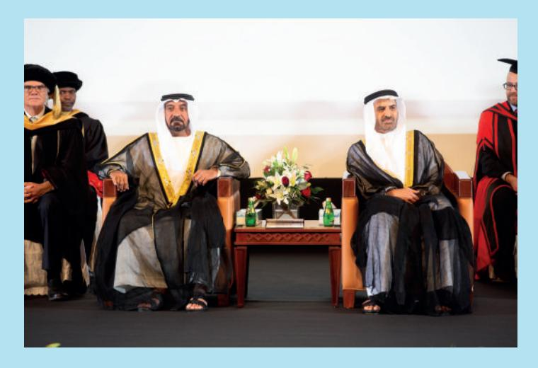

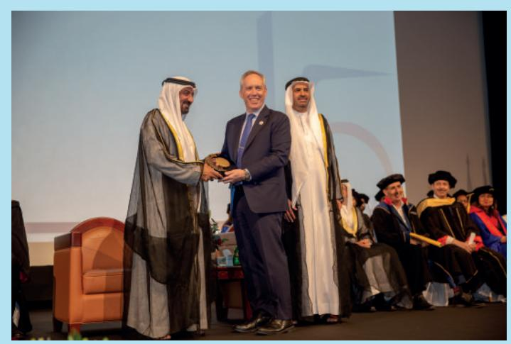

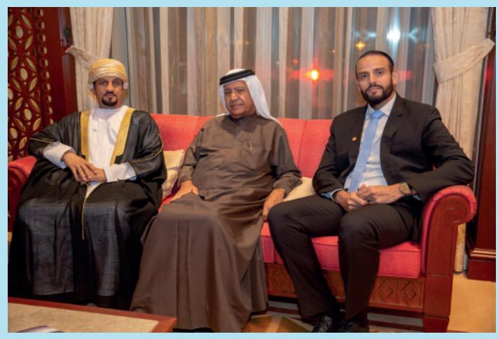

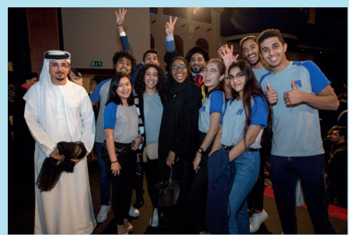

<!-- page 9 -->

## **Graduates 2018-2019 **

## PhD Masters

232

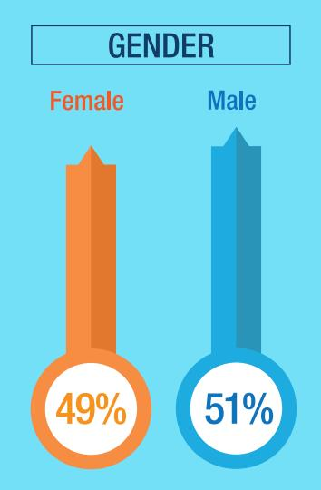

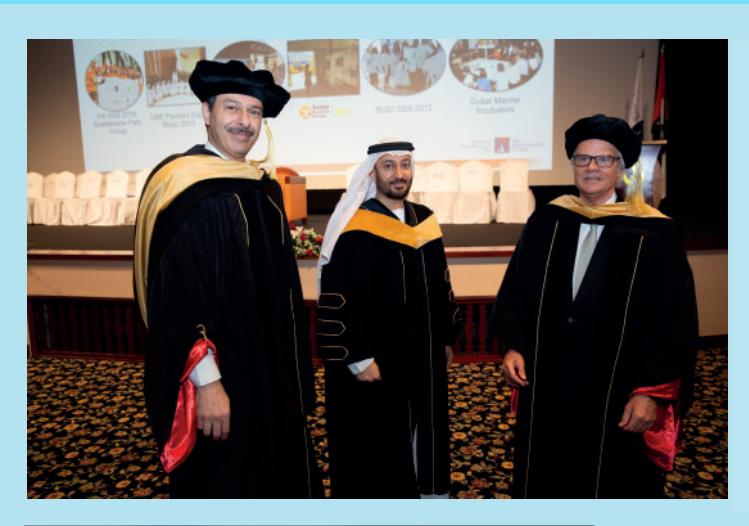

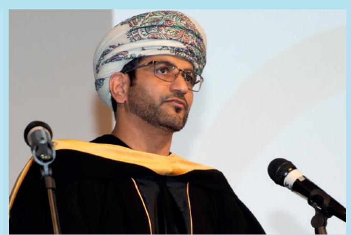

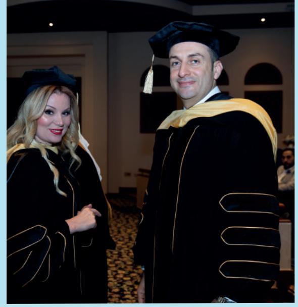

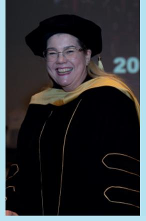

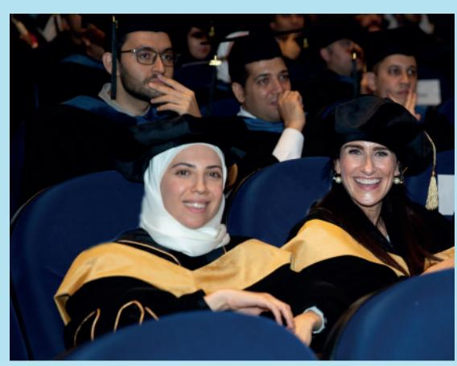

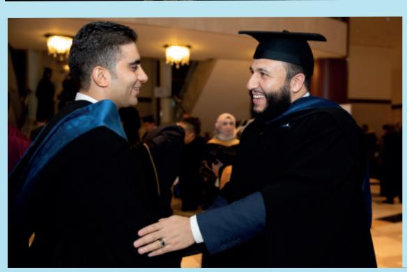

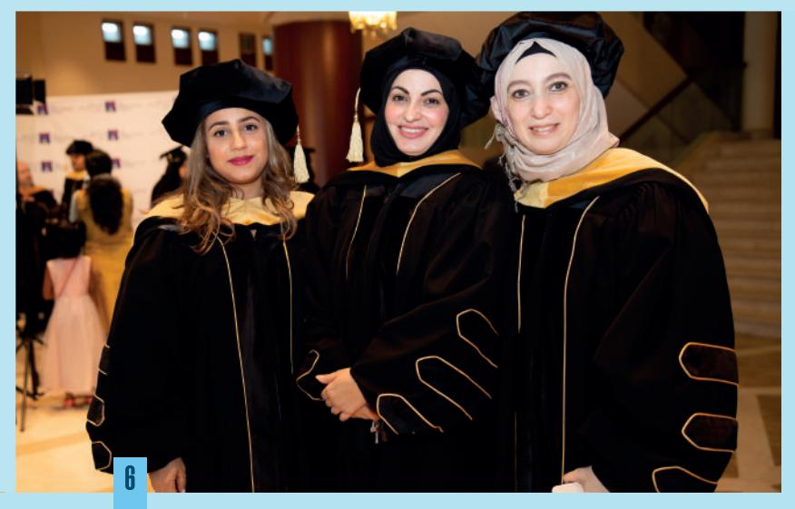

<!-- page 10 -->

## A group of British university leaders from the Association of Heads of University Administration (AHUA) visits BUID

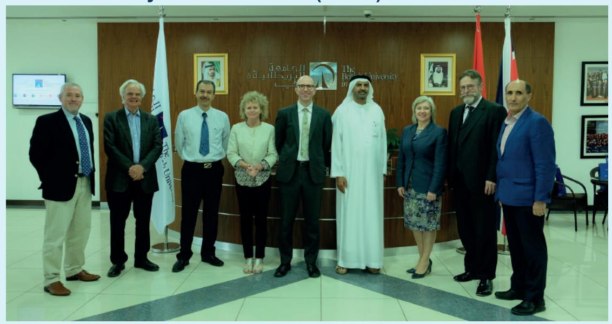

At the invitation of the Registrar and Chief Administrative Officer, a group of British university leaders from the Association of Heads of University Administration (AHUA) visited BUID from 29 January to 3 February.

AHUA is the representative body for senior university managers (University Secretaries, Registrars, Chief Operating Officers, and Heads of Administration) in the United Kingdom and Ireland. BUiD is the first and only international university to be a member of AHUA. The visitors were given a presentation on the history of BUiD by the Vice Chancellor as well as introductions to BUiD's research and faculties by the Deans. During their visit, our guests met with BUiD's senior staff and held discussions around potential collaborative research and teaching. It is hoped the visit will lead to new and exciting partnerships between BUiD and more UK universities.

## The Engineering Deans Council (EDC) holds its bi-annual meeting at BUiD

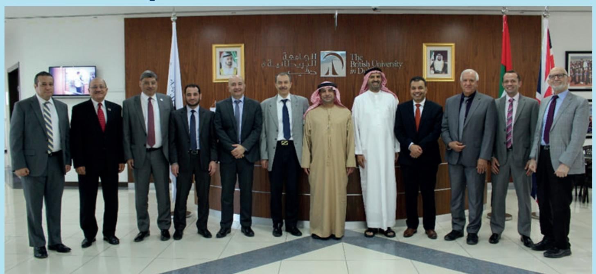

On 2 February, the Engineering Deans Council (EDC) held its bi-annual meeting at BUiD. The EDC membership is comprised of the Deans of engineering faculties of all federally accredited universities in the UAE. Professor Mohamed Yousif Baniyas, Director of the Commission for Academic Accreditation (CAA) – Ministry of Education, attended the meeting and discussed issues related to accreditation of engineering programmes and ways to improve the process in order to enhance the quality of these programmes in the UAE.

<!-- page 11 -->

## **ACCREDITATION AND MEMBERSHIP **

## BUID Engineering Management programme receives accreditation from The American Society for Engineering Management (ASEM)

BUID's Engineering Management programme received accreditation from The American Society for Engineering Management (ASEM), making BUID the first university in the UAE to receive such accreditation. Students graduating with a Masters degree from an ASEM-certified graduate programme are eligible for immediate instatement as a Certified Associate in Engineering Management (CAEM).

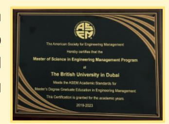

ASEM is a global professional society dedicated to the promotion and advancement of the engineering and technical management profession. Programme certification is designed to provide recognition to those programmes that excel in offering education at the Masters level that meet the rigorous standards of ASEM.

## Project Management programmes at BUiD receive PMI Global accreditation

BUiD's Project Management programmes received accreditation for the next five years from PMI Global Accreditation Center for Project Management Education Programs (GAC). GAC is the world's leading specialised accrediting body for project management and related degree programmes. Graduates from BUiD's Project Management programmes can now receive 1500 hours of project management experience credit towards earning the Project Management Professional certification (PMP).

BUiD launched its first Masters programme in Project Management in 2004, and has since expanded to offer a specialised portfolio of Masters programmes in Project Management including Project Management, Construction Project Management, Infrastructure Project Management, Enterprise Risk Project Management, and Information Technology Project Management.

## BUiD becomes a member of AACSB International

## -The Association to Advance Collegiate Schools of Business

BUID became a member of AACSB International — The Association to Advance Collegiate Schools of Business. This membership will allow BUID to promote engagement, encourage innovation, and increase impact in its business programmes. In attaining this membership, BUID joined universities with the highest standards in business education.

AACSB International (AACSB) is a global non-profit association that connects educators, students, and business to achieve a common goal: to create the next generation of great leaders.

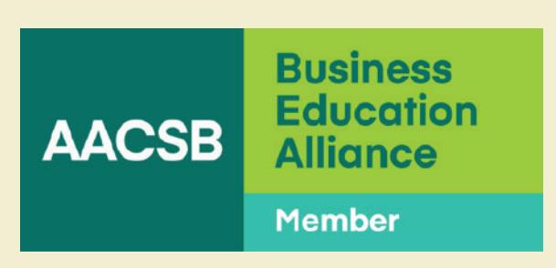

<!-- page 12 -->

## **CUTTING-EDGE RESEARCH **

## ■ BUiD professors win at the 2019 Emerald Literati Awards

BUID professors won at the 2019 Emerald Literati Awards for their articles published by Emerald Publishing in the areas of

Facilities, Managerial Finance, and Educational Management.

Emerald Literati Awards
Celebrating high quality scholarly research

The article 'Emerging financial risks from climate changes on building Celebrating high quality scholarly research

assets in the UK', co-authored by Professor Halim Boussabaine, Dean of the Faculty of Business and Law, and Dr Khalid Al Marri, Associate Professor of Project Management, won the Outstanding Paper Award.

Articles by Professor Husam Al-Malkawi, Professor of Finance and Head of the MSc in Finance programme ('Corporate social responsibility and financial performance in Saudi Arabia: Evidence from Zakat contribution') and Professor Stephen Wilkins ('Transnational higher education: the importance of institutional reputation, trust and student-university identification in international partnerships') were selected as Highly Commended.

## ■ BUiD holds its fourth Doctoral Research Conference

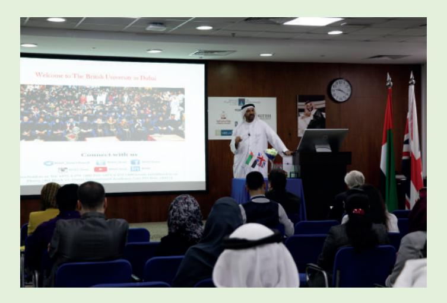

The fourth BUiD Doctoral Research Conference was held on 4 May at the University. The day began with an introduction by the Vice Chancellor, and then a keynote presentation by Professor Dejan Mumovic of UCL who delivered an overview of the PhD journey.

BUiD's PhD students participated in the Conference and 74 papers were presented. Prizes were awarded for the best poster overall and best conference papers in Architecture and Sustainable Built Environment, Project Management, Business Management, Education and Computer Science.

## BUiD conducts the inaugural Construction Law and Arbitration Training

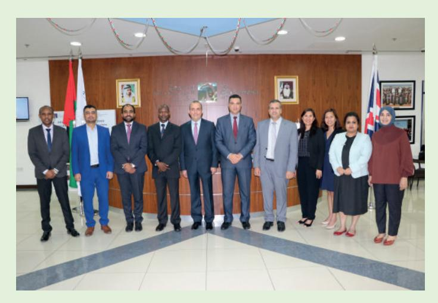

BUID conducted training on Construction Law and Arbitration on 14-15 December. BUID's Professors of Construction Law and Dispute Resolution gave the training, which awarded its participants CPD points in accordance with the Government of Dubai Legal Affairs Department. The 2-day training discussed issues related to construction law and arbitration in the UAE including construction contacts, defects liability, decennial liability, arbitration agreement, arbitral tribunal, and arbitration awards.

<!-- page 13 -->

## BUiD hosts the 16th European, Mediterranean and Middle Eastern Conference on Information Systems (EMCIS 2019)

In collaboration with the University of Nicosia and the Dubai Blockchain Center, BUiD organised EMCIS 2019 on 9-10 December. EMCIS is an annual research conference, which addresses research into information systems regionally and globally.

It aims to bring together researchers, academics, and professionals from around the world to exchange innovative ideas covering technical, organisational, business and social issues in the application of information technology. The conference accepted 50 research papers.

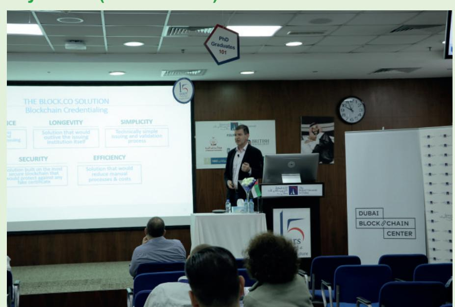

## BUiD students participate in the Solar Decathlon Middle East competition

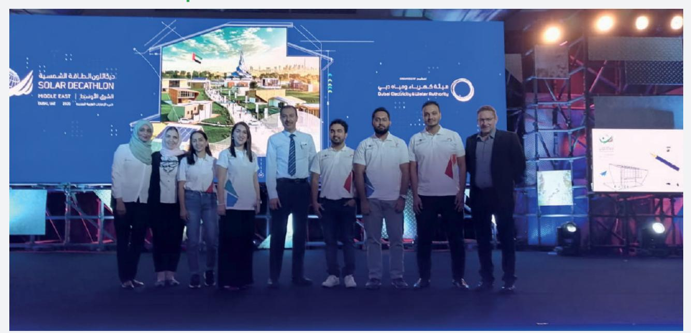

BUiD's team Harmony was shortlisted in the Solar Decathlon Middle East competition organised by Dubai Electricity and Water Authority. The team was formed of students from different disciplines at BUiD including sustainable design, engineering management, architecture, smart buildings, structural engineering, information technology and project management under the guidance of Professor Bassam Abu Hijleh, Dean of the Faculty of Engineering and IT.

Solar Decathlon Middle East is a collegiate competition of 10 contests that challenges students to design and build solar-powered houses. The projects are developed by multidisciplinary teams, giving students the opportunity to learn about technical issues, teamwork, communication skills, and sustainable lifestyle and socio-economic issues in order to ensure the viability of their project. This year's edition will be held in conjunction with the World Expo 2020 Dubai.

<!-- page 14 -->

## **BUID ACADEMIC RESEARCH GRANTS **

Female

Male

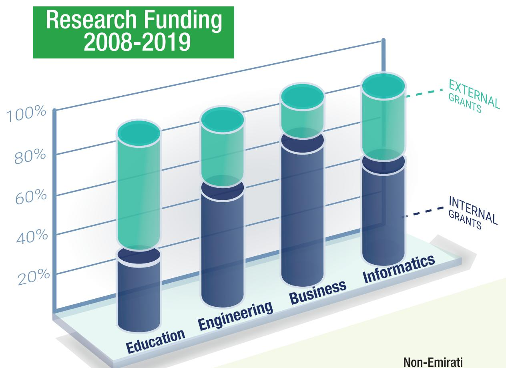

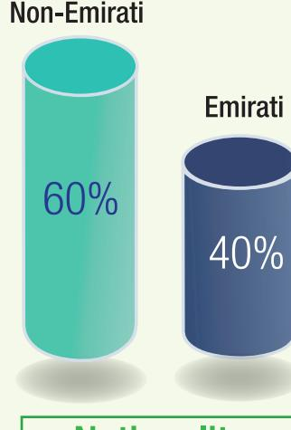

**Nationality **

<!-- page 15 -->

## **ACADEMIC PUBLICATIONS **

The Vice Chancellor and the Dean of Research contribute a chapter in a book about talent management

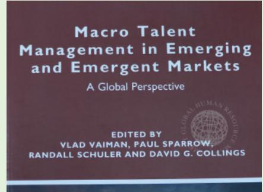

Professor Abdullah Alshamsi, Vice Chancellor, and Professor Ashly Pinnington, Dean of Research, contributed a chapter in a book about talent management titled 'Macro Talent Management in Emerging and Emergent Markets'.

In their chapter, they presented research involving 4 case studies and 84 interviews with people holding responsibility for Talent Management (TM) in public, private, and not-for-profit sector organisations. The main findings of their research demonstrated some of the key stakeholder roles of government in macro TM and showed the potential for public sector organisations collaborating in areas of global TM and organisational TM.

BUiD academics and students contribute to an educational policies book

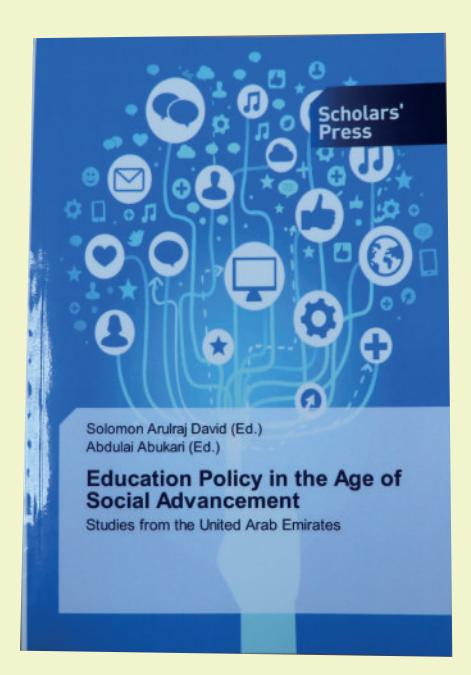

Dean of Education contributes chapters in two books

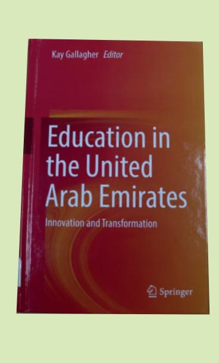

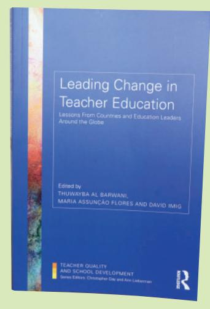

Dr Solomon David, Associate Professor and Head of the Master of Education programme, and Professor Abdulai Abukari, edited a book about educational policies titled 'Educational Policy in the Age of Social Advancement – Studies from the United Arab Emirates'.

The book consists of 12 chapters, which were contributed by BUiD's PhD in Education students. These chapters address the unique areas, aspects and practices of education policies in the UAE that contribute to the ongoing debate that shapes educational innovation and social advancement.

Professor Eman Gaad, Dean of the Faculty of Education, wrote a chapter in 'Education in the United Arab Emirates – Innovation and Transformation'. The book, published by Springer, overviews education in the UAE. In her chapter Professor Eman discusses the status of inclusive education and initiatives taken by the UAE to support inclusion. She also co-authored a chapter in 'Leading Change in Teacher Education', published by Routledge. The book discusses topics relevant to education, policymakers and international organisations involved in the design and implementation of programmes in teacher education.

<!-- page 16 -->

## **PROGRAMMES **

■ BUiD accepts students on the BSc in Electro-Mechanical Engineering programme

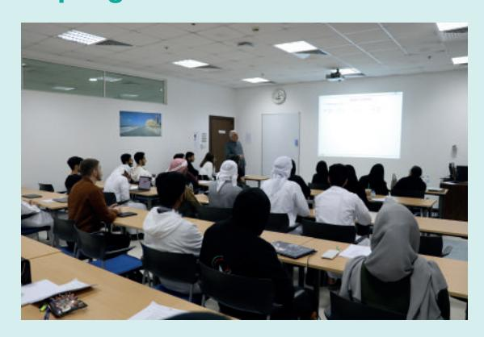

BUID offered undergraduate programmes for the first time in 2018. In 2019, it accepted the first group of students on the BSc in Electro-Mechanical Engineering. The programme is designed to produce well-rounded graduates who can work across a wide range of roles from design and consulting to contracting and management in a wide range of modern industries such as construction, manufacturing, energy services, renewable energy, transportation, and aviation. An electro-mechanical engineer can ensure the reliable and efficient functioning of the majority of systems and subsystems that underpin today's societies. Proper integration and optimisation of these has significant environmental, economic and social implications and therefore plays a decisive role in enhancing the sustainability of society.

Master of Education programme introduces a successful blended learning approach

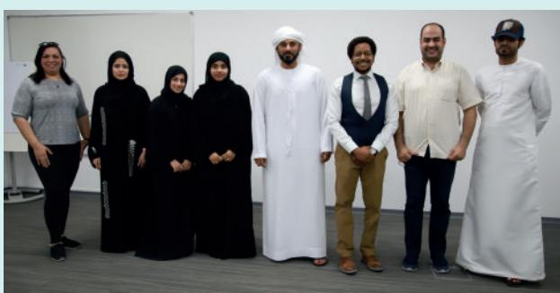

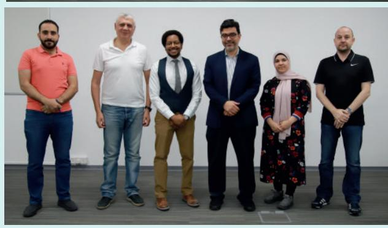

Dr. Tendai Charles, Assistant Professor of Education, introduced an innovative teaching approach to his class. The Teaching & Learning module was enhanced with the introduction of a blended learning component that uses a combination of 'Team-Based Learning' pedagogy, 'Micro-Learning' pedagogy and the 'Flipped Classroom' method. Students were divided into teams and each team leader was responsible for ensuring that the students were on track with their weekly homework tasks and the core assignments for the module.

## ■ BUiD offers a portfolio of Masters in Education programmes

In 2004, BUID offered its first Master of Education programme. In 2019, based on this now highly successful MEd programme, it introduced a portfolio of programmes in Education including Master of Education in Management Leadership and Policy, Master of Education in Special and Inclusive Education, Master of Education in Teaching English to Speakers of Other Languages, Master of Education in Information and Communication Technology, Master of Education in Science Education, Master of Education in Psychology, and Master of Education in Learning and Teaching.

<!-- page 17 -->

## ACADEMIC AND PROFESSIONAL COLLABORATION, AND LINKS WITH INDUSTRY

## ■ BUiD signs an MoU with the Knowledge Fund Establishment

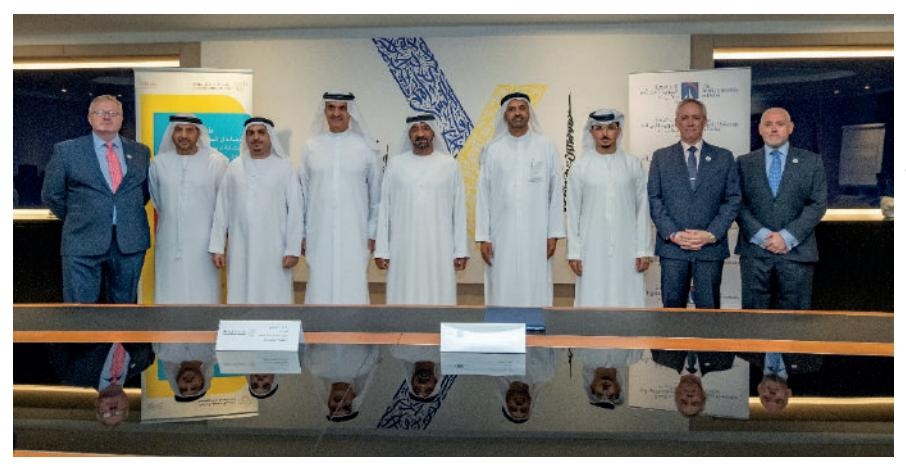

Under the patronage and in the presence of His Highness Sheikh Ahmed bin Saeed Al Maktoum, President, Dubai Civil Aviation Authority, Chairman & Chief Executive, Emirates Group, Chairman Dubai Airports, and BUID Chancellor, the Knowledge Fund Establishment and The British University in Dubai signed a memorandum of understanding. The MoU signing marked the continued support of the Knowledge Fund Establishment in the development of BUID. The

MoU was signed by Professor Abdullah Alshamsi, Vice Chancellor, and His Excellency Hesham Khalifa Al Qaizi, Chief Executive Officer and Member of the Board of Directors of the Knowledge Fund Establishment. The ceremony was also attended by His Excellency Ahmad Abdulkarim Julfar, Chairman of the Board of Directors of the Knowledge Fund Establishment, and members of the University's Council.

## ■ BUiD signs an MoU with the Ministry of Health and Prevention (MoHAP)

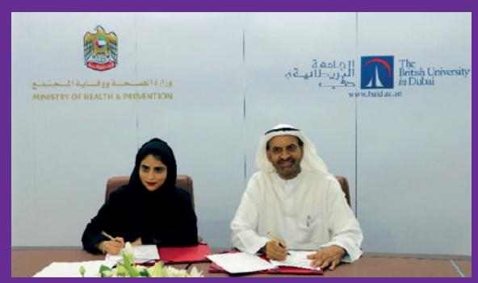

On 24 November, BUiD signed a memorandum of understanding with the Ministry of Health and Prevention, (MoHAP), represented by the Health Statistics and Research Center. The two organisations agreed on enhancing their cooperation to conduct health statistical research, exchange experiences and research in health and data field, and develop a framework of cooperation in the field of data science and informatics.

The MoU was signed at BUiD by Alya Zaid Harbi, Director of the Health Statistics and Research Center, and Professor Abdullah Alshamsi, Vice Chancellor.

## BUiD, Dubai Blockchain Center and the University of Nicosia sign a Memorandum of Understanding

On 2 April, BUiD signed a Memorandum of Understanding (MoU) with the Dubai Blockchain Center and the University of Nicosia during the Future Blockchain Summit. The MoU was signed by Professor Abdullah Alshamsi, Vice Chancellor,

Dr Marwan Alzarouni, Chief Executive Officer – Dubai Blockchain Center and Antonis Polemitis, Chief Executive Officer – University of Nicosia.

The three parties agreed to collaborate to further the promotion and understanding of blockchain through training courses, workshops, conferences, educational programmes and research.

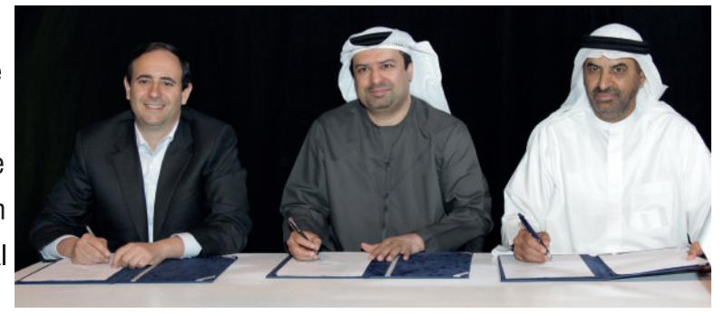

<!-- page 18 -->

## ■ BUID signs an MoU with the British Council to become an IELTS Registration and Test Centre

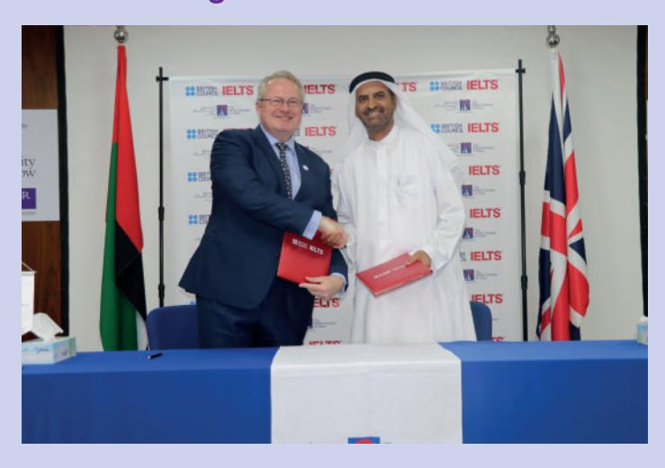

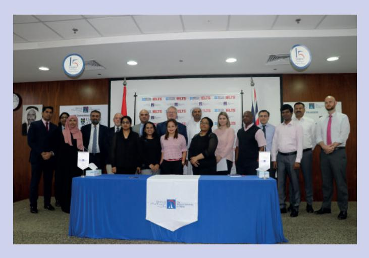

On 7 October BUiD signed an MoU with the British Council to become an approved IELTS Registration and Test Centre. The MoU was signed during an official ceremony held at BUiD attended by Gavin Anderson, Director of the British Council, UAE, Deep Adhikari, Director – Exams, Gulf South Cluster, Professor Abdullah Alshamsi, Vice Chancellor, and Hugh Martin, Registrar and Chief Administrative Officer.

## ■ BUiD signs 2+2 agreement with the University of Glasgow for Computer Science programmes

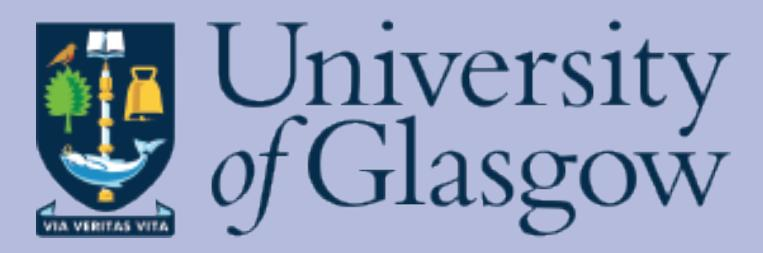

BUID signed a collaborative agreement with the University of Glasgow. Through this agreement, BUID Computer Science undergraduates will be able to complete the last two years of their programmes in the UK, benefitting from an exceptional learning experience offered by one of the UK's world-class universities.

BUiD's students registered on the BSc in Computer Science – Software Engineering or BSc in Computer Science – Artificial Intelligence will have the option to study the last two years of their degrees on the BSc (Honours) in Computing Science at the University of Glasgow. In addition, students will be offered annual financial support in the form of a scholarship to help them with their education expenses. The University of Glasgow was established in 1451, and it is ranked in the top 100 universities in the world. It is a member of the prestigious Russell Group that represents 24 leading UK universities.

This agreement follows two similar 2+2 collaborative agreements, which BUiD signed with the University of Edinburgh and the University of Glasgow for engineering programmes in 2018.

<!-- page 19 -->

## Energy certified programmes at BUiD

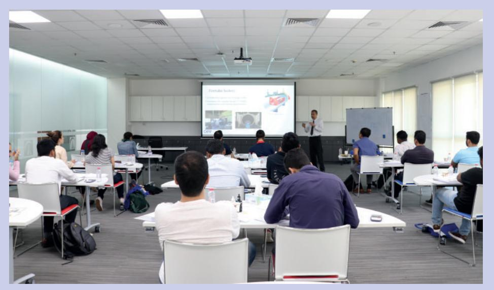

In 2019, BUiD's Professional Development and Examination Centre (PDEC) conducted 19 workshop sessions through the Taqati training programme which brings in a suite of internationally and locally certified training programmes and modules to cater to the learning & development needs of different audiences in Dubai's energy sector. Workshops conducted through the year included LEED (GA, AP O+M, AP BD+C, and AP ID+C), Certified Energy

Manager (CEM), Certified Energy Auditor (CEA), Certified Measurement & Verification Professional (CMVP), WELL AP, Performance Contracting & Funding Professional (PCF), and Advanced Measurement & Verification (AMV).

Specialised training sessions were held for major stakeholders such as RTA, Dubai Airports, ENOVA, and MAF. The goal of the training programmes was to help bridge the knowledge and skill gaps in the energy market. BUiD has also forged partnerships with governmental and non-governmental agencies and organisations throughout the UAE and GCC for the provision of organisational training. It delivered the first Certified Building Commissioning Professional (CBCP) in the Middle East.

## ■ BUiD hosts a lecture about intelligent engines and intelligent services

On 18 February, BUiD hosted Professor Andrew Harrison, Engineering Associate Fellow at Rolls-Royce, who gave a presentation titled 'Intelligent engines and intelligent services – the perfect partnership'. In his presentation, Professor Harrison talked about the extent of technological advancement being used in Rolls-Royce engines, making them some of the safest, most intelligent and cost efficient. The presentation explored how application of these technologies from the setting of product requirements through to in-service support planning are transforming product availability, reliability, and cost of ownership.

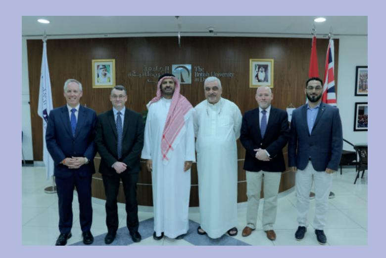

<!-- page 20 -->

## **AWARDS **

## ■ BUiD PhD student wins the Dubai Award for Sustainable Transport 2019

On 27 February, His Highness Sheikh Mansour bin Mohammed bin Rashid Al Maktoum, President of the Dubai International Marine Club, honoured the winners of the 11th edition of the Dubai Award for Sustainable Transport (DAST).

Aysha Hasan Alshehhi, BUiD's student on the PhD in Architecture and Sustainable Built Environment, won the second place award in the Best Student Project category for her research about a priority indicator for the lighting of federal roads in the UAE. The DAST award is an initiative of Dubai's Roads and Transport Authority (RTA) to motivate the public and private sectors to contribute to easing traffic congestion and protect the environment.

## BUID students win best paper awards at the Graduate Students Research Conference 2019

Two of BUiD's PhD students won the best paper award at the Graduate Students Research Conference 2019 (GSRC) held at Zayed University in Abu Dhabi.

Joe Hazzam won 1st place and best paper award in the Business and Management track for his paper 'Co-creation of value in the digital age: the role of customer engagement and social media activities'.

Maqsoud Kruse won 1st place and best paper award in the Arts, Humanities and Social Sciences track for his paper 'Can neuroimaging identify giftedness? An exploratory experimental study'.

The main purpose of the GSRC is to provide opportunities for graduate students to share their research work receive scholarly feedback, and network professionally.

## BUiD academic wins Best Presentation Award

Dr Emad Abu-Ayyash, Assistant Professor of Education, won the Best Presentation Award at the XIII ICLLL 2019: International Conference on Languages, Literature and Linguistics. His winning paper titled 'Context and Culture in EFL Learners' and Native Speakers' Discourses' explored the functions of exophoric and homophoric cohesive devices in EFL learners' essays and professional NS writers' articles about the same topic. The conference, which was

held in Bali, Indonesia on 24 October, brought together leading academic scientists, researchers and research scholars to exchange and share their experiences and research results on all aspects of languages, literature and linguistics.

<!-- page 21 -->

## BUiD professors receive recognition awards

Professor Husam Al-Malkawi Professor of Finance and the Head of Finance programmes, won one of the Asian Education Leadership Awards under the Best Professor in Finance Studies category. The Awards ceremony was held on 10 October in Dubai. The award indicates excellence in application of leadership principles to business situations.

Professor Khaled Shaalan, Head of Computer Science programmes, won the Transformation Maestro in IT Research Award at the Enterprise Transformation Summit & Awards 2019 held in Dubai on 7 October. The Summit is a leadership platform for top CXOs and IT Heads. It focuses

on continued efforts towards embracing new technologies and how enterprises in the region are enhancing their competitive edge by the deployment of technologies including Al and machine learning, robotic process automation, digital workspaces, IoT, blockchain, and data analytics.

## Dean of Education wins awards for her research

Professor Eman Gaad, Dean of the Faculty of Education, won the Best Research Award at the Asia-Pacific Down Syndrome Federation (APDSF) Excellence Awards 2019 ceremony for her research on Down syndrome. She also won The Best Paper Award at the International Conference on Literature, Languages, Humanities and Social Sciences, which was held in Istanbul, for her research paper titled 'The Quest for Effective Inclusive Education: from Equality to Equity in Mainstream Classroom'.

## BUiD academic wins Best Presenter Award

Dr. Solomon David, Associate Professor and Head of Master of Education programmes, won the Best Presenter Award at the International Conference on Teaching, Education & Learning held on 24-25 June at Lusófona University, Lisbon, Portugal. The Conference was organised by the Teaching and Education Research Association (TERA). TERA aims to bring researchers and professionals together to encourage intellectual development and to create opportunities for networking and collaboration.

<!-- page 22 -->

## INTERNATIONAL REACH

## ■ BUiD students participate in leadership and multicultural training in Dundee, Scotland

Four of BUiD's postgraduate students were among 63 students from the UAE, Egypt and Malaysia who participated in the 27th educational programme at the Al Maktoum College of Higher Education in Dundee.

During the training programme, the students were involved in debates on multiculturalism, international politics, globalisation, leadership and dialogue of civilisations. The concluding ceremony was held on 22 February in the presence of His Excellency Mirza Al Sayegh, Chairman of the College Board and member of the University Council, His Excellency Sulaiman Hamid Almazroui, UAE Ambassador to the UK, and Ian Borthwick, the Right Honourable Lord Lieutenant and Lord Provost of Dundee. Students were awarded with certificates accredited by the Scottish Qualifications Authority.

## **■ BUiD students visit leading UK universities **

In BUiD's fifteen year history, regular educational visits to the UK have formed an important part of the University's student experience. This year for the first time, BUiD was able to include in these trips undergraduate students from its initial cohort who started our new Bachelors programmes this year.

In June, BUiD students from the Faculty of Education along with Dr Christopher Hill, Associate Professor and Director of the Doctoral Training Centre, travelled to the UK. They were hosted by the University of Westminster and were able to take part in an international colloquium. The students discussed developing research that benefits society and how to work internationally and benefit from conferences. The students then attended a series of research presentations at the University of Glasgow. The group discussed good practice, developing research skills and how to work with the local community to ensure relevant and valuable outputs to research activity. All of the BUiD students along with students from the University of Glasgow then presented their research work during an international student research conference. Professor Stephen McKinney, Leader of Pedagogy, Praxis and Faith at the University of Glasgow, delivered a professional development workshop, on getting work published.

<!-- page 23 -->

## ■ BUiD students participated in an educational trip to the United Kingdom

In July, a mixed Faculty group of BUiD postgraduates and undergraduates travelled to the United Kingdom on an educational trip, led by the Registrar and Chief Administrative Officer. The trip included visits to Rolls-Royce in Derby, the Universities of Edinburgh and Glasgow, the UK's largest onshore wind farm at Whitelee in Scotland, as well as two days exploring the sights of London. During the trip, students attended workshops at the Rolls-Royce plant in Derby.

The trip also afforded senior BUiD staff the opportunity to meet with their UK Universities Alliance partners in Edinburgh and Glasgow, and to visit the Manufacturing Technology Centre in Coventry, where they held productive meetings with Rolls-Royce managers to discuss plans to develop further the ongoing relationship between the two partners.

<!-- page 24 -->

## **■ Visit to Rolls-Royce **

Students visited the Rolls-Royce plant in Derby where they attended lectures and participated in workshops.

<!-- page 25 -->

## **COMMUNITY OUTREACH **

## ■ The British University in Dubai holds its Sustainability Spring School 2019

BUID organised its Sustainability Spring School 2019, sponsored by the Emirates National Oil Company (ENOC), under the theme 'Green Bridge' and aimed at giving students a better understanding of sustainability. More than 60 students from the UAE, UK, Kingdom of Saudi Arabia, China, and Singapore participated. Students were engaged in a wide range of activities including seminars, debates, roundtable discussions, competitions, and site visits. They visited DEWA Sustainable Building in Al Quoz, Sustainable City, Zayed Desert Learning Centre, and UAE University. Participants were divided into seven teams which competed to win the best design of the Future Petrol Station. The winning team for the best design was chosen by a judging panel that included His Excellency Saif Al Falasi, Group CEO of ENOC, Dr. Waddah Ghanem, Sr. Director of Sustainability, Operational & Business Excellence, and other members from the ENOC management team, along with the Vice Chancellor and Dean of the Faculty of Engineering and IT. The one-week activity at the University was concluded in a closing ceremony in the presence of His Excellency Dr. Thani bin Ahmed Al Zeyoudi, Minister of Climate Change and Environment, and His Excellency Saif Humaid Al Falasi.

<!-- page 26 -->

## BUiD organises its first Entrepreneurship and Innovation Competition

BUiD organised its first Entrepreneurship and Innovation Competition for schools. The competition aimed to encourage innovation and entrepreneurship by engaging students and giving them the opportunity to develop and pursue their business ideas. Nine teams from three schools (St Mary's Catholic High School, the International School of Creative Science, and SAMA American Private School) competed in presenting their projects in front of a jury panel. The first place winner was the Frame Work team from the International School of Creative Science. The Preference Speculators team from St Mary's Catholic High School came in second and in third place was the EGR team from the International School of Creative Science.

## Faculty of Education offers parenting training

On 24 September, Professor Eman Gaad, Dean of the Faculty of Education, and Rawy Thabet, Academic Associate, provided training for 25 staff working at the Psychiatric Clinic at Rashid Hospital. The training focused on how to deliver parenting strategies effectively, particularly through the use of case discussion and role play. One of the main objectives of the training was to help trainees gain confidence in delivering regular group sessions to parents. This training was awarded one CPD Credit Point by Dubai Health Authority (Accreditation 1584/19).

<!-- page 27 -->

<!-- page 28 -->

## **CONNECT WITH BUID **

## THE BRITISH UNIVERSITY IN DUBAI

Block 10 & 11 Dubai International Academic City, PO Box 345015, Dubai, UAE **tel.:** +971 4 279 1400, **email:** info@buid.ac.ae
