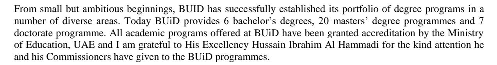
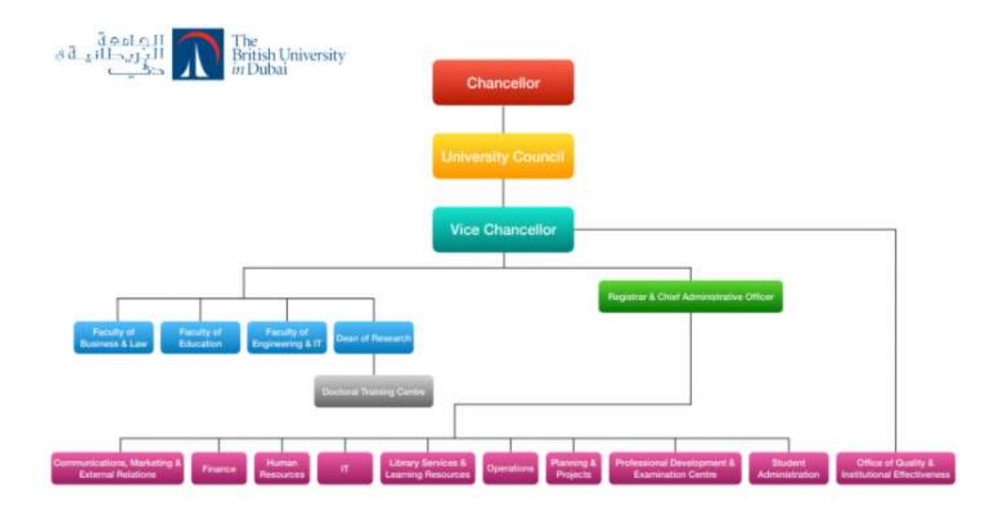

<!-- A3.R30 | source: papers_json/A3.R30/ -->

## **Student Catalogue** **AY 2021-2022**

<!-- page 2 -->

**The British University in Dubai Undergraduate Catalogue 2021-2022**"At the root of all creation is imagination because before you can achieve you must conceive"HH Sheikh Mohammad Bin Rashed Al MaktoumRuler of Dubai and Prime Minister of UAE*Globally Aware – Nationally Accredited- Locally Focused*

<!-- page 3 -->

## **CHANCELLOR'S MESSAGE**

It is my great pleasure to welcome our new cohort of undergraduate students to the British University in Dubai.

The University has been formed out of a genuine collaboration between Dubai and United Kingdom institutions to provide the best of British education in Dubai. Our UK associates,

the Universities of Edinburgh, Manchester and Glasgow, have been chosen because of their research standing and high standards. I am pleased that they will continue working closely with BUiD to ensure that you are offered high quality programmes which benefit from that research.

The University is also grateful to its founders the Al Maktoum Foundation, Rolls-Royce, the National Bank of Dubai, the British Business Group, and the Dubai Development and Investment Authority; its contributors, The Emirates Group, DUCAB, Atkins, and Dubai Duty Free; the Dubai & UK Trade & Economic Committee and the members of the Council, Advisory Groups, and Senate; and its Vice Chancellor, Registrar and staff for the role they have played in running the University and providing a top quality higher education experience for our students.

The University was established to make a substantial and unique contribution to the United Arab Emirates and the Gulf region. Our faculty and staff are highly qualified, experienced, and dedicated professionals, whose passion and dedication is to focus on providing you with a positive learning experience. However, the University can only go so far by providing tuition, a vibrant environment in which to study and the considerable benefit of access to the resources of the three top quality British Universities. By far the greatest contribution to the University will come from you, as a student, both through what you put into the University and through what you take from it and return to society through your employment or profession.

This document is designed to give you information to make your academic planning easier. If you need more information or advice, please take advantage of the experience and professional expertise of our faculty and administrative staff.

I wish you every success as you begin one of the most important journeys of your life.

Ahmed Bin Saeed Al Maktoum Chairman of the Council

<!-- page 4 -->

## **HOW TO CONTACT THE UNIVERSITY**

.

| BY MAIL | PO Box 345015, Dubai, United Arab Emirates |
| --- | --- |
| BY TELEPHONE | +971 4 279 1400 |
| BY EMAIL | info@buid.ac.ae |
| IN PERSON | 1st and 2nd Floor, Block 11 Dubai International Academic City (DIAC) Dubai |

## **Disclaimer**

The catalogue is an official BUiD University document describing academic programmes, faculty listings, policies, procedures, regulations and requirements of the University. Every effort has been made to ensure the accuracy of the information presented in this catalogue. However, no responsibility is assumed for editorial, clerical or printing errors, or errors occasioned by mistakes. The University reserves the right to change any provision listed at any point in time during the year, to best serve the academic interest of the students. Such change may include, but is not limited to, academic requirements for graduation. Every effort will be made to keep students informed of any such changes.

It is important that each student be aware of his or her individual responsibility to keep apprised of current policies and requirements.

<!-- page 5 -->

## TABLE OF CONTENTS

INTRODUCTION AND OVERVIEW6BOARD OF TRUSTEES/COUNCIL9ORGANISATION CHART10THE CAMPUS11UNDERGRADUATE ACADEMIC DEGREES12ACADEMIC STAFF13ADMINISTRATIVE STAFF17ACADEMIC CALENDAR 2020-202118ADMISSION, ENROLMENT AND REGISTRATION20ADMISSIONS PROCEDURES28FINANCIAL SUPPORT & FEES32IMPORTANT UNIVERSITY POLICIES34ACADEMIC ADVISING42ASSESSMENT43TEACHING AND LEARNING48GENERAL EDUCATION PROGRAMME49FACULTY OF ENGINEERING & IT PROGRAMMES52FACULTY OF BUSINESS AND LAW71STUDENT SERVICES90LEARNING SUPPORT SERVICES93ACADEMIC GOVERNANCE96GLOSSARY99

<!-- page 6 -->

## **INTRODUCTION AND OVERVIEW**

The British University in Dubai (BUiD) was established in 2003 by Ruler's Decree of the Emirate of Dubai, as the region's first, research-based, postgraduate university. BUiD offers a unique not-for-profit brand of higher education with high standards for study and research designed to contribute to the technological innovation and socio-economic development of the Arab world and beyond

BUiD was founded through the collaboration of government, private sector and academia. The private sector founders are Al Maktoum Foundation, Rolls-Royce PLC, the National Bank of Dubai (now ENBD), Investment and Development Authority in Dubai (now Dubai Holding), and the British Business Group. The founders approached three Russell Group Universities in the UK; namely the Universities of Birmingham, Edinburgh, and Manchester, to provide the academic support for the newly proposed university. The founders also approached the Government of Dubai to issue a Law establishing the University. This has guaranteed the sustainability of BUiD and minimised many risk elements. Additionally, to maintain the smooth operation of the University, the Ruler of the Emirate of Dubai issues a decree every three years to establish the University Council. His Highness Sheikh Ahmed Bin Saeed Al Maktoum has been the Chair of the University Council and Chancellor of BUiD since inception.

Working in association with leading UK universities BUiD offers cutting-edge education and research in key disciplines. BUiD aspires to the highest, internationally recognized British standards as reflected in its work with the Universities of Edinburgh, Glasgow, and Manchester. All BUiD Masters and Doctorate programmes have accreditation from the UAE Ministry of Education, as validated by its Commission for Academic Accreditation.

The University is comprised of three faculties (Business and Law, Engineering & Information Technology and Education) delivering a portfolio of accredited Bachelor, Master and doctorate programmes.

To date BUiD has accredited 5 Bachelor's degrees, 20 Masters degrees, and 7 Doctorate degrees. As of 2019/2020, nearly 1000 students are enrolled at BUiD, 34% of which are doctoral students, 52% are master's students and 13% are undergraduate students.

## **University Mission**

The Mission of the British University in Dubai (BUiD) is to provide world class scholarship, education and research that make a distinctive British contribution to supporting the aspirations of the Dubai Government to become a hub for education and research in the region.

## **University Vision**

The University's vision is to be recognised and supported as Dubai's premier resource and focus for the reflective pursuit, inclusive accessibility, effective transfer and liberal application of scientific, academic and professional knowledge.

## **University Strategy**

The strategy of a modern university operating in a world city within an increasingly global economy needs to have three dimensions:

- a) An offer of advanced education which meets the demands for higher skills and learning of those who are, or aspire to be professional and intellectual leaders in Dubai, UAE & the wider region
- b) The capture, development and extension of knowledge about the complex realities of human society in the 21st Century
- c) Promotion of reflection, debate and dissemination of learning and understanding to inform policy, practice and activity of benefit for personal, community and social development.

Such a strategy requires the following fundamental attributes in order to flourish:

<!-- page 7 -->

- research-based teaching;
- evidence-based analysis;
- student-centred learning;
- knowledge-oriented economy;
- morally responsible society.

Successful higher education assumes a fundamental core and foundation of skills, knowledge and competency. Over the years and through due review processes, the initial (2003-11) post-graduate focus and experiences of BUiD have prompted some questioning of these assumptions, with a consequent strategic shift to embrace relevant undergraduate provision as well, subject as always to the needs of the individual in modern society, and the support of the political economy.

## **University Goals **

The goals of the University are to:

- Make a distinctive British contribution to the higher educational system in the United Arab Emirates (UAE) through the creation of a high quality research-led university
- Develop leading-edge research capabilities in key disciplines
- Offer the highest international competitive level of research-informed education in key modern disciplines
- Interact with regional industry and play a leading role in stimulating a knowledge-based economy in Dubai and the Emirates
- Provide opportunities for study and research for the purpose of gaining degrees in arts and sciences
- Apply the systems of study and research that are used in distinguished British universities with the aim of enhancing the standard of university education in the U.A.E.
- Qualify and educate nationals who are scientifically and practically trained in all fields of knowledge, through advanced educational and training programmes
- Serve the various sectors of society, especially the commercial and industrial sectors, by providing consultation, technical services and research in the various fields of science and technology and the other disciplines, which will be offered by BUiD
- Consolidate educational, scientific and cultural links with distinguished British universities and institutions, and with other internationally distinguished universities.

## **Licensure and Accreditation**

BUiD located in the Emirate of Dubai is officially licensed from 21/01/2015 to 31/12/2019 by the Ministry of Higher Education and Scientific Research of the United Arab Emirates to award degrees/qualifications in higher education.

The University also holds the license issued by the Knowledge and Human Development Authority Dubai.

## **Strategic Operations and Plans**

The BUiD 2019-24 Strategic Plan is thus designed to align with the UAE Vision 2021 and the Dubai Plan 2021, with the aim of improving BUiD's standing in the Arab region and in internationally recognised university rankings. The BUiD 2019-24 Strategic Plan is also designed to be adaptable and emerging; this is important so that it can absorb the new UAE Vision 2030, the Dubai Plan 2025, as well as adapting to developing university ranking measures.

<!-- page 8 -->

## **Why Choose British University Dubai?**

## 1. A local high quality academic institution

- Licensed and accredited federally and locally
- Self-governing autonomy with regard for academic freedom, quality and local relevance
- Supported by the municipality, local commerce, national foundations and multinational corporations

## 2. A diverse student body

- Around 30% Emirati, 40% from the wider Arab region and 30% other resident expatriate
- Very competitive pricing being a not-for-profit organization
- Special scholarship categories for the Emiratis and the best graduates from Federal institutions
- Full –time / part-time study options
- Only weekend and evening classes

## 3. A rich and exciting university experience

- Research-based teaching founded upon evidence-based research
- Business, social enterprise and government links for workplace learning, knowledge transfer and professional development opportunities
- A university relevant to the key sectors of the economy and society
- Pragmatic inquiry through real-life case study, blue sky research and inter disciplinary analysis
- Members of the academic community have published approximately 2000 academic papers, books and professional works since 2004

## 4. The Best of British Education in the UAE

- Partnerships for each program with the leading UK research universities; The University of Edinburgh, University of Manchester, and University of Glasgow.
- British quality assurance and standards, UAE accredited masters and doctorate level awards
- Opportunities to collaborate with ( and visit) British partners and fellow students

<!-- page 9 -->

## **BOARD OF TRUSTEES/COUNCIL **

<!-- page 10 -->

## ** ****ORGANISATION CHART **

<!-- page 11 -->

## **THE CAMPUS**

The University is situated in Dubai International Academic City (DIAC), very accessible to all residential and commercial areas and at a 30-minute drive from the downtown.

The University campus is located in Block 10 and 11 of the Dubai International Academic City (DIAC).

The University shares the sports facilities, parking services, food court and recreation facilities with other Universities in Dubai International Academic City providing all campus facilities to the University community.

<!-- page 12 -->

## **UNDERGRADUATE ACADEMIC DEGREES**

| Faculty | Programmes |
| --- | --- |
| Engineering & IT | **Bachelor** of Science in Computer Science |
| Concentrations: |  |
| Computer Science and Artificial Intelligence |  |
| Computer Science and Software Engineering |  |
| **Bachelor** of Science Electro-Mechanical Engineering |  |
|  |  |
| Business and Law | **Bachelor** of Science in Business Management |
| **Bachelor** of Science in Accounting and Finance |  |
| **Bachelor** of Law |  |

<!-- page 13 -->

## **ACADEMIC STAFF**

| Name | Academic Position | Credentials |  |
| --- | --- | --- | --- |
| Faculty of Engineering And Informatics |  |  |  |
| Professor Bassam Abu Hijleh | Dean- Faculty of Engineering & IT Head of Programme (MSc SDBE/PhD ASBE) | (1985) Bachelor of Science in Mechanical Engineering, Ohio State, University (USA) |  |
| (1987) Master of Science in Mechanical Engineering, Ohio State, University (USA) |  |  |  |
| (1990) Doctor of Philosophy (Ph. D) in Mechanical Engineering, Ohio State University (USA) |  |  |  |
| Dr Hanan M Taleb |  | (2004) BA Interior Design, Dar Al Hekma College (Saudi Arabia) |  |
| (2006) MA Interior Design, Bournemouth University (UK) |  |  |  |
| (2007) MArch, University of Sheffield (UK) |  |  |  |
| (2011) PhD Architecture, University of Sheffield (UK) |  |  |  |
| Dr Wael Ahmed Sheta |  | (1999) BSc, Architectural Engineering (Egypt) |  |
| (2005) MArch, Architecture History (Egypt) |  |  |  |
| (2012) PhD, Building Technology and Sustainability (UK) |  |  |  |
| Dr Kirk Shanks |  | (1996) BEng (Hons) Building Services Engineering + Diploma in Industrial Studies, University of Ulster (UK) |  |
| (1997) MSc in Architecture: Environmental Design of Buildings, The Welsh School of Architecture, Cardiff University (UK) |  |  |  |
| (2007) PhD in Energy Studies, University of Ulster, (UK) |  |  |  |
| (2015) PG Certificate in Academic Practice Heriot-Watt University + Fellow of the Higher Education Academy (UK) |  |  |  |
| Prof. Alaa Ameer | Head of Programme (MSc Eng.Mgt/BSE/BSc Electro-Mechanical) | (1979) Bachelor of Science in Mechanical Engineering, University of Technology (Iraq) |  |
| (1981) Higher Diploma in Applied Mechanics, University of Technology (Iraq) |  |  |  |
| (1983) Master of Science in Tribology, University of Technology (Iraq) |  |  |  |
| (2001) Doctor of Philosophy in System Modelling, University of Bradford (UK) |  |  |  |
| Prof. Khaled Shalaan | Head of Programme – Informatics (BSc, MSc IT/ITM, PhD CS) | (1982) Bachelor of Commerce (B.Com), University of Cairo, (Egypt) |  |
| (1985) Post-graduate Diploma (PGDip) in Computer Science & Information Science, University of Cairo (Egypt) |  |  |  |
| (1989) Master of Science (MSc) in Computer Science, University of Cairo (Egypt) |  |  |  |
| (1995) PhD Computer Science, Institute of Statistical Studies & Research, Cairo University (Egypt) |  |  |  |
| Prof. Sherief Abdallah |  | (1998) Bachelor of Engineering in Computer Engineering, Cairo University (Egypt) |  |
| (2001) Master of Science in Computer Engineering, Cairo University (Egypt) |  |  |  |
| (2006) Master of Science & Doctor of Philosophy in Computer Science, University of Massachusetts (USA) |  |  |  |
| Prof Piyush Maheshwari |  | (1982) B.Eng. in Electronics & Communication Engineering, Indian Institute of Technology (India) |  |
| (1984) M.Eng. in Computer Science & Technology, Indian Institute of Technology (India) |  |  |  |
| (1990) Ph.D. in Computer Science, The University of Manchester (UK) |  |  |  |
| (1994) Graduate Certificate in Higher Education, Griffith University, (Australia) |  |  |  |
| Dr Cornelius Ncube |  | (1994) Bachelor of Engineering in Computer Science, Brunel University (UK) |  |
| Dr Mostafa Al-Emran |  | (1995) | Master of Science in Software Engineering, City University (UK) |
| (2000) | Doctor of Philosophy in Computer Science, City University (UK) |  |  |
| (2012) | B.Sc. in Computer Science, Al Buraimi University College (Oman) |  |  |
| (2015) | M.Sc. in Informatics, The British University in Dubai (UAE) |  |  |
| (2019) | Ph.D. in Computer Science, Universiti Malaysia Pahang (Malaysia) |  |  |
| Dr Manar Alkhatib |  | (2004) | BSc in Computer Science, Yarmouk University (Jordan) |
| (2007) | MSc in Computer Science, Middle East University (Jordan) |  |  |
| (2019) | PhD in Computer Science, The British University in Dubai (UAE) |  |  |
| Dr Hend ElMohandes |  | (2013) | Bachelor, AinShams University (Egypt) |
| (2018) | Masters in Informatics, Nile University (Egypt) |  |  |
| Prof Abid Abu-tair | Head of Programme – MSc StrE | (1984) | B.Eng. Civil Engineering, Queen Mary College (UK) |
| (1985) | M.Sc. Civil Engineering, Imperial College; (UK) |  |  |
| (1992) | PhD Civil Engineering; Queen Mary College (UK) |  |  |
| Dr Gul Ahmed |  | (2012) | PhD in Civil Engineering, Imperial College (UK) |
| (2002) | M.Engg. in Structural Engineering, NED University (Pakistan) |  |  |
| (1999) | B.E. in Civil Engineering, NED University (Pakistan) |  |  |
| Dr Basem Tuqan |  | (2014) | MSc in System Engineering, The British University in Dubai (UAE) |
| () | PhD The British University in Dubai (UAE) |  |  |
| Prof. Eman Gaad | Dean Faculty of Education | (1987) | Bachelors of Science (BSc) in Biology, Alexandria University (Egypt) |
| (1999) | Doctor of Philosophy (PhD) in Education, The University of East Anglia (UK). |  |  |
| Prof. Sufian Forawi |  | (1983) | Bachelor of Science in Biology and Education, University of Alexandria, Egypt |
| (1984) | Higher Diploma in Education, Omdurman Islamic University, Sudan |  |  |
| (1987) | Master's of Education, Curriculum and Instruction, Omdurman Islamic University, Sudan |  |  |
| (1996) | Educational Doctorate in Science Education, University of Massachusetts Lowell, USA |  |  |
| Dr. Solomon Arulraj David | Head of Programme, MEd | (1999) | B B.A., in English Literature; St. John's College (India) |
| (2000) | B.Ed., in Education; St. Xavier's College of Education (India) |  |  |
| (2002) | M.A in English Literature; Manonmaniam Sundaranar University (India) |  |  |
| (2004) | MEd, Katholieke Universiteit Leuven, (Belgium) |  |  |
| (2011) | PhD in Education, Katholieke Universiteit Leuven, (Belgium) |  |  |
| Dr Emad Ahmed Abu Ayyash |  | (1996) | B.A. Degree in English Literature and Linguistics, Yarmouk University (Jordan) |
| (2008) | Master Degree in English/ Translation, Yarmouk University (Jordan) |  |  |
| (2009) | TEFL Certificate, University of the Fraser Valley (Canada) |  |  |
| (2016) | Ph.D in Education – TESOL, The British University in Dubai, (UAE) |  |  |
| Dr Adbulai Abukari |  | (1999) | BEd (Hons) Social Studies Education & Art Education, University of Education/University of Cape Coast (Ghana) |
| (2003) | MPhil in Comparative and International Education, University of Oslo (Norway) |  |  |
| (2007) | PhD in Comparative and International Education, Middlesex University, (UK) |  |  |
| Dr Christopher Hill |  | (2000) Bachelor of Arts (Hons) in Classical Civilisation, University of Nottingham, UK |  |
| (2001) Master of Arts in International Relations, University of Nottingham, UK |  |  |  |
| (2005) Doctor of Philosophy (Ph. D) in Political Science, University of Nottingham, UK |  |  |  |
| (2010) Post Graduate Certificate in Higher Education, University of Nottingham Malaysia Campus, Malaysia |  |  |  |
| Dr Tendai Charles | Director, Centre for Research for Digital Innovation | (2005) BEng in Computing City University, UK |  |
| (2010) MA Applied Linguistics Newcastle University, UK |  |  |  |
| (2013) CELTA International House, UK |  |  |  |
| (2018) PhD in Education University of York, UK |  |  |  |
| Prof Aymen Masadeh | Dean, Faculty of Business and Law | (1996) LLB, Jordan University, Jordan |  |
| (1997) LLM, Aberdeen University, UK |  |  |  |
| (2001) PhD (Contract Law), Bristol University, UK |  |  |  |
| Dr Abba Kolo | Head of Programme, PhD Business Law, BSc Law and CLDR | (1984) LL.B, Ahmadu Bello University, Nigeria |  |
| (1986) Bachelor of Law, Nigerian Law School. Nigeria |  |  |  |
| (1988) LLM, University of Warwick, UK |  |  |  |
| Dr Omar Hisham Alhyari |  | (2000) Bachelor's Degree in Law, Amman University (Jordan) |  |
| (2003) Master's Degree in Private Law, Amman University (Jordan) |  |  |  |
| (2008) Doctorate in Law, University of the West of England (UK) |  |  |  |
| Dr Stephen Wilkins | Head of Programme, PhD BM/DBA/MBA | (1988) Bachelor of Arts in Business Studies, Plymouth Polytechnic, UK |  |
| (1995) Master of Science in Management Science, University of Southampton, UK |  |  |  |
| (1995) Postgraduate Certificate in Education (PGCE), University of Greenwich, UK |  |  |  |
| (2010) Master of Research (ResM) in Management, University of Bath, UK |  |  |  |
| (2013) Doctor of Philosophy (PhD) in Management, University of Bath, UK |  |  |  |
| Dr Sulafa Badi |  | (1996) BSc Architecture, University of Khartoum (Sudan) |  |
| (2000) MSc Construction Economics and Management, Bartlett School of Graduate Studies, University College London (UK) |  |  |  |
| (2012) PhD Project Management, Bartlett School of Construction and Project Management (UK) |  |  |  |
| Prof Edward Godfrey Ochieng | Head of Programme ( MSc PM, PhD PM) | (2010) Postgraduate Certificate in Higher Education learning and Teaching, Robert Gordon University (UK) |  |
| (2008) PhD Project Management, Loughborough University (UK) |  |  |  |
| (2000) MSc Project Management, Leeds Beckett University (UK) |  |  |  |
| (1999) BSc Technology and Management, University of Bradford (UK) |  |  |  |
| Dr Khalid Al Maari | Dean of Research | (1984) B.Sc. Civil Engineering, University of Arizona (USA) |  |
| (2000) M.Sc. Engineering Management; The Catholic University of America (USA) |  |  |  |
| (2015) PhD Project Management, the British University in Dubai (UAE) |  |  |  |
| Dr Maria Papadaki | Director, BUiD Innovation and Risk Management Centre | (2004) BSc Business Economics, Salford University (UK) |  |
| (2005) MSc Management of Projects; The University of Manchester (UK) |  |  |  |
| (2013) PhD in Risk Management; The University of Manchester (UK) |  |  |  |
| Dr Husam-Aldin Al-Malkawi | Head of Programme (MSc Finance, BSc Finance and BSc Business Management) | (1990) B.A. in Economics and Planning, University of Aleppo, Syria |  |
| (1996) Master of Commerce in Accounting and Financial Management, Maharaja Sayajirao University of Baroda, India |  |  |  |
| (2005) Ph.D. in Finance, School of Economics and Finance, University of Western Sydney, Australia |  |  |  |
| Dr Abdelmounaim Lahrech |  | (1998) Mathematics (Statistics), University Mohammed V (Morocco) |  |
| (2003) Mathematics (Statistics), Southern Illinois University (USA) |  |  |  |
| (2007) Economics, Southern Illinois University (USA) |  |  |  |
| Prof Abubakr Suliman |  | (1991) BSc in Administrative Sciences (Sudan) |  |
| (1995) MBA, University of Jordan (Jordan) |  |  |  |
| (1998) MPhil University of Liverpool (United Kingdom) |  |  |  |
| (2000) Doctor of Philosophy (PhD) |  |  |  |
| Dr Farzana Asad Mir |  | (1993) BSc Electrical Engineering, University of Engineering and Technology, (Pakistan) |  |
| (2012) MSc in Project Management, The British University in Dubai (UAE) |  |  |  |
| (2019) PhD in Management, University of Guelph (Canada) |  |  |  |

<!-- page 14 -->

<!-- page 15 -->

<!-- page 16 -->

## **The British University in Dubai** **Undergraduate Catalogue 2021-2022**

<!-- page 17 -->

## **ADMINISTRATIVE STAFF**

## **Executive Office**

*Professor Abdullah Al * *Shamsi**, Vice-* *Chancellor*

*Hugh Martin, **Registrar * *and Chief Administrative * *Officer*

*Salam Khoury, **Executive * *Administrator/PA to VC & * *Registrar*

## **Office of Quality and ** **Institutional Effectiveness**

*Maria Pinto, **Head of * *Institutional Effectiveness *

*Dr Ghassan Dabbour, **Head * *of Planning and Projects*

*Brian Bontriger Odunga, * *Institutional Effectiveness * *Co-ordinator*

## **Student Administration**

*Dr* *Amer Alaya, **Head of * *Student Administration*

*Christine Salvador, * *Research Programmes * *Officer*

*Dr Godwin Francis, **Senior * *Faculty Administrator*

*Ahmed Ali, **Senior Student * *Administrator*

*Abdullah El Nokiti, **Faculty * *Administrator*

*Maria Kopteva, **Admissions * *Officer*

*Nadine Markiz, **Student * *Relations Coordinator*

*Muhammad Jammal, * *Admissions Officer*

## **Financial Affairs**

*Mohammed Wajahatuddin * *Ahmed, **Head of Finance*

*Haskar K, **Finance * *Administrator*

*Lordlyn Joy Tabalus, * *Finance Administrator*

## **Marketing, ** **Communication & ** **External Relations**

*Joe Hazzam,* *Head of * *Marketing, Communication * *& External Relations*

*Samar Alkhatib, * *Communications Manager*

*Nour Boustanji, **External * *Relations Officer*

*Tanisha Simon, **Digital * *Marketing Officer*

## **Library**

*Hameed Saeed, **Head of * *Library Services & * *Learning Resources*

*Simia Kumar, **Assistant * *Librarian*

*Grace Abergos Rico, * *Library Services * *Coordinator*

*Mohammad Mesfer * *Rashed, **Library Support*

## **Information Technology**

*Khaleelullah Ghourie, * *Head of IT*

*Joma Cabales, **IT Officer*

*Arun KK, **IT Support * *Specialist*

*Shobu Skaria, **IT Support * *Specialist*

*Anfar Malikathazhath, **IT * *Support Specialist*

## **Human Resources**

*Sheila Enriquez,* *Head of * *Human Resources*

*Jouhar Ali, **Human * *Resources Administrator*

*Mary D'Cunha, **HR * *Assistant*

*Honey,* *Office Assistant*

## **Operations**

*Hassan Modiraprambil, * *Head of Operations*

## **Professional Development ** **& Examinations Centre**

*Samar Shaker; * *Professional * *Training/Development * *Manager*

*Jerry Joy**, Training & * *Examinations Administrator*

## **Doctoral Training Centre** *Rawy Abdelrahman Thabet,* *Academic Associate*

*Danielle Wilson –* *Gulston,* *Teaching & Training * *Associate *

**Laboratory Technician** *Hammas Ahmed, **Electro-**Mechanical Laboratory * *Technician*

<!-- page 18 -->

## **ACADEMIC CALENDAR 2020-2021**

|  | 05-Sep-21 | Start of new academic year |  |
| --- | --- | --- | --- |
| First term | 18-Sep | *Commencement of classes | Week 1 |
| 25-Sep |  | Week 2 |  |
| 02-Oct | end of Add/Drop Period | Week 3 |  |
| 09-Oct |  | Week 4 |  |
| 16-Oct | ASSLC Meetings | Week 5 |  |
| 23-Oct | Board of Studies | Week 6 |  |
| 30-Oct |  | Week 7 |  |
| 06-Nov |  | Week 8 |  |
| 13-Nov |  | Week 9 |  |
| 20-Nov |  | Week 10 |  |
| 27-Nov | First-Term Examinations | Week 11 |  |
| 04-Dec |  | Week 12 |  |
| 11-Dec | Board of Examiners | week 13 |  |
| 18-Dec | start break |  |  |
| 18- 30 Dec 2021 | Faculty Break | Student Break |  |
| Second Term | 02-Jan | **Commencement of classes | Week 1 |
| 08-Jan |  | Week 2 |  |
| 15-Jan | End of Add/Drop Period | Week 3 |  |
| 22-Jan |  | Week 4 |  |
| 29-Jan |  | Week 5 |  |
| 05-Feb | ASSLC Meetings | Week 6 |  |
| 12-Feb | Board of Studies | Week 7 |  |
| 19-Feb |  | Week 8 |  |
| 26-Feb |  | Week 9 |  |
| 05-Mar |  | Week 10 |  |
| 12-Mar | Second-Term Examinations | Week 11 |  |
| 19-Mar |  | Week 12 |  |
| 26-Mar | Board of Examiners | Week 13 |  |
| Third Term | 09-Apr | Commencement of classes | Week 1 |
| 16-Apr |  | Week 2 |  |
| 23-Apr | End of Add/Drop Period | Week 3 |  |
| 30-Apr | Eid Break |  |  |
| 07-May |  | Week 4 |  |
| 14-May |  | Week 5 |  |
| 21-May | ASSLC Meetings | Week 6 |  |
| 28-May | Board of Studies | Week 7 |  |
| 04-Jun |  | Week 8 |  |
| 11-Jun |  | Week 9 |  |
| 18-Jun |  | Week 10 |  |
| 25-Jun | Third-Term Examinations | Week 11 |  |
| 02-Jul |  | Week 12 |  |
| 09-Jul | Board of Examiners | Week 13 |  |
| 16 July - 1 Sept | Faculty Break, report back on 4th Sept | Student break |  |

<!-- page 19 -->

Note: Academic Board Held twice a year in November and May Senate Held twice a year in November and May

Council Four times a year: October, Dec/Jan, March/April, June/July

<!-- page 20 -->

## **ADMISSION, ENROLMENT AND REGISTRATION **

## **General Requirements **

BUiD operates a competitive admissions policy, which is rigorous in order to maintain the high standards expected of a research-led institution. The admission of an individual applicant is at the discretion of the University. In exercising this discretion, the University will be guided by the following considerations:

- 1. The University will operate an admissions system which complies with the UAE Standards and which fulfils any specific requirements, which might have arisen through individual programme accreditation.
- 2 There shall be a reasonable expectation that anyone admitted to a programme of study is able to fulfil the learning objectives of the programme and to achieve the standard required for the award.
- 3 In considering each individual applicant for admission to a programme of study, evidence should be sought of personal, professional and educational experiences that provide indications of ability to meet the demands of the programme.
- 4 There shall be no discrimination against any applicant in relation to age, colour, creed, disability, ethnic origin, gender, marital status, nationality, race, sexual orientation or social class. The procedures should ensure equality of opportunity for all applicants, not only in the interest of social justice but to harness the development of the scarce supply of talent.
- 5 The University must satisfy itself that the applicant has sufficient command of the English language to complete satisfactorily the programme of study.
- 6 Applicants may not be admitted or enrolled in more than one programme concurrently.
- 7 Enrolled graduate students who wish to change their programme must meet the admission requirements of the new programme.
- 8 Each applicant has to submit an official transcript of any degrees earned and of any other credit earned from a higher education institution.
- 9 Applicants must satisfy both the general university requirements for admission and the Program-specific admission criteria. Individual programmes may raise the minimum requirements stated, or they may request additional requirements such as work experience, specific skills, written essay and/or an interview, among other things depending on the nature of the programme.

<!-- page 21 -->

## **Admission to the University****^1^**

## **a.** **Bachelor of Law programme**

| Curriculum | High School GPA | English Language | Arabic Language ** | Mathematics ** | Personal Interview ** | others |  |  |
| --- | --- | --- | --- | --- | --- | --- | --- | --- |
| Local Students | UAE curriculum | Elite stream | Minimum overall average of 75% | EmSAT English 1100 or IELTS 5.0 overall or TOEFL 61 iBT or equivalent | EmSAT Arabic score 800 | EmSAT Math score 800 | Yes |  |
| Advanced stream | Minimum overall average of 80% | EmSAT English 1100 or IELTS 5.0 overall or TOEFL 61 iBT or equivalent | EmSAT Arabic score 800 | EmSAT Math score 800 | Yes |  |  |  |
| General stream | Minimum overall average of 85% | EmSAT English 1100 or IELTS 5.0 overall or TOEFL 61 iBT or equivalent | EmSAT Arabic score 800 | EmSAT Math score 800 | Yes |  |  |  |
| International Students | Sabis curriculum | Minimum overall average of 75% | EmSAT English 1100 or IELTS 5.0 overall or TOEFL 61 iBT or equivalent | EmSAT Arabic score 800 | EmSAT Math score 800 | Yes |  |  |
| International Baccalaureate (IB) | IB diploma with minimum score of 24 points, exclusive of any bonus points | EmSAT English 1100 or IELTS 5.0 overall or TOEFL 61 iBT or equivalent | EMSAT 800 or Zero-Credit Basic Arabic Language Course (Pass BUiD Arabic Language Placement Test) | EMSAT 800 or 4 in HL or S1 Math or study zero credit course | Yes |  |  |  |
| American curriculum | Minimum overall average of 80% or GPA 3 (on a scale of 4), or equivalent | EmSAT English 1100 or IELTS 5.0 overall or TOEFL 61 iBT or equivalent | EMSAT 800 or Zero-Credit Basic Arabic Language Course (Pass BUiD Arabic Language Placement Test) | EmSAT Math score 800 or SAT score 450 | Yes |  |  |  |

> ^1^ Where the applicant is not normally resident in the UAE, admission to the University is dependent upon obtaining a DIAC Student Residence Visa.

<!-- page 22 -->

<!-- page 23 -->

## b. BSc Electro-mechanical

|  | Curriculum | High School GPA | English Language | Arabic Language ** | Mathematics ** | Physics ** | Personal Interview | others |  |
| --- | --- | --- | --- | --- | --- | --- | --- | --- | --- |
|  | Stream |  |  |  |  |  |  |  |  |
| Local Students | UAE curriculum | Elite stream | Minimum overall average of 75% | EmSAT English 1100 or IELTS 5.0 overall or TOEFL 61 iBT | EmSAT Arabic score 600 | EmSAT Math score 900 | EmSAT physics score 800 | Yes |  |
| Advanced stream | Minimum overall average of 80% | EmSAT English 1100 or IELTS 5.0 overall or TOEFL 61 iBT | EmSAT Arabic score 600 | EmSAT Math score 900 | EmSAT physics score 800 | Yes |  |  |  |
| International Students | Sabis curriculum | Minimum overall average of 75% | EmSAT English 1100 or IELTS 5.0 overall or TOEFL 61 iBT | EMSAT 600 or Zero-Credit Basic Arabic Language Course (Pass BUiD Arabic Language Placement Test) | EmSAT Math score 900 | EmSAT physics score 800 | Yes |  |  |
| International Baccalaureate (IB) | IB diploma with minimum score of 24 points, exclusive of any bonus points | IELTS 5.0 overall or TOEFL 61 iBT | EMSAT 600 or Zero-Credit Basic Arabic Language Course (Pass BUiD Arabic Language Placement Test) | EmSAT Math score 900 or Minimum 4 in HL Mathematics | EmSAT physics score 800 or Minimum 3 in HL Physics | Yes |  |  |  |
| American curriculum | Minimum overall average of 80% or GPA 3 (on a scale of 4), or equivalent | EmSAT English 1100 or IELTS 5.0 overall or TOEFL 61 iBT or equivalent | EMSAT 600 or Zero-Credit Basic Arabic Language Course (Pass BUiD Arabic Language Placement Test) | EmSAT Math score 900 or SAT score 480 | EmSAT physics score 800 or SAT score 460 | Yes |  |  |  |

<!-- page 24 -->

<!-- page 25 -->

## **c. BSc Business Management and BSc Finance** **and Accounting**

|  |  |  | High School GPA | English Language | Arabic Language | Mathematics | Personal Interview | others |
| --- | --- | --- | --- | --- | --- | --- | --- | --- |
| Local Students | UAE curriculum | Elite stream | Minimum overall average of 70% | EmSAT English 1100 or IELTS 5.0 overall or TOEFL 61 iBT | EmSAT Arabic score 600 | EmSAT Math score 600 | Yes |  |
| Advanced stream | Minimum overall average of 70% | EmSAT English 1100 or IELTS 5.0 overall or TOEFL 61 iBT | EmSAT Arabic score 600 | EmSAT Math score 600 | Yes |  |  |  |
| General stream | Minimum overall average of 75% | EmSAT English 1100 or IELTS 5.0 overall or TOEFL 61 iBT | EmSAT Arabic score 600 | EmSAT Math score 600 | Yes |  |  |  |
| Sabis curriculum |  | Minimum overall average of 70% | EmSAT English 1100 or IELTS 5.0 overall or TOEFL 61 iBT or equivalent | EMSAT 600 or Zero Credit Basic Arabic Language Course (Pass BUiD Arabic Language Placement Test) | EmSAT Math score 600 | Yes |  |  |
| International Students | International Baccalaureate (IB) | IB diploma with minimum score of 24 points, exclusive of any bonus points | EmSAT English 1100 or IELTS 5.0 overall or TOEFL 61 iBT or equivalent | EMSAT 600 or Zero Credit Basic Arabic Language Course (Pass BUiD Arabic Language Placement Test) | EmSAT Math score 600 or Minimum 3 in HL or SL Mathematics | Yes |  |  |
| American curriculum | Minimum overall average of 70% or GPA 2.5 (on a scale of 4), or equivalent | EmSAT English 1100 or IELTS 5.0 overall or TOEFL 61 iBT or equivalent | EMSAT 600 or Zero Credit Basic Arabic Language Course (Pass BUiD Arabic Language Placement Test) | EmSAT Math score 600 or SAT score 430 | Yes | The student shall complete the 12th Grade (Year 13) |  |  |

<!-- page 26 -->

<!-- page 27 -->

## d. BSc Computer Science

|  |  |  | High School GPA | English Language | Mathematics | Personal Interview | others |
| --- | --- | --- | --- | --- | --- | --- | --- |
| Local Students | UAE curriculum | Elite stream | Minimum overall average of 70% | EmSAT English 1100 or IELTS 5.0 overall or TOEFL 61 iBT | 75% in High school | Yes |  |
| Advanced stream | Minimum overall average of 70% | EmSAT English 1100 or IELTS 5.0 overall or TOEFL 61 iBT | 75% in High school | Yes |  |  |  |
| General stream | Minimum overall average of 75% | EmSAT English 1100 or IELTS 5.0 overall or TOEFL 61 iBT | 75% in High school | Yes |  |  |  |
| Sabis curriculum | Minimum overall average of 70% | EmSAT English 1100 or IELTS 5.0 overall or TOEFL 61 iBT | 75% in High school | Yes |  |  |  |
| International Students | International Baccalaureate (IB) | IB diploma with minimum score of 24 points, exclusive of any bonus points | EmSAT English 1100 or IELTS 5.0 overall or TOEFL 61 iBT | Minimum 3 in HL or SL Mathematics | Yes |  |  |
| American curriculum | Minimum overall average of 70% or GPA 3 (on a scale of 4), or equivalent | EmSAT English 1100 or IELTS 5.0 overall or TOEFL 61 iBT | SAT score 430 | Yes | The student shall complete the 12th Grade (Year 13). |  |  |
| British curriculum (GCE/IGCSE) | Total of seven subjects, five at (O level) and two at (AS/A level), with a minimum grade of C in all subjects. Arabic Language and Islamic Education are not counted. | EmSAT English 1100 or IELTS 5.0 overall or TOEFL 61 iBT | AS/A Level Minimum C | Yes |  |  |  |
| West African Examinaiton Council | Minimum 3 "B" and 4 "C" | EmSAT English 1100 or IELTS 5.0 overall or TOEFL 61 iBT | Minimum B in Mathematics | Yes |  |  |  |
| Russian System | Minimum average 3 Satisfactory | EmSAT English 1100 or IELTS 5.0 overall or TOEFL 61 iBT | Minimum 4 in Mathematics | Yes |  |  |  |
| Indian and Pakistani Boards | Minimum of 55% in the Senior Secondary School Certificate (12th Standard), or its equivalent. | EmSAT English 1100 or IELTS 5.0 overall or TOEFL 61 iBT | 60% Mathematics (12th Standard) | Yes |  |  |  |

<!-- page 28 -->

## **ADMISSIONS PROCEDURES**

To apply to a progarmme at BUiD, applicants must:

- meet all programme specific requirements
- complete the Graduate Online Application (available at http://www.buid.ac.ae/apply-sept-2017)
- An original or certified copy of your secondary school records
- A Statement or Certificate of Completion of secondary school
- Proof of your English language proficiency

## **Provisional Offer**

The provisional offer from the University will state that the applicant has been offered a place on a programme SUBJECT to meeting a list of requirements detailed in the letter. This may include provision of authorised documents, including attested copy of degree certificate and, for non-UAE degree, a letter of equivalency from the Ministry of Education, further details, reference letters etc. This provisional offer is intended to help overseas applicants commence the process of obtaining their DIAC Student Residence Visa. Once all of the requirements listed in the Provisional Offer have been satisfied, the University will issue a confirmed offer.

## **Confirmed Offer****^1^**

The Confirmed Offer letter will state that the student has met the admissions requirements and provided appropriate evidence to support their application. This letter will also provide further details about pre-registration and registration procedures.

## **Pre-Registration**

The Student Services department will ensure that the applicant is kept informed of any issues, which require attention, and of planned key dates and deadlines. This includes

- Student Induction Programme date
- Diagnostic test dates
- Fee Requirements
- Probationary requirements.

## **Final Admission**

The applicant pays the initial fee and advises the accounts department of their selected fee payment option

The applicant submits all required documents including original degree certificates, transcript, EmSAT/ IELTS/TOEFL Certificate (or Equivalent), Certificate of Equivalence (if applicable) two passport size photographs and reference letters. The original certificates, transcripts, Certificate of Equivalence and EmSAT/IELTS/TOEFL certificates are returned to the student and a copy of the same is retained by the University^2^ .

## **Attestation of Documents**

All applicants for admission are required to obtain equivalency of their secondary school leaving qualifications from the UAE Ministry of Education. The attestation process is dependent upon whether you completed your secondary schooling within the UAE or outside the UAE.

## **Applicants who completed secondary schooling within the UAE**

Applicants must get their certificates attested by the Ministry of Education in the UAE for secondary schooling studies undertaken in the UAE. In these circumstances, you will be provisionally admitted to the University and permitted to commence the first term of study, subject to you obtaining the required attestation.

> *^1^* *A confirmed offer is subject to the overseas applicant receiving the appropriate DIAC Student Residence Visa.*

> ^2^ *An applicant with a provisional offer can be admitted only if he has met the minimum English language * *requirement. For submitting original attested documents or Equivalence of certificate students will be given * *time till the end of first term*

<!-- page 29 -->

## **Applicants who completed secondary schooling outside the UAE**

In these circumstances, you will be provisionally admitted to the University and permitted to commence the first term of study. However, you must have your secondary school records and Certificates of Completion certified by:

- 1. The issuing Board of Secondary Education or a recognised authority for secondary education.
- 2. The Ministry of Foreign Affairs in the host country
- 3. The UAE Embassy in that host country

## **Falsified and Fraudulent Admission Documents**

BUiD reserves the right to take disciplinary action up to and including the revocation of admission or permanent dismissal if the University determines that information has been misrepresented or falsified documents have been submitted in support of an application for admission

## **Credit Transfers for Under Graduate Programmes**

Transfer of credits may be considered for Bachelors programmes on the basis of work and studies successfully completed by applicants at a recognized post-secondary institution/college/university:

- a. Recognised prior learning is assessed on the basis of equivalent learning outcomes. Assessments will be evidence-based and the faculty will determine a variety of methods and instruments to establish equivalence
- b. BUiD does not award credit for experiential learning.
- c. BUiD does consider credit transfer arrangements towards its graduate programmes from other higher education institutions subject to the following conditions. The applicant meets BUiD's normal entry requirements. The relevant Faculty is able to determine that the coursework was taken at undergraduate level and is at least equivalent to the credit rating available for one module of the programme for which the credit transfer is being considered.That the student attained a minimum GPA of 2.0 on a 4.0 scale or equivalent. The institution at which the programme was taken is recognised by the MOHESR or licensed or officially recognised by the Department/Ministry of Education in the home country (and so, attestable by MOHESR) The Faculty only allows exemptions from modules with content equivalent to that qualification providing the transferable points. Credit points can only be transferred where the work done for the previous qualification would allow the student to successfully perform the assessment exercise for the exempted module.Credits which have already formed part of an award are not acceptable for transfer. Transferred credit can provide no more than 50% of the credit points for the taught component of the Programme.d. Any student receiving exemption from a module through credit transfer will have their period of study pro-rated.e. The modules exempted through credit transfer will be considered as normal pass (grade C at 40%) for the degree completion requirements.f. As the University does not offer a GPA, credit transferred modules will not count towards any record of GPA.

<!-- page 30 -->

## **Student Induction**

There will be an induction programme which is mandatory for all students, normally held one week before the classes begin. During this first week student will be welcomed and provided with the following:

- An overview of BUiD and of the support services available.
- Introduction to the academic staff who will be teaching and supervising them, and given an opportunity to discuss a Study Plan
- An opportunity to ask specific questions about the programme or any other matters of academic concern
- Information about BUiD's administrative structures and its teaching and research activities Introduction to academic support services, in particular library and computing services, including arrangements for access and training in the use of these facilities
- Opportunity to explore possibilities for further training and skills development
- Information and access to pastoral support within the Faculty
- Information concerning the expectations and entitlements of students
- Details about Programme structure, expectations and requirements Diagnostic assessments for study and other foundation skills and knowledge

## **Student Registration**

## **New Students **

The University invites its successful applicants to complete registration formalities over a week, usually about two weeks before the commencement of the new term. Students are required to submit the following documents:

- Original attested degree certificate and transcript
- Original IELTS/TOEFL certificate
- Two passport-sized photographs
- Passport copy UAE residence visa for non-UAE nationals
- Copy of Emirates ID card

## Applicants are required to

- Submit a completed Programme Registration form
- Pay an initial fee of AED 10,000 during registration. The remaining tuition fee may be paid as per term payment schedule.

On payment of the initial fee, they will be registered on the University system and issued an Identity Card which may also be used to borrow books from the library. These cards are non-transferable and must be returned if the student withdraws from classes, suspends registration, is dismissed, or graduates from the programme.

## **Returning Students**

All returning students are required to complete the Programme Registration form and get it signed by their personal tutor. Any change in contact details, emergency contact details etc. are to be indicated on the registration form. Registration will be complete on getting clearance from the Accounts Department. Students are required to complete the 'Suspend Study' form if they do not intend to register for a term.

## **Visa **

In order to apply for a student visa, the student must be enrolled in a full time program of study. The Visa application process can only commence once a student has submitted all relevant forms, paid appropriate fees and accepted an unconditional offer of admission to commence studies in their nominated program. Student visa applications are subject to approval by the UAE's Immigration Department. Students who have a visa application rejected will not be able to undertake their program of study with BUiD.

A student visa is normally valid for a period of 1 year. Students will be required to renew every year of their programme. It is the responsibility of the student to notify the Student Administration Department and to submit all documents for renewal at least 60 days prior to the date of expiry of visa.

## **Visa Compliance and Cancellation **

It is the student's responsibility to ensure that the student visa is cancelled before leaving the country/after finishing the programme and also ensure that they duly pay the cancellation charges

<!-- page 31 -->

- In case a student does not cancel his/her student visa as per the rules and regulations stipulated by the University, he/she will have to pay the total fine charged by TECOM. Furthermore, the University will report such students to the immigration authorities as absconded.
- A student visa may be cancelled under the following provisions: Where the student wishes to terminate his/her studies prior to the expiry of the visa. The visa will be cancelled immediately and the student will be responsible for making arrangements to leave the country or seek other sponsorship All graduating student visas will be cancelled one month after the last day of examinations in the final session of study or one week before the visa expiry date. When a student does not maintain a full-time study status in a session, other than those who have been granted a leave of absence. When a student has been convicted of a criminal offence.When a student does not comply with the rules and regulations as advised by the University

## **Health Insurance**

All visa sponsored students must have valid medical insurance which is either private or through BUiD's preferred provider. Students will be required to renew either their private or BUiD health insurance prior to the expiry date of their visa and/or the process for the extension of the visa.

The fees set by BUiD for its programmes are comparable to those for other internationally recognised programmes of study within leading higher education institutions.

All students are required to make adequate financial provision for the proposed duration of their programme of study, including:

- Arrangements for the payment of tuition and/or research fees to BUiD
- Adequate provision for other expenses relating to his/her programme of study such as:
- Research costs
- The purchasing of textbooks or equipment and suchlike
- Projected living expenses are covered for the projected duration of the programme.
- It is the responsibility of the student to apply for and obtain any funds necessary for the pursuit of his/her programme of study, such as a scholarship or other financial award.

<!-- page 32 -->

## **FINANCIAL SUPPORT & FEES**

## **Programme Fees for the** **Academic Year 2021-2022**

| Bachelor Programme (4 years) | Tuition fees per year |
| --- | --- |
| BSc Business Management | AED 56,250 |
| BSc Accounting and Finance | AED 56,250 |
| BSc Electro-Mechanical Engineering | AED 62,500 |
| BSc Computer Science Artificial Intelligence | AED 56,250 |
| BSc Computer Science Software Engineering | AED 56,250 |
| Bachelor of Law | AED 56,250 |

## **Tuition Fee Terms and** **Conditions**

- a. An Initial payment of AED 5000 is paid for all programmes at the time of reserving a place on a programme**. ** *Once paid the initial payment is non-refundable in all circumstances whether* *a student commences the * *programme or not**. *
- b. The first payment is to be made during registration and the term fees are to be made in the first week of each term
- c. After the Initial payment, the entire remaining tuition fees have to be paid. Students will not be registered until a commitment for the entire programme payments is made. Post-dated cheque the preferred mode of payment is by post-dated cheques, dependent upon the instalment plan chosen. The date of the cheques will be the first of each month. Bank standing order where students do not have access to a cheque book, then a bank standing order has to be set up and a copy given the university. Cash exceptionally students may pay by cash. However, the quarterly or monthly instalment plans are not available to cash payers, who have to pay in full at the beginning of each term.
- d. Any cheques or standing order payments returned unpaid will incur an AED 100 administration charge. The students must arrange alternative payment within 2 weeks of the returned payment. If there is more than 1 month of arrears, then access to blackboard, library and IT facilities may be denied.
- e. Cancellation of a post-dated cheque for tuition fees will result in disciplinary and legal action being taken by BUiD.
- f. Students with outstanding debt to BUiD may not graduate.

## **Sponsorship**

Students may ask the University to invoice external sponsors, such as employers or organisations directly. Students must provide, at or before the time of enrolment, an original letter (on official letterhead) from the sponsor confirming the amount and/or proportion of the Fees and charges being guaranteed by the sponsor. In the event of a student's sponsoring authority (if any) failing to make payment the student becomes personally liable for the payment of all of their fees.

## **Refunds**

The Initial payment is non-refundable in all circumstances. If a student has attended more than one-third of the classes of a module, then payment for the entire module has to be made. For attendance of one-third or less than 75% of the tuition fee for that module is refundable. The Request to Withdraw Form needs to be submitted. Any claims for refunds must be made within one month of the commencement of tuition.

Students who have their Student Visa withdrawn may not receive a refund of fees.

## **Retake Module**

A student who has to retake the whole module will be charges 50% of the full cost of the tuition for that module will be due, irrespective of whether the student has a scholarship or not.

## **Late or Non-payment of Fees **

Late payment of fees will result in the withholding and non-ratification of exam results and coursework marks. The University will not supply any transcripts or any other documentation until the fees are paid in full.

Non-payment of fees will result in the student not being registered and being barred from attending classes. In such cases the blackboard access will be denied and the student will not be allowed to borrow books from the library.

## **Official letter**

Students shall pay a fee of AED50 for every official letter requested from BUiD.

<!-- page 33 -->

## **Other Fees**

| Readmission Fee | AED 1,000 |
| --- | --- |
| Penalty for late-withdrawal from a module | AED 4,500 |
| Re-taking a module with an RM award | 50% of module fee |
| Replacing a Re-take module with another module | 100% of module fee |
| Re-taking Dissertation | AED 10,000 |
| Re-taking Project | AED 5,000 |
| First Dissertation Extension | AED 1,500 |
| Second Dissertation Extension | AED 4,500 |
| Application for Credit Transfer | AED 1,000 |
| Dissertation Re-registration after Suspension | AED 1,500 |

All policies and procedures relevant to the operations of the University are documented in the IE Policies and Procedures Manual. This Manual is maintained by the Office of Quality and Institutional Effectiveness. Academic relevant policies and procedures will be made available to students on the on Blackboard (virtual learning environment).

<!-- page 34 -->

## **IMPORTANT UNIVERSITY POLICIES**

## **Student Code of Conduct**

1.Student are responsible for:

- Conduct that expresses respect for the University's values.
- Gaining knowledge and understanding of all policies that bear on their conduct and academic progress at the University, including discipline, assessment, and attendance requirements.
- Compliance with the terms of policies that apply to them.
- Collegial participation in classes.
- Observing the highest standards of integrity.
- Openness, honesty and respect in dealings with others.
- Observing international standards in research conduct, including documentation of results, critique of findings, and acknowledgement of the contribution of others through adherence to bibliographic conventions.
- Appropriate use of the University's Information Technology infrastructure.
- Prompt payment of financial liabilities.
- 2. A student's failure to observe his/her responsibilities may result in imposition of penalties set out in the University's Student Disciplinary Policy.
- 3. The University has the right to apply the terms of its Student Disciplinary Policy to any students who commit an offence, including but not limited to the following: Disruption of, or improper interference with, the academic, administrative, social or other activities of the University, whether on its premises or elsewhere. Violent, indecent, disorderly, threatening, or offensive behaviour or language, whether expressed orally or in writing (including electronically), including sexual or racial harassment of any student, member of staff or other employee, whilst on the University's premises or engaged in any University activity. Conduct which unjustifiably infringes freedom of thought or expression whilst on University premises or engaged in University work, study or activity. Fraud, deceit, deception, or dishonesty in relation to the University or its staff or in connection with holding any office in the University or in relation to being a student of the University.Action likely to cause injury or impair safety on University premises.Conduct which constitutes a criminal offence (including conviction for an offence). Behaviour which is such as to render the student unfit to practise any particular profession or calling to which that student's course leads directly. Without prejudice to the right to fair and justified comment and criticism, behaviour which brings the University into disrepute. Failure to disclose their name and other relevant details to an officer or employee of the University in circumstances when it is reasonable to require that such information be given e.g. while securing admission to the University. Without prejudice to the right to raise academic and other concerns responsibly within or outside the University, the making of false and malicious reports of malpractice, which upon investigation are proved to be unfounded.Violation of Dubai International Academic City (DIAC) non-smoking policy.Violation of DIAC student resident visa regulations.Withdrawal of Student Visa status following action by DIAC.Disregarding University rules and regulations.

## **Student disciplinary policy**

The following are examples of what might constitute misconduct:

- disruption of, or improper interference with the academic, administrative, sporting, social or other activities of the University;
- obstruction of, or improper interference with the activities, functions or duties of any student, staff member, University Council member, contractor or visitor to the University;
- violent, disorderly, threatening, indecent or offensive behaviour or language whilst on University premises or elsewhere;
- falsification or misuse of University records, including degree, diploma or other certificates, and of University equipment, systems and processes;

<!-- page 35 -->

- false pretences or deception relating to academic assessments and examinations; fraud, deceit or dishonesty in relation to the University or its staff or in connection with registering as a student, being a student, holding any office at the University or gaining a pecuniary advantage through association with the University;
- actions which might cause injury or put at risk the health or safety of people on University premises or whilst on University activities;
- harassment or bullying in any form including via social media of any student, member of staff, University Council member, contractor or other visitor to the University on grounds of their perceived race, nationality, gender, transgender status, disability, sexual orientation, religion, belief, age, other personal characteristic or for any other reason; the expression of any extremist views that have the potential to incite discrimination or violence by or towards others;
- theft, damage to or defacement of University property, or the property of other members and users of the University or third parties, whether caused intentionally or recklessly; attending classes or entering any other learning environment whilst under the influence of alcohol or

## drugs;

- misuse or unauthorised use of University premises or items of property, including computer misuse, or breaches of the University code on acceptable network use;
- conduct which constitutes a criminal offence, including possession of offensive weapons, possession of implements that are intended for use as weapons and possession of illegal substances on University premises or at an event under the control of the University, or an offence affecting other users of the University or the public;
- failure to disclose name, student number or other relevant details to a staff member of the University, when it is reasonable that such information be given;
- failure to comply with a previously imposed penalty under the disciplinary procedures;
- bringing the University into disrepute.

The above list is not exhaustive.

The following framework will be referred to in determining the level:

| Level of seriousness | Examples of types of offence | Action | Dealt with by | Record |
| --- | --- | --- | --- | --- |
| 1 Minor (Informal disciplinary measures) | Rudeness Disruption in class Poor attitude to staff, other students or members of the public | Guidance: Pastoral guidance interview with University Counsellor | Dean of Faculty (with Disciplinary Board guidance where appropriate) | Faculty to keep brief note of the complaint and that guidance interview has taken place |
| 2 Significant (Informal disciplinary measures) | Repeat offences or more serious offences | Warning: Disciplinary Interview and informal warning Restriction or injunction to avoid certain behaviour | Dean of Faculty (with Disciplinary Board guidance where appropriate) | Faculty to keep brief note of the complaint and that warning interview has taken place |
| 3 Serious (Formal disciplinary measures) | Serious disciplinary offences | Formal hearing: Formal penalties as described below | Head of Student Administration and Disciplinary Board | Formally recorded Disciplinary Board hearing, investigation and decision coordinated by Head of Student Administration |

Where the offence is sufficiently serious, the Head of Student Administration may make a recommendation via the Registrar to the Vice Chancellor to suspend the student about whom the complaint has been made whilst the complaint is being investigated.

On receipt of a report from an Investigating Staff Member, the Head of Student Administration will determine the action to be taken in accordance with the following guide:

<!-- page 36 -->

| Category | Level of complaint (see Table 1) | Decision | Action | Dealt with by |
| --- | --- | --- | --- | --- |
| A | 1 Minor 2 Significant 3 Serious | That there is no case to answer | The Head of Student Administration will write to the student indicating that the matter is closed. They will copy this letter to the Investigating Staff Member, the Dean of Faculty, any appointed Disciplinary Board member and the person who made the original complaint | Head of Student Administration |
| B | 1 Minor 2 Significant 3 Serious | That the offence has been admitted or partially admitted and is minor | The Head of Student Administration will request the Dean of Faculty to apply the appropriate action in accordance with Table 1. The Head of Student Administration will write to the person who made the original complaint advising them of the outcome | Dean of Faculty |
| C | 1 Minor 2 Significant 3 Serious | That the offence is admitted or partially admitted but is more serious, or is a second or further offence | The Head of Student Administration will organise a Disciplinary Board to consider the allegation at a formal hearing | Head of Student Administration/ Disciplinary Board |
| D | 1 Minor 2 Significant 3 Serious | That the offence is not admitted | The Head of Student Administration will organise a Disciplinary Board to consider the allegation at a formal hearing | Head of Student Administration/ Disciplinary Board |

Where the Disciplinary Board finds the student guilty, the student will be given an opportunity to present any mitigating circumstances or other factors they wish to have taken into account. The Disciplinary Board will then recommend the penalty to be applied, or may adjourn the meeting to consider the appropriate penalty further.

Penalties may include one or more of the following:

- a) a requirement for the student to apologise to those affected by the actions which were complained of;
- b) a written warning to the student, to remain on their record for a period determined by the Disciplinary Board;
- c) a fine proportionate to the offence;
- d) a requirement to make good the cost (in full or in part) of any damage or loss caused to property, whether that of the University or a third party;
- e) exclusion from a particular section of the University's premises or facilities for a fixed or indefinite period such as suspension or expulsion;
- f) a recommendation via the Registrar to the Vice Chancellor that the student be permanently dismissed from the University. Only the Vice Chancellor can permanently dismiss a student, and the Vice Chancellor may commute the proposed penalty to a lesser one if it is felt appropriate. If a decision to permanently dismiss is enacted, then the University may advise other appropriate bodies of the action that it has taken.

The above list is not exhaustive. The Disciplinary Board may recommend a penalty or action not listed above, which will be subject to the agreement of the Registrar. A record of the offence and penalty will remain on the student's file for the remainder of their period of study.

All recommendations for penalty are subject to confirmation by the Registrar, and the Registrar's decision is final, except where the recommendation is for dismissal, in which case the Vice Chancellor will make the final decision. A student may appeal the decision of the Disciplinary Board by writing to the Registrar within ten working days of receiving written notification of the Disciplinary Board decision, setting out the grounds for appeal. The following alone shall constitute grounds for appeal:

<!-- page 37 -->

- a) that new and relevant material evidence or information has emerged, which could not have been made available for consideration at the time of the Disciplinary Board hearing;
- b) that the decision reached was perverse in the light of the evidence presented;
- c) that there was a procedural error at the Disciplinary Board hearing or in the process leading up to it which had a material effect upon the Disciplinary Board decision; or
- d) that the severity of the penalty imposed was unreasonable and disproportionate.

The Registrar will determine whether the grounds are sufficient for an appeal to be heard. If not, he or she will inform the student in writing of this decision as soon as possible. This decision is final, and there will be no further right of appeal in the University's procedures.

If there are sufficient grounds for appeal, then the Registrar will convene an Appeal Board.

Where it is suspected that a criminal offence has been committed, the University will refer the matter to the police. Where the police are investigating a particular matter, any investigation by the University relating to the same matter will normally be suspended but may recommence when the police investigation is completed. The University may, exceptionally, decide to proceed with its internal disciplinary process before a police investigation is complete. In such cases, the University will take into consideration any new information that arises from the police investigation.

Whether or not a matter results in a criminal prosecution or other forms of civil reprimand, the University may decide to pursue disciplinary action in relation to any matter brought to its attention.

The University and the police may share information about a student in order to progress either a police investigation or a University disciplinary investigation. The University may also use other means of information gathering such as web searches to collect or check information that is in the public domain regarding a student or an incident, for example court listings or news reports. Such information sharing and gathering will have due regard for Data Protection legislation and credibility of the source.

## **Student grievance**

BUiD is committed to maintaining an effective procedure to allow all members of its community to make legitimate complaints. Students are entitled to lodge complaints concerning any aspect of University's services. Services' include but are not limited to:

- Facilities for learning and teaching
- Resources for learning and teaching
- Support for learning and teaching
- Pastoral support and careers guidance
- Administration, including:

Students may bring a grievance against the University should they believe the University has failed in its responsibility for the provision of services supportive of learning.

The University will reject student grievances that are anonymous or that are made by anyone other than a student enrolled in a programme of study at the University.

## **Stage One: Informal Grievance**

- a. The student should raise the grievance with the member of staff with responsibility for the matter in question (eg tutor, supervisor, person with responsibility for implementation of a procedure).
- b. The student should arrange to address the grievance by organising an appointment with the member of staff identified (as explained above in point a)
- c. If the student is uncomfortable addressing that member of staff directly, or if that member of staff does not make him/herself readily available, the student should contact the relevant Dean (if the grievance relates to a Faculty) or relevant the Head of department (if the grievance relates to an administrative department) to organise an appointment.
- d. The member of staff identified (as explained in point a) or the relevant Dean or the relevant Head of department (with whom the student has raised the grievance) are mandated to try to resolve the informal grievance at this stage.
- e. In cases where the grievance involves a Dean and/or a Head of department, the student should progress directly to Stage Two.

<!-- page 38 -->

## **Stage 2 -** **Formal Grievance**

- a. If the grievance is unable to be resolved by the student and the member of staff with whom the grievance has been raised in Stage One, the student may submit a formal grievance in writing, using the standard form (available on BUiD website or send email to Student Administration department). The form is submitted to the Registrar and Chief Administrative Officer.
- b. The Registrar and Chief Administrative Officer will meet with the student and set out how the University will address the matter.
- c. The student can normally expect to be notified within three weeks of the meeting.
- d. In complex cases where the grievance requires longer to resolve, the student can expect to be kept informed of the progress of the grievance on a timely basis.
- e. The student will receive written notice from the Registrar and Chief Administrative Officer of the outcome(s) of any action taken and any future steps pending.
- f. In cases where the grievance involves the Registrar and Chief Administrative Officer, the student should submit the formal grievance in writing to the Vice Chancellor; in such cases the Vice Chancellor will assume the role of the Registrar and Chief Administrative Officer as detailed in point b and e.
- g. In cases where the grievance involves the Vice Chancellor, the student should submit the formal grievance in writing to the Clerk to the University Council; the Clerk to the University Council will identify a member of the University Council to assume the role of the Registrar and Chief Administrative Officer as detailed in in point b and e

If the student is not satisfied with the outcome(s) of a Stage Two Formal Grievance, he/she may appeal the decision subject to specific grounds.

The grounds on which a student may appeal a Stage Two decision are restricted to the following (no other appeals will be entertained):

- There is evidence that the Stage Two investigation did not include in its deliberations all relevant issues, and any relevant issues identified as not included at Stage Two are material to the decision and do not constitute a new basis for complaint;
- There is evidence that the Stage Two investigation was not operated in accordance with University policies.

## **Stage 3 -** **Appeals**

- a. The jurisdiction of the Vice Chancellor or the Clerk to the University Council is limited to investigation of the actions and outcomes at Stages One and Two.
- b. If the student has grounds to appeal a Stage Two decision as detailed in 5.4, he/she should submit their appeal in writing using the standard form, for submission to the Vice Chancellor.
- c. The Vice Chancellor will meet with those involved at Stage Two, and if necessary Stage One.
- d. The student will receive written confirmation of the outcomes of the Vice Chancellor's investigation, and any actions outstanding, within 3 weeks of the date of submission.
- e. In cases where the grievance involves the Vice Chancellor, the student should submit their appeal in writing to the Clerk to the University Council; the Clerk to the University Council will identify a member of the University Council to assume the role of the Vice Chancellor.
- f. The notice of a Stage Three appeal is final and will bring the University's investigation to a close.

## **Student Appeals Policy and Procedure**

A candidate has the right to lodge an appeal against the results of an examination. 'Examination' is understood to include any written, practical or oral assessment, continually assessed coursework or dissertation which counts towards the final module or award grade.

Factors which may adversely affect a student's performance in an assessment or examination must be drawn to the attention of the Examiners in writing by the student as soon as possible and, in any event, before the meeting of the Board of Examiners.

The formal grounds under which an appeal may be considered are:

<!-- page 39 -->

- a. Substantial information directly relevant to the quality of a performance in the examination which was not available to the Board of Examiners when their decision was taken.^3^
- b. Alleged improper conduct of the examination

*Appeals against academic judgement are not permitted. If appellants have issues with regard to a mark awarded, * *they must demonstrate that the process by which the mark was approved was flawed (i.e. though grounds a and/or * *b above).*

Appellants must specify the formal ground or grounds under which they believe their appeal should be considered. They must also specify the basis or bases on which the formal ground(s) is/are invoked.

Any appeal must be submitted in writing, using the relevant form, to the Head of Student Administration as soon as possible. Only in special circumstances may an appeal be considered more than three weeks after the confirmed results of an examination have been made available to the appellant. The written presentation of the case, which the appellant is required to submit, should contain all the relevant arguments on the basis of which the appeal is being made. Other than in exceptional circumstances the appellant will not at any point thereafter be permitted to introduce new circumstances into the appeal.

Following submission of an appeal the Head of Student Administration will inform the relevant Dean of Faculty (or nominee), and the Personal Tutor.

The Appeal will be reviewed by the Head of Student Administration to assess whether the appeal has been appropriately formulated and, if so, it will be considered by the Appeal Committee.

If the Appeal has been properly formulated the relevant Dean of Faculty (or nominee) will be invited to provide written comments on the appeal case.

Following the receipt of written comments from the Dean of Faculty (or nominee) the Appeal Committee will be asked to meet in order to consider the appeal case.

The Appeal Committee will be convened by a Dean of Faculty. The remaining membership will include one further academic member of staff, the Head of Student Administration and the Head of Quality. None of the members of a specific Appeal Committee can be drawn from the Faculty in which the student is based.

During the Appeal Committee meeting the appellant and a representative of the Board of Examiners will be invited to attend part of the meeting in order to provide comment and to answer any questions that the Committee may have.

On hearing the appeal, the Committee has the power either to vary the original decision of the Board of Examiners or to confirm it.

A decision of the Appeal Committee is final and only in exceptional circumstances may be appealed. Appeals against Appeal Committee decisions will be considered by the Academic Board.

*Page 39*

> *^3^* *Ignorance of the requirements above to report factors which may have adversely affected a candidate's performance, or failure to report * *such factors on the basis that the candidate did not anticipate an unsatisfactory result in the examinations, will not by themselves constitute * *good reason.*

<!-- page 40 -->

## **Withdrawal, Probation and Suspension**

## **Adding or Dropping Modules **

Student may add or drop module within the first 30% of scheduled classes. Module(s) dropped during the 'add and drop' period is not recorded on a student's transcript.

## **Attendance, Withdrawal and Suspension**

Students may not attend class until they have formally enrolled in their Module(s). The student administration team will assist you with any queries or concerns you have in regard to any non-academic related queries. In regard to academic issues the students should contact their Module Tutor or their Personal Tutor

## *Attendance*

All students at the University are expected to be independent learners and must take responsibility for achieving their learning outcomes and reaching their potential. This notwithstanding, regular attendance and participation is closely linked to retention, progression and academic achievement and therefore, the University expects students to attend all published classes for each module. Students are expected to achieve a minimum of 70% attendance in each taught module

Students who fall below the minimum University requirement may be deemed to be failing to progress. BUiD is obliged to inform Dubai International Academic City (DIAC) if attendance falls below this requirement which will result in withdrawal of the Student Residence Visa.

## *Suspension*

Students who are unable to follow his/her programme of study for a significant period of time due to circumstances that are largely beyond the student's control, a temporary suspension of study may be granted by the Dean of the relevant faculty. These circumstances can include, amongst others,

- Substantial changes to employment commitments or changes of circumstance
- Medical and health problems
- Personal and family problems
- Bereavement
- Problems experienced because of failure of University equipment or lack of access to equipment for good reasons that are outwith the control of the student
- Problems experienced because of substantial deficiencies in the provision of supervision or facilities

Periods of leave of absence count towards the student's total permitted duration of study. During the suspension study period, students will not be entitled to supervision or use of any University facilities including ID cards, library and computer access. All applications for suspension of study should be made in writing on the appropriate form and supported by documentation where appropriate e.g. medical or hospital certificates.

## *Withdrawal from a Module*

A student who withdraws in the early part of the module (i.e. before 30% of the scheduled classes have been conducted) will be withdrawn upon request. For any such instances the module will be deleted from the student's registration record and the student may seek a refund in accordance with the relevant University policy.

Any student who withdraws after 30% of the scheduled classes have been conducted will be classed as "late withdrawal". Such students will have to complete and submit to the Head of Student Administration a Late Withdrawal form on which they must check that they are withdrawing either 'With Cause' or 'Without Cause'. Any withdrawals where the student has attended between 30% and 50% of the module and is withdrawing without cause, the student will be liable for the half cost associated with the module.

In case of a "late withdrawal" of a student after 50% of scheduled classes, the student will have to complete and submit to the Head of Student Administration the Late Withdrawal form. the student will be liable to pay full costs associated with the module and the student transcript will show a status of "LW". The student will have to repeat the module with full attendance and no assessment marks will be carried forward. The student will attempt all the assessments upon re-registration as for the first time. However, the "LW" status on the transcript will remain permanently on the transcript.

A student seeking withdrawal from a module 'With Cause' at any point after the first 30% classes must submit the completed Late withdrawal form to the Head of Student Administration together with medical or other evidence in support.

<!-- page 41 -->

## *Permanent Withdrawal from the Programme *

There are three categories of permanent withdrawal recognised by the University

## **a.** **Withdrawal Requirement by the University**

The University has the right to require permanent withdrawal of the student from a programme in the following cases;

- the students fails academically (University Assessment Regulation 16.2)
- student admitted on probationary basis fails to satisfy conditions of probation (Graduate Admissions Policy)
- There is an established case of academic dishonesty or any other disciplinary offense whereby the relevant committee has recommended dismissal of the student.

## **b.** **Withdrawal due to Lapse of Registration Period**

In certain cases, students are unable to complete their programme within the stipulated maximum allowable programme duration. Mostly this happens with students who had suspended their study and despite attempts on the part of the University, not respond to any communications regarding their study intentions.

## **c.** **Voluntary Withdrawal from the Programme**

Any student may withdraw permanently from a programme at any point in the year. Students wishing to withdraw from their studies must submit a **Request to Withdraw Form** available from Student Services. If the form is not submitted, then the university will carry on submitting the cheques deposited. Upon the submitting the Withdrawal form, the remaining cheques will be returned, dependent upon tuition fee payments being up to date.

## **Academic Honesty and Integrity**

Academic honesty and integrity is an ethic fundamental to the British University in Dubai. The University is committed to inculcate a culture of respect, understanding, and observance of this ethic, and thereby to demonstrate:

- the credibility and value of its intellectual work
- the trustworthiness of the credentials it awards
- the reliability of the research conducted in its name

## **Types of Academic Dishonesty **

**Manipulation:** submitting work in a format intended to mislead or bypass technology or procedures used by the University to detect academic dishonesty.

**Fabrication of data:** Submitting work that was completed in part or whole by someone who is not the student with ID enrolled on the programme (e.g. other student; work colleague or employee, any individual or entity contracted by a personal or commercial relation). This also includes contravention of examination procedures: e.g. communicating with a third party during the exam whether in person, telephonically, or electronically; bringing and/or using material not explicitly allowed in the exam; referring to and/or copying the work of others also taking the exam; falsifying identity in the exam)

**Plagiarism:** Presentation of the intellectual work of another person as if it were the presenter's own original work. This occurs when phrases, clauses, sentences, paragraphs or longer extracts are presented without acknowledgement of the source (original author); presentation of work as if it were original work when in fact it is substantially the same or the same; work previously submitted for assessment and/or credit and/or publication (self-plagiarism; recycling); presentation of another person's work or the student's own previously submitted work without the deliberate intent to claim it as own and original work, but failing to acknowledge the original source owing to carelessness, recklessness, or ignorance (negligent plagiarism)

**Collusion:** Unauthorized and/or unacknowledged collaboration with another person or persons in the production of intellectual work that is to be submitted by the individual student. This includes contracting with individuals or entities on a commercial basis and supply in part or whole of work completed by one student for submission by another student as their own. The colluder (the other party) is considered perpetrator of the dishonest act alongside the student.

<!-- page 42 -->

## **ACADEMIC ADVISING**

The University is committed to ensuring that its students successfully complete their chosen programme of study and wherever possible do not leave prematurely without obtaining an appropriate qualification. To ensure an excellent student experience, academic advice and support is available to students throughout the course of their programmes through a number of channels. The advisors who are directly involved with student progression and performance are:

- Personal Tutor/Student Academic Tutor
- Module Tutor
- Module Coordinator
- Head of Programme/ Programme Coordinator

## **Personal Tutor**

On entry to the University all students will be assigned a named personal tutor responsible for offering personal and general academic support and guidance that is clearly distinct from subject-specific tutoring. Student should formally meet their personal tutor once in the induction week and then at least at the start of each term. The student must be able to arrange meetings at other times also as required. The students could also seek advice through other informal channels for example email correspondence etc. The Personal Tutor is responsible for

- i. Being available as a first line of pastoral support with whom to discuss non-academic problems and difficulties on studying, financial and other problems
- ii. Monitoring and supervising a student's overall progress on the programme
- iii. Advising the student on other available student support mechanisms (study skills support etc.) and how these can be accessed
- iv. Providing support to students where performance is below expectations
- v. Ratifying each student's choice of modules for the coming term and hence monitoring the student's Plan of Studies.
- vi. Referring students as necessary to University regulations and ensuring that students are familiar with relevant University procedures
- vii.Providing advice and support in cases where the student requests to suspend study, withdraw from a module, change programme or withdraw from a programme

## **Students' Responsibilities related to Personal Tutoring**

In order for personal tutoring to be beneficial and meaningful students will be expected to undertake the following:

- 1. Maintain regular communication with their personal tutor.
- 2. To consider how they can address or facilitate any self-help for problems or concerns raised with personal tutor.
- 3. To attend all scheduled meetings or agree an alternative time if it is inconvenient
- 4. Contact personal tutors if there are any issues that may impact on their academic performance or pose any risk to their progression or withdrawal
- 5. Act on any recommendations and advice offered by personal tutors

## **Module Tutors**

Module tutor is the person responsible for teaching the module. During the term, the Module Tutors teaching each module will make themselves available to students through establishing weekly office hours (minimum of two hours per week for staff teaching current modules, other staff by appointment) during which they may be consulted on curricular and related matters, and give individual advice on matters pertaining to the programme. Outside these office hours, staff should be available by appointment.

## **Module Coordinator**

At BUiD, each module has a designated Module Coordinator, where there is a single module tutor than he/she would hold both roles. However, where there are several module tutors, one will be appointed as Module Coordinator. For any module being taught by an adjunct lecturer a full time staff member of the University will be assigned the responsibilities of Module Coordination. Module Coordinators should be available to students by appointment so they may be consulted on any module related matters where students need advice in addition to the advice given to them by their Module Tutors.

## **Head of Programme / Programme Coordinator **

Students may consult the HOP/Programme Coordinator should they experience any difficulty which is impairing academic performance. The HOP/Programme Coordinator will discuss and, if possible, suggest solutions for any problems with academic work, and may involve other members of staff, e.g. personal tutors or module coordinators, where appropriate.

<!-- page 43 -->

## **ASSESSMENT **

Each module is assessed separately, and in relation to the module learning outcomes found in the module syllabus. Both full-time and part-time students must pass all the taught modules with an aggregate mark of 50% in each. The pass mark for the dissertation is 50%.

Taught modules will be assessed individually by a mixture of coursework assignments and written examinations.

Coursework assignments are intended to assess the ability of students to apply what they have learned to specific problems. Each coursework assignment has its own brief, in which the particular learning outcomes for that assignment are given. The assignment mark is divided between the learning outcomes.

There are two main types of assignment.

- In one, students hand in a report to the module coordinator for assessment. The student receives written feedback from the module coordinator and an assessment in the form of a provisional percentage mark.
- In the other, students display their work on boards and explain it to a small panel of critics, who assess the work. Feedback to the students comes in three forms: verbal comment and discussion amongst the panel of critics and co-students; written feedback from the module leader or one of the critics; and a provisional assessment in the form of a provisional percentage mark.

The briefs for these will be set by the module coordinator, and they will include submission deadlines to which students must adhere.

Written examinations assess the spread of a student's knowledge in the subject. They will normally be by unseen paper and between 2 and 3 hours' duration, depending on their weighting in the module assessment. Each examination paper will normally be set by the academic staff responsible for each module and vetted by appropriate members of the Board of Examiners and the External Examiner. Questions may be set on any aspect of the lectures.

Students will receive details of examinations for each module from the academic staff concerned and these details shall be published by a deadline in advance of the assessment time, to be determined by the Programme Coordinator. Any procedures adopted for the running of examinations will be subject to BUiD general regulations.

Other modes of assessment are possible, with the approval of the Programme Coordinator, such as the use of open-book or pre-released examination papers.

## **University Module Marking Scheme**

| Module Grade | Module mark | Module GPA |  |
| --- | --- | --- | --- |
| A | 75+ | 4.00 | Pass |
| A- | 70-74 | 3.70 | Pass |
| B+ | 67-69 | 3.30 | Pass |
| B | 64-66 | 3.00 | Pass |
| B- | 60-63 | 2.70 | Pass |
| C+ | 57-59 | 2.30 | Pass |
| C | 54-56 | 2.00 | Pass |
| C- | 50-53 | 1.70 | Pass |
| D+ | 47-49 | 1.30 | Pass |
| D | 44-46 | 1.00 | Pass |
| D- | 40-43 | 0.70 | Pass |
| F | 0-39 | 0 | Fail |

## **Graduation Scheme**

| CGPA | Degree Classification | British Equivalent |
| --- | --- | --- |
| 3.70-4.00 | Distinction | First |
| 3.30-3.69 | Merit | Upper Second |
| 2.00-3.29 | Pass | Lower Second |

<!-- page 44 -->

## **University Grade Descriptors**

Student performance in written examinations, practical work and oral examinations, reports, essays and the dissertation will be assessed against the following criteria

|  | Level of Achievement Indicators |  |  |  |  |  |
| --- | --- | --- | --- | --- | --- | --- |
| Criteria | 0-29% | 30-39% | 40-49% | 50-59% | 60-69% | 70-100% |
| 1. Research Systematic identification and investigation of appropriate sources | Little or no information presented | Information presented does not relate sufficiently to the task; there may be evidence of rudimentary research | Adequate information has been gathered and documented from readily available sources applying standard techniques | Information is accurate, appropriately categorised and from a range of sources | Well informed judgements made of the relative value of connected information from a wide range of sources | Extensive independent research, accuracy, familiarity with the material, and sound judgements |
| 2. Analysis Examination and interpretation of resources | Little or no evidence of examination of source material | Constituent elements may be incorrectly identified; analysis may be attempted but unjustified | Key elements within relevant information are identified, but may lack accurate interpretation | Accurate interpretation of the relationships between constituent elements | Accurate interpretation and evaluation of relationships between elements | Accurate and perhaps personal synthesis and evaluation of elements |
| 3. Subject Knowledge Understanding and application of subject knowledge and underlying principles | Unable to evidence or articulate basic principles and knowledge related to the subject | Limited knowledge of subject and its development | Evidence of understanding key aspects of the subject context, in current debates and/or historical background. References to some relevant movements/ people | Accurate understanding of subject context. References key movements and people | Accurate extensive understanding of subject context. Evidence of appreciation of the relative significance of movements and people | Contributes to the subject debate by assimilating knowledge into a personal hypothesis (or elements / the beginnings of one) |
| 4. Experimentation Problem solving, risk taking, experimentation and testing of ideas and materials in the realisation of concepts | Little or no engagement with alternative ideas and processes | Unable to identify problems; does not understand the purpose of risk taking or exploration of alternatives | Operates within familiar and well established ideas, processes, media and/or materials; some evidence of exploration | Evidence of exploration of processes, media and materials; may lead to potential directions for future work | Evidence of conceptual risk taking / using own analysis to inform further cycles of inquiry and potential future directions | Unfamiliar conceptual territories may be explored |
|  | Level of Achievement Indicators |  |  |  |  |  |
| Criteria | 0-29% | 30-39% | 40-49% | 50-59% | 60-69% | 70-100% |
| 5. Technical competence Skills to enable the execution of ideas appropriate to the medium | Execution demonstrates poor judgement and very limited command of techniques | Uses limited rudimentary processes exercising little judgement | Skills are adequate to communicate ideas; accepted conventions and procedures are usually applied | Skills facilitate communication of ideas; evidence of checking / testing / finishing; conventions and procedures are used consistently and appropriately | Skills facilitate practice and the communication of ideas; full command of conventions and procedures is evident | Idea and technique are unified. Discernment and judgement are evident. Craft skills may have contributed to conceptual advances |
| 6. Communication and Presentation Clarity of purpose; skills in the selected media; awareness and adoption of appropriate conventions; sensitivity to the needs of the audience | Ineffective use of visual/ oral/ written communication conventions in the production and presentation of ideas | Partial lack of awareness and observance of conventions and standards; lack of clarity in structure, selection and organisation of information; lack of awareness of audience | Conventions and standards are applied; structure is clear; information selection and organisation shows awareness of audience requirements and preferences | Communication media have been selected / used with good judgement; standards and conventions of use have been fully adhered to; decisions show awareness of the audience and the context | The nature and strengths of appropriate communication media have been exploited; information has been selected, organised and presented showing awareness of context and audience | Message and medium are unified with personal style; the communication is persuasive and compelling; it takes full account of diverse audience needs |
| 7. Personal and professional development Management of learning through reflection, planning, self-direction, subject engagement and commitment | Consistent lack of evidence of reflection or planning for learning. No awareness of personal strengths and weaknesses in relation to task | Sporadic evidence of reflection and planning not followed through consistently. Incomplete awareness of personal strengths and weaknesses | Evidence that reflection and planning have led to increased subject engagement and commitment. Developing an awareness of strengths and weaknesses | Evidence that a cycle of reflection and planning has been iterative and productive. Actively works to develop strengths and mitigate weaknesses | Reflection and planning is self-directed, iterative and habitual. Strengths have been successfully built on, weaknesses have been mitigated | Takes full responsibility for own learning and development through iterative cycles of well articulated purposeful analysis and planning, supported by extensive evidence of impacts |
| Criteria | Level of Achievement Indicators |  |  |  |  |  |
| 0-29% | 30-39% | 40-49% | 50-59% | 60-69% | 70-100% |  |
| 8. Collaborative and/or independent professional working Demonstrates suitable behaviour for working in a professional context alone or with others | Does not collaborate with others; unproductive working alone; shows no knowledge of related profession | Collaborates reluctantly; struggles to produce work alone; has unrealistic view of professional life | Awareness of main standards required of relevant profession. Able work both collaboratively and independently | Aware of and able to meet most standards required of relevant profession in simulated or real professional situations. Productive when in a team or working alone | Aware of and able to meet most standards required of relevant profession in simulated or real professional situations. May work well in a team, provide effective leadership, and demonstrate a well-rounded profile working alone | Integrates a sense of own identity productively into real or simulated professional situations. Can comfortably work as team member, in leadership role, or alone |

<!-- page 45 -->

<!-- page 46 -->

## **The British University in Dubai** **Undergraduate Catalogue 2021-2022**

<!-- page 47 -->

## **Duration of Study **

All degree requirements must be completed within seven years of admission to BUiD as an undergraduate degree student. the duration of study is calculated from the date of the first registration in the relevant programme and includes all Suspend Study periods

## **Graduation**

The Board of Examiners is responsible for making final decisions on all module marks, the satisfactory completion of the taught component of programmes, and the final award

Programme graduate completion requirements:

- Students must attain at least 480 undergraduate level credits at BUiD.
- Students must successfully pass all modules, as required by the approved structure and syllabi to be eligible to receive their degree
- A minimum overall GPA of 2.0 on a 4.0-point scale (equivalent on the BUiD marking scheme to a 40% pass overall) will be required in order for a student to successfully complete the programme
- The majority of final year credits must be earned via study at BUiD
- No more than 50% of the credits may be earned through credit transfer.
- Students must attend for at least 70% of all contact sessions
- Students must be registered for the programme for a minimum of 4 years and a maximum of 7 years
- Students must not have any outstanding debt with BUiD

## **Graduation Ceremony**

BUiD will hold one graduation ceremony each year; this will usually be in November or December. Details will be sent to the students and also published on the university website

<!-- page 48 -->

## **TEACHING AND LEARNING**

## **Study Plan **

The study plan provides students with an indicative path-way on your academic journey throughout your studies. The individual study plans will be determined and reviewed at the start of each academic term, in consultation with your personal tutor, depending upon factors such as; your academic and personal circumstances, your previous performance, academic probation and/or progression restrictions and the academic timetable for the relevant term.

## **Prerequisites and Co-requisites**

A programme of study may also require that module be taken in a certain order or taken together. A module that is required to be taken before another course is called a "prerequisite". Students are not allowed to register for any module with a prerequisite unless the prerequisite module has been completed with a passing grade**. **A "co-requisite" is a course that is designed to be taken together with another module

## **Limitation of modules offered **

The University reserves the right to cancel a module even though it is listed in the catalogue or in the timetable. Notification of a cancelled module will be sent to students at their University email address.

## **Teaching and learning strategies and methods**

Programme teaching will have a strong emphasis on interaction in the classroom and, consistent with the British system, it will be made clear to the students that they are expected to challenge perceived wisdom at all times in order to develop their critical faculty. Programme will aim to exploit the mix of new ideas and practical experience within the student body itself.

Teaching and learning on modules will be through a variety of formats:

- Lectures
- Seminars
- Student presentations
- External speakers
- Practical teaching at educational institutions

The main style will be the small group seminar, where a topic is introduced and students engage in a range of activity to develop skills and understandings of that topic, for example:

- Pair and group discussion
- Debate
- Prepared presentation
- Case studies
- Simulations
- Text or video analysis
- Materials development
- Independent study will be paper-based and web-based.

Interaction with tutors will be:

- Face-to-face
- Through email to discuss particular problems or to submit outline drafts of assignments.

## **Credit Hours**

A credit is equivalent to approximately 10 hours of study. Each module of 10 credits is equivalent to 100 hours of student effort. The hours of student effort comprise:

- The face-to-face contact hours
- On-line discussion with tutors
- Independent reading and web-based study

<!-- page 49 -->

## **GENERAL EDUCATION PROGRAMME**

The general education modules engage learners in integrated learning activities of sufficient breadth and depth to prepare learners for further studies in their chosen disciplines and to equip them with the necessary skills of lifelong learning. In compliance with the requirements of the UAE Ministry of Education, the general education modules are an integral part of each of BUiD's undergraduate programmes.

## **General modules and University electives**

## *Module Description*

**General Mathematics: **This pre-college mathematics module introduces those students who require foundational mathematics before taking the first undergraduate general education Mathematics 001 module. Those students have required knowledge and skills must test out this module in order not to take it. This module provides students with understanding and application of related topics at the undergraduate level such as: Algebra: integers, decimal & rational numbers, real numbers, complex numbers, functions, inequalities, expressions, equations, graphics, polynomial & binomial theorem, solving algebraic equations; Trigonometry: the triangle, the right-angled triangle, Pythagoras' theorem, trigonometric ratios, sine & cosine rules, solutions of triangles; Precalculus: trigonometric functions, angles and equations, graphs of functions.

**English learning and communication skills: **This module is intended for non-native English speaking high school graduates who wish to join an undergraduate programme where the medium of instruction is English, and who have an English Language Level of TOEFL 500 or IELTS 5. This module also consolidates previous language learning and through a critical thinking framework prepares students for academic life. Taking into account individual needs, this programme aims to homogenise standards of achievement. Critical thinking is a fundamental component of academic life. It is an essential skill when reading academic texts, and writing essays and reports, or taking part in lectures, seminars and debates.

**Critical thinking and academic writing:** This module is intended for non-native English speaking high school graduates who have joined an undergraduate programme where the medium of is English, and who have an English Language Level

> ^*** ^BSc Business Management and BSc Accounting and Finance students will not be required to take a module from this category because in line with ERT observation (and later approved by the ERT), the requirement is already being met by the modules being offered in Economics.

<!-- page 50 -->

of TOEFL500 or IELTS 5. This module also consolidates previous language learning and through a critical thinking framework continues to prepare students for academic life.

**Introduction to Philosophy: **This module is an introduction to the central questions, concepts, and principles in philosophy through the Western and Arabic traditions covering selections from major philosophers such as Plato, Aristotle, al-Kindi, al-Farabi, Ibn Sina, al-Ghazali, Descartes, Kant, Hume, Mill, Ryle, Searle, and Rawls. The module focuses on the major issues and role of philosophy in providing a foundation to other disciplines such as free will, consciousness, ethics, rights, justice, knowledge theory, and personal identity, including discussion of these issues as they apply to the contemporary world. Included also is discussion and training in constructing and critique arguments and the basic application of logic to argumentation

**Islamic Values: **The purpose of this module is to provide students with knowledge and discourse on fundamental Islamic values. Student will gain solid knowledge and understanding of the basic fundamentals of Islam, its values, and how values are connected to human development. The module also allows students to discuss research and report findings on issues related to Islamic societies as they highlight some of the practices of Islamic values shared by individuals and in a special connection to the UAE context.

**UAE Society: **The purpose of this module is to provide students with knowledge and discourse on fundamentals of the UAE Society. Students will gain knowledge and understanding of the basic components of the UAE including; history, government and constitution, geography, agriculture, vegetation, flora, oil, fishing, civil society, education, culture, health, tradition and demography. The global status, role and impact of the UAE will also be dealt in various elements of the module

**Calculus I: **A study of basic college mathematics including topics of algebra, trigonometry, and introduction to calculus. This General Mathematics module of general education focuses on quantitative reasoning to provide a base for developing a quantitatively literate college graduate. Every college graduate should be able to understand major concepts in mathematics and be able to apply simple mathematical methods to the solution of real-world problems. The module accepted in partially to fulfilling the general education mathematics requirement. It emphasizes the development of the student's capability to do mathematical reasoning and problem solving in other modules in the major related programmes and in settings the college graduate may encounter in the future.

**Introduction to Statistics:** Statistics is the science of reasoning from data. Data and statistical thinking abound in everyday life and in almost all academic fields. Students, in this module, will gain knowledge and skills of data recording and organization by means of statistical analysis. This course will focus on understanding basic statistical concepts and reasoning; probability, organizing, interpreting and producing data; analyzing statistical arguments and communicating findings clearly; and appreciating the relevance of statistics to contemporary issues, and applying solution to statistical problems.

**Introduction to Computers**: The aim of this module is to examine computer systems and learn how they can enhance personal productivity. The module will focus on essential computer skills in today's world, including computer hardware, important software applications, such as, word processing, worksheets, database, and presentation graphics.

**Environment Sciences and Sustainability: **The module introduces the fundamental principles of sustainability including avoidance or minimization of negative impacts on the environment; Conservation and efficient use of natural resources; preservation of cultural patterns; and Ecological harmony and respect for biodiversity. It emphasises the importance of creating a liveable environment and the practical goal that our interaction with the natural world should be working towards.

**Physics 1: **A study of basic college kinematic physics including the following topics: Kinematics in one, two , and three dimensions, Dynamics, Work, Energy, and conservation of momentum, Rotational motion and equilibrium of rigid bodies.

**Diversity and Multiculturalism**: This module is an introduction to the interdisciplinary field of diversity and multiculturalism studies. The module will focus on acquiring an understanding of basic concepts, theories and models of diversity and multiculturalism as well as their basic social, cultural and political dimensions, including a number of recent areas of controversy, such as governance and multicultural management. The module will also cover the field on an international level, including information on case studies, particularly those relevant to the UAE and region, that have to do with cultural and social issues in organisations with multicultural staff, leadership in a multicultural society, and providing services for a diverse and multicultural population.

**Introduction to Comparative Politics and Government**: This module is an introduction to the fields of politics and government on an international level. The module will focus on acquiring an understanding of basic concepts and models of governments as well as pros and cons of each type. The module will also concentrate on the different institutions of each type. The impact of these models on the basic social, cultural and political dimensions, including a number of recent

<!-- page 51 -->

## **The British University in Dubai** **Undergraduate Catalogue 2021-2022**

areas of controversy. The module will also cover citizenship, interest groups, political parties and their relationship with the state. The module will finally discuss and debate the different models throughout the world as case studies.

**History of Science**: The course will cover the history of science from a world prospective spanning a period from ancient times to the present. General areas covered will include the origins of science and its development and interaction with society. Specific topics will include the scientific revolution in ancient civilizations, Islamic era, and modern times, and the development of the character of the scientist. The social impact of science on society and religion will be examined.

<!-- page 52 -->

## **FACULTY OF ENGINEERING & IT PROGRAMMES**

## **Degrees Offered**

Bachelor of Science (BSc) Computer Science Bachelor of Science (BSc) Electro-Mechanical Engineering

<!-- page 53 -->

## **Bachelor of Science (BSc) Electro-Mechanical Engineering**

## **Head of Programme**

Dr Alaa Ameer

## **Professors**

Prof Bassam Abu Hijleh Prof Abid Abu-Tair

## **Associate Professors**

Dr. Alaa Ameer

Dr. Hanan M Taleb

## **Assistant** **Professors**

Dr Kirk Shanks

The purpose of establishing a BSc E-M programme at BUiD is to meet the needs of the region in the industrial, manufacturing, airline, shipping, service and governmental sector and to offer a programme with international standing. Graduates of this programme will be equipped with a wide set of relevant knowledge and skills preparing them for an employment market with very diverse needs.

## **Programme Learning Outcomes (Generic)**

The programme provides opportunities for students to develop and demonstrate knowledge and understanding, qualities, skills and other attributes in the following areas:

## **Knowledge**

- 1. Acquire knowledge of math, statistics, science, and engineering required to model and solve real life E-M engineering problems
- 2. Gain knowledge of E-M components and systems involving people, materials, equipment, information, and energy
- 3. Acquire knowledge of the design, conduct and analysis of experiments in a scientific and systemic way in order to identify the optimum running conditions for such systems
- 4. Identify, formulate and optimize operations and service systems based on objective performance engineering functions and of constraints

## **Skills **

- 5. Use modern tools to analyse, improve, and optimize engineering systems
- 6. Realize performance measurement of real systems by identifying feasible performance indicators and methods of assessment

## **Aspects of competence**

## **Autonomy and responsibility**

- 7. Recognize the impact of engineering solutions in a societal context associated with the groups of people and their beliefs, practices and needs
- 8. Understand the professional and ethical responsibilities of engineers
- 9. Design, plan and control integrated power, process and service systems to meet key performance indicators (ABET: c)
- 10. Possess knowledge of contemporary and emerging issues in E-M engineering practices

## **Role in context**

- 11. Function effectively in multi-functional, multi-disciplinary project teams
- 12. Communicate effectively, both orally and in writing with people of different backgrounds and education levels

## **Self-** **development**

- 13. Provide insight into E-M design, innovation, and identification issues.
- 14. Recognize the need for, and the ability to engage in life-long learning

<!-- page 54 -->

**Programme Structure **

| Year | Term 1 | Term 2 | Term 3 | Total |  |  |  |
| --- | --- | --- | --- | --- | --- | --- | --- |
| Module name | # CR | Module name | # CR | Module name | # CR |  |  |
| 1 | General Mathematics | 0 | Calculus 1 | 10 | Engineering Economy and Entrepreneurship | 10 |  |
| English learning and communication skills | 10 | Introduction to Engineering and Innovation | 10 | Statistics | 10 |  |  |
| Introduction to Computers | 10 | CADD | 10 | Calculus II | 10 |  |  |
| Environment Sciences and Sustainability | 10 | Critical thinking and academic writing | 10 | University Elective (Islamic Studies) | 10 | 120 |  |
| Physics 1 | 10 |  |  |  |  |  |  |
| 2 | Chemistry I | 10 | Manufacturing Processes | 10 | Programming for Engineering (MATLAB) | 10 |  |
| Linear Algebra | 10 | Engineering Mechanics | 10 | Electrical Engineering II | 10 |  |  |
| Physics II | 10 | Differential Equations | 10 | Thermo-Fluid Sciences I | 10 |  |  |
| Material Science and Metallurgy | 10 | Electrical Engineering I | 10 | Mechanics of Materials | 10 | 120 |  |
| 3 | Advance Applied Maths | 10 | Applied Numerical Methods for Engineers | 10 | Machine Element Design | 10 |  |
| Engineering Management | 10 | Thermo-Fluid Sciences III | 10 | Introduction to Digital Electronics | 10 |  |  |
| Thermo-Fluid Sciences II | 10 | Machine Theory and Dynamics | 10 | Human Factors and Safety Engineering | 10 |  |  |
| Electrical Machines | 10 | Electrical Power Devices | 10 | Sensors and Instrumentation | 10 | 120 |  |
| Summer Internship |  |  |  |  |  |  |  |
| 4 | Final Year Project (cont. in three terms) | 10 | Final Year Project (cont. in three terms) |  | Final Year Project (cont. in three terms) |  |  |
| Systems and Control Engineering | 10 | Electromechanical Design | 10 | Maintenance and System monitoring | 10 |  |  |
| University Elective (Humanities or arts) | 10 | University Elective (Social or behavioural sciences) | 10 | Elective Module V | 10 |  |  |
| Elective Module I | 10 | Elective Module III | 10 | Elective Module VI | 10 |  |  |
| Elective Module II | 10 | Elective Module IV | 10 |  |  | 120 |  |

## **Module Descriptions **

General Education module description are available in Section 12.

**Introduction to Engineering & Innovation:** This module is designed to prepare the student for an exciting career in Engineering in general as well as give the student an understanding of the different professions and specialisations in Engineering. The student will also learn about the ethical issues related to engineering practice. The student will learn the importance and different communications methods used in engineering. The student

<!-- page 55 -->

will gain the knowledge and ability to understand, relate and manipulate different types of units and parameters frequently encountered in the engineering profession.

**Engineering Economy& Entrepreneurship: **Methods of economic analysis in engineering, including time value of money, equivalence, economic measures of worth, selection rules for alternatives, income taxes and equipment depreciation, inflation, and uncertainty.

**Engineering Mechanics: **Convey the fundamental role of mechanics in engineering. Introduce the concepts of statics mechanics of the force systems in 2 and 3 dimensions with the equilibrium and free body diagrams. Introduce the concept of kinematics to describe the motion of particles and bodies in two dimensions.

**Material Science and Metallurgy: **Describe the atomic and microstructural characteristics which control the important properties of engineering materials, and interpret material property charts. Relate properties to atomic, molecular and microstructural features. Develop systematic strategies for material and process selection for a given component.

**Manufacturing Processes: **The course includes an introduction to manufacturing processes with a focus on metal casting, rolling, forging, extrusion, drawing, machining, and joining (welding, brazing, soldering, adhesive bonding, and mechanical fastening).

**Differential Equations: **This module provides an introduction to the theory, solution and application of ordinary differential equations. Topics discussed in the module include methods of solving first-order differential equations, existence and uniqueness theorems, second-order linear equations, higher-order linear equations and systems of equations. The relationship between differential equations and linear algebra is emphasized in this module.

**Mechanics of Materials: **Make students aware of the key role of structures in different branches of engineering. Illustrate the way in which engineers use the principles of structural mechanics to understand the behaviour of structures and so to design structures in order to meet specified requirements. Examine in detail simple structural forms, including beams and cables; to understand how such structures carry applied loads, and how they deform under load, and how slender members may buckle.

**Programming for Engineers (MATLAB): **This module provides basic introduction to the MATLAB language including: array manipulations, control-flow, script and function files. Simple 2-D plotting and editing. Real engineering problems will be used in the module assignments. This module is intended to provide the student with working knowledge of MATLAB as a solution tool that can be used in future modules or professional practice.

**Chemistry I:** A study of basic college chemistry including the following topics: Elements and compounds, Periodic table, Basic chemical reactions, chemical bonds, Gaseous state and introductory Organic chemistry.

**Electrical Engineering,** **I**: Develop an understanding of electromagnetic fields and their application to the solution of engineering problems. The emphasis during the course will be on the physical understanding of the principals involved. Only elementary mathematical methods will be used, including basic vectors concepts of superposition, dot product and cross product. The overall course is designed to introduce the physical properties of electromagnetics leading to the resistor, the capacitor and the inductor. This will be done through theoretical analysis of electromagnetic concepts.

**Electrical Engineering II**: Develop an understanding of electromagnetic fields and their application to the solution of engineering problems. The emphasis during the course will be on the application of digital and analogue electronic circuit components concepts. The overall course is designed to introduce the impedance and admittance concept of load model representations

**Linear Algebra:** This module provides an introduction to the theory and analysis of linear algebra including: systems of linear equation, matrix algebra, linear

Transformations, determinants, vector spaces, eigenvalues and eigenvectors, diagonalization and orthogonality

**Thermo-Fluid Sciences I:** Understand the properties of gases and the laws of thermodynamics. Know the different forms of energy and understand what is meant by work, temperature and heat. Ability to perform mass & energy analysis on control volumes. Understanding of the 2nd law of thermodynamics and the concept of entropy. Ability to analyse the basic thermodynamic cycles.

<!-- page 56 -->

**Engineering Management:** The structure and principal functions of engineering companies in terms of their activities and procedures are outlined in this module. This includes functions spanning research, design/development through to manufacturing and sales. Performance, safety, reliability and systematic design are discussed. The economics of engineering companies include supply-demand and cost controls are incorporated. Technology, innovation and product development are considered. The companies' potential and growth management plans, risk and profitability profile are assessed. Manufacturing and service operation are detailed and the use of integrated, computer control machining and software engineering is advocated.

**Human Factors and Safety Engineering:** This module covers human performance in human-machine systems, including information processing, display and control design, workplace design, and environmental effects on worker performance.

**Machine Element Design:** This module is intended for engineering students beginning the study of mechanical engineering design. This will cover the basic of specific machine components design, including the design process, mechanics and materials selection, failure prevention under static and variable loading for principal types of mechanical elements. A practical approach is emphasized throughout the course where concise design problems and examples illustrating the ability of the students for design calculation, decision-making process and final engineering design presentation

**Advanced Applied Maths:** To enhance and extend previous mathematical knowledge and the understanding of the principles supporting engineering themes and to develop concepts facilitating analytical solutions and application of advanced techniques for treating engineering problems.

**Applied Numerical Methods for Engineers:** This module is designed to introduce students to fundamentals of numerical analysis as well as engineering common uses of numerical analysis. This includes: round off and truncation errors, root finding, solution of matrices, least-squares regression, interpolation, differentiation and integration. The focus will be on using MATLAB for numerical calculations.

**Electrical Machines:** This module introduces students to the fundamental concepts and principles of operation of various types of electrical machines. To equip the students with basic experimental and modelling skills for handling problems associated with electrical machines. To develop an appreciation of design and operational problems in the electrical power industry.

**Electrical Power Devices:** The functioning of modern industrial society depends heavily upon the ready availability of energy in a form that can be transported cheaply and converted easily into other forms. The processes by which electricity is generated and the means by which it is reconverted into mechanical energy for industrial uses are therefore of fundamental importance. In this module the student will be introduce to the principal types of electro-mechanical energy conversion devices (induction motors, synchronous machine) as well as the transmission and distribution of a three-phase power supply.

**Introduction to Digital Electronics:** Understand gates, RAM, ROM, shift counters IC's and latches. Use Boolean algebra and appreciate logic functions. Consider voltage thresholds, noise, resistance and delays. Become familiar with number codes, two's complement. Using code, ASCII and the conversion from binary, hexadecimal, octal and decimal counting. Comprehend logic circuit operation for addition, negalion and subtraction of binary integers, sequential logic, info. processing and microcomputers.

**Machine Theory and Dynamics**: To provide an understanding of the application of simple mathematical models and vibration problems in engineering systems. Describe mathematically the behaviour of simple mechanical vibrating systems. Determine the response of these systems to transient and harmonic excitation. Analyse systems with more than one degree of freedom and provide practical experience of vibration measurement.

**Sensors and Instrumentation:** The need for existing and new types of sensors is critical. This is due to the emergence of increasingly complex technologies, health and security concerns and of a burgeoning world population. Depending on their application, the design, fabrication, testing, and use of sensors, all require technical and nontechnical expertise. This module examines the theoretical foundations and practical applications of electronic, electrochemical, piezoelectric, fibre optic, thermal, and magnetic sensors and their use in the modern era.

**Thermo-Fluid Sciences II:** Fundamental concepts; basic principles of fluid statics and dynamics; conservation laws of mass, momentum, and energy developed in the context of the control volume formulation; introduction to

<!-- page 57 -->

viscous flow: boundary layer, laminar and turbulent. Steady incompressible flow in pipes including: friction and fitting losses, Hydraulic & Energy grade lines, and system operating point.

**Thermo-Fluid Sciences III:** This module aims to give an understanding of the fundamentals of heat and mass transfer processes in engineering systems. The lectures will build on the basic principles learned in Thermodynamic topics. In mass transfer, basic principles are introduced practical problems are analysed. Finally examples of practical heat transfer problems will be addressed.

**Electromechanical Design:** The students will be introduced to the concept of electro-mechanical design processes from a number of view points, including design theory, team working, risk analysis and visualisation. To enable the student to become acquainted with the basic principles of design, and the component elements of design processes

**Maintenance and System Monitoring:** This module introduces students to the topic of maintenance including: definition, scope, purpose, levels, types, planning, monitoring and diagnostics techniques. The student is to become aware of the significance of maintenance in insuring safe, economical and uninterrupted operations of a range of systems expected to be encountered during their career

**Systems and Control Engineering:** The aims of the course are to introduce the use of feedback control systems. Introduce analysis techniques for linear systems which are used in control of engineering systems. Develop and interpret block diagrams and transfer functions for simple systems. Relate the time response of a system to its transfer function and/or its poles. Understand the term 'stability', its definition, and its relation to the poles of a system. Understand the term 'frequency response' (or 'harmonic response'), and its relation to the transfer function of a system. Introduce the specification, analysis and design of feedback control systems by using graphical methods and techniques.

**Digital Electronics:** To introduce students to the design and operation of digital logic systems including combinational and sequential logic circuits. To illustrate the applications of these circuits in digital subsystems and systems and to appreciate the advantages of the alternative methods of implementation.

**Digital Signal Processing:** To introduce students to the fundamentals of signal processing and provide illustrations of practical applications. On successful completion of this module, students will have demonstrated the ability to explain the sampling theorem and appreciate the implications of aliasing distortion. Use the DFT and its fast implementation in the form of the FFT for spectral analysis.

**Energy Conservation and Management:** This module is designed to highlight the different ways energy is used in a range of applications. The student will learn how to be able to audit a site and assess the energy consumption of the systems. The audit will enable the proposition of one or more energy saving strategies. Each strategy is to be assessed based on its technical, practical and economical features to determine the energy saving potential and associated financial costs and savings.

**Engineering Systems and Services:** This module is designed to introduce students to a range of mechanical and electrical systems used to provide a services for different built environments. This covers water supply, plumbing, lighting, fire safety, communications & security, vertical transport as well as the potential noise and vibration that could results from such systems.

**HVAC Systems and Analysis**: This module is designed to introduce the student to the fundamentals of HVAC considerations, analysis, calculations and systems. This includes types and functions of major HVAC systems, Psychrometric chart, Indoor comfort conditions, Heat transmission modes in buildings, Solar radiation, Heating and Cooling load calculations and Air distribution systems. The students will also practice the use of simple energy modelling software (Ecotect) to obtain heating and cooling load estimates.

**Power Generation:** The power generation plant is a facility that transforms various types of energy into electricity or heat for some useful purpose. Most power generation plant use steam as an energy source. The steam is essential for driving equipment such as pumps, compressors, powering ships and many other industrial and domestic applications. The course aims to develop an understanding of basic knowledge of steam power generation plants.

**Power Systems, Plants and Protection:** To introduce the students to fundamental concepts of power system stability and protection. To familiarize the students with the construction of overhead lines and underground cables and give them an appreciation of the multidisciplinary nature of their design. To introduce the concept of FACTS, and familiarize them with the basic design and principle of operation of HVDC systems.

<!-- page 58 -->

**Refrigeration Plants:** This module is designed to introduce the student to the refrigerant potential of HVAC systems. This includes the refrigerants, compressors, condensers, evaporators, axillaries, controls, constant volume and VAV air distribution systems, district cooling, thermal storage and cooling using co- & tri-generation integrated cooling systems.

**Renewable Energy:** This module introduces a range of renewable energy resources including: Solar, Wind, Hydropower, Geothermal and Biomass. The students will learn the main working principles of such sources, their technical requirements, configurations as well as practical requirements for harnessing the power sources. Student will use simple calculations to estimate the energy production potential of renewable energy sources.

**State Space and Multivariable** **Systems:** This module is designed to introduce state space and multivariable techniques, computer simulation and analysis methods.

**Turbo-Machinery:** The course aims to develop an understanding of axial and radial flow turbo-machinery. It develops simple analytical and computational methods to solve problems of such gas flows and their application to gas turbines, compressors and fans. It aims to build up physical understanding through a range of turbomachinery applications.

**Entrepreneurship: **Engineering students will explore the dynamics of turning an innovative idea into a commercial venture in an increasingly global economy. Creating a business plan originating in an international setting will: challenge students to innovate; manage risk, stress and failure; confront ethical problems; question cultural assumptions; and closely simulate the realities of life as an entrepreneur.

**Final Year Project:** Selection and completion of a team project comprising a typical problem which E-M Engineering graduates must solve in their fields of employment, representative of those encountered in professional practice. Projects typically involve system design, modelling, analysis and testing. Project method includes planning, scheduling, and appropriate research methodology. Formulation of project outline, literature review, project activity scheduling and regular progress reviews by the instructor are required. The capstone electro-mechanical engineering project will be carried out over 3 terms. The 2nd and 3rd phases involve research methodology: problem statement, method, results, analysis, synthesis, project design, construction (when feasible), and evaluation/conclusions. Project results are presented in a formal written report suitable for reference library and formal oral presentations

<!-- page 59 -->

## **Bachelor** **of Science (BSc) Computer Science **

## **Head of Programme**

Prof. Khaled Shaalan

## **Academic Staff**

## **Associate Professors**

Prof. Khaled Shaalan Prof. Sherief Abdallah

Prof Piyush Maheshwari

## **Associate Professor**

Dr Cornelius Ncube

## **Lecturer**

Dr Mostafa Al-Emran Dr Manar Alkhatib

## **Teaching Assistant**

Dr Hend ElMohandes

The programme helps develop a thorough understanding of the theoretical and practical aspects of Computer Science. Students can specialise in either in Software Engineering or in Artificial Intelligence based on their interest. Software Engineering which is similar to Computer Science with more focus on Software. to suit their interests.

## **Programme Outcomes**

## **BSc CS-SE Programme (Programme Specific Content)** **Knowledge **

- 1. Appropriately apply core knowledge of computer fundamentals to solve a range of practical problems.
- 2. Aware of the social, professional, ethical and legal issues involved in the use of computing systems
- 3. Demonstrate familiarity with a selection of the state-of-the-art, emerging computing techniques and technologies
- 4. Demonstrate knowledge of advanced software engineering techniques and their applications.

## **Skills**

- 5. Deploy appropriate theory, practices, and tools for the specification, design, implementation, maintenance, and evaluation of computer-based systems.
- 6. Present and explain complex issues using well-formed arguments and information technology skills

## **Aspects of Competence**

## **Autonomy and responsibility**

- 7. Design, develop, and employ computer science techniques and technologies in solving practical problems.
- 8. Demonstrate effective work habits, leadership, and social responsibility

## **Role in context**

- 9. Ability to learn and apply new techniques and technologies as they emerge.
- 10. Acquire the ability to function effectively as part of a team to accomplish a set of common goals and objectives.

## **Self-** **development**

- 11. Analyse a problem and craft an appropriate algorithmic solution
- 12. Design appropriate solutions in one or more application domains using software engineering approaches

<!-- page 60 -->

13. Adopt a professional and ethical approach to decision making and related social responsibilities.

## **BSc CS-AI Programme (Programme Specific Content)** **Knowledge **

- 1. Appropriately apply core knowledge of computer fundamentals to solve a range of practical problems.
- 2. Aware of the social, professional, ethical and legal issues involved in the use of computing systems
- 3. Demonstrate familiarity with a selection of the state-of-the-art, emerging computing techniques and technologies
- 4. Demonstrate knowledge of advanced artificial intelligence techniques and their applications.

## **Skills**

- 5. Deploy appropriate theory, practices, and tools for the specification, design, implementation, maintenance, and evaluation of computer-based systems.
- 6. Present and explain complex issues using well-formed arguments and information technology skills

## **Aspects of Competence**

## **Autonomy and responsibility**

- 7. Design, develop, and employ computer science techniques and technologies in solving practical problems.
- 8. Demonstrate effective work habits, leadership, and social responsibility

## **Role in context**

- 9. Ability to learn and apply new techniques and technologies as they emerge.
- 10. Acquire the ability to function effectively as part of a team to accomplish a set of common goals and objectives

## **Self-** **development**

- 11. Design appropriate solutions in one or more application domains using artificial intelligence approaches
- 12. Analyse a problem and craft an appropriate algorithmic solution
- 13. Adopt a professional and ethical approach to decision making and related social responsibilities

<!-- page 61 -->

## **Programme Structure **

| Yr | Term (1) | Term (2) | Term (3) | Total Cr |  |  |  |  |  |  |
| --- | --- | --- | --- | --- | --- | --- | --- | --- | --- | --- |
| Pre- requisites | Module Name | Cr | Pre- requisites | Module Name | Cr | Pre- requisites | Module Name | Cr |  |  |
| 1 | None | Introduction to Computers | 10 | None | Introduction to Programming | 10 | Introduction to Programming | Object-Oriented Programming | 10 |  |
|  | IELTS 5.0, TOEFL 500 | English learning and communication skills | 10 | English 1; IELTS 5.0 TOEFL 500 | Critical thinking and academic writing | 10 | None | Environment Sciences and Sustainability | 10 |  |
|  | General Mathematics1 | Calculus I | 10 | None | Elementary Linear Algebra | 10 | None | Discrete Structure I | 10 |  |
|  |  | University Elective | 10 |  | University Elective | 10 |  | University Elective | 10 | 120 |
| 2 | Discrete Structures I | Discrete Structure II | 10 | None | Web technology | 10 | Discrete Structure II; Data Structures and Algorithms | Computer Architecture | 10 |  |
|  | CS Object- Oriented Programming CS Discrete Structure I | Data Structures and Algorithms | 10 | Introduction to Computers; Discrete Structure II | Database Systems | 10 | Data Structures and Algorithms | Introduction to Artificial Intelligence | 10 |  |
|  | Object- Oriented Programming | Introduction to Software Engineering | 10 | Discrete Structure 1; Data Structures and Algorithms; Introduction to Software Engineering | Software Construction | 10 | Introduction to Software Engineering | Human computer interface design | 10 |  |
|  |  | University Elective | 10 | None | Engineering Economy & Entrepreneurship | 10 | The student should complete 200 credit hours | System Design and Practical Project | 10 | 120 |
| 3 | Computer Architecture | Operating Systems | 10 | Operating Systems | Computer Communications and Networks | 10 | Introduction to Software Engineering | Software Engineering with Objects and Components | 10 |  |
|  | None | Professional Issues | 10 | Web Technology | Web Development | 10 | Introduction to Software Engineering | Software Engineering Approach to Human Computer Interaction | 10 |  |
|  | None | Professional Software Engineering Practice | 10 | Software Construction | Software Design and Architecture | 10 | Introduction to Software Engineering | Software Project Management | 10 |  |
|  | General Mathematics2 | Introduction to Statistics | 10 |  | Electives | 10 |  | Electives | 10 | 120 |
|  | Internship |  | 10 |  |  |  |  |  |  |  |
| 4 | Introduction to Software Engineering | Software Testing | 10 | Software Quality Assurance | Software Process and Management | 10 | Electives | 10 |  |  |
| Software Requirements Analysis | 10 |  | Electives | 10 |  |  |  |  |  |  |
| Software Quality Assurance | 10 |  | Electives | 10 |  |  |  |  |  |  |
|  |  | Computer Science - Software Engineering Capstone Project | 40 | 110 |  |  |  |  |  |  |

> ^&^lt;sup>1 Only for students who were required to take General Mathematics 2 Only for students who were required to take General Mathematics

<!-- page 62 -->

## **The British University in Dubai** **Undergraduate Catalogue 2021-2022**

<!-- page 63 -->

## **Programme Structure BSc Computer Science (Artificial Intelligence) **

| Yr | Term (1) | Term (2) | Term (3) | Total Cr |  |  |  |  |  |  |
| --- | --- | --- | --- | --- | --- | --- | --- | --- | --- | --- |
| Pre-requisites | Module Name | Cr | Pre-requisites | Module Name | Cr | Pre-requisites | Module Name | Cr |  |  |
| 1 | None | Introduction to Computers | 10 | None | Introduction to Programming | 10 | Introduction to Programming | Object-Oriented Programming | 10 |  |
|  | IELTS 5.0, TOEFL 500 | English learning and communication skills | 10 | English 1; IELTS 5.0 TOEFL 500 | Critical thinking and academic writing | 10 | None | Environment Sciences and Sustainability | 10 |  |
|  | General Mathematics1 | Calculus I | 10 | None | Elementary Linear Algebra | 10 | None | Discrete Structure I | 10 |  |
|  |  | University Elective | 10 |  | University Elective | 10 |  | University Elective | 10 | 120 |
| 2 | Discrete Structures I | Discrete Structure II | 10 | None | Web technology | 10 | Discrete Structure II; Data Structures and Algorithms | Computer Architecture | 10 |  |
|  | CS Object- Oriented Programming CS Discrete Structure I | Data Structures and Algorithms | 10 | Introduction to Computers; Discrete Structure II | Database Systems | 10 | Data Structures and Algorithms | Introduction to Artificial Intelligence | 10 |  |
|  | Object-Oriented Programming | Introduction to Software Engineering | 10 | Discrete Structure I; Data Structures and Algorithms; Introduction to Software Engineering | Software Construction | 10 | Introduction to Software Engineering | Human computer interface design | 10 |  |
|  |  | University Elective | 10 | None | Engineering Economy & Entrepreneurship | 10 | The student should complete 200 credit hours | System Design and Practical Project | 10 | 120 |
| 3 | Computer Architecture | Operating Systems | 10 | Operating Systems | Computer Communications and Networks | 10 | Introduction to Artificial Intelligence | Introduction to processing natural languages | 10 |  |
|  | None | Professional Issues | 10 | Web Technology | Web Development | 10 | Introduction to Artificial Intelligence | Introduction to Machine Learning | 10 |  |
|  | None | Professional Software Engineering Practice | 10 | Software Construction | Software Design and Architecture | 10 | Introduction to Artificial Intelligence | Agent Based Systems | 10 |  |
|  | General Mathematics2 | Introduction to Statistics | 10 |  | Electives | 10 |  | Electives | 10 | 120 |
| Summer between year 3 & year 4 – Internship | 10 |  |  |  |  |  |  |  |  |  |
| 4 | Introduction to machine learning | Machine Learning & Pattern Recognition | 10 | Introduction to Artificial Intelligence | Introduction to Vision and Robotics | 10 |  | Electives | 10 |  |
|  | Introduction to Natural Language Processing | Applied Natural Language Processing | 10 |  | Electives | 10 |  |  |  | 110 |

> ^^{\^rm 1} Only for students who were required to take General Mathematics ^{\rm 2} Only for students who were required to take General Mathematics

<!-- page 64 -->

## **The British University in Dubai** **Undergraduate Catalogue 2021-2022**

| CS -Introduction to Artificial Intelligence | Knowledge Engineering and Management | 10 |  | Electives | 10 |  |  |
| --- | --- | --- | --- | --- | --- | --- | --- |
| Computer Science - AI Capstone Project | 40 |  |  |  |  |  |  |

<!-- page 65 -->

## *Module* *Description*

General Education module description are available in Section 12.

**Elementary Linear Algebra: **This module provides an introduction to the theory and analysis of linear algebra including: systems of linear equation, matrix algebra, linear transformations, determinants, vector spaces, eigenvalues and eigenvectors, diagonalization and orthogonality.

**Introduction to Programming: **The course teaches the basics of programming. Students will learn about fundamental programming concepts such as control conditions, loops, and recursion. Fundamental data structures will also be studied such as Arrays and Strings. The course has extensive lab sessions to ensure students get hand-on experience of the taught material.

**Discrete Structures I: **Introduces the foundations of discrete mathematics as they apply to computer science, focusing on providing a solid theoretical foundation for further work. Topics include functions, relations, sets, simple proof techniques, Boolean algebra, propositional logic, digital logic, elementary number theory, and the fundamentals of counting

**Object Oriented Programming: **The course teaches the basics of object-oriented programming. Students will learn about fundamental programming concepts such as recursion, abstraction, higher-order functions and data types, whilst at the same time emphasizing the practical use of such constructs by applying them. Students will also learn the general principles of object oriented frameworks

**Data Structures and Algorithms: **This course introduces the fundamental concepts of data structures and the algorithms that proceed from them. Topics include recursion, the underlying philosophy of object-oriented programming, fundamental data structures (including stacks, queues, linked lists, hash tables, trees, and graphs), the basics of algorithmic analysis, and an introduction to the principles of language translation

**Discrete Structures II: **Continues the discussion of discrete mathematics introduced in Discrete Structures I. Topics in the second course include predicate logic, recurrence relations, graphs, trees, matrices, computational complexity, elementary computability, and discrete probability

**Introduction to Software Engineering**: Principles of software engineering: Requirements, design and testing. Review of principles of object orientation. Object oriented analysis using UML. Frameworks and APIs. Introduction to the client-server architecture. Analysis, design and programming of simple servers and clients. Introduction to user interface technology.

**Database Systems: **This course is an introduction to the principles underlying the design and implementation of databases and database management systems. It will cover the languages that have been developed for relational databases, their implementation and optimisation. It will also introduce some recent developments in databases including object-oriented, object-relational systems, semistructured data. The bare essentials of transaction processing will also be covered.

**Engineering Economy& Entrepreneurship: **Methods of economic analysis in engineering, including time value of money, equivalence, economic measures of worth, selection rules for alternatives, income taxes and equipment depreciation, inflation, and uncertainty.

**Software Construction: **General principles and techniques for disciplined low-level software design. BNF and basic theory of grammars and parsing. Use of parser generators. Basics of language and protocol design. Formal languages. State-transition and table-based software design. Formal methods for software construction. Techniques for handling concurrency and inter-process communication. Techniques for designing numerical software. Tools for model-driven construction. Introduction to Middleware. Hot-spot analysis and performance tuning

**Web Technology: **This course covers mark-up languages and methods for manipulating marked-up content. In particular, the students will learn techniques for developing web pages using XHTML and Cascading Style Sheets (CSS).

<!-- page 66 -->

**Computer Architecture: **Introduces students to the organization and architecture of computer systems, beginning with the standard von Neumann model and then moving forward to more recent architectural concepts.

**Introduction to Artificial Intelligence: **This course will introduce the basic principles in artificial intelligence research. It will cover simple representation schemes, problem solving paradigms, constraint propagation, and search strategies. Areas of application such as knowledge representation, natural language processing, expert systems, vision and robotics will be explored.

**Human-Computer Interface Design: **The design and implementation of efficient, effective and user friendly computing systems depends upon understanding both the technology and its users. Only then can designers be confident that computer systems will be properly matched to the skills, knowledge and needs of their users. The study of Human-Computer Interaction (HCI) seeks to combine perspectives and methods of enquiry drawn from disciplines such as Psychology and Sociology with the tools, techniques and technologies of Computer Science to create an approach to design which is both relevant and practical

**System Design and Practical Project:** The System Design Project is intended to give students practical experience of (a) building a large scale system (b) working as members of a team. The project involves applying and combining material from several courses to complete a complex design and implementation task. At the end of course each group demonstrates its implemented system and gives a formal presentation to an audience of the students, supervisors, and visitors from industry.

**Operating Systems: **This course provides an introduction to the design and implementation of general purpose multitasking operating systems. It concentrates on the kernel aspects of such systems with the emphasis being on concepts which lead to practical implementations. Throughout the course reference is made to a number of significant actual operating systems (Linux, Windows variants etc.) to illustrate real implementations.

**Professional Issues: **There are many commercial, engineering and professional issues, complementary to the necessary scientific knowledge and technical skills, that impinge on the work of the computing professional. The Professional Issues course aims to provide a general awareness of these issues and to cover some of them in depth. The course will mostly involve directed reading but there will be some lectures from members of staff and visitors.

**Professional Software Engineering Practice: **History of computing and software engineering. Principles of professional software engineering practice and ethics. Societal and environmental obligations of the software engineer. Role of professional organizations. Intellectual property and other laws relevant to software engineering practice.

**Computer Communications and Networks:** This is an introductory course on Computer Communications and Networks, focusing on fundamental concepts, principles and techniques. The course will introduce basic networking concepts, including: protocol, network architecture, reference models, layering, service, interface, multiplexing, switching and standards. An overview of digital communication from the perspective of computer networking will also be provided. Topics covered in this course include: Internet (TCP/IP) architecture and protocols, network applications, congestion/flow/error control, routing and internetworking, data link protocols, error detection and correction, channel allocation and multiple access protocols, communication media and selected topics in wireless and mobile networks.

**CS Software Design and Architecture:** An in-depth look at software design. Continuation of the study of design patterns, frameworks, and architectures. Survey of current middleware architectures. Design of distributed systems using middleware. Component based design. Measurement theory and appropriate use of metrics in design. Designing for qualities such as performance, safety, security, reusability, reliability, etc. Measuring internal qualities and complexity of software. Evaluation and evolution of designs. Basics of software evolution, reengineering, and reverse engineering.

**Web Development:** The module aims to cover the concepts, relevance and practical implementation of: use of open source web frameworks to develop complex, data driven, web applications; and of distributed web solutions, focusing primarily on the development of XML web services via Visual Studio.NET. The module also aims to discuss issues, core technologies and applications whilst further developing students' problem solving, coding and investigative skills.

<!-- page 67 -->

**Agent Based Systems:** Agent technology has emerged as a new area within Artificial Intelligence in the last two decades, exploring systems in which it is assumed that the computational components are autonomous, and interact with each other in a common environment. The aim of this course is to provide a comprehensive introduction to agents and multiagent systems. It covers a broad range of topics including agent architectures, agent interaction and communication, and game-theoretic methods and models of distributed rational decision making.

**Introduction to Natural Language Processing:** This module introduces students to goals, methods and applications of language processing

**Introduction to Machine Learning: **Since the early days of AI, researchers have been interested in making computers learn, rather than simply programming them to do tasks. This is the field of machine learning. The main area that will be discussed is supervised learning, which is concerned with learning to predict an output, given inputs. A second area of study is unsupervised learning, where we wish to discover the structure in a set of patterns; there is no output "teacher signal". The primary aim of the course is to provide the student with a set of practical tools that can be applied to solve real-world problems in machine learning, coupled with an appropriate, principled approach to formulating a solution.

**Software Engineering with Objects and Components: **This course provides an introduction to the design and implementation of software systems using object oriented techniques. The techniques we consider are oriented to creating component based designs. The course will review basic object oriented techniques and how they support the creation of component based designs. We also consider the high level modelling of systems as a means of supporting the Software Engineering process. Here we study the Unified Modelling Language (UML), which provides programming language independent notations for design.

**Software Engineering Approach to Human Computer Interaction: **Psychological principles of human-computer interaction. Evaluation of user interfaces. Usability engineering. Task analysis, user-centered design, and prototyping. Conceptual models and metaphors. Software design rationale. Design of windows, menus, and commands. Voice and natural language I/O. Response time and feedback. Color, icons, and sound. Internationalization and localization. User interface architectures and APIs. Case studies and project.

**Software Project Management:** Project planning, cost estimation, and scheduling. Project management tools. Factors influencing productivity and success. Productivity metrics. Analysis of options and risks. Planning for change. Management of expectations. Release and configuration management. Software process standards and process implementation. Software contracts and intellectual property. Approaches to maintenance and long-term software development. Case studies of real industrial projects

**Applied Natural Language Processing**: The aim of this course is to explain basic techniques of Natural Language Processing programming, with special focus on the Python programming language & NLTK and their application to processing natural language.

**Knowledge Engineering and Management: **The aim of this module is to teach the principles and technologies of knowledge management. The module covers the fundamental concepts in the study of knowledge and its creation, representation, dissemination, use and re-use, and management. The focus is on methods, techniques, and tools for computer support of knowledge management, knowledge acquisition, and how to apply a knowledge management system using one of the knowledge-based system tools

**Machine Learning & Pattern Recognition: **Both the study of Artificial Intelligence - understanding how to build learning machines - and the business of developing tools to analyse the numerous increasing data sources involves developing a systematic understanding of how we can learn from data. A principled approach to this problem is critical given the wide differences in the places these methods need to be used. This course is a foundational course for anyone pursuing machine learning, or interested in the intelligent utilisation of machine learning methods. The primary aim of the course is enable the student to think coherently and confidently about machine learning problems, and present the student with a set of practical tools that can be applied to solve real-world problems in machine learning, coupled with an appropriate, principled approach to formulating a solution.

<!-- page 68 -->

This course avoids the potential pitfalls of simply presenting a set of machine learning tools as if they were an end in themselves, but follows the basic principles of machine learning methods in showing how the different tools are developed, how they are related, how they should be deployed, and how they are used in practice. The course presents a number of methods in machine learning that are increasingly used, including Bayesian methods, and Gaussian processes. This course is identical to the level 10 version except for an additional learning outcome, and a consequential difference in assessment.

**Introduction to Vision and Robotics: **Robotics and Vision applies AI techniques to the problems of making devices capable of interacting with the physical world. This includes moving around in the world (mobile robotics), moving things in the world (manipulation robotics), acquiring information by direct sensing of the world (e.g. machine vision) and, importantly, closing the loop by using sensing to control movement. Applying AI in this context poses certain problems, and sets certain limitations, which have important effects on the general software and hardware architectures. For example, a robot with legs must be able to correct detected imbalances before it falls over, and a robot which has to look left and right before crossing the road must be able to identify approaching hazards before it gets run over. These constraints become much more serious if the robot is required to carry both its own power supply and its own brain along with it. This module introduces the basic concepts and methods in these areas, and serves as an introduction to the more advanced robotics and vision modules.

**Software Quality Assurance: **To introduce the basic concepts of quality assurance (QA) and existing standards by looking at the nature of software systems, the underlying technologies, the architecture, and the applications of QA onto software systems.

**Software Requirements Analysis:** Domain engineering. Techniques for discovering and eliciting requirements. Languages and models for representing requirements. Analysis and validation techniques, including need, goal, and use case analysis. Requirements in the context of system engineering. Specifying and measuring external qualities: performance, reliability, availability, safety, security, etc. Specifying and analyzing requirements for various types of systems: embedded systems, consumer systems, web-based systems, business systems, systems for scientists and other engineers. Resolving feature interactions. Requirements documentation standards. Traceability. Human factors. Requirements in the context of agile processes. Requirements management: Handling requirements changes.

**Software Testing:** This course is intended to provide the students with an overall view over Software Engineering as an engineering discipline and with insight into the processes of software development. The course highlights a number of important Software Engineering topics, mainly: Software Life-cycle Models; Software Requirements elicitation; Architectural design; Software Integration and Testing; Software evolution; Software Quality; Project Management

**Software Process and Management:** Software processes: standards, implementation, and assurance. Project management with a focus on requirements management and long-term evolution: Eliciting and prioritizing requirements, cost estimation, planning and tracking projects, risk analysis, project control, change management.

**3D Game Programming: **This module aims to take a student with a background in programming to an advanced level of understanding and experience of modern interactive 3D game engine development. On completing the module, students will have developed a fully interactive and graphically realistic 3D game application at a low level using Visual Studio. Starting with an appreciation of the historical aspects of interactive technology then moving onto 3D modelling theory and environments. The next stage will be to introduce interactive device programming techniques, network programming and state-of-the-art software tools. Finally, in order to prepare students for further work or employment in this area, students will design, build and test a complex 3D graphics application using an off-the-shelf game engine and the Visual Studio programming environment.

**Advanced Database Systems:** This course is designed to cover advanced database system design and implementation. It quickly goes through relational databases and then moves on to advanced topics in modern database systems, including object-oriented databases, XML databases, distributed databases, and on-line analytical processing. The course also discusses various data description and query languages, database design, and query processing and optimization, and also looks at distributed object model, and data mining and data warehouses. Students undertake a semester project that includes the design and implementation of a database system. This database project includes the use of object-oriented features and XML.

<!-- page 69 -->

**Artificial Intelligence Programming:** The aim of this module is to explain basic techniques of AI programming, with special focus on the Prolog programming language and AI applications. Students will explore this through problem-solving paradigms, logic and theorem proving, search and control methods, and learning.

**Decision support systems:** This course covers the following topics: Introduction to decision support systems (DSS); DSS components; Decision making and DSS; DSS software and hardware; developing DSS; DSS models; types of DSS; group DSS; executive information systems; data mining; artificial intelligence and expert systems

**Document Analysis and Semantic Web:** This module aims to give an insight to the process of analysing documents (scanned and electronic) to extract the information contained in them. The topics covered include: principles of labelling and analysis of web-accessible data, document engineering concepts and methodologies, and document representation and use in different contexts.

**Information Security:** This module gives students a solid understanding of the basic technologies for managing security (confidentiality, integrity and availability) of information systems, their roles and relevance, and how they are used.

**Intelligent Autonomous Robotics:** The aims of this course are to introduce the fundamental problems of producing real world intelligent behaviour in robots, some of the different kinds of information processing techniques and control architectures that have been developed, and how biological systems can be modelled on robots and contribute to their design. The course is structured around a practical-based programme involving the construction of a series of small mobile LEGO vehicles of increasing sensorimotor sophistication. We will cover related sensing and control ideas, approaches, and organisational architectures. We consider some alternative types of mechanism suggested for the production of desired intelligent behaviour by both engineers (simple control theory) and biologists (e.g. muscle control, biomimetic robotics, learning).

**Machine Translation:** Machine Translation deals with computers translating human languages (for example, from Arabic to English). The field is now sufficiently mature that Google use it to allow millions of people to translate Web Documents each day. This course deals with all aspects of designing, building and evaluating a range of state-of-theart translation systems. The systems covered are largely statistical and include: word-based, phrase-based, syntaxbased and discriminative models. As well as exploring these systems, the course will cover practical aspects such as using very large training sets, evaluation and the open problem of whether linguistics can be useful for translation.

**Natural Language Generation:** An introduction to the theory and practice of computational approaches to natural language generation. The course will cover common approaches to content selection and organization, sentence planning, and realisation. The course will cover both symbolic approaches to generation, as well as more recent statistical and trainable techniques. It also aims to provide: An understanding of key aspects of human language production; An understanding of evaluation methods used in this field; Exposure to techniques and tools used to develop practical systems that can communicate with users; Insight into open research problems in applications of natural language generation, e.g., summarization, paraphrase, dialogue, multimodal discourse.

**Selected Topics in Computer Science:** This module provides students with an opportunity to gain an in depth understanding of the theories and issues on a selected topic. The course should cover new technologies that are not offered in the current modules descriptions (e.g Energy Aware Computing, Bioinformatics, Embedded Software, Adaptive Learning Environments, etc.).

**Blockchains and Distributed Ledgers:** Blockchain technology and distributed ledgers have been hailed as a turning point in scaling information technology services at a global level. Although the digital currency Bitcoin is the bestknown Blockchain application today, the technology is set to play a much broader role in cyber security innovation. This course is an introduction to the design and analysis of blockchain systems and distributed ledgers.

**E-Commerce:** In this module students study topics related to creating a business on the web, with particular focus on e-commerce. Students will study the IT issues raised by electronic business and commerce. Techniques and technologies available for designing and implementing e-business and e-commerce applications will be discussed. Students will have a deep understanding of internet-based tools and services for designing e-Business solutions.

<!-- page 70 -->

**Text Technologies for Data Science:** The course deals with retrieval technologies behind search engines, such as Google. The course will aim to strike a balance between theoretical and system-related aspects of the field. The course will cover:

- 1. Theoretical aspects, including properties of text, queries, relevance, major retrieval models and evaluation;
- 2. System-related aspects, including crawlers, text processing, index construction and retrieval algorithms

**Capstone Project: **This is a major project and is intended to allow students to demonstrate their ability to organise and carry out a substantial piece of work. The project involves both the application of skills learnt in the past and the acquisition of new skills. Typical areas of activity will be: gathering and understanding background information; solving conceptual problems; design; implementation; experimentation and evaluation; writing up.

The project is conducted individually by the student under the supervision of a member of teaching staff. The project specification is usually provided by a member of staff, but students are also free to specify their own project. All project specifications must be approved by the Project Coordinator.

<!-- page 71 -->

## **FACULTY OF BUSINESS AND LAW**

## **Degrees Offered**

BSc in Business Management BSc in Accounting and Finance Bachelor of Law

## **Dean**

Prof Aymen Masadeh

## **Academic Staff**

## **Professor**

Prof Stephen Wilkins Prof Husam-Aldin Al-Malkawi

## **Associate Professor**

Dr Abba Kolo Dr Sulafa Badi Dr Bader Yousef Bader Obeidat

## **Assistant Professor**

Dr Omar Alhyari Dr Amer Alaya Dr Farzana Asad Mir Dr Maria Papadaki

<!-- page 72 -->

## **Bachelor of Science (BSc) in Business Management**

## **Head of Programme**

Prof Husam-Aldin Al-Malkawi

## **Professor**

Prof Stephen Wilkins Prof Husam-Aldin Al-Malkawi

## **Associate Professor**

Dr Abba Kolo Dr Sulafa Badi Dr Abdelmounaim Lahrech

## **Assistant Professor**

Dr Omar Alhyari Dr Amer Alaya Dr Farzana Asad Mir Dr Maria Papadaki

BUiD's BSc in Business Management will help students gain an excellent technical grounding for a career in business or public sector management, or for running their own business. The programme covers all the main areas of business including operations management, finance, marketing and human resource management. Students start with a semicommon first-year, which provides a solid foundation, before taking more specialised programme-specific courses in the later years. There is a focus on innovation and entrepreneurship throughout the programme.

## **Programme Outcomes**

## **Knowledge **

- 1. Demonstrate knowledge and understanding of organisations (internal aspects, functions and processes including diverse nature, purposes, structures, governance, operations and management)
- 2. Understand and analyse the external environment in which organisations operate

## **Skills**

- 3. Analyse business situations and problems utilising conceptual frameworks drawn from management theories, economics, business law, accounting, finance, marketing and quantitative methods
- 4. Identify and invoke mechanisms for the stimulation of creative thinking in organisational setting
- 5. Demonstrate effective problem-solving and decision-making skills using appropriate qualitative and quantitative methods

## **Aspects of Competence**

## **Autonomy and Responsibility**

6. Develop business plans and management strategies necessary for survival, development and growth of the organisation

## **Role in context**

7. Inculcate effective communication skills; promote team-building and team work

## **Self-** **development**

8. Employ current information technology effectively in order to solve business problems and adapt new technologies as required

<!-- page 73 -->

**Programme Structure **

| Year | Term 1 | Term 2 | Term 3 | Total |  |  |  |
| --- | --- | --- | --- | --- | --- | --- | --- |
| Module name | # CR | Module name | # CR | Module name | # CR |  |  |
| 1 | General Mathematics | 0 | Calculus 1 | 10 | Basic Accounting | 10 |  |
| English learning and communication skills | 10 | Critical thinking and academic writing | 10 | Business Statistics | 10 |  |  |
| Introduction to Computers | 10 | Principles of Management | 10 | Principles of Marketing | 10 |  |  |
| Personal and Professional Skills | 10 | Introduction to Statistics | 10 | Principles of Microeconomics | 10 |  |  |
| Introduction to Business Enterprise | 10 |  |  |  |  | 120 |  |
| 2 | Principles of Macroeconomics | 10 | Introduction to Management Information System | 10 | Financial Analysis and reporting | 10 |  |
| Introduction to Finance | 10 | Understanding Organisations | 10 | Management Accounting | 10 |  |  |
| Analytical Techniques A | 10 | Analytical Techniques B | 10 | Managing Organisations | 10 |  |  |
| University Elective | 10 | University Elective | 10 | University Elective | 10 | 120 |  |
| 3 | Introduction to Innovation and Leadership | 10 | Financial Risk Management | 10 | Small Business Finance | 10 |  |
| Business Communication | 10 | Operations and Supply Chain Management | 10 | Business Ethics | 10 |  |  |
| Financial Markets and Institutions | 10 | Corporate Financial Management | 10 | Company Accounting | 10 |  |  |
| Project Management | 10 | Information Technology Management | 10 | Human Resource Management | 10 | 120 |  |
| 4 | Market Research | 10 | Entrepreneurship | 10 | International Business Management | 10 |  |
| Business Law | 10 | International HRM | 10 | Strategic Management | 10 |  |  |
| Organisational Theory | 10 | Consumer Behaviour | 10 | Special Topics in Management | 10 |  |  |
| Public Sector Accounting | 10 | Ethics and Islamic Values in Business | 10 | International Corporate Governance | 10 | 120 |  |

## **Module Description **

General Education module description are available in Section 12.

**Introduction to Business Enterprise:** To provide students with a working knowledge of fundamental management and enterprise concepts applicable to a wide range of careers

**Business Statistics:** Statistics is the science of reasoning from data. Data and statistical thinking abound in everyday life and in almost all academic fields. This module will provide understanding of basic statistical concepts of

<!-- page 74 -->

inferential statistics. Students, in this module, will gain knowledge and skills of some important tools of statistical analysis.

**Basic Accounting: **This module introduces to the students the required basic knowledge of the principles and practices of Accounting. By the end of the module, the student will be able to: explain the functions of financial accounting, describe the regulatory framework governing financial accounting, principles of double entry bookkeeping, assess the nature of internal control in accounting, prepare bank reconciliations, control accounts and the entries for the correction of errors, prepare basic financial statements of sole traders and limited companies and illustrate accounting adjustments.

**Principles of Marketing:** This is a core module that aims to introduce the main marketing principles, theory and practice as it applies in consumer, industrial and service organisations. The module's purpose is to explore the manner in which firms can gain competitive advantage by adopting a consumer orientation.

**Principles to Microeconomics: **The aim of the module is to develop the student's knowledge and understanding of the concepts of microeconomics and to apply principles and models to real world cases and situations. In addition, by the end of the module students will have an appreciation of the relevance of economics for business. The module facilitates the application of basic economic concepts, principles and models to understand and analyse the business and economic environment in which we live and work, and to appreciate the impacts of economic decisions and events.

**Principles of Management:** This module introduces students to the nature and the structure of business firms and the principles of organization. The course defines, explains and discusses the management functions, namely, planning, organizing, leading and controlling. Leadership, ethics, motivation, culture and organization structure will also be explored.

**Personal & Professional Skills:** The module will help students to develop and refine skills and inter-personal skills necessary for successful study and assessment in higher education, and subsequent employability. Students will be able to focus on particular skills areas which are relevant to their own needs and targets, and to their degree programme.

**Analytical Techniques A:** Students, in this module, will gain knowledge and skills of operations research based applied mathematical tools. This course will focus on developing the understanding of mathematical translation and solution of business problems using linear programming models

**Introduction to Finance:** The aim of the module is to develop the student's abilities to analyse and explain the fundamental financial theories and goals of financial management; identify the agency problem and ways to resolve it; explain the functions of financial markets and the modern financial instruments in use; evaluate investment decisions using discounted cash flow methods under the assumptions of certainty and to examine the role of risk and uncertainty in capital budgeting

**Principles of Macroeconomics:** The aim of the module is to develop the student's ability to analyse and explain the functioning of an economy at the macro level. The module focuses on examination of the theories of exchange rate determination, the impact of monetary policy on exchange rate. It encourages students to discuss and explain the importance of interest rate parity theorems and the role of macroeconomic parameters in functioning of the international capital flow. It also addresses the mechanism of the determination of aggregate output and employment, interest rates and monetary transmission.

**Analytical Techniques B:** The aim of the module is to develop the student's knowledge of mathematics in solving some of the relevant business problems. The module describes the tools of financial mathematics such as the time value of money, compound interest, and internal rate of return. Besides that, the project planning tools, inventory models and forecasting methods are also be included.

**Introduction to Management Information Systems:** This module aims to introduce students to the diversity and use of management information systems in the context of the broader business environment.

<!-- page 75 -->

**Understanding Organisations:** This module examines a variety of approaches towards analysing work organizations. The module focuses on individual and group processes within organizations addressing issues such as perception, motivation, group and team structure. It will also explore the nature of organizations, giving an overview of traditional approaches to designing organizations including scientific management, classical theory, contingency theory, and socio-technical systems, and concludes with new contemporary approaches to organizational structures, culture and leadership.

**Financial Analysis and Reporting:** The aim of this module is to develop the knowledge and skills necessary to provide financial information for the purpose of decision-making. This financial information is provided to external decision-makers primarily by means of general-purpose statements of operating results, financial position, and cash flow. The module covers the different valuation techniques pertaining to credit risk assessment and cash flow analysis as well. It also develops students' ability to prepare different reports for tax and other regulatory compliance-related purposes as well as for the owners of the business i.e., the equity shareholders, lenders, equity analysts and investment bankers.

**Management Accounting**: This module aims to introduce students to fundamental concepts and practices of management accounting. The module examines basic management and cost accounting concepts and explores their uses in the development of costing systems and decision making in the context of planning and controlling business enterprises.

**Managing Organisations:** The module considers how people behave in work organisations, how managers seek to shape human behaviour in the workplace and issues arising. This module links with important themes explored in the Principles of Management and Understanding Organisations modules, and develops further on the study of behaviour in organisations (OB). It places principal emphasis on the individual and group aspects of organisational behaviour.

**Business Communications:** This course is designed to give students a comprehensive view of communication, its scope and importance in business, and the role of communication in work organisations, as well as an effective internal communications program. The various types of business communication media are covered. This course also develops an awareness of the importance of succinct written expression to modern business communication.

**Financial Markets and Institutions:** This module is designed to enable the students to gain an understanding of the financial markets, which include the financial institutions, instruments and services. An understanding of the structure, dimensions and the operating mechanisms of the financial markets is important as it is an emerging discipline and has wider usage in banking, insurance, forex and also in capital and money markets. This module enables students to analyse the emerging trends in financial disintermediation and financial instruments. It helps students to be aware of the regulatory framework and its role in ensuring the smooth functioning of the financial markets.

**Introduction to Innovation and Leadership:** This module introduces students to the concept of innovation and leadership. The module provides students with basic knowledge and understanding of the role of leadership in organising successful innovation.

**Project Management:** Project management is an interdisciplinary subject area with wide industrial and commercial application. The skills to manage projects successfully are required by more and more employers. This module develops a practical understanding of projects and develops ability to plan and manage a small to medium-sized project to its successful conclusion.

**Corporate Financial Management:** The aim of the module is to enable the students to demonstrate a thorough understanding of the investment appraisal techniques within the framework of overall capital budgeting. By the end of the module, students will be able to explain the advantages and disadvantages of the discounted cash flow techniques; describe the relationship between portfolio theory and efficient markets, and the capital-asset pricing model (CAPM); estimate the cost of equity, cost of debt and overall weighted average cost of capital for companies and critically appraise the important models proposed to explain corporate capital structure and dividend policies and practices.

**Financial** **Risk Management: **This module introduces the sources of financial risk together with the methods used to measure it. Managing financial risk is a key activity for firms and a range of different approaches is outlined. The

<!-- page 76 -->

function of financial risk management is to control the effects of uncertain and generally adverse external developments (or events) on firms' activities and projects. Financial risk management is a more specific activity which seeks to limit the effects of changes in financial variables such as interest rates, currencies and commodity prices. After pursuing this module, students should be able to understand: what financial risk management is designed to achieve; the difference between uncertainty and risk; the multidimensionality of risk; how different attitudes towards risk lead to different decisions; the basic approaches used to manage risks; the basic nature of the financial risks being faced by the firm; the three key steps used in risk management: risk awareness, risk measurement and risk adjustment. **Information Technology Management:** The purpose of this module is to expand the student's management competencies by examining how Information Technology can be used as a strategic asset to mold competitive strategies and to change organisational processes.

**Operations and Supply Chain Management:** The aim of this module is to provide management and analytical concepts and tools for the management of operations in relation to supply chain management. Decision-making regarding operational issues is one of the most common tasks within organizations. This module will enhance students' ability to perform the analyses necessary to understand the management issues in order to make good operational and supply chain management decisions. Coverage will include efficient planning of production, process analysis, production planning and line balancing and sequencing, inventory management, supply chain management, quality control and assurance, forecasting and maintenance management. The introduction of concepts via cases will be used whenever appropriate.

**Business Ethics:** The main aim of this module is to enable students to acquire a critical understanding of the foundations of business ethics; to develop a sound understanding of both individual and social aspects of business ethics; to examine the historical context of ethical practices and applications; to develop an appreciation for new or alternative perspectives of ethics, particularly in relation to issues of globalisation

**Company Accounting:** The aim of the module is to develop the student's knowledge and understanding of the historical, conceptual and regulatory framework of UK financial reporting. By the end of the module, the student will be able to explain and critically evaluate accounting for tangible and intangible assets and report financial performance. In addition, the module covers preparation of company accounts, in accordance with IAS/GAAP, the financial statements of groups of companies including subsidiary, associates and joint ventures. Students will develop their skills in the analysis of financial statements and demonstrate the capabilities necessary to analyse a company balance sheet based on GAAP.

**Human Resource Management:** This module covers the fundamental functions of Human Resource Management (HRM). It introduces students to the nature of HRM exploring a range of frameworks and debates. Students are expected to learn about the Strategic approach to HRM‒understanding how it aligns with the business environment. They will become more knowledgeable and skilled in designing HRM approaches. This is achieved through lectures, discussions and group work on the HR policies and practices in key areas such as Planning, Resourcing, Performance Management, Rewards, Training and Development, Employee Relations. The module informs students on the skills required for using Human Resource Information Systems both as an employee and an HR officer.

**Small Business Finance**: The aim of this module is to enable students to enhance their skills in managing small businesses and medium level enterprises. It enables students to gain adequate expertise in the development of a small business plan, organizing and financing a new venture, measuring and evaluating the financial performance of the above businesses and enterprises. The course will enable students to identify the macro-economic environment, business risk, financial risk and the turnaround strategies for small and medium enterprises. Thus, it will also emphasize on financial analysis and decision-making from the perspective of institutions such as banks, venture capital firms, investment banks and individual investors providing capital to the above two enterprises.

**Business Law:** This module introduces students to the legal framework and business related areas of law. The module provides a general overview of the law in the business area. It will examine how the law operates to ensure coherence, fairness and efficiency in the conduct of business. Students will study the interaction between various principles of business law, current legal issues in the business world, case studies and learn how to apply legal rules to hypothetical problems

<!-- page 77 -->

**Market Research:** This is a core module that aims to introduce the main marketing principles, theory and practice as it applies in consumer, industrial and service organisations. The module's purpose is to explore the manner in which firms can gain competitive advantage by adopting a consumer orientation.

**Organisational Theory:** The main objective of this module is to introduce the basic concepts, contributions, and limits of the main paradigms of Organizational Theories and help students to develop the capability of reflection and of understanding, designing, and managing organizations. The course emphasizes both the macro characteristics of organizations such as their structures, technology and environment, and internal processes such as political games and conflicts.

**Public Sector Accounting:** The aim of the module is to critically examine accounting in non-business contexts, particularly in relation to national, state and local governments. It addresses the concepts of budgetary accounting, including commitment accounting and accrual accounting. In addition, it examines the concepts of audit independence, value for money auditing. It endeavours to develop the student's knowledge and understanding of the techniques of measuring performance: in budgeting, financial accounting and reporting and auditing. The module also covers traditional budgeting, programme structures, zero-based reviews, capital budgeting, audit independence and local government finance.

**Consumer Behaviour:** This module aims to develop students' understanding of consumer research and its usefulness for marketing management in its application to how consumers behave. Conclusions from consumer research are not always directly accessible and are often also ambiguous in their messages; as such the course aims to reflect our current understanding of consumer behaviour drawing on disciplines such as sociology, psychology and consumer culture studies.

**Entrepreneurship:** This module is designed expose students to theories and examples that explain the roles of entrepreneurship and small firms in market economies and the process associated with creating a new and successful venture

**Ethics and Islamic Values in Business:** The main aim of this module is to enable students to acquire a critical understanding of the foundations of business ethics in Islamic societies; to develop a sound understanding of the nature and importance of business in Islam; to identify the Islamic Value System; to learn key management and organisation issues in Islam.

**International Human Resource Management: **This module covers the growing field of International Human Resource Management (IHRM). It presents the latest theories and practices in IHRM. Students are expected to learn about different approaches to cross-cultural management as well as become familiar with some of the debates in comparative HRM and IHRM. It offers comprehensive and integrative case studies that require students to understand how IHRM functions in global organisations from different countries and industries.

**International Business Management: **The module aims to provide students with an in-depth understanding of some of the main forces that are shaping international business. These include: the increasing globalisation of business activity (understood as the increasing integration of business activity at the level of both firm and nation state); the new forms of business organisation that multinationals (MNEs) use to capture business opportunities; and the rise of MNEs in emerging economies such as countries in the Middle East, China and India

**International Corporate Governance: **The purpose of this module is to examine the distinctiveness of national norms of corporate governance in advanced and emerging economies. It will provide students with the knowledge of the processes through which international patterns of corporate governance are emerging. The module will examine the pressures of globalisation forces and international organisations on national corporate governance regimes.

**Special Topics in Management: **This module is open-ended and designed to reflect current trends in management. It is anticipated that some sessions will be taught by guest speakers and academic and practitioner visitors or consultants to The British University in Dubai. Topic coverage should reflect key topics in management that are either a source of debate in the UAE or are likely to become more important in the future. The module might focus on mainstream topics such as Benchmarking Global Best Practice, Quality Management, EFQM, Balanced Scorecard or more emergent issues such as Social Responsibility, Corporate Social Responsibility, Knowledge Management, New Approaches to Leadership and Leadership Development, and Knowledge Management (e.g. Knowledge Sharing).

<!-- page 78 -->

**Strategic Management**: The aim of this module will cover the various components of strategy formulation, implementation and evaluation. Formulation components include conducting an external and internal analysis, applying strategic tools and differentiating among the three levels of strategy (operational, business, corporate). Implementation components include governance, ethics, organizational structure, control systems and culture. Evaluation involves monitoring the execution of strategy to determine the extent strategic goals are being achieved and the degree to which competitive advantage is being created and sustained.

<!-- page 79 -->

## **Bachelor of Science (BSc) in Accounting and Finance**

## **Head of Programme**

Dr Husam Al-Malkawi

## **Professor**

Prof Ashly Pinnington Prof Stephen Wilkins Prof Husam-Aldin Al-Malkawi

## **Associate Professor**

Dr Abba Kolo Dr Sulafa Badi Dr Abdelmounaim Lahrech

## **Assistant Professor**

Dr Omar Alhyari Dr Amer Alaya Dr Farzana Asad Mir Dr Maria Papadaki

Students will gain an excellent technical grounding for a career in accounting and finance. Students will demonstrate an understanding of current practices in accounting, auditing and finance areas. The programme will enable students to go on to take professional accountancy or finance qualifications.

## **Programme Outcomes**

## **Knowledge **

- **1.** Explain the fundamental financial theories and goals of financial management
- 2. Demonstrate an understanding of current practices in accounting, auditing and finance areas

## **Skills**

- 3. Develop critical thinking skills to analyse and apply accounting and financial data in business decision making including examining the relationship between risk and return
- 4. Recognise the circumstances leading to exposure to different risks, unethical practices and identify appropriate internal control and other preventive measures to the same
- 5. Analyse a company using a comprehensive range of financial and accounting tools and techniques
- 6. Identify the influences of political, social and psychological factors on financial decisions

## **Aspects of Competence**

## **Autonomy and responsibility**

- 7. Apply the principles of finance and accounting in different sector contexts (private, public, non profit)
- 8. Demonstrate effective work habits, leadership and commutations to solve practical problems

## **Role in context**

9. Acquire the ability to function effectively as part of a team to accomplish common goals and objectives.

## **Self-** **development**

10. Synthesise theoretical constructs in a practical application with respect to common business and funding problems, determine and evaluate the critical success factors of financial strategy.

<!-- page 80 -->

**Programme Structure **

| Year | Term 1 | Term 2 | Term 3 | Total |  |  |  |
| --- | --- | --- | --- | --- | --- | --- | --- |
| Module name | # CR | Module name | # CR | Module name | # CR |  |  |
| 1 | General Mathematics | 0 | Calculus 1 | 10 | Basic Accounting | 10 | 120 |
| English learning and communication skills | 10 | Critical thinking and academic writing | 10 | Business Statistics | 10 |  |  |
| Introduction to Computers | 10 | Principles of Management | 10 | Principles of Marketing | 10 |  |  |
| Personal and Professional Skills | 10 | Introduction to Statistics | 10 | Principles of Microeconomics | 10 |  |  |
| Introduction to Business Enterprise | 10 |  |  |  |  |  |  |
| 2 | Principles of Macroeconomics | 10 | Introduction to Management Information System | 10 | Financial Analysis and reporting | 10 | 120 |
| Introduction to Finance | 10 | Understanding Organisations | 10 | Management Accounting | 10 |  |  |
| Analytical Techniques A | 10 | Analytical Techniques B | 10 | Managing Organisations | 10 |  |  |
| University Elective | 10 | University Elective | 10 | University Elective | 10 |  |  |
| 3 | Auditing | 10 | Corporate Financial Management | 10 | Business Ethics | 10 | 120 |
| Accounting Theory | 10 | Modern Banking | 10 | Human Resource Management | 10 |  |  |
| Information Systems for Accounting | 10 | Operations and Supply Chain Management | 10 | Company Accounting | 10 |  |  |
| Financial Markets and Institutions | 10 | Financial Risk Management | 10 | Small Business Finance | 10 |  |  |
| 4 | Advanced Accounting Theory and Policy | 10 | Advanced Management Accounting | 10 | Comparative and International Taxation | 10 | 120 |
| Advanced Financial Statement Analysis | 10 | Investments | 10 | International Business Management | 10 |  |  |
| Public Sector Accounting | 10 | Advanced Financial Analysis and Valuation | 10 | Strategic Management | 10 |  |  |
| Business Law | 10 | Business Research Methods | 10 | International Corporate Governance | 10 |  |  |

## Module Descriptions

General Education module description are available in Section 12. Modules common with BSc in Business Management are available in the module description under BSc in Business Management programme.

**Basic Accounting:** This module introduces to the students the required basic knowledge of the principles and practices of Accounting. By the end of the module, the student will be able to: explain the functions of financial accounting, describe the regulatory framework governing financial accounting, principles of double entry bookkeeping, assess the nature of internal control in accounting, prepare bank reconciliations, control accounts and the entries for the

<!-- page 81 -->

correction of errors, prepare basic financial statements of sole traders and limited companies and illustrate accounting adjustments

**Accounting Theory: **The aim of the module is to develop the student's abilities to analyse and evaluate the alternative measurement systems which may be selected for financial reporting. On completion of the module, students will be able to describe and explain the origins of the conceptual framework approach to financial reporting; understand the characteristics of different depreciation methods, and demonstrate ability in analysing financial statements using a comprehensive range of tools and techniques.

**Auditing: **This module introduces students to the theory and practice of auditing. It will cover the following topics in respect of auditing, role and conceptual framework, authority to audit and the role of the professions; ethics and independence, regulation, auditors' duty and the expectations gaps, auditing standards and the True and Fair View, the nature of evidence, audit process and audit risk, internal control and the auditors' report.

**Information Systems for Accounting: **The aim of the module is to understand the modern business computing environment. It includes ability to appreciate the role, function and operation of internal controls within a business information system; examine the issues related to the role of information management in an organization; evaluate the nature and role of ERP systems, database use and automation in accounting and business and to analyse the importance of internal control.

**Modern Banking: **The aim of this module is to enable the students to gain an understanding of the structure and emerging developments in the field of banking. A thorough understanding of the structure of the banking industry (commercial banks, investment banks, universal banks, and financial conglomerates), the diversification of banking activities, the special nature and the challenges being faced by this important industry in the post-crisis era assumes greater significance. The students would also analyse the most relevant issues of modern banking such as e-cash, consolidation and diversification of the banking industry and the emerging prudential regulations introduced.

**Advanced Accounting Theory and Policy: **The aim of the module is to develop the student's knowledge and understanding of the financial accounting policy-making under the IASB and in the US, UK and GCC contexts. By the end of the module, students will be able to explain the nature of financial accounting theory and place it in an historical perspective; to understand politicization in historical context; understand the financial accounting research in the context of capital markets, and particularly its relevance to policy-makers. The module furthermore ensures that students demonstrate practical skills in the implementation of the accounting policy.

**Advanced Financial Statement Analysis: **The aim of the module is to develop the student's knowledge and understanding of financial statement analysis techniques and the valuation of firms using financial statement data. The module covers the basic equity valuation techniques, various financial statement analysis techniques, relationship between equity risk and the cost of capital in a financial statement analysis context and the relationships between forecasting, accounting quality and the valuation of the firm. The module also develops students' analytical ability to rank business entities and to analyse for causes and effects of the available information for conversion of data into information.

**Advanced FA and Valuation: **The aim of the module is to critically appreciate the emerging and advanced models and techniques in financial analysis and valuation. The candidates will acquire the ability to use information and data culled out from financial statements to analyze, value and project the behavior of accounting and financial variables for decision making. They would also learn the usage of different econometric software in valuation, projections and risk assessments.

**Advanced Management Accounting: **The aim of the module is to consider the appropriateness and effectiveness of management accounting information as used for decision making and control purposes in organisations and to critically evaluate the contribution of management accounting to the management of business strategy. By the end of the module, students will be able to describe and evaluate methods of transfer pricing within organisations, discuss the ways of analysing different factors which affect the design of management accounting systems and examine the emerging role of management accounting in modern organisations.

<!-- page 82 -->

## **Business Research Methods: **

**Investments: **The aim of the module is to discuss and analyse current developments in the investments area and consider risk in financial markets, pricing of financial and derivative assets, the use of derivatives, important aspects of fund management, bond characteristics and international investments and hedging techniques. The module also examines features of the management of investment funds, bond valuation and international aspects. It covers a comprehensive range of tools and techniques to analyse the financial decision making process and to identify the impact of human psychology on financial decisions.

**Comparative and International Taxation: **The aim of the module is to develop the student's knowledge and understanding of the principles of comparative taxation, provide an understanding of the taxation of international business activity. The module equips the student with a grounding in the principles of international taxation and illustrates the ways in which these principles are currently applied in key jurisdictions across the world. On completion of this module, the student will be able to analyse the role of international tax planning in modern business activity, appreciate the principles and application of principles of taxation across various domestic domains (comparative taxation) and the application of general international taxation principles.

<!-- page 83 -->

## **Bachelor of Law**

## **Head of Programme**

Dr Abba Kolo

## **Professor**

Prof Aymen Masadeh

## **Associate Professor**

Dr Abba Kolo

## **Assistant Professor**

Dr Omar Alhyari

The Bachelor of Law is designed to prepare students for a career in law and in the legal areas of public and private sector organisations. It also opens opportunities for future graduate study. The programme offers a balanced variety of specialist modules covering civil law, procedural law, commercial law, criminal law, administrative law, and public international law amongst other legal disciplines. Students will have the opportunity to develop the skills needed to succeed within the highly competitive legal profession.

## **Programme Outcomes**

## **Knowledge **

- 1. Gain knowledge and understanding of key concepts related to English and the use of computers.
- 2. Develop an understanding of citizenship through the transfer of knowledge relating to humanities and social sciences issues and challenges

## **Skills**

- 3. Be able to exercise cognitive skills such as argument, logic and reasoning in order to enhance the breadth and diversity of student's intellectual experience
- 4. Be able to critically analyse and evaluate different ideas and information and make decisions based on scientific, quantitative and critical reasoning

## **Aspects of Competence**

- 5. Be able to apply the knowledge and skills gained in the use of English language, mathematics and computers to access, evaluate, organise and communicate information.
- 6. Be able to apply knowledge drawn from the natural and social sciences in order to understand real life experiences for continuing learning.
- 7. Gain knowledge and skills required for successful performance as a university student.

<!-- page 84 -->

**Programme Structure **

| Year | Term 1 | Term 2 | Term 3 | Total |  |  |  |  |  |  |
| --- | --- | --- | --- | --- | --- | --- | --- | --- | --- | --- |
| Module Code | Module name | CR | Module Code | Module name | CR | Module Code | Module name | CR |  |  |
| 1 | SOC101 | Introduction to Comparative Politics and Government | 10 | ENG102 | Critical thinking and academic writing | 10 | ISLM101 | Islamic Values | 10 | 120 |
| PHIL101 | Introduction to Philosophy | 10 | STAT101 | Introduction to Statistics | 10 |  | Legal Research Methods | 10 |  |  |
| IT101 | Introduction to Computers | 10 | SOC102 | Diversity and Multiculturalism | 10 |  | Introduction to Law | 10 |  |  |
| ENG101 | English learning and communication skills | 10 | ARCH103 | Environment Sciences and Sustainability (N) | 10 |  | Principles of Commercial Law | 10 |  |  |
| 2 |  | Sources of Obligation (1) | 10 |  | Information Technology Law | 10 |  | Rules of Obligation | 10 | 120 |
|  | Criminal Law: General Part | 10 |  | Sources of Obligation (2) | 10 |  | International Organizations | 10 |  |  |
|  | Constitutional Law | 10 |  | Family Law | 10 |  | Company Law & Bankruptcy | 10 |  |  |
|  | Administrative Law | 10 |  | Public International Law | 10 |  | Crimes against persons | 10 |  |  |
| 3 |  | Public Finance & Tax Law | 10 |  | Media Law | 10 |  | Construction & Agency Contracts | 10 | 120 |
|  | Labour Law | 10 |  | Maritime Law | 10 |  | Personal and Real Securities | 10 |  |  |
|  | Commercial Papers & Banking Transactions | 10 |  | Right in Rem | 10 |  | Intellectual Property Law | 10 |  |  |
|  | Crimes against Property | 10 |  | Sale & Rent Contracts | 10 |  | Consumer Protection Law | 10 |  |  |
| 4 |  | Human Rights in the International Law | 10 |  | Civil Procedures | 10 |  | Arbitration Law | 10 | 120 |
|  | Law of Evidence | 10 |  | Criminal Procedures | 10 |  | Execution Procedures | 10 |  |  |
|  | Insurance Law | 10 |  | Law of Investment | 10 |  | Private International Law | 10 |  |  |
|  | Emerging Crimes | 10 |  | Legal Practice Training | 10 |  | Graduation Research Project | 10 |  |  |

<!-- page 85 -->

## *Module Description*

General Education module description are available in Section 12.

**Legal Research Methods: **This module introduces students to legal research. It explains how to conduct legal research under several methods. It discusses, among others, legal issues, hypotheses, title, sources of data and other skills necessary for conducting legal research. The module also trains students on legal writing and the use of legal terminology.

**Principles of Commercial Law**: This module aims to introduce students to principles of commercial law and familiarize them with the framework and mechanisms of commercial law and provide them with knowledge of the main principles of commercial law. The modules covers the legal framework of commercial law and the application of fundamental principles to business transactions in the domestic and international sphere, including the nature and sources of commercial law; sale of goods (the English Sale of Goods Act 1979 and Supply of Goods and Services Act 1982); implied conditions in sale of goods; passage of property and risk in goods; international trade and sales (relevance of standard trade terms in international contracts e.g. CIF, FOB and INCOTERMS); the role of the United Nations Convention on Contracts for the International Sale of Goods 1980 (CISG); law of agency (authority of an agent, duties of an agent etc); UAE Commercial Agencies Law No. 18 of 1981; the UAE Civil Transactions Code and Commercial Transactions Law; Conditional Sale and Hire purchase

**Introduction to Law:** This is an introductory module that introduces students to the legal systems and the main branches of law. Furthermore, it provides a general introduction on the theory of legal right, the sources of law, the types of legal rules and the time when newly enacted laws are put into forces. It is intended to explain and discuss the relevant main topics under both UAE law and English law (to the extent applicable in the UAE).

## **Constitutional Law**

This module aims to introduce students to constitutional processes by which the relationship between the individual and the state, and the relationship between the organs of the state are regulated. The module covers, types of constitutions, essence of constitutions, sources of constitutional rules, the place of constitutional Law in the legal system, conceptions of the State, constitution-making as a Process, systems of government (presidentialism, parliamentarism etc.), the rule of law, the separation of powers, checks and balances, Citizenship.

## **Principles of Commercial Law**

This module aims to introduce students to principles of commercial law and familiarize them with the framework and mechanisms of commercial law and provide them with knowledge of the main principles of commercial law. The modules covers the legal framework of commercial law and the application of fundamental principles to business transactions in the domestic and international sphere, including the nature and sources of commercial law; sale of goods (the English Sale of Goods Act 1979 and Supply of Goods and Services Act 1982); implied conditions in sale of goods; passage of property and risk in goods; international trade and sales (relevance of standard trade terms in international contracts e.g. CIF, FOB and INCOTERMS); the role of the United Nations Convention on Contracts for the International Sale of Goods 1980 (CISG); law of agency (authority of an agent, duties of an agent etc.); UAE Commercial Agencies Law No. 18 of 1981; the UAE Civil Transactions Code and Commercial Transactions Law; Conditional Sale and Hire purchase.

## **Sources of Obligation (1)**

This module covers the wilful sources of obligation, i.e. contract and unilateral promise. It is intended to explain and discuss the relevant main topics under both English law and UAE law. It will cover several topics, such as offer & acceptance, consideration & promissory estoppel, the subject-matter of contract, the ligitamate causes of contract, privity & third parties, types of contract, competence of parties & contracts by agents, terms of contract, limitation of liability, termination of contracts, unilateral promise.

## **Criminal Law: General Part**

This module covers the general part of criminal law through addressing the general principles govern criminal law. It also examines the application of criminal law in real-life's scenarios as well as the objectives of criminal law. Furthermore, this module deals with criminal law theoretically and practically. It is worth noting that the general part of criminal law's module contains several topics. These topics are: general principles of criminal law and the sources of criminal law, what is a crime, the principle of legality '*nullum crimen, nulla poena sine lege*', the elements of crime, criminal jurisdiction, penalties and precautionary measures, justification, excuse and the overturn of criminal convictions, motive, mitigating excuses and repetition, criminal participation and exemption from punishment

<!-- page 86 -->

**Family Law: **This module covers the legal nature of marriage & divorce and their legal consequences. It also discusses the Islamic rules of inheritance, succession and will particularly under UAE law.

## **Right in Rem**

This module covers the theory of the right in rem; means of acquiring property; transfer of property; collateral rights accruing from ownership; concurrent interests and co-ownership; easement; mortgage; priority rights. It is intended to deliver this module under both English law and UAE law.

## **Sources of Obligation (2)**

This module covers tort and unjust enrichment as sources of obligation. It discusses the requirement of liability in tort such as causation and remoteness. It also discusses the scope of liability, including moral and economic losses, vicarious and joint liability. The module explains the types of unjust enrichment. It is intended to explain and discuss the relevant main topics under both English law and UAE law.

## **Administrative Law**

This module covers topics related to the relation between the government and its employees. It deals also with administrative contracts, good governance, means of administrative governance, the relationship between local governments and the federal government. It is intended to explain and discuss the relevant main topics under both English law and UAE law.

## **Public International Law**

This module aims to introduce students to public international laws, familiarise them with the framework and mechanisms of international legal system and provide them with knowledge of the core international topics and a solid understanding of the theoretical and practical issues attached to these areas of law. The module covers subjects of international law, sources of international law, peaceful settlement of disputes, the use of force in international law, state Responsibility, jurisdiction and acquisition of Territory.

## **Rules of Obligation**

This module covers the execution of legal rights whether discretionary or obligatory. It deals with conditional obligations and time of performance. It also covers descriptions and modalities, obligation transmission, right & debt assignment. It is intended to consider these topics under both English law and UAE law.

## **International Organizations**

This module aims to introduce students to the rules of international organisations, familiarise them with the legal mechanisms behind the operations of international organisations. The module covers the international organisations and their membership, legal personality of international organisations, functions of international organisations, privileges and immunities, responsibilities of international organisations and mechanisms of accountability, regional and specialised organisations (United Nations, Arab League, European Union, WTO, IMF, World Bank etc).

## **Company Law & Bankruptcy **

This module illustrates the several types of commercial companies, their establishments, characteristics, liability of partners/shareholders, governance and financing. It also discusses insolvency and bankruptcy. It is intended to explain and discuss the relevant main topics under both English law and UAE law.

## **Crimes against persons**

This module covers the core elements of certain offences against the person. It is designed to provide students, undertaking this module, with the necessary understanding needed to identify offences against the person and the implications of criminal acts and as a result a better understanding of these offences theoretically and practically. Additionally, this module aims at solving realistic issues and problems relying on the applicable legislation and case-law. Indeed, the offences against the person's module contains a number of topics. These topics are: murder, manslaughter by negligence, bodily harm, aggravated bodily harm, suicide, assisted suicide, abortion, rape, sexual assault, fondling, indecency, adultery, incest, kidnapping, abduction and false imprisonment, harassment, threats, defamation, libel and slander.

## **Public Finance and Tax Law**

This module explains the several types of tax, their significance and role in society. It discusses other sources of State's revenues. The module explains the fiscal public budget and the process of it is prepared & approved. It is intended to explain and discuss the relevant main topics under both English law and UAE law.

<!-- page 87 -->

## **Labour Law**

The aim of the module is to provide students with an understanding of the relevant laws and regulations in the UAE applicable to employment including the rights and obligations of employers and employees and to familiarize them with international labour standards. The module covers the development and sources of labour law in UAE, working conditions, Emiratisation legislations, international labour standards and resolution of employment disputes.

**Commercial Papers & Banking Transactions: **This module covers commercial papers and banking transactions. In the first part it covers definition of commercial papers, their types, advantages and their main characteristics. The creation of commercial papers and their formal and substantial elements will be discussed. The module will cover also the negotiability and transfer of title of commercial papers. The legal and illegal payment of a commercial paper will be covered with special emphasis on cheques more that bill of exchange and promissory note. The liability of drawer and endorser/ and other signatory parties will be analysed in cases of dishonour of a paper. The formal and substantial defences against the holder of the paper will be discussed in addition to the relationship between rights in the paper and rights of the original source of obligations. The second part will cover selected banking transactions in addition to the general relationship between bank and customer.

## **Crimes against Property**

This module covers the core elements of certain offences against property. It is designed to provide students, undertaking this module, with the necessary understanding needed to identify offences against property and the implications of criminal acts and as a result a better understanding of these offences theoretically and practically. Additionally, this module aims at solving realistic issues and problems relying on the applicable legislation and case-law. Indeed, the offences against property module contains a number of topics. These topics are: theft, robbery, burglary, motor vehicle theft, handling stolen property, possession of stolen property, extortion and unlawful use of others' property, fraud, deception and other forms of fraud related offences, cheque related offences, breach of trust and embezzlement, forgery, vandalism, damage to property, arson and money laundry.

## **Information Technology Law**

This module covers copyright of software & cyberspace, privacy, content liability and other legal issues associated with information technology. It is intended to explain and discuss the relevant main topics under both English law and UAE law.

## **Maritime Law**

The scope of this module includes a general view of UAE legislation in maritime law in addition to related international conventions, the rules governing the ownership of Vessel and its registration, lien, mortgages and arrest, employment contract on vessel's board, carriage of goods by sea and marine insurance. The course will cover important cases whether in UAE courts or international ones in the above described issues.

## **Personal and Real Securities**

This module covers the personal guarantee, formal mortgage, unsufructuary mortgage and the contractual & statutory priorities of creditors. It is intended to explain and discuss the relevant main topics under both English law and UAE law.

## **Sale & Rent Contracts**

The module covers the several topics of sale & rent contracts including formation of contract, forms of contract, warranty of quality, warranty of title, duties and rights of parties, period of rent contract and termination of contract. It is intended to explain and discuss the relevant main topics under both English law and UAE law.

## **Construction & Agency Contracts**

This module the requirements of construction contract, its performance, its termination & the post-completion duties. It discusses the general duties of employers, contractors & engineer. It also illustrates the several types of construction contract. The module covers also agency contracts in terms of formation, responsibilities & rights of both principals & agents and termination. It discusses the types of agency. It is intended to explain and discuss the relevant main topics under both English law and UAE law.

## **Media Law**

The module covers essential legal aspects of media including privacy, breach of confidence, defamation, hatred speech, etc. It also discusses the duties and rights of journalists. It is intended to explain and discuss the relevant main topics under both English law and UAE law.

<!-- page 88 -->

## **Intellectual Property Law**

This module aims to provide students an understanding of the rationales and development of intellectual property laws and familiarise them with current trends and developments in the field of intellectual property. The module covers the history and rationale of intellectual property rights, the UAE national intellectual property regime relating to copyright, trademarks and patents, the international intellectual property system and enforcement of intellectual property rights.

## **Consumer Protection Law**

This module covers legal aspects of consumer's transactions such as duties of suppliers, rights of consumers and monopoly. It illustrates how consumers can be protected in the era of modern technology. It discusses consumer protection in particular sales such as online and doorstep sales. The module deals also with the misleading advertising and its legal consequences. The liabilities and dispute resolutions are also discussed at the end of this module. It is intended to explain and discuss the relevant main topics under both English law and UAE law.

## **Human Rights in the International Law**

The main objectives of this module are to provide students with an understanding of the concept and sources of Human Rights and civil liberties, and to familiarise them with the international and domestic obstacles to the realisation of human rights. The module covers the study of the history and legal sources of Human Rights, Human Rights under the United Nations, Universality and Diversity in international Human Rights, Substantive Rights, Islamic Law and International Human Rights, role of business organisations and non-governmental organisations in the protection of Human Rights, Compliance and Monitoring Mechanisms, and Enforcing Human Rights**.**

## **Law of Evidence**

This module is concerned with the rules and principles that govern the submission of evidence in commercial and civil cases under UAE law and English law. It discusses, *inter alia*, formal & informal documents, testimony, oath and expertise.

## **Insurance Law**

This module covers the rights of the insurer and insured person; the risk; the unfair contract terms; the duty of disclosure, premium payment, the duty of utmost good faith; the scope of coverage. It is intended to explain and discuss the relevant main topics under both English law and UAE law.

## **Emerging Crimes**

This Module aims to identify the legal dangers associated with the use of the web, it sheds light on the nature of cybercrimes, the differences between them and conventional crimes, and also explains the forms and types of electronic crimes and the characteristics of the criminal in such crimes, it also explains the legal procedures to follow in case of exposure to such crimes, and stresses the correct behaviors in dealing with the Internet. The Module deals with these issues under UAE law and English law.

## **Civil Procedures**

The module deals with litigation proceedings in civil and commercial matters under UAE law along with comparisons with such procedures under English law. It discusses the structure of the courts, the steps of filing a lawsuit, the proceedings before each court, and the drafting and issuance of judgments.

## **Criminal Procedures**

This module covers the rules, process and criminal procedures concerning the administration of justice by ensuring suspects' rights throughout the following stages of the criminal case: initial police contact stage, arrest stage, investigation stage, trial stages, sentencing and appeals. The Law of Criminal Procedure's module is designed to provide students, undertaking this module, with the necessary understanding needed to comprehend criminal procedures. Additionally, it aims at solving realistic issues and problems relying on the applicable legislation and case-law. It is noteworthy that this module contains the following topics: introduction to criminal procedure, investigation proceedings, jurisdiction and evidence, courts, the pre-trial process, trial, sentencing and punishment, appeal and post-conviction relief and effect of the final judgments and the extinguishment of lawsuit and penalty.

## **Law of Investment**

This module aims to introduce students to the principles behind the law of foreign investment, familiarise them with the legal framework that governs the making and protection of foreign investment. The module covers the history of international investment law, sources of international investment law, role and functions of international investment law, foreign investment contracts and settlement of investment disputes.

<!-- page 89 -->

**Legal Practice Training: **In this internal training, students deal with hypothetical cases and legal situations that require legal treatment. Students must apply all relevant legal provisions to the points of facts of each given situation. Students are asked to draft memorandums, judgments, contracts & statements of claim and defence.

## **Arbitration Law**

This module aims at indicating the importance of arbitration as an alternative method of dispute resolution. It discusses the pros and cons of this method, and differentiates it from all other methods of dispute resolution. Thereafter, the module provides deep anyalsis of the UAE Arbitration Law along with comparisions with the English Arbitration Act. This will cover the five elements of the arbitral process, namely, the arbitration agreement, the arbitral tribunal, the arbitral proceedings, the arbitral awards and challenge & enforcement of such awards.

## **Execution Procedures**

This module is concerned with the rules and principles that govern the execution procedures of the executive documents stated by the UAE Law of Civil Proceedings along with comparisons with the parallel rules and principles of English law.

## **Private International Law**

This module aims to introduce students to private international law and familiarise them with the current theories of private international law and conflict of laws. Topics covered include the nature and scope of private international law, applicable law, jurisdictions over persons and things and in disputes relating to domestic relations, taking of evidence abroad, recognition and enforcement of foreign judgments and arbitral awards.

## **Graduation Research Project**

In this module the student will undertake a short research project. The student will focus on applying the knowledge learnt in several modules to analyse, revise, improve and assess a relevant topic. The research project module will be delivered in a different way than other modules. It will rely on independent study by the student/s. There will however be a class activity for all students. The module will start in the first week in a class attended by all students where they will be exposed to the concept of the project, outline and scope, requirements and deadlines

<!-- page 90 -->

## **STUDENT SERVICES**

BUiD's Student Services are designed to contribute to the cultural, social, moral, intellectual, and physical development of its students, through careers advice, counselling and access to health care and spiritual facilities.

## **Career Development Service**

The Career Development Service offers the following types of assistance and support to all registered BUiD students. The service is one of the University's Student Services.

## **Career Guidance and Support **

Career guidance helps students explore vocational interests, and opportunities available in various fields of specialisation in their chosen educational programmes. This is provided through the following means:

- Members of the academic staff giving careers advice;
- Access to any career related activities organised by Knowledge Village/DIAC.

## **Career and Employment Information **

Employment related information is available in both hardcopies and electronic form through employment and corporate websites, copies of corporate directories and databases. The University Library has a specially designated space for access to this information.

## **Career Development Support**

BUiD has retained the services of a Counsellor, to offer individual one-on-one coaching for career success. Consultations are by appointment

## **Counselling Service**

The University has contracted the services of a qualified Counsellor who will be available to all staff and students who are experiencing psychological or emotional difficulties of any nature.

- a. Counselling services are available for all registered students during term time.
- b. Services are available from 3pm to 6pm on Tuesday.
- c. Information about the service is provided to students during student induction and via BUiD website and Blackboard.
- d. Access to the counsellor out of designated hours is available and will be organized through the Head of Student Administration

Appointments can be made by telephone 04 391 3626, or e-mail[ counselling@buid.ac.ae](mailto:counselling@buid.ac.ae)

## **Accommodation**

Students are invited to contact the Head of Student Administration for information on available accommodation.

## **DIAC Facilities**

## A. FOOD COURT

The DIAC food court is located across Block 11. The food court is open from 9am to 8.30pm from Sunday to Thursday, and 9am to 4.30pm on Friday and Saturday.

## B. PRAYER ROOMS

Male and female prayer rooms are located in Block 8. A prayer room for women is available in Block 11. A prayer room for men is available in Block 12.

<!-- page 91 -->

## **Student Activities and Publications**

Both in conjunction with the Dubai International Academic City and as an autonomous institute the University will create and plan several social and cultural activities for students throughout the year. These activities may include:

- Guest lectures
- Dinners
- International celebrations
- Desert safaris and other events

Student's ideas for a suitable student activity will be welcome by BUiD.

## **Student Organisations**

BUiD will have authority over all student organisations and activities.

- To provide for the efficient use of University buildings and facilities and to protect the integrity and reputation of BUiD, no student organisation will be permitted to use BUiD facilities without prior approval. The students can request for such approval by writing an email to the Head of Student Administration.
- All students and guests must conform to the UAE law. Organisation or students arranging the activity will be responsible for taking all reasonable steps to prevent any infraction of the University rules and UAE laws.
- Students will be expected to behave in a responsible and respectful manner when taking part in such activities and refrain from any disciplinary offences as set out in the student Disciplinary policy.

## **Supervision of Student Activities & Publications**

- BUiD will broadly support any organised student activities that may arise from students' interests, such as student societies or student publications.
- While the University respects individual freedom of expression, students will be free to express their views as long as they do not interfere with the rights and freedoms of other individuals but they should refrain from publishing offensive or defamatory comments concerning the University or any individual or group of individuals within or external to the university community.
- Material that is found to be disrespectful and offensive to Islam, UAE laws and traditions, and/or any other cultural or ethnic group will not be published.
- Any individual/group whose conduct violates these rules will be subject to disciplinary action.

## **Student-run media**

Any Student-run media, shall be representative of the entire student body and not be the province of a limited number of students or small groups of students associated with any Faculty, programme or department. Staff members (including editors) for student media shall be widely recruited from the entire student body, and a designated faculty advisor shall provide assistance to student staff members irrespective of their programme of study.

Appropriate disclaimers will be published stating that:

- a. University is not responsible for the content of student publications or broadcasts.
- b. Views and opinions disseminated through any or all of the student-run Media are not necessarily the views and opinions of BUiD.

All information provided through student-run media shall be based upon professional standards of accuracy, objectivity and fairness.

The students responsible for student-run media will check and verify all facts and verify the accuracy of all quotations before publishing.

## **Student Media and Use of Electronic Information Resources**

Student may use electronic information resources, including Internet Web sites, e-mail, etc. to gather news and information, to communicate with other students and individuals and to ask questions of and consult with sources.

<!-- page 92 -->

The university reserves the right to remove or restrict student media access to on-line and electronic material in case the content is deemed in appropriate by the University

## **Social Networks **

Social network sites such as Facebook, Myspace, and other digital platforms and distribution mechanisms facilitate student communicating with other students. Participation in such networks has both positive appeal and potentially negative consequences. It is important that BUiD students be aware of these consequences and exercise appropriate caution if they choose to participate.

Students are not restricted from using any on-line social network sites and digital platforms. However, users must understand that any content they make public via on-line social networks or digital platforms is expected to follow acceptable social behaviours.

## **Alumni Association **

BUiD aims to maintain an up-to-date database of its former students. Through this BUiD will act as a contact point for a worldwide network of alumni contacts and groupings of alumni in various countries and regions of the UAE. Inclusion in the database will be voluntary and will form the mailing list for news on developments within BUiD.

## **Student Participation in the University**

Students will have a crucial role in providing feedback to BUiD on the quality of its teaching and learning and support services. Students may participate in the following ways:

- Completing a module feedback form at the end of each module
- Participating in the module review process
- Electing a student to be Programme Representative
- Supporting the Programme Representative at the relevant Board of Studies, Senate and Programme Review Committees
- Offering suggestions to the Library and other support services using the appropriate Suggestions Boxes
- Giving feedback to the Careers, Counselling, Health service and other DIAC service providers using the appropriate questionnaire
- Using the Student Grievance Procedure as appropriate

<!-- page 93 -->

## **LEARNING SUPPORT SERVICES**

## **Library**

## **a.** **Mission Statement**

The mission of the Library Services and Learning Resources Centre is to provide knowledge resources, services, and discovery tools to meet the academic and research needs of the University. The University Library provides state-of-the-art facilities and infrastructure for greater student interaction and learning. In addition to traditional library services, it offers a wide range of high-quality online services to students and staff.

## **b.** **Collection Management**

The University Library contains a growing collection of thousands of titles in various formats for study and research across all academic programmes. Comprehensive collections of e-books and e-journals are the backbone of its resources and are integrated with Google Scholar and OCLC WorldCat Discovery Services.

The print collection is catalogued and classified according to the Library of Congress Classification standards. Access to materials which the University does not have in its collection may be arranged through other libraries subject to the inter-library cooperation agreement.

A list of electronic resources is available on the University Library website. In addition, several subject guides facilitate access to resources relevant to a particular field of study or research. All registered staff and students can access these resources off-campus as well.

The University Library holds a collection of print and electronic thesis and dissertations. The print collection is organised according to programmes and can be used within library premises. Access to the full-text PDF is provided through the BSPACE. This digital platform serves as BUiD's institutional repository.

## **c.** **Services**

The University Library provides various online services to cater to the needs of its users, such as My Library Account, book renewals, book requests, study room bookings, off-campus access, video tutorials, reserves, virtual reference services (Chatbot), Whatsapp connectivity, and database guides.

Registered users should have a Library account to access its resources and services. A system-generated email is sent to their BUiD email account when setting a new password and/or resetting their password, which is available on the Library website. The Library patrons may also contact the Library Help Desk directly.

Document Delivery Services (DDS) or document supply service refers to the physical or electronic delivery of a document from a library collection required by library users, including book chapters. Registered users may submit a request using our online discovery platform, which may take up to 48 hours to fulfil its requests.

Computer workstations are available in the Library for students' use and connected with the multifunction self-service machine, which includes printing, scanning and copying. Users must use their University login details to use the computers and need a PIN code to use the machine for reproduction.

Access to Library facilities is open throughout the year, and its opening hours schedule is available on the [Library website](https://buid.libguides.com/libraryservicesandlearningresources) and is displayed on the notice board outside the Library.

The Library has an extensive social media presence to enhance interaction and communication with its academic and research community. The YouTube channel provides up-to-date instructional videos on information literacy, plagiarism, how-to guides, and tutorials, to name a few. In addition, LinkedIn, Facebook, Pinterest, and Instagram provide latest updates and promotional materials to keep the Library patrons engaged and informed. The Library website is highly engaging and interactive and is compatible with all kinds of mobile devices.

## **d.** **Information Literacy**

All new students receive an induction to the University Library and its services during their induction week. It includes a general introduction of the collection and its services, rules and regulations on access to resources, and other essential information.

<!-- page 94 -->

During the academic year, students receive practical training on databases and special modules such as basic library skills for the effective use of the learning management system, bibliographic and full-text discovery tools.

## **e.** **Library Staff & Support**

The University Library is managed by a team of highly qualified and dedicated professional staff. The staff has extensive experience of working and supporting academic libraries and provide high-quality services. The team goes through regular training on emerging technologies and are available in-person and online.

An online Chatbot and Whatsapp are provided on the Library website to answer patron queries and may be directed to a professional librarian. In addition, any enquiries to the Library may be emailed to [library@buid.ac.ae](mailto:library@buid.ac.ae) or by telephone at 04 279 1419.

The individual training or information session with a librarian can be arranged either in person or online via Microsoft Teams, Zoom, etc. Users can also submit requests available on the library website to schedule an appointment.

## **IT Facilities**

The purpose of the IT facilities in the University is to provide students (as well as academic staff) with facilities to support the programme. These technologies/facilities include: networking (Wired and Wireless), Audio Visual facility, internet, and accessibility to software (general and specialised).

Projectors with 3LCD technology and wireless connectivity are installed in all Classrooms in BUiD including the Auditorium. Most of the classrooms offer audio capabilities as well. BUiD has four 65" Interactive panels with OPS and 4K resolution to facilitate the learning and teaching process, this setup provides collaboration and mirroring capabilities along with wireless connection.

The professional full-time IT support staff members have extensive experience in hardware and software. The support staff members provide direct support to students in troubleshooting on the various equipment and specialist software available for student use. The IT support staff also organise the purchasing of any required software based on module requirements provided by Faculty members and help in installation and training. A shift system is employed to extend coverage across the full University timings.

The following facilities are currently available for the students

- The IT lab is equipped with 34 latest i7 all-in-one computers. These PCs are equipped with specialised teaching, learning and research software like, SPSS, AMOS, IES, ETABS, etc.
- Students have access through Printing Management System (papercut) to laser printing at the library and student area. Students are given a free 20.00 AED print credit; additional print cards can be purchased at the library. We have implemented MFP with proximity card authentication to facilitate print, scan and copy in the BUiD campus.
- The Library is equipped with 4 computers for student and staff use, one multi-function coloured printer.
- The University encourages all students to make use of ICT services and facilities. Many students prefer to use their own laptops and gadgets. These are given access to the BUiD wireless network, the campus is well connected with 57 wave-2 access points, so that students may use them throughout the campus. BUiD provides a free, secure high performance wireless network facility (wireless AC up to 800 Mbps network speed) for faculty, staff and students.
- Blackboard, BUiD's eLearning platform, is used by instructors to post and distribute course content such as syllabuses and handouts, communicate with students via announcements and email messages, and assess student learning through quizzes and online assignments. Blackboard is also integrated with Turnitin, a software that prevents plagiarism and delivering comprehensive feedback on students' written work. BUiD recently upgraded its Blackboard platform to SaaS that includes learn, content Management, collaborate, community engagement and ally modules.

## Timings and Support

The University offers all of its postgraduate programmes in the evening and the helpdesk hours of IT personnel are maintained to support these programmes. The IT helpdesk working hours are 8am to 7pm from Sunday to Thursday and from 9am to 6 pm on Saturdays.

IT support can also be sought via calling the IT Services helpline and by raising support tickets on email.

<!-- page 95 -->

## Servers and Bandwidth

BUiD has 6 running servers: application server, file server, backup server, and virtualisation server. BUiD has Hyper Virtualisation system server which can handle up to 8 different virtualized servers.

BUiD has subscribed for 2 separate ADSL lines 275 mbps each (550mbps) to cater students and staff needs and a dedicated 16mbps leased line for its on-premises hosted services.

## Reliability of IT Network

BUiD has improved network perimeter and server farm security with 3 FORTIGATE 500 firewall devices.

In order to improve IT security and continuity for critical applications, BUiD has WAF subscription from cloud flare.

## Labs

- 1. Physics Lab
- 2. Architecture Lab
- 3. Engineering Lab

ATKINS Digital Design Studio: Funded by ATKINS Global in their continuous support for The British University in Dubai. The studio has a large variety of engineering, simulation, and graphic design software to help BUiD Engineering students complete their work

## **Doctoral Training Centre**

The DTC is a central department that supports and promotes the development of research activity and output at The British University in Dubai. Working in collaboration with the Academic Faculties and Central Administration, the DTC offers a comprehensive and systematic training and development programme for doctoral level students. The British University in Dubai is a research intensive institution and our commitment to research development extends to our students.

## **Research Development and Support**

The primary focus of the DTC is to provide training, guidance and support for doctoral students in the pursuit of research excellence and output. Through a combination of training courses, workshops, presentations, discussion groups, seminars and conferences, the DTC promotes research activity, supports student development and seeks to enhance the value and relevance of BUiD's contribution to both academia and the community at large.

## **Training Provision**

Training courses are grouped thematically into areas of development so that students can develop a range of transferable skills in key areas:

- Communication
- Career management
- Networking and team working
- Research methodology and management
- Information technology
- Personal effectiveness

Research Training courses for doctoral students are offered throughout the year and aim to cover key areas of relevance and value. The courses reflect the early, mid and late stage stages of PhD development and are targeted and offered accordingly.

## **Core course delivery**

In addition to the doctoral training courses above, the DTC provides access to core courses for all postgraduate students at BUiD. These courses are available throughout the academic year and are offered on multiple occasions and times to suit the diverse needs and expectations of our student body.

- Referencing, acknowledging sources & avoiding plagiarism
- Writing introductions, definitions, conclusions & abstracts

These courses focus on key skills and competencies and are relevant to all research students. Registration for all courses is through the BUiD Blackboard system and students will be emailed with details of new courses and registration processes.

<!-- page 96 -->

## **ACADEMIC GOVERNANCE**

## **Quality of Instruction**

The quality of instruction in individual modules is evaluated regularly, and the results are used to provide a basis for ongoing improvement of teaching effectiveness in each programme. Generally, academic staff members assess teaching effectiveness using feedback from student evaluations, peer observations and self-evaluation. Evaluation results are used to improve teaching and learning.

The quality of each programme is reviewed and evaluated using the following mechanisms:

- i. Collection of Student Feedback through questionnaires and various committee cycles
- ii.Scrutiny of the programme by the Board of Studies, to ensure academic excellence
- iii.End of term module reviews by tutors
- iv. Annual programme review
- v. External Examiner system
- vi. Ongoing evaluation by the Dean and the associated UK university

## **Responsibility for Teaching and Learning within Faculties**

The following are appointed to oversee various aspects of the teaching within Faculties:

## *Board of Studies*

Each programme has a Board of Studies. The Board of Studies is responsible to the Dean of Faculty for the curriculum approval process for the programme within the Faculty. The Board of Studies has responsibility for undertaking all necessary consultations within BUiD in order to formulate thorough and well-rounded academic proposals.

Essentially, the main function of the Board of Studies is to consider proposals to change:

- the courses offered within a specific programme,
- overall student assessment within the programme, including mark weighting for courses,
- the general structure of programme

and to ensure that:

- the programme conforms to UAE accreditation and UK QAA requirements
- academic excellence is maintained in the programme
- any proposed programme changes appear to be at a level appropriate to the intended qualification.

The Board of Studies is also responsible for consideration of relevant issues relating to the delivery and syllabus of the programme and for monitoring and evaluating teaching activity within the programme. It also develops recommendations for teaching policy in the areas of recruitment, admissions, and liaison with other Faculties.

In taking forward its responsibilities, the Board must receive and consider the following inputs: -

- External Examiner Reports
- Issues raised during Board of Examiner meetings
- Issues raised during Academic Staff-Student Liaison Committee (ASSLC) meetings
- Student Feedback Questionnaires
- Annual Programme Self- Study reports
- Programme Review reports
- Minutes from Advisory Boards

Where appropriate, for example, in the case of an interdisciplinary programme, a specific proposal/issue may be considered by more than one Board of Studies.

The Board of Studies is chaired by the Dean of Faculty and includes all academic staff who teach on the programme, at least one-member external to the Faculty and at least two student representatives (chosen from class representatives). A BOS meeting is held at least once in the first and second term.

<!-- page 97 -->

Agendas, papers and minutes of the Board are made available to the student representatives for onwards dissemination to the student community.

## **Monitoring and** **Evaluation Procedures**

The following outlines Faculties' programme monitoring and evaluation procedures:

## *Academic Staff-Student Liaison Committee*

The Academic Staff-Student Liaison Committee (ASSLC) is a forum for consultation and reporting between the academic staff and students of the Faculty. The ASSLC plays an important role in the dissemination of information to students and is an essential element in the quality assurance procedures. The ASSLC meetings are held once in the first and second term.

The members of the ASSLC comprise academic staff, other staff and students. The Convenor of the ASSLC is the Dean of Faculty, or his/her nominee. The academic staff membership should consist of at least the Programme Coordinators and Personal Tutors. Other staff members present may include a member of Library staff and the Registrar (or his/her nominee). Allowance is made for student representation at a minimum level of two students from the programme, to be nominated by class members. The ASSLC will also provide a forum from which student representation on the Board of Studies and other Faculty committees may be drawn.

The role of the ASSLC is to address teaching and organisational issues that affect students in the Faculty. This may involve discussion regarding curricula, teaching methods, assessment procedures, facilities and resources within the Faculty, timetable, workload, vocational work etc. Some of these issues may be of wider university concern, such as the Library provision or opening times.

Agendas and papers and minutes from this committee are made available to the student representatives for onwards dissemination to the student community

## *Programme Quality Self-Study Reports*

At the end of each academic year, the Head of Programme/Programme Coordinator prepares a report using a University template, covering the content of the programme, any problems encountered, and responses to programme assessments by the External Examiner. This report summarizes the performance of the programme over the full academic year. This report is submitted to BoS for consideration of any issues and acts as an important input for the proceedings of the annual review of the programme.

## *Elicitation of Feedback from Students*

Each programme has elected student representatives for every intake. The student representative must be present at Board of Studies meetings, where there will be the opportunity of raising issues pertaining to teaching methods, syllabus or any other matters relating to individual modules, the dissertation or the programme as a whole. A student representative is also elected as a member to the Senate on committees, such as the Senate, in the wider university.

In addition, feedback questionnaires will be administered by the Office of Quality and Institutional Effectiveness at the end of each module. The results are summarised and reported to the Head of Programme/Programme Coordinator, relevant module coordinator/s, and the Dean. The Head of Programme/Programme Coordinator is responsible for highlighting to the Board of Studies and the Annual Programme Review any areas of concern and/or suggestions for improvements based on the feedback.

Exiting students are also asked to complete a student feedback form in order to elicit feedback on the programme as a whole. The forms are used to produce a report evaluating the success of the programme as a whole and suggesting any improvements that might be made, based on the results of the feedback.

## *Programme Review*

The purposes of the reviews are:

- to ensure that the academic standard and content are appropriate to the purpose of the programme concerned, and
- to ensure that the functioning and administration of the programme is in good order.

<!-- page 98 -->

The reviews are intended to be constructive, and should aim to enhance the quality of provision within a Faculty. They should encourage Faculties to scrutinise critically their aspirations for and implementation of specific programmes.

All the well-established programmes will be reviewed every other year unless a specific request for review is initiated due to a significant reason and approved by the Chair of the Academic Board.

All new programmes and programmes that have undergone substantial changes will be reviewed annually for three years. If there are no substantial issues after the first three years of operation, the review frequency will be reduced to once every two years.

Reviews will take place at the end of the academic year. Review Panels will normally consist of three members. Two members will be from the Academic Staff, one of whom shall act as the lead for the review and who will convene any specific review meetings and will be in-charge of writing the final report.

Review Panels should see the following documentation for the period under review:

- 1. Completed Programme Self-Study Reports
- 2. Questionnaire reports relevant to the Programme
- 3. Relevant programme or faculty handbook
- 4. End of term module review forms
- 5. Relevant external examiners' reports
- 6. Copy of the previous review
- 7. Report of actions taken as a result of the review(s)
- 8. Minutes for the Board of Studies
- 9. Notes for the Academic Staff Student Liaison Committee

The Review Panel should meet with:

- The Dean of Faculty;
- The Programme Co-coordinator/Head of Programme and the Faculty members
- Student Representatives

Programme Review Reports and action items will be sent to Academic Board for comment and approval.

## *External Examiners Report*

External Examiners are required to produce a written report at the end of the academic year. Matters arising from the External Examiners' annual report will be considered by the Board of Examiners and the Board of Studies as appropriate.

The reports are presented to the Dean of Faculty, and also sent to the Head of Quality for onward transmission to the Board of Studies and the Annual Review Panel. When the reports have been gathered they are read and summarised by the Head of Quality, who will draw to the attention of the Vice-Chancellor any reports that appear to require executive action.

The points that the External Examiner are asked to comment upon include the availability of information on course aims, structure and content; the extent to which the examinations adequately covered the programme content; the appropriateness of the teaching methods; the appropriateness of the standards of internal markers; the comparability of degree classifications with those in other institutions, and the procedures of the Board of Examiners. The External Examiner would expect to have an opportunity of evaluating the components of continual assessment that contribute to the overall assessment, perhaps by being able to sample material. Inputs from External Examiners are normally sought on substantial changes or on the introduction of new modules or programmes. External Examiners are also given the opportunity, if they so wish, of making confidential comment to the Vice-Chancellor.

<!-- page 99 -->

## **GLOSSARY**

| Admissions Tutor | An academic member of the Faculty who makes decisions on applicants' suitability for being offered a place on a programme |
| --- | --- |
| Anonymous Marking | A process whereby the names of students on scripts are removed or concealed, so that examiners/markers do not know their identity during the marking process |
| Appeal | A student may challenge a decision made by selected University committees which directly affects their study |
| Assessment | Any activity which is graded by academic staff and counts towards the overall module marks, including examinations |
| Board of Examiners | A formally constituted University committee charged with approving assessment decisions |
| BUiD | The British University in Dubai |
| Compensation | When Board of Examiners recommends that a student's less than satisfactory performance in one component of assessment be compensated by better performance in other components within a module |
| Credit Transfer | A process by which a student may obtain credit for relevant modules undertaken previously at accredited/recognized institutes |
| Double Marking | When a student's work is assessed by more than one marker. If the marks and annotation of the first marker are not available to the second marker, this is known as 'blind' double marking |
| Electives | Modules which are not compulsory for students. Electives may be free—selected by the student from any course offerings, or restricted—chosen from a pre-determined list of options. |
| Examination | A formal assessment which is invigilated and subject to BUiD Examination Regulations |
| Exemption | The status achieved by a student who obtains credit transfer for previous learning |
| External Examiner | An academic, external to BUiD, who is appointed to ensure that the standards are at the correct level |
| Full-time | A study route whereby a student completes a programme in two terms & dissertation |
| GCSE | General Certificate of Secondary Education – a British school qualification normally after 11years of study |
| Grading System | BUiD uses an agreed grading system for all assessments |
| Dean | The academic in charge of the curriculum department with overall responsibility for delivery and standards |
| Faculty | The University internal structure with primary responsibility for delivering learning in a given discipline |
| Internal marker | A member of BUiD academic staff who marks a student assignment or dissertation |
| Internationally Accredited University | Every university may obtain accredited status from their home country or through an international recognition system such as NARIC which is used in the UK |
| Mitigating Circumstances | Events which adversely affect a student's performance and which may be taken into account by the Board of Examiners |
| Moderation | Independent academic checking of assessed work of a student by more than one marker. May involve second marking, double marking or analysis of marks for the cohort |
| Module | A coherent, credit bearing, curriculum element of a programme |
| Module Coordinator | An academic staff member responsible for the delivery and assessment of a module |
| Part-time | A study route whereby a student completes a programme over two or more academic years |
| Personal Tutor | An academic staff member with primary responsibility for ensuring that students progress appropriately during their studies |
| Programme Coordinator | The academic responsible for the oversight of a programme |
| Provisional | The status of assessment and examinations grades until they are confirmed by the Board of Examiners |
| Study Plan | The initial document produced after a meeting between the Personal Tutor and student |
| Transcript | A list of modules studied and the module grades |
| UAE | United Arab Emirates |
| Unfair Means | Assistance that a student uses to gain unfair advantage in assessments or examinations |
| University | The British University in Dubai |
| Upper Second Class Honours Degree | A classification of a British Honours Bachelor Degree. This normally equates to a GPA of between 3.0 and 3.5 |
| Video-wall | Technology used to deliver lectures in real time from UK associate institutions |
| Viva Voce | An oral examination |

<!-- page 100 -->

## **The British University in Dubai** **Undergraduate Catalogue 2021-2022**
