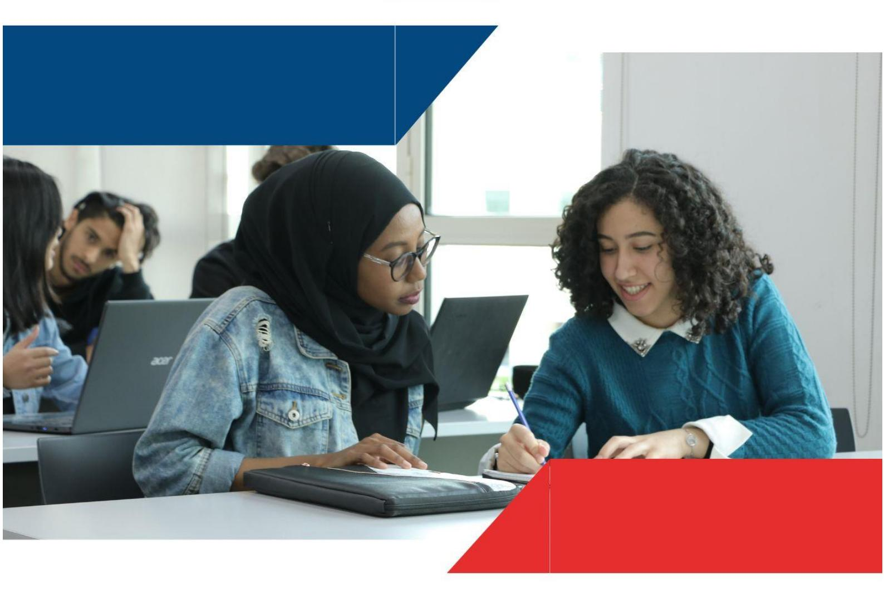
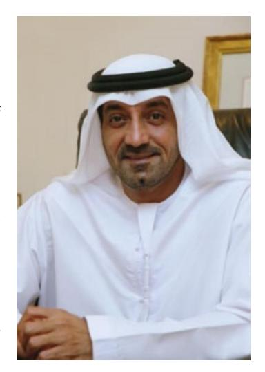
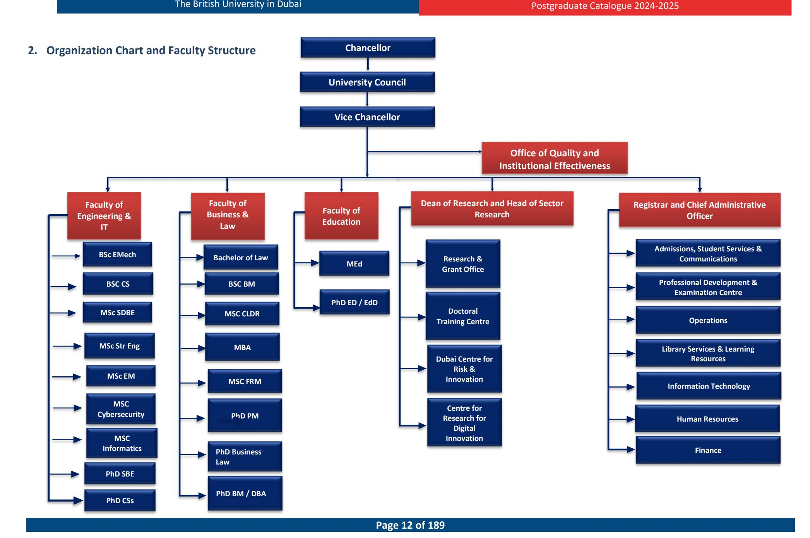

<!-- A3.R33 | source: papers_json/A3.R33/ -->

## **POSTGRADUATE CATALOGUE**

**Academic Year**

**2024-2025**

<!-- page 2 -->

## *Message from The Chancellor*

Dear Students,

It is my great pleasure to welcome you to the British University in Dubai.

The University has been formed out of a genuine collaboration between Dubai and United Kingdom institutions to provide the best of British education in Dubai.

Our UK associates, the Universities of Edinburgh, Manchester and Glasgow, have been chosen because of their research standing and high standards. I am pleased that they will continue working closely with BUiD to ensure that you are offered high quality programmes which benefit from that research.

It is pleasing that worldwide interest has been shown in academic posts at the University and that our British associates have been able to apply strict criteria in selecting the best. All academic programmes offered

at BUiD have been granted accreditation by the Ministry of Education, UAE and I am grateful to His Excellency Hussain Ibrahim Al Hammadi for the kind attention he and his Commissioners have given to the BUiD programmes.

The University is also grateful to its founders the Al Maktoum Foundation, Rolls-Royce, the National Bank of Dubai, the British Business Group, and the Dubai Development and Investment Authority; its contributors, The Emirates Group, DUCAB, Atkins, and Dubai Duty Free; the Dubai & UK Trade & Economic Committee and the members of the Council, Advisory Groups, and Senate; and its Vice Chancellor, Registrar and staff for the role they have played in running the University and providing a top quality higher education experience for our students.

The University was established to make a substantial and unique contribution to the United Arab Emirates and the Gulf region. However, the University can only go so far by providing tuition, a vibrant environment in which to study and the considerable benefit of access to the resources of five top quality British Universities. By far the greatest contribution to the University will come from you, as a student, both through what you put into the University and through what you take from it and return to society through your employment or profession.

I wish you every success in your studies.

Ahmed Bin Saeed Al Maktoum Chairman of the Council

<!-- page 3 -->

## **Table of Contents **

Message from The Chancellor 21.Introduction to the University. 112.Organization Chart and Faculty Structure. 122.1Board of Trustees / Council. 132.2Academic Staff. 142.3Administration. 203.Academic Programmes 2024-2025. 214.Academic Calendar for 2024-2025. 225.BUID Vision, Mission, and Values. 245.1University Mission. 245.2University Vision. 245.3University Strategy. 245.4University Goals. 245.5Licensure and Accreditation. 255.6Strategic Operations and Plans. 255.7Why Choose British University Dubai?. 256.Physical and Technology Resources. 266.1Library Services and Learning Resources. 266.1.1L Mission Statement. 266.1.22 Services. 266.1.3Information Literacy. 276.1.41 Library Staff and Support. 276.2IT Facilities. 276.2.1L Timings & Support. 286.2.2.2.2 Servers and Bandwidth6.2.3Reliability of IT Network. 28

<!-- page 4 -->

6.3IT Facilities. 297.Admissions. 307.1General Requirements. 307.1.1Admission to the University. 307.2Programme Specific Admissions Requirements. 317.3Conditional Admittance for Postgraduate Diploma and Masters Programmes. 387.4Exceptions to The Proof of English Proficiency Requirement. 397.5Admissions Procedures. 397.6Admission and Progression through Postgraduate qualifications417.7Credit Transfers for Post Graduate Programmes417.7.1External Credit Transfers. 417.7.2Internal Credit Transfer within Postgraduate Programmes. 427.8Student Induction. 437.9Student Registration. 437.9.1New Students. 437.9.2Returning Students. 447.10Adding or Dropping Modules. 447.11Readmission. 447.12Suspension of Study. 457.13Late Withdrawal from a Module. 467.14Permanent Withdrawal from the Programme. 468.Financial Information. 478.1Total Programme Fees for the Academic Year 2024-2025. 478.2Tuition Fee Terms and Conditions. 478.3Scholarships. 488.4Sponsorship. 488.5Refunds. 488.6Late or Non-payment of Fees. 49

<!-- page 5 -->

8.7Other Fees499.Academic Policies & Assessment Procedures509.1Assessment for M-Level Programmes509.1.1Taught Modules509.1.2P Dissertation519.2Graduate Instruction519.2.1University M-Level Grade Descriptors539.3Doctoral Level Assessment Regulations579.3.1Taught Module Stage Regulations599.3.2Comprehensive exam609.3.3Proposal Defense Assessment609.3.4Final Thesis and Viva Assessment609.3.5University D-Level Grade Descriptors629.4Transferable Skills679.5Evaluating Instruction679.6Concentration, Major/Minor679.7Credit Hours6810.Academic Governance6910.1Quality of Instruction6910.2Responsibility for Teaching and Learning within Faculties6910.2.1 Board of Studies6910.2.2 External Examiners7010.3Monitoring and Evaluation Procedures7010.3.1 Academic Staff-Student Liaison Committee7010.3.2 Programme Quality Self-Study Reports7110.3.3 Elicitation of Feedback from Students7110.3.4 Programme Review7110.3.5 External Examiners Report72

<!-- page 6 -->

11.Academic Advice and Pastoral Support'311.1Personal Tutor/Student Academic Tutor (SAT)'311.2Module Tutors'411.3Module Coordinator411.4Dissertation Supervisor (Applicable only to programmes having a dissertation component) 7'412.Head of Programme / Programme Coordinator'513.Supervision for Doctoral Students'514.Rights and Responsibilities714.1Student Code of Conduct714.2Student Disciplinary Offences8'14.3Student Complaint Procedure 83214.4Attendance Policy and Procedure314.5Student Appeals Policy and Procedure3414.6Academic Honesty and Integrity35Student Services8615.Student Services15.
15.18615.
15.1
15.2BUID Achievement & Career Excellence3615.1
15.2
15.3BUID Achievement & Career Excellence36
3715.1
15.2
15.3
15.4BUID Achievement & Career Excellence36
37
3715.1
15.2
15.3
15.4
15.5BUID Achievement & Career Excellence36
37
3715.1
15.2
15.3
15.4
15.5
15.6BUID Achievement & Career Excellence36
37
3715.1
15.2
15.3
15.4
15.5
15.6BUID Achievement & Career Excellence36
37
37
3915.1
15.2
15.3
15.4
15.5
15.6BUID Achievement & Career Excellence366
377
377
379
39915.1
15.2
15.3
15.4
15.5
15.6
15.7
16.BUID Achievement & Career Excellence366
377
377
379
39915.1
15.2
15.3
15.4
15.5
15.6
15.7
16.
17.BUID Achievement & Career Excellence36
37
37
37
39
3915.1
15.2
15.3
15.4
15.5
15.6
15.7
16.
17.BUID Achievement & Career Excellence 8

Counselling Service 8

Accommodation 8

DIAC Facilities 8

Student Activities and Publications 8

Alumni Association 8

Student Participation in the University 8

Doctoral Training Centre 8

Masters Preparation Programmes 9

FACULTY OF EDUCATION 9366
377
377
379
399
399
391
391

<!-- page 7 -->

19.FACULTY OF BUSINESS AND LAW 10619.1 PhD in Business Management Programme 10719.2 Professional Doctorate in Business Administration 11119.3 PhD (Subject: Project Management) 11619.4 PhD (Subject: Business Law) 12019.5 MSc in Construction Law and Dispute Resolution 12419.6 Postgraduate Diploma in Construction Law and Dispute Resolution 12719.7 Master in Business Administration 13019.8 MSc in Project Management 13719.9 Postgraduate Diploma in Project Management 14119.20Master of Science in Finance and Risk Management 14620.FACULTY OF ENGINEERING & IT PROGRAMMES 15020.1 PhD: Sustainable Built Environments 15120.2 MSc in Sustainable Design of the Built Environment Programme (SDBE) 15720.3 MSc in Structural Engineering (StrE)Programme 16420.4 MSc in Engineering Management Programme 16920.5 PhD in Computer Science 17520.6 MSc in Informatics 18020.7 MSc in Cybersecurity 185

<!-- page 8 -->

| How to Contact the University |  |
| --- | --- |
| By Mail | PO Box 345015, Dubai – UAE |
| By Telephone | +971 4 279 1400 |
| By Email | info@buid.ac.ae |
| In Person | st and 2nd Floor, Block 11 1 Dubai International Academic City (DIAC) Dubai – UAE |

## **IT IS THE RESPONSIBILITY OF EACH STUDENT TO READ, UNDERSTAND AND ** **ABIDE BY THE REGULATIONS AND PROCEDURES PRINTED IN THIS BOOKLET****.**

The catalogue is an official BUiD University document describing academic programme, faculty listings, policies, procedures, regulations, and requirements of the University. Every effort has been made to ensure the accuracy of the information presented in this catalogue. However, no responsibility is assumed for editorial, clerical, or printing errors, or errors occasioned by mistakes. The University reserves the right to make changes without prior notice to the information contained in this publication, including the alteration of various fees (as per University policies), schedules, conditions of admission and credit requirements, and the revision or cancellation of particular modules or programmes.

<!-- page 9 -->

## Terminologies

| Terminology | Description |
| --- | --- |
| BUiD | The British University in Dubai |
| Admissions Tutor | An academic member of the Faculty who makes decisions on applicants' suitability for being offered a place on a Programme |
| Anonymous Marking | A process whereby the names of students on scripts are removed or concealed, so that examiners/markers do not know their identity during the marking process |
| Appeal | A student may challenge a decision made by selected University committees which directly affects their study |
| Assessment | Any activity which is graded by academic staff and counts towards the overall module marks, including examinations |
| Board of Examiners | A formally constituted University committee charged with approving assessment decisions |
| Core module | Core modules are mandatory modules that a student must study to meet the requirements of the Programme. |
| Credit | One credit represents 10 notional hours of learning. Credit is awarded once you have successfully completed a module in recognition of the amount and depth of learning which you have achieved. Credits are then accumulated towards the total credit required for a programme of study and a qualification |
| Credit hours | The measurement unit which defines the student's overall effort towards attaining a qualification. |
| Compensation | When Board of Examiners recommends that a student's less than satisfactory performance in one component of assessment be compensated by better performance in other components within a module |
| Concentration | Concentrations are grouping of courses which represent a sub specialization taken within the major field of study. A concentration may be specified on the diploma or in the student's academic record (transcript). A concentration module is at least 20 term credits of study, or equivalent, in the specialized field |
| Credit Transfer | A process by which a student may obtain credit for relevant modules undertaken previously at accredited/recognized institutes |
| Dean | The academic in charge of the curriculum department with overall responsibility for delivery and standards |
| Dissertation | A significant piece of individual research undertaken by a student at the end of their taught Programme |
| Dissertation Supervisor | An academic staff member who will support a student during the research period |
| Distance Learning | A form of learning where the teacher may not be present with the class. |
| Double Marking | When a student's work is assessed by more than one marker. If the marks and annotation of the first marker are not available to the second marker, this is known as 'blind' double marking |
| Electives | Modules which are not compulsory for students. Electives may be free— selected by the student from any course offerings, or restricted—chosen from a pre-determined list of options. |
| Examination | A formal assessment which is invigilated and subject to BUiD Examination Regulations |

<!-- page 10 -->

| Terminology | Description |
| --- | --- |
| Exemption | The status achieved by a student who obtains credit transfer for previous learning |
| External Examiner | An academic, external to BUiD, who is appointed to ensure that the standards are at the correct level |
| External marker | A person of experience who may be asked to mark specialised dissertations as a first or second marker |
| Faculty | The University internal structure with primary responsibility for delivering learning in a given discipline |
| Full-time | A study route whereby a student completes a Programme in two terms & dissertation |
| GCSE | General Certificate of Secondary Education – a British school qualification normally after 11years of study |
| Grade Point Average (GPA) | The system by which coursework grades are averaged to indicate the overall level of student performance |
| Grading System | BUiD uses an agreed grading system for all assessments |
| HoMASS | Head of Marketing, Admissions & Student Services |
| Internal marker | A member of BUiD academic staff who marks a student assignment or dissertation |
| Internationally Accredited University | Every university may obtain accredited status from their home country or through an international recognition system such as NARIC which is used in the UK |
| Mitigating Circumstances | Events which adversely affect a student's performance, and which may be taken into account by the Board of Examiners |
| Moderation | Independent academic checking of assessed work of a student by more than one marker. May involve second marking, double marking or analysis of marks for the cohort |
| Module | A coherent, credit bearing, curriculum element of a Programme |
| Module Coordinator | An academic staff member responsible for the delivery and assessment of a module |
| Prerequisite | A module that students must take prior to attending another module |
| Part-time | A study route whereby a student completes a Programme over two or more academic years |
| Personal Tutor | An academic staff member with primary responsibility for ensuring that students' progress appropriately during their studies |
| Programme Coordinator | The academic responsible for the oversight of a Programme |
| Provisional | The status of assessment and examinations grades until they are confirmed by the Board of Examiners |
| Study Plan | The initial document produced after a meeting between the Personal Tutor and student |
| Transcript | A list of modules studied and the module grades |
| UAE | United Arab Emirates |
| Unfair Means | Assistance that a student uses to gain unfair advantage in assessments or examinations |
| University | The British University in Dubai |
| Upper Second-Class | A classification of a British Honours Bachelor Degree. This normally |
| Honours Degree Viva Voce | equates to a GPA of between 3.0 and 3.5 An oral examination |
|  |  |

<!-- page 11 -->

## **1.** **Introduction to the University**

The British University in Dubai (BUiD) was established in 2003 by Law #5/2003 by His Highness Sheikh Maktoum bin Rashid bin Saeed Al Maktoum, Ruler of Dubai.

The University grew out of collaborations between British and Dubai academic, government, and commercial organisations to make a unique contribution to the UAE and Gulf region. BUiD was established to be the region's leading research-based university, facilitating world-class education, training, and research. It provides an important and growing community and resource for young professionals, leading academics, corporate managers, and aspiring leaders of all description. The UAE Ministry of Education – Higher Education Affairs licenses BUiD to award its own degrees.

BUiD's internal quality assurance includes processes that ensure our programmes and students' achievements are of standards on a par with those of our UK Universities Alliance partners (the University of Edinburgh, the University of Glasgow, and the University of Manchester).

BUID is a non-profit university that has attracted academic experts to develop regionally tailored programmes in which they extend and challenge the boundaries of knowledge, understanding and research.

<!-- page 12 -->

<!-- page 13 -->

## **2.1** **Board of Trustees** **/** **Council**

<!-- page 14 -->

## **2.2** **Academic Staff**

| Name | Academic Position | Credentials |
| --- | --- | --- |
| Faculty of Engineering and IT |  |  |
| Prof. Bassam Abu Hijleh | Dean, Faculty of Engineering & IT Programme Coordinator – PhD in Sustainable Built Environment | (1985) Bachelor of Science in Mechanical Engineering, Ohio State, University (USA) (1987) Master of Science in Mechanical Engineering, Ohio State, University (USA) (1990) Doctor of Philosophy (Ph. D) in Mechanical Engineering, Ohio State University (USA) |
| Prof. Hanan M Taleb |  | (2004) BA Interior Design, Dar Al Hekma College (Saudi Arabia) (2006) MA Interior Design, Bournemouth University (UK) (2007) MArch, University of Sheffield (UK) (2011) Doctor of Philosophy (PhD) Architecture, University of Sheffield (UK) |
| Prof. Alaa Ameer |  | (1979) Bachelor of Science in Mechanical Engineering, University of Technology (Iraq) (1981) Higher Diploma in Applied Mechanics, University of Technology (Iraq) (1983) Master of Science in Tribology, University of Technology (Iraq) (2001) Doctor of Philosophy in System Modelling, University of Bradford (UK) |
| Prof. Khaled Shalaan | Head of Department of IT Programme coordinator – PhD in Computer Science | (1982) Bachelor of Commerce (B.Comm), University of Cairo, (Egypt) (1985) Post-graduate Diploma (PGDip) in Computer Science & Information Science, University of Cairo (Egypt) (1989) Master of Science (MSc) in Computer Science, University of Cairo (Egypt) (1995) Doctor of Philosophy (PhD) Computer Science, Institute of Statistical Studies & Research, Cairo University (Egypt) |
| Prof. Sherief Abdallah | Programme Coordinator – BSc in Computer Science | (1998) Bachelor of Engineering in Computer Engineering, Cairo University (Egypt) (2001) Master of Science in Computer Engineering, Cairo University (Egypt) (2006) Doctor of Philosophy in Computer Science, University of Massachusetts (USA) |
| Prof. Piyush Maheshwari | Programme Coordinator – MSc in Informatics | (1982) B.Eng. in Electronics & Communication Engineering, Indian Institute of Technology (India) (1984) M.Eng. in Computer Science & Technology, Indian Institute of Technology (India) (1990) Doctor of Philosophy (PhD). in Computer Science, The University of Manchester (UK) (1994) Graduate Certificate in Higher Education, Griffith University, (Australia) |
| Dr. Mostafa Al-Emran |  | (2012) Bachelor of Science in Computer Science, Al Buraimi University College (Oman) (2015) Master of Science in Informatics (Knowledge and Data Management), BUiD (UAE) (2019) Doctor of Philosophy in Computer Science, Universiti Malaysia (Malaysia) |

<!-- page 15 -->

| Name | Academic Position | Credentials |
| --- | --- | --- |
|  |  | (2004) Bachelor Degree in Computer Science, Yarmouk University (Jordan) |
| Dr. Manar Alkhatib |  | (2007) Master Degree in Computer Science, Middle East University (Jordan) |
|  |  | (2019) Doctor of Philosophy in Computer Science, BUiD (UAE) |
|  |  | (2013) BSc Electrical –Computer- Engineering, Ain Shams University (Egypt) |
| Hend ElMohandes |  | (2018) Masters on Informatics, Nile University /Fraunhofer Research Institute (Egypt) |
|  |  | (2009) Bachelor in Pure Mathematics, Lebanese University (Lebanon) |
| Dr. Nahia Mourad |  | (2011) Diploma of Master Research in Mathematics, Lebanese University, (Lebanon) |
|  |  | (2015) Ph.D in Applied and Computational Mathematics, Universite Paris EST (France) |
|  |  | (1995) B.Sc Mechanical Engineering (emphasis in Production Engineering), Jordan University Of |
|  |  | Science & Technology (Jordan) |
| Dr Sa'ed Salhieh | Programme Coordinator – MSc | (1998) MS Industrial and Systems Engineering, THE UNIVERSITY OF MICHIGAN – DEARBORN |
|  | in Engineering Management | (Michigan) |
|  |  | (2001) Ph.D Industrial Engineering, WAYNE STATE UNIVERSITY (Michigan) |
|  |  | (1995) BSc in in Electrical Engineering, Aleppo University (Syria) |
| Dr. Basem Tuqan |  | (2009) M.Cs in Computer Science, University of Malaya (Malaysia) |
|  |  | (2014) Doctor of Philosophy (PhD) The British University in Dubai (UAE) |
|  | Programme Coordinator – MSc | (1999) BSc Architectural Engineering, Al-Azhar University (Egypt) |
| Dr Wael Sheta | in Sustainable Design of the | (2005) March, Architecture History, Al – Azhar University (Egypt) |
|  | Built Environment | (2012) Ph.D Building Technology and Sustainability, University of Sheffield (UK) |
|  |  | (2012) B.Eng in Mechanical Engineering, University of Mumbai (India) |
|  |  | (2015) M. Eng in Mechanical Engineering, Fr Conceicao Rodriques Institute of Technology, University |
| Dr Faeez Masurkar |  | of Mumbai (India) |
|  |  | (2020) Ph.D in System Engineering & Engineering Management, City University of Hong Kong (Hong |
|  |  | Kong SAR) |
|  |  | (2000) BSc in Information Systems Cairo University, Egypt |
| Dr Ahmed Awad |  | (2003) MSc in Information Systems, Cairo University, Egypt |
|  |  | (2010) Ph.D in Computer Science, Potsdam University, Germany |
|  |  | (2000) B.Eng. (First Class) in Electrical and Computer Engineering \|Federal Univ. of Tech., Minna, |
|  |  | Nigeria |
|  | Programme Coordinator – MSc | (2004) MSc (Distinction) in Personal, Mobile & Satellite Communication \| Univ. of Bradford, Bradford, |
| Dr Suleiman Yerima | in Cyber Security | UK |
|  |  | (2009) PhD in Computing (QoS optimization of Multimedia Traffic in Mobile Networks) \| University |
|  |  | of South Wales (Formerly University of Glamorgan), Wales, UK \| 2009 |

<!-- page 16 -->

| Name | Academic Position |  | Credentials |
| --- | --- | --- | --- |
|  |  |  | (2023) PhD in Cybersecurity Brunel University, UK |
| Dr Usman Butt |  |  | (2010) MSc. Network and Computer Systems Security Greenwich University, UK |
|  |  |  | (2003) Bachelor of Computer Science University of Central Punjab, Pakistan |
| Faculty of Education |  |  |  |
|  |  | 1987) | Bachelors of Science (BSc) in Biology, Alexandria University (Egypt) |
| Prof. Eman Gaad | Dean, Faculty of Education | (l999) | Doctor of Philosophy (PhD) in Education, The University of East Anglia (UK). |
|  |  |  | (1983) Bachelor of Science in Biology and Education, University of Alexandria, Egypt |
|  |  |  | (1984) Higher Diploma in Education, Omdurman Islamic University, Sudan |
| Prof. Sufian Forawi |  |  | (1987) Master's of Education, Curriculum and Instruction, Omdurman Islamic University, Sudan |
|  |  |  | (1996) Educational Doctorate in Science Education, University of Massachusetts Lowell, USA |
|  |  | (1999) | B B.A., in English Literature; St. John's College (India) |
|  |  | (2000) | B.Ed., in Education; St. Xavier's College of Education (India) |
| Dr. Solomon Arulraj |  | (2002) | M.A in English Literature; Manonmanium Sundaranar University (India) |
| David |  | (2004) | MEd, Katholieke Universiteit Leuven, (Belgium ) |
|  |  | (2011) | Doctor of Philosophy (PhD) in Education, Katholieke Universiteit Leuven, (Belgium) |
|  |  | (1996) | B.A. Degree in English Literature and Linguistics, Yarmouk University (Jordan) |
| Dr. Emad Ahmed Abu | Programme Coordinator – | (2008) | Master Degree in English/ Translation, Yarmouk University (Jordan) |
| Ayyash | Master of Education | (2009) | TEFL Certificate, University of the Fraser Valley (Canada) |
|  |  | (2016) | Doctor of Philosophy (PhD) in Education – TESOL, The British University in Dubai, (UAE) |
|  |  | (1999) | BEd (Hons) Social Studies Education & Art Education, University of Education/University of |
|  |  |  | Cape Coast (Ghana) |
| Prof. Adbulai Abukari |  | (2003) | MPhil in Comparative and International Education, University of Oslo (Norway) |
|  |  | (2007) | Doctor of Philosophy (PhD) in Comparative and International Education, Middlesex University, |
|  |  |  | (UK ) |
|  |  |  | (2000) Bachelor of Arts (Hons) in Classical Civilisation, University of Nottingham, UK |
|  | Director of Digital Research |  | (2001) Master of Arts in International Relations, University of Nottingham, UK |
| Prof. Christopher Hill | and Education |  | (2005) Doctor of Philosophy (Ph. D) in Political Science, University of Nottingham, UK |
|  |  | (2010) | Post Graduate Certificate in Higher Education, University of Nottingham Malaysia Campus, |
|  |  |  | Malaysia |
|  |  |  | (2005) BEng in Computing City University, UK |
| Dr. Tendai Charles |  |  | (2010) MA Applied Linguistics Newcastle University, UK |
|  |  |  | (2013) CELTA International House, UK |
|  |  | (2018) | Doctor of Philosophy (PhD) in Education University of York, UK |

<!-- page 17 -->

| Name | Academic Position | Credentials |
| --- | --- | --- |
| Dr Ahmed Bawa Kuyini Abubakar | Programme Coordinator – EdD/PhD in Education | BSC & Diploma in Social Work, Volda University College, Norway (2000) (2004) PhD (Educational Psychology & Special/Inclusive Education), University of Melbourne, Australia |
| Faculty of Business and Law |  |  |
| Prof. Aymen Masadeh | Dean, Faculty of Business and Law Programme Coordinator – PhD in Business Law | (1996) LLB, Jordan University, Jordan (1997) LLM, Aberdeen University, UK (2001) Doctor of Philosophy (PhD) (Contract Law), Bristol University, UK |
| Dr. Abba Kolo |  | (1984) LL.B, Ahmadu Bello University, Nigeria (1986) Bachelor of Law, Nigerian Law School. Nigeria (1988) LLM, University of Warwick, UK |
| Dr. Omar Hisham Alhyari | Programme Coordinator – MSc in Construction Law and Dispute Resolution | (2000) Bachelor's Degree in Law, Amman University (Jordan) (2003) Master's Degree in Private Law, Amman University (Jordan (2008) Doctorate in Law, University of the West of England (UK) |
| Prof Abu Baker Suliman | Programme Coordinator – PhD/DBA | (1991) BSc in Administrative Sciences, Sudan (1995) Master of Business Administration, Jordan (1198) Master of Philosophy, Liverpool Business School (UK) (2000) Doctor of Philosophy (PhD) (HRM), Liverpool Business School (UK) |
| Dr. Farzana Asad Mir | Director of Doctoral Training Centre | (1993) BSc, Electrical Engineering, University of Engineering and Technology (Pakistan) (2012) MSc, Project Management, BUiD (UAE) (2019) PhD in Management, University of Guelph (Canada) |
| Dr. Sulafa Badi | Programme Coordinator – PhD Project Management | (1996) BSc Architecture, University of Khartoum (Sudan) (2000) MSc Construction Economics and Management, Bartlett School of Graduate Studies, University College London (UK) (2012) Doctor of Philosophy (PhD) Project Management, Bartlett School of Construction and Project Management (UK) |
| Prof. Edward Godfrey Ochieng |  | (2010) Postgraduate Certificate in Higher Education learning and Teaching, Robert Gordon University (UK) (2008) PhD Project Management, Loughborough University (UK) (2000) MSc Project Management, Leeds Beckett University (UK) (1999) BSc Technology and Management, University of Bradford (UK) |
| Prof. Khalid Almarri | Dean of Research | (1995) B.Sc. Civil Engineering, University of Arizona (USA) (2000) M.Sc. Engineering Management; The Catholic University of America (USA) |

<!-- page 18 -->

| Name | Academic Position |  | Credentials |
| --- | --- | --- | --- |
|  |  |  | (2015) Doctor of Philosophy (PhD) in Project Management, the British University in Dubai (UAE) |
|  |  | (2004) | BSc Business Economics, Salford University (UK) |
| Dr. Maria Papadaki | Director, Dubai Centre for Risk | (2005) | MSc Management of Projects; The University of Manchester (UK) |
|  | and Innovation (DCRI) |  | (2013) Doctor of Philosophy (PhD) in Risk Management; The University of Manchester (UK) |
|  |  |  | (1990) B.A. in Economics and Planning, University of Aleppo, Syria |
|  | Programme Coordinator |  | (1996) Master of Commerce in Accounting and Financial Management, Maharaja Sayajirao |
| Dr. Husam-Aldin Al | Master of Finance and Risk |  | University of Baroda, India |
| Malkawi | Management |  | (2005) Doctor of Philosophy (PhD). in Finance, School of Economics and Finance, University of |
|  |  |  | Western Sydney, Australia |
|  |  |  | (1998) Mathematics (Statistics), University Mohammed V (Morocco) |
| Dr. Abdelmounaim |  | (2003) | Mathematics (Statistics), Southern Illinois University (USA) |
| Lahrech |  |  | (2007) Economics, Southern Illinois University (USA) |
|  |  |  | (2006) B.Sc. from MJP Rohilkhand University in 2006 |
| Dr. Imran Khan |  |  | (2010) Master of Business Administration – Marketing, Jamia Hamdard University (New Delhi) |
|  |  |  | (2016) Ph.D. in Marketing, Indian Institute of Technology Roorkee |
|  |  |  | (2003) BSc Mechanical Engineering, N.E.D University of Engineering and Technology (Pakistan) |
| Dr. Muhammad Waris Ali | Programme Coordinator – MSc |  | (2011) MSc Civil Engineering (Project Management), Universiti Teknologi Petronas (Malaysia) |
| Khan | Project Management |  | (2015) Doctor of Philosophy (PhD) in Civil Engineering – Project Management, Universiti |
|  |  |  | Teknologi Petronas (Malaysia) |
| Dr. Derar Hussein Al |  |  | (1998) L.L.B, Mu'tah University (Jordan) |
| Daboubi |  | (2009) | L.L.M, Mu'tah University (Jordan) |
|  |  |  | (2019) International Commercial Law and Maritime Law, University of London (UK) |
| Dr. Mohamed Yacine | Programme Coordinator – |  | (2008) BSc International Business, Ecole des Hautes Etudes Commerciales (Algiers) |
| Haddoud | Master of Business |  | (2011) MSc International Business, University of Hertfordshire |
|  | Administration |  | (2015) Doctor of Philosophy (PhD) in Business with Management, Plymouth University (UK) |
| Dr. Ashmiza Mahamed | BSc Programme Coordinator – |  | (2001) BA (Hons) Business Management, Oxford Brookes University (UK) |
| Ismail | Business Management / |  | (2004) Masters Business Administration (MBA), University Mara Technology (Malaysia) |
|  | Finance and account |  | (2012) Doctor of Philosophy (PhD) in Business Management, University of Portsmouth (UK) |
|  |  |  | (2013) LLB, European Law School (UK) |
| Dr. Eva Christina Lienen | Programme Coordinator – |  | (2014) MJur, University of Oxford (UK) |
|  | Bachelor of Law |  | (2018) GDL, The University of Law (UK) |
|  |  |  | (2020) Doctor of Philosophy (PhD) in Law, University of College London (UK) |

<!-- page 19 -->

| Name | Academic Position | Credentials |
| --- | --- | --- |
|  |  | (2015) BA in Law, UAE University Al Ain, UAE |
| Dr Hamad Aleissaee |  | (2017) MSc of Law in International Business Law, Case Western Reserve University, USA |
|  |  | (2012) PhD in Juridical Science, Case Western Reserve University, USA |
|  |  | (1998) BA Commerce (Accounting), University of Kerala, India |
| Dr Rekha Pillai |  | (2001) MSc Commerce (Finance and Accounting), University of Kerala, India |
|  |  | (2016) PhD (Management) Banasthali University, India |

<!-- page 20 -->

## **2.3** **Administration**

## **Executives Office**

**Professor Abdullah Al ** **Shamsi**, Vice- Chancellor

**Salam Khoury, **Executive Administrator/PA to VC & Registrar

## **Office of Quality and** **Institutional** **Effectiveness**

**Maria Pinto, **Head of Institutional Effectiveness

**Naglaa Ghonim, **Head of Planning and Projects

**Muna** **Ali, **Institutional Effectiveness Coordinator

## **Financial Affairs**

**Krishna Prathap**, Head of Finance

**Haskar K, **Finance Administrator

**Lordlyn Joy Tabalus, ** Finance Administrator

## **Library**

**Simia Kumar, **Head of Library Services & Learning Resources

**Immaculata Amarachukwu ** **Ofurum**, Library Services Coordinator

**Jojie Sebarrotin, **Library Assistant

**Mohammed Mesfer, **Library Assistant

## **Information Technology**

**Jude Isaac Lobo, **Head of IT

**Rijo Raju**, System Administrator

**Arun KK, **IT Support Specialist

**Shobu Skaria, **IT Support Specialist

**Andrew Jerome, **IT Support Specialist

## **Human Resources**

**Jouhar Ali, **Interim Head of Human Resources

**Marwa Elghitany, **Human Resources Administrator

**Honeymabelle Rivera ** **Genith, **Office Assistant

## **Operations**

**Hassan Modiraprambil**, Head of Operations

**Professional ** **Development & ** **Examinations Centre**

**Nabeela N D'Sa****, **Head of Professional Development & Examinations Centre

**Jerry** **Joy**, Training & Examinations Administrator

## **Doctoral Training ** **Centre**

**Rawy Abdelrahman Thabet**, Academic Associate

## **Marketing, Admissions ** **& Student Services**

**Mira Hamzeh, **Head of Marketing, Admissions & Student Services

**Ahmed Ali, **Deputy Head of Marketing, Admissions, and Student Services

**Christine Salvador, ** Research Programmes Officer

**Godwin Francis, **Senior Faculty Administrator

**Hamza Alabdallah, **Faculty Administrator

**Maria Kopteva, **Admissions Officer

**Nadine Markiz, **Student Relations Coordinator

**Muhammad Jammal, ** Admissions Officer

**Samar Alkhatib, ** Communications Manager

**Tanisha Simon, **Digital Media Officer

**Samer Batran, **External Relations Officer

**Dina Haddad, **Admissions Officer

## **Engineering Lab**

**Bashar Aldbaiat,** Electromechanical Engineering Lab and Research Engineer

<!-- page 21 -->

## **3.** **Academic Programmes 2024-2025**

| Programme | Professional accreditation |
| --- | --- |
| Faculty of Engineering & IT |  |
| PhD – Sustainable Built Environments |  |
| PhD – Computer Science |  |
| Master of Science (MSc) in Sustainable Design of the |  |
| Built Environment | Chartered Institute of Building (CIoB) |
| Postgraduate (PG) Diploma in Sustainable Design of |  |
| Built Environment | Chartered Institute of Building (CIoB) |
| Master of Science (MSc) in Informatics |  |
| Postgraduate (PG) Diploma in Informatics |  |
| Master of Science (MSc) in Structural Engineering |  |
| Postgraduate (PG) Diploma in Structural |  |
| Engineering |  |
| Master of Science (MSc) in Engineering |  |
| Management | American Society for Engineering |
| Concentrations: | Management (ASEM) |
| ▪ Maintenance and Reliability |  |
| ▪ Total Quality Management |  |
| Master of Science (MSc) in Cybersecurity |  |
| Postgraduate (PG) Diploma in Engineering |  |
| Management |  |
| Concentrations: | American Society for Engineering |
| ▪ Maintenance and Reliability | Management (ASEM) |
| Total Quality Management ▪ |  |
| Faculty of Education |  |
| Doctor of Education (EdD)/Doctor of Philosophy |  |
| (PhD) in Education |  |
| Master of Education |  |
| Concentrations: |  |
| ▪ Management Leadership and Policy |  |
| ▪ Teaching and Learning ▪ General |  |
| Postgraduate Diploma in Education |  |
| Concentrations: |  |
| ▪ Management Leadership and Policy |  |
| ▪ Teaching and Learning |  |
| ▪ General |  |
| Faculty of Business and Law |  |
| PhD - Business Management |  |
| PhD – Project Management |  |
| Professional Doctorate in Business Administration |  |
| PhD - Business Law |  |
| Master of Science (MSc) in Construction Law and | Chartered Institute of Building (CIoB) |
| Dispute Resolution |  |
| Postgraduate Diploma in Construction Law and | Chartered Institute of Building (CIoB) |
| Dispute Resolution |  |
| Master of Business Administration |  |
| Concentrations: |  |

<!-- page 22 -->

| ▪ Human Resource Management |  |
| --- | --- |
| ▪ Finance |  |
| ▪ Marketing |  |
| Sustainability ▪ |  |
|  | Global Association of Risk Professionals |
| Master of Science in Finance and Risk Management | (GARP). |
|  | The Global Accreditation Center of the Project |
| Master of Science (MSc) in Project Management | Management Institute (PMI) |
|  | The Global Accreditation Center of the Project |
| Postgraduate Diploma in Project Management | Management Institute (PMI) |

## **4.** **Academic Calendar for 2024-2025**

***** **Islamic holidays are determined after sighting the moon. The university will officially announce any closure on a religious ** **and/or public holiday to students and staff.**

|  |  | Academic Calendar 2024 - 2025 |  |
| --- | --- | --- | --- |
|  | 1-Sep-24 | UG Admissions Deadline |  |
|  | 2 - 20 September | Pre-Term Activities |  |
|  | 14-Sep | Induction Week (Saturday 14 September) |  |
|  | 20-Sep | PG Admissions Deadline |  |
|  | 21-Sep | Commencement of Classes (21 Sep PG) Commencement of Classes (23 Sep UG) | Week 1 |
|  | 28-Sep | Retake Exams 27-September End of Add/Drop period (UG) | Week 2 |
|  | 5-Oct | 11-October End of Add/Drop period (PG) | Week 3 |
|  | 12-Oct |  | Week 4 |
|  | 19-Oct | ASSLC meetings/Board of Studies | Week 5 |
|  | 26-Oct | Proposal Defence | Week 6 |
|  | 2-Nov |  | Week 7 |
|  | 9-Nov | Advisory Group Meetings | Week 8 |
|  | 16-Nov | Academic Board | Week 9 |
|  | 23-Nov | Senate Meeting | Week 10 |
|  | 30-Nov | First Term Examinations Commemoration Day & National Day | Week 11 |
|  | 7-Dec | Module Registration (January 2025) | Week 12 |
|  | 14-Dec | Board of Examiners week | Week 13 |
|  | 19-Dec | Graduation Ceremony |  |
|  | 20 Dec - 3 January | First Term Break |  |
|  | 3-Jan | PG/UG Admissions Deadline |  |
|  | 4-Jan | Commencement of Classes (4 Jan PG) Commencement of Classes (6 Jan UG) | Week 1 |
| Se co nd | 11-Jan | Retake Exams 10-Jan End of Add/Drop period (UG) | Week 2 |
| Te | 18-Jan | 24-Jan End of Add/Drop period (PG) | Week 3 |
| rm | 25-Jan |  | Week 4 |
|  | 1-Feb | ASSLC meetings/Board of Studies | Week 5 |
|  | 8-Feb |  | Week 6 |
|  | 15-Feb | Proposal Defence | Week 7 |

<!-- page 23 -->

|  | 22-Feb |  | Week 8 |
| --- | --- | --- | --- |
|  | 1-Mar |  | Week 9 |
|  | 8-Mar |  | Week 10 |
|  | 15-Mar | Second Term Examinations | Week 11 |
|  | 22-Mar |  | Week 12 |
|  | 29-Mar | Eid AlFitr (TBC) Board of Examiners Meetings | Week 13 |
|  | 6-11 Apr | Second Term Break |  |
|  | 12-Apr | Commencement of Classes (12 Apr PG) Commencement of Classes (14 Apr UG) | Week 1 |
|  | 19-Apr | Retake Exams 18 April -End of Add/Drop period (UG) | Week 2 |
|  | 26-Apr | 2nd May - End of Add/Drop period (PG) | Week 3 |
|  | 3-May |  | Week 4 |
| Th | 10-May |  | Week 5 |
| ird Te | 17-May | ASSLC meetings/Board of Studies | Week 6 |
| rm | 24-May | Academic Board | Week 7 |
|  | 31-May | Senate Meeting | Week 8 |
|  | 7-Jun | Proposal Defence | Week 9 |
|  | 14-Jun | Eid AlAdha (TBC) | Week 10 |
|  | 21-Jun | Third Term Examinations | Week 11 |
|  | 28-Jun |  | Week 12 |
|  | 5-Jul | Board of Examiners Meetings (5- 12 July) | Week 13 |
|  | 14 July - 24 Aug | Third Term Break |  |
|  | Academic Year 2025-2026 will be starting on Monday 25 August 2025 |  |  |

*Note:* **Senate** Held twice a year in November and May

**Council** Four times a year: October, Dec/Jan, March/April, June/July

<!-- page 24 -->

## **5.** **BUiD Vision, Mission, and Values**

## **5.1** **University Mission**

The Mission of the British University in Dubai (BUiD) is to provide world class scholarship, education and research that make a distinctive British contribution to supporting the aspirations of the Dubai Government to become a hub for education and research in the region.

## **5.2** **University Vision**

The University's vision is to be recognised and supported as Dubai's premier resource and focus for the reflective pursuit, inclusive accessibility, effective transfer, and liberal application of scientific, academic, and professional knowledge.

## **5.3** **University Strategy**

The strategy of a modern university operating in a world city within an increasingly global economy needs to have three dimensions:

- 1. An offer of advanced education which meets the demands for higher skills and learning of those who are or aspire to be professional and intellectual leaders in Dubai, UAE & the wider region.
- 2. The capture, development, and extension of knowledge about the complex realities of human society in the 21st Century.
- 3. Promotion of reflection, debate and dissemination of learning and understanding to inform policy, practice, and activity of benefit for personal, community and social development.

Such a strategy requires the following fundamental attributes in order to flourish:

- Research-based teaching.
- Evidence-based analysis.
- Student-centred learning.
- Knowledge-oriented economy.
- Morally responsible society.

Successful higher education assumes a fundamental core and foundation of skills, knowledge, and competency. Over the years and through due review processes, the initial (2003-11) post-graduate focus and experiences of BUiD have prompted some questioning of these assumptions, with a consequent strategic shift to embrace relevant undergraduate provision as well, subject as always to the needs of the individual in modern society, and the support of the political economy.

## **5.4** **University Goals **

The goals of the University are to:

- Make a distinctive British contribution to the higher educational system in the United Arab Emirates (UAE) through the creation of a high-quality research-led university.
- Develop leading-edge research capabilities in key disciplines.
- Offer the highest international competitive level of research-informed education in key modern disciplines.
- Interact with regional industry and play a leading role in stimulating a knowledge-based economy in Dubai and the Emirates.
- Provide opportunities for study and research for the purpose of gaining degrees in arts and sciences.
- Apply the systems of study and research that are used in distinguished British universities with the aim of enhancing the standard of university education in the U.A.E.

<!-- page 25 -->

- Qualify and educate nationals who are scientifically and practically trained in all fields of knowledge, through advanced educational and training programmes.
- Serve the various sectors of society, especially the commercial and industrial sectors, by providing consultation, technical services, and research in the various fields of science and technology and the other disciplines, which will be offered by BUiD.
- Consolidate educational, scientific, and cultural links with distinguished British universities and institutions, and with other internationally distinguished universities.

## **5.5** **Licensure and Accreditation**

BUiD, located in the Emirate of Dubai is officially licensed from 29/11/2020 to 14/10/2025 by the Ministry of Higher Education of the United Arab Emirates to award degrees/qualifications in higher education. The University also holds the license issued by the Knowledge and Human Development Authority Dubai.

## **5.6** **Strategic Operations and Plans**

The University progresses its mission, vision, strategy, and operations through the focus of its three academic faculties. The Strategic Plans for each faculty are available with Office of Quality and Institutional Effectiveness. A 5-year strategic plan was developed in 2017 and it covers the period 2018-2021.

## **5.7** **Why Choose British University Dubai?**

- Licensed and accredited federally and locally.
- Making a not–for-profit contribution to the knowledge economy.
- Very competitive pricing being a not-for-profit organisation.
- Research-based teaching founded upon evidence-based research.

<!-- page 26 -->

## **6.** **Physical and Technology Resources**

The University campus is currently located at Dubai International Academic City (DIAC) and students therefore have access to the range of facilities which are available on site (e.g., shops, prayer rooms, dining, and recreation facilities etc.). DIAC has also made requisite arrangements to cater for people having any physical disabilities.

## **6.1** **Library Services and Learning Resources**

## **6.1.1** **Mission Statement**

The mission of the Library Services and Learning Resources Centre is to provide resources, services, and information discovery tools to meet the academic and research needs of the University. The University Library provides state-of-the-art facilities and infrastructure for greater student interaction and learning. In addition to traditional library services, it offers a wide range of high-quality online services to students and staff. The collaborative learning is at the core of the Library by providing the latest touchscreen panels and computer workstations. It provides access to several electronic databases which can be searched simultaneously through a federated search tool. The Library's website is the one-stop source for a wide range of digital resources and services to meet the growing academic and research needs at BUiD. Users can access the Library on and off-campus. The OCLC WorldCat platform is integrated with Google Scholar, providing the convenience of finding resources along with thousands of other libraries. The website has been redesigned to provide the required information conveniently and seamlessly.

## ▪ **Collections**

The University Library contains a growing collection of thousands of titles in various formats for study and research across all academic programmes. Comprehensive collections of e-books and e-journals are the backbone of its resources and are integrated with Google Scholar and OCLC WorldCat Discovery Services.

The print collection is catalogued and classified according to the Library of Congress Classification standards. Access to materials which the University does not have in its collection may be arranged through other libraries subject to the inter-library cooperation agreement.

A list of electronic resources is available on the University Library website. In addition, several subject guides facilitate access to resources relevant to a particular field of study or research. All registered staff and students can access these resources off-campus as well.

The University Library holds a collection of print and electronic thesis and dissertations. The print collection is organised according to programmes and can be used within library premises. Access to the full-text PDF is provided through the BSpace. This digital platform serves as BUiD's institutional repository.

## **6.1.2** **Services**

The University Library provides various online services to cater to the needs of its users, such as My Library Account, book renewals, book requests, study room bookings, off-campus access, video tutorials, reserves, virtual reference services (Chatbot), WhatsApp connectivity, and database guides.

Registered users should have a Library account to access its resources and services. A systemgenerated email is sent to their BUiD email account when setting a new password and/or resetting their password, which is available on the Library website. The Library patrons may also contact the Library Help Desk directly.

<!-- page 27 -->

Document Delivery Services (DDS) or document supply service refers to the physical or electronic delivery of a document from a library collection required by library users, including book chapters. Registered users may submit a request using our online discovery platform, which may take up to 48 hours to fulfil its requests.

Computer workstations are available in the Library for students' use and connected with the multifunction self-service machine, which includes printing, scanning, and copying. Users must use their University login details to use the computers and need a PIN code to use the machine for reproduction.

Access to Library facilities is open throughout the year, and its opening hours can be found on the [Library website](https://library.buid.ac.ae/libraryservicesandlearningresources) and is displayed on the notice board outside the Library.

The Library has an extensive social media presence to enhance interaction and communication with its academic and research community. The YouTube channel provides up-to-date instructional videos on information literacy, plagiarism, how-to guides, and tutorials, to name a few. In addition, LinkedIn, Facebook, Pinterest, and Instagram provide latest updates and promotional materials to keep the Library patrons engaged and informed. The Library website is highly engaging and interactive and is compatible with all kinds of mobile devices.

## **6.1.3** **Information Literacy**

All new students receive an induction to the University Library and its services during their induction week. It includes a general introduction of the collection and its services, rules, and regulations on access to resources, and other essential information.

During the academic year, students receive practical training on databases and special modules such as basic library skills for the effective use of the learning management system, bibliographic and fulltext discovery tools.

## **6.1.4** **Library Staff and Support**

The University Library is managed by a team of highly qualified and dedicated professional staff. The staff has extensive experience of working and supporting academic libraries and provide high-quality services. The team goes through regular training on emerging technologies and are available in-person and online.

An online Chatbot and WhatsApp are provided on the Library website to answer patron queries and may also be directed to a professional librarian. In addition, any enquiries to the Library may be emailed to[ library@buid.ac.ae](mailto:library@buid.ac.ae) or by telephone at 04 279 1431.

The individual training or information session with a librarian can be arranged either in person or online via Microsoft Teams, Zoom, etc. Users can also submit requests through the library website to schedule an appointment.

## **6.2** **IT Facilities**

The purpose of the IT facilities in the University is to provide students (as well as academic staff) with facilities to support the programme. These technologies/facilities include Internet (Wired and Wireless), Audio Visual facility, and accessibility to software (general and specialised).

Projectors with 3LCD technology and wireless connectivity are installed in all Classrooms in BUiD including the Auditorium. Most of the classrooms offer audio capabilities as well. BUiD has two 65" Interactive panels with OPS and 4K resolution to facilitate the learning and teaching process, this setup provides collaboration and mirroring capabilities along with wireless connection.

<!-- page 28 -->

The Head of IT organises the purchasing of any required software based on module requirements provided by Faculty members. The professional full-time IT support staff members have extensive experience in hardware and software. The support staff members provide direct support to students in troubleshooting on the various equipment and specialist software available for student use. A shift system is employed to extend IT helpdesk services across the full University timings.

The following facilities are currently available for the students:

- a. The IT lab is equipped with 34 latest i7 all-in-one computers. These PCs are equipped with specialised teaching, learning and research software like, DesignBuilder.
- b. Students have access through the Printing Management System (papercut) to laser printing at the library and student area. Students are given a free 20.00 AED print credit; additional print cards can be purchased at the library. We have implemented MFP with proximity card authentication to facilitate print, scan and copy in the BUiD campus.
- c. The Library is equipped with 5 computers for student and staff use, one multifunction coloured printer.
- d. The University encourages all students to make use of ICT services and facilities. Many students prefer to use their own laptops and gadgets (BYOD). These are given access to the BUiD wireless network, the campus is well connected with 57 wave-2 access points, so that students may use them throughout the campus. BUiD provides a free, secure high performance wireless network facility for faculty, staff, and students.
- e. Blackboard Ultra, BUiD's eLearning platform, is used by instructors to post and distribute course content such as syllabuses and handouts, communicate with students via announcements and email messages, and assess student learning through quizzes and online assignments. Blackboard is also integrated with Turnitin, a software that prevents plagiarism and delivers comprehensive feedback on students' written work. Blackboard is also integrated with the Respondus LockDown browser for conducting BB based exams. Blackboard ultra includes learn, content Management, collaborate, community engagement and ally modules.
- f. BUiD IT offers a **Self Service Password Reset (SSPR)** portal at [https://selfservice.buid.ac.ae](https://selfservice.buid.ac.ae/) where students can reset forgotten passwords or unlock locked accounts. This user-friendly tool ensures uninterrupted access to university systems by allowing students to manage their own accounts quickly and efficiently, reducing the need for IT helpdesk support for common login issues.

## **6.2.1** **Timings & Support**

The University offers all of its postgraduate programmes in the evening and the helpdesk hours of IT personnel are maintained to support these programmes. The IT helpdesk working hours are 8am to 7pm from Monday to Friday and from 9am to 6 pm on Saturdays.

IT support can also be sought via calling the IT Services helpline and by raising support tickets on the email [itservices@buid.ac.ae.](mailto:itservices@buid.ac.ae)

## **6.2.2** **Servers and Bandwidth**

BUiD has upgraded its network & server infrastructure recently and most of its services are hosted on premises.

## **6.2.3** **Reliability of IT Network**

BUiD has improved network perimeter and server farm security with NGFW firewall devices. In order to improve IT security and continuity for critical web applications, BUiD also maintains WAF subscription and security certificates.

<!-- page 29 -->

## **6.3 IT Facilities**

## Labs:

- Physics Lab
- Architecture Lab
- Engineering Lab

## ATKINS Digital Design Studio:

Funded by [ATKINS Global](http://www.atkinsglobal.com/) in their continuous support for The British University in Dubai. The studio has a large variety of engineering, simulation, and graphic design software to help BUiD Engineering students complete their work.

<!-- page 30 -->

## **7.** **Admissions**

## **7.1** **General Requirements **

BUiD has two intakes per academic year. BUiD operates a competitive admissions policy, which is rigorous in order to maintain the high standards expected of a research-led institution. The admission of an individual applicant is at the discretion of the University. In exercising this discretion, the University will be guided by the following considerations:

- 1. The University will operate an admissions system which complies with the UAE Standards, and which fulfils any specific requirements, which might have arisen through individual programme accreditation.
- 2. There shall be a reasonable expectation that anyone admitted to a programme of study is able to fulfil the learning objectives of the programme and to achieve the standard required for the award.
- 3. In considering each individual applicant for admission to a programme of study, evidence should be sought of personal, professional, and educational experiences that provide indications of ability to meet the demands of the programme.
- 4. There shall be no discrimination against any applicant in relation to age, colour, creed, disability, ethnic origin, gender, marital status, nationality, race, sexual orientation, or social class. The procedures should ensure equality of opportunity for all applicants, not only in the interest of social justice but to harness the development of the scarce supply of talent.
- 5. The University must satisfy itself that the applicant has sufficient command of the English language to complete satisfactorily the programme of study.
- 6. Applicants may not be admitted or enrolled in more than one programme concurrently.
- 7. Enrolled graduate students who wish to change their programme must meet the admission requirements of the new programme.
- 8. Each applicant has to submit an official transcript of any degrees earned and of any other credit earned from a higher education institution.
- 9. Applicants must satisfy both the general university requirements for admission and the Programme-specific admission criteria. Individual programmes may raise the minimum requirements stated, or they may request additional requirements such as work experience, specific skills, written essay and/or an interview, among other things depending on the nature of the programme.

The University operates a competitive admissions policy, which is rigorous in order to maintain the high standards expected of a research-led institution. There are two levels to the University Admissions Policy & Standards.

## **7.1.1** **Admission to the** **University**[1](#page-29-3)

In order to be considered for admittance to the University, applicants must have the following:

> ^1^ Where the applicant is not normally resident in the UAE, admission to the University is dependent upon obtaining a DIAC Student Residence Visa.

<!-- page 31 -->

## **Postgraduate M-Level Programme** **(Diplomas, Masters** **Programmes) Requirements:**

- A Bachelor's degree equivalent to a British Upper Second-Class Honours degree or with a good GPA (3.0 on 4.0 scale or above) or its established equivalent. The degree should be in a related subject from an accredited university.
- English language proficiency equivalent to EmSAT Achieve English score of 1400 ( IELTS 6.0, TOEFL 550, 213 CBT, 79 iBT) or its equivalent in a standardized English language test approved by the Ministry of Education

## **Doctoral Programme** **Requirements:**

- b) A Master's degree with a GPA of 3.0 on a 4.0 scale or above or its established equivalent. The degree should be in a related subject from an accredited university.
- c) Where the Master's degree is by research only, candidates will be required to demonstrate that they have a level of research competency that is deemed suitable by the faculty members of the PhD programme the candidate is applying for. The candidate will be required to give a presentation about their Masters dissertation after which they will be cross-examined by a jury from the faculty. If the faculty determines that the candidate has sufficient research competency skills, they will be accepted into the PhD programme provided the candidate satisfies all other entry requirements as well.
- d) Minimum English language proficiency equivalent to EMSAT Achieve English Score of 1400; (IELTS 6.0; TOEFL 550, 213 CBT, 79 iBT) or its equivalent in a standardized English language test approved by the Ministry of Education. The University may raise this requirement for specific programmes.

## **7.2** **Programme** **Specific Admissions Requirements**

In all cases, the University and Programme Admissions Tutors will consider transcripts and syllabi of the applicant's modules prior to making any offer of a place.

<!-- page 32 -->

| Programme | GPA | English Language Competency | Relevant Degree | Required Prior Knowledge | Required Prior Experience |
| --- | --- | --- | --- | --- | --- |
| Doctorate in Education (EdD and PhD) | Minimum 3.0 or equivalent | EMSAT Achieve English Score of 1550 TOEFL iBT 92 (Minimum 6.0 or 20 on writing band) | Examples of Relevant degrees:  Education, Educational Management, Social Policy, Sociology, Social Work, TESOL, Linguistics, Psychology, Language Studies, Policy Studies, Management (including MBA, MPA), Mathematics (or another numerate discipline) | Satisfactory admissions interview by a panel of at least two academics will be mandatory.  Evidence of training in research and research work will be considered. | Considerable\nexperience (a minimum of 3 years)\nin education in one capacity or another |
| Doctor of Philosophy (PhD) Subject: Project Management | Minimum 3.0 or equivalent | EMSAT Achieve English Score of 1400 IELTS 6.0 TOEFL 550 TOEFL iBT 79-80 | A recognised master's degree (or equivalent or higher qualification) in a project management or PM related subject  Examples of relevant subject areas are: Business, Finance, Economics, Engineering, IT, Mathematics, Applied Science and Technology, Medical Science. People with other backgrounds may also be considered on a case-by-case basis. | Satisfactory admissions interview by a panel of at least two academics will be mandatory.  Evidence of training in research and research work will be considered.  An initial proposal for research, including motivation to study for a PhD will be considered.  Supporting references will be required. | Relevant work experience will be considered. Considerable experience (3 years or more) in a project management or related environment is desirable. |
| Doctor of Philosophy (PhD) Subject: Sustainable Built Environments | Minimum 3.0 or equivalent | EMSAT Achieve English Score of 1400 IELTS 6.0 TOEFL 550 TOEFL iBT 79-80 | A recognised master's degree (or equivalent or higher qualification) in SDBE or SDBE related subject  Examples of relevant subject areas: | Satisfactory admissions interview by a panel of at least two academics will be mandatory.  Evidence of training in research and research work will be considered. | Relevant work experience will be considered. Considerable experience (3 years or more) in an SDBE or |

<!-- page 33 -->

| Programme | GPA | English Language Competency | Relevant Degree | Required Prior Knowledge | Required Prior Experience |
| --- | --- | --- | --- | --- | --- |
|  |  |  | Architecture, Architectural Engineering, Interior Design, Building, Building Science, Building Services Engineering, Mechanical Engineering, Civil Engineering, etc. People with other backgrounds may also be considered on a case-by-case basis. | An initial proposal for research, including motivation to study for a PhD will be considered.  Supporting references will be required. | related environment is desirable |
| Doctor of Philosophy (PhD) Subject: Computer Science | Minimum 3.0 or equivalent | 0 | A recognised master's degree (or equivalent or higher qualification) in CS or CS related subject  The following are examples of subject areas which may be deemed relevant to the PhD in CS:  Bio-informatics, natural language processing, machine learning, distributed systems, artificial intelligence, networks, software engineering, information systems, information technology, etc. People with other backgrounds may also be considered on a case-by-case basis. The selection of a research territory by a student will take into account the student's | Satisfactory admissions interview by a panel of at least two academics will be mandatory.  Evidence of training in research and research work will be considered.  An initial proposal for research, including motivation to study for a PhD will be considered.  Supporting references will be required. | considered. Considerable |

<!-- page 34 -->

| Programme | GPA | English Language Competency | Relevant Degree | Required Prior Knowledge | Required Prior Experience |
| --- | --- | --- | --- | --- | --- |
|  |  |  | background and previous academic area of study. |  |  |
| Doctor of Philosophy (PhD) Subject: Business Management | Minimum 3.0 or equivalent | EMSAT Achieve English Score of 1550 IELTS 6.5 TOEFL iBT 92 | A recognized Master's degree in Business Management or Business Management related subject with a cumulative grade point average of greater than 3.0 on a 4.0-point scale or its equivalent  The following are examples of subject areas which may be deemed relevant to the PhD in Management:  Strategic management, Corporate governance, Ethics, Sustainability, Corporate Social Responsibility, Finance, Accounting, Operations, Purchasing, Supply Chain Management, Sales, Marketing, Public Relations, Human Resource Management, Health Safety & Environment, Information systems, Information technology, etc. People with other backgrounds may also be considered on a case-by-case basis. The selection of a research | Satisfactory admissions interview by a panel of at least two academics will be mandatory.  Evidence of training in research and research work will be considered.  An initial proposal for research, including motivation to study for a PhD will be considered.  Supporting references will be required. | Relevant work experience will be considered. Considerable experience (3 years or more) in a Management/Busines s or related environment is desirable. |

<!-- page 35 -->

| Programme | GPA | English Language Competency | Relevant Degree | Required Prior Knowledge | Required Prior Experience |
| --- | --- | --- | --- | --- | --- |
|  |  |  | area by a student will take into account the student's background and previous academic area of study. |  |  |
| Professional Doctorate in Business Administration | Minimum 3.0 | EMSAT Achieve English Score of 1400 IELTS 6.0 TOEFL iBT 79-80 | A recognised Master's degree (or equivalent or higher qualification) in the DBA disciplines' related subject |  | Relevant work experience will be considered. Considerable experience (3 years or more) in a management/busines s environment is desirable |
| PhD in Business Law | Minimum 3.0 | EMSAT Achieve English Score of 1400 IELTS 6.0 TOEFL IBT 79-80 | Master's or the bachelor's degree should be in a law related subject. |  | Considerable\nexperience (3 years or more) in law practice or related\nenvironment is desirable. |
| Master of Education/ Postgraduate Diploma in Education | Minimum 3.0 | EMSAT Achieve English Score of 1400 IELTS 6.0 TOEFL iBT 79-80 | - | - | Minimum of two years teaching experience |
| MSc /Postgraduate Diploma in Informatics | Minimum 3.0 | EMSAT Achieve English Score of 1400 IELTS 6.0 TOEFL IBT 79-80 | Computer Science, Artificial Intelligence, Cognitive Science, Engineering, Physics or Mathematics (with a programming background). | Maths to the level required of a rigorous Science degree. Programming experience beyond introductory level, preferably in Java or similar. | - |

<!-- page 36 -->

| Programme | GPA | English Language Competency | Relevant Degree | Required Prior Knowledge | Required Prior Experience |
| --- | --- | --- | --- | --- | --- |
| MSc/Postgradu ate Diploma/ in Project Management | Minimum 3.0 | EMSAT Achieve English Score of 1400 IELTS 6.0 TOEFL IBT 79-80 | The applicants are normally expected to hold a university degree in management, information technology, computer science, engineering, science, business, or related disciplines. | Applicants without background in management will be required to attend BUiD pre-master's programme to acquire basic knowledge and understanding of Project Management. |  |
| MSc/Postgradu ate Diploma/ in Finance and Risk Management | Minimum 3.0 | EMSAT Achieve English Score of 1400 IELTS 6.0 TOEFL iBT 79-80 | The applicants are normally expected to hold a university degree in Finance or Economics or Accounting or Business Administration or a related discipline with some mathematical content. | Applicants with no prior exposure to accounting and finance are required to study and pass a specialised premaster's module (remedial course) with zero-credit. | - |
| Master of Business Administration | Minimum 3.0 | EMSAT Achieve English Score of 1400 IELTS 6.0 TOEFL iBT 79-80 | A first degree in a business-related subject  Students that have non-business-related Bachelor degree will be required to complete the BUID MBA Foundation programme. | For conditional admittance applicants may be required to submit a Portfolio of Evidence of their work achievements to demonstrate that they can benefit from, contribute to and succeed on the MBA programme. A Portfolio will include, for example, details of significant work projects or strategic analyses undertaken. It might also include information about other courses taken, and training and development programmes attended. | 3 months or more work experience (including internships and part-time employment) |
| MSc/ Postgraduate Diploma in Sustainable Design of the | Minimum 3.0 | EMSAT Achieve English Score of 1400. IELTS 6.0 TOEFL IBT 79-80 | A relevant first degree | - | - |

<!-- page 37 -->

| Programme | GPA | English Language Competency | Relevant Degree | Required Prior Knowledge | Required Prior Experience |
| --- | --- | --- | --- | --- | --- |
| Built Environment |  |  |  |  |  |
| MSc/ Postgraduate Diploma in Engineering Management | Minimum 3.0 | EMSAT Achieve English Score of 1400 IELTS 6.0 TOEFL iBT 79-80 | An Industrial Engineering, Electrical Engineering, Mechanical Engineering, or any other relevant discipline |  |  |
| MSc in Cybersecurity | Minimum 3.0 | EMSAT Achieve English Score of 1400 IELTS 6.0 TOEFL iBT 79-80 | A Bachelor's degree in Computer Science (or a closely related field) |  |  |
| MSc/ Postgraduate Diploma in Construction Law and Dispute Resolution (CLDR) | Minimum 3.0 | EMSAT Achieve English Score of 1400 IELTS 6.0 TOEFL iBT 79-80 | First degree relating to buildings, construction and/or law | Enrolees without a law background will be required to take a challenge exam, graded on a pass/fail basis. Only those who pass will be permitted to join the programme. | - |
| MSc/ in Structural Engineering | Minimum 3.0 | EMSAT Achieve English Score of 1400. IELTS 6.0 or TOEFL 213 / 550 | A Civil Engineering, Mechanical Engineering, or any other relevant discipline Bachelors degree |  |  |

<!-- page 38 -->

## **7.3** **Conditional Admittance for Postgraduate Diploma and Masters Programmes**

- The University may consider the following cases for conditional admittance: o An applicant with a recognised baccalaureate degree with a GPA between 2.5 and 2.99.o An applicant with a recognised baccalaureate degree with a GPA less than 2.5 and more than 2.0 on a 4.0 scale. and having at least 1 year of relevant documented work experience after the Bachelors degree was obtained.o Applicants with a recognized Bachelor's degree and a minimum GPA of 2.0-2.5 on a 4.0 scale or equivalent are required to take a maximum of nine graduate-level credit hours as remedial preparation for the Postgraduate Diploma or Masters Programmes during the period of conditional admission and must achieve a minimum CGPA of 3.0 on a 4.0 scale, or its equivalent, in these credit hours of remedial courses in order to progress to the graduate program otherwise he/she will be subject to dismissalo An applicant with an EmSAT Achieve English Score of 1250(IELTS score of 5.5; TOEFL 530, 197 CBT, 71 iBT),or its equivalent in a standardized English language test approved by the Ministry of Education
- Applicants who are granted admission under the above criteria are in addition required to meet the conditions stated below: o The students can take a maximum of two modules in the first term.o The students must achieve an overall grade of C according to the University's grading structure (3.0 on a 4.0 scale according to the grading structures that prevail within the UAE and the Gulf region), in the first three modules studied for the programme or be subject to dismissal.
- For students who are granted admittance conditional to meeting English Language requirements, the following additional requirements are to be met. o Students receive intensive English support during the first termo The students must achieve anEMSAT Achieve English Score of 1400(IELTS score of 6.0, TOEFL 550, 213 CBT, 79 iBT) or its equivalent in a standardized English language test approved by the Ministry of Education by the end of the first term or be subject to dismissal.
- The Admissions Tutor will approve normal and conditional admissions based on the relevant documents except cases of conditional admittance with a GPA less than 2.5, for which approval is required from the Dean or his/her nominee.
- Dismissed students may be considered for re-admission to the programme in accordance with the University policy for re-admission (ATTENDANCE, COMPLETION, SUSPENSION, WITHDRAWAL 4.7).
- Subject to the delivery of the initial part of a programme in Arabic, the English requirements as stated in this policy pertain for commencement of module delivered in English. Admission to the initial Arabic modules shall still requirean EMSAT Achieve English Score of 1100 (TOEFL score of 500) or equivalent and intensive English language study to achieve the required English proficiency for the English delivery programme modules.

<!-- page 39 -->

## **7.4** **Exceptions to** **The Proof of English Proficiency Requirement**

## PG Diploma and Masters

- A native speaker of English who has completed his/her undergraduate education in an English medium institution in a country where English is the official language
- A student admitted to and graduated from an English medium institution, who can provide evidence of acquiring a minimum EMSAT Achieve English Score of 1100; (TOEFL score of 500 on the Paper-Based test, or its equivalent on another standardized test approved by the Ministry of Education, at the time of admission to his/her undergraduate programme.

## Doctoral level programme

- Doctoral applicants who studied in an English medium Master's programme which required an EMSAT English admission score of 1250 or its standardized equivalent as approved by the Ministry of Education are exempt.
- This will mean that they may be exempted based on the institution and programme they studied as deemed appropriate by the University and in accordance with the list provided by the Commission of recognised and accredited universities. The University reserves the right to further ascertain the candidate's proficiency in English Language through an interview or any other assessment as decided by the University.

## **7.5** **Admissions Procedures**

To apply to a programme at BUiD, applicants must:

## **Initial Application**

- Applicants to complete online application for admission
- Applicants to send relevant documents including: o Attested Bachelor/Masters degree certificate and transcripto Certificate of Equivalence (if applicable)o EMSAT/IELTS/TOEFL/Cambridge English: Advanced Test of English scoreo Work experience letter for Master of Education and Doctor of Education programme and for applications under Conditional Admittance categoryo 500-word statement of educational philosophy or why the applicant wishes to study for the doctorate. (in case of admission application for doctoral programmes only)o Proposal for research for PhD applicants

## **Application Processing**

- Verification of the Bachelors/ Masters degree against records held by CAA.
- Application with relevant documents is sent to Admissions Tutor of the respective programme who considers the application against the admission requirements of the programme.
- Short-listed applicants may be invited for an interview
- Successful candidates are given an offer of a place to study on the programme
- Unsuccessful candidates are issued 'regret letters'

<!-- page 40 -->

- Accepted candidates are required to confirm their acceptance of the offer of admission by the set deadline to reserve their seats. Failure to do so may result in forfeiture of a place in the programme.
- Accepted candidates may defer their admission for up to one year. If they do not enroll within a year of their acceptance, they must re-apply for the programme.

## **Provisional Offer**

The provisional offer from the University will state that the applicant has been offered a place on a programme SUBJECT to meeting a list of requirements detailed in the letter. This may include provision of authorised documents, including attested copy of degree certificate and, for non-UAE degree, a letter of equivalency from the Ministry of Education, further details, reference letters etc. The provisional offer is intended to help overseas applicants commence the process of obtaining their Dubai International Academic City Residence Visa. When all the requirements listed in the Provisional Offer have been satisfied, the University will issue a confirmed offer.

## **Confirmed Offe****[r](#page-39-0)****^2^**

The Confirmed Offer letter will state that the student has met the admissions requirements and provided appropriate evidence to support their application.

## **Pre-Registration**

The Student Services department will ensure that the applicant is kept informed of any issues, which require attention, and of planned key dates and deadlines. This includes:

- Registration dates
- Student Induction Programme date
- Diagnostic test dates if required
- Fee Requirements
- Conditional Admission requirements

## **Final Admission**

- The applicant pays the initial fee and advises the accounts department of their selected fee payment option.
- The applicant submits all required documents including original degree certificates, transcript, EMSAT/IELTS/TOEFL certificate, Certificate of Equivalence (if applicable) two passport size photographs and reference letters. The original certificates, transcripts, Certificate of Equivalence

> *^2^* A confirmed offer is subject to the overseas applicant receiving the appropriate DIAC Student Residence Visa.

> ^3^ An applicant with a provisional offer can be admitted only if he has met the minimum English language requirement. For submitting original attested documents or Equivalence of certificate students will be given time till the end of first term

<!-- page 41 -->

and EMSAT/IELTS/TOEFL certificates are returned to the student and a copy of the same is retained by the University.

- The applicant is registered as a student within the Quercus system
- The applicant is provided with an identity card and provided access to Blackboard and other relevant online resources.
- The applicant is invited to participate in the general and programme induction
- The applicant is required to commit to completion of all probationary requirements within the stipulated time period, acknowledging that failure will require exclusion.

## **7.6** **Admission and Progression through Postgraduate qualifications**

For a programme having options of different awards at various exit stages (i.e., Postgraduate Diploma or Masters); common entry requirements will be maintained for all awards.

Students who have successfully completed a BUiD Postgraduate (PG) Certificate or PG Diploma, may progress onto a PG Diploma or Masters subject to the following:

- a. All the credit bearing modules of the award were completed within last five years. The credit transfer will be in accordance with University policy on Internal Credit Transfer between PG Qualifications. In cases where a module of the existing award was taken more than five years earlier, academic judgment will be exercised in decision making after evaluating the student though an interview or/and an assessment for that module.
- b. The modules are deemed to have currency and relevance to the extant PGDip or Master programmes in accordance with conditions (based upon academic judgement) approved by the Board of Studies which may include: a. Additional admission assessment to ensure currency and relevance of prior learning.b. Additional or specific taught modules to be taken.c. These conditions will be in addition to the conditions as stated in the university internal credit transfer policy.
- c. Progression of PG diploma to masters, will be dependent on student meeting the progression to dissertation requirements as stated in postgraduate assessment regulations.
- d. Achievement of the award and issue of the transcript and certificate shall require the progressive accredited award to be relinquished and its certificate and transcript to be returned or overwritten as transferred.
- e. The students requesting progression to higher award will apply through normal university admissions procedure.

## **7.7** **Credit Transfers for Post Graduate Programmes**

## **7.7.1** **External Credit Transfers**

Transfer of credits may be considered for Postgraduate Diplomas and Masters and Doctoral Programmes.

The University will consider credit transfer arrangements from other internationally accredited higher education institutions subject to the following conditions:

<!-- page 42 -->

- BUiD does not award credit for experiential learning.
- BUiD does consider credit transfer arrangements towards its graduate programmes from other higher education institutions subject to the following conditions: a. The relevant Faculty is able to determine that the coursework was taken at postgraduate level and is at least equivalent to credit points available for one module of the programme for which the credit transfer is being considered.b. The student attained credit at an appropriate level which equates to a grade of at least 'B' according to the grading structures that prevail within the UAE and Gulf region which is equivalent to a 'C' according to BUiD's grading structure.c. The institution at which the programme was taken is accredited within the UAE or recognised by the Ministry of Education.d. The Faculty only allows exemptions from modules with content equivalent to that qualification providing the transferable points.e. Credit points can only be transferred where the work done for the previous qualification would allow the student to successfully perform the assessment exercise for the exempted module.f. The decision as to whether a previously taken qualification serves to exempt a student from a current module, rests with the Board of Examiners on the recommendation of the Dean of the Faculty.g. Credits which have already formed part of an award are not acceptable for transfer.h. Credit transfer will not be awarded for study completed as part of any programme for continuing professional development.i. Students applying to Masters programmes may transfer credit up to 25% of the total credit points of the degree programme. No transferred credit points can be used in lieu of graduation projects and theses.j. Students applying to Doctoral programmes may transfer credit to exempt up to 100 credits of the taught component of a University programme. No transferred credit points can be used in lieu of the final Research Methods module (that concludes the research proposal and has 40 credits) and the doctoral thesis.
- Any student receiving exemption from a module through credit transfer will have their period of study pro-rated.
- The modules exempted through credit transfer will be considered as normal pass (grade C at 0%) for the degree completion requirements.
- Students need to meet the English language requirements of the programme.
- Only students transferring from UAE institutions recorded in the National Register of Licensed HEIs, or other organisations in the UAE approved by the CAA, or recognized institutions of higher learning located outside the UAE, are eligible for transfer admission;
- Students need to present valid certifications approved by the CAA demonstrating the competency scores required by the programme for full admission.
- As the University does not offer a GPA, credit transferred modules will not count towards any record of GPA.

## **In case of students who are re-admitted to the BUiD programme**

Students who have successfully completed BUiD module(s) may transfer his/her credits within BUiD programmes in line with University Internal Credit Transfer Policy

## **7.7.2** **Internal Credit Transfer within Postgraduate Programmes**

Students who have successfully completed BUiD module(s) may transfer his/her credits within BUiD programmes subject to the following:

<!-- page 43 -->

- The credit bearing module was completed within the last five years. In cases where the credit transfer is requested for a module which was taken more than five years earlier, academic judgment will be exercised in decision making after the Board of Studies has evaluated that module has currency and relevance to the extant programme and the student has been assessed by the relevant module coordinator and the Head of Programme. This internal credit transfer decision will be recommended by the Head of Programme to the Board of Examiners for approval.
- In cases where the same module is not being transferred, the Faculty only allows exemptions from any module with content equivalent to a module providing the transferable points are considered comparable by the Board of Studies to the assessed work for the exempted module.
- The decision as to whether a previously taken module serves to exempt a student from a current module, rests with the Board of Examiners evaluation and recommendation.
- Credits which have already formed part of an award are not acceptable for transfer. BUiD students, however, can opt for progression to a higher award which will require the progressive accredited award to be relinquished and its certificate and transcript to be returned or overwritten as transferred.
- The fees applicable to the student for the programme in which he/she has registered shall be reduced by a percentage proportional to the weight of the modules transferred relative to the TOTAL number of credits of the taught part of the programme.
- In the case of internal credit transfer the period of study for the programme will be pro-rata.

## **7.8** **Student Induction**

There will be an induction programme which is mandatory for all students, normally held one week before the classes begin. During this first week student will be welcomed and provided with the following:

- An overview of BUiD and of the support services available.
- Introduction to the academic staff who will be teaching and supervising them, and given an opportunity to discuss a Study Plan
- An opportunity to ask specific questions about the programme or any other matters of academic concern.
- Information about BUiD's administrative structures and its teaching and research activities Introduction to academic support services, in particular library and computing services, including arrangements for access and training in the use of these facilities.
- Opportunity to explore possibilities for further training and skills development.
- Information and access to pastoral support within the Faculty.
- Information concerning the expectations and entitlements of students.
- Details about Programme structure, expectations and requirements Diagnostic assessments for study and other foundation skills and knowledge.

## **7.9** **Student Registration**

## **7.9.1** **New Students **

The University invites its successful applicants to complete registration formalities over a period of three weeks. Students are required to submit the following documents:

- a. Original attested degree certificate and transcript
- b. Original IELTS/TOEFL certificate
- c. Two passport-sized photographs
- d. Passport copy
- e. UAE residence visa for non-UAE nationals

<!-- page 44 -->

## f. Copy of Emirates ID card

On payment of the initial fee, they will be registered on the University system and issued an Identity Card which may also be used to borrow books from the library. These cards are non-transferable and must be returned if the student withdraws from classes, suspends registration, is dismissed, or graduates from the programme.

## **7.9.2** **Returning Students**

All returning students receive an email to register for the modules online. Once registered successfully to the module they will also be registered to the blackboard. Students are required to complete the 'Suspend Study' form if they do not intend to register for a term.

## **7.10** **Adding or Dropping Modules **

A student may add or drop module within the first 30% of scheduled classes.

## **7.11** **Readmission**

Readmission applies only to students who:

- have voluntarily withdrawn from a programme.
- did not finish within maximum allowed programme duration.
- have failed two attempts at a module.
- did not meet their probationary entry requirements.
- want to progress to a higher award after relinquishing previously acquired progressive award. A student can only be readmitted once to the same programme. There shall normally be a minimum period of one term between the withdrawal and readmission of the student. The student needs to include a letter with the readmission application stating why s/he thinks they can perform better now than when previously at this University and must indicate their activities during the period they were away from this University. This letter will be taken into consideration by the admissions tutor whose recommendation on readmission will be referred to the Dean for his/her formal approval. Student seeking re-admission in order to progress to a higher award after relinquishing previously acquired progressive award will be exempted from clauses "b" and "c" above. The student will have to meet the entry requirements of the programme as they are at the time of readmission not as they were when s/he first joined this University. This includes, but not limited to, GPA, English and any pre-programme requirements. The student still at the taught module stage will have to follow the programme structure and fulfill the module requirements of the programme as they are at the time of readmission not as they were when s/he first joined this University. Exceptions may be considered by a Board of Studies and based on minuted decisions intended to apply to all similar cases. The student will be allowed to internally transfer the credit from previously completed taught modules in line with University Internal Credit Transfer Policy. In cases where a programme has undergone changes in the structure, applicants who had already completed their taught module (proceed to dissertation) requirements and seek readmission to the programme may be considered eligible to take the dissertation

<!-- page 45 -->

component or equivalent only, to meet their Masters Completion requirements provided that:

- a. All the credit bearing modules of the award were completed within the last five years.
- b. In cases where a module of the existing award was taken more than five years earlier, academic judgment will be exercised in decision making after the student has been assessed by the Head of Programme in consultation with the relevant module coordinator. This internal credit transfer decision will be recommended by the Dean of the relevant faculty for the approval of the Board of Examiners.
- The old structure will become obsolete after five years from the date of change to the programme structure. Any student wishing to continue after this duration will have to meet the requirements of the extant programme structure.
- The period of study for the re-admitted students will be pro-rated according to the elements for the programme to be completed upon readmission.
- The fees for the programme will be as they are at the time of readmission not as they were when s/he first joined this University. The fees can be reduced by a percentage proportional to the weight of the modules transferred relative to the TOTAL number of credits of the taught part of the programme. An additional new registration/administration fee will be charged upon readmission. A student readmitted to this University under this policy is not eligible for any scholarship support through this University.

## **7.12** **Suspension of Study**

Students who are unable to follow his/her programme of study for a significant period of time due to circumstances that are largely beyond the student's control, a temporary suspension of study may be granted by the Dean of the relevant faculty. These circumstances can include, amongst others,

- o Substantial changes to employment commitments or changes of circumstance
- o Medical and health problems
- o Personal and family problems
- o Bereavement
- o Problems experienced because of failure of University equipment or lack of access to equipment for good reasons that are out with the control of the student.
- o Problems experienced because of substantial deficiencies in the provision of supervision or facilities.

Periods of leave of absence count towards the student's total permitted duration of study. During the suspension study period, students will not be entitled to supervision or use of any University facilities including ID cards, library, and computer access.

Students wishing to suspend or withdraw from their studies must submit a Suspend Study Form available from Student Services. All applications for suspension of study should be made in writing on the appropriate form and supported by documentation where appropriate e.g., medical or hospital certificates.

<!-- page 46 -->

## **7.13** **Late Withdrawal from a** **Module**

A student who withdraws in the early part of the module (i.e., before 30% of the scheduled classes have been conducted) will be withdrawn upon request. For any such instances the module will be deleted from the student's registration record and the student may seek a refund in accordance with the relevant University policy.

Any student who withdraws after 30% of the scheduled classes have been conducted will be classed as "late withdrawal". Such students will have to complete and submit to the Head of MASS a Late Withdrawal form on which they must check that they are withdrawing either 'With Cause' or 'Without Cause'. Any withdrawals where students have attended between 30% and 50% of the module and are withdrawing without cause, they will be liable to pay AED 4500 (plus vat) for the module.

In case of a "late withdrawal" of a student after 50% of scheduled classes, the student will have to complete and submit to the Head of Student Administration the Late Withdrawal form. the student will be liable to pay full costs associated with the module and the student transcript will show a status of "LW". The student will have to repeat the module with full attendance and no assessment marks will be carried forward. The student will attempt all the assessments upon re-registration as for the first time. However, the "LW" status on the transcript will remain permanently on the transcript.

A student seeking withdrawal from a module 'With Cause' at any point after the first 30% classes must submit the completed Late withdrawal form to the Head of Student Administration together with medical or other evidence in support.

## **7.14** **Permanent Withdrawal from the Programme**

There are three categories of permanent withdrawal recognised by the University:

o Withdrawal Requirement by the University

The University has the right to require permanent withdrawal of the student from a programme in the following cases:

- c. The students fail academically (University Assessment Regulation 16.2)
- d. Student admitted on probationary basis fails to satisfy conditions of probation (Graduate Admissions Policy)
- e. There is an established case of academic dishonesty or any other disciplinary offense whereby the relevant committee has recommended dismissal of the student. o Withdrawal due to Lapse of Registration Period

In certain cases, students are unable to complete their programme within the stipulated maximum allowable programme duration. Mostly this happens with students who had suspended their study and despite attempts on the part of the University, not respond to any communications regarding their study intentions.

o Voluntary Withdrawal from the Programme

Any student may withdraw permanently from a programme at any point in the year. Students wishing to withdraw from their studies must submit a **Request to Withdraw Form** available from Student Services. If the form is not submitted, then the university will carry on submitting the cheques deposited. Upon the submitting the Withdrawal form, the remaining cheques will be returned, dependent upon tuition fee payments being up to date.

<!-- page 47 -->

## **8.** **Financial Information**

The fees set by BUiD for its programmes are comparable to those for other internationally recognised programmes of study within leading higher education institutions.

All students are required to make adequate financial provision for the proposed duration of their programme of study, including:

- Arrangements for the payment of tuition and/or research fees to BUiD
- Adequate provision for other expenses relating to his/her programme of study such as:
- Research costs
- The purchasing of textbooks or equipment and suchlike
- Projected living expenses are covered for the projected duration of the programme.
- It is the responsibility of the student to apply for and obtain any funds necessary for the pursuit of his/her programme of study, such as a scholarship or other financial award.

## **8.1** **Total Programme** **Fees for the** **Academic Year 2024-2025**

The tuition fees for full-time and part-time study at BUiD are as follows:

| Programme | Tuition Fees |
| --- | --- |
| Masters' programmes | 85,000 AED |
| Postgraduate Diploma programmes | 80,000 AED |
| Doctor of Education/ PhD in Education | 200,000 AED |
| PhD in Project Management | 250,000 AED |
| PhD in Business Management | 250,000 AED |
| PhD in Sustainable Built Environment | 225,000 AED |
| PhD in Computer Science | 225,000 AED |
| Doctorate of Business Administration | 250,000 AED |
| PhD in Business Law | 225,000 AED |

## **8.2** **Tuition Fee Terms and** **Conditions**

- a. An Initial payment of AED 5000 is paid for all programmes at the time of reserving a place on a programme. Once paid the initial payment is non-refundable in all circumstances whether a student commences the programme or not.
- b. The first payment is to be made during registration and the term fees are to be made in the first week of each term.
- c. After the Initial payment, the entire remaining tuition fees have to be paid. Students will not be registered until a commitment for the entire programme payments is made.
- a. Post-dated cheque the preferred mode of payment is by post-dated cheques, dependent upon the instalment plan chosen. The date of the cheques will be the first of each month.
- b. Bank standing order where students do not have access to a cheque book, then a bank standing order has to be set up and a copy given the university.

<!-- page 48 -->

- c. Cash exceptionally students may pay by cash. However, the quarterly or monthly instalment plans are not available to cash payers, who have to pay in full at the beginning of each term.
- d. Any cheques or standing order payments returned unpaid will incur an AED 100 administration charge. The students must arrange alternative payment within 2 weeks of the returned payment. If there is more than 1 month of arrears, then access to blackboard, library and IT facilities may be denied.
- e. Cancellation of a post-dated cheque for tuition fees will result in disciplinary and legal action being taken by BUiD.
- f. Students with outstanding debt to BUiD may not graduate.

## **8.3** **Scholarships**

Master's Programme:

**^**MSc distinction: your bachelor's degree should clearly mention Distinction or its equivalent. GPA is not considered.

## PhD Programmes:

## **8.4** **Sponsorship**

For students who are sponsored by their employers, the **Sponsorship Form** must be completed, signed, and stamped and given to the Head of Student Services. Alternatively, a letter from the sponsoring company will suffice for registration, if it is on company letter headed paper, signed, and stamped. The university will then make arrangements with the sponsor for payment.

Should any person or organisation from which the student expected to receive financial support with tuition fees not provide that support, the student becomes personally liable for the payment of all of their fees.

## **8.5** **Refunds**

The Initial payment is non-refundable in all circumstances. If a student has attended more than onethird of the classes of a module, then payment for the entire module has to be made. For attendance

> **^**^**MSc group discount: group of 5 employees from the same company joining at the same time.

<!-- page 49 -->

of one-third or less than 75% of the tuition fee for that module is refundable. The Request to Withdraw Form needs to be submitted. Any claims for refunds must be made within one month of the commencement of tuition.

Students who have their Student Visa withdrawn may not receive a refund of fees.

## **8.6** **Late or Non-payment of Fees**

Late payment of fees will result in the withholding and non-ratification of exam results and coursework marks. The University will not supply any transcripts or any other documentation until the fees are paid in full.

Non-payment of fees will result in the student not being registered and being barred from attending classes. In such cases the blackboard access will be denied, and the student will not be allowed to borrow books from the library.

## **8.7** **Other Fees**

| Description | Fees (AED) |
| --- | --- |
| Re-admission fee | 1,000 |
| Extension fee after lapsed registration (PhD) | 10,000 |
| Penalty for late withdrawal from a module | 4,500 AED |
| Credit transfer fee per module (master's and doctorate) | 1,000 |
| Credit transfer fee per module (Bachelor's) | 500 (min 1,000 – max 2,500 for 12 modules) |
| Transfer out of concentration or programme fee | 1,000 |
| Dissertation extension fee | 5,000 |
| Dissertation re-registration fee | 1,500 |
| Dissertation retake fee | 100% of Dissertation fee |
| Project retake fee for MBA (addition) | 100% of module fee |
| Programme Extension Fee (Doctoral programmes - per term, maximum 1 year) (addition) | 10,000 |
| Module retake fee (Bachelor's, Master's, and doctoral programmes) | 100% of module fee |
| st reschedule Proposal defence re-schedule – 1 | 2,000 |
| nd reschedule Proposal defence re-schedule – 2 | 5,000 |
| Official letter | 50 AED for every official letter |
| Transcript fee | 100 |

<!-- page 50 -->

## **9.** **Academic Policies & Assessment Procedures**

## **9.1** **Assessment for M-Level***[1](#page-49-3)* **Programmes**

## **9.1.1 Taught Modules**

Each module is assessed separately, and in relation to the module learning outcomes found in the module syllabus. Both full-time and part-time students must pass all the taught modules with an aggregate mark of 50% in each. The pass mark for the dissertation is 50%.

Taught modules will be assessed individually by a mixture of coursework assignments and written examinations.

Coursework assignments are intended to assess the ability of students to apply what they have learned to specific problems. Each coursework assignment has its own brief, in which the particular learning outcomes for that assignment are given. The assignment mark is divided between the learning outcomes.

There are two main types of assignment:

- o In one, students hand in a report to the module coordinator for assessment. The student receives written feedback from the module coordinator and an assessment in the form of a provisional percentage mark.
- o In the other, students display their work on boards and explain it to a small panel of critics, who assess the work. Feedback to the students comes in three forms: verbal comment and discussion amongst the panel of critics and co-students; written feedback from the module leader or one of the critics; and a provisional assessment in the form of a provisional percentage mark.

The briefs for these will be set by the module coordinator, and they will include submission deadlines to which students must adhere.

Written examinations assess the spread of a student's knowledge in the subject. They will normally be by unseen paper and between 2- and 3-hours' duration, depending on their weighting in the module assessment. Each examination paper will normally be set by the academic staff responsible for each module and vetted by appropriate members of the Board of Examiners and the External Examiner. Questions may be set on any aspect of the lectures.

Students will receive details of examinations for each module from the academic staff concerned and these details shall be published by a deadline in advance of the assessment time, to be determined by the Programme Coordinator. Any procedures adopted for the running of examinations will be subject to BUiD general regulations.

Other modes of assessment are possible, with the approval of the Programme Coordinator, such as the use of open-book or pre-released examination papers.

> ^1^ M-level stands for MSc level. Postgraduate Diploma and MSc are all M-level programmes

<!-- page 51 -->

## **9.1.2 Dissertation **

Dissertations assess a student's ability to engage in depth with a particular aspect of the subject, to carry out an investigation into it, and to report the outcome. The Dissertation is a major part of most of the Master's programme. It is supervised individually and assessed on the basis of a final dissertation which will have a maximum word limit and an oral presentation. The project will be a piece of research on a topic that relates to the subject matter of the programme.

The dissertation will be marked by two internal examiners (one of whom can be the Dissertation Supervisor). The internal examiners should come to an agreed mark and comments. In the event that they are unable to agree or wish a third opinion for a good reason (e.g., they have close marks but these fall either side of 50%) the Programme Coordinator shall oversee the appointment of a third internal examiner. In any case where a third internal marker has been used the External Examiner shall be requested to review the marks and the outcome. In the event of the third internal examiner being unable to resolve the problem, the Chair of the Examination Board shall (following input from the External Examiner) be requested to make a recommendation to the Board of Examiners. In the event of a student being required to resubmit his/her dissertation, the Internal Examiners will agree on a list of written corrections to be communicated to the student as soon as is practical following the Board of Examiners.

## **9.2** **Graduate Instruction**

Programme teaching will have a strong emphasis on interaction in the classroom and, consistent with the British system, it will be made clear to the students that they are expected to challenge perceived wisdom at all times in order to develop their critical faculty. Programme will aim to exploit the mix of new ideas and practical experience within the student body itself. Teaching and learning on modules will be through a variety of formats:

- Lectures
- Seminars
- Student presentations
- External speakers
- Practical teaching at educational institutions

The main style will be the small group seminar, where a topic is introduced and students engage in a range of activity to develop skills and understandings of that topic, for example:

- Pair and group discussion
- Debate
- Prepared presentation
- Case studies
- Simulations
- Text or video analysis
- Materials development
- Independent study will be paper-based and web-based.

Interaction with tutors will be:

- Face-to-face
- Through email to discuss particular problems or to submit outline drafts of assignments.
- University M-Level Grading System

<!-- page 52 -->

The correspondence between numerical scores, grades, and their interpretation in terms of the programmes is given below:

| Range of marks | Grade |
| --- | --- |
| 95-100 |  |
| 90-94 |  |
| 85-89 |  |
| 80-84 | A |
| 75-79 |  |
| 70-74 |  |
| 65-69 |  |
| 60-64 | B |
| 55-59 |  |
| 50-54 | C |
| 45-49 |  |
| 40-44 | D |
| 0-39 | E |

To pass a Master's programme (Dissertation Route) with "Distinction" a student must:

- Pass all modules (minimum 180 credits) taken as part of the programme on a first-sit basis;
- Achieve a weighted mean mark of at least 70% in all taught modules. If 70% marks are not achieved in more than two modules, a recommendation for distinction must be approved by the Board of Examiners. No module mark may be less than 50%;
- Achieve a weighted mean mark of at least 70% in the dissertation component taken as part of the programme;
- Not have more than 40 credits transferred from another institution for a programme comprising 180 credits. This rule will be adopted on pro rata basis for programmes not having 180 credits in total.

To pass a Master's programme (Dissertation Route) with "Merit" a student must:

- Pass all modules (minimum 180 credits) taken as part of the programme on a first-sit basis;
- Achieve a weighted mean mark of 60-69% in all taught modules. No module mark may be less than 50%;
- Achieve a weighted mean mark of at least 70% in the dissertation component taken as part of the programme;
- Not have more than 40 credits transferred from another institution for a programme comprising 180 credits. This rule will be adopted on pro rata basis for programmes not having 180 credits in total.

To pass a Master's programme (Project-Based Route) with "Distinction" a student must:

- Pass all modules (minimum 180 credits) taken as part of the programme on a first-sit basis;
- Achieve a weighted mean mark of at least 70% in all taught modules. If 70% marks are not achieved in more than two modules, a recommendation for distinction must be approved by the Board of Examiners. No module mark may be less than 50%;
- Achieve a weighted mean mark of at least 70% in the project component taken as part of the programme;
- Not have more than 40 credits transferred from another institution for a programme comprising 180 credits. This rule will be adopted on pro rata basis for programmes not having 180 credits in total.

To pass a Master's programme (Project-Based Route) with "Merit" a student must:

<!-- page 53 -->

- Pass all modules (minimum 180 credits) taken as part of the programme on a first-sit basis;
- Achieve a weighted mean mark of 60-69% in all taught modules. No module mark may be less than 50%;
- Achieve a weighted mean mark of at least 70% in the project component taken as part of the programme;
- Not have more than 40 credits transferred from another institution for a programme comprising 180 credits. This rule will be adopted on pro rata basis for programmes not having 180 credits in total.

## **9.2.1 University M-Level Grade Descriptors**

Student performance in written examinations, practical work and oral examinations, reports, essays and the dissertation will be assessed against the following criteria:

| Grade | Written | Practical Work and | Reports and Essays | Research Process |
| --- | --- | --- | --- | --- |
| A 70 – 100% | Examinations Understanding: Able to analyse critically, with arguments soundly based, and fully supported by relevant facts. Able to apply correct methods to problem-solving tasks. Evidence of an original or creative approach. Selection and coverage of material: Questions answered accurately and with insight, demonstrating a well-informed knowledge of the topic and a clear mastery of relevant skills. Structure and presentation: Logical and well | Oral Examinations Very well prepared, displaying a systematic and carefully planned approach with a clear understanding of the material and methodology. Able to work independently, or to participate actively in a group. Excellent presentational skills; showing an accurate and fluent analysis of the topic or problem. Answers questions thoughtfully and accurately with independent ideas. Able to reach valid/relevant conclusions, and to | A full systematic and accurate account of the assignment; exceptionally well organised and clearly presented. A very clear record of the aims and methods of the work. Data manipulation and analysis carried out thoroughly and correctly. Critical and/or comparative comments on all observations, with no 'loose ends' (unexplained observations or unjustified claims and speculations). Considerable evidence of | Evidence is analysed in systematic and principled manner which demonstrates thorough understanding of application of theory to evidence producing insightful and original views. Work shows good coverage and critical discussion and awareness of significant literature in the chosen area. Demonstrates high level of ability to select and use literature to substantiate argument. |
|  | organised flow of content, clearly expressed. | suggest logical extensions of the work | extended reading and original or innovative thinking. |  |
| B 60 – 69% | Understanding: Good attempt to analyse critically, with arguments well supported by | Well prepared, displaying a systematic and well planned approach with a good | A mostly systematic and accurate account of the assignment; well organised and | Evidence is analysed in systematic and principled manner which demonstrates good understanding |

<!-- page 54 -->

|  | Written | Practical Work and |  |  |
| --- | --- | --- | --- | --- |
| Grade | Examinations | Oral Examinations | Reports and Essays | Research Process |
|  | relevant facts. Able | understanding of | clearly presented. | of application of |
|  | to apply correct | the material and |  | theory to evidence |
|  | methods to | methodology. | A clear record of the | producing some |
|  | problem-solving |  | aims and methods | insightful analysis. |
|  | tasks with some | Able to work | of the work. |  |
|  | evidence of an | independently, or to |  | Work shows |
|  | original or creative | participate well in a | Data manipulation | awareness of and |
|  | approach. | group. | and analysis carried | critical discussion of |
|  |  |  | out with good levels | significant literature |
|  | Selection and | Good presentational | of accuracy. | in the chosen area. |
|  | coverage of | skills; showing a |  | Demonstrates the |
|  | material: | fairly accurate and | Critical and/or | ability to select and |
|  | Questions answered | fluent | comparative | use literature to |
|  | accurately, | analysis of the topic | comments | substantiate |
|  | demonstrating a | or problem. | on most | argument. |
|  | good knowledge of the topic and | Answers questions | observations, with few 'loose ends' |  |
|  | understanding of | with a good level of | (unexplained |  |
|  | relevant skills. | accurately with | observations or |  |
|  | Written | some evidence of | unjustified claims | Research Process |
|  | Examinations | Practical Work and | and speculations). |  |
|  | Structure and | Oral Examinations |  |  |
|  | presentation: |  | Reports and Essays |  |
|  | Logical and well | independent ideas. |  |  |
|  | organised flow of |  | Good evidence of |  |
|  | content, well | Able to reach | extended reading |  |
|  | expressed. | valid/relevant | and original or |  |
|  |  | conclusions and to | innovative thinking. |  |
|  |  | suggest extensions |  |  |
|  |  | of the work |  |  |

<!-- page 55 -->

| Grade | Written Examinations | Practical Work and Oral Examinations | Reports and Essays | Research Process |
| --- | --- | --- | --- | --- |
| C 50 - 59% | Understanding: Attempts to analyse critically: with arguments supported by some relevant facts. Familiar with the correct methods needed for problem-solving tasks, but with some difficulties in their use. Some evidence of an original or creative approach. Selection and coverage of material: Questions answered incompletely but demonstrating some knowledge of the topic and some capability with the relevant skills. Structure and presentation: Logical flow of content, with reasonable clarity of expression. | Adequately prepared, displaying a reasonably systematic approach and some understanding of the material and methodology. Able to work independently, or to participate in a group. Adequate presentational skills; showing a credible analysis of the topic or problem. Answers questions with some wider understanding of the key ideas. Able to reach valid conclusions, and to suggest extensions of the work. | A systematic account of the assignment, reasonably presented. An adequate record of the aims and methods of the work. Data manipulation and analysis contains few inaccuracies or omissions. Comments on most observations, mainly reasonable, but with possible 'loose ends'. Evidence of extended reading or of any original or innovative thinking. | Data collection and analysis is adequate and demonstrates an appropriate degree of commitment and the ability to select relevant material to answer the question set. The discussion of the data and other material demonstrates a general understanding of the theoretical principles involved and their application to professional practice. The work may be anecdotal/ descriptive at times, but there must be some evidence of the ability to be analytical. Work shows awareness of some literature in the chosen area, but there may be gaps. Use of literature may be descriptive rather than analytical and supportive of |
|  | Written Examinations | Practical Work and Oral Examinations | Reports and Essays | argument. Research Process Data collection and |
| D 40 - 49% | Understanding: Some capacity to analyse critically: but arguments not always supported by relevant facts. Familiar with the some methods | Disorganised preparation, displaying an unsystematic approach and only partial understanding of the material and | An unsystematic account of the assignment task. An incomplete record of the aims and methods of the work. | analysis is adequate and demonstrates an appropriate degree of commitment. However there may be significant deficiencies in one |

<!-- page 56 -->

| Grade | Examinations |  |  |  |
| --- | --- | --- | --- | --- |
|  | needed for problem-solving tasks, but unable to apply them routinely. No evidence of an original or creative approach. Selection and coverage of material: Questions answered incompletely, demonstrating a patchy knowledge of the topic and limited capability with the relevant skills. Structure and presentation: Logical flow of content, but with poor clarity of expression. Note: The work demonstrates sufficient qualities to allow either for recommendation for compensation or re-assessment. | Oral Examinations methodology. Has difficulty in working independently, or participates only passively in a group. Inadequate presentational skills; showing a confused analysis of the topic or problem. Answers to questions show limited understanding of the key ideas. Able to reach some valid conclusions, but unable to suggest appropriate extensions of the work. Note: The work demonstrates sufficient qualities to allow either for recommendation for compensation or re-assessment. | Reports and Essays Data manipulation and analysis contains significant inaccuracies or omissions. Few comments on the observations, with many 'loose ends'. No evidence of extended reading. Note: The work demonstrates sufficient qualities to allow either for recommendation for compensation or re-assessment. | Research Process or more of the following areas: 1. The discussion of the data and other material does not demonstrate a sufficient understanding of the theoretical principles involved and their application to professional practice. 2. The work may be anecdotal/ descriptive at times, and there is no evidence of the ability to be analytical. 3. Work shows awareness of some literature in the chosen area, but there may be significant gaps. Use of literature may be descriptive rather than analytical and supportive of argument. Note: The work demonstrates sufficient qualities to allow either for |
| E< 40% with | Understanding: Poor attempts to analyse critically: | Poor preparation, displaying an unsystematic | An unsystematic, incomplete or inaccurate account | recommendation for compensation or re-assessment. Data collection is inadequate indicating lack of commitment. Poor |

<!-- page 57 -->

| Grade | Written | Practical Work and | Reports and Essays | Research Process |
| --- | --- | --- | --- | --- |
|  | Examinations | Oral Examinations |  |  |
|  | arguments | limited |  | analysis of the data |
|  | unsupported by | understanding of | A sketchy record of | which is wholly |
|  | relevant facts. | the material and | the aims and | descriptive and/or |
|  | Unfamiliar with | methodology. | methods of the | inappropriate |
|  | many methods |  | work. | material selected for |
|  |  | Has great difficulty |  | analysis. |
|  |  | in working |  | Commentary shows |
|  |  |  | Reports and Essays | major problems. |
| Written | Examinations | Practical Work and |  |  |
|  |  | Oral Examinations |  |  |
| needed | for |  | Data manipulation | Research Process |
|  | problem-solving | independently, or | and analysis |  |
|  | tasks, and unable to | cannot participate | contains numerous | in the ability to |
| apply | them | effectively in a | inaccuracies or | understand the |
|  | routinely. No | group. | omissions. | theoretical |
|  | evidence of an |  |  | principles involved |
|  | original or creative | Poor presentational | Very few comments | and their application |
|  | approach. | skills; showing a very | on the observations, | to professional |
|  |  | confused analysis of | with many 'loose | practice. Little or no |
|  | Selection and | the topic or | ends'. | reference to |
|  | coverage of | problem. |  | significant literature |
|  | material: |  | No evidence of | in the area. Work is |
|  | Questions answered | Answers to | further reading. | anecdotal rather |
|  | incompletely, | questions show |  | than analytical. |
|  | demonstrating | almost no |  |  |
|  | neither breadth nor | understanding of |  |  |
|  | depth of knowledge. | the key ideas. |  |  |
|  | Answers often | Unable to reach |  |  |
| skills | irrelevant, with key rarely and | valid conclusions, or |  |  |
|  | inappropriately | to suggest |  |  |
|  | deployed when | appropriate |  |  |
| tackling | problems. | extensions of the |  |  |
|  |  | work. |  |  |
|  | Structure and |  |  |  |
|  | presentation: |  |  |  |
|  | Disorganised flow of |  |  |  |
|  | content, with poor |  |  |  |
|  | clarity of expression. |  |  |  |

## **9.3** **Doctoral Level Assessment Regulations**

▪ Doctoral programme normally comprises three stages:

Taught Modules Stage:

Stage 1

Candidates need to pass the specified taught module assessments of the programme to complete this stage.

<!-- page 58 -->

## Stage 2 Comprehensive Exam Stage:

Students need to pass a doctorate qualifying exam to clear this stage and proceed to the proposal defence.

Proposal Defence Stage:

## Stage 3

Candidates must present a research proposal, pass a proposal defence and meet any other requirements specified by the RDC to proceed to thesis.

Final Thesis Stage:

## Stage 4

The candidates are required to complete their final thesis and pass the thesis submission and viva requirements to be eligible for the award of the doctoral degree.

- During the taught stage of programmes, all the individual modules are assessed. The BoE approves the final results of the modules.
- Candidates who successfully complete all taught modules and are not progressing to the next stage can be considered for a Master of Research (MRes) at the discretion of the University in accordance with the approved award completion requirements.
- Candidates who successfully complete all taught modules and who are proceeding to the next stage must appear for proposal defence. Candidates progress to Stage 3 after passing the proposal defence stage. Candidates not progressing to Stage 3, at the discretion of the RDC, may be offered the opportunity to exit the programme with an MRes award.
- Student advancement in programmes shall require satisfactory progress before the end of each year by submission of a substantial progress report that will be discussed at a formal progress meeting with the supervisory team and an independent assessor.
- All doctoral students shall maintain a record of their progression and personal development throughout the various stages of the programme.
- Students who are not able to demonstrate satisfactory progress within Stage 3 will not be permitted to register for the subsequent year of the doctoral degree. They may, at the discretion of the RDC, be offered the opportunity to exit the programme with an MRes award.
- Completion of the third stage of the programme is assessed through a thesis and a viva. The RDC approves the outcome of the Stage 3 assessments.

## **Assessment Criteria**

All assignments and work in both the taught elements and in the thesis will be assessed using the criteria described in the table below which reflect the doctoral level of attainment to ensure that the credits acquired are doctoral level credits.

<!-- page 59 -->

## **Knowledge and Understanding**

## ▪ **Identification of key issues and recognition of leading-edge** **ideas**

Wide range of background reading including classic and contemporary sources; explicit identification of theoretical foundations; explicit identification of significant themes that recur and of areas of dissonance between studies/ authors/domains within the overall field.

## ▪ **Awareness of a variety of standpoints**

Attention drawn to the level of consistency evident within the accounts of leading authors / researchers / commentators; attention drawn to the chronology of ideas and practices; challenges to prevailing views highlighted.

## **Application, Argument & Analysis**

## ▪ **Extension and application of theoretical knowledge to generate new understandings**

Integration and synthesis of accounts of published authors; extrapolation from theory to generate further hypotheses; attention to the ways in which theoretical arguments and / or research findings have been or could be used to inform practice and make an original contribution to knowledge.

## ▪ **Critical analysis of the sources or evidence bases**

Depth of background reading with attention to genre and epistemological assumptions; independent critical evaluation of the reliability of 'evidence'; independent critical evaluation of the validity of claims made; quality of evidence to support claims; attention to features of research and design methodology.

## **Communication & presentation**

## ▪ **Suitability and /or potential for dissemination / publication**

Purpose, audience, message, quality of presentation and communication; overall coherence and attention to detail

## **9.3.1 Taught Module Stage Regulations **

## **Marking Schemes and Grade Descriptors**

Each module is assessed separately, and in relation to the module learning outcomes found in the module descriptor. The grading scheme in the table below is used for the reference of the BoE and the RDC.

During the taught module stage, students with a grade of 50% and over will be graded pass and those below 50% will be graded as fail. Above 70% will be considered as pass with distinction. Students must pass all required taught modules before progression to the proposal defence stage.

The University will use the following marking scheme for feedback purposes and for reporting marks and the grades at the Board of Examiners

## **Feedback Scheme for Modules:**

| Score % | Grade | Interpretation |
| --- | --- | --- |
| 90 – 100 |  |  |
| 80 – 89 |  |  |
| 70 – 79 | A | Excellent – Satisfactory for a distinction |
| 60 – 69 | B | Very good |

<!-- page 60 -->

| 50 – 59 | C | Good |
| --- | --- | --- |
| 40 – 49 | D | Marginal Fail |
| 30 – 39 | E |  |
| 20 – 29 |  |  |
| 10 – 19 | F | Clear Fail |
| 0 – 10 |  |  |

The marking scheme presented in table above is used in conjunction with the approved Doctoral Grade Descriptors for assessing all components in taught elements and in the thesis.

The BoE shall determine the satisfactory completion of the taught module stage based on the above stated criteria. Students will then have the option to submit the proposal for defence proposal, on which they are strongly encouraged to continue to seek support from their Director of Studies.

## **9.3.2 Comprehensive exam **

The Comprehensive exam is designed to evaluate the breadth and depth of the student's knowledge of his or her discipline, as well as the student's scholarly potential. It will be in the form of an oral exam (total of 60-90 minutes) and may include a written component. The Comprehensive exam will be noncredit rated and the final outcome (Pass or Fail) will be recorded on the student's academic transcript

Pass: A student who passes the Comprehensive Examination will proceed to proposal defence

Fail: The jury will either recommend a "resit" of the examination in the next Comprehensive Exam or in some circumstances, recommend dismissal from the programme

A student is allowed only one resit of the Comprehensive Exam. A student who fails the resit will be dismissed from the programme.

## **9.3.3** **Proposal Defense** **Assessment**

Students must submit a detailed research proposal in the prescribed format before appearing for the defence as one of the indications of their suitability to successfully pursue their research. After considering the results of the proposal defence which they have conducted, the examiners, at their discretion, shall make one of the following recommendations to the RDC:

- A. **Pass:** That the student be allowed to proceed to Thesis.
- B. **Conditional Pass:** That the student be allowed to proceed subject to minor changes to the proposal within a clearly specified (short) timescale.
- C. **Refer:** That the student be invited to revise, resubmit and repeat the proposal defence within a specified time not exceeding four months. A student will be permitted to repeat on only one occasion. A fresh defence, normally by the original examiners, is required.

## **9.3.4 Final Thesis and Viva Assessment**

Students must submit a thesis, in the prescribed format before appearing for the viva. After examining the thesis presented by a student and considering the results of the viva and any written examination which they have conducted, the examiners, at their discretion, shall make one of the following recommendations:

I. That the student be awarded the doctoral degree with no corrections to the thesis required

<!-- page 61 -->

- II. That the student be awarded the doctoral degree subject to minor corrections being made to the thesis, to the satisfaction of the Chair of RDC, normally on the recommendation of Director of Studies in consultation with the external examiner.
- III. That the student be invited to revise, resubmit and/or repeat the viva for the doctoral degree. A student will be permitted to resubmit/repeat the viva on only one occasion. A fresh examination, normally by the original examiners, is required.
- IV. That no resubmission/repeat viva of thesis be permitted

In the case of a resubmitted thesis, examiners may waive the requirement to hold a viva if the recommendation is to award the degree and all examiners are in agreement.

<!-- page 62 -->

## **9.3.5 University D-Level Grade Descriptors**

|  |  | Doctoral Grade Descriptor Indicators |  |  |  |  |
| --- | --- | --- | --- | --- | --- | --- |
| Criteria |  | Clear Fail | Marginal Fail | Good | Very Good | Excellent |
|  | F 0-29% | E 30- 39% | D 40-49% | C 50-59% | B 60-69% | A 70-100% |
| ▪ Knowledge and understanding: Identification of key issues and recognition of leading edge and new ideas | Little or no evidence of relevant background reading; unfocused; little or no attempt to relate to relevant areas; generally descriptive. | Unfocused background reading, with some reference to a relevant area; little or no identification of significant themes within the field, tends to be descriptive. | Evidence of some background reading in a relevant area; identification of some significant themes within the field. | Evidence of substantial background reading in some relevant areas; basic attempt at identification of theoretical formulation of argument; identification of some significant themes within the field. | Wide background reading including contemporary sources; explicit identification of theoretical formulation of argument; explicit identification and some linking of significant themes and some evidence of recognition of areas of dissonance between studies/ authors/domains within the field. | Extensive background reading including contemporary sources; explicit identification of theoretical formulation of argument; explicit identification and linking of significant and/or new themes and of areas of dissonance between studies/ authors/domains within the overall field. |

<!-- page 63 -->

|  |  | Doctoral Grade Descriptor Indicators |  |  |  |  |
| --- | --- | --- | --- | --- | --- | --- |
| Criteria |  | Clear Fail | Marginal Fail | Good | Very Good | Excellent |
|  | F 0-29% | E 30- 39% | D 40-49% | C 50-59% | B 60-69% | A 70-100% |
| ▪ Knowledge and understanding: Awareness of a variety of standpoints | No level of awareness demonstrated between different authors. | Poor level of awareness; some attention drawn to the chronology of ideas and practices. | Basic level of awareness with little or no attempt to show the level of consistency evident within the accounts of authors / researchers / commentators; some attention drawn to the chronology of ideas and practices. | General level of awareness with limited attempt to show the level of consistency evident within the accounts of leading authors / researchers / commentators; some attention drawn to the chronology of ideas and practices; limited challenges to the main prevailing view(s) | High level of awareness with some attempt to show the level of consistency evident within the accounts of leading authors / researchers / commentators; attention drawn to the chronology of ideas and practices; challenges to the main prevailing view(s). | Extremely high level of awareness with attention drawn to the level of consistency evident within the accounts of leading authors / researchers / commentators; attention drawn to the chronology of ideas and practices; challenges to prevailing views highlighted, new standpoints proposed and argued. |

<!-- page 64 -->

|  | Doctoral Grade Descriptor Indicators |  |  |  |  |  |
| --- | --- | --- | --- | --- | --- | --- |
| Criteria |  | Clear Fail | Marginal Fail | Good | Very Good | Excellent |
|  | F 0-29% | E 30- 39% | D 40-49% | C 50-59% | B 60-69% | A 70-100% |
| ▪ Application, argument and analysis: Extension and application of theoretical knowledge to generate new understandings | No evidence of argument or analysis applied to theoretical knowledge. | Generally descriptive accounts from poor quality sources with poor integration; little if any attention to the ways in which theoretical arguments and / or research findings have been used to inform practice. | Generally descriptive accounts of published authors with little or no integration; some attention to the ways in which theoretical arguments and / or research findings have been used to inform practice. | Limited integration and synthesis of accounts of published authors; attention to the ways in which theoretical arguments and / or research findings have been or could be used to inform practice. | Significant integration and synthesis of accounts of published authors; attention to the ways in which theoretical arguments and / or research findings have been or could be used to inform practice and make an original contribution to knowledge. | Extensive and consistent integration and synthesis of accounts of published authors; extrapolation from theory to generate further hypotheses; attention to the ways in which theoretical arguments and / or research findings have been or could be used to inform practice and make an original contribution to knowledge. |

<!-- page 65 -->

|  |  | Doctoral Grade Descriptor Indicators |  |  |  |  |
| --- | --- | --- | --- | --- | --- | --- |
| Criteria |  | Clear Fail | Marginal Fail | Good | Very Good | Excellent |
|  | F 0-29% | E 30- 39% | D 40-49% | C 50-59% | B 60-69% | A 70-100% |
| ▪ Application, argument and analysis: Critical analysis of the sources or evidence bases | Poor evidence of background reading; no evidence of independent critical evaluation of the reliability of 'evidence'. | Evidence of some background reading though generally superficial and not focused; poor evidence of independent critical evaluation of the reliability of 'evidence'. | Evidence of relevant, though not in-depth, background reading; little evidence of independent critical evaluation of the reliability of 'evidence'. | Some evidence of in-depth background reading; some evidence of independent critical evaluation of the reliability of 'evidence'; generally little or no attention to features of research design such as sampling, methods of data collection and analysis. | Evidence of in depth background reading with attention to genre and epistemological assumptions; independent critical evaluation of the reliability of 'evidence'; quality of evidence to support claims; attention to features of research design such as sampling, methods of data collection and analysis. | Evidence of extensive and in depth background reading with attention to genre and epistemological assumptions; independent critical evaluation of the reliability of 'evidence'; independent critical evaluation of the validity of claims made; quality of evidence to support claims; attention to features of research design methodology |

<!-- page 66 -->

|  | Doctoral Grade Descriptor Indicators |  |  |  |  |  |
| --- | --- | --- | --- | --- | --- | --- |
| Criteria |  | Clear Fail | Marginal Fail | Good | Very Good | Excellent |
|  | F 0-29% | E 30- 39% | D 40-49% | C 50-59% | B 60-69% | A 70-100% |
| ▪ Communication & presentation: Suitability and /or potential for dissemination / publication including citation and referencing | Generally, unintelligible; no articulation of purpose, poor quality of presentation; poor coherence and disjointed flow. | Generally intelligible but articulation of purpose unclear, poor quality of presentation; poor coherence and flow rather disjointed. | Articulation of purpose on topic but lacking in clarity, adequate quality of presentation; poor coherence and flow sometimes disjointed. | Clearly articulated purpose, adequate quality of presentation; overall coherence and flow reasonable. | Communication almost at the standard of published academic work; clearly articulated purpose, good cognizance of the audience, high quality of presentation; overall coherence, flow, linkage and attention to detail. | Communication at the standard of published academic work and/or critical dialogue and review with peers and experts in other specialisms; clearly articulated purpose, high cognizance of the audience, high quality of presentation; overall coherence, flow, linkage and attention to detail. |

<!-- page 67 -->

## **9.4** **Transferable Skills**

Transferable skills will be woven into programmes, so that students will gain enhanced capacity in, for example:

- Critical reading
- Summarising and communicating what has been read.
- Writing
- Presentation skills
- Self-management skills
- Individual project management
- Teamwork skills.

The mix of recent graduates and professionals within the student body will allow for the transfer of innovation and experience between both groups which will be encouraged through seminar and joint project work.

## **9.5** **Evaluating Instruction**

The quality of instruction in individual modules will be evaluated regularly, and the results will be used to provide a basis for ongoing improvement of teaching effectiveness in each module. Generally, academic staff members assess teaching effectiveness using feedback from student evaluations, peer observations and self-evaluation. Evaluation results are used to improve teaching and learning.

The quality of all programmes will be individually reviewed and evaluated using the following mechanisms:

- The quality of the student work, as evaluated through the external examiner system.
- Programme review
- Informal Peer review of teaching
- Student module evaluations on a systematic basis
- Ongoing evaluation by the associate university in UK, who will visit on a regular basis to talk to students and staff as well as examine outputs and teaching materials.
- Scrutiny of existing and new programmes by the Board of Studies, to ensure academic excellence.

## **9.6** **Concentration, Major/Minor**

Concentration: A concentration is a grouping of module which represent a sub-specialization taken within the major field of study. In accordance with CAA's Standards 2019, concentration may be specified on the student's academic record (transcript) but not on the degree certificate. The concentration shall include at least 15 credits of study, or equivalent, in the specialized field in order to be recognized by the MoE. In graduate programs this must include the thesis and at least 9 credits of other courses.

Major: The major is the field of study in which a student specializes at the baccalaureate level. The major usually requires that a student complete a minimum of 30 semester credits (or equivalent) that are specified for the major and distinctive to that subject area. To earn a double major, a student must meet the subject-area requirements of each of the two majors. BUiD currently does not provide the option of a Major for any of its programmes.

Minor: A minor is a separate field of study outside the major or concentration in which a student has a secondary area of specialization, requiring less course work than the major. Minors usually require that students earn 12-18 semester credits in subject area modules. BUiD currently does not provide the option of a Minor for any of its programmes.

<!-- page 68 -->

## **9.7** **Credit Hours**

Modules are calculated in credit hours. Each module carries a certain number of credit hours that are awarded after the successful completion of that module. Students admitted to a post graduate programmes Degree must complete the required number of credit hours of module taught according to the approved programme structure. Each 3 credit hour modules has 40 contact hours for 10 weeks. The current contact hours that BUiD demands from students are 4-hour sessions with 15-minutes break for 10 sessions per term. This amounts to 37.5 hours per term. For each in-class hour, a student is expected to spend 2 hours outside class. For laboratory or studio-based modules the allocation of credit differs. Final examinations occur in week 11

<!-- page 69 -->

## **10.** **Academic Governance**

## **10.1** **Quality of Instruction**

The quality of instruction in individual modules is evaluated regularly, and the results are used to provide a basis for ongoing improvement of teaching effectiveness in each programme. Generally, academic staff members assess teaching effectiveness using feedback from student evaluations, peer observations and self-evaluation. Evaluation results are used to improve teaching and learning. The quality of each programme is reviewed and evaluated using the following mechanisms:

- I. Collection of Student Feedback through questionnaires and various committee cycles
- II. Scrutiny of the programme by the Board of Studies, to ensure academic excellence.
- III. End of term module reviews by tutors
- IV. Annual programme review
- V. External Examiner system
- VI. Ongoing evaluation by the Dean and the associated UK university

## **10.2** **Responsibility for Teaching and Learning within Faculties**

The following are appointed to oversee various aspects of the teaching within Faculties:

## **10.2.1 Board of Studies**

Each programme has a Board of Studies. The Board of Studies is responsible to the Dean of Faculty for the curriculum approval process for the programme within the Faculty. The Board of Studies has responsibility for undertaking all necessary consultations within BUiD in order to formulate thorough and well-rounded academic proposals.

Essentially, the main function of the Board of Studies is to consider proposals to change:

- I. The courses offered within a specific programme.
- II. Overall student assessment within the programme, including mark weighting for courses.
- III. The general structure of programme.

and to ensure that:

- The programme conforms to UAE accreditation and UK QAA requirements.
- Academic excellence is maintained in the programme.
- Any proposed programme changes appear to be at a level appropriate to the intended qualification.

The Board of Studies is also responsible for consideration of relevant issues relating to the delivery and syllabus of the programme and for monitoring and evaluating teaching activity within the programme. It also develops recommendations for teaching policy in the areas of recruitment, admissions, and liaison with other Faculties.

In taking forward its responsibilities, the Board must receive and consider the following inputs: -

- External Examiner Reports
- Issues raised during Board of Examiner meetings.
- Issues raised during Academic Staff-Student Liaison Committee (ASSLC) meetings.
- Student Feedback Questionnaires

<!-- page 70 -->

- Annual Programme Self- Study reports
- Programme Review reports
- Minutes from Advisory Boards

Where appropriate, for example, in the case of an interdisciplinary programme, a specific proposal/issue may be considered by more than one Board of Studies.

The Board of Studies is chaired by the Dean of Faculty and includes all academic staff who teach on the programme, at least one-member external to the Faculty and at least two student representatives (chosen from class representatives). A BOS meeting is held at least once in the first and second term.

Agendas, papers and minutes of the Board are made available to the student representatives for onwards dissemination to the student community.

## **10.2.2 External Examiners**

The External Examiner system forms an important part of BUiD's quality assurance procedures. External Examiners help to ensure that degrees awarded by BUiD are comparable in standard to those of other equivalent departments in the associate universities, although their content may differ. They also ensure that the assessment system is fair and is equitable operated in the classification of students.

In order to achieve these purposes external examiners will:

- participate in assessment procedures for the award of degrees.
- arbitrate in problem cases.
- comment and give advice on assessment procedures.

If appropriate, External Examiners may also comment on module content, balance and structure, and on degree programme curricula. Faculties may also invite External Examiners to see and comment on reports and feedback related to curriculum review and quality of educational provision.

## **10.3** **Monitoring and Evaluation Procedures**

The following outlines Faculties' programme monitoring and evaluation procedures:

## **10.3.1 Academic Staff-Student Liaison Committee**

The Academic Staff-Student Liaison Committee (ASSLC) is a forum for consultation and reporting between the academic staff and students of the Faculty. The ASSLC plays an important role in the dissemination of information to students and is an essential element in the quality assurance procedures. The ASSLC meetings are held once in the first and second term.

The members of the ASSLC comprise academic staff, other staff and students. The Convenor of the ASSLC is the Dean of Faculty, or his/her nominee. The academic staff membership should consist of at least the Programme Coordinators and Personal Tutors. Other staff members present may include a member of Library staff and the Registrar (or his/her nominee). Allowance is made for student representation at a minimum level of two students from the programme, to be nominated by class members. The ASSLC will also provide a forum from which student representation on the Board of Studies and other Faculty committees may be drawn.

The role of the ASSLC is to address teaching and organisational issues that affect students in the Faculty. This may involve discussion regarding curricula, teaching methods, assessment procedures, facilities and resources within the Faculty, timetable, workload, vocational work etc. Some of these issues may be of wider university concern, such as the Library provision or opening times.

<!-- page 71 -->

Agendas and papers and minutes from this committee are made available to the student representatives for onwards dissemination to the student community.

## **10.3.2** **Programme** **Quality Self-Study Reports**

At the end of each academic year, the Head of Programme/Programme Coordinator prepares a report using a University template, covering the content of the programme, any problems encountered, and responses to programme assessments by the External Examiner. This report summarizes the performance of the programme over the full academic year. This report is submitted to BoS for consideration of any issues and acts as an important input for the proceedings of the annual review of the programme.

## **10.3.3** **Elicitation of Feedback from Students**

Each programme has elected student representatives for every intake. The student representative must be present at Board of Studies meetings, where there will be the opportunity of raising issues pertaining to teaching methods, syllabus or any other matters relating to individual modules, the dissertation or the programme as a whole. A student representative is also elected as a member to the Senate on committees, such as the Senate, in the wider university.

In addition, feedback questionnaires will be administered at the end of each module. The Institutional Research Administrator summarises the results and present a report to the Head of Programme/Programme Coordinator, relevant module coordinator/s, and the Dean. The Head of Programme/Programme Coordinator is responsible for highlighting to the Board of Studies and the Annual Programme Review any areas of concern and/or suggestions for improvements based on the feedback.

Exiting students are also asked to complete a student feedback form in order to elicit feedback on the programme as a whole (included in this document). The forms are used to produce a report evaluating the success of the programme as a whole and suggesting any improvements that might be made, based on the results of the feedback.

## **10.3.4 Programme** **Review**

The purposes of the reviews are:

- I. To ensure that the academic standard and content are appropriate to the purpose of the programme concerned, and
- II. To ensure that the functioning and administration of the programme is in good order.

The reviews are intended to be constructive and should aim to enhance the quality of provision within a Faculty. They should encourage Faculties to scrutinise critically their aspirations for and implementation of specific programmes.

All the well-established programmes will be reviewed every other year unless a specific request for review is initiated due to a significant reason and approved by the Chair of the Academic Board.

All new programmes and programmes that have undergone substantial changes will be reviewed annually for three years. If there are no substantial issues after the first three years of operation, the review frequency will be reduced to once every two years.

Reviews will take place at the end of the academic year. Review Panels will normally consist of three members. Two members will be from the Academic Staff, one of whom shall act as the lead for the review and who will convene any specific review meetings and will be in-charge of writing the final report.

<!-- page 72 -->

Review Panels should see the following documentation for the period under review:

- Completed Programme Self-Study Reports
- Questionnaire reports relevant to the Programme
- Relevant programme or faculty handbook
- End of term module review forms
- Relevant external examiners' reports
- Copy of the previous review
- Report of actions taken as a result of the review(s)
- Minutes for the Board of Studies
- Notes for the Academic Staff Student Liaison Committee

The Review Panel should meet with:

- 1. The Dean of Faculty
- 2. The Programme Co-coordinator/Head of Programme and the Faculty members
- 3. Student Representatives

Programme Review Reports and action items will be sent to Academic Board for comment and approval.

## **10.3.5** **External Examiners Report**

External Examiners are required to produce a written report at the end of the academic year. Matters arising from the External Examiners' annual report will be considered by the Board of Examiners and the Board of Studies as appropriate.

The reports are presented to the Dean of Faculty, and also sent to the Head of Quality for onward transmission to the Board of Studies and the Annual Review Panel. When the reports have been gathered, they are read and summarised by the Head of Quality, who will draw to the attention of the Vice-Chancellor any reports that appear to require executive action.

The points that the External Examiner are asked to comment upon include the availability of information on course aims, structure and content; the extent to which the examinations adequately covered the programme content; the appropriateness of the teaching methods; the appropriateness of the standards of internal markers; the comparability of degree classifications with those in other institutions, and the procedures of the Board of Examiners. The External Examiner would expect to have an opportunity of evaluating the components of continual assessment that contribute to the overall assessment, perhaps by being able to sample material. Inputs from External Examiners are normally sought on substantial changes or on the introduction of new modules or programmes. External Examiners are also given the opportunity, if they so wish, of making confidential comment to the Vice-Chancellor.

<!-- page 73 -->

## **11.** **Academic Advice and Pastoral Support**

The University is committed to ensuring that its students successfully complete their chosen programme of study and wherever possible do not leave prematurely without obtaining an appropriate qualification. To ensure an excellent student experience, academic advice and support is available to students throughout the course of their programmes through a number of channels. The advisors who are directly involved with student progression and performance are:

- Personal Tutor/Student Academic Tutor
- Module Tutor
- Module Coordinator
- Dissertation Supervisor (Applicable only to programmes having a dissertation component)
- Head of Programme/ Programme Coordinator

## **11.1** **Personal Tutor/Student Academic Tutor (SAT)**

On entry to the University all students will be assigned a named personal tutor or SAT (for doctoral students) responsible for offering personal and general academic support and guidance that is clearly distinct from subject-specific tutoring. Student should formally meet their personal tutor once in the induction week and then at least at the start of each term. The student must be able to arrange meetings at other times also as required. The students could also seek advice through other informal channels for example email correspondence etc. The Personal Tutor is responsible for

- Being available as a first line of pastoral support with whom to discuss non-academic problems and difficulties on studying, financial and other problems.
- Monitoring and supervising a student's overall progress on the programme
- Advising the student on other available student support mechanisms (study skills support etc.) and how these can be accessed.
- Providing support to students where performance is below expectations.
- Ratifying each student's choice of modules for the coming term and hence monitoring the student's Plan of Studies.
- Referring students as necessary to University regulations and ensuring that students are familiar with relevant University procedures.
- Providing advice and support in cases where the student requests to suspend study, withdraw from a module, change programme or withdraw from a programme.

Students' Responsibilities related to Personal Tutoring

In order for personal tutoring to be beneficial and meaningful students will be expected to undertake the following:

- Maintain regular communication with their personal tutor.
- To consider how they can address or facilitate any self-help for problems or concerns raised with personal tutor.
- To attend all scheduled meetings or agree an alternative time if it is inconvenient.
- Contact personal tutors if there are any issues that may impact on their academic performance or pose any risk to their progression or withdrawal.
- Act on any recommendations and advice offered by personal tutors.

Role of the Student Academic Tutor

<!-- page 74 -->

Doctoral students are assigned a Student Academic Tutor within the Faculty. SAT selections are based on student topic of research keeping in mind that the SAT is most likely going to be the DoS of the student. The SAT takes full responsibility for the overall management and direction of the student's academic matters during the taught stage of the programme (with the exception of the Research Methodology 3 module) in addition to administrative issues relating to the student's registration and progress.

## **11.2** **Module Tutors**

Module tutor is the person responsible for teaching the module. During the term, the Module Tutors teaching each module will make themselves available to students through establishing weekly office hours (minimum of two hours per week for staff teaching current modules, other staff by appointment) during which they may be consulted on curricular and related matters and give individual advice on matters pertaining to the programme. Outside these office hours, staff should be available by appointment.

## **11.3** **Module Coordinator**

At BUiD, each module has a designated Module Coordinator, where there is a single module tutor than he/she would hold both roles. However, where there are several module tutors, one will be appointed as Module Coordinator. For any module being taught by an adjunct lecturer a full-time staff member of the University will be assigned the responsibilities of Module Coordination.

Module Coordinators should be available to students by appointment so they may be consulted on any module related matters where students need advice in addition to the advice given to them by their Module Tutors.

## **11.4** **Dissertation Supervisor** **(Applicable only to programmes** **having a dissertation ** **component)**

Each student who is completing a dissertation is allocated a Dissertation Supervisor to provide guidance during the conduct of the dissertation research. The Dissertation Supervisor may be the same academic staff member as the Personal Tutor or another academic staff member. Whatever the case, the academic staff member's consent to serve as the Dissertation Supervisor must be formally obtained.

The responsibilities of the dissertation supervisor are:

- 1. To give guidance about the nature of the dissertation enquiry and the standard of work to be expected.
- 2. Guide the student in focusing the study and in drawing up a plan and outline for the dissertation to ensure that a feasible piece of work is proposed.
- 3. Advise the student on relevant literature and methodology.
- 4. To maintain contact through dissertation meetings in accordance with University policy and in the light of any agreement reached with the student.
- 5. Monitor progress against an agreed plan and timetable for the dissertation study.
- 6. Comment on at least some if not all of the draft chapters of the dissertation.
- 7. To ensure that the student is made aware if the standard of work is below that expected.
- 8. Where relevant, advise on ethical and safety implications of the work.

<!-- page 75 -->

- 9. Respond promptly and appropriately, by making constructive suggestions both at the planning stage and in response to the material submitted.
- 10. Give appropriate technical advice and also assist the student in planning and refining the dissertation and working towards agreed targets during the period of work.
- 11. Ensure that their students are fully aware of their being away for any extended periods such as in annual leave during the summer, and make back-up supervisory arrangements at crucial times, such as when draft chapters are being written or submitted.
- 12. To give advice on the necessary completion dates of successive stages of the work so that the dissertation may be submitted within the scheduled time.
- 13. Write a formal progress report for any student who applies for a formal extension to the standard period of dissertation study registration.
- 14. To advise the HoP/Programme Coordinator, Dean of the Faculty and the student, as soon as it is recognised that there is a problem, if in his or her opinion, there is significant likelihood that the student is likely to fail the dissertation. Dissertation supervisors are not required to indicate the standard of the work in progress as it is only the final submission which is formally assessed.
- 15. To be the first marker of the Dissertation. Making sure that all assessment procedures in line with University Regulations are followed.

At the beginning of the dissertation, a learning contract will be signed between the University and the student laying out the scope of research, research milestones and the schedule of meetings between the student and the supervisor. The dissertation supervisors will make themselves available to students for these meetings.

A change of the Dissertation Supervisor may be sought by the student, the adviser, the programme, or the Faculty. Any such change shall only be made with the approvals of Head of Programme /Programme Coordinator and the Dean of the Faculty.

## **12.** **Head of Programme** **/ Programme** **Coordinator **

Students may consult the HOP/Programme Coordinator should they experience any difficulty which is impairing academic performance. The HOP/Programme Coordinator will discuss and, if possible, suggest solutions for any problems with academic work, and may involve other members of staff, e.g. personal tutors or module coordinators, where appropriate.

## **13.** **Supervision for Doctoral Students**

The academic advice and supervision specific to Doctoral students is offered through a Supervisory Team. The aim of the supervisory team is to achieve maximum clarity in the supervisory process to ensure that the student's requirements and issues are addressed throughout their research degree. The team will consist of:

- a. A Director of Studies (DoS) (who will usually be drawn from the respective Faculty)
- b. A Second Supervisor
- c. An Academic Advisor from the associate UK university
- d. The Student

<!-- page 76 -->

The student has a personal responsibility to manage his/her learning and progress throughout the doctoral period of study. Full opportunity should be taken by the student to engage with the supervisory and pastoral support provided, together with the wide academic resources and repositories accessible at postgraduate level.

## **Student Academic Tutor (SAT)**

Students are assigned a Student Academic Tutor within the Faculty. SAT selection will be based on student topic of research keeping in mind that the SAT is most likely going to be the DoS of the student. This selection process will be completed before the start of the programme. The SAT takes full responsibility for the overall management and direction of the student's academic matters during the taught stage of the programme (with the exception of the proposal writing (Research Design and Planning module) in addition to administrative issues relating to the student's registration and progress.

## **Director of Studies**

The Director of Studies assumes full responsibility for the overall management and direction of the student's research programme from the start of the Research Methodology 3 (RM3) module. During this period the DoS will also deal with any administrative issues relating to the student's registration and progress.

## **Second Supervisor**

A Second Supervisor will be appointed for every student. The Second Supervisor will normally be drawn from the staff of BUiD and contribute specific expertise in assisting the DoS throughout the development of the student's research programme and may act as a supervisor of sections of work in progress in consultation with the DoS.

## **Academic Advisor**

The formal involvement of the Academic Advisor, from an associated UK university, will ensure that internationally recognized standards of research and investigation are maintained throughout the programme. The Academic Advisor shall normally be appointed to contribute specific expertise in assisting the DoS throughout the development of the student's research programme.

<!-- page 77 -->

## **14.** **Rights and Responsibilities**

## **14.1** **Student Code of Conduct**

- a) Students are responsible for:
- 1. Conduct that expresses respect for the University's values.
- 2. Gaining knowledge and understanding of all policies that bear on their conduct and academic progress at the University, including discipline, assessment, and attendance requirements.
- 3. Compliance with the terms of policies that apply to them.
- 4. Collegial participation in classes.
- 5. Observing the highest standards of integrity.
- 6. Openness, honesty, and respect in dealings with others.
- 7. Observing international standards in research conduct, including documentation of results, critique of findings, and acknowledgement of the contribution of others through adherence to bibliographic conventions.
- 8. Appropriate use of the University's Information Technology infrastructure.
- 9. Prompt payment of financial liabilities.
- b) A student's failure to observe his/her responsibilities may result in imposition of penalties set out in the University's Student Disciplinary Policy.
- c) The University has the right to apply the terms of its Student Disciplinary Policy to any students who commit an offence, including but not limited to the following:
- 10. Disruption of, or improper interference with, the academic, administrative, social, or other activities of the University, whether on its premises or elsewhere.
- 11. Violent, indecent, disorderly, threatening, or offensive behaviour or language, whether expressed orally or in writing (including electronically), including sexual or racial harassment of any student, member of staff or other employee, whilst on the University's premises or engaged in any University activity.
- 12. Conduct which unjustifiably infringes freedom of thought or expression whilst on University premises or engaged in University work, study, or activity.
- 13. Fraud, deceit, deception, or dishonesty in relation to the University or its staff or in connection with holding any office in the University or in relation to being a student at the University.
- 14. Action likely to cause injury or impair safety on University premises.
- 15. Conduct which constitutes a criminal offence (including conviction for an offence).
- 16. Behaviour which is such as to render the student unfit to practise any particular profession or calling to which that student's course leads directly.

<!-- page 78 -->

- 17. Without prejudice to the right to fair and justified comment and criticism, behaviour which brings the University into disrepute.
- 18. Failure to disclose their name and other relevant details to an officer or employee of the University in circumstances when it is reasonable to require that such information be given e.g., while securing admission to the University.
- 19. Without prejudice to the right to raise academic and other concerns responsibly within or outside the University, the making of false and malicious reports of malpractice, which upon investigation are proved to be unfounded.
- 20. Violation of Dubai International Academic City (DIAC) non-smoking policy.
- 21. Violation of DIAC student resident visa regulations.
- 22. Withdrawal of Student Visa status following action by DIAC.
- 23. Disregarding University rules and regulations.

## **14.2** **Student** **Disciplinary Offences**

The following are examples of what might constitute misconduct:

- Disruption of, or improper interference with the academic, administrative, sporting, social or other activities of the University;
- Obstruction of, or improper interference with the activities, functions or duties of any student, staff member, University Council member, contractor or visitor to the University;
- Violent, disorderly, threatening, indecent or offensive behaviour or language whilst on University premises or elsewhere;
- Falsification or misuse of University records, including degree, diploma or other certificates, and of University equipment, systems and processes;
- False pretences or deception relating to academic assessments and examinations;
- Fraud, deceit or dishonesty in relation to the University or its staff or in connection with registering as a student, being a student, holding any office at the University or gaining a pecuniary advantage through association with the University;
- Actions which might cause injury or put at risk the health or safety of people on University premises or whilst on University activities;
- Harassment or bullying in any form including via social media of any student, member of staff, University Council member, contractor or other visitor to the University on grounds of their perceived race, nationality, gender, transgender status, disability, sexual orientation, religion, belief, age, other personal characteristic or for any other reason;

The expression of any extremist views that have the potential to incite discrimination or violence by or towards others;

- Theft, damage to or defacement of University property, or the property of other members and users of the University or third parties, whether caused intentionally or recklessly;
- attending classes or entering any other learning environment whilst under the influence of alcohol or drugs;
- Misuse or unauthorised use of University premises or items of property, including computer misuse, or breaches of the University code on acceptable network use;
- Conduct which constitutes a criminal offence, including possession of offensive weapons, possession of implements that are intended for use as weapons and possession of illegal substances on University premises or at an event under the control of the University, or an offence affecting other users of the University or the public;

<!-- page 79 -->

- Failure to disclose name, student number or other relevant details to a staff member of the University, when it is reasonable that such information be given;
- Failure to comply with a previously imposed penalty under the disciplinary procedures;
- Bringing the University into disrepute.

The above list is not exhaustive.

The following framework will be referred to in determining the level:

| Level of seriousness | Examples of types of offence | Action | Dealt with by | Record |
| --- | --- | --- | --- | --- |
| 1 Minor (Informal disciplinary measures) | Rudeness Disruption in class Poor attitude to staff, other students or members of the public | Guidance: Pastoral guidance interview with University Counsellor | Dean of Faculty (with Disciplinary Board guidance where appropriate) | Faculty to keep brief note of the complaint and that guidance interview has taken place |
| 2 Significant (Informal disciplinary measures) | Repeat offences or more serious offences | Warning: Disciplinary Interview and informal warning Restriction or injunction to avoid certain behaviour | Dean of Faculty (with Disciplinary Board guidance where appropriate) | Faculty to keep brief note of the complaint and that warning interview has taken place |
| 3 Serious (Formal disciplinary measures) | Serious disciplinary offences | Formal hearing: Formal penalties as described below | Head of Student Administration and Disciplinary Board | Formally recorded Disciplinary Board hearing, investigation and decision coordinated by Head of Student Administration |

Where the offence is sufficiently serious, the Head of Student Administration may make a recommendation via the Registrar to the Vice Chancellor to suspend the student about whom the complaint has been made whilst the complaint is being investigated.

On receipt of a report from an Investigating Staff Member, the Head of Student Administration will determine the action to be taken in accordance with the following guide:

<!-- page 80 -->

| Category | Level of complaint (See Table 1) | Decision | Action | Dealt with by |
| --- | --- | --- | --- | --- |
| A | 1 Minor 2 Significant 3 Serious | There is no case to answer | The Head of Mass will write to the student indication that the matter is closed. They will copy this letter to the Investigating Staff Member, the Dean of Faculty, any appointed Disciplinary Board member and the person who made the original complaint | Head of MASS |
| B | 1 Minor 2 Significant 3 Serious | That the offence has been admitted or partially admitted and is minor | The Head of Mass will request the Dean of Faculty to apply the appropriate action in accordance with Table 1. The Head of Mass will write to the person who made the original complaint advising them of the outcome | Dean of Faculty |
| C | 1 Minor 2 Significant 3 Serious | That the offence is admitted or partially admitted but is more serious, or is a second or further offence | The Head of MASS will organise a Disciplinary Board to consider the allegation at a formal hearing | Head of MASS Disciplinary Board |
| D | 1 Minor 2 Significant 3 Serious | That the offence is not admitted | The Head of MASS will organise a Disciplinary Board to consider the allegation at a formal hearing | Head of MASS Disciplinary Board |

Where the Disciplinary Board finds the student guilty, the student will be given an opportunity to present any mitigating circumstances or other factors they wish to have taken into account. The Disciplinary Board will then recommend the penalty to be applied or may adjourn the meeting to consider the appropriate penalty further.

Penalties may include one or more of the following:

- A requirement for the student to apologise to those affected by the actions which were complained of;
- A written warning to the student, to remain on their record for a period determined by the disciplinary board;
- A fine proportionate to the offence;
- A requirement to make good the cost (in full or in part) of any damage or loss caused to property, whether that of the university or a third party;
- Exclusion from a particular section of the university's premises or facilities for a fixed or indefinite period such as suspension or expulsion;

<!-- page 81 -->

▪ A recommendation via the registrar to the vice chancellor that the student be permanently dismissed from the university. Only the vice chancellor can permanently dismiss a student, and the vice chancellor may commute the proposed penalty to a lesser one if it is felt appropriate. If a decision to permanently dismiss is enacted, then the university may advise other appropriate bodies of the action that it has taken.

The above list is not exhaustive. The Disciplinary Board may recommend a penalty or action not listed above, which will be subject to the agreement of the Registrar. A record of the offence and penalty will remain on the student's file for the remainder of their period of study.

All recommendations for penalty are subject to confirmation by the Registrar, and the Registrar's decision is final, except where the recommendation is for dismissal, in which case the Vice Chancellor will make the final decision.

A student may appeal the decision of the Disciplinary Board by writing to the Registrar within ten working days of receiving written notification of the Disciplinary Board decision, setting out the grounds for appeal.

The following alone shall constitute grounds for appeal:

- a) that new and relevant material evidence or information has emerged, which could not have been made available for consideration at the time of the Disciplinary Board hearing;
- b) that the decision reached was perverse in the light of the evidence presented;
- c) that there was a procedural error at the Disciplinary Board hearing or in the process leading up to it which had a material effect upon the Disciplinary Board decision; or
- d) that the severity of the penalty imposed was unreasonable and disproportionate.

The Registrar will determine whether the grounds are sufficient for an appeal to be heard. If not, he or she will inform the student in writing of this decision as soon as possible. This decision is final, and there will be no further right of appeal in the University's procedures.

If there are sufficient grounds for appeal, then the Registrar will convene an Appeal Board.

Where it is suspected that a criminal offence has been committed, the University will refer the matter to the police. Where the police are investigating a particular matter, any investigation by the University relating to the same matter will normally be suspended but may recommence when the police investigation is completed. The University may, exceptionally, decide to proceed with its internal disciplinary process before a police investigation is complete. In such cases, the University will take into consideration any new information that arises from the police investigation.

Whether or not a matter results in a criminal prosecution or other forms of civil reprimand, the University may decide to pursue disciplinary action in relation to any matter brought to its attention.

The University and the police may share information about a student in order to progress either a police investigation or a University disciplinary investigation. The University may also use other means of information gathering such as web searches to collect or check information that is in the public domain regarding a student or an incident, for example court listings or news reports. Such information sharing and gathering will have due regard for Data Protection legislation and credibility of the source.

<!-- page 82 -->

## **14.3** **Student Complaint Procedure**

BUiD is committed to maintaining an effective procedure to allow all members of its community to make legitimate complaints. Students are entitled to lodge complaints concerning any aspect of University's services, including:

- Teaching and academic facilities such as quality of teaching or laboratory facilities.
- Academic services such as computing or library services.
- Personal support such as the Careers Service or Project Supervisors.
- Administrative services such as Faculty Offices.

The Complaints Procedure shall not apply to cases in which an individual wishes to appeal against an academic decision; in such instances the applicant should follow the Appeals Procedure for students.

Stage 1 - Informal Complaint to the Person Directly Responsible

If possible, the complaint should initially be addressed to the member of University staff who is directly responsible for the situation in question.

If a matter of University policy or practice is the source of the complaint, the student should seek to identify the person with responsibility for its implementation or operation. For instance, complaints about the content of a particular module should be addressed to the academic staff member teaching the module.

In order to ensure that the complaint is raised at a mutually convenient time, the student should try to arrange an appointment with the staff member concerned. The staff member may request the presence of a colleague and the student may wish to bring a friend to the meeting. Staff should be happy to deal with complaints raised on an informal basis, but if the student feels unable to approach the individual directly concerned, they may proceed directly to Stage 2.

Stage 2 - Formal Complaint to the Dean of Faculty or Registrar

If the student feels unable to approach the staff member who is directly responsible or considers that the matter has not been satisfactorily resolved, s/he should raise the complaint by completing the relevant form and submitting it to the Dean of Faculty or Registrar.

Having reviewed the complaint and meeting with the student the Dean of Faculty/Registrar will outline how s/he intends to deal with the situation and when this is expected to be completed. The student will be notified in the event of any subsequent delay. The investigation should be completed as swiftly as possible and certainly within 3 weeks from the time of the initial hearing.

Once the complaint has been fully considered, the Dean of Faculty/Registrar will notify the student in writing of his or her conclusions and of any consequent action the Faculty intends to take.

If the student is not satisfied with the action taken at Stage 2, s/he may then choose to proceed to Stage 3 of this process.

Stage 3 - Formal Complaint to the Vice-Chancellor

If the student is not satisfied that the matter has been resolved at Stage 2, a formal complaint to the Vice- Chancellor should be made by using the relevant complaint form.

If the complaint has already been heard under the procedure outlined in Stages 1 and 2, then any further investigation under Stages 3 of this procedure will normally be confined to an investigation of the handling of that complaint, and not into its substance.

<!-- page 83 -->

The Complaint Form must be submitted, with any supporting documentation, to the Vice- Chancellor, who will then investigate the matter with relevant members of the staff in the Faculty concerned. The Dean of Faculty will be involved in the investigation of all complaints relating to academic matters, and the Registrar and Head of the relevant service in all complaints relating to the support services and the administration.

Unless notified otherwise, students should expect that written confirmation of the outcome of the investigation, and any consequent action BUiD intends to take, within 3 weeks of submission of the complaint form.

The decision at this stage will be final and will bring the University's investigation of the case to a close.

## **14.4 Attendance Policy and Procedur****[e4](#page-82-1)**

- ▪ BUiD expects students to attend all published classes for each module.
- Students must achieve a minimum of 70% attendance at all required learning activities.
- Students will be expected to meet with their tutors individually in order to plan assignments and presentations, and for feedback on written and oral work.
- Students are expected to be particularly aware of the necessity to attend and participate fully in any group work activities.
- Students who fall below the minimum University requirement may be deemed to be failing to progress.
- BUiD is obliged to inform Dubai International Academic City (DIAC) if attendance falls below this requirement which will result in withdrawal of the Student Residence Visa.

## Attendance Procedure:

- Attendance is captured by the Module Tutor assigned to the learning activity.
- The Module Tutor hands over the completed attendance sheet to administration on the same or next day for their information and record.
- Students arriving more than fifteen minutes late may be required at the tutor's discretion to provide a written account for their lateness. This account may be considered by the Head of Student Administration for reporting to the Board of Examiners on attendance.

Faculty Administrators will contact the student to discuss the absence, informing the student that any further absences could have a detrimental impact on their study. Faculty Administrators will notify the Personal Tutor of any student absent for two consecutive learning activities. A tutorial will be arranged to discuss the issue with both the Personal Tutor and Head of Student Services. An appropriate record will be kept of the meeting.

> ^4^ *a.* *The University does not accept routine medical or dental appointments, family medical or dental appointments, business matters, * *overseas travel, death of non-immediate family members or travel or car delays as appropriate reasons for non-attendance.*

> *b.* *In common with other UAE higher education institutions, students should not be late to class or leave class for prayers. Prayers should * *be taken at the next available gap in the student's timetable. Absences for prayers, where these occur, will be included in the non-attendance * *count.*

<!-- page 84 -->

## **14.5** **Student Appeals Policy and Procedure**

A candidate has the right to lodge an appeal against the results of an examination. 'Examination' is understood to include any written, practical or oral assessment, continually assessed coursework or dissertation which counts towards the final module or award grade.

Factors which may adversely affect a student's performance in an assessment or examination must be drawn to the attention of the Examiners in writing by the student as soon as possible and, in any event, before the meeting of the Board of Examiners.

The formal grounds under which an appeal may be considered are:

- a) Substantial information directly relevant to the quality of a performance in the examination which was not available to the Board of Examiners when their decision was taken.[5](#page-83-1)
- b) Alleged improper conduct of the examination.

Appeals against academic judgement are not permitted. If appellants have issues with regard to a mark awarded, they must demonstrate that the process by which the mark was approved was flawed (i.e., though grounds a and/or b above).

Appellants must specify the formal ground or grounds under which they believe their appeal should be considered. They must also specify the basis or bases on which the formal ground(s) is/are invoked.

The written presentation of the case should contain all the relevant arguments on the basis of which the appeal is being made. Other than in exceptional circumstances (e.g. where new information comes to light which was not available at the time of the original appeal) the appellant will not at any point thereafter be permitted to introduce new circumstances into the appeal.

In cases where the appeal is submitted on grounds related to mental health crisis, the student will have to provide:

- o written documentation to support the mental health appeal from their doctor and/or licensed mental health provider/BUiD Personal Counsellor. The written documentation should bear an official stamp and should state the following:
- o time period during which the student was treated;
- o frequency of treatment;

- o diagnosis or presenting problem;
- o historical record of the student's mental illness condition;
- o explanation as to how the diagnosis/presenting problem impacted the student's ability to attend class or successfully complete module(s) for the term(s) appealed (if the student is appealing only some modules within the same semester, the written documentation should

> *^5^* Ignorance of the requirements above to report factors which may have adversely affected a candidate's performance, or failure to report such factors on the basis that the candidate did not anticipate an unsatisfactory result in the examinations, will not by themselves constitute good reason.

<!-- page 85 -->

explain how/why their mental health condition impacted their performance in some modules and not others).

o a copy of the hospital record showing dates of admission if the student was admitted to a hospital to be treated.

Any appeal must be submitted in writing, using the relevant form, to the Head of Institutional Effectiveness as soon as possible. Only in special circumstances may an appeal be considered more than three weeks after the confirmed results of an examination have been made available to the appellant. The written presentation of the case, which the appellant is required to submit, should contain all the relevant arguments on the basis of which the appeal is being made. Other than in exceptional circumstances the appellant will not at any point thereafter be permitted to introduce new circumstances into the appeal.

The Appeal will be reviewed by the Head of Institutional Effectiveness to assess whether the appeal has been appropriately formulated and, if so, it will be considered by the Appeal Committee.

If the Appeal has been properly formulated the relevant Dean of Faculty (or nominee) will be invited to provide written comments on the appeal case.

Following the receipt of written comments from the Dean of Faculty (or nominee) the Appeal Committee will be asked to meet in order to consider the appeal case.

The Appeal Committee will be convened by a Dean of Faculty. The remaining membership will include one further academic member of staff, the Head of Student Administration and the Head of Quality. None of the members of a specific Appeal Committee can be drawn from the Faculty in which the student is based.

During the Appeal Committee meeting the appellant and a representative of the Board of Examiners will be invited to attend part of the meeting in order to provide comment and to answer any questions that the Committee may have.

On hearing the appeal, the Committee has the power either to vary the original decision of the Board of Examiners or to confirm it.

A decision of the Appeal Committee is final and only in exceptional circumstances may be appealed. Appeals against Appeal Committee decisions will be considered by the Academic Board.

## **14.6**** Academic Honesty and Integrity**

Academic dishonesty means obtaining or seeking to obtain academic advantage by actions that include or are of equivalent nature to:

- Manipulation: submitting work in a format intended to mislead or bypass technology or procedures used by the University to detect academic dishonesty.
- Fabrication of data
- Submitting work that was completed in part or whole by someone who is not the student with ID enrolled on the programme (e.g., other student; work colleague or employee, any individual or entity contracted by a personal or commercial relation)
- Contravention of examination procedures: e.g., communicating with a third party during the exam whether in person, telephonically, or electronically; bringing and/or using material not explicitly allowed in the exam; referring to and/or copying the work of others also taking the exam; falsifying identity in the exam)
- Plagiarism: is a dishonest academic act that means:

<!-- page 86 -->

- a. Presentation of the intellectual work of another person as if it were the presenter's own original work. This occurs when phrases, clauses, sentences, paragraphs, or longer extracts are presented without acknowledgement of the source (original author)
- b. Presentation of work as if it were original work when in fact it is substantially the same or the same as work previously submitted for assessment and/or credit and/or publication (selfplagiarism, recycling)
- c. Presentation of another person's work or the student's own previously submitted work without the deliberate intent to claim it as own and original work, but failing to acknowledge the original source owing to carelessness, recklessness, or ignorance (negligent plagiarism)
- Collusion: is unauthorized and/or unacknowledged collaboration with another person or persons in the production of intellectual work that is to be submitted by the individual student. This includes contracting with individuals or entities on a commercial basis and supply in part or whole of work completed by one student for submission by another student as their own. The colluder (the other party) is considered perpetrator of the dishonest act alongside the student.

BUiD's Student Services are designed to contribute to the cultural, social, moral, intellectual, and physical development of its students, through careers advice, counselling and access to health care and spiritual facilities.

## **15.** **Student Services**

## **15.1** **BUiD Achievement & Career Excellence**

B.ACE is a centre that provides services to BUiD undergraduate and postgraduate students, leading them to empower their potential, competencies, and skills for future success, as well as helping them choose the right career. At B.ACE students will get a chance to find career path which will maximize their skills. B.ACE will work in close collaboration with different BUiD stakeholders –staff, partners, employers, and career developers – to ensure graduates leave BUiD with every available opportunity and choice. B.ACE offers its services to students who are currently registered at BUiD and are on their 3rd year of study, and graduates; for up to two years after their graduation. B.ACE makes sure that the capabilities, proficiencies and skills of all students are recognised, and effective guidance will be given to them.

B.ACE will provide students with the tools, resources, and experiences they need to make informed choices about their future, empowering them to reflect on their university experience, develop their skills and competencies, and understand how to market these and interact confidently in a working environment.

Students will be offered services that include the following:

- 1. Information, advice and guidance:
- ❖ ACE Career Hub: web and physical space for job seekers
- ❖ Career guidance, feedback on profiles and documents, and practice interviews
- 2. Workshops, talks and events:
- ❖ Skills development
- ❖ CV preparation
- ❖ Mock interviews
- ❖ Researching job opportunities
- ❖ Talks and webinars
- ❖ Nationwide career events

<!-- page 87 -->

## 3. Work experience:

- ❖ Part-time work
- ❖ Volunteering
- ❖ Internships
- ❖ Business idea development and incubation

## **15.2** **Counselling Service**

The University has contracted the services of a qualified Counsellor who will be available to all staff and students who are experiencing psychological or emotional difficulties of any nature.

- o Counselling services are available for all registered students during term time.
- o Services are available from 3pm to 6pm on Tuesday.
- o Information about the service is provided to students during student induction and via BUiD website and Blackboard.
- o Access to the counsellor out of designated hours is available and will be organized through the Head of Student Administration

Appointments can be made by telephone 04 391 3626, or e-mai[l counselling@buid.ac.ae.](mailto:counselling@buid.ac.ae)

## **15.3** **Accommodation**

Students are invited to contact the Head of Student Administration for information on available accommodation.

## **15.4** **DIAC Facilities**

## **a.** **Food Court**

The DIAC food court is located across Block 11. The food court is open from 9am to 8.30pm from Sunday to Thursday, and 9am to 4.30pm on Friday and Saturday.

## **b.** **Prayer Rooms**

Male and female prayer rooms are located in Block 8. A prayer room for women is available in Block 11. A prayer room for men is available in Block 12.

## **15.5** **Student Activities and Publications**

Both in conjunction with the Dubai International Academic City and as an autonomous institute the University will create and plan several social and cultural activities for students throughout the year. Student's ideas for a suitable student activity will be welcome by BUiD.

## Student Organisations

BUiD will have authority over all student organisations and activities.

- To provide for the efficient use of University buildings and facilities and to protect the integrity and reputation of BUiD, no student organisation will be permitted to use BUiD facilities without prior approval. The students can request for such approval by writing an email to the Head of Student Administration.
- All students and guests must conform to the UAE law. Organisation or students arranging the activity will be responsible for taking all reasonable steps to prevent any infraction of the University rules and UAE laws.

<!-- page 88 -->

▪ Students will be expected to behave in a responsible and respectful manner when taking part in such activities and refrain from any disciplinary offences as set out in the student Disciplinary policy.

## Supervision of Student Activities & Publications

- BUiD will broadly support any organised student activities that may arise from students' interests, such as student societies or student publications.
- While the University respects individual freedom of expression, students will be free to express their views as long as they do not interfere with the rights and freedoms of other individuals but they should refrain from publishing offensive or defamatory comments concerning the University or any individual or group of individuals within or external to the university community.
- Material that is found to be disrespectful and offensive to Islam, UAE laws and traditions, and/or any other cultural or ethnic group will not be published.
- Any individual/group whose conduct violates these rules will be subject to disciplinary action.

## Student-run media

Any Student-run media shall be representative of the entire student body and not be the province of a limited number of students or small groups of students associated with any Faculty, programme or department. Staff members (including editors) for student media shall be widely recruited from the entire student body, and a designated faculty advisor shall provide assistance to student staff members irrespective of their programme of study.

Appropriate disclaimers will be published stating that:

- A. University is not responsible for the content of student publications or broadcasts.
- B. Views and opinions disseminated through any or all of the student-run Media are not necessarily the views and opinions of BUiD.

All information provided through student-run media shall be based upon professional standards of accuracy, objectivity, and fairness.

The students responsible for student-run media will check and verify all facts and verify the accuracy of all quotations before publishing.

Student Media and Use of Electronic Information Resources

Student may use electronic information resources, including Internet Web sites, e-mail, etc. to gather news and information, to communicate with other students and individuals and to ask questions of and consult with sources.

The university reserves the right to remove or restrict student media access to on-line and electronic material in case the content is deemed in appropriate by the University.

## Social Networks

Social network sites such as Facebook, Myspace, and other digital platforms and distribution mechanisms facilitate student communicating with other students. Participation in such networks has both positive appeal and potentially negative consequences. It is important that BUiD students be aware of these consequences and exercise appropriate caution if they choose to participate.

<!-- page 89 -->

Students are not restricted from using any on-line social network sites and digital platforms. However, users must understand that any content they make public via on-line social networks or digital platforms is expected to follow acceptable social behaviours.

## **15.6** **Alumni Association **

BUiD aims to maintain an up-to-date database of its former students. Through this BUiD will act as a contact point for a worldwide network of alumni contacts and groupings of alumni in various countries and regions of the UAE. Inclusion in the database will be voluntary and will form the mailing list for news on developments within BUiD.

## **15.7** **Student Participation in the University**

Students will have a crucial role in providing feedback to BUiD on the quality of its teaching and learning and support services. Students may participate in the following ways:

- Completing a module feedback form at the end of each module
- Participating in the module review process
- Electing a student to be Programme Representative
- Supporting the Programme Representative at the relevant Board of Studies, Senate, and Programme Review Committees
- Offering suggestions to the Library and other support services using the appropriate Suggestions Boxes
- Giving feedback to the Careers, Counselling, Health service and other DIAC service providers using the appropriate questionnaire
- Using the Student Grievance Procedure as appropriate

## **16.** **Doctoral Training Centre**

The DTC is a central department that supports and promotes the development of research activity and output at The British University in Dubai. Working in collaboration with the Academic Faculties and Central Administration, the DTC offers a comprehensive and systematic training and development programme for doctoral level students. The British University in Dubai is a research-intensive institution and our commitment to research development extends to our students.

## Research Development and Support

The primary focus of the DTC is to provide training, guidance, and support for doctoral students in the pursuit of research excellence and output. Through a combination of training courses, workshops, presentations, discussion groups, seminars and conferences, the DTC promotes research activity, supports student development, and seeks to enhance the value and relevance of BUiD's contribution to both academia and the community at large.

## Training Provision

Training courses are grouped thematically into areas of development so that students can develop a range of transferable skills in key areas:

- Communication
- Career management
- Networking and team working
- Research methodology and management
- Information technology
- Personal effectiveness

<!-- page 90 -->

Research Training courses for doctoral students are offered throughout the year and aim to cover key areas of relevance and value. The courses reflect the early, mid, and late stages of PhD development and are targeted and offered accordingly.

## Core course delivery

In addition to the doctoral training courses above, the DTC provides access to core courses for all postgraduate students at BUiD. These courses are available throughout the academic year and are offered on multiple occasions and times to suit the diverse needs and expectations of our student body.

- Referencing, acknowledging sources & avoiding plagiarism
- Writing introductions, definitions, conclusions & abstracts

These courses focus on key skills and competencies and are relevant to all research students. Registration for all courses is through the BUiD Blackboard system and students will be emailed with details of new courses and registration processes.

## **17.** **Masters Preparation Programmes**

The MBA programme offers a Foundation programme for applicants who have non-business-related Bachelor degree. The foundation programme will cover four core concentrations of Business and Management, namely:

- Principles of Management
- Principles of Marketing
- Principles of Accounting
- Principles of Finance

If the student has already taken one or more of the concentrations covered in the foundation programme, he/she may seek exemption from that concentration provided that they achieved grade 'C' or above in a comparable and accredited (Ministry of Education) undergraduate module completed within the past five years. An official transcript must be submitted for evaluation at the time of admission if students want to consider the said exemption. Meanwhile, the decision to waive one or more concentration will be made jointly by the Dean of the faculty of Business and the Head of Programme.

<!-- page 91 -->

## **18.** **FACULTY OF EDUCATION **

| Degrees Offered |  |
| --- | --- |
| Doctorate in Education (EdD)/PhD in Education |  |
| Master of Education (MEd) |  |
| Postgraduate Diploma in Education |  |
|  | Academic Staff |
| Dean | Prof. Eman Gaad |
|  | Prof. Sufian Forawi |
| Professors | Prof. Abdulai Abukari |
|  | Prof. Christopher Hill |
|  | Dr. Solomon Arulraj David |
| Associate Professor | Dr. Ahmed Bawa Kuyini Abubakar |
|  | Dr. Emad Ayyash |
| Assistant Professor | Dr. Tendai Charles |

## **18.1** **PhD in Education and Doctor of Education Programmes**

Date of initial accreditation: February 2015 Date of renewal of accreditation: September 2023

| Sn. | Faculty | Designation/ Role |
| --- | --- | --- |
| 01 | Prof. Eman Gaad | Professor; Dean |
| 02 | Prof. Sufian Forawi | Professor |
| 03 | Prof. Abdulai Abukari | Professor |
| 05 | Prof. Christopher Hill | Professor |
| 06 | Dr Solomon Arulraj David | Associate Professor |
| 07 | Dr Ahmed Bawa Kuyini Abubakar | Associate Professor, Programme Coordinator |
| 08 | Dr Emad Ayyash | Associate Professor |
| 09 | Dr Tendai Charles | Assistant Professor |
| External Examiner | University |  |
|  | Prof. Kristina Hultgren | The Open University |

## **PhD in Education/EdD** **Programme**

The Doctor of Education (EdD) is degree oriented towards professionals who want to learn to leverage educational leadership skills. Combining both research and application, the EdD is applicable to a broad range of industries inside and outside of the world of education. seeks to prepare scholars whose research will address critical problems in education, develop our understanding of teaching and learning in diverse contexts, and lead to improved outcomes for all learners. While EdD students concentrate on real-world problems, PhD students shall deal with topics leading to distinct and original contribution to a particular filed of knowledge

<!-- page 92 -->

## **Learning Outcomes of the Programme**

By the end of the programme, students will have demonstrated the ability to carry out leading edge research in a particular educational field through the pursuit of a theoretically thesis, contributing more fundamental knowledge to educational scholarship.

| SN. | Programme Learning Outcomes | Aligned with L10 QFE Descriptors |
| --- | --- | --- |
| 1 | Demonstrate a thorough knowledge of literature and a comprehensive understanding of research methods and techniques in the field of Education | QFE 1, 6,7,10 |
| 2 | Analyse and synthesize a substantial body of knowledge, particularly in philosophical and theoretical foundations and implications, at the forefront of the academic discipline or area of professional practice in Education | QFE 1, 3,4,5,9,13,14 |
| 3 | Formulate and interpret research that contributes increased understanding and awareness in theory building and interdisciplinarity in the field of education | QFE 2,6,7,8,11, 13,14 |
| 4 | Critically evaluate current issues, research and advanced scholarship in the discipline of Education | QFE 5,8,12, |
| 5 | Apply theoretical perspectives to generate practical outcomes relevant to the UAE and the wider Gulf region, as well as internationally (EdD only) | QFE 4,5, 8, 10, 11, 12 |

The core learning outcomes will also translate into PhD holders having the qualities and transferable skills necessary for employment in scholarly positions requiring the exercise of significant personal responsibility and largely autonomous initiative in complex and unpredictable situations, within professional or equivalent environments.

## **Programme** **Structure**

| Stage | Details | Requirements | Prerequisite | Credit Hours |
| --- | --- | --- | --- | --- |
|  | Research part | RES608 Research Methods (A student may be exempted from this module if they have taken a similar module in their Masters programme and pass a written or oral examination.) |  | 3 |
|  | Core modules | DED630 Advanced Foundations of Education Paradigms and Approaches | 3 core modules | 3 |
| Taught |  | DED631 Assessment and Learning |  | 3 |
| part |  | DED632 Educational Policy: Theory and Practice |  | 3 |
|  | DED633 Curriculum Innovation: History, Theory and Development |  | 3 |  |
|  | DED634 Latest Trends and Issues in Education |  | 3 |  |
|  |  |  |  | 3 |

<!-- page 93 -->

|  |  | DED635 Inclusion, Diversity and Equity in Educational Studies |  |  |
| --- | --- | --- | --- | --- |
|  |  | DED636 Applied Investigative Techniques in Education | DED630, DED631, DED632, DED633, DED634 | 3 |
|  | 1 Elective | DED637 Current Issues in |  | 3 |
|  | module | Psycholinguistics and Language |  |  |
|  |  | Learning and Teaching |  | 3 |
|  |  | DED638 Theory and Practice of Leadership in Education |  | 3 3 |
|  |  | DED639 Reading STEM Education |  | 3 |
|  |  | DED640 Managing Technology in |  |  |
|  |  | Education |  |  |
|  |  | DED641 Education of Children with |  |  |
|  |  | Exceptional Learning Needs |  |  |
|  | Pass the Comprehensive exam |  |  |  |
| Proposal defence | · | Submit a detailed proposal |  | 0 |
|  | · | Pass the proposal defense viva |  |  |
| Thesis | · | Conducted a PhD/EdD level research |  | 30 |
|  | · | Submit a PhD/EdD thesis |  |  |
|  | · | Pass the PhD/EdD viva |  |  |
| Total |  |  |  | 54/57 |

The programme study plan will be the same for both PhD in Education and Doctor of Education

## **Programme** **Graduate Completion Requirements**

- Successfully completed the Research Methods module or show adequate competency in RM
- Acquire 24 credit hours through the completion of taught modules
- Achieve a minimum of "pass" grade in all taught modules (Pass is BUiD is a grade of B)
- Acquire 30 credit hours by successful completion and viva of a substantial thesis equivalent to approximately 60000-80000 words for the PhD thesis or 50000 to 60000 for the EdD thesis.
- Duration of Study o Full-Time Students: minimum of three years; maximum of five academic years.o Part-Time Students: Minimum of four years; maximum of seven academic years.
- Have no outstanding debt with BUiD

<!-- page 94 -->

The programme Structure of PhD in Education and Doctor of Education is same with the only difference being in the type of research being pursued by the student.

## **Module Descriptions:**

## **DED600: Thesis**

This element comprises the planning, development, and submission of a doctoral research thesis of approximately 60000-80000 words for the PhD thesis or 50000 to 60000 for the EdD thesis.; the word count does not include references and appendices. The word count is an indicative number and the focus will be on the quality rather than the quantity. This is an individual research work conducted under the supervision of a Director of Studies (DoS) and a Second Supervisor (SS), as needed. Publication of results from this research in a scientific journal(s) and/or conference(s) is expected and is highly encouraged.

The PhD in Education thesis will focus on a specific and recent research area within the field of Educational. The PhD thesis is expected to make a distinct and original contribution to the knowledge of the topic addressed.

The EdD thesis will emphasize real-world applications and practical implications within the chosen field of study. This research endeavor aims to bridge theoretical knowledge with practical experiences to address contemporary challenges and issues.

Viva is mandatory for the successful completion of the Doctorate.

## **RES608:** **Research Methods**

This module develops students' ability to conduct a research assignment related to their field of study and prepares them to carry out research projects successfully. The initial stages of the module will consider key issues related to research methods in general, types of research, and identifying research problems. Students will also learn to evaluate and criticize academic journal articles and conduct a comprehensive systematic review in a specific field of study. The module will then consider sampling and sampling methods, qualitative, quantitative, and mixed research methods. The module also considers descriptive and inferential statistics and sheds light on data analysis through the lens of structural equation modelling (SEM).

> ^*^ Modules offered are subject to change

<!-- page 95 -->

## **DED630:** **Advanced Foundations of Education Paradigms and Approaches **

This module focuses on providing students with advanced knowledge on educational foundations and development of understanding of connection to pedagogical, curricular and management application locally and internationally. Main foundations with include, social, scientific, psychological, cultural, political, economics….etc. Their education relevance to different fields of education will be established by the instructor and student own interest, e.g., science, TESOL, inclusive, management & leadership, ICT, psychology…etc. This will be demonstrated through two meaningful assignments, theoretical framework and literature review and scope of research related to the student interest and background. This will result in students acquiring knowledge and skills in reviewing, conceptualizing research within their education concentrations.

## **DED631:** **Assessment and Learning**

The principles, concepts and theories of human learning psychology are presented in detail with emphasis on cognitive approaches, their interpretation of how learning occurs and what is required to orient teaching to respond to the nature of learning. The personality of the human being, the issues of personal learning characteristics, the situation of human motivation for learning are examined from a research perspective and from the viewpoint of classroom applications. Specific aspects of learning language, mathematics, science, leadership and special education are explored. The main concepts, principles, methods and controversies concerning the measurement of student leaning are also examined including how the statistical tools and procedures are applied in testing and assessment in different subject disciplines.

## **DED632:** **Educational Policy: Theory and Practice**

Policy development, analysis, and implementation of change processes in educational organizations are the substance of this course. It will introduce educators and educational policy-makers and leaders to thinking critically about the art and processes of educational policy-making through the study of theories, research and experiences of others, as well as by reflecting on their own perspectives and beliefs about policy-making and implementation. Learners will understand educational policy-making and implementation from a number of philosophical and practical perspectives, and will be able to articulate and reflect on their own beliefs about educational policymaking and implementation. Further they will be able to offer policy recommendations, evaluate policy efforts and prepare policy briefs for a range of audiences.

## **DED633:** **Curriculum Innovation: History, Theory and Development**

The nature of curriculum and innovation is examined in detail developing concepts, research methods, analytic and evaluative methods and techniques and policy issues to achieve an in-depth conceptualization of the field. Strengths and weakness of curriculum innovation policy approaches are analyzed. Curriculum analysis, design and development models and approaches are explored and practical exercises in curriculum development undertaken. Theories and models of innovation are examined and critiqued and innovation strategies are analyzed in various cases (charter schools, cooperative learning, teacher certification, etc.). Designs to confront and resolve barriers to innovation are considered. Materials development and subsequent implementation and impact evaluation are included.

## **DED634:** **Latest Trends and Issues in Education**

The field of education has experienced dramatic changes in recent years and this has had an impact of both the study and practice of education. This module will provide a comprehensive review and analysis of the emerging trends in education – from the perspective of classroom practitioners and researchers. The module will introduce students to critical aspects of conducting research in education and key issues in leadership, science, special inclusive education, ICT and TESOL and provide

<!-- page 96 -->

appropriate techniques to conduct research in these areas and to manage successful interaction and classroom development.

## **DED635:** **Inclusion, Diversity and Equity in Educational Studies**

Overall, inclusion, Diversity, and Equity in Educational Studies module at the doctoral level aims to develop students' critical thinking, research, and communication skills while providing them with a deep understanding of related issues. Issues related to inclusivity in different educational settings, diversity with its wide meaning that goes beyond abilities and race, as well as issues related to equity in education are examined in detail developing concepts, research methods, analytic and evaluative methods and techniques to achieve an in-depth conceptualization of the field. The module enables students to become familiar with issues such as strategic direction, identification and evidence of efficacy in diverse settings, as well as related issues of social settings and equity in inclusive settings.

## **DED636:** **Applied Investigative Techniques in Education**

This module aims to provide students with discourse and integrative skills in some emerging issues and perspectives in education. It allows each student to connect this discourse to their research areas of interest. Additionally, the module permits each student to present different emerging topics which will be discussed and supported by reading to allow students to develop their own interest and research focus. Major aspects of education research methodology will be linked to different research issues. Students will have an active role to develop their own research topics and have the opportunity to develop the ability to integrate different academic disciplines and issues, and to identify key references and appropriate methods in a coherent educational research paper. Students will develop confidence to effectively communicate ideas and present own educational research ideas.

## **DED637:** **Current Issues in Psycholinguistics and Language Learning and Teaching**

This module involves the study of psycholinguistics and its relation to learning. Current research into how languages are acquired are examined. The module provides students with the opportunity to reflect on and re-assess a wide range of recent and traditional theories and approaches in psycholinguistics, such as task-based approaches, and communicative approaches. Students will critically examine such methods from the point of view of recent psycholinguistic and applied frameworks with specific reference to research into learning different contexts. Thus, the module examines the psychological and psycholinguistic processes underpinning different approaches to language acquisition. In particular, it examines the differences between first and second language acquisition processes and the effects that these differences have had on instructional processes in classrooms. Psycholinguistics is examined from a range of perspectives: a) short term and long term memory, b) how learners process spoken and written input, and c) the kinds of input which help maximise acquisition. Theories of behaviour and of learning will be profoundly examined and critically analysed.

## **DED638:** **Theory and Practice of Leadership in Education**

This module covers the basic theories and models of leadership as they apply to educational settings. This includes examining the forms it takes, its social, cultural and political dimensions, the role of personality and character, the ethics of leadership, and the effects of these factors on educational professionalism, programmes, and practices. Also covered are problems in leadership, the impact of globalization, identity formation and nationalism, multicultural tensions, and issues of ethnicity, race, and gender. In addition, the module will cover empirical research studies and research methods for leadership in international, regional and local contexts.

## **DED639:** **Reading STEM Education**

This module is designed to provide discourse and issues of the interdisciplinary connections among the science, technology, engineering, and mathematics (STEM) and related fields and practices.

<!-- page 97 -->

Technological innovation accounted for almost half of the global economic growth over the past 50 years, and almost half of the 30 fastest-growing occupations in the next decade will require at least some background in STEM fields. Innovation, AI, art, and higher order thinking also remain tightly coupled with STEM education and practices. Additionally, AI, art, and entrepreneurship are promised to transform our knowledge, economy, and employment in the 21st century just as science and technology did in the last century. Therefore, this module discusses the connection of science, technology, engineering, arts, and mathematics (STEM/STEAM) that forms the scientific endeavour and development that makes it so successful. The module examines the parallel but separate development of these subjects/disciplines, their differences and their connectedness, especially to student learning, curricular implications, and education policies and reforms internationally and in the UAE context.

## **DED640:** **Managing Technology in Education**

The organisation, development and implementation of ICT in education is examined in detail developing concepts, research methods, analytic and evaluative methods and techniques and policy issues to achieve an in-depth conceptualization of the field, and a fundamental understanding of the role of policy in ICT provision.

ICT policy is discussed in relation to the process of auditing, planning and implementing change. Analysis, design and development models and approaches are explored and practical exercises in ICT innovation and implementation are examined and critiqued. Designs to confront and resolve barriers to innovation are considered. Materials development and subsequent implementation and impact evaluation upon teaching and learning practices as well as practical issues concerning policy development will be examined.

## **DED641:** **Education of Children with Exceptional Learning Needs**

This module will be offered on weekly bases in a lecture/interactive seminar mode. The module will consist of a series of weekly lecture/seminar sessions which will introduce basic concepts related to education of children with exceptional learning needs. These sessions will be based on general issues involved in their education and programme design for students with exceptional learning needs in and outside of inclusive settings. In addition, students will explore issues which are relevant in their thesis area through small group/individual tutorials which will include the presentation and development of educational plans supported by related literature. The following issues will form the spine of the syllabus and at all stages there will be a strong emphasis on research and critical analysis.

<!-- page 98 -->

## **18.2** **Masters of Education**

Date of initial accreditation: 03 July 2019 Date of renewal of accreditation: TBC

| SN. | Faculty | Designation/ Role |
| --- | --- | --- |
| 01 | Prof. Eman Gaad | Professor; Dean |
| 02 | Prof. Sufian Forawi | Professor |
| 03 | Prof. Abdulai Abukari | Professor; |
| 04 | Prof. Christopher Hill | Professor |
| 05 | Dr. Solomon Arulraj David | Associate Professor |
| 06 | Dr. Ahmed Bawa Kuyini Abubakar | Associate Professor |
| 07 | Dr. Emad Ayyash | Associate Professor; Programme coordinator |
| 09 | Dr. Tendai Charles | Assistant Professor |
| External Examiner | University |  |
|  | Prof. Kristina Hultgren | The Open University |

The aim of the programme is to develop talented, well-rounded, professionals who possess the knowledge, understanding and skills needed to assume roles of responsibility, in the field of Education. The student's work on the Dissertation is designed to equip the student with the ability to independently research education related topics and apply rigorous academic-level analysis and reporting standards.

## **Learning Outcomes of the Programme**

| SN. | Common Programme Learning Outcomes | Aligned with L9 QFE Descriptors |
| --- | --- | --- |
| 1 | Demonstrate advanced knowledge and comprehension of theories and concepts in the discipline of education. | QFE 1,2, 3, 4 |
| 2 | Critically examine and explore significant issues in educational theory, policy, and practice relevant to your specific field of study and professional practice by applying appropriate research methodologies. | QFE 2,3,5, |
| 3 | Demonstrate innovation, entrepreneurship, sustainability and lifelong learning abilities through the application of initiatives to formulate constructive solutions for current issues | QFE 6, 8, 13,14,15 |
| 4 | Apply the conceptual and theoretical knowledge to engage in the enhancement of the cultural, intellectual, technological and social capital which stems from interacting with a wide range of learners | QFE 7,9,11,12,16 |
| 5 | Critically evaluate complex issues so as to develop and support conclusions which can be effectively and ethically communicated to specialist and non-specialist audiences | QFE 5,6,7, 9,10,17 |

<!-- page 99 -->

## **Teaching and Learning (T&L)** **Learning Outcomes**

| SN. | Programme Learning Outcomes | Aligned with L9 QFE Descriptors |
| --- | --- | --- |
| 1 | Demonstrate in-depth knowledge and understanding of teaching and learning from an international and interdisciplinary perspective, reflecting critically on their application to contemporary educational issues | QFE 1, |
| 2 | Implement the teaching, learning and development/research in the relevant specialised area in fast changing educational contexts through the integration and use of relevant theories, approaches and practices | QFE 5,6, 7,8 |
| 3 | Critically evaluate complex issues related to teaching and learning to develop and support conclusions and to effectively communicate the outcomes to specialist and non-specialist audiences | QFE 9 |

## **Management, Leadership and Policy (MLP) Learning Outcomes**

| SN. | Programme Learning Outcomes | Aligned with L9 QFE Descriptors |
| --- | --- | --- |
|  | Knowledge |  |
| 1 | Demonstrate in-depth knowledge and understanding of education management, leadership and policy from an international and interdisciplinary perspective, critically reflecting on their application to contemporary and ethical educational issues | QFE 1, 5 |
| 2 | Implement organizational development, theory, process, structure, and systems within diverse educational contexts through the integration and use of relevant theories, approaches and practices | QFE 5,7,8, |
| 3 | Critically evaluate complex issues related to management leadership and policy to develop and support conclusions and to effectively communicate the outcomes to specialist and non specialist audiences | QFE 9 |

## **Programme** **Structure**

|  | Module Title | Prereq uisite | Credit Hours |
| --- | --- | --- | --- |
| Core Modules |  |  |  |
| RES504 | Research Methods in education |  | 3 |
| EDU530 | Learning, Teaching and assessment |  | 3 |
| EDU531 | Innovation in Curriculum |  | 3 |
| EDU532 | Education Policy and Leadership |  | 3 |
| EDU533 | Diversity, Equity, Inclusion and Social Justice in Education |  | 3 |
| EDU534 | Critical Perspectives in Educational Psychology |  | 3 |
| Areas: A Student chooses TWO 3-credit hour modules from either Concentration 1 (Teaching and Learning) or Concentration 2 (Management, Leadership and Policy) as shown in each Area below. Concentration 1: Teaching and Learning |  |  |  |
| Electives | Modules |  |  |
| Student selects two | EDU535 Learning and Educational Technology |  | 3 |
| (2) modules from the list | EDU536 Studies in Educational Documents and Texts |  | 3 |

<!-- page 100 -->

|  | EDU537 Introduction to Developmental and Social Psychology in Learning and Teaching | 3 |
| --- | --- | --- |
|  | EDU538 Introduction to Learning Difficulties | 3 |
|  | EDU539 Scientific Ways of Knowing | 3 |
|  | Concentration 2: Management, Leadership and Policy |  |
| Student selects 2 modules from the list | EDU540 Teacher Professional Learning and Development | 3 |
| of modules (six) | EDU541 Leadership for Organisational Effectiveness | 3 |
|  | EDU542 Citizenship and Sustainable Education | 3 |
|  | EDU543 Professional Values and Ethics | 3 |
| General |  |  |
| Student selects any 2 | Module 1 | 3 |
| modules from the list | Module 2 | 3 |
| concentration |  |  |
| modules |  |  |
| Dissertation |  |  |
| RES518 | Dissertation | 6 |
| Total Credit hours |  | 30 |

## **Programme** **Completion Requirements **

- Successfully complete Six core common Education module of 3 credits each and Two 3 credit modules from either Concentration 1 (Teaching and Learning) or Concentration 2 (Management, Leadership and Policy). Or in case of Genreal Education any 2 modules from the list concentration modules
- Successfully complete a 6 credit hours of dissertation on a topic that relates to their Programme specialization.
- Achieve a minimum of "C" grade in all modules.
- Attend for at least 70% of all contact sessions.
- Duration of Study o Full-Time Students: minimum of three terms; maximum of nine terms.o Part-Time Students: minimum of twenty months; maximum of five academic years.
- • Have no outstanding debt with BUiD

## **18.3**** Postgraduate** **Diploma in Education Programme**

The award of a Postgraduate Diploma, as an alternative to the MSc programme, addresses the needs of potential students who wish to gain the advanced knowledge/tools/skills needed by professionals in industry. The students who are only interested in the Diploma award would not be required to undertake the dissertation component. Nevertheless, the knowledge and skills gained from the taught modules would provide a sound basis for effective application of knowledge in the practical situations. The Postgraduate Diploma may also be taken as an exit route by MSc students who are unable to complete the dissertation due to any circumstances. The Postgraduate Diploma as an exit route provides a valuable and deserved postgraduate qualification in such cases.

## **Programme** **Structure**

|  | Module Title | Prerequisite | Credit Hours |
| --- | --- | --- | --- |
| Core Modules |  |  |  |
| RES504 | Research Methods in education |  | 3 |

<!-- page 101 -->

| EDU530 | Learning, Teaching and assessment | 3 |
| --- | --- | --- |
| EDU531 | Innovation in Curriculum | 3 |
| EDU532 | Education Policy and Leadership | 3 |
| EDU533 | Diversity, Equity, Inclusion and Social Justice in Education | 3 |
| EDU534 | Critical Perspectives in Educational Psychology | 3 |
|  |  |  |

**Areas: **A Student chooses TWO 3-credit hour modules from either Concentration 1 (Teaching and Learning) or Concentration 2 (Management, Leadership and Policy) as shown in each Area below.

## **Concentration 1: Teaching and Learning**

|  |  |  |
| --- | --- | --- |
| Electives | Modules |  |
| Student selects two | EDU535 Learning and Educational Technology |  |
| (2) modules from the | EDU536 Studies in Educational Documents and Texts | 3 3 |
| list | EDU537 Introduction to Developmental and Social | 3 |
|  | Psychology in Learning and Teaching |  |
|  | EDU538 Introduction to Learning Difficulties | 3 |
|  | EDU539 Scientific Ways of Knowing | 3 |
|  | Concentration 2: Management, Leadership and Policy |  |
| Student selects 2 | EDU540 Teacher Professional Learning and Development 3 |  |
| modules from the list | EDU541 Leadership for Organisational Effectiveness 3 |  |
| of modules (six) | EDU542 Citizenship and Sustainable Education |  |
| EDU543 Professional Values and Ethics | 3 |  |
| General |  |  |
| Student selects any 2 | Module 1 3 |  |
| modules from the list | Module 2 3 |  |
| concentration |  |  |
| modules |  |  |
| Total Credit hours 24 |  |  |

## **Programme** **Completion Requirements**

- Successfully complete Six core common Education module of 3 credits each and Two 3 credit modules from either Concentration 1 (Teaching and Learning) or Concentration 2 (Management, Leadership and Policy). Or in case of Genreal Education any 2 modules from the list concentration modules
- Achieve a minimum of "C" grade in all modules
- Attend for at least 70% of all contact sessions
- Duration of Study o Full-Time Students: Minimum of 2 terms; maximum of 6 terms.o Part-Time Students: Minimum of 6 terms; maximum of 9 terms
- Have no outstanding debt with BUiD

<!-- page 102 -->

## **Teaching Plan for Academic Year 2024-202****[5](#page-101-0)*****

| Term | Module code | Module Name |
| --- | --- | --- |
|  | EDU530 | Learning Teaching and Assessment |
| Sep-24 | EDU542 | Citizenship and Sustainable Education |
|  | RES503 | Research Methods in Education |
| Jan-25 | TBD |  |
| Apr-25 | TBD |  |

## **Module** **Descriptions for Master of Education Programme**

## **Common core modules required for all programmes:**

## **RES518: Research Methods in education**

This module develops the skills and understandings necessary to engage in research for a dissertation at Master's level. It also enables critical analysis of research studies in education, so that students can evaluate the relevance and applicability of existing research to their own field. A repertoire of research techniques and approaches will be introduced and discussed with reference to the themes being studied in core and elective modules within the MEd. The module tackles data analysis and writing up, including discussion of dissemination of research to difference audiences. Students will develop skills in critical analysis of existing studies in terms of their methodology, validity, generalisability and ethical base.

## **EDU530: Learning, Teaching and assessment**

This module helps students to gain knowledge of the nature of learning and what implications this has for teaching and learning environments. The main themes will be theories of developmental and cognitive psychology, memory and the structure of knowledge, analysis of problem solving and reasoning, metacognitive processes, cultural experience and situated learning. Expert vs novice performance, issues in transfer of learning, children as learners, and effective teaching and assessment for learning will be reviewed in the light of learning theories and the implications for various instructional strategies of subjects and student achievement.

## **EDU531: Innovation in Curriculum**

Curriculum models and curriculum design and development procedures are explicated and explored, and practical exercises in curriculum development undertaken. Issues of power and control of the curriculum, as well as transfer across national contexts, are explored. The nature of innovation in the curriculum and teaching is critically evaluated in relation to a range of international case studies including contemporary initiatives in areas such as adult literacy, health education, peace education, community extension, vocational education and learner-centred learning.

## **EDU532: Education Policy and Leadership**

Overall, the educational policy and leadership module at the Masters level aims to develop students' critical thinking, research, and communication skills while providing them with critical understanding of educational policies and leadership practices. Learners will be able to articulate and reflect on their own beliefs about educational policy-making and leading in education, and the relationship between policy, leadership, and student learning outcomes. Further, they will be able to undertake research in

> ^*^ Modules offered are subject to change.

<!-- page 103 -->

educational policy and leadership with the view to inform understanding and practice. Particular attention is paid to policy and leadership issues; policy making and leadership practices in the UAE and MENA.

## **EDU533:** **Diversity, Equity, Inclusion and Social Justice in Education**

Overall, Diversity, equity, inclusion and Social Justice module at the Masters level aims to develop students' critical thinking, research, and communication skills while providing them with a deep understanding of related issues. The module enables students to become familiar with issues such as strategic direction, identification and evidence of efficacy in diverse settings, as well as related issues of social settings and equity in inclusive settings

## **EDU534:** **Critical Perspectives in Educational Psychology**

The module explores perspectives in the field of educational psychology from a critical and analytical standpoint. It aims to provide students with a deeper understanding of the theoretical frameworks, research methodologies, and practical implications of educational psychology while encouraging them to question and critically evaluate the underlying assumptions and dominant paradigms within the field. Throughout the course, students engage with various critical perspectives and theories. They analyse how these perspectives challenge traditional notions of intelligence, learning, motivation, and assessment, and how they offer alternative frameworks for understanding and addressing educational issues.

## **EDU535:** **Learning and Educational Technology**

This module will consider the role of the educator and the learner in relation to the use of Educational Technologies in learning environments. Learning theories and the pedagogical issues raised by the use of Information Communication Technologies will be discussed. The ways in which technology can be used to enhance teaching and learning will be examined in relation to theoretical models of good practise as well as practical issues concerning the successful implementation and use of technologies in a pedagogically sound manner. The relationship between technology use and its role in knowledge construction and assessment will be investigated and examined in relation to the needs, attitudes, beliefs and behaviours of teachers, students as well as acknowledging the role and development of the knowledge economy in affecting teaching and learning practices.

## **EDU536:** **Studies in Educational Documents and Texts **

This module deals centrally with the issues involved in syllabus design. Linked to this, the module looks at the issue of examining the curriculum; another area central to teachers and managers. The module considers the problem of reconciling syllabus and materials design with what is known about the process of language learning and the attempts of established approaches to syllabus design to solve these problems. It examines the models of language, such as structure and function which have traditionally underpinned such courses. It also looks at the methods used to teach initial literacy skills in a second language, a neglected area in many international textbooks. The module goes on to examine different approaches involving the establishment of a pedagogic corpus, the use of taskbased methodology, and the development of analytical exercises. Having established this general approach, the module goes on to look at: the design of a pedagogic corpus, the design of communicative tasks, and the design of analytical exercises.

## **EDU537:** **Introduction to Developmental and Social Psychology** **in Learning and Teaching**

The module is designed to provide students with comprehensive and critical understanding of how developmental and social psychological theories and concepts apply to the field of education. It explores the intersection of developmental psychology, which focuses on human growth and change across the lifespan, and social psychology, which examines how individuals' thoughts, feelings, and behaviours are influenced by social interactions and environments. Students learn about the key

<!-- page 104 -->

developmental milestones and factors that shape children's learning and behaviour, such as genetics, culture, and parenting styles. In the social psychology component, students delve into the social aspects of learning and education. By the end of the module, students should have a solid understanding of the psychological processes underlying human development and social interactions within educational contexts. They should be equipped with insights and tools to critically analyse and address various challenges and opportunities that arise in the field of education, while considering the diverse needs and backgrounds of learners.

## **EDU538:** **Introduction to Learning Difficulties**

The UAE is taking a leading role in the Gulf to develop the educational services offered to learners with special needs and disabilities in general and LD in particular in the regular classroom. This module provides an overview of the education of learners with learning difficulties (moderate, severe, profound and multiple). It looks at curriculum and development, interdisciplinary work, differentiation of lessons, classroom management strategies and writing individual education plans. The module provides students with knowledge about challenges facing decision makers to decide on important matters like provision of placement in the regular school, and production and evaluation of individualized educational programs in regular class settings in a country where academic excellence is very important. This module on Learning Difficulties (LD) is essential for students who wish to study the education of learners with special needs and disabilities as part of their MEd.

## **EDU539:** **Scientific Ways of Knowing**

The aims of this module are to provide a discourse on major theories and issues on the history and the philosophy of science, develop an informed understanding of the nature of science, and connect discussion to science research and practice. The module provides opportunities to examine the historical, social, cultural, multicultural, and philosophical perspectives of science. It considers the nature of science, how does it work, and its ethical and societal considerations. It critically studies the parallel but separate development of science and technology, their differences and their connectedness. Classroom implications for teaching and learning, management, policy, and implicit and explicit nature of science are discussed and developed. The impact of each of these entities on society, UAE and international is addressed where appropriate.

## **EDU540:** **Teacher Professional Learning and Development**

Teacher professional growth and development is an essential component to guarantee teacher effectiveness. Key perspectives, concepts and approaches to teacher professional development are critically evaluated. Approaches to reflection, professional development planning, implementation, evaluation of impact on learners' achievement and action research and issues related to these are critically examined across a wide range of contexts. The module draws on wide range of sources including research, case studies and grey literature from professional and organisational sources.

## **EDU541:** **Leadership for Organisational Effectiveness**

This course mainly aims to establish that leaders positively affect the effectiveness of organisation. Students will go through a thorough study of leadership, its various definitions and forms and a systematic analysis of the effects of leadership on variables such as vision, mission, process, product, project, people development / improvement. Necessary support given to identify and develop the leadership capabilities of each participant. Careful attention will be given to a) empirical research studies on the effectiveness of various approaches to leadership, and, b) the development and application of research methods for study of leadership in the local context, c) understanding of crosscultural variables in leadership such as norms and religion, modernization, cultural convergence, issues such as power distance and individualization and development of the role of women in leadership*.*

<!-- page 105 -->

## **EDU542:** **Citizenship and Sustainable Education**

This module examines some of the important, if sometimes controversial, areas of education in a globalised world: citizenship, responsibility for the environment, and the impact of human rights. The module tackles the conceptual and practical issues, looking at the meanings of being an active citizen and the implications for leadership, policy, management, and planning in educational organizations for the Gulf region, as well as principles for curricular goals and guidelines*.*

## **EDU543: Professional Values and Ethics**

Teacher professional and personal values and ethics are central to teacher professional practice. The fundamental principles, concepts and practices are explored. The nature, policies and issues in teacher professional values are critically examined from different contexts and perspectives including the UAE, GCC and international contexts and teacher professional organisations. How these professional values and ethics are applied in practice contexts especially in relation to respecting and promoting UAE values, personal and professional ethics, accountability to learners, complying with national, organisational and international expectations, and establishing communication and collaboration with all stakeholders. It draws on wide range of sources including national/international/organisational policies, research literature and case studies

## **RES518***: ***Dissertation**

Having successfully completed the six modules in the taught stage of the programme, students who wish to proceed to the masters degree take the project stage. This final project is intended to give students an opportunity to focus on an aspect of the taught subject matter and investigate it in more detail. This will help them consolidate their capacity for independent study, and to learn some of the techniques needed to conduct research and develop knowledge in the subject area of the programme of study. There are thus two aspects to consider: the research and the writing. Both are governed by implicit rules common to the discipline of formal research; part of your training is to become familiar with these rules.

<!-- page 106 -->

## **19.** **FACULTY OF BUSINESS AND** **LAW**

| Degrees Offered |  |
| --- | --- |
| PhD in Business Management |  |
|  | Professional Doctorate in Business Administration |
| PhD – Project Management |  |
| PhD – Business Law |  |
|  | Master of Science (MSc) in Construction Law and Dispute Resolution |
|  | Postgraduate Diploma in Construction Law and Dispute Resolution |
| Master of Business Administration |  |
| Master of Science (MSc) in Project Management |  |
| Postgraduate Diploma in Project Management |  |
| Master of Science (MSc) in Finance and Risk Management |  |
|  | Postgraduate Diploma in Finance and Risk Management |
|  | Academic Staff |
| Dean | Prof. Aymen Masadeh |
|  | Prof. Edward Godfrey Ochieng |
|  | Prof. Husam-Aldin Al-Malkawi |
| Professors | Prof. Aymen Masadeh |
|  | Prof. Khalid Almarri |

|  |  |
| --- | --- |
| Dean Prof. Aymen Masadeh |  |
| Professors | Prof. Edward Godfrey Ochieng Prof. Husam-Aldin Al-Malkawi Prof. Aymen Masadeh |
| Associate Professor | Prof. Khalid Almarri Dr. Abba Kolo Dr. Sulafa Badi Dr. Nor Ashmiza Mahameis d Ismail Dr. Mohamed Yacine Haddoud Dr. Maria Papadaki Dr. Omar Alhyari |
| Assistant Professor | Dr. Farzana Asad Mir Dr. Shams Al-Hajjaji Dr. Derar Al-Daboub Dr. Hamad Aleissaee |
| Lecturer | Dr. Rekha Pillai |

<!-- page 107 -->

## **19.1** **PhD in Business Management** **Programme**

Date of initial accreditation: October 2015

Date of renewal of accreditation: September 2023

| SN. | Faculty | Designation/ Role |
| --- | --- | --- |
| 01 | Prof. Edward Godfrey Ochieng | Professor |
| 02 | Prof. Abu Baker Suliman | Professor, Programme Coordinator |
| 03 | Prof. Khalid Almarri | Professor |
| 04 | Dr. Sulafa Badi | Associate Professor |
| 05 | Dr Mohamed Yacine Haddoud | Associate Professor |
| 06 | Dr Nor Ashmiza Mahameis d Ismail | Associate Professor |
|  | External Examiner | University |
| Prof Christopher Forde | University of Leeds |  |

BUiD' s PhD in Business Management will suit professionals in commercial, public and non-profit sectors, blending the latest academic thinking with practice in a wide range of organizational, business and management contexts. The programme emphasizes technical and academic knowledge alongside a view that management practice is best informed by research evidence and problem solving by investigation and testing.

## **Programme** **Goals**

- a. Make a distinctive contribution to the higher education system in the United Arab Emirates through the creation of a doctoral level programme of equivalent standard to that run in the UK.
- b. Develop leading-edge research capability in business management through the training of doctoral level students who will carry out research in the region.
- c. Support the Higher Education institutions in the region by training students at the doctoral level to teach in such institutions in the business management discipline.
- d. Support other research-led organisations and institutions by building their capacity to carry out distinctive research into business and management in the region in order to provide sound policies based on research.
- e. Become a centre of excellence for research and the training of researchers in business and management within the wider Gulf and Middle East (ME) region.

## **Programme** **Learning Outcomes**

On successful completion of this programme the graduate will be able to:

| SN. | Programme Learning Outcomes |
| --- | --- |
| 1 | Analyse the applicable techniques for research and advanced academic inquiry in business management. |
| 2 | Integrate knowledge from different business disciplines to assess complex organizational contexts, opportunities and threats. |
| 3 | Design and implement empirical research projects, generate new solutions/techniques and solve complex business problems to develop the organisation. |

<!-- page 108 -->

| SN. | Programme Learning Outcomes |
| --- | --- |
| 4 | Create and interpret new knowledge, through original research or other advanced scholarship, of a quality to satisfy peer review, extend the forefront of the discipline of business management, and merit publication; |

The achievement of these core-learning outcomes will ensure that holders of the PhD will typically be able to:

- Make informed judgements on complex issues in specialist fields, often in the absence of complete data, and be able to communicate their ideas and conclusions clearly and effectively to specialist and non-specialist audiences.
- Continue to undertake pure and/or applied research and development at an advanced level, contributing substantially to the development of new techniques, ideas or approaches.

The core learning outcomes will also translate in PhD holders having the qualities and transferable skills necessary for employment requiring the exercise of personal responsibility and largely autonomous initiative in complex and unpredictable situations, in professional or equivalent environments.

## **Programme** **Structure**

| Module Number | Module Title | Prerequisite | Credits |
| --- | --- | --- | --- |
| RES609 | Qualitative research methods and paradigms |  | 30 |
| RES610 | Quantitative Methods |  | 30 |
| RES606 | Research Design and Planning | RES609, RES610 | 40 |
|  | Core Modules |  |  |
| MGT609 | Business Excellence |  | 20 |
| MGT610 | Global Management |  | 20 |
|  | Elective Modules (any 1) |  |  |
| MGT611 | Financial Analysis & Strategy |  | 20 |
| MGT613 | Case Studies in Organisational and Institutional Change |  | 20 |
| MGT603 | Managing Projects for Innovation |  | 20 |
| MGT604 | Organisation, Projects & Sustainability |  | 20 |
| MGT601 | Management of Knowledge in Projects |  | 20 |
| MGT605 | Project Dynamics and Complexity |  | 20 |
| MGT602 | Managing Large Programmes |  | 20 |
| MGT608 | Evolutionary Project Management |  | 20 |
| Thesis Credits |  |  | 360 |
|  | Total Credits Required for Degree Completion 540 |  |  |

## ** Programme** **Graduate Completion Requirements**

- Acquire 180 D-level credits through completion of 7 taught D-level modules
- Achieve a minimum of "C" grade in all modules
- Acquire 360 D-level credits by successful completion and viva of a substantial thesis of up to 80,000 words. (within a range of 60,000 – 80,0000 words will be accepted)
- Attend for at least 70% of all contact sessions
- Duration of Study o Full-Time Students: minimum of three years; maximum of five academic years.o Part-Time Students: Minimum of four years; maximum of seven academic years
- Have no outstanding debt with BUiD.

<!-- page 109 -->

## **Module Descriptions for in PhD Business Management Programme**

## **Core Research Methods**

Please refer to EdD section for the Research Method module descriptors

## **Subject Study Modules**

## **MGT609: Business Excellence**

The purpose of this module is to provide a solid understanding of different theories of excellence, approaches and models in the UAE and beyond such as Baldridge framework for performance excellence and UAE excellence models, Statistical methods in quality management and Business Excellence and Leading, building & sustaining business excellence.

## **MGT610: Global Management **

The purpose of this module is to provide a solid understanding of theories and debates in global management relevant to doctoral thesis research. This will involve consideration of the challenges of globalisation and varieties of capitalism, and will attend to identifying differences between countries in government regulation, societal and industry contexts, organisational cultures and management practices. Special consideration will be given to alternative ways of theorising globalisation, internationalisation, product innovation, service innovation and business viability. The second half of the module will concentrate on class presentation and peer evaluation of individual proposed research designs in thesis topic areas incorporating relevant aspects of: 1. globalisation, 2. management and 3. innovation

## **Elective Modules**

## **MGT611: Financial Analysis & Strategy**

This module aims to provide students with a comprehensive knowledge of concepts, theories and models used in the discipline of finance. Students will acquire an in-depth knowledge of emerging trends in financial markets, corporate ownership, shareholder activism, governance and legislation. Students will also develop new knowledge on cross-border capital flows and the related financial exposures. They will acquire comprehensive knowledge of various methods of corporate restructuring and bankruptcy prediction models and by the end of the module will be able to demonstrate a thorough understanding of different methods of valuing options and techniques to mitigate forex and interest rate risks of firms. The module requires students to exercise critical thinking, analytical ability and judgement to assess highly complex finance-related issues, form valid judgements and create innovative ways to solve problems leading to the advancement of the discipline of finance and their organizations.

## **MGT613: Case Studies in Organisational and Institutional Change**

This module introduces the student to the theory and practice of managing organisational culture and change. Viewed as a key management skill, the ability to manage and lead change is critical to organisational success and plays a crucial role in supporting creativity and innovation. As well as gaining a perspective on the need for organisations to embrace change as a way of gaining competitive advantage, the student is given insight, via case studies, into the practical aspects of managing change and the essential tools for successful implementation. The student is required to analyse a specific change scenario and make associated recommendations. In addition, the student is expected to reflect on their own abilities in relation to managing the process of change.

<!-- page 110 -->

## **MGT603: Managing Projects for Innovation**

This module addresses the need to manage projects to deliver innovations as well as provide the knowledge that would help students understand the purpose of projects and their relationship to corporate strategic objectives. Project managers need to understand the drivers for change and innovation in the way projects are managed and how the different models of innovation and change and their applicability in a project environment. The module advocates the need to view project management as the management of innovation, which in the past was limited to "new product development". The module will examine the role of project managers in encouraging creativity, creating a climate of innovation and Innovation networks. The module will examine the relevant issues at team level and at supply chain level. In particular, using case studies, examine how an effective knowledge sharing and learning within the team and between the supply chain will create the support and incentive for innovation.

## **MGT604: Organisation, Projects & Sustainability**

This module is designed to provide advanced knowledge and higher-level understanding of concepts of organisation in relation to the public, private and not-for-profit sectors. The focus of interest is on projects and their implementation for achieving goals of strategic alignment, knowledge management, sustainability, and corporate social responsibility.

## **MGT601: Management of Knowledge in Projects**

The aim of this module is to teach the principles and technologies of knowledge management in the context of projectised organisations. A case study approach, as and where appropriate, will be adopted in introducing the course contents. The module covers the fundamental concepts in the study of knowledge and its creation, representation, dissemination, use and re-use, and management. The focus is on methods, techniques, and tools for computer support of knowledge management, knowledge acquisition and knowledge sharing in projectised organisations.

## **MGT605: Project Dynamics and Complexity**

This module is designed to provide advanced knowledge and higher level of understanding of the use of systems thinking and dynamic modelling to address the complexity in project management.

## **MGT602: Managing Large Programmes**

This module addresses the special requirements of large programmes and mega-projects. A distinguishing factor is the inherent increase in complexity that requires a different, more advanced, skill set. The module draws from international large project and programme case studies in the public and private sector that cover manufacturing, construction, and service industries. Key differentiating factors for large programme management considered include stakeholder and supply chain management complexity; risk management for high risk profile programmes; cost estimating and whole life-cycle costs; and effective use of knowledge management techniques to ensure that lessons are learned from programmes.

## **MGT608:** **Evolutionary Project Management**

This module aims to provide advanced knowledge and explore emerging research themes on Organization, portfolio, programmes and project strategy, structure, process, risk, tools and techniques.

<!-- page 111 -->

## **19.2** **Professional Doctorate in Business Administration**

Date of initial accreditation: April 2020 Date of next accreditation: June 2025

| SN. | Faculty | Designation/ Role |
| --- | --- | --- |
| 01 | Prof. Edward Godfrey Ochieng | Professor |
| 02 | Prof Abu Baker Suliman | Professor, Programme Coordinator |
| 03 | Prof. Khalid Almarri | Professor |
| 04 | Dr. Sulafa Badi | Associate Professor |
| 05 | Dr Mohamed Yacine Haddoud | Associate Professor |
| 06 | Dr Nor Ashmiza Mahameid Ismail | Associate Professor |
| External Examiner | University |  |
| Prof Christopher Forde | University of Leeds |  |

BUiD's Doctorate in Business Administration (DBA) will suit professionals in commercial, public and private sectors – it blends the latest academic thinking with practice in a wide range of organisational, business and management contexts. The programme emphasises technical and academic knowledge with the development of creativity, innovation and originality in leading change and adopting innovative solutions to business administration problems and opportunities.

## **Programme** **Goals**

- o Evaluate relevant theoretical and specialised academic and professional knowledge of their chosen area of research in management and cognate disciplines.
- o Develop critical understanding of methods, knowledge, skills and capabilities that are necessary to undertake higher level research in the chosen specialist area and to make an effective contribution to scholarship and professional practice.
- o Categorise, evaluate, conceptualise, plan and undertake applied research at an advanced level, contributing substantially to the development of new techniques, ideas and approaches to real world problems in a relevant professional practice area.
- o Improve, contribute to and advance the body of knowledge and professional practice in the chosen specialist area within management and cognate disciplines.
- o Act with authority, creativity and professional integrity to undertake independent rigorous, leading-edge research in a relevant professional context.
- o Develop candidates' ability to formulate ideas, hypotheses, and design, develop, implement and execute plans by which to evaluate these for the creation of new knowledge and manage their learning activities.
- o Critically evaluate relevant theory and concepts, and current debates which are at the forefront of business administration discipline within an area of professional practice in business administration.
- o Apply advanced analytical, and evaluative research skills to synthesise and interpret business administration knowledge through seminal publications and make original contribution to the forefront of the theory and professional practice that merit publication.

<!-- page 112 -->

On completion of a Professional Doctorate candidates will be able to:

## **Programme** **Learning Outcomes**

*Develop originality and creativity to evaluate specialised management theories and * *principles and their application in practice*: based on the fundamentals of modern management as practiced today, marketing, human resources, organisational behaviour, organisation structure, organisational roles, organisational culture, governance, change management, risk and quality management, sustainable social responsibility, planning and strategy formulation.

*Evaluate innovation and entrepreneurship theories and their application in practice*: innovation theories, applied innovation to projects, tools to support innovation, innovation strategy, innovation life cycle, entrepreneurship, entrepreneurship process, business models and intellectual property, innovation management, venture capital and growth finance.

*Critically examine management science and its application in professional practices:* value management techniques, decision making techniques and tools, resource optimisation, business analysis

*Critically examine project and operation management theories and their application in * *practice*: manage changes, performance measurement (identify needs for corrective action, obtain approvals, perform appropriate actions and evaluate effectiveness), budgeting and cost management, health, safety and environmental management.

*Evaluate specialised management theories and their application in* *professional practices*: financial/cost management, investment appraisal, sources of funding, financial accounting, capital budgeting techniques, risk and return, financial analysis.

*Analyse complex adaptive systems and their application to solve real world problems*: systems thinking, complex systems, emergent behaviour, adaptation, dynamic change, competition and corporation, bifurcations, system dynamics.

*Critically appraise people aspects of management*: personal, ethnic, and cultural differences, communication, conflict management, delegation, influencing leadership, competence communities of practice, ethics frameworks, and personnel management *Critically assess existing research methodologies*: qualitative and quantitative research methods, reporting writing, research ethics, communication, and presentation Develop critical evaluation and understanding of current research developments, findings

and professional practices within a specific area of in business administration which is at the forefront of existing knowledge. Adopt originality and creativity in the development and application of new knowledge

understanding in business administration

Evaluate information from academic papers, books, practitioner journals, and other sources

Assess and apply appropriate research instruments and techniques of enquiry.

Evaluate and deploy advanced skills to present written work, ideas in seminars, discussion and debate using an array of advanced and specialised communication, computing, visualisation and/or numeracy skills as appropriate to the discipline.

Formulate and evaluate independently and proactively research plans, ideas and hypotheses and design, develop, implement, and execute plans by which to evaluate these. Evaluate and apply acquired skills to undertake rigorous research that contributes to theory and practice in business administration.

Develop creative and original responses to real world business administration problems and practices.

Categorise, evaluate and conceptualise and offer new insights into complex issues within the area of research interest in business administration

**Knowledge**

**Skills**

<!-- page 113 -->

|  |  | Programme Learning Outcomes |
| --- | --- | --- |
| mpetence | my and responsibility Autono | Develop high levels of autonomy in carrying out research and professional activities. Develop leadership and originality in tackling and solving real world problems. Act with authority, creativity, and professional integrity in the evaluation of academic performance through self-discipline, self-direction, time management, prioritisation of workloads, and recognition and management of stressful situations Evaluate standards of good research practice and ethical governance Assume independent critical thinking to manage ethical/professional issues and concerns relevant to the business administration discipline |
| Aspects of co | Role in context | Assume full responsibility for own work, personal and professional learning, and development (and a significant proportion of the work of others if appropriate) Act with authority, creativity, innovation, and originality in initiating and developing research ideas to enhance professional practices. Develop creativity, innovation and originality in initiating and leading change, consulting transforming entities/organisations and adopt innovative and creative solutions to the business administration and cognate discipline problems and opportunities |
|  | ment Self-develop | Develop critical reflection and evaluation of own learning in an evidence-based way. Apply advanced skills to manage complex ethical and professional issues and make informed judgements. Develop critical reflection and self-evaluation to identify and generate new and readily applicable knowledge and training needs in a chosen area of business administration |

## **Programme** **Structure**

| Module Number | Module Title | Prerequisite | Credits |
| --- | --- | --- | --- |
| Core Research Skills |  |  |  |
| RES609 | Qualitative research methods and paradigms |  | 20 |
| RES610 | Quantitative Methods |  | 20 |
| RES606 | Research Design and Planning | RES609, RES610 | 40 |
|  | Core Modules |  |  |
| PDBA601 | Core Readings in Management and Business |  | 20 |
|  | Research |  |  |
| PDBA602 | Innovation Theories/Models and |  | 20 |
|  | Entrepreneurship |  |  |
| MGT609 | Business Excellence |  | 20 |
| Elective Modules (any 1) |  |  |  |
| MGT610 | Global Management |  | 20 |
| MGT604 | Organisation, Projects & Sustainability | 20 |  |
| MGT601 Management of Knowledge in Projects |  | 20 |  |
|  |  |  |  |
|  | Thesis Credits |  | 360 |
| Total Credits Required for Degree Completion | 540 |  |  |

<!-- page 114 -->

## **Programme** **Graduate Completion Requirements**

- Acquire 180 D-level credits through completion of 7 taught D-level modules
- Achieve a minimum of "C" grade in all modules
- Acquire 360 D-level credits by successful completion and viva of a substantial thesis of up to 80,000 words. (within a range of 60,000 – 80,0000 words will be accepted)
- Attend for at least 70% of all contact sessions
- Duration of Study o Full-Time Students: minimum of three years; maximum of five academic yearso Part-Time Students: minimum of four years; maximum of seven academic years.
- Have no outstanding debt with BUiD.

## **Module Descriptions **

For Qualitative research methods and paradigms and Quantitative Methods module descriptor please see EdD section.

## **RES606: Research Design and Planning**

This module is designed to enhance candidate's ability to develop a critical understanding of formal methods of enquiry, select and design appropriate methods for investigating practice research-based projects. The module is based on based on extensive critical analysis of key bodies of literature and some use of primary source material to evaluate the interdisciplinary methodologies relevant to the chosen topic of the research proposal being developed. The research topic will have been chosen in consultation module tutor research advisor. The research must be suitable for research at doctoral level.

## **PDM601: Core Readings in Management and Business Research**

The purpose of this research-based module is to introduce students to the latest seminal research publications. This is necessary so that the candidates will develop a deep understanding of the core disciplines and research streams within the management and its cognitive disciplines. This will assist the candidates to acquire a strong disciplinary knowledge foundation based on recent publications and direct the candidates to the current research themes in each discipline in the portfolio of professional doctorate. The module will cover the major research streams and fundamental disciplines in each of the four subject areas within management discipline.

## **PDBA602: Innovation Theories/Models and Entrepreneurship**

The module aimsto prepare students for exiting their doctorate research topics from the point of view emerging research in innovation and entrepreneurship in their fields. The module will introduce students to a variety of ongoing research innovation and entrepreneurship and related themes. The module will also assist students to develop a profound literature review of theories and scientific bases most relevant for the research questions that are planning to investigate.

The module will introduce a range of specific research themes relevant to the students' research projects. In particular, using case studies, to critically examine and discuss specific research papers to help students develop their research aspirations. The module content will have personalised to the students' research field of interest.

## **MGT609: Business Excellence**

The purpose of this module is to provide a solid understanding of different theories of excellence, approaches, and models in the UAE and beyond such as Baldridge framework for performance excellence and UAE excellence models, Statistical methods in quality management and Business Excellence and Leading, building & sustaining business excellence.

<!-- page 115 -->

## **MGT610: Global** **Management**

The purpose of this module is to provide a solid understanding of theories and debates in global management relevant to doctoral thesis research. This will involve consideration of the challenges of globalisation and varieties of capitalism and will attend to identifying differences between countries in government regulation, societal and industry contexts, organisational cultures and management practices. Special consideration will be given to alternative ways of theorising globalisation, internationalisation, product innovation, service innovation and business viability. The second half of the module will concentrate on class presentation and peer evaluation of individual proposed research designs in thesis topic areas incorporating relevant aspects of: 1. globalisation, 2. management and 3. innovation

## **MGT604:** **Organisation, Projects & Sustainability**

This module is designed to provide advanced knowledge and a high level of understanding of concepts of organisation in relation to the public, private and not-for-profit sectors. The focus of interest is on projects in business management and their implementation for achieving goals of strategic alignment, knowledge management, sustainability, and corporate social responsibility.

## **MGT601: Management** **of Knowledge in Projects**

The aim of this module is to teach the principles and technologies of knowledge management. A case study approach, as and where appropriate, will be adopted in introducing the course contents. The module covers the fundamental concepts in the study of knowledge and its creation, representation, dissemination, use and re-use, and management. The focus is on methods, techniques, and tools for computer support of knowledge management, knowledge acquisition and knowledge sharing in business, public and engineering organisations.

<!-- page 116 -->

## **19.3** **PhD (Subject: Project Management) **

Date of initial accreditation: February 2012 Date of next accreditation: June 2025

| SN. | Faculty | Designation/ Role |
| --- | --- | --- |
| 01 | Prof. Edward Godfrey Ochieng | Professor |
| 02 | Dr. Sulafa Badi | Associate Professor, Programme coordinator |
| 03 | Prof. Khalid Almarri | Professor |
| 04 | Dr. Maria Papadaki | Associate Professor |
| 05 | Dr. Farzana Asad Mir | Assistant Professor |
| External Examiner | University |  |
| Dr. Andrew D Ross | Liverpool John Moores University |  |

The programme has been developed to meet the growing needs of professionals in the UAE who have already achieved their Master's degree and now wish to pursue higher ambitions and achieve the highest academic qualification while continuing to live and work in the UAE. This doctoral programme includes academic support from the world-renowned University of Manchester in the UK. The programme is an excellent opportunity for UAE residents to engage in an exciting and advanced research programme. The programme will give students an in-depth knowledge into ground-breaking insights and help develop top talent for higher-level management positions and academia

## **Programme** **Goals**

- o Make a distinctive contribution to the higher education system in the United Arab Emirates through the creation of a doctoral level programme of equivalent standard to that run in the UK.
- o Develop leading-edge research capability in project management through the training of doctoral level students who will carry out research in the region.
- o Support the Higher Education institutions in the region by training students at the doctoral level to teach in such institutions in the project management discipline.
- o Support other research-led organisations and institutions by building their capacity to carry out distinctive research into project, programme and portfolio management in the region in order to provide sound policies based on research.
- o Become a centre of excellence for research and the training of researchers in project, programme and portfolio management within the wider Gulf and Middle East (ME) region.

## **Programme** **Learning Outcomes**

By the end of the programme, students will have demonstrated the ability to carry out leading edge research in a particular project management knowledge area through the pursuit of a major research project contributing to the project management body of knowledge.

| SN. | SE Programme Learning Outcomes |
| --- | --- |
|  | Knowledge |
|  | Appraise theoretical and practical techniques for research and advanced academic enquiry |
| 1 | in project management. |

<!-- page 117 -->

| SN. | SE Programme Learning Outcomes |
| --- | --- |
| 2 | Conceptualise, design and implement a project for the generation of new knowledge, applications or understanding at the forefront of the discipline, and to adjust the project design in the light of unforeseen problems |
| 3 | A systematic acquisition and appraisal of a substantial body of knowledge which is at the forefront of the academic discipline or area of professional practice in project management |
| 4 | Master the creation and interpretation of new knowledge, through original research or other advanced scholarship, of a quality to satisfy peer review, extend the forefront of the discipline of project management, and merit publication |
|  | Skills |
| 3 | Interpret and critically evaluate and create new knowledge through research and/or scholarship of publishable quality to satisfy peer review and merit publication |
| 4 | Able to formulate independently and proactively research plans, ideas and hypotheses and to design, develop, implement and execute plans by which to evaluate these |
|  | Aspects of Competency |
| 5 | Develop capacity to think critically and to make informed judgements on complex issues in specialist fields, often in the absence of complete data |
| 6 | Assume autonomy to undertake pure and/or applied research and development |
| 7 | Develop advanced skills to communicate their ideas and conclusions clearly and effectively to specialist and non-specialist audiences |
| 8 | Assume full responsibility in reflect on learning to substantially contribute to the development of new techniques, ideas or approaches |

## **Programme** **Structure**

| Module Number | Module Title | Credits |
| --- | --- | --- |
| RES609 | Qualitative research methods and paradigms | 20 |
| RES610 | Quantitative Methods | 20 |
| RES606 | Research Design and Planning | 40 |
|  | Subject Study Modules (any 5) |  |
| MGT601 | Management of Knowledge in Projects | 20 |
| MGT602 | Managing Large Programmes | 20 |
| MGT603 | Managing Projects for Innovation | 20 |
| MGT604 | Organisations, Projects and Sustainability | 20 |
| MGT608 | Evolutionary Research Themes in Project Management | 20 |
| MGT615 | Special Topics in Project Management | 20 |
| RES600 | Thesis | 360 |
| Total Taught Module Credits 540 |  |  |

## **Transferable Skills (Non-credit)**

During the programme students will need to successfully complete a number of hours of training through special sessions to develop competence and skills in targeted areas relevant to scholarly activity and project management practice as discussed with their Director of Studies.

## **Dissertation/Thesis (360 credit hours)**

This element comprises the planning, development, and submission of a doctoral research thesis of 60 – 80,000 words. This will draw on a major research investigation that you have carried out. It requires individual work under the supervision of a Director of Studies and second supervisor and

<!-- page 118 -->

critical feedback and oversight from an academic advisor. The PhD thesis will be expected to make a distinct and original contribution to the knowledge of the topic addressed.

## **Programme** **Graduate Completion Requirements**

- Successfully complete a 360 D level credit dissertation of approximately 80,000 words
- Successfully complete 7 modules totalling to 180 credits
- Attend at least 70% of all contact sessions
- Achieve a minimum of "C" grade in all modules
- Duration of Study o Full-Time Students: minimum of three years; maximum of five academic years.o Part-Time Students: minimum of four years; maximum of seven academic years.
- Have no outstanding debt with BUiD.

## **Module Description for PhD Project Management Programme**

## **RES609: Qualitative research methods and paradigms**

This module covers the underlying theory and forms of qualitative research approaches, methods and ethics as they apply to the context of the programme. This includes acquiring a critical and interpretive understanding of qualitative research approaches, theories and concepts, as well as methods and techniques that constitute the qualitative research realm. The emphasis in this module will be on an understanding of and rationale for adopting qualitative research, as well as controversies and debates about qualitative forms, the role of the researcher, the rights of the research subject, cultural and social norms, and research practices. The module will also cover the distinctions between qualitative and quantitative research and the role of mixed methods.

## **RES610: Quantitative Methods**

This module introduces students to, and familiarises them with, a wide range of methods of data collection, analysis and interpretation. It will consider the strengths and weaknesses of experimental, quasi-experimental approaches, the proposal and testing of hypotheses and the suitability of such methods. It will introduce students to a range of descriptive and inferential statistical techniques used for interpreting numerical data.

## **RES606: Research Design and Planning **

This module concentrates on the development and design of the students' own research proposals, consisting of two main sections: first, developing the research question and objectives and designing the theoretical framework; secondly, designing the research methodology including the research approach, methods, instruments, or information gathering guidelines, and method of results analysis. The first section will include developing the rationale for the research question and objectives, as well as a theoretical framework that will identify theories and concepts from relevant disciplines, and any relevant philosophical foundations or concepts, that is coherent and appropriate to the research question and will form part of the final thesis proposal. This section also includes a critical understanding of the general range of disciplinary and interdisciplinary approaches to the students' research topics, as well as an understanding of knowledge transfer and situating their research topic in national and international research and intellectual traditions. The second section focuses on the selection and development of a methodology consistent with the theoretical framework including the approach, methods, instruments, or information gathering guides, and guidelines for conduct of the study including a draft ethics proposal. The module will also discuss the development of theoretical sections of a thesis in addition to empirical research designs, and the implications of their research for professional practice. The module will conclude with a draft of a detailed research proposal for their thesis. Where relevant, students may conduct a pilot study.

<!-- page 119 -->

## **MGT601: Management of Knowledge in Projects**

The aim of this module is to teach the principles and technologies of knowledge management in the context of projectised organisations. A case study approach, as and where appropriate, will be adopted in introducing the course contents. The module covers the fundamental concepts in the study of knowledge and its creation, representation, dissemination, use and re-use, and management. The focus is on methods, techniques, and tools for computer support of knowledge management, knowledge acquisition and knowledge sharing in projectised organisations.

## **MGT602: Managing Large Programmes**

This module addresses the special requirements of large programmes and mega-projects. A distinguishing factor is the inherent increase in complexity which requires a different, more advanced, skill set. The module draws from international large project and programme case studies in the public and private sector. Key differentiating factors for large programme management considered are: integrated programme plan and strategy; stakeholder management complexity; risk management for high risk profile programmes; and, programme governance complexity.

## **MGT603: Managing Projects for Innovation**

This module addresses the need to manage projects to deliver innovations as well as provide the knowledge that would help students understand the purpose of projects and their relationship to corporate strategic objectives, Project managers need to understand the drivers for change and innovation in the way projects are managed and how the different models of innovation and change and their applicability in a project environment. The module advocates the need to view project management as the management of innovation, which in the past was limited to "new product development". The module will examine the role of project managers in encouraging creativity, creating a climate of innovation and Innovation networks. The module will examine the relevant issues at team level and at supply chain level. In particular, using case studies, examine how an effective knowledge sharing and learning within the team and between the supply chain will create the support and incentive for innovation.

## **MGT604: Organisations, Projects and Sustainability**

This module is designed to provide advanced knowledge and higher-level understanding of concepts of organisation in relation to the public, private and not-for-profit sectors. The focus of interest is on projects and their implementation for achieving goals of strategic alignment, knowledge management, sustainability, and corporate social responsibility.

## **MGT608: Evolutionary Research Themes in Project Management**

This module aims to provide advanced knowledge on the selection and prioritisation of projects and the measurement of project and programme outcomes to maximise portfolio value contribution to organisations. The module will apply qualitative and quantitative modelling techniques.

## **MGT615:** **Special Topics in Project Management**

This module covers the theoretical background and the different sources of project finance available for large-scale investments in residential, industrial commercial, development projects, joint venture and other alliances. It develops a critical understanding of appraisal and selection of projects clearly focusing on the financial aspects in addition to evaluating the risks inherently present in such projects. The syllabus incorporates an introduction to project financing, analyses the risk and return dynamics carefully taking into account various factors that affect a project such as fluctuation in prices and the economic factors. It also covers discussion of different case studies applying real-option analysis and other techniques under different scenarios. Dispute resolution and its impact on project financing shall also be discussed with real-life cases in both local and multinational contexts.

<!-- page 120 -->

## **19.4** **PhD (Subject: Business Law) **

Date of initial accreditation: August 2020 Date of next accreditation: June 2024

| SN. | Faculty | Designation/ Role |
| --- | --- | --- |
| 01 | Prof. Aymen Masadeh | Professor; Programme coordinator |
| 02 | Dr Abba Kolo | Associate Professor |
| 03 | Dr Omar Alhyari | Associate Professor |
| 04 | Dr Derar Al-Daboubi | Assistant Professor |
| 05 | Dr Hamad Aleissaee | Assistant Professor |
| External Examiner | University |  |
| Prof Geraint Gordon Howells | Manchester University |  |

The PhD in Business Law is designed for students who are interested in the advanced study of law as it applies to business transactions and administration. It will provide opportunities for students and researchers to conduct in-depth research into ongoing business processes, and into social and legal challenges in international business, which lawyers in the region cannot afford to ignore. The programme equips students with the research skills needed in the business law field and law in general. Students will have the opportunity to enhance their legal writing, critical thinking, and analytical skills.

## **Programme** **Goals**

- o obtain in-depth knowledge in business law.
- o improve the students' skills in searching for primary and secondary legal sources.
- o help students to develop problem-solving techniques.
- o enhance the students' ability of critical thinking.
- o examine the adequacy of local business law through various techniques.

## **Programme** **Learning Outcomes**

By the end of the programme, students will have demonstrated the ability to carry out leading edge research in a particular project management knowledge area through the pursuit of a major research project contributing to the project management body of knowledge.

|  | Programme Learning Outcomes | Aligned with L10 QFE Descriptors |
| --- | --- | --- |
| 1 | Demonstrate a critical understanding of advanced research methodologies and techniques and apply such methodologies and techniques in the field of Business Law | QFE 1, 3, 9, 12 |
| 2 | Analyse the applicable techniques for research and advanced academic inquiry in Business Law. | QFE 2, 3, 12 |
| 3 | Integrate knowledge from different Business Law disciplines to assess complex legal contexts, opportunities and risks |  |
| 4 | Design and implement empirical research projects, generate new solutions/techniques and solve complex legal problems | QFE 2, 3, 6, 8, 9, 12 |
| 5 | Create and interpret new knowledge, through original research or other advanced scholarship, of a quality to satisfy peer review, which | QFE 2, 3, 4, 5, 6, 9, 10, 11, 12, 13, 14 |

<!-- page 121 -->

| can potentially extend the forefront of academic research in law |  |
| --- | --- |
| and/or relevant areas of professional practice, and merit publication. |  |

The achievement of these core-learning outcomes will ensure that holders of the PhD will typically be able to:

- Make informed judgements on complex issues in specialist fields, often in the absence of complete data, and be able to communicate their ideas and conclusions clearly and effectively to specialist and non-specialist audiences.
- Continue to undertake pure and/or applied research and development at an advanced level, contributing substantially to the development of new techniques, ideas, or approaches.

## **Programme** **Structure**

| Module Number | Module Title | Prerequisite | Credits |
| --- | --- | --- | --- |
| RES604 | Qualitative research methods and paradigms |  | 30 |
| RES607 | Legal Research Methods |  | 30 |
| RES606 | Research Design and Planning | RES604, RES605 | 40 |
|  | Subject Study Modules |  |  |
| LAW601 | International Business Law |  | 20 |
| LAW602 | International Investment Law |  | 20 |
| LAW603 | Commercial Arbitration and Dispute Resolution |  | 20 |
| LAW604 | Intellectual Property Law |  | 20 |
|  | Thesis |  | 360 |
| Total Credits Required for Degree Completion | 540 |  |  |

## **Programme** **Graduate Completion Requirements**

Successfully complete a 360 D level credit dissertation of approximately 80,000 words

- Successfully complete 7 modules totalling to 180 credits
- Attend at least 70% of all contact sessions
- Achieve a minimum of "C" grade in all modules
- Duration of Study o Full-Time Students: minimum of three years; maximum of five academic years.o Part-Time Students: minimum of four years; maximum of seven academic years.
- Have no outstanding debt with BUiD.

## **Module Description for PhD Business Law**

## **RES604: Qualitative research methods and paradigms**

This module covers the underlying theory and forms of qualitative research approaches, methods and ethics as they apply to the context of the programme. This includes acquiring a critical and interpretive understanding of qualitative research approaches, theories and concepts, as well as methods and techniques that constitute the qualitative research realm. The emphasis in this module will be on an understanding of and rationale for adopting qualitative research, as well as controversies and debates about qualitative forms, the role of the researcher, the rights of the research subject, cultural and social norms, and research practices. The module will also cover the distinctions between qualitative and quantitative research and the role of mixed methods.

<!-- page 122 -->

## **RES607: Legal Research Methods **

This module is designed to enhance the students' ability to conduct doctrinal and empirical legal research. It helps students to identify and analyse relevant legal sources and to develop writing and methodological skills. It covers a wide range of legal methods, including doctrinal studies, empirical studies & comparative studies. It trains students on arguing cases, examining legal texts and categorizing their research.

## **RES606: Research Design and Planning **

This module concentrates on the development and design of the students' own research proposals, consisting of two main sections: first, developing the research question and objectives and designing the theoretical framework; secondly, designing the research methodology including the research approach, methods, instruments or information gathering guidelines, and method of results analysis. The first section will include developing the rationale for the research question and objectives, as well as a theoretical framework that will identify theories and concepts from relevant disciplines, and any relevant philosophical foundations or concepts, that is coherent and appropriate to the research question and will form part of the final thesis proposal. This section also includes a critical understanding of the general range of disciplinary and interdisciplinary approaches to the students' research topics, as well as an understanding of knowledge transfer and situating their research topic in national and international research and intellectual traditions. The second section focuses on the selection and development of a methodology consistent with the theoretical framework including the approach, methods, instruments or information gathering guides, and guidelines for conduct of the study including a draft ethics proposal. The module will also discuss the development of theoretical sections of a thesis in addition to empirical research designs, and the implications of their research for professional practice. The module will conclude with a draft of a detailed research proposal for their thesis. Where relevant, students may conduct a pilot study.

## **LAW603: Commercial Arbitration and Dispute Resolution**

The module introduces the student to the law and practice of commercial arbitration, mediation, adjudication, and other alternative dispute resolutions. The aim of the module is to develop a critical understanding of the evolving complex practical issues of international commercial arbitration, in the context of both investment relationships between states and foreign investors as well as those between parties to normal commercial contracts, faced by lawyers as counsel to the parties and as arbitrators; and to equip them with the necessary skills on how to handle such issues. Topics to be covered include Arbitration Agreement, Arbitration Tribunal, Applicable Laws, Procedure and Evidence issues, Arbitration award, enforcement and recourse against awards, mediation, adjudication and other alternative dispute resolution.

The module will be taught comparatively with reference to various international laws, the Arbitration Rules of UNCITRAL, the rules of leading arbitration institutions (e.g. AAA, ICC, LCIA, ICSID) and the major international instruments relevant to international arbitration.

## **LAW604: Intellectual Property Law**

This module is designed to provide advanced knowledge and higher-level understanding of the law and practice relating to intellectual property rights. Intellectual property plays a vital role in the global economy. However, as the scope of protection expands to cover new subject matters, the protection of intellectual property also raises serious ethical and societal value issues such as the propertisation of genes and other biotechnological products under patent law. Topics to be covered include: the international patent system – the Paris Convention and the World Intellectual Property Organisation (WIPO); comparative patent law systems; the patent provisions of the TRIPS Agreement, patents, and access to medicine.

<!-- page 123 -->

## **LAW601: International Business Law**

This module aims at providing a thorough and advanced knowledge of the basic methods of doing *business* abroad: the sales of goods (export) *transactions*, licensing and franchising, international joint ventures, and varying types of payment options. The aim of the module is to develop and advance the students' understanding of key aspects of commercial law, including how cross-border sales contract are created, what rights the parties enjoy and what kind of liabilities such contracts may give rise to domestically as well as under international law. The module will critically consider current issues in the law and practice of international business. This includes the shortcomings in regulation of international trade finance, international marketing operations, countertrade, mergers, and acquisitions. Topics to be covered include: Sources of international commercial sales: English law and SOGA 1979, Incoterms, CIF and FOB contracts, 1980 Vienna Convention on International sale of goods, creation of the contract: incorporation of standard terms and transport obligations, transfer of risk and property, international joint ventures, internal and external relationship, commercial agency, assignment, international franchising and agencies abroad, regulation of international trade finance, international marketing operations; counter-trade; mergers and acquisitions.

## **LAW602: International Investment Law**

The aim of the module is to develop a critical understanding of current and emerging developments in international investment law. The module will equip the students with the knowledge and understanding about the various approaches to regulating foreign investment in a social, economic, and political context. Topics to be covered include sources of international investment law, the evolution of international investment law, theories relating to foreign investment, the regulation of foreign investment, the standards of protection under modern bilateral/multilateral investment treaties (BIT/MITs) and investor-state arbitration.

<!-- page 124 -->

## **19.5** **MSc in Construction Law and Dispute Resolution**

Date of initial accreditation: July 2009 Date of next accreditation: September 2027

| SN. | Faculty | Designation/ Role |
| --- | --- | --- |
| 01 | Prof. Aymen Masadeh | Professor |
| 02 | Dr. Abba Kolo | Associate Professor |
| 03 | Dr. Omar Alhyari | Associate Professor, Programme coordinator |
| 04 | Dr Derar Al-Daboubi | Assistant Professor |
| 05 | Dr Hamad Aleissaee | Assistant Professor |
| External Examiner University |  |  |
| 06 | Dr Matthew Bell | Melbourne Law School |

The MSc in Construction Law and Dispute Resolution is designed to enable practising lawyers, engineers, architects, surveyors, and other relevant professionals to gain expertise in a range of studies related to construction law and dispute resolution**.**

## **Programme** **Goals**

- 1. Develop critical awareness of contemporary issues in the discipline of construction law from both international and Gulf regional perspectives
- 2. Develop a critically evaluative and evidenced-based research approach to the study of construction law and dispute resolution through review and appraisal of current research and advanced scholarship
- 3. Develop skills and in-depth knowledge to promote a problem-solving approach to standard and unusual scenarios relating to construction law and dispute resolution which can be applied in professional practice
- 4. Develop and enhance skills of teamwork, negotiation and legal reasoning to facilitate the resolution and communication of complex issues relating to construction law and dispute resolution.

## **Programme** **Learning** **Outcomes**

The following learning outcomes apply to the programme as a whole, and summarise the achievements of a typical student who has successfully completed the programme. Upon completion of the programme, a student should be able to:

| SN. | Programme Learning Outcomes | Aligned with L9 QFE Descriptors |
| --- | --- | --- |
| 1 | Critically assess, apply and synthesise the core legal principles relating to the construction law discipline specifically in the areas of the law of contract and tort, the law of property, the law on bonds and insolvency | QFE 3 |
| 2 | Develop and demonstrate a detailed understanding of the local (i.e. Dubai, UAE, GCC) and international framework for the practice of construction law and dispute resolution including the relevant bodies of private and public law | QFE 1, 2, 4 |
| 3 | Critically assess the different approaches taken and the diverse methods available to resolve construction disputes including adjudication, arbitration, statutory adjudication and litigation | QFE 2, 3 |

<!-- page 125 -->

| SN. | Programme Learning Outcomes | Aligned with L9 QFE Descriptors |
| --- | --- | --- |
| 4 | Synthesise and critically apply legal theory and procedural rules to practical problems arising in the construction industry  QFE |  |
| 5 | Synthesise and critically apply legal theory and procedural rules to practical problems arising in the construction industry | QFE 5 |
| 6 | Critically analyse and apply the processes of construction and project procurement including new forms of procurement in public and private contexts worldwide, and describe, in detail, the roles of the major actors in that process | QFE 6, 7 |
| 7 | Demonstrate a capacity to apply complex concepts and develop solutions to both standard and unusual problems relating to construction law (MSc.) | QFE 5, 6, 7, 8 |
| 8 | Appraise and apply the techniques and practical procedures available under the law (both public and private) which relate specifically to construction, including standard forms, building standards, the environment and health and safety | QFE 7, 8 |
| 9 | Conduct technical discussions with authority between lawyers and construction professionals on key matters arising during the course of a construction contract | QFE 5, 9 |
| 10 | Identify a suitable topic for a research project, formulate and apply an appropriate research methodology and translate this into a feasible plan for its execution and completion within the identified timescale complying with academic best practice (MSc) | QFE 10, 13, 14, 15 |
| 11 | Analyse and critically evaluate research findings so as to develop and support ideas which can be effectively communicated in both a scholarly and a professional context (MSc) | QFE 12, 15 |
| 12 | Apply problem-solving techniques to complex problems of a multidisciplinary nature to develop practical managerial solutions | QFE 10, 12. 13, 15, 16 |

## **Programme Structure - Dissertation Route **

| Module Number | Module Title | Prerequisite | Credits |
| --- | --- | --- | --- |
|  | One of the Following |  |  |
| CDR521 | Fundamental of Private Law (For non- |  | 3 |
| CDN321 | lawyers) |  | **o** |
| CDR515 | Fundamentals of Construction (For lawyers) |  | 3 |
|  | All the of the Following |  |  |
| CDR516 | Construction Law and Contracts |  | 3 |
| CDR517 | Arbitration Law | CDR521 | 3 |
| CDR518 | Alternative Dispute Resolution | CDR521 | 3 |
| CDR519 | Contemporary Issues in Construction Law | CDR516 | 3 |
| CDR520 | Arbitration Award Writing |  | 3 |
|  | One elective from the elective modules |  | 3 |
|  | basket presented below |  |  |
| RES517 | Dissertation |  | 9 |
| Total Hours/Credits 3 |  |  |  |

## **Elective modules **

|  |  |
| --- | --- |
| PPM511 Construction Project Management Professional Practice |  |
| PPM512 | Enterprise Risk Management |
| PPM513 | Management of Projects |

<!-- page 126 -->

| LAW605 International Business Law (PhD in Business Law module) |  |
| --- | --- |
| LAW606 | International Investment Law (PhD in Business Law module) |

## **Programme** **Completion Requirements (Dissertation Route)**

- Complete 7 modules and satisfactorily pass all elements of assessment
- Achieve a minimum of "C" grade in all modules
- Attend at least 70% of all contact sessions
- Complete a dissertation of 9 Credit hours on a topic based on one of the modules or specialist themes as introduced within the programme
- Duration of Study o Full-Time Students: minimum of three terms; maximum of nine terms.o Part-Time Students**:** minimum of twenty months; maximum of five academic years.
- Have no outstanding debt with BUiD.

<!-- page 127 -->

## **19.6** **Postgraduate Diploma in Construction Law and Dispute Resolution **

The Postgraduate Diploma in CLDR award will be of interest to students who wish to obtain a higher degree in this field but who may be not currently able or willing to undertake the intensive period of study and research for the dissertation. The Postgraduate Diploma may also be taken as an exit route by MSc students who are unable to complete the dissertation due to any circumstances. The Postgraduate Diploma as an exit route provides a valuable and deserved postgraduate qualification in such cases.

## **Programme** **Structure**

| Module Number | Module Title | Credits |
| --- | --- | --- |
|  | One of the Following |  |
| CDR521 | Fundamental of Private Law (For non-lawyers) | 3 |
| CDR515 | Fundamentals of Construction (For lawyers) | 3 |
|  | All the of the Following |  |
| CDR516 | Construction Law and Contracts | 3 |
| CDR517 | Arbitration Law | 3 |
| CDR518 | Alternative Dispute Resolution | 3 |
| CDR519 | Contemporary Issues in Construction Law | 3 |
| CDR520 | Arbitration Award Writing | 3 |
|  | Two electives from the elective modules basket presented below | 6 |
|  | Total Hours/Credits 24 |  |

## **Elective modules**

| PPM511 | Construction Project Management Professional Practice |
| --- | --- |
| PPM512 | Enterprise Risk Management |
| PPM513 | Management of Projects |
| LAW605 | International Business Law (PhD in Business Law module) |
| LAW606 | International Investment Law (PhD in Business Law module) |

## **Programme** **Graduate Completion Requirements**

- Complete 8 modules for and satisfactorily pass all elements of assessment.
- Achieve a minimum of "C" grade in all modules.
- Attend for at least 70% of all contact sessions.
- Duration of Study o Full-Time Students: minimum of two terms; maximum of six terms.o Part-Time Students: minimum of six terms; maximum of nine terms.
- Have no outstanding debt or liability with BUiD.

## **Module Descriptions for Construction Law and Dispute Resolution Programme**

## **CDR521: Fundamentals of Private Law**

This module is intended for students who do not have a professional law background. It provides an introduction to the key aspects and features of the legal systems which form the foundation for law in the construction industry in the UAE. In taking this course, students will acquire a foundational understanding of different relevant areas of public law, including regulatory law, and private law, including torts law and contracts. Students are expected to become familiar, within those areas, with the key legal principles, rules and reasoning techniques as well as with the relevant court systems and other dispute resolution mechanisms prevalent in the construction industry. The overall aim is to assist students to become well-rounded professionals in their field, such that they are aware of possible legal implications and ramifications of their work in the construction industry

<!-- page 128 -->

## **CDR515: Fundamentals of Construction**

This module is intended for students who do not have a professional background in construction or related disciplines. The module will therefore provide an introduction to key aspects and features of construction and construction technology which form the economic and professional context within which construction law operates.

## **CDR516 Construction Law and Contracts **

This module provides a solid understanding of the special features of construction which give rise to particular legal doctrines and problems. The multi-party and long-time scale nature of construction processes coupled with its complexity and the financial risks involved may give rise to legal problems. The module familiarise students with the nature and implications of the legal relationship between the participants, the relevant laws and industry standard form contracts, and how they could be used in practical life situations.

## **CDR517: Arbitration Law**

This module aims to provide a solid foundation in the different aspects of arbitration, with a specific focus on international commercial arbitration as it applies to construction, including issues which are specific to Dubai, the UAE and the wider Gulf Region

## **CDR518: Alternative Dispute Resolution**

The purpose of this module is to provide a solid understanding of alternative methods of dispute resolution and the applicability of the different methods as they apply to construction, including issues which are specific to Dubai, the UAE and the wider Gulf Region.

## **CDR519 Contemporary issues in Construction Law**

This module will provide a solid understanding of further aspects of the legal implications of construction projects, with a special focus on the structuring of projects and contemporary issues. This module is designed to familiarise students with contemporary legal issues in the construction field including (but not limited to) legal aspects of sustainable built and environmental protection, and investor-state dispute settlement under modern international investment treaties.

## **CDR520 Arbitration Award Writing**

This module aims to provide sufficient knowledge of all the requirements for the writing of a final, reasoned and enforceable arbitration Award in a commercial dispute. This module focuses on international commercial arbitration as it applies to construction, including issues which are specific to Dubai, the UAE and the wider Gulf Region.

## **LAW605 International Business Law**

The aim of the module is to develop and advance the students' understanding of key aspects of commercial law, including how cross-border sales contract are created, what rights the parties enjoy and what kind of liabilities such contracts may give rise to domestically as well as under international law. The module will critically consider current issues in the law and practice of international business. This includes the shortcomings in regulation of international trade finance, international marketing operations, countertrade, mergers and acquisitions. Topics to be covered include: Sources of international commercial sales: English law and SOGA 1979, Incoterms, CIF and FOB contracts, 1980 Vienna Convention on International sale of goods, creation of the contract: incorporation of standard terms and transport obligations, transfer of risk and property, international joint ventures, internal and external relationship, commercial agency, assignment, international franchising and agencies

<!-- page 129 -->

abroad, regulation of international trade finance, international marketing operations; counter-trade; mergers and acquisitions.

## **LAW606 International Investment Law**

The aim of the module is to develop a critical understanding of current and emerging developments in international investment law. The module will equip the students with the knowledge and understanding about the various approaches to regulating foreign investment in a social, economic and political context. Topics to be covered include: sources of international investment law, the evolution of international investment law, theories relating to foreign investment, the regulation of foreign investment, the standards of protection under modern bilateral/multilateral investment treaties (BIT/MITs) and investor-state arbitration.

## **PPM511 Construction Project Management Professional Practice**

The philosophy behind the unit is to emulate the professional practice setting and reinforce students' theoretical, practical and employability skills. Students must also demonstrate practical project management skills in scheduling task activities, allocating responsibility and appropriate resources, time management and organisational skills at an advanced level. Thus the module aims: to provide students with advanced level knowledge, skills and experience to appreciate the complex landscape of contemporary civil and construction projects; and to develop students' knowledge, practical understanding and skills of project management professional practice within the construction and built environment industry; looking specifically at stakeholders, planning, contacts, risks, BIM, health & safety and sustainability – and the interlink between the interdisciplinary, diversity and multifaceted nature of civil and construction projects

## **PPM512 Enterprise Risk Management**

The module is designed to equip students with an advanced knowledge of the risk management process; by exploring strategic and tactical issues associated with the implementation of effective risk management practices, students should develop the appropriate skills to appreciate the key processes and decision stages at corporate and project level. Students taking this module will be able: To identify and critically evaluate the theoretical and practical concepts of risk and value within the context of engineering project management; To critically evaluate the framework within which project participants can operate appropriate risk and value management strategies

## **RES517: Dissertation**

The aim of the initial taught component of this module is to ensure that the students review and consider the issues in designing, managing and delivering a research project and can apply them to formulate and refine their own proposal for a dissertation topic of a scope and at a level appropriate for a Master degree. Each proposal will be required to define clearly research questions, discuss the rationale for such questions and the expected results, describing also the methodology and the information sources the student will use. The aim of the dissertation itself is to give students an opportunity to focus in depth on one aspect of CLDR, which will normally be directly relevant to a real life workplace situation, and to allow them to demonstrate skills in discovering, ordering and presenting information and ideas on a topic involving both legal and practical or technical issues. A viva will be conducted after submitting the dissertation. The aim of the viva is to give the students the opportunity to defend their work and enhance their presentation skills.

<!-- page 130 -->

## **19.7** **Master in Business Administration**

Date of initial accreditation: February 2013

Date of next accreditation: TBC

| SN. | Faculty | Designation/ Role |
| --- | --- | --- |
| 01 | Prof. AbuBaker Sulaiman | Professor |
| 02 | Prof. Khalid Almarri | Professor |
| 03 | Dr Mohamed Yacine Haddoud | Associate Professor, Programme Coordinator |
| 04 | Dr. Sulafa Badi | Associate Professor |
| 05 | Dr. Maria Papadaki | Associate Professor |
| 06 | Dr. Farzana Asad Mir | Assistant Professor |
| 07 | Dr Nor Ashmiza Mahameis d Ismail | Associate Professor |
|  | External Examiner | University |
|  | Prof. Christopher Forde | University of Leeds |

In today's rapidly changing business environment more and more employers and employees recognise MBA as a programme of study that provides competency in all the major functional management areas of an organisation. The BUiD-MBA is designed to incorporate and reflect on International best practices in MBA delivery and is based on the best methods for business education founded upon critical enquiry and challenge**.**

## **Programme** **Goals**

- o enhance and develop previous experience in business and management;
- o develop the ability to apply previous and newly acquired knowledge and experience to complex business issues in a range of contexts;
- o Develop interpersonal and group-working skills required for assuming management, leadership and transformational roles in business;
- o develop strategic thinking, innovation and entrepreneurial skills;
- o develop knowledge, at an advanced level, of organisations, their management and the environment in which they operate;
- o develop an understanding of responsible risk management and sustainable value creation on the basis of the environmental, social and governance impacts of business;
- o develop the ability to apply knowledge and understanding of local, regional, global business issues and general management through conducting a Business Consultancy Project;
- o address the need for general management and leadership skills in the UAE, Gulf and the wider region

<!-- page 131 -->

## **Programme** **Learning Outcomes**

The following learning outcomes apply to the programme as a whole, and summarise the achievements of a typical student who has successfully completed the programme. Upon completion of the programme, a student should be able to:

| SN. | Programme Learning Outcomes |
| --- | --- |
| 1 | Critically assess, apply and synthesise the core legal principles relating to the construction law discipline specifically in the areas of the law of contract and tort, the law of property, the law |
|  | on bonds and insolvency |
|  | Demonstrate comprehensive, highly specialised knowledge of leadership and/or general |
| 2 | management and the interface between different fields of management, including frontier concepts and recent developments. |
|  | Show critical awareness and advanced knowledge of techniques and tools useful for analysing |
| 3 | economic factors/indicators, business environments, financial measures and control in work |
|  | organisations. |
|  | Illustrate detailed body of knowledge of recent developments in business operations, logistics, |
| 4 | and marketing related to the different aspects of the business. |
|  | Integrate knowledge from different fields using highly developed cognitive and creative skills |
| 5 | and intellectual independence to develop new knowledge and procedures in the field of |
|  | business management. |
|  | Analyse highly complex issues with incomplete data and develop innovative solutions and |
| 6 | proposals relevant to business management, e.g. communication and information technology skills. |
|  | Develop and execute a major project or comparable activities (that includes a significant range |
| 7 | of variable and complexity) with appropriately selected research methodologies producing |
|  | sound conclusions. |
|  | Integrate knowledge from different fields using highly developed cognitive and creative skills |
| 8 | and intellectual independence to develop new knowledge and procedures in the field of |
|  | business management. |
| 9 | Employ high-level governance of processes and systems. |
|  | Analyse and reflect on global issues, socio-cultural norms and relationships and act to build |
| 10 | and transform them. |
| 11 | Facilitate the transformation of organisations through strategic leadership, intellectual rigour |
|  | and professional ethical values. |
| 12 | Apply well-developed interpersonal skills including the ability to communicate effectively and |
|  | interact with groups and individuals at all levels. |
| 13 | Self-assess and plan self-development and take responsibility for contributing to professional |
|  | knowledge and practice including in unfamiliar learning contexts. |

## **Concentration Specific Learning Outcomes**

## **Finance**

|  | Programme Learning Outcomes |
| --- | --- |
| 1 | Demonstrate sound knowledge of theories and operations of financial markets and institutions |
| 2 | Apply appropriate quantitative tools and techniques to critically analyse banking and financial market data |

## **Marketing**

|  |  |
| --- | --- |
|  | Programme Learning Outcomes |
| 1 | Demonstrate comprehensive knowledge of marketing theories related to consumer behaviour |
| 2 | Apply appropriate market research methods to develop marketing plans |

<!-- page 132 -->

## **Human Resource Management**

|  | Programme Learning Outcomes |
| --- | --- |
|  | Demonstrate advanced knowledge of HR and Change management theories and key HR |
| 1 | practises. |
|  | Apply HRM theories and practises to support HR planning and /or organisational change in the |
| 2 | context of UAE culture and environment |

## **Sustainability**

|  | Programme Learning Outcomes |
| --- | --- |
|  | Demonstrate knowledge of theories and concepts of CSR and the fundamental principles |
| 1 | guiding sustainable development |
|  | Appraise ethical issues and the implications for decision making within examples drawn from |
| 2 | contemporary business practice. |

## **Programme** **Structure**

| Module Code | Module Title | Prerequisite | Credit |
| --- | --- | --- | --- |
| Core Modules |  |  |  |
| MGT520 | Marketing Management |  | 20 |
| MGT508 | Organisational Behaviour and Business Leadership |  | 20 |
| MGT521 | Economics and Business Environment |  | 20 |
| MGT525 | Operations Management |  | 20 |
| MGT519 | Accounting and Finance For Managers |  | 20 |
| MGT523 | Strategic Management |  | 20 |
| Concentration | Module Title & Code |  | Credit |
| 1.HRM | MGT510 Organisational Change MGT506 HR in Action MGT524 Business Consultancy Project in HRM |  | 20 20 20 |
| 2.Finance | FIN501 Quantitative Methods for Finance FIN504 Financial Markets & Institutions MGT524 Business Consultancy Project in Finance |  | 20 20 20 |
| 3.Marketing | MGT528 Consumer Behaviour MGT529 Marketing Research MGT524 Business Consultancy Project in Marketing |  | 20 20 20 |
| 4.Sustainability | MGT522 Governance and Corporate Social Responsibility SDBE504 Sustainable built environment MGT524 Business Consultancy Project in Sustainability |  | 20 20 20 |
| 5.Generic | Two modules from any of the four streams MGT524 Business Consultancy Project in Business Administration |  | 20 x 2 20 |
| Skills & Personal Mandatory Workshop: Research & Consultancy Development Skills & Techniques Workshops |  | Zero credit |  |
| Students will choose three out of the four proposed workshops | Self-Management; Interpersonal skills; Team Skills Leadership |  | Zero credits |
|  | Total Credits |  | 180 |

<!-- page 133 -->

## **Programme** **Graduate Completion Requirements**

- Successfully complete 9 x 20 credit modules (6 core and 2 concentration modules and 1 final project)
- Achieve a minimum of "C" grade in all modules
- Attend and complete workshop on Research & Consultancy Skills & Techniques and at least three more personal development workshops
- Attend for at least 70% of all contact sessions
- Duration of Study o Full-Time Students: minimum of three terms; maximum of nine terms.o Part-Time Students: minimum of twenty months; maximum of five academic years.
- Have no outstanding debt with BUiD.

## **Module Descriptions for MBA programme**

## **MGT508: Organisational Behaviour and Business Leadership **

The purpose of this module is to provide a solid understanding of individuals and group behaviour in work organisations. It examines the role of management in diagnosing behaviours and adopting practices that can improve organisational effectiveness. This will involve consideration of employees' attitudes, motivation, learning and reinforcement, job satisfaction workgroups, organizational culture, leadership, communication, decision making, organization conflict, change management, and management of stress. Successful managers have different approaches to their work, sharing a range of diverse personality traits, attributes, and beliefs. These underpin skills proficiency but cannot in themselves be described as 'skills'. Yet often they are central determinants of an individual manager's effectiveness and are developed consciously over time and with an awareness of differing cultural contexts and operating environments. A key purpose of this module is thus to encourage learners to develop a strong sense of self-awareness and of their own strengths and weaknesses as managers and colleagues. The module also seeks to develop further more-specialised skills that are of particular significance to effective higher-level people management and provides opportunities for applied learning and continuous professional development. This module seeks to help learners make the most of their formal programmes of study with the inclusion of key postgraduate study skills and requires critical reflection on theory and practice from an ethical and professional standpoint. An emphasis is placed on Organisational Behaviour and Business Leadership in a mixed global environment. The module encourages learning about talent management in developing economies with diverse national, organizational and group cultures. In these different local and global contexts, managing diversity is central along with cross-cultural communication and motivation.

## **MGT510: Organisational Change**

The purpose of this module is to provide a solid understanding of how theories of organisational change and management impacts on organisations in the UAE. This will involve initial consideration of key theories relating to organisational change and how these theories can be applied. Consideration will then be given specific areas of relevance including leadership, organisational culture, power, politics and emotional intelligence. The final part of the module will consider the role of consultants and managers as change agents and the ethics of change management. The module is concerned with the development of skills in organisational change and organisational development, and specifically seeks to develop and improve a range of definable skills that are pivotal to successful management practice and to effective leadership. These include thinking and decision-making skills, the management of financial information, managing budgets, a range of team working, and interpersonal skills and others associated with developing personal effectiveness and credibility at work. Students are expected to be able to demonstrate leadership skills through the project management of organisational change in developing countries and GCC contexts, especially the UAE.

<!-- page 134 -->

## **MGT519:** **Accounting and Finance for Managers**

This module will enable students to gain an advanced knowledge and deep understanding of accounting and financial aspects that are expected to be acquired by a manager working for a modern organization. Students will, applying different analytical tools, learn to identify the relevant information for better decision making to the advantage of the organization. The topics include cost concepts, cost-volume profit relationships and cost information for decision making, analysing and interpreting financial statements applying ratio analysis. It also includes important areas of management accounting useful for decision making purposes which includes preparation of cash flow, funds flow statements and budgets. Financial accounting covers external as well as accounting to be prepared by organisations. The finance component of this module aims at developing a clear understanding of the fundamental and advanced concepts of corporate finance and their relationship with the theory and practice of corporate investments through the examination of real-life case studies and contemporary examples which helps decision-making. It, therefore, discusses and compares investment appraisal techniques, risk & return and examines the relation of finance theory to corporate policy issues such as cost of capital & capital structure, debt policy & leverage and capital budgeting, dividend policy and mergers and acquisitions.

## **MGT520: Marketing Management**

The module develops a managerial overview of the role of the marketing function within an organisation. Students will gain knowledge of the key concepts of marketing that will enable an understanding of the role of marketing in the current highly competitive environment.

## **MGT521: Economics and Business Environment**

The module covers principles of macroeconomics and microeconomics and deals with their applications to private and public sector management contexts. It provides an understanding of global macroeconomics and its importance in the development of effective corporate strategies. The module will present fundamental concepts of macroeconomics and develop analytical tools that can be used to study economic scenarios and performance. Students will gain insight into how external influences such as global trade and international capital flows are driving the world economy in addition to governmental fiscal and monetary policy. It develops the student's knowledge and understanding of the concepts of microeconomics and to apply principles and models to real world cases and situations. In addition, by the end of the module students will have an appreciation of the relevance of economics for business. The module facilitates the application of basic economic concepts, principles and models to understand and analyse the business and economic environment in which we live and work, and to appreciate the impacts of economic decisions and events.

## **MGT522; Governance and Corporate Social Responsibility**

This module defines the components in Corporate Social Responsibility (CSR) and the relevant dependencies and areas of overlap. The combined strategic approach in socio-environmental analysis from the economic perspective will define a baseline. The module introduces the fundamental principles guiding sustainable development best practices ant the global level and its operational examples. The module will focus on the three thematic areas of Triple Bottom Line (TBL), namely people, planet, and profits. The socio-developmental aspect will map the cultural change in society over the last decade and how the international community has responded with shifts in policy and culture, as well as practices. The environmental approach will utilize the carbon (or environmental) footprint as the core competency to assess different applications of environmental policy in reference to project and programme environments. The economic dimension will consolidate the socioenvironmental practices in different economic models to demonstrate the value proposition of engaging in long term CSR strategies within corporate environment.

<!-- page 135 -->

## **MGT523: Strategic Management**

Strategic management is concerned with the direction and scope of an organisation. The module conveys how this involves determining the purpose of the organisation, establishing objectives and formulating strategies to achieve the objectives through projects and programmes in a multi-project environment. Strategy formation, including emergent strategy, business case development, risk management, and quality management at a strategic level. The module explores how an organisation positions itself with regard to dynamic internal and external environments. Strategic management is holistic and hence builds on and develops the range of subjects of an MBA.

## **MGT524: Business Consultancy Project. **

The Business Consultancy Project is an important part of the MBA programme. The Project provides an opportunity for the student to apply their learning to a real business issue or topic, to engage in depth with a particular aspect of the subject, to carry out an investigation into it, and to report the outcome. The students will be provided with the knowledge and skills they need in order to develop a proposal, design a research plan, undertake literature review (if appropriate) and collect and analyse qualitative and quantitative data. Project supervision will be undertaken by a member of the MBA teaching team and a mentor representing the student's employer (if applicable). Assessment is based on the project proposal, a management report to the organisation, an academic report (not exceeding 15,000 words) and a presentation. The project topic will be agreed with the student's employer and will involve a piece of research on a topic that is of relevance to the employer's business, and which relates to the subject matter of the programme.

If it is not possible for a student to undertake an in-company project at their place of work, a suitable alternative (e.g., a research or generic consultancy project) may be agreed with the student's academic supervisor.

## **MGT525: Operations Management **

The purpose of this module is to develop a clear understanding of the topics of operations management and their interrelationship, based on theory and illustrated with real-life case studies. Module discusses and compares critical topics in service and production operations management such as process design, inventory control, performance management and supply chain management.

## **MGT526: Introduction to Law**

This module is intended for students who do not have a law degree. The module provides a general overview of the law of obligations. Topics include: the law of contract, particular contracts (agency, sale & employment contracts), law of tort, unjust enrichment, and Legal remedies.

## **INF511: Management Information Systems **

Managers have increasing responsibility for determining their information system needs and for designing and implementing information systems that support these needs. Management information systems integrate, for purposes of information requirements, the accounting, financial, and operations management functions of an organization. This course will examine the various levels and types of software and information systems required by an organization to integrate these functions.

## **MGT503: People, Culture and Organisation**

To gain knowledge and understanding on a wide range of people and culture topics relevant to a project manager. To gain awareness and understanding of a range of perspectives and underpinning techniques for analysing problems. To experience the application of theoretical ideas to work situations through personal reflection. To gain understanding of the theory and practice of creative approaches to problem solving. To create a future learning agenda for personal development. To gain

<!-- page 136 -->

experience and understanding of qualitative concepts and measures with respect to people, culture, and organisations Personal Development Workshops.

The four personal development workshops are designed to develop the skills required for effective research, management, and leadership in business. The workshops are practical, interactive events taking place over two days. The first day will consist of some input, discussion and coaching for the key concepts and ideas from the lecturer/facilitator and the second day will involve a series of structured group and individual activities (e.g., case studies, scenarios, research papers and audio/videos); which will allow students to apply the knowledge that they gained from the first day following which participants will review their performance, give and receive feedback. At the end of each workshop day students will complete their personal action plan identifying the steps they will take to build on and implement their learning from the workshops. Workshops will also be provided to help students plan and prepare for their Business Consultancy Project.

<!-- page 137 -->

## **19.8** **MSc in** **Project Management **

Date of initial accreditation: January 2017

Date of next accreditation: TBC

| SN. | Faculty | Designation/ Role |
| --- | --- | --- |
| 01 | Prof. Edward Ochieng | Professor |
| 02 | Prof. Khalid Almarri | Professor |
| 03 | Dr. Maria Papadaki | Associate Professor |
| 04 | Dr. Waris Khan | Associate Professor, Programme Coordinator |
| 05 | Dr. Farzana Asad Mir | Assistant Professor |
|  | External Examiner | University |
| 06 | Prof. Alan Pearman | Leeds University Business School |

The aim of the MSc PM programme is to develop talented, well rounded, professional Project Managers who possesses the technical, behavioural, and contextual ability to manage complex projects and display mastery of discipline.

The goals of the PPM MSc programmes are:

- Equip students with advanced knowledge in project management practice and procedure
- Provide students with specialised professional practice knowledge and higher-order skills to facilitate access to high-level careers in project management and cognate disciplines
- Develop student's competences in the application of theory and practice of project management in their fields of work
- Develop students critical thinking, evaluative and reflective abilities
- Develop transferable skills to prepare students for managing highly complex projects and ethical and behavioural professional issues
- Develop the students' ability to perform independent high quality scientific research, analysis and critical thinking in a relevant topic area.

<!-- page 138 -->

## **Common Programme** **Learning Outcomes**

**Programme** **Learning Outcomes** **(MSc and Diploma Common Learning Outcomes)**

## ▪ Develop an understanding of professional knowledge in general project management principles: based on the PMI and APM core professional requirements.

- *Develop an awareness of strategic aspects of project management:* governance, project context setting, project close-out, scope management, project success criteria; value, risk and quality management.
- *Acquire competences in Technical aspects of project management:* project time and cost estimates to define project baseline, schedule and budget, risk analysis and value management techniques, PM decision making techniques and tools, value engineering and resource scheduling and optimisation.
- *Use Project control mechanisms:* Manage project scope changes, performance measurement (Identify needs for corrective action, obtain approvals, perform appropriate actions, and evaluate effectiveness), budgeting and cost management, health, safety and environmental management.
- *Understand Financial aspects of project management:* financial / cost management, investment appraisal, project sources of funding, marketing, bidding.
- *Develop a detailed body of knowledge on organisational aspects of project * *management:* projects life cycle, project selection and initiation, procurement, project mobilisation, contract management, project administrative closure, project organisation, organisational roles.
- *Develop an awareness on People aspects of project management:* Personal, ethnic and cultural differences, communication, conflict management, delegation, influencing leadership, competence communities of practice, ethics frameworks, and personnel management.
- *Acquire advanced knowledge* *of applicable research principles and methods*: qualitative and quantitative research methods, reporting writing, research ethics, communication, and presentation (MSc only)
- Acquire Additional specialized advanced knowledge of recent developments in Project Management related topics.
- Be aware about the latest knowledge in project management theories and practices through research projects(MSc only)

## **Knowledge**

<!-- page 139 -->

|  |  | Common Programme Learning Outcomes |
| --- | --- | --- |
|  |  | ▪ Develop an understanding of a critical analysis and evaluation of the field of |
|  |  | work/study |
|  |  | ▪ Assimilate new knowledge of project management into practice |
|  |  | ▪ Synthesise information from various sources in order to gain a coherent understanding of theory and practice of project management |
|  |  | ▪ Apply strategies for appropriate selection of relevant information from a |
|  |  | wide source and large body of knowledge |
|  |  | ▪ Utilise project management decision tools to solve complex problems |
|  |  | ▪ Apply the skills needed for analysing data using statistical methods |
|  |  | ▪ Use of primary data sources and data management and analysis needed for |
|  |  | academic study and enquiry |
|  |  | ▪ Apply reasoning and logic to analyse and solve highly complex project |
|  | Skills | management problems |
|  |  | ▪ Present written coursework and other material clearly and appropriately as |
|  |  | required |
|  |  | ▪ Present work, ideas in seminars, discussion and debate. ▪ |
|  |  | Work independently and taking initiative to complete research projects and dissertation (MSc only) |
|  |  | ▪ Communicate using a variety of information technology means |
|  |  | ▪ Evaluate academic performance through self-discipline, self-direction, time |
|  |  | management and prioritise workloads and recognise and manage stressful |
|  |  | situations |
|  |  | ▪ Formulate project objectives |
|  |  | ▪ Able to apply latest knowledge and theories to research issues related the |
|  |  | project management (MSc only) |
|  |  | ▪ Work resourcefully, flexibly and complaisantly with others |
|  | my Autono | ▪ Evaluate academic performance through self-discipline, self-direction, time |
|  | management and prioritise workloads and recognise and manage stressful situations |  |
|  | ▪ Develop Personal effectiveness including flexibility, open-mindedness and |  |
|  | self-discipline |  |
|  | ▪ Show appreciation of standards of good research practice and esthetical |  |
|  |  | governance (MSc only) |
|  |  | ▪ Lead and give support and encouragement to others in the group |
|  |  | ▪ Take responsibility for personal and professional learning and development |
| mpetence |  | (Personal Development Planning) |
|  | Role in context | ▪ Develop broad knowledge of the roles and responsibilities of the project |
|  |  | manager within the lifecycle of the project context ▪ Demonstrate creativity and innovation and originality in initiating and |
|  |  | developing project management professional activities |
| Aspects of co |  | ▪ Interact successfully and ethicality with peers and others |
|  |  | ▪ show and demonstrate self-awareness and the ability to identify own training |
|  | ment | needs |
|  |  | ▪ Meet the professional and ethical standards of a project manager as |
| Self-develop | identified by professional organ |  |
|  | ▪ Learn to act with integrity and ethically |  |
|  | ▪ Demonstrate adaptability and responsibility learns and acquire knowledge to |  |
|  | meet professional requirements in project delivery |  |
|  | ▪ Carry out independent research using latest research-based knowledge to solve a project management related problem (MSc only) |  |
|  |  |  |

<!-- page 140 -->

| MSc PM (Dissertation –route) |  |  |
| --- | --- | --- |
|  | Programme Modules (20CR each) | Prerequisite |
|  | PPM501 People and Organizations |  |
| modules Core | PPM502 Management of Projects |  |
| (80CR) | PPM503 Planning, Execution and Control |  |
|  | PPM504 Project Management Research Methods |  |
|  | PPM505 Construction Project Management Professional Practice |  |
|  | PPM506 Enterprise Risk Management |  |
| me Specialized modules | PPM507 Infrastructure Management |  |
|  | PPM508 Information systems and cyber security |  |
|  | FIN515 International Finance |  |
|  | MGT522 Governance and corporate social responsibility |  |
| (2*20CR=40 CR) | CDR512 Introduction to law |  |
|  | CDR510 Arbitration Law |  |
|  | SDBE504 Sustainable built environment |  |
| m | INF506 Knowledge Management |  |
| Progra | INF509 E-Commerce |  |
|  | INF510 IT Entrepreneurship |  |
|  | MGT519 Accounting and Finance for Managers |  |
| Dissertation (60CR) | RES500 (60CR) |  |
| Total 180CR |  |  |

## **Programme** **Completion Requirements -** **Dissertation-Route**

- Successfully complete a 60 credit dissertation
- Successfully complete 6 x 20 credit modules
- Undertake 200 notional hours of study for each 20 credit module
- Achieve a minimum of "C" grade in all modules
- Attend for at least 70% of all contact sessions
- Duration of Study o Full-Time Students: minimum of three terms; maximum of nine terms.o Part-Time Students: minimum of twenty months; maximum of five academic years.
- Have no outstanding debt with BUiD.

<!-- page 141 -->

## **19.9** **Postgraduate Diploma in Project Management**

The award of a Postgraduate Diploma, as an alternative to the MSc programme, addresses the needs of potential students who wish to gain the advanced knowledge/tools/skills needed by professionals in industry. The students who are only interested in the Diploma award would not be required to undertake the dissertation component. Nevertheless, the knowledge and skills gained from the taught modules would provide a sound basis for effective application of knowledge in the practical situations.

The Postgraduate Diploma may also be taken as an exit route by MSc students who are unable to complete the dissertation due to any circumstances. The Postgraduate Diploma as an exit route provides a valuable and deserved postgraduate qualification in such cases.

## **Programme** **Structure**

|  | Proposed structure of the PG Diploma in PM |  |
| --- | --- | --- |
|  | Programme Modules (20CR each) | Prerequisite |
| modules | PPM501 People and Organizations |  |
| (60CR) Core | PPM502 Management of Projects |  |
|  | PPM503 Planning, Execution and Control |  |
|  | PPM505 Construction Project Management Professional Practice |  |
|  | PPM506 Enterprise Risk Management |  |
|  | PPM507 Infrastructure Management |  |
| Programme Specialized modules | PPM508 Information systems and cyber security |  |
| (3*20CR=60 CR) | MGT522 Governance and corporate social responsibility |  |
|  | CDR512 Introduction to law |  |
|  | CDR510 Arbitration Law |  |
|  | SDBE504 Sustainable built environment |  |
|  | INF506 Knowledge Management |  |
|  | INF509 E-Commerce |  |
|  | INF510 IT Entrepreneurship |  |
|  | MGT Accounting and Finance for Managers |  |
| Total 120 CR |  |  |

## **Programme** **Graduate Completion Requirements**

- Successfully complete 6 x 20 credit modules
- Undertake 200 notional hours of study for each 20 credit module
- Achieve a minimum of "C" grade in all modules
- Attend at least 70% of all contact sessions
- Duration of Study o Full-Time Students: minimum of two terms; maximum of six terms.o Part-Time Students: minimum of six terms; maximum of nine terms
- Have no outstanding debt with BUiD.

## **Module Description for Project Management Programme**

## **PPM501: People and Organisations**

By the end of this unit, students should be able:

- To trace and discuss a wide range of theories (from classical to more contemporary postmodern perspectives) in the study of organization and human relations relevant to the management of projects;
- To critically reflect and review on a range of theoretical perspectives that can be used to problematize people and/or organizational in the management of projects, and;

<!-- page 142 -->

▪ To apply a range of theoretical perspectives to appropriate and evaluate possible interventions in tackling everyday people and/or organizational problems in project environments.

## **PPM502: Management of projects **

This unit is designed to provide a foundational perspective on the challenges of managing projects by placing them in their organisational context and introducing students to the range of management issues that are incorporated in the 'management of projects' paradigm. The keynote lectures will also introduce students many of the subjects that will be considered in greater depth in the core and optional modules in the MSc Management of Projects. The unit will introduce students to the APM Body of Knowledge and PMI project management processes. Also the model will introduce students to recent advanced PM methodologies.

## **PPM503: Planning, Execution and Control**

This module aims to develop students' understanding of the processes of project implementation and further develop students' knowledge skills in the theory and application of programming, performance measurement, and monitoring and control methods. The module also aims to develop students about health, safety management.

## **PPM504: Project Management Research Methods**

Develop students' ability to conduct a research assignment related to project management and to prepare students to carry out the dissertation component of the programme successfully. A particular emphasis is placed on projects/organisations and their applicability to different environments and situations. The initial stages of the module will consider key issues relating to research methods in general, including ethics, and how to design a research proposal and carry out research assignment. The module will then consider qualitative research techniques including data collection, data transcription, and analysis. Consideration will then be given to quantitative research techniques such as surveys and analysing data with PASW. Qualitative, quantitative, and mixed-methods research approaches such as Action research, Ethnographic research, Case studies, and Modelling/Simulation will also be dealt with. The module will conclude with a discussion of the content of the module in relation to student research-based assignments.

## **Modules Descriptors for all MSc Awards**

## **PPM505: Construction Project Management Professional Practice**

The philosophy behind the unit is to emulate the professional practice setting and reinforce students' theoretical, practical and employability skills. Students must also demonstrate practical project management skills in scheduling task activities, allocating responsibility and appropriate resources, time management and organisational skills at an advanced level. Thus, the module aims:

- To provide students with advanced level knowledge, skills, and experience to appreciate the complex landscape of contemporary civil and construction projects; and
- To develop students' knowledge, practical understanding, and skills of project management professional practice within the construction and built environment industry; looking specifically at stakeholders, planning, contacts, risks, BIM, health & safety and sustainability – and the interlink between the interdisciplinary, diversity and multifaceted nature of civil and construction projects.

<!-- page 143 -->

## **PPM506: Enterprise Risk Management**

The module is designed to equip students with an advanced knowledge of the risk management process; by exploring strategic and tactical issues associated with the implementation of effective risk management practices, students should develop the appropriate skills to appreciate the key processes and decision stages at corporate and project level. Students taking this module will be able:

- 1. To identify and critically evaluate the theoretical and practical concepts of risk and value within the context of engineering project management.
- 2. To critically evaluate the framework within which project participants can operate appropriate risk and value management strategies.

## **PPM507: Infrastructure Management**

Infrastructure systems are fundamental for the economic growth and operation of any public services. Enterprises and public authorities depend on infrastructure systems for all aspects of daily operations. The module aims to introduce students to the challenges that existing in the development and operation of infrastructure projects. The module will develop student's understanding and knowledge of infrastructure assets development and operation.

## **PPM508: Information systems and cyber security**

Cybercrime is increasing exponentially. National infrastructure, organisations and projects assets are constantly exposed to the threat of cyber-crime. Also, the cost from cybercrime to enterprises and the public sector is estimated to rise to billions of dollars. As a result, the management of information systems security is critical for both project and business thus, this module is designed to offer the opportunity for students who may have a background interest in the management of information systems to argument their knowledge with an in depth understanding of the emerging cyber security and project risk. The module is also intended to up skill future project and risk managers to manage enterprises' information systems security and procedures against cybercrime. The module will also further expose students to current knowledge and prepare them for emerging information security developments in the context of IT Project Management.

## **FIN515: International Finance**

The purpose of this module is to provide contemporary insights needed to enhance one's understanding of the global business environment from a corporate perspective. It emphasizes on the changes and emerging trends in global financial and forex markets affecting business decisions and effectively manages them with appropriate strategies. It also helps promote a critical awareness of the effects of domestic and international banking, finance, foreign investments, macroeconomic policy and institutions on financial markets and select macroeconomic indicators.

## **MGT522: Governance and Corporate Social Responsibility**

This module defines the components in Corporate Social Responsibility (CSR) and the relevant dependencies and areas of overlap. The combined strategic approach in socio-environmental analysis from the economic perspective will define a baseline. The module introduces the fundamental principles guiding sustainable development best practices ant the global level and its operational examples. The module will focus on the three thematic areas of Triple Bottom Line (TBL), namely people, planet, and profits. The socio-developmental aspect will map the cultural change in society over the last decade and how the international community has responded with shifts in policy and culture, as well as practices. The environmental approach will utilize the carbon (or environmental) footprint as the core competency to assess different applications of environmental policy in reference to project and programme environments. The economic dimension will consolidate the socioenvironmental practices in different economic models to demonstrate the value proposition of engaging in long term CSR strategies within corporate environment.

<!-- page 144 -->

## **CDR512: Introduction to Law**

This module is intended for students who do not have a professional Law background. The module therefore provides an introduction to the key aspects and features of relevant legal systems which form the foundation for law in the construction industry. Topics include nature of law, major legal traditions, common law, civil law and Shari'a, the law of contract, particular contracts, law of tort, remedies and defences, restitutionary remedies, torts, intro to public law, intro to European law and property.

## **CDR510: Arbitration Law**

This module aims to provide a solid foundation in the different aspects of arbitration, with a specific focus on international commercial arbitration as it applies to construction, including issues which are specific to Dubai, the UAE and the wider Gulf Region

## **SDBE504: Sustainable Built Environment**

This module emphasizes the need for a symbiotic and functional relationship in which ecology, culture and technology evolve and adapt. The module introduces the fundamental principles guiding sustainable development of the built environment including Avoidance or minimization of negative impacts on the environment; Conservation and efficient use of natural resources; preservation of cultural patterns; and Ecological harmony and respect for biodiversity. The concept of sustainable development is discussed within the limitations imposed by the present state of technology and social organization on environmental resources and by the ability of the biosphere to absorb the effects of human activity. The module introduces tools for measuring and evaluating the impact of urban development on the environmental as well as the social, economic well-being of the urban system. Also discusses relevant issues relating to contractual procedures and construction law.

## **INF506: Knowledge Management**

The aim of this module is to teach the principles and technologies of knowledge management. A case study approach, as and where appropriate, will be adopted in introducing the course contents. The module covers the fundamental concepts in the study of knowledge and its creation, representation, dissemination, use and re-use, and management. The focus is on methods, techniques, and tools for computer support of knowledge management, knowledge acquisition, and how to apply a knowledge management system using one of the knowledge-based system tools

## **INF509: E-Commerce**

In this module students study topics related to creating a business on the web, with particular focus on e-commerce. Students will study the IT issues raised by electronic business and commerce. Techniques and technologies available for designing and implementing e-business and e-commerce applications will be surveyed. Students will have first-hand experience with Web-based tools and services to help design e-Business solutions.

## **INF510: IT Entrepreneurship**

This module provides the students with scientific methodologies for identifying opportunities in the IT space. Students will learn how to create an effective business plan, acquiring funding, establishing a company from scratch and managing in an environment of high growth, high uncertainty and rapid change.

The module will include case studies of successful and failed IT entrepreneurial companies and will draw upon the angel investing, venture capital and entrepreneurial communities from guest speakers.

## **MGT519: Accounting and Finance for Managers**

<!-- page 145 -->

This module will enable students to gain an advanced knowledge and deep understanding of accounting and financial aspects that are expected to be acquired by a manager working for a modern organization. Students will, applying different analytical tools, learn to identify the relevant information for better decision making to the advantage of the organization. The topics include cost concepts, cost-volume profit relationships and cost information for decision making, analysing and interpreting financial statements applying ratio analysis. It also includes important areas of management accounting useful for decision making purposes which includes preparation of cash flow, funds flow statements and budgets. Financial accounting covers external as well as accounting to be prepared by organisations. The finance component of this module aims at developing a clear understanding of the fundamental and advanced concepts of corporate finance and their relationship with the theory and practice of corporate investments through the examination of real-life case studies and contemporary examples which helps decision-making. It, therefore, discusses and compares investment appraisal techniques, risk & return and examines the relation of finance theory to corporate policy issues such as cost of capital & capital structure, debt policy & leverage and capital budgeting, dividend policy and mergers and acquisitions.

## **PPM510: Research project**

The research project follows a different approach to the dissertation through as delegates are encouraged to focus on developing their project management knowledge by applying the leaned skills to solving a real workplace or industrial problem. The students who opt to take the innovative applied PM research project together with an additional elective will carry out an applied research project credited 40. The research project will be based on a research or development/application topic of industrial and scientific relevance in the area of project management. The project will be carried out either in the university setting or at the work placement approved by the course director.

## **RES500: Dissertation**

The aim of the dissertation is to develop the ability to conduct a substantial piece of research work in a specific area of project management and report on this work in the form of a Dissertation. Depending on the subject chosen, this work can be desk top based, experimental in nature, or can involve modelling and simulation, or can be a combination of all. This will offer an opportunity for students to focus in depth on one aspect of PM, which will normally be directly relevant to a real-life workplace situation, and to allow them to demonstrate their independent research skills to the course assessors. The dissertation is supervised individually and assessed on the basis of a final report between 20,000 to 40,000 words.

<!-- page 146 -->

## **19.20** **Master of Science in Finance and Risk Management**

Date of initial accreditation: September 2022

Date of next accreditation: June 2025

| SN. | Faculty | Designation/ Role |
| --- | --- | --- |
| 01 | Prof. Husam-Aldin Al-Malkawi | Professor, Programme Coordinator |
| 02 | Dr Abdelmounaim Lahrech | Professor |
| 03 | Dr Maria Papadaki | Associate Professor |
| External Examiner | University |  |
| Prof Kent Matthews | Cardiff Business School |  |

The Master of Science in Finance and Risk Management mission is to graduate skilled professionals with the breadth of knowledge that permits them to make ethical, thoughtful and significant contributions to their organizations and communities. The Programme prepares students for positions in the finance and financial risk management industry. It will also assist in preparing students for professional certifications such as the Financial Risk Manager (FRM) or Chartered Financial Analyst (CFA). The programme's content is aligned with FRM's curriculum, which is accredited by Global Association of Risk Professionals (GARP).

## **Programme goals**

- ❖ Enable students to acquire a broad knowledge of finance and risk management, and to deepen their competency in the chosen specialist area.
- ❖ Develop students' critical understanding of financial risk management and how to measure and manage risk.
- ❖ Provide students with the skills and knowledge required to work effectively in the field of finance.
- ❖ Provide students with a thorough understanding of the modern finance theory, risk management techniques and financial regulations.
- ❖ Develop students' ability to perform independent high quality scientific research, analysis and critical thinking in a relevant topic area.(MSc only)

## **Programme Learning Outcomes**

- 1. Demonstrate advanced knowledge and understanding of the modern theory of finance and the major areas of financial innovation and risk management
- 2. Apply suitable quantitative and other analytical methods used in finance and grasp the knowledge of the various hedging strategies
- 3. Develop a rigorous approach to a variety of analytical tools commonly applied to the analysis and timing of investment strategies in derivatives and other markets taking into account sustainably factors such as social, economic and environmental (SEG).
- 4. Critically evaluate different quantitative and risk management models and hedging mechanisms
- 5. Organise and critically analyse real-world data on banking, financial and economic problems
- 6. Carry out independent and original academic research in a related specialist area. (MSc only)
- 7. Individually manage data and information collection, organisation, and implementation of theories and strategies using spread sheets and economic software for managing financial risk and investments to make entrepreneur financial decision
- 8. Apply the techniques of modern finance theory to practical problems of asset management, credit evaluation, and risk management in financial institutions.
- **9.** Self-evaluate, develop, and participate in further learning and advancement of knowledge and skills.

<!-- page 147 -->

## **Programme Structure**

| Code | Module Title | Prerequisite | Credits |
| --- | --- | --- | --- |
|  | Core modules: (Compulsory-All to be taken) |  |  |
| FRM501 | Corporate Finance |  | 3 |
| FRM502 | Research Methods in Finance |  | 3 |
| FRM503 | Derivatives and Risk Management | FRM501 | 3 |
| FRM504 | Investment Analysis and Portfolio Management | FRM501 | 3 |
| FRM505 | Financial Markets & Institutions |  | 3 |
| FRM506 | Financial Risk and Regulation | FRM505 | 3 |
| FRM507 | Economics for Business and Finance |  | 3 |
| Total available credits for core modules 21 |  |  |  |
| Elective modules: (Select one) |  |  |  |
| FRM508 | Fintech and Technological Innovation |  | 3 |
| FRM509 | Blockchain and Cryptocurrencies Management |  | 3 |
| Total available credits electives 3 |  |  |  |
| Independent Research |  |  |  |
| Dissertation |  |  | 6 |
| Total Credit | 30 |  |  |

## **Completion requirements** **(MSc)**

- Successfully complete a 6 credit hours dissertation
- Successfully complete 7 x 3 credit hours modules
- Achieve a minimum of "C" grade in all modules
- Duration of Study o Full-Time Students: minimum of three terms; maximum of nine terms.o Part-Time Students: minimum of twenty months; maximum of five academic years.
- Have no outstanding debt with BUiD.

## **Completion requirements** **(PG Diploma)**

- Successfully complete 8 x 3 credit hours modules
- Achieve a minimum of "C" grade in all modules
- Duration of Study o Full-Time Students: minimum of two terms; maximum of six terms.o Part-Time Students: minimum of six terms; maximum of nine terms.
- Have no outstanding debt with BUiD.

## **Module Descriptions **

## **FRM501-** **Corporate Finance**

The purpose of this module is to develop a clear understanding of the fundamentals of corporate finance and their relationship with the theory and practice of corporate investments through the examination of real-life case studies and contemporary examples. Course discusses and compares investment appraisal techniques of corporations and entrepreneurial firms. It also, examines the

<!-- page 148 -->

relation of finance theory to corporate policy issues such as capital structure, debt policy, capital budgeting, dividend policy and mergers and acquisitions.

## **FRM502-** **Research Methods in Finance **

This module introduces students to quantitative techniques commonly used in analysing financial market data whether it is primary or secondary data. Student will learn how to conduct quantitative research using surveys or secondary financial data. Upon completion of the module, student will learn solid econometric techniques such linear regression, logistic regression, forecasting and nonparametric techniques such as bootstrapping. Moreover, student will be able to individually conduct a complete and independent research whether it is based on primary or secondary data.

## **FRM503-** **Derivatives and Risk Management**

The purpose of this module is to provide a solid understanding of financial derivatives and hedging strategies. It focuses mainly on the pricing and use of financial derivatives in risk management such as the use of forward, futures, options, swaps and credit derivatives. It also aims at introducing students to principles and techniques commonly used in the management of financial risk.

## **FRM504-** **Investment Analysis and Portfolio Management**

This module focuses on imparting the much-needed skills and strategies needed to make the best investment decisions. Students will learn the various investment opportunities, techniques and methods to identify the right investment avenues for investments. It equips students with the various methods that are used in evaluating investment and portfolio performance. The module considers students as investors and provides them information so that they would take the right decisions on the various types of financial instruments-equity, and bonds including risks and returns involved in the market in which they trade.

## **FRM505-** **Financial Markets & Institutions**

To provide a clear understanding of the operations of major financial markets such as bond, stock and foreign exchange markets. It also provides a clear understanding of bank management, risk management in financial institutions and their role in sustainable development. Moreover, it digs deeply into the behavior of interest rates and risk and term structures of interest rates. Further, it gives a clear understanding of the characteristics of mutual and hedge funds.

## **FRM506-** **Financial Risk and Regulation **

This module provides a comprehensive understanding of the various types of financial risks faced by banks and financial institutions. It explores bank regulations as well as theoretical and practical techniques to measure and manage market risk, credit risk, liquidity risk operational risk, foreign exchange risk and sovereign risk. It also discusses the relationship between financial risk management and sustainability.

## **FRM507-** **Economics for Business and Finance **

The module covers two parts namely microeconomics and macroeconomics, both are essential for advanced studies in business and finance. Part one deals with microeconomic concepts such as demand and supply, elasticity, market structures and pricing strategies. Part two deals with macroeconomic concepts such as GDP, inflation, unemployment. Moreover, it covers money, banking and financial system and their interconnection. Further, it emphasizes the role of central bank in monetary and financial system and also the role of policies including monetary and fiscal policies in influencing demand side of the economy. Business and finance students will greatly benefit from this module since it will allow them to gain economic concepts necessary for analysing and making decision within both private and public organisation as well. Moreover, it will allow them to understand how government policies such as fiscal or monetary ones can affect their business or financial decisions.

<!-- page 149 -->

## **RES512-** **Dissertation**

This module deals with the design, development and completion of student research dissertation as partial fulfilment of master's requirement.

The aim of dissertations is to give students an opportunity to focus on one or more aspects of the taught subjects and to investigate it in more detail independently. This will help them consolidate their capacity as independent learners. Students will learn more techniques needed to conduct proper research and develop knowledge in the subject area of the programme of study.

This is a research-based task. There are thus two aspects to consider; the research efforts and the writing up format. Both are governed by implicit rules common to the discipline of formal research. Students are trained to become familiar with these rules. Typically the dissertation word count will range between 12000-15000 words, excluding references and appendices.

<!-- page 150 -->

## **20.** **FACULTY OF ENGINEERING & IT PROGRAMMES**

| Degrees Offered |  |
| --- | --- |
| PhD: Sustainable Built Environments |  |
| PhD: Computer Science |  |
|  | Master of Science (MSc) in Sustainable Design of Built Environment |
|  | Postgraduate Diploma in Sustainable Design of Built Environment |
| Master of Science (MSc) in Structural Engineering |  |
| Postgraduate Diploma in Structural Engineering |  |
| Master of Science (MSc) in Engineering Management |  |
| Postgraduate Diploma in Engineering Management |  |
| Master of Science (MSc) in Informatics |  |
| Postgraduate Diploma in Informatics |  |
| Master of Science (MSc) in Cyber Security |  |
|  | Academic Staff |
| Dean | Prof. Bassam Abu Hijleh |
|  | Prof. Khaled Shalaan |
|  | Prof. Sherief Abdullah |
| Professors | Prof. Alaa Ameer |
|  | Prof. Piyush Maheshwari |
|  | Prof. Hanan Taleb |
|  | Dr. Sa'Ed Salhieh |
|  | Dr Ahmed Awad |
| Associate Professors | Dr Suleiman Yerima |
|  | Dr Usman Butt |

<!-- page 151 -->

## **20.1** **PhD: Sustainable Built Environments**

Date of initial accreditation: April 2013 Date of next accreditation: January 2027

| SN. | Faculty | Designation/ Role |
| --- | --- | --- |
| 01 | Prof. Bassam AbuHijleh | Professor; Programme coordinator |
| 02 | Prof. Hanan Taleb | Professor |
| 03 | Dr. Wael Sheta | Assistant Professor |
| External Examiner | University |  |
|  | Prof. Peter John Walker | University of Bath |

The Doctor of Philosophy (PhD) in Sustainable Built Environments meets an important need in skill and knowledge in the increasingly important area of environmentally responsive design. The PhD SBE graduate will gain knowledge and skills in the areas of sustainable design strategies, advanced energy modelling, urban infrastructure and transport, interior environment, and environmental policy and economic.

## **Programme** **Goals**

- ❖ Demonstrate a high level of understanding of applicable research techniques for investigation and advanced academic enquiry in relevant Sustainability themes.
- ❖ Demonstrate the general ability to conceptualize, model, solve, and critically analyse sustainability problems with the aim of the generation of new knowledge, applications or understanding at the forefront of the discipline.
- ❖ Ability to create and interpret new knowledge, through original research or other advanced scholarly activities.
- ❖ Ability to disseminate research results in high quality peer reviewed conferences or journals.
- ❖ Demonstrate a systematic acquisition and understanding of a substantial body of knowledge which is at the forefront of an academic discipline or research area in relevant sustainability themes.
- ❖ Ability to work, independently or as part of a research team, on research topics that are at the forefront of the discipline of sustainability.

## **Programme** **Outcomes**

The outcomes of the PhD SBE programme are in line with level 10 descriptors of the QF Emirates and reflect the appropriate incorporation of knowledge, skill and competencies appropriate to this level of qualification.

|  | Programme Learning Outcomes | Aligned with L9 QFE Descriptors |
| --- | --- | --- |
| 1. | Demonstrate a high level of understanding of applicable research techniques for investigation and advanced academic inquiry in relevant Sustainability themes. | QFE 1,2 |
|  | 2. Demonstrate a systematic acquisition and understanding of a substantial body of knowledge that is at the forefront of an academic discipline or research area in relevant Sustainability themes. | QFE 1 |
| 3. | Demonstrate the general ability to conceptualize, model, solve, and critically analyze Sustainability problems with the aim of the generation of new knowledge, applications or understanding at the forefront of the discipline | QFE 3,4,5 |

<!-- page 152 -->

|  | Programme Learning Outcomes | Aligned with L9 QFE Descriptors |
| --- | --- | --- |
| 4. | Ability to work, independently or as part of a research team, on | QFE 6,7, 8 |
|  | research topics that are at the forefront of the discipline of |  |
|  | Architecture and Sustainability |  |
| 5. | Ability to create and interpret new knowledge, through original | QFE 9,10, 11 |
|  | research or other advanced scholarly activities |  |
| 6. | Ability to disseminate research results in high quality peer reviewed conferences or journals. | QFE 12, 13, 14 |

The achievement of these core learning outcomes will ensure that holders of the PhD will typically be able to: Make informed judgements on complex issues in specialist fields, often in the absence of complete data, and be able to communicate their ideas and conclusions clearly and effectively to specialist and non-specialist audiences.

- Continue to undertake pure and/or applied research and development at an advanced level, contributing substantially to the development of new techniques, ideas or approaches.
- The core learning outcomes will also translate in PhD holders having the qualities and transferable skills necessary for employment requiring the exercise of personal responsibility and largely autonomous initiative in complex and unpredictable situations, in professional or equivalent environments.

## **Programme** **Structure**

| Module Code | Module Name | Prerequisite | Credit Hours |  |  |  |
| --- | --- | --- | --- | --- | --- | --- |
|  |  |  |  |  | Research part |  |
| RES608 | Research Methods |  |  |  |  | 3 |
|  |  |  |  |  | Core Modules |  |
| SDBE609 | Passive and Low Energy Design |  |  |  |  | 3 |
| SDBE610 | Sustainable Materials |  |  |  |  | 3 |
| SDBE611 | Energy and the Environment |  |  |  |  | 3 |
| SDBE612 | Sustainable | Urbanism | and | Social | SBE609 |  |
|  | Sustainability |  |  |  |  | 3 |
|  |  | Elective modules (select 2 modules) |  |  |  |  |
|  | Elective 1 |  |  |  |  | 3 |
|  | Elective 2 |  |  |  |  | 3 |
|  | Elective 3 |  |  |  |  | 3 |
|  | Elective 4 |  |  |  |  | 3 |
| Thesis (SBE600) |  | 30 |  |  |  |  |
|  | Total Credits Required for Degree Completion |  |  |  |  | 57 |

| Elective modules |  |  |  |
| --- | --- | --- | --- |
| Module Code | Module | Prerequisite | Credit Hours |
| SBE614 | Sustainable Infrastructure | SDBE612 | 3 |
| SBE615 | Environmental Sustainability |  | 3 |
| SBE616 | Advanced Indoor Air Quality and Climate |  | 3 |
| SBE607 | Lighting Performance and Strategies |  | 3 |
| SBE606 | Environmental Economics and Policy |  | 3 |
| SBE617 | Transport Planning |  | 3 |
| SBE618 | Special Topics in Sustainable Built Environment |  | 3 |
| xxxxxx | A PhD level module from another PhD programme |  | 3 |
|  | within BUiD if deemed by the supervisor that such a |  |  |
|  | module is relevant |  |  |

<!-- page 153 -->

## **Programme** **Graduate Completion Requirements**

- Successfully completed the Research Method module.
- Acquire 24 credit hours through the completion of 7 taught modules.
- Achieve a minimum of "pass" grade in all taught modules (Pass is BUiD is a grade of B)
- Pass the comprehensive exam.
- Acquire 30 credit hours by successful completion and viva of a substantial thesis equivalent to approximately 60000-80000 words (approx. 275-300 pages).
- Duration of Study o Full-Time Students: minimum of three years; maximum of five academic years.o Part-Time Students: minimum of four years; maximum of seven academic years.
- Have no outstanding debt with BUiD.

## **Study Plan**

| AY | Term 1 | Term 2 | Term 3 |
| --- | --- | --- | --- |
| Year 1 | SBE609 (core) | SBE610 (core) | SBE61x (elective 2) |
|  | SBE61x (elective 1) | RES608 |  |
| Year 2 | SBE611 (core) | SBE612 (core) | Comprehensive exam |
|  | SBE61x (elective 3) | SBE61x (elective 4) | Formal proposal defence |
| Year 3 | SBE600 Research work, write up of thesis (cont.) |  |  |
| Year 4 | SBE600 Research work, write up of thesis & Viva |  |  |

## **Module Descriptions for PhD -** **Sustainable Built Environments** **Programme **

## **RES608: Research Methods**

Develop students' ability to conduct a research assignment related to business management and to prepare students to successfully carry out research projects. A particular emphasis is placed on work organisations and their applicability to different environments and situations. The initial stages of the module will consider key issues relating to research methods in general, including ethics, and how to design a research proposal and carry out research assignment. The module will then consider qualitative research techniques including data collection, data transcription, and analysis using NVIVIO. Consideration will then be given to quantitative research techniques such as surveys and analysing data with PASW. Qualitative, quantitative and mixed-methods research approaches such as Action research, Ethnographic research, Case studies, and Modelling/Simulation will also be dealt with. The module will conclude with a discussion of the content of the module in relation to student research-based assignments.

## **SDBE609: Passive and Low Energy Design**

In this module the students will learn advanced modelling techniques to simulate and optimise the performance of different components used in buildings. Integration of passive and low energy design will also be addressed, e.g., solar and wind. The integrative effect of these components will also be studied. This includes both thermal & fluid modelling for some components as well as mathematical modelling and optimization for the control systems. One or more commercial software packages will be used, e.g., IES.

## **SBE610: Sustainable Materials**

This module focuses on the materials used in the built environment (construction and operation) and their environmental impact. This covers traditional as well as new & innovative materials and construction processes. Life Cycle Assessment (LCA) will be discussed as a method of assessing the environmental impact of different materials. It examines the principles of reuse, recycling and renewal in achieving sustainability in the Built Environment. It looks at the consumption of materials, energy and water and at the production of waste through the whole life cycle of the building. Special

<!-- page 154 -->

attention is paid to the different renewable energy resources with focus on technology and economics. The role of energy policy, politics and regulations in promoting the use of renewable resources will be discussed.

The module explores issued related to sustainability of building materials and sustainable construction. It provides an advanced knowledge of cladding, moisture control, and building finishes, fire performance, and construction robotics. It discusses construction issues related to complex structures and high-rise buildings. It explores 3-D printing technologies and how construction robotics affect the architectural design of buildings. Throughout different assessments, the module will help students to build and to consolidate greater reliance on independent study, critical appraisal, reflection, and analysis, and how to present and justify their own ideas.

## **SBE611: Energy and the Environment**

In this module the students will learn the impact of traditional energy sources on the environment, energy conservation methods, alternative renewable energy systems including storage, and ability to conduct economic analysis of different energy configurations. Energy systems' modelling software such as HOMER Pro will be introduced and used to assess a range of conventional & renewable energy configurations. Throughout different assessments, the module will help students to build and to consolidate greater reliance on independent study, critical appraisal, reflection, and analysis, and how to present and justify their own ideas.

## **SBE612: Sustainable Urbanism and Social Sustainability**

Gaining in-depth knowledge with regard to the urbanism theories underlying, the notion of social sustainability. This module aims to develop critical understanding of the formal and informal processes; systems; structures; and relationships actively support the capacity of current and future generations to create healthy and liveable urban communities. Topics to cover include sustainable urban design principals, process, social dimensions, and case studies. After successfully completing this module, students will be expected to acquire a strong theoretical background of socially sustainable communities are equitable, diverse, connected, and democratic and provide a good quality of life. Students are expected to run some experimental assessment on urban site using available professional tools and equipment.

## **SBE614: Sustainable Infrastructure**

This module offers an in-depth look at sustainable engineering practices in an urban design context. It aims to provide advanced knowledge on various aspects related to achieving smart and sustainable infrastructure including water resource management, materials, environmental performance, site planning and transportation-related issues.

Student will practice real life assessment on urban site including measuring the urban microclimate with assessment tools.

## **SBE615: Environmental Sustainability **

This module offers an in-depth look at environmental sustainability. It aims to provide advanced knowledge on various aspects related to environment including environmental quality, depletion or degradation of natural resources, sustainable forestry, and environmental sustainability applications. Student will practice real life assessment on urban site including measuring the urban microclimate with assessment tools.

<!-- page 155 -->

## **SBE616: Advanced Indoor Air Quality and Climate**

This module aims to provide students latest research development, knowledge and skills needed for achieving creation of healthy, comfortable, and productive indoor environments. Students will acquire knowledge and skills needed to conduct independent research and/or practice as consultants in the industry on topical issues that include indoor air quality (IAQ) and thermal conditions, ventilation, sources and IAQ modelling, particle characterization, indoor air chemistry, environmental tobacco smoke, IAQ purification strategies biological agents' effects, and infectious disease transmission and control. Throughout different assessments, the module will help students to build and to consolidate greater reliance on independent study, critical appraisal, reflection, and analysis, and how to present and justify their own ideas.

## **SDBE607: Lighting Performance and Strategies**

This module offers an in-depth look at natural light performance and design in the built environment. It aims to provide advanced knowledge on various aspects related to design issues and strategies, the effect of daylighting on occupant performance, calculations methods and visual comfort evaluation. The module will also highlight the role of electrical lighting and investigate ways to compromise its use with daylighting systems. The delivery of this module will largely depend on offering an international perspective with case studies from around the world and up-to-date knowledge of daylighting and electrical lighting innovative designs. Students will also be provided with knowledge required in conducting modelling, laboratory, and field studies. Throughout different assessments, the module will help students to build and to consolidate greater reliance on independent study, critical appraisal, reflection, and analysis, and how to present and justify their own ideas.

## **SDBE606: Environmental Economics and Policy**

The module tackles aspects related to the impact of environmental economics and policy on the built environment and the appropriate ways of regulating economic activity, in general, in order to strike a balance among economic, environmental, and social goals. Not only will students learn about economics-related concepts such as externalities and public good, but they will also establish an understanding of the role of markets and regulations in determining the 'right' amount of pollution levels that lead to achieving a socially desirable environment. Through the use of advanced software packages, students will also learn how to assess the marginal costs and benefits associated with an individual policy as well as those resulted from a combination of multiple policies and actions. Last but certainly not least, it is envisaged that by the end of this module, students will appreciate the complex roles of governments in designing and implementing environmental policy with a particular emphasis on the built environment.

## **SDBE6xx: Transport Planning**

This module aims to provide an insight into transport planning principles and techniques and how they are applied to address existing transportation issues and prepare plans to cater for future travel demand. It explores the methods and approaches that could be developed in identifying key parameters impacting travel demand and pattern and the transport plans required to maintain acceptable level of urban mobility. In this module, details of an integrated and sustainable land use transport plan will be discussed including the shift in emphasis from traditional road building to provision of public transport and sustainable transport modes. The recent focus on personal mobility, first and last mile service and autonomous vehicles will be discussed and their impacts on urban mobility will be considered. The impacts of travel on environment, economy and social cohesion will also be considered. The students will be introduced to various issues related to transport planning and the techniques available to aid them to develop an integrated and sustainable transport plan. A wider perspective is desirable, which starts from the premise that land-use decisions both influence and are influenced by transport objectives and performance.

<!-- page 156 -->

## **SDBE618: Special Topics in Sustainable Built Environment**

This module provides students with an opportunity to gain an in-depth understanding of the science and issues related to advanced topics in the sustainable built environment. The module would cover new theories and/or technologies and/or applications that are not offered in the current module's descriptions.

## **SBE600: PhD Thesis **

This element comprises the planning, development, and submission of a doctoral research thesis of 60,000 to 80,000 equivalent words; the word count does not include references and appendices. The word count is an indicative number, and the focus will be on the quality rather than the quantity. This thesis will address a specific and recent research area related to the Sustainable Built Environment. This is an individual research work conducted under the supervision of a Director of Studies (DoS) and a Second Supervisor (SS), as needed. The PhD thesis is expected to make a distinct and original contribution to the knowledge of the topic addressed. Publication from this research in a scientific journal(s) and/or conference(s) is expected and is highly encouraged.

<!-- page 157 -->

## **20.2** **MSc in Sustainable Design of the Built Environment Programme** **(SDBE)**

Date of initial accreditation: 2004 Date of next accreditation: TBC

| SN. | Faculty | Designation/ Role |
| --- | --- | --- |
| 01 | Prof. Bassam AbuHijleh | Professor |
| 02 | Prof. Hanan Taleb | Professor |
| 03 | Dr. Wael Shata | Assistant Professor, Programme coordinator, Admissions Tutor |
| 04 | Dr Fuad Baba | Assistant Professor |
| External Examiner | University |  |
|  | Prof. Peter John Walker | External Examiner – University of Bath |

Climate change and its impacts are an immediate global environmental concern. The built environment is a major contributor to carbon emissions and depletion of resources. In addition, the indoor environment within buildings has a major impact on the health, well-being, and productivity of occupants. A more sustainable approach to design can be achieved using a combination of passive and active strategies utilising the latest knowledge, design, and modelling strategies. This will reduce energy needs, which in turn will reduce both local and global pollution and provide more comfortable and healthier indoor and outdoor living environments. The main aim of the SDBE programme is to provide design team members with the knowledge, skills, and tools to enable them to undertake innovative approaches to sustainable design, integrating architectural and engineering solutions.

## **Programme** **Goals**

The Goals and Outcomes of the MSc SDBE are detailed below:

- I. To develop students' knowledge and ability needed to design healthy, comfortable, and secure environments in and around buildings that place a minimal strain on global resources.
- II. To prepare students for adopting a role in the building team that can promote environmental design, and adapting to changing demands on this role as sustainable policies are increasingly supported by the public and by governments.
- III. To develop students' understanding of both the principles and application of the subject, using project work to emphasise practicalities and develop necessary working, and research skills to emphasise the ongoing development of knowledge.
- IV. To address the different requirements for environmental design raised by the globe's diverse climates, but with particular reference to the Gulf region.
- V. To develop students' understanding of the range of renewable resources available including their advantages, disadvantages, and limitations.

## **Programme Learning Outcomes **

| Programme Learning Outcomes | Aligned with L9 QFE Descriptors |
| --- | --- |
| • Gain knowledge of the main principles governing the design of buildings to be environmentally sound while still addressing the needs and preferences of building users | QFE 1,3 |
| • Gain knowledge of the range of sustainable resources (materials & energy) available and their potential benefits to the environment | QFE 1,2 |

<!-- page 158 -->

| Programme Learning Outcomes | Aligned with L9 QFE Descriptors |
| --- | --- |
| • Gain knowledge of a range of research methodologies that are applicable to studies in the field of sustainability | QFE 1,2, 3, 4 |
| • Ability to create and interpret knowledge in the discipline. | QFE 6,7,8,9 |
| • Ability to evaluate advanced knowledge and practices to critically evaluate the environmental impact of different designs and, where appropriate, propose new alternatives (not for PGDip) | QFE 5,6,7,8 |
| • Ability to work, independently or as part of a research team, on research topics that are at the forefront of the discipline of Sustainability | QFE 10,11,12 |
| • Ability to create, interpret, present, and defend new knowledge, through a range of tools. | QFE 13,14 |
| • Self-evaluate, develop, and implement further learning consistently, sensitively, and independently | QFE 15, 16,17 |

## **Programme** **Structure**

## • **MSc in Sustainable Design of the Built Environment**

| Modules | Module Code | Module Title | Prerequisite | Credits |
| --- | --- | --- | --- | --- |
|  |  |  |  | hours |
| Core | SDBE521 | Climate and Comfort |  | 3 |
|  | SDBE522 | Renewable and Sustainable |  | 3 |
|  |  | resources |  |  |
|  | SDBE523 | Investigations in the Built |  | 3 |
|  |  | Environment |  |  |
|  | SDBE524 | Sustainable Built Environments |  | 3 |
| Electives (must | Elective 1 | See Table of electives |  | 3 |
| include at least 1 | Elective 2 | See Table of electives |  | 3 |
| SDBE module from | Elective 3 See Table of electives |  | 3 |  |
| Table of electives) | Elective 4 | See Table of electives |  | 3 |
|  | Dissertation | RES508 |  | 6 |
| Total credit hours |  |  |  |  |

## • **PG Diploma in Sustainable Design of the Built Environment**

| Modules | Module Code | Module Title | Prerequisite | Credits hours |
| --- | --- | --- | --- | --- |
| Core | SDBE521 | Climate and Comfort |  | 3 |
|  | SDBE522 | Renewable and Sustainable resources |  | 3 |
|  | SDBE523 | Investigations in the Built Environment |  | 3 |
|  | SDBE524 | Sustainable Built Environments |  | 3 |
| Electives (must | Elective 1 | See Table of electives |  | 3 |
| include at least 1 | Elective 2 | See Table of electives |  | 3 |
| SDBE module from Elective 3 Table of electives) | See Table of electives |  | 3 |  |

<!-- page 159 -->

| Modules | Module Code | Module Title | Prerequisite | Credits hours |
| --- | --- | --- | --- | --- |
|  | Elective 4 | See Table of electives |  | 3 |
| Total credit hours |  |  |  | 24 |

## **Elective Modules **

| Module Code | Module Title | Prerequisite | Credit Hours |
| --- | --- | --- | --- |
| SDBE525 | Passive Design |  | 3 |
| SDBE526 | Skins and Spaces | SDBE521 | 3 |
| SDBE527 | Efficient Building Services |  | 3 |
| SDBE528 | Sustainable Urban Design |  | 3 |
| SDBE529 | Sustainable Urban Transport |  | 3 |
| SDBE530 | Building Information Modelling |  | 3 |
| ID501 | Sustainable Indoor Air Quality |  | 3 |
| ID502 | Sustainable Materials for Interior Design |  | 3 |
| ARCH504 | Advanced Engineering Materials |  | 3 |
| ID503 | Building Acoustics and Illumination |  | 3 |
| ENGM526 | Energy Management 1 |  | 3 |

## **Completion requirements**

## **MSc SDBE Completion Requirements (Dissertation Route)**

In order to graduate from the programme, students must:

- Successfully complete a 6 credit hours dissertation.
- Successfully complete (24 Credit hour) 8 x 3 credit hour of taught modules
- Attend for at least 70% of all contact sessions.
- Achieve a minimum of "C" grade in all modules.
- Duration of Study o Full-Time Students: minimum of three terms; maximum of nine terms.o Part-Time Students**:** minimum of twenty months; maximum of five academic years.
- Have no outstanding debt with BUiD

## **Postgraduate Diploma in SDBE Graduate Completion Requirements**

In order to graduate from the programme, students must:

- Successfully complete (24 Credit hour) 8 x 3 credit hours of taught modules.
- Attend for at least 70% of all contact sessions.
- Achieve a minimum of "C" grade in all modules.
- Duration of Study o Full-Time Students: minimum of two terms; maximum of six terms.o Part-Time Students: minimum of six terms; maximum of nine terms.
- Have no outstanding debt with BUiD.

<!-- page 160 -->

## **Module Descriptions for MSc in Sustainable Design of the Built Environment** **Programme**

## **1.** **Core Module Descriptors**

## **SDBE521: Climate and Comfort**

The primary focus of this course will be the study of the thermal, luminous and ventilation performance of buildings within the Built Environmental context. The course will examine the basic scientific principles underlying these phenomena and introduce students to a range of technologies and analysis skills for designing comfortable indoor environments. Students will be challenged to apply these skills and explore the role light, energy and air can play in shaping a Built Environment. The course format will consist of a series of lectures that are accompanied by software tutorials. A number of individual and group assignments relevant to the topic, in which will aid students to better perceive the topics covered in class. The assignments for this class will be closely interlinked with the real world (from profession) and students will be challenged to integrate what they have learnt in this class within Profession.

## **SDBE522: Renewable and Sustainable Resources**

This module focuses on the resources needed to construct and operate buildings, and on their significance for a sustainable future. The construction industry is one of the largest consumers of resources among all industries, from its supply chain of materials producers and fabricators, through to its influence on the operation of buildings. Making construction activity sustainable in the long term is a major challenge. The module emphasizes the links between sustainability, improved performance, and resource management in terms of what resources are used and the way they are used with emphasis on sourcing and using renewable materials. It examines the principles of reuse, recycling, and renewal in achieving sustainability in the Built Environment. It looks at the consumption of materials, energy, and water and at the production of waste through the whole life cycle of the building. Special attention is paid to the different renewable energy resources with focus on technology and economics. The role of energy policy, politics, and regulations in promoting the use of renewable resources will be discussed.

## **SDBE523: Investigations in the Built Environment**

The module is based on the belief that evaluation, feedback, and critique are all vital components to the progress of sustainable design. Progress can only be achieved when this assessment loop is completed using credible and appropriate methods. Investigations in the Built Environment aims to reinforce this message and introduce the student to a number of investigative and analytical methods and techniques, including surveys, simulation, experimental, and measurement. It will consider both physical and human perspectives of the Built Environment and draw on methods appropriate to both academic and practice-based investigations. Further support for the learning will come from the assignments, in which students are encouraged to think through the issues involved in each stage of making an investigation; written feedback on these from the tutor will contribute to the module content. The students will also be introduced and trained to use some handheld instruments used to assess thermal comfort and indoor environmental quality.

## **SDBE524: Sustainable Built Environments**

This module emphasizes the need for a symbiotic and functional relationship in which ecology, culture and technology evolve and adapt. The module introduces the fundamental principles guiding sustainable development of the built environment including avoidance or minimization of negative impacts on the environment; conservation and efficient use of natural resources; preservation of cultural patterns; and ecological harmony and respect for biodiversity. The concept of sustainable

<!-- page 161 -->

development is discussed within the limitations imposed by the present state of technology and social organization on environmental resources and by the ability of the biosphere to absorb the effects of human activity. The module introduces tools for measuring and evaluating the impact of urban development on the environmental as well as the social, economic well-being of the urban system. It also discusses relevant issues relating to contractual procedures and construction law.

## **2.** **Elective Module Descriptors**

## **SDBE525: Passive Design**

The module will prepare students for playing a participatory role in the practice of designing passive buildings. It will demonstrate techniques for selecting strategies appropriate to climate and brief, and introduce passive methods of lighting, heating, and cooling buildings. It will introduce simple manual ways for assessing the effectiveness of design decisions, as well as giving students opportunities for furthering their use of current environmental software. The discussion of strategies will be given an international context for a wide applicability scope. The module content is backed up by self-learning material for both manual and simulation techniques. Further support for the learning will come from the module final project assignment.

## **SDBE526: Skins and Spaces**

The environmental design of the space and its enclosing and surrounding skin has received much attention in recent years as concern has grown over building occupants' health and comfort and the rate in which buildings use energy to maintain the required environmental conditions. The concern also includes an ongoing topic of investigation dealing with the relationship between built form and environmental performance. A number of recent projects have focused on aspects of mixed-use development as part of a zero-carbon emission strategy for urban environments. Results of research are beginning to inform new ideas in building design, in relation to innovative facades, chilled/heated surfaces and mixed-mode ventilation systems. In order to achieve successful design for comfort, health and energy efficiency, architects, urban planners, and services engineers need to have a common understanding of the basic principles and techniques involved in integrating the environmental performance of the envelope, surrounding enclosure and space. The aim of this course is to provide such understanding in order to encourage a good overall environmental design.

## **SDBE527: Efficient Building Services**

The design of 'environmentally friendly' buildings depends critically on the choice of appropriate servicing strategies - an inappropriate servicing strategy can negate all the work undertaken on the form and fabric of the building. This module explores the principles behind current low-energy solutions to servicing strategies and deals with basic application information and strategies. Students will have an opportunity to extend their use of current environmental software to take into account service loads. The course is designed to complement the information provided in all the other modules. In particular, ventilation system design is covered in detail elsewhere. Support for the learning will come from the module project.

## **SDBE528: Sustainable Urban Design**

The design of 'environmentally friendly' buildings depends critically on the choice of appropriate servicing strategies - an inappropriate servicing strategy can negate all the work undertaken on the form and fabric of the building. This module explores the principles behind current low-energy solutions to servicing strategies and deals with basic application information and strategies. Students will have an opportunity to extend their use of current environmental software to take into account service loads. The course is designed to complement the information provided in all the other modules. In particular, ventilation system design is covered in detail elsewhere. Support for the learning will come from the module project.

<!-- page 162 -->

## **SDBE529: Sustainable Urban Transport**

This module covers the quantitative techniques applied in developing efficient and optimum transport plans to cater for forecasted travel demand. It explores the ways in which acceptable level of urban mobility could be maintained through an integrated land use transport plan, provision of public transport and promotion of shared mobility services with minimum negative impacts which are associated with excessive use of private automobiles - such as impacts on the quality of our environment, social cohesion, and health. The module has two focus points: 1) the relationship between land use and transport and its impacts on personal mobility and environment and 2) the means through which an integrated land use transport plan could be developed for achieving sustainable mobility. The students will be introduced to various issues related to transport planning and development of sustainable transportation plan with a view of making an effective contribution to the planning, policy making and management of transport. A wider perspective is desirable, which starts from the premise that land-use decisions both influence and are influenced by transport objectives and performance. The students will learn related techniques to aid them to plan transport system more efficient and sustainable.

## **SDBE530: Building Information Modelling**

This module is intended for an interdisciplinary audience interested in learning Building Information Modelling (BIM) and its use in various application areas within the Architecture, Engineering, Construction and Facilities Management (AEC/FM) industry. This course focuses on the information and skills needed for effective use of BIM concepts throughout the lifecycle of building projects, and with an emphasis on architectural and structural design, mechanical, electrical, and plumbing (MEP), construction engineering and management applications. BIM is emerging as an innovative way to manage projects, a new approach for representing and exchanging building information within the AEC/FM industry while promoting an Integrated Project Delivery (IPD) among multiple project stakeholders and at the same time providing a medium to store integrated design project information over the lifecycle of a project. The AEC/FM industry is increasingly adopting this new approach hence architects, engineers, contractors, subcontractors, owners and facility managers use BIM for various tasks during different phases of a project; such as for building design, planning and phasing during construction, cost estimation during bid preparation, for coordination during construction, and equipment and component tracking during facilities management. BIM is also being used in assessment of projects compliance with green building standards/regulations, e.g. LEED, Estidama. While not covering all possible applications and every potential aspect of BIM, this course provides the necessary foundation for students to use BIM in their professional life as architects, engineers, contractors and facility managers.

## **ID501: Sustainable Indoor Air Quality**

Students will learn the role of Indoor Air Quality (IAQ) in achieving a sustainable indoor environment. Issues like occupants' health, productivity, and energy consumption will be discussed. The module will outline the requirements and standards of proper IAQ needed to ensure healthy and productive indoor environments. Students will learn of the main causes of poor IAQ conditions and the different strategies that can be implemented to resolve these issues. The energy requirements of such strategies will be discussed with special emphasis on HVAC and Ventilation requirements. Students will also learn how to use some field-testing equipment to measure different IAQ parameters.

## **ID502: Sustainable Materials for Interior Environment **

Students will learn the role of indoor materials in achieving a sustainable and comfortable indoor environment. Students will explore different options to optimise of the materials that has less impacts on the indoor environment and achieving high durability. Students will learn how indoor materials affect human comfort and will gain skill in using BIM and LCA to evaluate alternatives. Students will study various sustainable materials including fabrics, finishes and multi-functional materials. By the

<!-- page 163 -->

end of this module, students will have a through experience in selecting the best materials choice in interior design projects and be able to use various methods to assess how materials play role on indoor thermal performance. Students will link their materials choices by consulting the literature review and previous research and studies within the fields.

## **ID503: Building Acoustics and Illumination**

Acquire a deep understanding of Building Acoustics, and illumination and their interaction with other operational building activities.

**Acoustics:** Covers the basic terms and physical principles, sound power and intensity, propagation of noise, legal requirements and noise standards, room acoustics, sound generation in services systems, and vibration isolation.

**Lighting Design:** Considers the human visual system, the nature and control of light, photometric units, lighting calculations, interior lighting design, lamps and luminaires and energy efficiency aspects of lighting systems.

## **ARCH504: Advanced Engineering Materials**

The module explores issued related to sustainability of building materials and sustainable construction. It provides an advanced knowledge of cladding, moisture control, and building finishes, fire performance, and construction robotics. It discusses construction issues related to complex structures and high-rise buildings. It explores 3-D printing technologies and how construction robotics affect the architectural design of buildings.

## **ENGM526: Energy Management 1**

Introducing the concepts and applications of modern energy management practices. Topics covered will include the need and impact of energy management, types and equipment used in energy auditing. The economic aspects of energy sourcing, purchase, and use. Economic assessment of alternative decision-making approaches based on present worth, payback period and Life Cycle Costing. The range of available financing options.

## **RES508: Dissertation **

Having successfully completed the six modules in the taught stage of the programme, students who wish to proceed to the master's degree take the dissertation stage. This final project is intended to give students an opportunity to focus on an aspect of the taught subject matter and investigate it in more detail. This will help them consolidate their capacity for independent study, and to learn some of the techniques needed to conduct research and develop knowledge in the subject area of the programme of study. This is a research project. The only piece of work to be submitted for examination is a dissertation, and this is a written report on the research. There are thus two aspects to consider: the research and the writing. Both are governed by implicit rules common to the discipline of formal research; part of the students' training is to become familiar with these rules.

<!-- page 164 -->

## **20.3** **MSc in Structural Engineering (StrE)Programme**

Date of initial accreditation: September 2013

Date of next accreditation: May 2025

| SN. | Faculty | Designation/ Role |
| --- | --- | --- |
| 01 | Dr. Alaa Ameer | Associate Professor Programme coordinator; Admissions Tutor |
|  | External Examiner | University |
| 02 | Prof. Ali Nadjai | University of Ulster |

BUiD MSc StrE programme is intended to enhance the knowledgebase of structural engineers by offering modules that fill the needs of the industry. The goal of the programme is to provide additional knowledge and skills in structural engineering to permit the candidate to be more effective in engineering and associated firms and organisations. BUiD's StrE programme also incorporates issues relating to sustainability and environment as this is a key factor that is expected to develop further over the next decades.

## **Programme** **Goals**

- Provide students with advanced knowledge in the fundamentals of engineering materials and structures.
- Provide students with advanced structural engineering knowledge such as advanced structural analysis and design, or durability and rehabilitation of structures.
- Provide students with an opportunity to apply theoretical concepts by means of short independent assignments and exercises in addition to the extended research and dissertation.
- Enhance the contribution of the Structural Engineering Profession in the Gulf Region towards; safety and risk management, sustainable use of resources, use of innovative technologies, and the creation of inspiring and efficient structures.
- Develop critical thinking, innovation, analytical skills, and interpersonal as well as groupworking skills.

## **Programme** **Learning Outcomes**

The programme provides opportunities for students to develop and demonstrate knowledge and understanding, qualities, skills, and other attributes in the following areas:

|  | Programme Learning Outcomes | Aligned with L9 QFE Descriptors |
| --- | --- | --- |
|  | Knowledge |  |
| 1 | Demonstrate advanced scientific knowledge and technical know how in structural engineering | QFE 1, 2, 3, 4 |
| 2 | Knowledge of developing technologies in structural engineering | QFE 1, 2, 3, 4 |
| 3 | Understanding concepts from a range of areas including some outside engineering, and the ability to evaluate them critically and to apply them effectively in structural engineering | QFE 1, 2, 3, 4 |
|  |  |  |
| 4 | Advanced skills in research, analysis, evaluation and innovation of complex ideas, information, concepts and/or activities in structural engineering | QFE 5, 6, 7, 8, 9 |
| 5 | Integrate knowledge from different fields to produce new knowledge and procedures in the field of structural engineering | QFE 5, 6, 7, 8, 9 |
| 6 | Analyse highly complex issues with incomplete data and develop innovative solutions and proposals relevant to structural engineering | QFE 5, 6, 7, 8, 9 |

<!-- page 165 -->

| 7 | Function autonomously and/or take responsibility for managing professional practices, work, processes or systems, or learning contexts that are highly complex, unpredictable and unfamiliar | QFE 10,11, 12 |
| --- | --- | --- |
| 8 | Do research and further develop knowledge and methods in the field of structural engineering. | QFE 10,11, 12 |
| 9 | Initiate and manage professional activities that may include a highly complex environment through taking responsibility for leading the strategic performance and development of professional teams and self | QFE 13, 14, |
| 10 | Apply well-developed interpersonal skills including the ability to communicate effectively and to interact with groups and individuals at all levels. | QFE 13, 14, |
| 11 | Self-evaluate, develop, and implement further learning consistently, sensitively, and independently | QFE 15, 16, 17 |
| 12 | Consistently and sensitively handle complex structural issues leading to informed, fair and valid decisions | QFE 15, 16, 17 |

## **Programme** **Structure**

## **Master's Degree**

| Module Code | Module Name | Prerequisite | Credits |
| --- | --- | --- | --- |
|  | Core Modules |  |  |
| SEEM504 | Structural Engineering Design |  | 3 |
| SEEM533 | Advanced Structural & Seismic Analysis |  | 3 |
| SEEM534 | Structural Rehabilitation |  | 3 |
| SEEM535 | Advanced Structural Design |  | 3 |
| SEEM536 | Foundation Engineering |  | 3 |
| Two electives from the elective modules basket presented below | 6 |  |  |
| Research Dissertation | 9 |  |  |
| Total Credits Required for Masters' Degree Completion | 30 |  |  |

**PG Diploma Degree**

| Module Code | Module Name | Prerequisite | Credits |
| --- | --- | --- | --- |
|  | Core Modules |  |  |
| SEEM504 | Structural Engineering Design |  | 3 |
| SEEM533 | Advanced Structural & Seismic Analysis |  | 3 |
| SEEM534 | Structural Rehabilitation |  | 3 |
| SEEM535 | Advanced Structural Design |  | 3 |
| SEEM536 | Foundation Engineering |  | 3 |
| Three electives from the elective modules basket presented |  | 9 |  |
| below |  |  |  |
|  | Total Credits Required for PG Diploma Degree Completion |  | 24 |

## **Elective Modules**

| Module Code | Module Name |
| --- | --- |
| SEEM537 | Special Topics in Structural Engineering |
| SDBE524 | Sustainable Built Environment |
| PPM507 | Infrastructure Management |
| PPM511 | Construction Project Management Professional Practice |

<!-- page 166 -->

| Module Code | Module Name |
| --- | --- |
| PPM513 | Management of Projects |
| XXXXXX | One Master or PhD module across the university with the approval of the HoP |

## **MSc StrE Completion Requirements (Dissertation Route)**

- Successfully complete a 9 credit hour dissertation
- Successfully complete (21 Credit hour) 7 x 3 credit hour of taught modules
- Attend for at least 70% of all contact sessions
- Achieve a minimum of "C" grade in all modules
- Duration of Study o Full-Time Students: minimum of three terms; maximum of nine terms.o Part-Time Students: minimum of twenty months; maximum of five academic years.
- Have no outstanding debt with BUiD.

## **Postgraduate Diploma in Structural Engineering (PGDip StrE)**

The award of a Postgraduate Diploma, as an alternative to the MSc programme, addresses the needs of potential students who wish to gain the advanced knowledge/tools/skills needed by professionals in industry. The students who are only interested in the Diploma award would not be required to undertake the dissertation component. Nevertheless, the knowledge and skills gained from the taught modules would provide a sound basis for effective application of knowledge in the practical situations.

The Postgraduate Diploma may also be taken as an exit route by MSc students who are unable to complete the dissertation due to any circumstances. The Postgraduate Diploma as an exit route provides a valuable and deserved postgraduate qualification in such cases.

## **Postgraduate Diploma** **Completion Requirements**

- Successfully complete (24 Credit hour) 8 x 3 credit hour of taught modules
- Achieve a minimum of "C" grade in all modules
- Duration of Study o Full-Time Students: minimum of two terms; maximum of six terms.o Part-Time Students: minimum of six terms; maximum of nine terms.
- Have no outstanding debt with BUiD.

## **Module Descriptions for Structural Engineering Programme**

## **STR501:** **Structural Engineering Design**

This module will develop the students' competences in structural design to an advanced level. It will cover the aspects of structural design including concepts, structural forms, sustainability, and detailed design. It will cover the topics including combined effects of axial force and bending, slender columns, and two-way slab systems in concrete; design of steel members for axial, flexure and torsion, as well as design of different types of connections. The students will also gain knowledge about the various available materials such as high performance concrete and steel, and the effects of the hot weather in the Gulf region on the properties of these materials.

## **STR502:** **Advanced Structural & Seismic Analysis**

This module will enable students to gain knowledge and understanding and provide scientific information on Advanced Matrix Analysis, structural dynamics and Seismic Design. It is expected that by the end of the module, learners should be able to analyze any framed structure subjected to applied loads, temperature variations, initial strains, and/or support settlements using the direct stiffness method in the context of finite element formulations. This module will also include the topics of ground motion, and the calculation of structural response to seismic action.

<!-- page 167 -->

## **STR503: Structural Rehabilitation**

This module will enable students to gain knowledge and understanding and provide scientific and practical information on a wide range of structural durability issues. The module discusses a number of chemical as well as physical deterioration mechanisms of concrete and reinforced concrete and the modelling and predicting of their effects and also discusses what to consider in the design, selection of materials, and the construction processes to improve and control the concrete durability, the deterioration of other structural materials such as steel, concrete and composites will also be covered. This module will also enable students to gain knowledge and understanding of the process of inspecting of structural deterioration and a range of methods of repairs, retrofitting, and protection

## **STR504:** **Advanced Structural Design**

This module will enable students to gain in depth knowledge and provide comprehensive scientific information on advanced concepts in reinforced concrete design, analysis and design of prestressed concrete, and advanced structural steel systems. It will cover the design of deep beams as well as a comprehensive design of a prestressed concrete girder along with the lossess calculation. It also includes complete design examples for structural steel members and connections. The students will also gain knowledge about the composite materials and the related design concepts

## **STR505: Foundation Engineering**

This module aims to extend students' knowledge of the physical properties, flow-through properties, and failure mechanisms of granular materials in a geotechnical engineering context. The focus is on applying advanced understanding of mechanics to geotechnical problem solving with an emphasis on fluid-soil interaction. The approach links soil mechanics theory (e.g. seepage, consolidation and settlement) to practical applications (e.g. deformation of foundations) via physical models and case studies. The geo-engineering software Plaxis will be used to provide the students with a hands-on experience in the design of complex foundation systems.

## **STR506: Special Topics in Structural Engineering **

This module provides students with an opportunity to gain an in depth understanding of the theories and issues on advanced topics in Civil Engineering. The module would cover new theories and/or technologies and/or applications that are not offered in the current modules descriptions

## **SDBE524: Sustainable Built Environment**

This module emphasizes the need for a symbiotic and functional relationship in which ecology, culture and technology evolve and adapt. The module introduces the fundamental principles guiding sustainable development of the built environment including Avoidance or minimization of negative impacts on the environment; Conservation and efficient use of natural resources; preservation of cultural patterns; and Ecological harmony and respect for biodiversity. The concept of sustainable development is discussed within the limitations imposed by the present state of technology and social organization on environmental resources and by the ability of the biosphere to absorb the effects of human activity. The module introduces tools for measuring and evaluating the impact of urban development on the environmental as well as the social, economic wellbeing of the urban system.

## **Infrastructure Management**

Infrastructure systems are fundamental for the economic growth and operation of any public services. Enterprises and public authorities depend on infrastructure systems for all aspects of daily operations. The module aims to introduce students to the challenges that existing in the development and operation of infrastructure projects. The module will develop student's understanding and knowledge of infrastructure assets development and operation.

<!-- page 168 -->

## **PPM511: Construction Project Management Professional Practice**

The philosophy behind the unit is to emulate the professional practice setting and reinforce students' theoretical, practical and employability skills. Students must also demonstrate practical project management skills in scheduling task activities, allocating responsibility and appropriate resources, time management and organisational skills at an advanced level. Thus the module aims:

to provide students with advanced level knowledge, skills and experience to appreciate the complex landscape of contemporary civil and construction projects; and

to develop students' knowledge, practical understanding and skills of project management professional practice within the construction and built environment industry; looking specifically at stakeholders, planning, contacts, risks, BIM, health & safety and sustainability – and the interlink between the interdisciplinary, diversity and multifaceted nature of civil and construction projects

## **RES513: Dissertation**

Having successfully completed the six modules in the taught stage of the programme, students who wish to proceed to the master's degree (Dissertation route) take the dissertation stage. The dissertation is intended to give students an opportunity to focus on an aspect of the taught subject matter and investigate it in more detail. This will help them consolidate their capacity for independent study, and to learn some of the techniques needed to conduct research and develop knowledge in the subject area of the programme of study. This is a research project. The only piece of work to be submitted for examination is a dissertation, and this is a written report on the research. There are thus two aspects to consider: the research and the writing. Both are governed by implicit rules common to the discipline of formal research; part of the students' training is to become familiar with these rules.

<!-- page 169 -->

## **20.4** **MSc in Engineering Management Programme **

Date of initial accreditation: November 2014 Date of next accreditation: June 2025

| SN. | Faculty | Designation/ Role |
| --- | --- | --- |
| 01 Dr. Alaa Ameer | Associate Professor |  |
| 02 | Dr. Sa'Ed Salhieh | Associate Professor; Programme coordinator, Admissions Tutor |
|  | External Examiner Designation/ Role |  |
| Prof Joseph Anthony McGeough | The University of Edinburgh |  |

The MSc. in Engineering Management provides the students with a detailed understanding of engineering management theories, methods, practices, and the principles of managing corporations & individuals. Students will be able to apply analytical methods and techniques to the management process and enterprise as a system. Also, they will be able to carry independent research in a related specialist area. The programme is offered in two specialisations: MSc Engineering Management (Maintenance and Reliability) and MSc Engineering Management in (Total Quality Management).

## **Programme** **Goals**

The goals of the BUiD MSc EngM programme are to:

- 1. provide students with the managerial knowledge and skills needed for an engineer to manage and guide organizational and professional settings.
- 2. provide students with advanced analytical tools and skills needed in a wide range of engineering applications, technical and managerial.
- 3. provide students with adequate knowledge and ability to be able to read, perform and assess basic accounting and financing activities.
- 4. provide students with the managerial knowledge and skills needed for an engineer to be able to manage the human capital in the organization.
- 5. provide students with advanced knowledge, tools and skills in a specific field of engineering industry.

develop the students' ability to perform independent high quality scientific research, analysis and critical thinking in a relevant topic.

## **Programme** **Learning Outcomes**

The programme provides opportunities for students to develop and demonstrate knowledge and understanding, qualities, skills and other attributes in the following areas:

|  | Programme Learning Outcomes | Aligned with L9 QFE Descriptors |
| --- | --- | --- |
| 1 | Demonstrate detailed understanding of engineering management theories, methods, practices and the principles of managing corporations & individuals | QFE 1,3,4 |
| 2 | Apply analytical methods and techniques to the management process and enterprise as a system. | QFE 1,3,4 |
| 3 | Exhibit advanced and state-of-the-art knowledge via independent research in a related specialist area. | QFE 2, 4 |
| 4 | Develop advanced skills required in research, analysis and critical evaluation of complex nature of systems. | QFE 5,6,7,8,9 |
|  | Skills |  |

<!-- page 170 -->

|  | Programme Learning Outcomes | Aligned with L9 QFE Descriptors |
| --- | --- | --- |
| 5 | Integrate knowledge from different fields and apply these in the field of engineering management. | QFE 7,8,9 |
| 6 | Function autonomously and/or take responsibility for managing professional practices, work, processes or systems, or learning contexts that are highly complex, unpredictable and unfamiliar. | QFE 10,11,12 |
| 7 | Do research and further develop knowledge and methods in the field of engineering management. | QFE 11,12 |
| 8 | Apply well-developed interpersonal skills including the ability to communicate effectively and to interact with groups, individuals at all levels. | QFE 13,14 |
| 9 | Self-evaluate, develop, and implement further learning consistently, independently and recognising the dynamical changes of Global Industrial environment. | QFE 15,16,17 |

## **Programme** **Structure**

Structure of the Engineering Management programme (Dissertation Route)

| Module Code | Module Title | Credits |
| --- | --- | --- |
| ENGM521 | Engineering Statistics | 3 |
|  |  |  |
| ENGM522 | Engineering Management and Corporate Strategy | 3 |
| MGT531 | Accounting and Finance for Managers | 3 |
|  |  |  |
| MGT532 | Organisational Behavour and Business Leadership | 3 |
|  |  |  |
| ENGM523 | Reliability, Engineering & Maintenance Management | 3 |
| ENGM527 | Six Sigma and Quality Management | 3 |
| RES529 | Dissertation | 6 |

## **Elective set 1 (students need to take at least one module from this set)**

| Module Code | Module Title | Credits |
| --- | --- | --- |
| ENGM524 | Systems and Maintenance Management | 3 |
| ENGM525 | Energy Management 1 | 3 |
| ENGM528 | Total Quality Management | 3 |
| ENGM520 | Supply Chain Management and Integration | 3 |

## **Elective set 2 (maximum one module from this set)**

<!-- page 171 -->

## **MSc Engineering Management Completion Requirements **

- Successfully complete a 6 credit hour dissertation
- Successfully complete (24 Credit hour) 8 x 3 credit hour of taught modules
- Attend for at least 70% of all contact sessions
- Achieve a minimum of "C" grade in all modules
- Attend following non-credit bearing mandatory workshops
- Research Skills and Techniques o Writing a Research Proposalo Literature Review Writingo Writing a Dissertation
- Duration of Study o Full-Time Students: minimum of three terms; maximum of nine terms.o Part-Time Students: minimum of twenty months; maximum of five academic years.
- Have no outstanding debt with BUiD.

## **Postgraduate Diploma in Engineering Management **

The award of a Postgraduate Diploma, as an alternative to the MSc programme, addresses the needs of potential students who wish to gain the advanced knowledge/tools/skills needed by professionals in industry. The students who are only interested in the Diploma award would not be required to undertake the dissertation component. Nevertheless, the knowledge and skills gained from the taught modules would provide a sound basis for effective application of knowledge in the practical situations.

The Postgraduate Diploma may also be taken as an exit route by MSc students who are unable to complete the dissertation due to any circumstances. The Postgraduate Diploma as an exit route provides a valuable and deserved postgraduate qualification in such cases.

## **PG Diploma in Engineering Management Structure **

| Module | Module Title | Credits |
| --- | --- | --- |
| Code |  |  |
| ENGM521 | Engineering Statistics | 3 |
|  |  |  |
| ENGM522 | Engineering Management and Corporate Strategy | 3 |
| MGT531 | Accounting and Finance for Managers | 3 |
|  |  |  |
| MGT532 | Organisational Behaviour and Business Leadership | 3 |
|  | Reliability, Engineering & Maintenance Management |  |
| ENGM523 | (prerequisite: ENGM501) | 3 |
|  | Six Sigma and Quality Management (prerequisite: ENGM521 |  |
| ENGM527 | ENGM522) | 3 |

## **Elective set 1 (students need to take at least one module from this set)**

| Module Code | Module Title | Credits |
| --- | --- | --- |
| ENGM524 | Systems and Maintenance Management | 3 |
| ENGM525 | Energy Management 1 | 3 |
| ENGM528 | Total Quality Management | 3 |
| ENGM520 | Supply Chain Management and Integration | 3 |

<!-- page 172 -->

## **Elective set 2 (maximum one module from this set)**

## **Programme** **Graduate Completion Requirements**

- Successfully complete (24 Credit hour) 8 x 3 credit hour of taught modules
- Attend for at least 70% of all contact sessions
- Achieve a minimum of "C" grade in all modules o Research Skills and Techniqueso Writing a Research Proposalo Literature Review Writing
- Duration of Study o Full-Time Students: minimum of two terms; maximum of six terms.o Part-Time Students: minimum of six terms; maximum of nine terms.
- Have no outstanding debt with BUiD.

## **Module Descriptions for Engineering Management Programme**

## **Core modules required for all concentrations:**

## **ENGM521: Engineering Statistics**

This module develops a critical understanding of the statistical methodologies, which underpin a range of engineering activities. The aim is to cover the common types of problems in engineering practice; engineering scenarios and problems providing the basis for practical – tutorials and computer classes.

## **ENGM522: Engineering Management and Corporate Strategy**

This module enables students to critically evaluate how corporate strategy is formulated and critically analyse the need for strategic thinking in a rapidly changing economic and competitive environment and appraising the objectives of engineering management.

## **MGT532: Organisational Behaviour and Business Leadership**

This provides a solid understanding of individuals and group behaviour in work organisations. It examines the role of management in diagnosing behaviours and adopting practices that can improve organisational effectiveness.

## **MGT531: Accounting and Finance for Managers**

This module enables students to gain an advanced knowledge and deep understanding of accounting and financial aspects that are expected to be acquired by a manager working for a modern organization. Students will, applying different analytical tools, learn to identify the relevant information for better decision making to the advantage of the organization.

<!-- page 173 -->

## **Elective Modules**

## **ENGM523: Reliability Engineering and Maintenance Management**

This module **helps** students to gain detail knowledge of the theories, principles and practices of reliability engineering and apply these principles in the design, operation, and maintenance of engineering systems.

## **ENGM524: System and Maintenance Management**

This module develops understanding of the principles of engineering system maintenance management, the various maintenance strategies, requirements, and models including preventive and corrective maintenance.

## **ENGM525: Energy Management 1**

This module introduces the concepts and applications of modern energy management practices. Topics will include the need and impact of energy management, types and equipment used in energy auditing.

## **ENGM527: Six Sigma and Quality Management**

This module helps the student acquire deep understanding of the theories and practices of Six Sigma and associated quality assurance and management principles and directly apply them to a variety of engineering products and service industries. Also, will develop conceptual knowledge of total quality management philosophies.

## **ENGM528: Total Quality Management**

This module helps the student acquire deep understanding and to familiarise students with the latest thinking in Total Quality Management and best practice management, examine in detail different models for managing quality and best practice throughout organisations and understand how organizations manage and improve processes to support policy and strategy and fully satisfy, and generate increasing value for customers and other stakeholders.

## **ENGM520: Supply Chain Management and Integration**

Supply Chain Management capability within business has, over the last decade in particular, taken on a much more significant role in enabling business to gain competitive advantage and deliver bottom line performance. As companies strive to identify their competitive edge, the application of supply chain concepts will continue to exert greater influence on overall business success. This module covers a wide range of topics in supply chain strategies, design, planning, operations and development. Emphasis has been laid mainly on the perspective of supply chain integration process. Releasing value in business through relationship management, cost reduction and lean supply have been the key considerations.

## **SDBE522: Renewable and Sustainable Resources**

This module focuses on the resources needed to construct and operate buildings and on their significance for a sustainable future. It emphasizes the links between sustainability, improved performance and resource management. It examines the principles of reuse, recycling, and renewal in achieving sustainability in the Built Environment.

<!-- page 174 -->

## **SDBE527: Efficient Building Services**

This module explores the principles behind current low energy solutions to servicing strategies and deals with basic application information and strategies. Students will have an opportunity to extend their use of current environmental software to consider service loads.

## **RES529: MSc Dissertation**

Having successfully completed the six modules in the taught stage of the programme, students who wish to proceed to the master's degree (Dissertation route) take the dissertation stage. The dissertation is intended to give students an opportunity to focus on an aspect of the taught subject matter and investigate it in more detail. This will help them consolidate their capacity for independent study, and to learn some of the techniques needed to conduct research and develop knowledge in the subject area of the programme of study.

This is a research project. The only piece of work to be submitted for examination is a dissertation, and this is a written report on the research. There are thus two aspects to consider: the research and the writing. Both are governed by implicit rules common to the discipline of formal research; part of the students' training is to become familiar with these rules.

<!-- page 175 -->

## **20.5** **PhD in Computer Science**

Date of initial accreditation: December 2021 Date of next accreditation: October 2026

| SN. | Faculty | Designation/ Role |
| --- | --- | --- |
| 01 | Prof. Khaled Shaalan | Professor, Programme Coordinator |
| 02 | Prof. Sherief Abdullah | Professor |
| 03 | Prof. Piyush Maheshwari | Professor |
| 04 | Dr Ahmed Awad | Associate Professor |
| 05 | Dr Suleiman Yerima | Associate Professor |
|  | External Examiner | University |
| TBC |  |  |

The Doctor of Philosophy (PhD) in Computer Science provides resources and space for students to grow intellectually and be able to undertake research in a computer science related area, which is crucial both for continued economic prosperity in the region and for students' own academic and professional growth.

## **Programme** **Outcomes**

|  | Programme Learning Outcomes |  |
| --- | --- | --- |
| 1 | Demonstrate breadth and depth of knowledge w.r.t the frontiers of research in different CS disciplines (knowledge) | QFE 1,12 |
| 2 | Apply advanced theories, research skills and methodologies to develop innovative CS solutions. (Skills) |  |
| 3 | Analyze and critique current research in CS, and propose solutions for selected research topics. (Self-Development) |  |
| 4 | Produce, disseminate and defend original state-of-the-art research in Computer Science (Autonomy and Responsibility) |  |
| 5 | Communicate research findings to both specialist and non-specialist audiences using a variety of appropriate media and events (Role in Context) |  |
| 6 | Plan and assess strategies that address complex and diverse ethical issues related to CS. (Self-Development) | QFE 8, 13,14 |
| 7 | Demonstrate autonomy, creativity, and self-evaluation while analyzing, solving, or managing complex problems related to CS. (Self-Development, Autonomy and Responsibility) |  |

The achievement of these core learning outcomes will ensure that holders of the PhD will typically be able to:

- Make informed judgements on complex issues in specialist fields, often in the absence of complete data, and be able to communicate their ideas and conclusions clearly and effectively to specialist and non-specialist audiences.
- Continue to undertake pure and/or applied research and development at an advanced level, contributing substantially to the development of new techniques, ideas, or approaches.

The core learning outcomes will also translate in PhD holders having the qualities and transferable skills necessary for employment requiring the exercise of personal responsibility and largely

<!-- page 176 -->

autonomous initiative in complex and unpredictable situations, in professional or equivalent environments.

## **Programme** **Structure**

| Stage | Details | Requirements | Credit |
| --- | --- | --- | --- |
|  |  |  | Hours |
|  | Research | RES608 Research Methods | 3 |
|  | part | (A student may be exempted from this module if they have |  |
|  |  | taken a similar module in their Masters programme and pass |  |
|  | a written or oral examination.) |  |  |
|  | Core | INF612 Advances in Artificial Intelligence | 3 |
|  | modules | INF613 Computer Network and Data Security | 3 |
|  |  | INF614 Advanced Algorithms | 3 |
| Taught part |  | INF615 Knowledge management | 3 |
|  |  | INF616 Advanced Software Engineering | 3 |
|  | 3 Elective | INF617 Natural Language Processing | 3 |
|  | modules | INF618 Big Data Analytics | 3 |
|  |  | INF619 Advanced Topics in Computer Science | 3 |
|  |  | A PhD level module from another PhD programme within | 3 |
|  |  | BUiD if deemed by the supervisor that such a module is |  |
|  |  | relevant |  |
| Pass an oral Comprehensive exam |  |  |  |
| Proposal | · | Submit a detailed proposal | 0 |
| defence |  |  |  |
|  | · Pass the proposal defense viva |  |  |
| Thesis | · | Conducted a PhD level research | 30 |
|  |  |  |  |
|  | · Submit a PhD thesis |  |  |
|  |  |  |  |
|  | · | Pass the PhD viva |  |
| Total |  |  | 57 |

## **Programme** **Completion Requirements**

- Successfully complete Research Method module
- Acquire 24 credit hours through completion of taught modules
- Achieve a minimum of "pass" grade in all taught modules (Pass is BUiD's grade of B)
- Pass comprehensive exam
- Acquire 30 credit hours by successful completion and viva of a substantial thesis equivalent to approximately 60000-80000 words
- Duration of Study o Full-Time Students: minimum of three years; maximum of five academic years.o Part-Time Students: minimum of four years; maximum of seven academic years.
- Have no outstanding debt with BUiD.

Full time students can take maximum of three modules per term and the part-time students take typically 2 modules per term.

<!-- page 177 -->

## **Module Descriptions for PhD Computer Science **

## **INF600: Thesis**

This element comprises the planning, development, and submission of a doctoral research thesis of approximately 60000-80000 words-equivalent; the word count does not include references and appendices. The word count is an indicative number and the focus will be on the quality rather than the quantity. This thesis will address a specific and recent research area related to the Computer Science. This is an individual research work conducted under the supervision of a Director of Studies (DoS) and a Second Supervisor (SS), as needed. The PhD thesis is expected to make a distinct and original contribution to the knowledge of the topic addressed. Publication of results from this research in a scientific journal(s) and/or conference(s) is expected and is highly encouraged. Viva is mandatory for the successful completion of the Doctorate.RES608: Research Methods

## **INF608:** **Research Methods**

This module develops students' ability to conduct a research assignment related to their field of study and prepares them to carry out research projects successfully. The initial stages of the module will consider key issues related to research methods in general, types of research, and identifying research problems. Students will also learn to evaluate and criticize academic journal articles and conduct a comprehensive systematic review in a specific field of study. The module will then consider sampling and sampling methods, qualitative, quantitative, and mixed research methods. The module also considers descriptive and inferential statistics and sheds light on data analysis through the lens of structural equation modelling (SEM).

## **INF612:** **Advances in Artificial Intelligence**

In-depth introduction to Artificial Intelligence focusing on techniques that allow intelligent systems to reason effectively with uncertain information and cope limited computational resources. Topics include: problem-solving using search, heuristic search techniques, constraint satisfaction, local search, abstraction and hierarchical search, resource-bounded search techniques, principles of knowledge representation and reasoning, logical inference, reasoning under uncertainty, belief networks, decision theoretic reasoning, planning under uncertainty using Markov decision processes, multiagent planning, and computational models of bounded rationality.

## **INF613:** **Computer Network and Data Security**

This module provides students with an opportunity to gain an in depth understanding of the theories and issues on the network and data security. In addition to covering network and data security technologies, such as cryptography, operating systems security, malicious software's, denial of services, and intrusion detection systems.

The course will cover network and data security is design in (firewalls , intrusion prevention system, malicious programs immune systems and Malicious Program Detection System (MPDS)), and analysed (access control, security issues and threats). Students will also learn about the analysis the main challenges faced when dealing with security assessment. Practical case studies will be used for illustration.

## **INF614:** **Advanced Algorithms**

Algorithms address the problems of how to best solve specific problems using minimal time and space resources. The study of designing efficient algorithms is an important component and core module of computer science. Many CS researchers make contributions by designing advanced algorithms to solve real-world problems. Research in advanced algorithms anticipates the growing quantity and power of data and works to use algorithms to their full capacity. Some research areas include: understanding the complexity of computational problems, designing secure cryptographic systems, computational

<!-- page 178 -->

geometry, computational topology, etc. Students would eventually learn to design algorithms for their research studies.

## **INF615:** **Knowledge management**

The aim of this module is to teach the principles and technologies of knowledge management across various sectors. The module covers the fundamental concepts in the study of knowledge and its acquisition, representation, sharing, application, protection, and management. The focus is on methods, techniques, and tools for computer support of knowledge management, and how to apply a knowledge management system using one of the innovative knowledge-based system tools.

## **INF616:** **Advanced Software Engineering**

This research-oriented course takes a 10-15-year time horizon envisioning the future of software engineering by outlining research needed to make future software systems safe, predictable, and evolvable. The module exposes students to the fundamental key challenges, and new research needed for architecting the future of software engineering. Major topics covered are:

Introduction: *Architecting the Future of Software Engineering; Envisioning the Future of Software * *Engineering*

Research Focus Area 1: Advanced Development Paradigms

*AI-Augmented Software Development; Assuring Continuously Evolving Software Systems; Software * *Construction through Compositional Correctness *

Research Focus Area 2: Advanced Architectural Paradigms

*Engineering AI-Enabled Software Systems; Engineering Socio-Technical Systems; Engineering Quantum * *Computing Software Systems; Responsible Software Engineering *

Research Focus Area 3: Research Roadmap

The module will culminate with a research roadmap in Week 10

## **INF617:** **Natural Language Processing**

The main aim of the module is to present the newest developments in the area of natural language processing (NLP) using algorithms and techniques of machine learning (ML). The majority of human knowledge is currently stored in the form of unstructured text. Abstracts, reviews, descriptions, posts, emails, tweets, all create a huge corpus of data which cannot be analyzed manually. Such textual corpora exist in almost all domains of science and technology. Computer methods for text analysis are collectively known as NLP. In the recent years we are witnessing a true revolution in NLP due to the development of machine learning methods designed specifically to tackle NLP challenges. During the lecture the students will learn basic NLP methods (such as tokenization, lemmatization, stemming), basic representation methods (such as one-hot encoding, TF-IDF), as well as corpus-based techniques (such as word and sentence vectors, transformer language models). We will discuss methods and recent directions for researches in sentiment and emotion analysis in text, named entity recognition, machine translation, sequence to sequence learning, and among others.

## **INF618:** **Big Data Analytics**

This module provides students with an opportunity to gain an in depth understanding of the theories and issues on analytics and big data. In addition to covering Big Data technologies, such as Map Reduce concepts, Hadoop and HDFS. The course will cover how big data is collected, stored (Relational Algebra operators vs SQL syntax, Data Mining using SQL), and analysed (statistical, visualization, classification, and clustering techniques). Students will also be exposed to special types of datasets, including graphs and time series. Students will also learn about the main challenges faced when dealing with big data. Practical case studies will be used for illustration.

<!-- page 179 -->

## **INF619:** **Advanced Topics in Computer Science**

This module provides students with an opportunity to gain an in depth understanding of the theories and issues on an advanced topic in CS. The course should cover new technologies that are not offered in the current modules' descriptions (e.g Energy Aware Computing, Bioinformatics, Health Informatics etc.)

<!-- page 180 -->

## **20.6** **MSc in Informatics**

Date of initial accreditation: 2003

Date of next accreditation: December 2023

| SN. | Faculty | Designation/ Role |
| --- | --- | --- |
| 01 | Prof. Piyush Maheshwari | Professor; Programme Coordinator |
| 02 | Prof. Khaled Shalaan | Professor |
| 03 | Prof. Sherief Abdullah | Professor |
| 04 | Dr Mostafa Al-Emran | Assistant Professor |
| External Examiner | University |  |
| TBC |  |  |

The MSc in Informatics is designed to furnish students with a comprehensive foundation in essential techniques related mainly to Artificial Intelligence and Data Science. The programme specifically focuses on the specialization of Informatics, offering a unique curriculum that empowers students to tackle diverse tasks involving data research, program design, and implementation in experimental phases. Applicable across various industries such as pharmaceuticals, education, system engineering, manufacturing, communications, transportation, entertainment, defense, computer technology, and government (e.g., e-government), this programme equips students with a diverse skill set. These skills encompass equipment programming, product testing, managing technical projects from initiation to conclusion, maintaining records and documentation, conducting research, handling engineering tasks, overseeing information and knowledge management, and engaging in the development and modification of software programs.

## **Programme** **Goals**

To enable students to demonstrate the main conceptual approaches in Informatics research and innovation.

- 2. To enable students to explore advanced techniques in data and knowledge representation and processing, ranging from statistical data mining to symbolic knowledge-based reasoning.
- 3. To equip students with the skills required for modern Informatics research, including the ability to formulate precise research questions, specify the appropriate methodological tools for answering these questions, and to write about and defend their work rigorously.
- 4. To develop the students' ability to produce a substantive piece of original Informatics research, criticize related researches, and to report it in a dissertation.
- 5. To enable the graduates to pursue a career in Research & Development (R&D) or for enrollment in a Doctorate programme in the field of Informatics

## **Programme** **Learning Outcomes**

The programme provides opportunities for learners to achieve the following outcomes:

|  | Programme Learning Outcomes | Aligned with L9 QFE Descriptors |
| --- | --- | --- |
| 1 | Demonstrate understanding of fundamental concepts, principles, and terminology of informatics. | QFE 1 |
| 2 | Analyze complex informatics problems, theories, and methodologies. | QFE 7 |
| 3 | Apply informatics knowledge and skills to solve practical problems, while promoting innovation, entrepreneurship, and sustainability in informatics. | QFE 7,8,10 |

<!-- page 181 -->

| 4 | Apply proper research methods and strategies to evaluate the performance, impact, and effectiveness of informatics systems and solutions. | QFE 2,8 |
| --- | --- | --- |
| 5 | Assess critically research articles and propose improvements for informatics projects. | WFE2,3,4,5,7 |
|  | Apply ethical and professional practices in informatics projects and | QFE |
| 6 | systems | 10,11,12,13,14,15,17 |
| 7 | Communicate research findings effectively in both written and oral forms, to both technical and non-technical audiences. | QFE 9 |
| 8 | Generate new knowledge and contribute to the advancement of the informatics field. (MSc Only) | QFE 2,3,4,5,6,7,16 |

## **Programme** **Structure**

| Module Code | Module Title | Credits |
| --- | --- | --- |
| Core Modules |  |  |
| INF531 | Informatics Research Methods | 3 |
| INF532 | Knowledge Representation & Reasoning | 3 |
| INF533 | Introduction to Computational Linguistics | 3 |
| INF518 | Data Mining and Exploration | 3 |
| INF519 | Knowledge Management | 3 |
| IINF536 | Machine Learning (pre-requisite INF534) | 3 |
| Elective Modules* | : Students have to choose TWO modules (subject to timetabling). |  |
| INF537 | Recent Informatics Trends and Issues | 3 |
| INF538 | Speech and Language Processing | 3 |
| INF539 | IoT Applications and Security | 3 |
| INF540 | Big Data Technologies and Applications | 3 |
| INF541 | Enterprise Architecture and IT Governance | 3 |
|  | Other relevant PG module from other programmes at BUiD* |  |
| Dissertation |  |  |
| RES519 | Dissertation | 6 |
|  | Total Credits | 30 |

## **Programme** **Completion Requirements**

- Six core compulsory modules (18 credit hours)
- Select any two elective modules (6 credit hours, non-specialism) depending on their interest
- A Dissertation (6 credit hours)
- Attend for at least 70% of all contact sessions
- Achieve a minimum of "C" grade in all modules
- Duration of Study o Full-Time Students: minimum of three terms; maximum of nine terms.o Part-Time Students: minimum of twenty months; maximum of five academic years.
- Have no outstanding debt with BUiD.

## **Postgraduate Diploma in Informatics **

The award of a Postgraduate Diploma, as an alternative to the MSc programme addresses the needs of potential students who wish to gain the advanced knowledge/tools/skills needed by professionals in industry. The students who are only interested in the Diploma award would not be required to

<!-- page 182 -->

undertake the dissertation component. Nevertheless, the knowledge and skills gained from the taught modules would provide a sound basis for effective application of knowledge in the practical situations.

The Postgraduate Diploma may also be taken as an exit route by MSc students who are unable to complete the dissertation due to any circumstances. The Postgraduate Diploma as an exit route provides a valuable and deserved postgraduate qualification in such cases.

## **Programme** **Structure**

| Module Code | Module Title | Credits |
| --- | --- | --- |
| Core Modules |  |  |
| INF531 | Informatics Research Methods | 3 |
| INF532 | Knowledge Representation & Reasoning | 3 |
| INF533 | Introduction to Computational Linguistics | 3 |
| INF518 | Data Mining and Exploration | 3 |
| INF519 | Knowledge Management | 3 |
| IINF536 | Machine Learning (pre-requisite INF534) | 3 |
| Elective Modules* : Students have to choose TWO modules (subject to timetabling). |  |  |
| INF537 | Recent Informatics Trends and Issues | 3 |
| INF538 | Speech and Language Processing | 3 |
| INF539 | IoT Applications and Security | 3 |
| INF540 | Big Data Technologies and Applications | 3 |
| INF541 | Enterprise Architecture and IT Governance | 3 |
|  | Other relevant PG module from other programmes at BUiD* |  |
|  | Total Credits | 24 |

## **Programme** **Graduate Completion Requirements**

- Successfully complete 6 x 20 credit modules
- Achieve a minimum of "C" grade in all modules
- Attend for at least 70% of all contact sessions
- Duration of Study o Full-Time Students: minimum of two terms; maximum of six terms.o Part-Time Students: minimum of six terms; maximum of nine terms
- Have no outstanding debt with BUiD.

Full time students can take maximum of three modules per term and the part-time students take typically 2 modules per term.

## **Module Descriptions for Informatics (Knowledge and Data Management) Programme **

## **INF531:** **Informatics Research Methods**

This module provides a comprehensive introduction to the methodologies and skills required to conduct informatics research, especially AI and Data Science research. It focuses on understanding the nature of informatics and informatics research, formulating research questions, and developing hypotheses. This module will delve into defining research objectives and scope and selecting suitable research methods and tools. It also provides a significant focus on research evaluation and assessment, such as criteria for assessing informatics research, validity, reliability, and generalizability of research findings, and assessing research impact and significance. The module offers practical research advice and numerous essential research skills, including reading, reviewing, presenting, and writing.INF532: Knowledge Representation & Reasoning

<!-- page 183 -->

## **INF532: Knowledge Representation & Reasoning**

This module provides the basis for the understanding and use of Knowledge Representation and Reasoning techniques in AI systems in general, and knowledge-based systems in particular. The module covers notions of representation and the relationship between representation and that which is represented, along with issues of the resources required to manipulate such representations. The focus is on different logic-based representation languages and proof search using logical calculi, but other approaches are also discussed.

## **INF533: Introduction to Computational Linguistics**

This is an introductory course that presumes no prior familiarity with Computational Linguistics. This course provides an introduction to the basic theory and practice of computational approaches to natural language processing. The module covers the following topic: introduction to programming in Python & NLTK, tokenization, part-of-speech tagging, context-free grammars for natural language, evaluating a natural language processing system, parsing techniques, information extraction, etc. The course also provides an introductory insight into the state of current research in Computational Linguistics, including AI and Data Science techniques.

## **INF518: Data Mining and Exploration**

Data mining is about analyzing, interpreting, visualizing and exploiting the data that is captured scientific and commercial environments. This module provides students with an opportunity to gain an in depth understanding of the Data Science theories and issues related to mining and exploring data, ranging from statistical summaries, to visualization, to classification and clustering. Practical case studies will be used for illustration.

## **INF519: Knowledge Management**

The aim of this module is to teach the principles and technologies of knowledge management. A case study approach, as and where appropriate, will be adopted in introducing the course contents. The module covers the fundamental concepts in the study of knowledge and its creation, representation, dissemination, use and re-use, and management. The focus is on methods, techniques, and tools for computer support of knowledge management, knowledge acquisition, and how to apply a knowledge management system using one of the knowledge-based system tools.

## **IINF536: Machine Learning (pre-requisite INF534)**

Machine learning is about making computers learn, rather than simply programming them to do tasks. The course will discuss supervised learning (which is concerned with learning to predict an output, from given inputs), reinforcement learning (which is concerned about learning from interacting with an environment), unsupervised learning, where we wish to discover the structure in a set of patterns; there is no output "teacher signal". We will compare and contrast different learning algorithms, and unlike Data Mining Exploration module where the focus was on the applying algorithms to large realworld data sets, in this course we will get to the technical and mathematical details of the studied algorithms.

## **INF537: Recent Informatics Trends and Issues**

This module aims to explore and critically evaluate the recent trends, developments, and challenges in the field of Informatics. As the technology landscape continues to evolve rapidly, it is imperative for students to stay updated with the cutting-edge advancements and ethical issues arising in the areas like Data Science, Cybersecurity, Intelligent Information Systems, and Quantum Computing, among others. Students will be exposed to the contemporary discourse of Informatics and be given the opportunity to delve deeper into specific areas of interest. Through an engaging combination of

<!-- page 184 -->

lectures and independent research, students will gain a robust understanding of the current informatics trends and their implications for society, business, and policy.

## **INF538: Speech and Language Processing**

The Speech and Language Processing module provides students with a comprehensive understanding of the fundamental principles, techniques, and applications in the field of natural language processing (NLP) and speech processing. The module covers theoretical concepts as well as practical implementations, enabling students to develop skills necessary for designing and implementing various speech and language processing systems.

The module will cover also how machine learning, deep learning and Neural Network are being applied and implemented to the processing of speech and natural language.

## **INF539: IoT Applications and Security**

The module explores the transformative potential of the Internet of Things (IoT) and the critical importance of ensuring security in IoT ecosystems. It provides a comprehensive understanding of IoT concepts, architectures, and protocols, along with insights into various domains where IoT technologies are applied, such as smart cities, healthcare, education, agriculture, and industrial systems. The module focuses on various aspects of IoT security, including privacy, ethical considerations, and legal implications. It explores the critical security challenges within IoT ecosystems, such as vulnerabilities and threats, and discusses countermeasures to safeguard IoT devices, networks, and data.

## **INF540: Big Data Technologies and Applications**

This module provides students with an opportunity to gain an in depth understanding of Big Data technologies. The course will cover topics ranging from how data is stored (in both relational and graph databases) to frameworks such as Map Reduce to cloud computing. Students will also learn about the main challenges faced when dealing with big data. Practical Data Science case studies will be used for illustration.

## **INF541: Enterprise Architecture and IT Governance**

The module provides a comprehensive understanding of the principles and practices involved in aligning IT systems with business objectives and ensuring effective IT governance within organizations. Students will gain knowledge of various frameworks and methodologies used in enterprise architecture, and learn how to assess, design, and implement IT systems that support organizational goals. This module also covers IT governance strategies, risk management, compliance, and the ethical considerations associated with IT decision-making. Students will develop the skills necessary to lead enterprise architecture initiatives, collaborate with stakeholders, and make informed decisions that optimize IT investments and drive organizational success.

<!-- page 185 -->

## **20.7** **MSc in Cybersecurity**

Date of initial accreditation: August 2023 Date of next accreditation: June 2026

| SN. | Faculty | Designation/ Role |
| --- | --- | --- |
| 01 | Prof. Khaled Shaalan | Professor |
| 02 | Prof. Piyush Maheshwari | Professor |
| 03 | Dr Suleiman Yerima Associate Professor |  |
| 04 Dr Ahmed Awad | Associate Professor |  |
| 05 | Dr Usman Butt Assistant Professor |  |
| External Examiner | University |  |
| Dr Mahesan Niranjan | University of Southampton |  |

MSc in Cybersecurity programme provides holistic coverage of cybersecurity, from governance and policy to penetration testing and digital forensics. The programme develops the knowledge and skills to design, develop and manage secure systems to produce highly employable cybersecurity professionals.

## **Programme** **Goals**

- Gain expertise in the technical and theoretical aspects of cybersecurity.
- Develop critical thinking and problem-solving skills to respond to cybersecurity threats in various contexts.
- Communicate effectively in oral and written to present complex and diverse problems to a variety of audience.
- Understand the legal, ethical, and social implications of cybersecurity and apply this knowledge to make informed decisions in different contexts.
- Gain practical experience through projects or research opportunities to develop skills and contribute to the development of new cybersecurity solutions.

## **Programme** **Learning Outcomes**

|  | Programme Learning Outcomes | Aligned with L9 QFE Descriptors |
| --- | --- | --- |
|  | Knowledge |  |
| 1 | Demonstrate an in-depth understanding of cybersecurity concepts, principles, and technologies, and apply this knowledge to identify opportunities for advancement in the cybersecurity field. | QFE 1, 3, 4 |
| 2 | Analyse and evaluate the effectiveness of cybersecurity measures and strategies to ensure the security of digital assets. | QFE 1,2, 3, 4 |
| 3 | Collect, analyse, and disseminate cyber threat intelligence to support effective decision-making, and explore innovative approaches to threat intelligence and risk management. | QFE 1,2, 4 |
|  | Skills |  |
| Design, implement, and evaluate secure network architectures and 4 systems. | QFE 5,6,7,8,9 |  |
| 5 Analyse and mitigate cybersecurity risks in various contexts. | QFE 5,6,7,8,9 |  |
|  | Aspects of Competence |  |
| 6 | Demonstrate ethical and professional conduct in cybersecurity practice. | QFE 10,11,12 |

<!-- page 186 -->

| Programme Learning Outcomes | Aligned with L9 QFE Descriptors |  |
| --- | --- | --- |
| 7 | Evaluate and monitor compliance with legal and regulatory requirements related to cybersecurity. | QFE 10,11,12 |
| 8 | Apply cybersecurity knowledge and skills in various organizational contexts, while promoting innovation, entrepreneurship, and sustainability in cybersecurity practices. | QFE 13,14 |
| 9 | Synthesize and evaluate the impact of cybersecurity practice on society, and explore innovative and sustainable approaches to cybersecurity research, practice, and policy. | QFE 15,16,17 |

## **Programme** **Structure**

| Module Code | Module Title | Prerequisite | Credit Hours |
| --- | --- | --- | --- |
|  | Core: Complete all of the following modules |  |  |
| CYS501 | Cybersecurity Science and Applications |  | 3 |
| CYS502 | Network Security |  | 3 |
| CYS503 | Cyber Threat Intelligence and Analysis |  | 3 |
| CYS504 | Cryptography and Information Security |  | 3 |
| CYS505 | Cybersecurity Governance, Risk Management, and Compliance |  | 3 |
| INF516 | Informatics Research Methods |  | 3 |
|  | Electives: (Student will be required to take two modules) |  |  |
| CYS506 | Penetration Testing and Vulnerability Assessment |  | 3 |
| CYS507 | Digital Forensics and Incident Investigation |  | 3 |
| CYS508 | Cloud Security and Virtualization | CYS502 | 3 |
|  |  | CYS504 |  |
| CYS509 | Mobile Security and IoT Security | CYS502 | 3 |
|  |  | CYS504 |  |
| CYS510 | Selected Topics in Cybersecurity | CYS502 |  |
|  |  | CYS504 | 3 |
| CYS511 | Secure Software Development |  | 3 |
| INF519 | Knowledge Management |  | 3 |
| INF518 | Data Mining and Exploration |  | 3 |
|  | Independent Research |  |  |
| CYS500 | Dissertation |  | 6 |
|  | Total Credit Hours |  | 30 |

## **Programme** **Completion Requirements**

- Six core compulsory modules (18 credit hours)
- Two elective modules (6 credit hours)
- A Dissertation (6 credit hours)
- Attend for at least 70% of all contact sessions.
- Achieve a minimum of "C" grade in all modules.
- Duration of Study o Full-Time Students: minimum of three terms; maximum of nine terms.o Part-Time Students: minimum of twenty months; maximum of five academic years.
- Have no outstanding debt with BUiD.

Full time students can take maximum of three modules per term and the part-time students take typically 2 modules per term.

<!-- page 187 -->

## **Module Descriptions for MSc in Cybersecurity** **Programme **

## **CYS501 ****–** **Cybersecurity Science and Applications **

This postgraduate course on the science of cybersecurity will provide students with a comprehensive overview of cybersecurity concepts, principles, and practices. The course will cover topics such as security threats, vulnerabilities, risk management, access control, cryptography, network security, and incident response. Students will learn about the latest cybersecurity technologies and tools, as well as emerging threats and challenges facing organizations and individuals.

## **CYS502 ****–** **Network Security**

This course provides an in-depth study of network security, including the principles, protocols, and technologies used to secure computer networks. Topics covered include network security threats and vulnerabilities, network security policies and procedures, network security technologies, and network security management and operations.

## **CYS503 ****–** **Cyber Threat Intelligence and Analysis**

This module provides an in-depth understanding of techniques for detecting, responding to, and defeating Threats Intelligence (TI) using artificial intelligence and analysis techniques. Students will identify, extract, and leverage intelligence from different types of cyber threat actors. Students will learn how to identify and analyse cyber threats, assess risk, and develop effective mitigation strategies. The course will cover a range of topics including threat intelligence sources, threat actors, attack techniques, incident response, and cyber threat hunting.

## **CYS504 ****–** **Cryptography and Information Security**

This course provides a comprehensive introduction to cryptography and information security. Students will learn the fundamental concepts, principles, and techniques of cryptography and information security, including encryption and decryption, secure communications, digital signatures, authentication, access control, network security, and more. The course will also cover current research topics and emerging trends in cryptography and information security.

## **CYS505 ****–** **Cybersecurity Governance, Risk Management, and Compliance**

This postgraduate course provides a comprehensive introduction to cybersecurity governance, risk management, and compliance. Students will learn the fundamental concepts, principles, and techniques of cybersecurity governance, risk management, and compliance, including regulatory compliance, risk assessment, security policies, incident response, and more. The course will also cover current research topics and emerging trends in cybersecurity governance, risk management, and compliance.

## **CYS506 ****–** **Penetration Testing and Vulnerability Assessment**

This course is designed to provide students with the knowledge and skills necessary to conduct effective penetration testing and vulnerability assessment in computer systems and networks. The course will cover the latest methodologies and tools used by industry professionals, with a focus on ethical hacking, reconnaissance, scanning, enumeration, exploitation, and reporting. Students will also learn how to conduct risk analysis and develop strategies to mitigate security threats.

## **CYS507 ****–** **Digital Forensics and Incident Investigation**

This course is designed to provide students with the knowledge and skills necessary to conduct digital forensics investigations and incident response. The course will cover the latest tools, techniques, and methodologies used by industry professionals, with a focus on identifying, preserving, analysing, and

<!-- page 188 -->

presenting digital evidence. Students will learn how to investigate a variety of incidents, including cybercrime, data breaches, and insider threats.

## **CYS508 ****–** **Cloud Security and Virtualization**

The course aims to provide students with a comprehensive understanding of cloud security and virtualization concepts. It covers security challenges in cloud computing, security architecture in cloud computing, security models, and security best practices. Students will also learn about virtualization concepts and techniques, virtualization platforms, and how to secure virtualized environments.

## **CYS509 ****–** **Mobile Security and IoT Security**

This course provides an in-depth understanding of the security risks associated with mobile devices and IoT devices, and the security measures to protect against those risks. The course covers the security architecture for mobile devices, mobile app security, IoT security architecture, and IoT security standards. Students will also learn about security testing techniques for mobile and IoT devices.

## **CYS510 ****–** **Selected Topics in Cybersecurity**

This postgraduate course is designed to provide advanced knowledge and skills related to selected topics in cybersecurity. The course aims to equip students with the necessary theoretical and practical knowledge to analyse, design, and implement security solutions for complex information systems. The course will cover various topics, including cloud security, network security, incident response, threat intelligence, and ethical hacking and explore some of these at a deeper level.

## **CYS511 ****–** **Secure Software Development**

The course provides in-depth knowledge and practical skills in developing secure software applications. Students will learn the fundamental concepts and principles of secure coding practices, software vulnerabilities, and secure software development life cycle (SDLC). The course emphasizes techniques to mitigate common software security risks and provides hands-on experience in implementing secure coding practices. Topics covered include threat modeling, secure design principles, secure coding standards, secure authentication and authorization mechanisms, input validation, secure data handling, secure error handling, and secure deployment practices.

## **INF516 ****–** **Informatics Research Methods**

This module provides a comprehensive introduction to the methodologies and skills required to conduct Informatics research. It focuses on understanding the nature of Informatics and Informatics research, formulating research questions, and developing hypotheses. This module will delve into defining research objectives and scope and selecting suitable research methods and tools. It also provides a significant focus on research evaluation and assessment, such as criteria for assessing Informatics research, validity, reliability, and generalizability of research findings, and assessing research impact and significance. The module offers practical research advice and numerous essential research skills, including reading, reviewing, presenting, and writing.

## **INF518 ****–** **Data Mining and Exploration**

Data mining is about analysing, interpreting, visualizing and exploiting the data that is captured scientific and commercial environments. This module provides students with an opportunity to gain an in depth understanding of the theories and issues related to mining and exploring data, ranging from statistical summaries, to visualization, to classification and clustering. Practical case studies will be used for illustration.

<!-- page 189 -->

## **INF519 ****–** **Knowledge Management**

The aim of this module is to teach the principles and technologies of knowledge management. A case study approach, as and where appropriate, will be adopted in introducing the course contents. The module covers the fundamental concepts in the study of knowledge and its creation, representation, dissemination, use and re-use, and management. The focus is on methods, techniques, and tools for computer support of knowledge management, knowledge acquisition, and how to apply a knowledge management system using one of the knowledge-based system tools.
