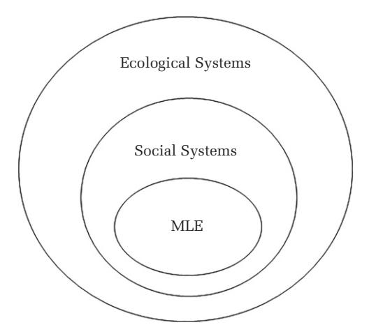

<!-- A3.R37 | source: papers_json/A3.R37/ -->

## VU Research Portal

Sowing the seeds of change: calling for a social-ecological approach to management learning and education

Colombo, Laura A.; Moser, Christine; Muehlfeld, Katrin; Joy, Simy

## published in

Academy of Management Learning and Education 2024

DOI (link to publisher) 10.5465/amle.2024.0086

document version

Publisher's PDF, also known as Version of record

document license

Article 25fa Dutch Copyright Act

Link to publication in VU Research Portal

citation for published version (APA)

Colombo, L. A., Moser, C., Muehlfeld, K., & Joy, S. (2024). Sowing the seeds of change: calling for a social-ecological approach to management learning and education. Academy of Management Learning and Education, 23(2), 207-213. https://doi.org/10.5465/amle.2024.0086

Copyright and moral rights for the publications made accessible in the public portal are retained by the authors and/or other copyright owners and it is a condition of accessing publications that users recognise and abide by the legal requirements associated with these rights.

- Users may download and print one copy of any publication from the public portal for the purpose of private study or research.
You may not further distribute the material or use it for any profit-making activity or commercial gain
You may freely distribute the URL identifying the publication in the public portal

## Take down policy

If you believe that this document breaches copyright please contact us providing details, and we will remove access to the work immediately and investigate your claim.

## E-mail address:

vuresearchportal.ub@vu.nl

Download date: 17, Feb. 2025

<!-- page 2 -->

## FROM THE EDITORS

## SOWING THE SEEDS OF CHANGE: CALLING FOR A SOCIAL–ECOLOGICAL APPROACH TO MANAGEMENT LEARNING AND EDUCATION

We are living in wild times. The ecological crisis and climate emergency are accelerating at an unprecedented rate and with devastating consequences (Richardson et al., 2023). The seriousness of this state of affairs seems to be slowly sinking inincluding in management learning and education (MLE) (Laasch, 2024). Although humans across the globe are not equally impacted by the consequences of a warming planet, it will increasingly prove more difficult for anyone to remain unaffected by what climate scientists are calling the "sixth mass extinction" (Barnosky et al., 2011). A World Bank report projects that there will be 216 million internal climate migrants by 2050 (Clement et al., 2021), while it is estimated that the world economy will lose $23 trillion (Flavelle, 2021) and rising sea levels will pose a coastal flood risk for one billion people by the same year (IPCC, 2022). Stocktaking at COP 28 in December 2023 revealed that we are not on track to achieve the Paris Agreement goal of limiting global temperature rise to 1.5°C, and it is essential that each nation demonstrates tangible progress by 2030 to arrest rapid deterioration (UNFCCC, 2023).

Over the years, MLE has contributed to exacerbate this dramatic state of affairs, through teaching narrow and mechanistic approaches to business and economics, fostering "a culture of greed" (Wang, Malhotra & Murnighan, 2011: 643). However, right now, MLE also has an essential role to play in addressing this historic challenge. How can our discipline help envision and shape a thriving future, in a way that contributes knowledge, skills, and wisdom toward tackling the contemporary ecological and climate crises? In this FTE, we call for the development of a social—ecological approach to management education and scholarship to help move MLE forward.

A social—ecological approach to MLE acknowledges that business is a human construct, and that humans are ecological beings. Social—ecological systems are complex, integrated systems in which humans are part of nature (Berkes & Folke 1998; Resilience Alliance, n.d.). Building on this understanding,

a social-ecological approach to MLE recognizes the interdependence between environment, society, and business; emphasizing that business schools must be centered around the promotion of human and ecological flourishing, as business survival depends on social and ecological systems. A social-ecological approach to MLE alters our view on its role and position in business and society. Recently, Lindebaum (2024) called for an understanding of MLE as "big picture" social science wherein we explore "why and how macro- and micro-level phenomena shape one another." Here, MLE is a part of social reality, which we can study from a social scientific perspective. In short, MLE is embedded in social systems. In this FTE, we suggest that social systems, in turn, are embedded in ecological systems (Figure 1). Ecology is the study of relationships among living organisms and their environment; ecological systems, then, are the systems in which these organisms and their environment interact. An embedded view of MLE considers business, society, and nature as nested systems: without society, there is no business; and without nature, there is no society, hence no business (Marcus, Kurucz & Colbert, 2010).

In what follows, we first make the case for a social—ecological approach to MLE, exploring the "why" of developing this approach. We then invite management educators and scholars, as well as business school leaders, to explore five areas of inquiry to foster its development. We conclude with an appeal to management educators worldwide: the time to transform MLE and make it future-proof is *now*.

## WHY A SOCIAL-ECOLOGICAL APPROACH TO MLE?

Interestingly, the words "economy" and "ecology" share the same etymological roots. While the word "economy"—from the Greek oi\kappaos (oikos), meaning "house," and \nuó\muos (nomos), "norm"—refers to the set of norms that regulate the management of the place we inhabit (metaphorically, planet Earth), the

<!-- page 3 -->

## FIGURE 1 MLE as Embedded in Social and Ecological Systems

Adapted from Marcus et al. (2010).

word "ecology"—from the Greek οἶκος (oikos), "house," and λόγος (logos), "study"—refers to the study of ecological systems on this planet. The words "economy" and "ecology" are linguistic siblings. However, in current MLE practice, they are estranged. Indeed, the norms that reign in economic thinking are rarely interested in studying, or often even acknowledging, our ecological systems, with unintended, yet devastating, consequences (Hoffman, 2021). The separation between MLE and social-ecological systems has particularly manifested in the last 70 years, when human impacts on Earth systems have accelerated at an unprecedented rate and scale (Steffen, Broadgate, Deutsch, Gaffney & Ludwig, 2015). However, the roots of this separation run deeper. Climate research shows that the exponential increase in carbon dioxide levels and global warming coincided with the beginning of the industrial revolution, ushering in the Anthropocene (UKRI, n.d.). Newer technologies enabled modes of production that intensified the extraction of natural resources beyond replenishable levels, jeopardizing ecosystems. Separating sites of extraction, production, consumption, and waste disposal, it was possible for some to ignore the harmful effects on natural habitats, creating a sense of human-nature duality that human activities, including business, can be conducted outside of nature. Worse, these systems solidified the belief that human progress depended on taming and exploiting nature rather than living in harmony with it. Colonialism (and ongoing neocolonialism) exacerbated apparently limitless extraction

from around the world, and widespread social injustice alongside (Guha, 2014).

Not only business practice but also management education has previously mostly maintained an artificial separation between social and ecological systems. Contemporary management education emerged in the early 1900s to help managers improve the efficiency of production, inter alia endorsing the capitalistic philosophy of extraction and consumption as a means for—and social ideology of—progress (Cooke & Kumar, 2020). The business schools that spread to other parts of the world from the 1950s onwards became vehicles for exporting this philosophy. This past is still reflected in curricula and pedagogies in the business schools set up in postwar Europe and worldwide (Alcadipani & Caldas, 2012; Joy & Poonamallee, 2013). Mainstream MLE that prioritizes bottom-line-focused businesses as its primary stakeholders is yet to be responsive to the natural and social crises that this approach contributed to create (Arend, 2023; Colombo, 2023). We argue here that embracing a social-ecological approach is an opportunity for MLE to learn from its past and move away from exploitative habits into a hopeful future.

## HOW TO CULTIVATE A SOCIAL-ECOLOGICAL APPROACH TO MLE

Considering the wider MLE disciplinary context, organization and management studies research identified four key ingredients for making "an ecological case for business," including developing a critical, relational, interdisciplinary, and engaged approach to research (Ergene, Banerjee & Hoffman, 2021). Drawing from these insights, while applying them to the specific context of MLE, we encourage management educators and scholars, as well as business school leaders, to consider the following overarching areas of inquiry.

First, we urge management educators and senior management in business schools to examine the *telos* (i.e., purpose) of MLE. Teaching and learning for what? To what end? For what future? Interrogating ourselves (together with students) on the overarching purpose of teaching and learning means questioning the direction in which MLE is heading (Gümüsay & Reinecke, 2022). Is MLE merely geared toward equipping students with the necessary knowledge and skills to succeed in gaining employment in a competitive job market? To what extent is it concerned with serving broader social—ecological interests? Asking these questions may open up the classroom to considering the standpoint of multiple

<!-- page 4 -->

stakeholders, paying attention to the needs of those who are at higher risk of marginalization, including considerations for their land and livelihoods. Some academics and institutions are already embracing the challenge of repurposing the business school "for the public good" (Dalpiaz, Leroy, Markman, Muzio, Potocnik & Wickert, 2023; Kitchener & Delbridge, 2020). While this can provide students with an opportunity to focus on collective action and joint outcomes—over individual incentives and benefits (Rand, 2016; Rand et al., 2014)—it is important to keep examining win–win solutions with a critical eye and ask, "Who is included in—and who is excluded from—the public?" In this context, Fougere, Solitander, and Young (2014) offer an interesting example, proposing to "expose" and "unsettle" business school "vocabularies" and implement learning methods able to open up "new directions for moral imagination" (for a list of concrete applications, see Fougere et al., 2014: 184).

Survival is already at stake for many whose livelihood directly depends on natural resource use, as the number of ecological refugees continues to rise (Apap & Harju, 2023); but the negative consequences of ecological collapse have also begun to affect those who have so far benefitted the most from economic growth, including global elites (Gadgil & Guha, 1995). For example, in October 2012, Hurricane Sandy forced several businesses—as well as the stock exchange market in Wall Street—to shut down because of the storm, causing an estimated $65 billion in damage (NHC, n.d.); and, in January 2019, following devastating wildfires in California, the Pacific Gas and Electric Company (PG&E) was declared "the first climate change bankruptcy" (Gold, 2019).

Second, cultivating a social–ecological approach to MLE requires bringing different philosophical approaches into the classroom for analysis and discussion. Management theory has largely been grounded in Western philosophies assuming a human–nature duality, such as Cartesian thinking and the Enlightenment's rationality (Banerjee & Arjalies, 2021). These philosophical approaches have given rise to mechanistic assumptions, implying the separation between economic, societal, and environmental domains (Jørgensen & Fatien, 2024). This includes, but is not limited to, assuming that the largely unquestioned goal of GDP growth can be decoupled from natural resource depletion, and that ecological influences (subsumed under negative "externalities") can be corrected through market and policy measures, including the introduction of taxes

to control carbon emissions, emission trading, and carbon markets. Mechanistic approaches to MLE have not just served as a legitimization of extractivism and the human-driven destruction of ecosystems, through positioning our species above the rest of nature, but they have also led to colonial and racialized exploitation; for example, through the outsourcing of pollution from high-income countries to the Global South (Banerjee, 2022; Banerjee & Arjalies, 2021).

Building a social–ecological approach to MLE entails decolonizing our discipline by observing through the lenses of knowledge systems that are different from Western rationalism (Salmon, Chavez & Murphy, 2023; Woods, Dell & Carroll, 2022), overcoming the conceptual separation between humans and nature and acknowledging that we are part of nature (Ergene et al., 2021). Exploring different knowledge systems in the classroom can help management educators and students appreciate the interdependence between environment, society, and business; investigate the biological foundations of meaning making (Phillips & Moser, 2024); and move beyond anthropocentric approaches (Arruda Fontenelle, 2023; Jørgensen & Fatien, 2024;). "Vadudhaiva Kudumbakam" ("the world is one family"), as the Sanskrit verse says. While questioning how we relate to others and the world involves engaging in deep ontological and epistemological inquiry, it is important to note that moving from a mechanistic to a social–ecological approach is not a simple flipping of the switch (e.g., mechanistic vs. systemic), but, rather, a nuanced process, requiring engagement with different ways of understanding and experiencing the world (Banerjee & Arjalies, 2021).

Third, a social–ecological approach to MLE calls for strengthened collaboration across disciplines, as tackling complex challenges requires cultivating knowledge and coordinating actions across disciplinary domains (Grewatsch, Kennedy & Bansal, 2023). Indeed, it is crucial to recognize that the present ecological crises are entwined with other pressing issues, such as socio-economic inequality, global health and well-being, food security and sovereignty, and so forth. Yet, despite a growing call for increased collaboration across subjects (Edwards, Alcaraz & Cornell, 2021; Trinh, Kirsch, Castillo & Bates, 2022), MLE is largely still locked within its disciplinary boundaries.

Strengthening interdisciplinarity in MLE would enable an acquisition of deeper-level awareness of complex phenomena at the intersection of environment, society, and business—as well as of the

<!-- page 5 -->

fundamental importance of basic laws of nature. For example, insights from earth system science can open the discipline's doors to the concept of limits, introducing issues such as planetary boundaries into the management classroom (Edwards et al., 2021). In addition, selected methods from other disciplines can help visualize these concepts in the classroom. For example, percolation-based models originating from statistical physics could be instructive in demonstrating the suddenness with which a critical threshold may be exceeded, virtually by accident, shifting a system from one state into another (e.g., Cantono & Silverberg, 2009; Niranjan, 2023; Solomon, Weisbuch, de Arcangelis, Jan & Stauffer, 2000). In particular, such models may demonstrate how small changes at the micro level can accumulate for a long time without any noticeable change at the system level, before suddenly the whole system irreversibly tips following the addition of one equally minor and seemingly innocuous micro-level change at the point of criticality. An accessible visualization of this phenomenon consists of successively adding droplets of water to anise liqueur: the liqueur is crystal clear at first and does not change its appearance across a considerable number of subsequently added droplets. Yet, suddenly, with the addition of a further droplet of water at the point of criticality, the threshold is exceeded and the entire drink—a mix of two initially clear substances—turns milky white.

Fourth, closely related, we encourage critically examining the teaching content in MLE. What do we teach students? And what do we not teach? For example, among the bastions of management curricula worldwide is Frederick Taylor's "scientific management" (as this is also the foundation for numerous management procedures). Yet, few management students are aware that scientific management principles are partly based on "plantation management" and its reliance on enslaved labor (Cummings, Bridgman, Hassard & Rowlinson, 2017; Greenberg & Hibbert, 2022; Roediger & Esch, 2012). Similarly, few students know that at the very origin of management theory in the United States was the pursuit of "conservation" (i.e., of the Earth's natural resources) and that this approach was later supplanted by Taylor's mechanistic worldview (Cummings et al., 2017).

In the contemporary business school, students typically learn that management is about achieving greater efficiency of performance, business is about maximizing profits, and economics is about GDP growth. To what extent do students learn about sufficiency, social entrepreneurship, and well-being

approaches to economics? To what extent do they explore a plurality of perspectives and consider the needs of multiple stakeholders (including less visible ones, such as future generations, ecological refugees, and the many whose livelihood and survival depend on ecosystem health) (Banerjee & Arjalies, 2021)?

Some schools have raised awareness of the issue of making MLE future-proof; for example, by including compulsory modules on climate change and designing new programs in sustainable business and management. This "sustainability turn" signals the existence of a growing number of driven faculty and students committed to making a difference and transforming the discipline. However, it is now important to move beyond the individual course level. A social–ecological approach to MLE calls for critical thinking and eco-literacy to be identified as key learning outcomes in MLE programs. When social– ecological awareness permeates the entire curriculum, solutions that encourage business to be regenerative, contributive, and distributive by design can start to emerge (Raworth, 2017; Sandel, 2021).

Finally, we encourage paying attention to the method and practice of teaching MLE (i.e., our pedagogy), and how this is impacted by the issues discussed above. Adopting a social–ecological approach to MLE means considering education as a way to empower students to question and transform their reality, including contributing solutions to tackle the climate and ecological breakdown (Barros, Bristow, Contu, Wanderley & Prasad, 2024). It requires engaging with "critical" (Grey, 2004) and "phronetic" (Berti, Jarvis, Nikolova & Pitsis, 2021) pedagogies, introducing dialogic methods centered on reflexivity (Allen & Girei, 2024), together with "environmental education" and "outdoor learning" (Lugg, 2007; UNESCO, 2023), encouraging students to experience firsthand environmental issues in relation to business and management challenges, learn from and with one another, and from and with nature.

These pedagogical approaches enable a deeper, more engaged understanding of the embeddedness of MLE in social–ecological systems, which, in turn, empowers students to take an active part in envisioning and shaping desirable futures. For this to happen, it is important to rethink assessment: to move away from grade-driven and hyper-competitive forms of assessment and toward feedback-based approaches that balance individual accountability and teamwork, reward mutual engagement in problem-solving, and encourage peer support (Rickey, Coombs, DeLuca & LaPointe-McEwan, 2023). This requires

<!-- page 6 -->

business school leadership and accreditation bodies to think beyond rankings, and to move from just being reactive to markets to actively and courageously choosing to participate in addressing managerial, societal, and ecological issues—because it is our collective responsibility to do so (Grolleau & Meunier, 2024).

## CONCLUSION

It is clear that "MLE as usual" cannot continue. In this FTE, we called for the development of a social–ecological approach to reconcile MLE and social–ecological systems, and to move away from exploitative management practices and into a just and sustainable future. While this FTE has laid the foundation for a social–ecological approach to MLE, more research is needed to develop it further. For example, future scholarship could delve into key concepts from different disciplines such as diversity, resilience, regime shift, transformation, complexity, scale, and adaptive management. This would facilitate a deeper understanding of the intricate connections and interactions within and with ecosystems in which managerial decision-making takes place, and of the interdependence between business schools and the civic and natural environment that sustains them. Furthermore, future research is required to uncover the impact of ecological collapse on MLE; the role of business schools in exacerbating, or contributing remedy to, such a collapse; and the concept of limit in MLE (such as planetary boundaries and limits to growth).

In times of ecological upheaval, making space for these conversations in the business school is essential. We urge management educators and business school leaders to take action: individually, by questioning MLE as usual; collectively, by making space for social–ecological approaches in the classroom; and institutionally, by contributing scholarship that pushes boundaries, challenges, and transforms MLE as we know it.

Laura A. Colombo University of Exeter

Christine Moser Vrije Universiteit Amsterdam

Katrin Muehlfeld University of Trier

Simy Joy Independent Researcher

## REFERENCES

- Alcadipani, R., & Caldas, M. P. 2012. Americanizing Brazilian management. Critical Perspectives on International Business, 8: 37–55.
- Allen, S., & Girei, E. 2024. Developing decolonial reflexivity: Decolonizing management education by confronting white skin, white identities, and whiteness. Academy of Management Learning & Education, 23: 246–264.
- Apap, J., & Harju, S. J. 2023. The concept of 'climate refugee': Towards a possible definition. Retrieved from [https://www.europarl.europa.eu/RegData/etudes/BRIE/](https://www.europarl.europa.eu/RegData/etudes/BRIE/2021/698753/EPRS_BRI(2021)698753_EN.pdf) [2021/698753/EPRS_BRI(2021)698753_EN.pdf](https://www.europarl.europa.eu/RegData/etudes/BRIE/2021/698753/EPRS_BRI(2021)698753_EN.pdf)
- Arend, R. J. 2023. AACSB's failures in guarding the ethical henhouse of business schools. Management Learning. Forthcoming.
- Arruda Fontenelle, I. 2023. A tragic ethics for the Anthropocene: On the unmanageable and impossible in management learning. Management Learning, 54: 825–836.
- Banerjee, S. B. 2022. Decolonizing management theory: A critical perspective. Journal of Management Studies, 59: 1074–1087.
- Banerjee, S. B. & Arjalies, D.-L. 2021. August 25: Celebrating the end of Enlightenment: Organization theory in the age of the Anthropocene and Gaia (and why neither is the solution to our ecological crisis). Organization Theory, 2: 26317877211036714.
- Barnosky, D., Matzke, N., Tomiya, S., Wogan, G. O. U., Swartz, B., Quental, T. B., Marshall, C., McGuire, J. L., Lindsey, E. L., Maguire, K. C., Mersey, B., & Ferrer, E. A. 2011. Has the Earth's sixth mass extinction already arrived? Nature, 471: 51–57.
- Barros, A., Bristow, A., Contu, A., Wanderley, S., & Prasad, A. 2024. Politicizing and humanizing management learning and education with Paulo Freire. Management Learning, 55: 3–16.
- Berkes, F., & Folke, C. (Eds.). 1998. Linking social and ecological systems: Management practices and social mechanisms for building resilience. Cambridge: Cambridge University Press.
- Berti, M., Jarvis, W., Nikolova, N., & Pitsis, A. 2021. Embodied phronetic pedagogy: Cultivating ethical and moral capabilities in postgraduate business students. Academy of Management Learning & Education, 20: 6–29.

<!-- page 7 -->

- Cantono, S., & Silverberg, G. 2009. A percolation model of eco-innovation diffusion: The relationship between diffusion, learning economies and subsidies. Technological Forecasting and Social Change, 76: 487–496.
- Clement, V., Rigaud, K. K., de Sherbinin, A., Jones, B., Adamo, S., Schewe, J., Sadiq, N., & Shabahat, E. 2021. Groundswell part 2: Acting on internal climate migration. Retrieved from [https://openknowledge.](https://openknowledge.worldbank.org/entities/publication/2c9150df-52c3-58ed-9075-d78ea56c3267) [worldbank.org/entities/publication/2c9150df-52c3-](https://openknowledge.worldbank.org/entities/publication/2c9150df-52c3-58ed-9075-d78ea56c3267) [58ed-9075-d78ea56c3267](https://openknowledge.worldbank.org/entities/publication/2c9150df-52c3-58ed-9075-d78ea56c3267)
- Colombo, L. A. 2023. Civilize the business school: For a civic management education. Academy of Management Learning & Education, 22: 132–149.
- Cooke, B., & Kumar, A. 2020. U.S. philanthropy's shaping of management education in the 20th century: Toward a periodization of history. Academy of Management Learning & Education, 19: 21–39.
- Cummings, S., Bridgman, T., Hassard, J., & Rowlinson, M. 2017. To what end? The nature of management's classical approach. In S. Cummings, T. Bridgman, J. Hassard, & M. Rowlinson (Eds.) A new history of management: 46–80. Cambridge: Cambridge University Press.
- Dalpiaz, E., Leroy, H., Markman, G., Muzio, D., Potocnik, K., & Wickert, C. (Eds.) 2023. Call for papers for a special issue: Repurposing management for the public good: Processes, obstacles and unintended consequences. Journal of Management Studies.
- Edwards, M. G., Alcaraz, J. M., & Cornell, S. E. 2021. Management education and earth system science: Transformation as if planetary boundaries mattered. Business & Society, 60: 26–56.
- Ergene, S., Banerjee, S. B., & Hoffman, A. J. 2021. (Un)sustainability and organization studies: Towards a radical engagement. Organization Studies, 42: 1319–1335.
- Flavelle, C. 2021. April 22: Climate change could cut world economy by $23 trillion in 2050, insurance giant warns. New York Times.
- Fougere, M., Solitander, N., & Young, S. 2014. Exploring and exposing values in management education: Problematizing final vocabularies in order to enhance moral imagination. Journal of Business Ethics, 120: 175–187.
- Gadgil, M., & Guha, R. 1995. Ecology and equity: The use and abuse of nature in contemporary India. Abingdon, U.K.: Routledge.
- Gold, R. 2019. January 18: PG&E: The first climate-change bankruptcy, probably not the last. Wall Street Journal.
- Greenberg, D., & Hibbert, P. 2022. Beyond legitimacy: A bold agenda for MLE scholarship. Academy of Management Learning & Education, 21: 161–166.
- Grewatsch, S., Kennedy, S., & Bansal, P. T. 2023. Tackling wicked problems in strategic management with systems thinking. Strategic Organization, 21: 721–732.

- Grey, C. 2004. Reinventing business schools: The contribution of critical management education. Academy of Management Learning & Education, 3: 178–186.
- Grolleau, G., & Meunier, L. 2024. Legitimacy through research, not rankings: A provocation and proposal for business schools. Academy of Management Learning & Education, 23: 325–342.
- Guha, R. 2014. Environmentalism: A global history. London: Penguin.
- Gum€ usay, A. A., & Reinecke, J. 2022. Researching for desir- € able futures: From real utopias to imagining alternatives. Journal of Management Studies, 59: 236–242.
- Hoffman, A. J. 2021. Business education as if people and the planet really matter. Strategic Organization, 19: 513–525.
- IPCC. 2022. Summary for policymakers. In H.-O. Portner, € D. C. Roberts, M. Tignor, E. S. Poloczanska, K. Mintenbeck, A. Alegrıa, M. Craig, S. Langsdorf, S. Loschke, € V. Moller, A. Okem, & B. Rama (Eds.), € Climate change 2022: Impacts, adaptation and vulnerability: 3–33. New York: Cambridge University Press.
- Jørgensen, K. M., & Fatien, P. 2024. Gaia storytelling: Management learning as terrestrial politics. Organization. Forthcoming.
- Joy, S., & Poonamallee, L. 2013. Cross-cultural teaching in globalized management classrooms: Time to move from functionalist to postcolonial approaches? Academy of Management Learning & Education, 12: 396–413.
- Kitchener, M., & Delbridge, R. 2020. Lessons from creating a business school for public good: Obliquity, waysetting, and wayfinding in substantively rational change. Academy of Management Learning & Education, 19: 307–322.
- Laasch, O. 2024. Radicalizing managers' climate education: Getting beyond the bull fairy tale of eternal economic growth. Journal of Management Education, 48: 110–140.
- Lindebaum, D. 2024. Management learning and education as "big picture" social science. Academy of Management Learning & Education, 23: 1–7.
- Lugg, A. 2007. Developing sustainability-literate citizens through outdoor learning: Possibilities for outdoor education in higher education. Journal of Adventure Education and Outdoor Learning, 7: 97–112.
- Marcus, J., Kurucz, E. C., & Colbert, B. A. 2010. Conceptions of the business–society–nature interface: Implications for management scholarship. Business & Society, 49: 402–438.
- NHC. n.d. Costliest U.S. tropical cyclones tables updated. Retrieved from [https://www.nhc.noaa.gov/news/](https://www.nhc.noaa.gov/news/UpdatedCostliest.pdf) [UpdatedCostliest.pdf.](https://www.nhc.noaa.gov/news/UpdatedCostliest.pdf) Accessed December 4, 2023.

<!-- page 8 -->

- Niranjan, A. 2023. December 6: Earth on verge of five catastrophic climate tipping points, scientists warn. Guardian.
- Phillips, N., & Moser, C. 2024. The biological basis of the symbolic: Exploring the implications of the co-evolution of language, cognition and sociality for management studies. Journal of Management Studies. Forthcoming.
- Rand, D. G. 2016. Cooperation, fast and slow: Metaanalytic evidence for a theory of social heuristics and self-interested deliberation. Psychological Science, 27: 1192–1206.
- Rand, D. G., Peysakhovich, A., Kraft-Todd, G. T., Newman, G. E., Wurzbacher, O., Nowak, M. A., & Greene, J. D. 2014. Social heuristics shape intuitive cooperation. Nature Communications, 5: 3677.
- Raworth, K. 2017. Doughnut economics: seven ways to think like a 21st-century economist. White River Junction, VT: Chelsea Green Publishing.
- Resilience Alliance. n.d. Social–ecological systems. Retrieved from [https://www.resalliance.org/concepts](https://www.resalliance.org/concepts-social-ecological-systems)[social-ecological-systems.](https://www.resalliance.org/concepts-social-ecological-systems) Accessed January 24, 2024.
- Richardson, K., Steffen, W., Lucht, W., Bendtsen, J., Cornell, S. E., Donges, J. F., Druke, M., Fetzer, I., Bala, G., € von Bloh, W., Feulner, G., Fiedler, S., Gerten, D., Gleeson, T., Hofmann, M., Huiskamp, W., Kummu, M., Mohan, C., Nogues-Bravo, D., & … Rockstrom, J. € 2023. Earth beyond six of nine planetary boundaries. Science Advances, 9: eadh2458.
- Rickey, N., Coombs, A., DeLuca, C., & LaPointe-McEwan, D. 2023. How "grade obsession" is detrimental to students and their education. Retrieved from [https://the](https://theconversation.com/how-grade-obsession-is-detrimental-to-students-and-their-education-199980) [conversation.com/how-grade-obsession-is-detrimental](https://theconversation.com/how-grade-obsession-is-detrimental-to-students-and-their-education-199980)[to-students-and-their-education-199980](https://theconversation.com/how-grade-obsession-is-detrimental-to-students-and-their-education-199980)
- Roediger, D. R., & Esch, E. D. 2012. The production of difference: Race and the management of labor in U.S. history. New York: Oxford University Press.

- Salmon, E., Chavez, R. J. F., & Murphy, M. 2023. New perspectives and critical insights from Indigenous peoples' research: A systematic review of Indigenous management and organization literature. Academy of Management Annals, 17: 439–491.
- Sandel, M. J. 2021. The tyranny of merit. London: Penguin Random House.
- Solomon, S., Weisbuch, G., de Arcangelis, L., Jan, N., & Stauffer, D. 2000. Social percolation models. Physica A, 277: 239–247.
- Steffen, W., Broadgate, W., Deutsch, L., Gaffney, O., & Ludwig, C. 2015. The trajectory of the Anthropocene: The great acceleration. Anthropocene Review, 2: 81–98.
- Trinh, M. P., Kirsch, R., Castillo, E. A., & Bates, D. E. 2022. Forging paths to interdisciplinary research for early career academics. Academy of Management Learning & Education, 21: 318–333.
- UKRI. n.d. A brief history of climate change discoveries. Retrieved from [https://www.discover.ukri.org/a](https://www.discover.ukri.org/a-brief-history-of-climate-change-discoveries/index.html)[brief-history-of-climate-change-discoveries/index.html.](https://www.discover.ukri.org/a-brief-history-of-climate-change-discoveries/index.html) Accessed December 4, 2023.
- UNESCO. 2023. Climate change education. Retrieved from [https://www.unesco.org/en/climate-change/education](https://www.unesco.org/en/climate-change/education)
- UNFCCC. 2023. COP28 agreement signals "beginning of the end" of the fossil fuel era. Retrieved from [https://](https://unfccc.int/news/cop28-agreement-signals-beginning-of-the-end-of-the-fossil-fuel-era) [unfccc.int/news/cop28-agreement-signals-beginning-of](https://unfccc.int/news/cop28-agreement-signals-beginning-of-the-end-of-the-fossil-fuel-era)[the-end-of-the-fossil-fuel-era](https://unfccc.int/news/cop28-agreement-signals-beginning-of-the-end-of-the-fossil-fuel-era)
- Wang, L., Malhotra, D., & Murnighan, J. K. 2011. Economics education and greed. Academy of Management Learning & Education, 10: 643–660.
- Woods, C., Dell, K., & Carroll, B. 2022. Decolonizing the business school: Reconstructing the entrepreneurship classroom through indigenizing pedagogy and learning. Academy of Management Learning & Education, 21: 82–100.

