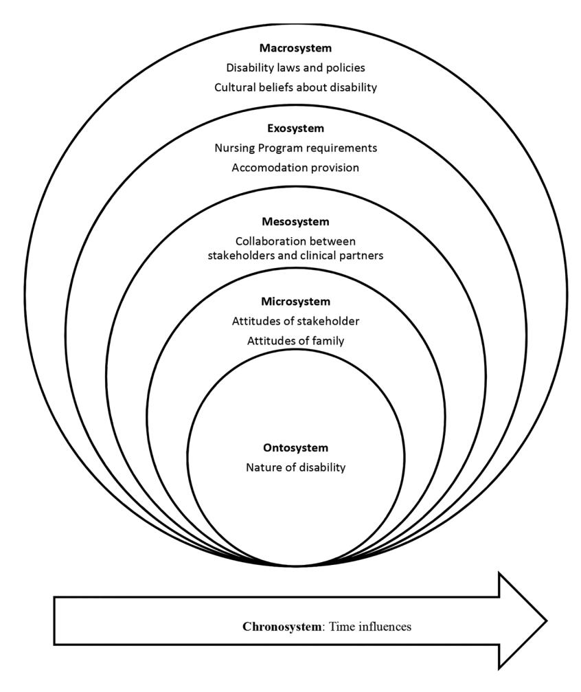
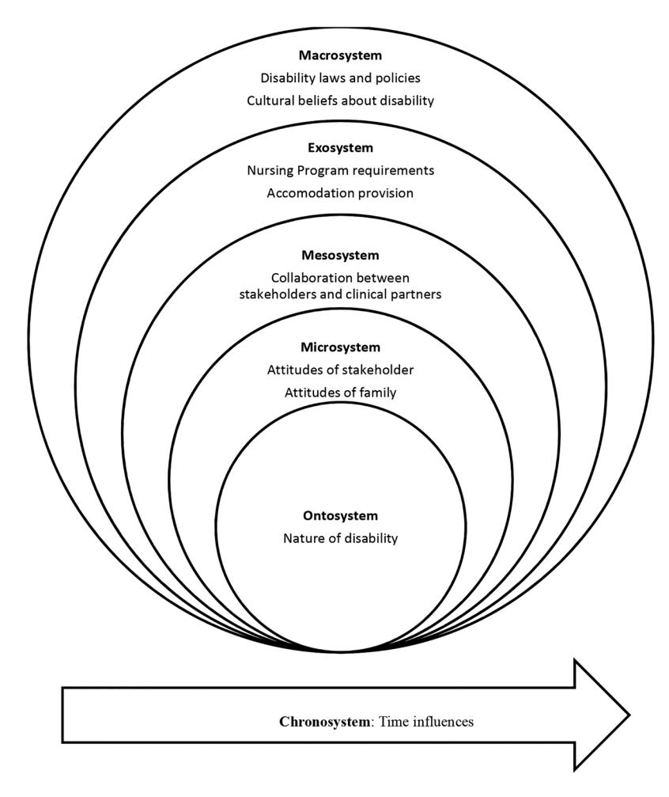

<!-- A3.R38 | source: papers_json/A3.R38/ -->

## **The Journal of Genetic Psychology**

**Research** **and** **Theory** **on** **Human** **Development**

**ISSN: 0022-1325 (Print) 1940-0896 (Online) Journal homepage:****[ www.tandfonline.com/journals/vgnt20](https://www.tandfonline.com/journals/vgnt20?src=pdf)**

## **Stakeholders'** **Perceptions** **of** **Students** **with** **Disabilities Inclusion in Nursing Education in the** **United** **Arab** **Emirates**

## **Amani Darwish & Eman Gaad**

**To** **cite** **this** **article:** Amani Darwish & Eman Gaad (13 Feb 2025): Stakeholders' Perceptions of Students with Disabilities Inclusion in Nursing Education in the United Arab Emirates, The Journal of Genetic Psychology, DOI: [10.1080/00221325.2025.2464780](https://www.tandfonline.com/action/showCitFormats?doi=10.1080/00221325.2025.2464780)

**To** **link** **to** **this** **article:** [https://doi.org/10.1080/00221325.2025.2464780](https://doi.org/10.1080/00221325.2025.2464780)

Published online: 13 Feb 2025.Submit your article to this journalArticle views: 140View related articlesView Crossmark data

<!-- page 2 -->

## **Stakeholders' Perceptions of Students with Disabilities ** **Inclusion in Nursing Education in the United Arab Emirates**

Amani Darwish[a](#page-1-0) and Eman Gaa[db](#page-1-1)

[a](#page-1-2) Psychology Department, Fatima College of Health Sciences, Abu Dhabi, UAE; [bB](#page-1-3)ritish University, Dubai, UAE

## ABSTRACT

The purpose of the study was to explore the perceptions of nursing education stakeholder of the inclusion of students with disabilities in nursing education programs in the United Arab Emirates (UAE) and barriers to their inclusion. A sequential exploratory mixed-methods design was used. Data was collected using unstructured interviews and questionnaires. Thematic analysis of the interviews with seven nursing education stakeholders revealed the following barriers to the inclusion of nursing students with disabilities: (1) Nature of disability, (2) knowledge of nursing faculty, (3) attitudes, (4) communication, (5) resources, (6) nursing program requirements, (7) admission and support policies, and (8) disability outreach activities. In total, 284 nursing education students and 29 nursing education faculty members from health science academic institutions in Abu Dhabi, Ajman, Al-Ain, and Al Dhafra in the UAE completed the questionnaires. The descriptive and inferential statistical analysis of the responses of nursing education faculty members and nursing education students was performed using SPSS software. The findings showed that both educators and students had concerns regarding the inclusion of students with disabilities. However, implementing facilitators and overcoming barriers can enhance the accessibility of nursing students with disabilities to nursing education programs. The findings also showed significant differences in the perception of nursing students and faculty of inclusion concerning their interactions with students with disabilities and having completed a course about individuals with disabilities.

## ARTICLE HISTORY

Received 28 March 2024 Accepted 3 February 2025

## KEYWORDS

Nursing education; inclusion; inclusive education; nursing education students with disabilities; nursing education stakeholder perceptions

## **Stakeholders' perceptions of the inclusion of students with disabilities in nursing ** **education in the United Arab Emirates**

Globally, the number of students with disabilities in tertiary institutions has increased (Pacheco et al., [2021](#page-31-0)). However, the number of students with disabilities admitted to and completing nursing education programs seems unusually small and disproportional compared to the number of students with disabilities graduating from other programs (Calloway & Copeland, [2021;](#page-29-0) Metzger et al., [2020](#page-30-0); Moodley & Mchunu, [2022](#page-30-1); Neal-Boylan & Miller, [2020](#page-30-2)). While knowledge of the national and international laws and policies related to the rights of people with disabilities appears to be growing, presumptions and misunderstandings regarding the abilities of nursing students with disabilities continue.

Students and healthcare workers with disabilities bring a unique perspective and talents with a fresh viewpoint to the nursing profession. This contributes to driving change in healthcare (Ailey & Marks, [2020](#page-28-0); Neal-Boylan & Miller, [2020](#page-30-2)). Regardless, several studies

<!-- page 3 -->

(Calloway & Copeland, [2021](#page-29-0); Gonzalez & Hsiao, [2020;](#page-29-1) Langørgen & Magnus, [2020](#page-30-3); Metzger et al., [2020;](#page-30-0) Moriña & Orozco, [2020;](#page-30-4) Neal-Boylan, [2019;](#page-30-5) Neal-Boylan & Miller, [2020](#page-30-2)) have identified difficulties surrounding the admission and success of nursing students with disabilities in nursing schools.

The United Arab Emirates' (UAE) efforts to support and uphold the rights of people with disabilities are manifest in its policies, laws, and regulations (Wiens et al., [2022](#page-31-1)). However, despite that the educational system has undergone reform, a gap remains between policy and practice (Elhoweris & Efthymiou, [2020;](#page-29-2) Hemdan et al., [2021](#page-29-3)). Studies in the UAE highlighted barriers for students with disabilities, including faculty members' negative attitudes in higher education. These attitudes hinder the success of an inclusive education process (Alzyoudi et al., [2021;](#page-28-1) Elhoweris & Efthymiou, [2020](#page-29-4); Gaad, [2019;](#page-29-5) Morgan, [2023](#page-30-6)).

This study addresses the following primary research question: *What are the perceptions of * *nursing education stakeholders of the inclusion of students with disabilities in nursing education * *programs in the UAE and barriers to their inclusion?*

Furthermore, the following four research sub-questions are addressed to achieve the research aim:

Sq. 1. What are the views of nursing education stakeholders on the barriers to the inclusion of nursing students with disabilities in nursing education programs in the UAE?

Sq. 2 What are the perceptions of nursing education faculty members and nursing education students of the inclusion of nursing education students with disabilities?

Sq. 3 Are there demographic differences in the perceptions of nursing education faculty members and nursing education students of the inclusion of nursing education students with disabilities?

To date, the inclusion of students with disabilities in nursing education programs has rarely been explored in the Middle East and North Africa. Thus, more studies are needed in the UAE on the inclusion of nursing students with disabilities to determine whether the perceptions of the nursing academic community are similar to those toward students with disabilities in any program. Furthermore, barriers to the participation of students with disabilities in nursing education programs must be identified to formulate strategies to overcome them. Philion et al. ([2021](#page-31-2)) emphasized the need for research investigating the requirements and difficulties faced by nursing students with disabilities and the accommodations and supports available to help them overcome these.

Finally, the study contributes to developing new knowledge regarding inclusive education in nursing education programs in the UAE by exploring barriers to the participation of students with disabilities. In addition, research on stakeholder perceptions can help identify gaps or discrepancies between existing legal frameworks and actual nursing education practices. This information can inform policy revisions or development of regulations that align with legal requirements, ensuring compliance with disability rights legislation.

## **Theoretical framework**

The social constructivism theory, medical model of disability, and human variation model of disability are used in this study to understand disability inclusion in nursing education. The focus is on the understanding of disability as a concept and how these conceptualizations influence the policies and practices surrounding disability. Furthermore, Jean Watson's caring theory is applied to examine how variations among nursing students with disabilities are respected and responded to in a caring and welcoming environment. The synthesis of these theories and models may help improve understanding of how to challenge discrimination, uphold the right of nursing students with disabilities in education, and make nursing part of disability inclusion promotion at both the patient and societal levels. The following paragraphs provide an overview of the aforementioned theories and models in the context of this study.

<!-- page 4 -->

The social constructivist perspective toward disability is based on an understanding that much of what is believed about disability results from meanings constructed by people who are not disabled (Vygotsky & Cole, [1978)](#page-31-3). Hence, using a social constructivism theory lens to understand disability in nursing education enables analyzing social structures that may impact the admission of students into nursing schools. Social constructivism theory has valuable implications for practice as it highlights designing programs and services to support students with special needs in nursing programs.

Nursing is a profession that embraces the need to avoid discrimination and to promote disability equality in relation to healthcare provision. However, nursing is often associated with medicine and 'disability' is predominantly considered a medicalized concept (Oliver, [2013](#page-30-7)). Although the medical model is needed to understand the root cause of impairments, it is limited in identifying environmental factors that can exacerbate the condition of disability. The model perceives human differences as anomalies that must be treated rather than human variations that should be respected and accommodated (Raman & Levi, [2002](#page-31-4)).

The human variation model of disability defines disability as an incongruity in people's qualities and society's potential to accommodate those qualities (Scotch & Schriner, [1997)](#page-31-5). Hence, disability represents a wide range of conditions, which are each unique and may necessitate modifying the support provided over the course of the education or employment of students with disabilities. Based on this model, the erroneous ability-disability dichotomy can be overcome by adopting a universal approach to disability. This approach accepts differences and increases the range of what is considered 'normal' along the ability-disability spectrum that applies to all humanity (Bickenbach et al., [1999)](#page-28-2). This renders the human variation model of disability important for this study, because it helps in understanding how the nursing community in the UAE responds to individual variation among nursing students with disabilities.

Relatedly, Jean Watson's theory of caring (Watson, [1997)](#page-31-6) considers caring the essence of nursing, and a caring environment accepts a person as he or she is. Caring is also central to inclusive education. Therefore, inclusive education in nursing programs based on Watson's human care theory can improve the caring behaviors of nursing education educators, students, and clinical educators toward patients as well as colleagues and peers with a disability.

## **Conceptual framework**

While these models and theories have different concepts and focuses, they all acknowledge the significance of contextual factors in shaping individuals' experiences, development, and perceptions. Furthermore, as disability is viewed as an ecologically constructed phenomenon (Olivier-Pijpers et al., [2019)](#page-31-7), we adopt Bronfenbrenner and Ceci ([1994](#page-29-6)) bio-ecological model of human development as a conceptual framework to examine the proximal and distal factors that can impact the inclusion of nursing students with disabilities in nursing education programs. These systems are dynamic and interrelated, as [Figure 1 ](#page-4-0)shows.

## **Literature review**

## *Disability*

A disability is a state of being in which a person is considered impaired in relation to the apparent usual standard of an individual or a group (Centers for Disease Control and Prevention, n.d.). Disability can include a long-term medical condition, learning difficulty, behavioral difficulties, and psychological problems (Veitch et al., [2018)](#page-31-8). The defining features of a disability are generally divided into three core classifications including personal qualities, social qualities, and a combination of both. The medical model of disability focuses on individual qualities to define disability. According to Goering ([2015)](#page-29-7), disability is usually viewed as a problem that

<!-- page 5 -->

***[Figure 1.](#page-3-0)** Bio-ecological model of human development. Source: Bronfenbrenner and Ceci [(1994)](#page-29-9).*

exists in the body of the individual that limits daily life activities and reduces interaction with the surrounding environment. On the other hand, social aspects emphasize how contextual factors such as culture and physical surroundings contribute to a disability (Jones, [1996)](#page-29-8). Many definitions of disability currently combine individual and social attributes. The most popular of these is the definition of the World Health Organization (WHO, [2016](#page-31-9)). It defines disability as a multidimensional phenomenon that involves both an individual and the way society influences life experiences of individuals (Leal et al., [2020](#page-30-8)). According to WHO, disability and functionality are affected by the interaction between the health condition of individuals and various factors in the environment of the individual (World Health Organization, [2016)](#page-31-10). As a result, conceptualizing disability is challenging, and several theories and models can inform the discussion thereof.

## *Nursing students with disabilities*

Students with disabilities are enrolling in higher education at a higher rate than before (Kraus, [2023)](#page-30-9). However, despite the progress, research showed that they remain underrepresented in nursing education (Calloway & Copeland, [2021;](#page-29-0) Metzger et al., [2020;](#page-30-0) Moodley & Mchunu, [2022;](#page-30-1) Neal-Boylan & Miller, [2020](#page-30-2)). Ailey and Marks ([2020)](#page-28-0) mentioned that the Institute of Medicine has requested increasing the diversity of the nursing labor force to support the needs of a

<!-- page 6 -->

culturally diverse patient population. Moreover, nursing education leaders have requested nursing schools to work toward inclusivity excellence (National League for Nursing, [2016](#page-30-10)) by retaining a diverse faculty, staff, and students. Arguably, nurses with disabilities bring an exceptional outlook and specific skills to the clinical setting that can help improve the quality of culturally competent care and enrich diversity in the profession (Ailey & Marks, [2020;](#page-28-0) Calloway & Copeland, [2021)](#page-29-0).

Including students with disabilities in nursing education is considered an opportunity for the development of educators and students and enhancement of the quality of care provided to patients. Moriña and Orozco ([2020](#page-30-11)) qualitatively explored the experiences of 19 Spanish nursing faculty members in teaching nursing students with disabilities. The results indicated that the majority of participants had positive experiences, although a few participants reported lacking the needed knowledge to deal with and support students with disabilities in the class.

Students are important stakeholders who significantly affect the classroom climate and have a chief role in supporting students with disabilities (Degtjarjova et al., [2018)](#page-29-10). Shpigelman et al. ([2016](#page-31-11)) investigated the attitudes of 270 Israeli nursing students toward their peers with impairments *via* a quantitative survey. The findings demonstrated that their attitudes toward their colleagues with disabilities were often unfavorable.

These studies demonstrate variance in the perceptions of educators and students in higher education regarding the inclusion of students with disabilities in nursing programs. Thus, it is crucial to complement these studies with more work on nursing education stakeholders' perceptions of the inclusion of nursing students with disabilities to know if these perceptions in the UAE are similar.

## *Barriers to the inclusion of students with a disability in nursing education*

Studies have explored the challenges regarding the inclusion of nursing students with disabilities in nursing education programs. Their findings highlight barriers to inclusion including disability disclosure, educators' knowledge and attitudes, admission requirements, lack of clear policies, and lack of communication and collaboration among stakeholders (Gonzalez & Hsiao, [2020;](#page-29-1) Metzger et al., [2020;](#page-30-12) Neal-Boylan & Miller, [2020)](#page-30-13). Shpigelman et al. ([2022](#page-31-12)) explored the academic development of students with disabilities in higher education. They showed that nursing students with disabilities face a dilemma of whether to disclose their disability and face ridicule and labeling or to benefit from disability services and accommodations.

Moreover, the literature indicated that some nursing schools apply discriminatory practices against students with disabilities. Here, inconsistent admission practices to nursing programs, reliance on outdated technical standards, and the subjective interpretations of these standards are major barriers to the admission, retention, and matriculation of nursing students with disabilities (Betz et al., [2012](#page-28-3); Gonzalez & Hsiao, [2020](#page-29-1); Marks & Ailey, [2014](#page-30-14), Ailey & Marks, [2020;](#page-28-4) Matt et al., [2015](#page-30-15)).

In addition, research emphasized the importance of having clear policies and procedures on how to include and support nursing students with disabilities. For example, Epstein et al. ([2021)](#page-29-11) examined the experiences of these nursing students and teachers in nursing clinical assignments. One emerging issue was the importance of having rules and policies that are transparent and easy to obtain. They suggested that having a support system and guidelines is essential before, during, and after the clinical experience.

Furthermore, Gonzalez and Hsiao ([2020)](#page-29-12) explained the barriers people with disabilities face in becoming nurses, including their ability to perform job tasks, likelihood of jeopardizing patient safety, and ability to contribute to the profession. Another reported barrier is fitness to practice. For Hargreaves et al. [(2014)](#page-29-13), assessing fitness to practice may lead to discrimination against students with disabilities. Moreover, related decisions may be impacted by concerns regarding the capabilities of nursing students with disabilities to provide safe patient care.

<!-- page 7 -->

In addition, providing accommodations to nursing students with disabilities was one of the most reported barriers to their inclusion in nursing education programs, especially in clinical settings (Halligan et al., [2019](#page-29-14); Philion et al., [2021)](#page-31-2). The situation is complex when it comes to students with disabilities who have disclosed their disability. These students must be proficient in conducting tasks, but also have legal rights to receive accommodations that are fair that do not compromise the technical standards of the course (Heelan et al., [2015](#page-29-15)).

The abovementioned studies offer a nuanced perspective on the impact of disability education in nursing curricula, revealing both persistent challenges and potential solutions. On one hand, some studies suggest that nursing students continue to hold negative attitudes toward disability and struggle to apply their learned knowledge in clinical settings, despite exposure to disability-related content. These findings indicate a need for more effective teaching strategies and stronger emphasis on the application of knowledge.

On the other, several studies support the integration of disability content in nursing education and advocate for experiential learning opportunities such as simulations and interactions with individuals with disabilities. For them, disability-focused education can improve students' attitudes, knowledge, self-efficacy, empathy, and communication skills, ultimately enhancing their preparedness to provide quality care for patients with disabilities. Together, these studies highlight the importance of addressing the gaps in current nursing education and implementing innovative teaching methods to promote inclusive and effective healthcare practices.

## **Methodology**

This study followed a mixed methods research approach. As noted, disability is a socially constructed phenomenon that is understood differently by different people (Mertens & McLaughlin, [2004)](#page-30-16). This renders the adoption of a mixed methods approach that combines qualitative and quantitative methods to study the phenomenon essential. This research used an exploratory design since the phenomenon of disability inclusion in nursing education is not well explored. In the first study phase, the qualitative stage, open-ended in-depth individual unstructured interviews were conducted with a group of nursing education stakeholders to uncover their views regarding barriers to inclusion. In the second phase, a cross-sectional survey was used to investigate the perceptions of a large number of nursing education stakeholders of the inclusion of students with disabilities.

The Institutional Review Board for Research granted approval for the study, as it was determined to pose a low risk to participants and adhere to ethical standards [IRB approval number: [FCEC-2-21-22-PSY-1-SF].

## *Site, population, and sampling technique*

This research was conducted at one nursing educational institution in the UAE. The college has four campuses in four regions across the UAE: Abu Dhabi, Al Ain, Al Gharbia, and Ajman.

[Table 1](#page-6-0) summarizes the participants of the qualitative and quantitative phases of the study, the methods of which are outlined below.

<!-- page 8 -->

## *Qualitative sampling for the In-depth interviews*

High accessibility, availability, proximity to the researcher, and achieving a representative sample are the rationales for convenience sampling (Creswell, [2014)](#page-29-16). Thus, convenience sampling was used to select nursing education faculty members and nursing education students as they may have valuable knowledge of the competencies students must acquire. They are also assumed knowledgeable in various teaching strategies to respond to the academic needs of diverse learners.

The study used purposive sampling to select other participants assumed to be able to provide rich information on disability-related laws and policies, the admission requirements to nursing education programs, and accommodations to students with disabilities.

An email with a consent form was sent to participants and interviews were set up with each. New interviewees were added until the study reached the saturation point, where new meaningful data ceased to be obtained from participants (Sarantakos, [2004](#page-31-13)).

## *Quantitative sampling for the questionnaire*

The population for the quantitative study was a convenience sample of 284 nursing education students (a combination of first, second, third, and fourth-year students) and 29 nursing education faculty members working in one of the health sciences institutions. The population size of nursing education students was estimated as 1386 and that for nursing education faculty members was 62; hence, the target sample size for nursing education students is 301 where the margin of error is 5% and confidence level is 95% (Creswell, [2014)](#page-29-16).

An email was sent to each participant to describe the purpose of the study and to seek their participation. The two groups of participants were provided with a link to the questionnaire. In total, 284 nursing education students and 29 nursing education faculty members signed the consent form, agreed to participate in the quantitative study, and completed the questionnaire.

## *Instruments*

## *In-depth interviews*

[Table 2 ](#page-7-0)summarizes the nursing education stakeholders who participated in the interviews. The interviews were conducted in a private room *via* Zoom. Zoom's recording feature was used to record the audio of the sessions after obtaining each participant's consent. All interviews were

KSWD: Knows someone with a disability; IWSD: Interacted with a student with a disability; TCD: Took a course about PWDs; AC/HO: Academic institution/Health Organization

<!-- page 9 -->

conducted in English and lasted an average of 35 min. After each interview, the researcher transcribed, analyzed, and thematically coded the recordings ([Appendix A](#page-32-0)).

## *Questionnaire*

The literature review did not indicate instruments to measure the attitudes of nursing educators toward nursing students with disabilities, especially those who are simultaneously potential caregivers and patients (Carroll, [2004](#page-29-17)). Thus, the researcher constructed a new tool focusing on educators and students' knowledge of policies and procedures to examine their beliefs regarding the provision of accommodations and challenges facing inclusion. The purpose was to increase the level of administrative support (Alfaro et al., [2015](#page-28-5); Forlin et al., [2011;](#page-29-18) Fuchs, [2010](#page-29-19); Papadakaki et al., [2022)](#page-31-14).

Participants' quotes from the unstructured interviews and the literature review (Ashcroft et al., [2008;](#page-28-6) Azzopardi et al., [2014;](#page-28-7) Betz et al., [2012](#page-28-3); Calloway, [2019;](#page-29-20) Calloway & Copeland, [2021;](#page-29-0) Matt et al., [2015;](#page-30-17) Moodley & Mchunu, [2022](#page-30-1); Morris & Turnbull, [2006](#page-30-18); Ramluggun et al., [2021](#page-31-15); Rankin et al., [2010;](#page-31-16) Sowers & Smith, [2004](#page-31-17)) were used to create a five-point Likert style questionnaire that consisted of 33 items. Items L1–L6 applied to knowledge of disability-related laws and institutions policies. Items A1–A7 applied to beliefs of accommodations in nursing education, B1–B9 focused on beliefs regarding barriers to inclusion, and T1–T4 explored attitudes toward the inclusion of nursing students with disabilities. Finally, items P1–P7 examined beliefs related to inclusivity (see [Table 3)](#page-9-0).

The demographics of study participants were wide ranging in terms of age, gender, and Emirates. Participants also varied in their experiences, including whether they had connections with individuals who have disabilities, interactions with students with disabilities, or had completed coursework related to people with disabilities, as identified by previous research (Alghazo & Naggar Gaad, [2004](#page-28-8); Levey, [2014;](#page-30-19) Magilvy & Mitchell, [1995;](#page-30-20) Marcone et al., [2019;](#page-30-21) Sowers & Smith, [2004)](#page-31-17).

## *Participant characteristics*

[Table 4](#page-12-0) provides the demographics of the study participants (nursing students [*N* = 169, 100% females] and nursing educators [*N* = 22, 48.3% females, 51.7% males]).

Most students are aged 17–27 years and most educators 39–49 years. The students and educators were mostly from Abu Dhabi and Ajman Emirate. Furthermore, the majority of nursing students (*N* = 169) and nursing educators (*N* = 22) know individuals with disabilities, but have not interacted with students with disabilities (nursing students, *N*=171; nursing educators, *N*=15). Furthermore, most nursing students (*N* = 245) and educators (*N* = 22) did not take any courses on disability, which can significantly affect their perceptions of the inclusion of students with disabilities.

## *Validity, reliability, and trustworthiness*

The researcher established face validity as recommended by Johnson and Christensen ([2019)](#page-29-21) and Tavakol and Dennick ([2011)](#page-31-18) by having a group of four specialists in the field of special and inclusive education and two nursing educators look over the questionnaire to ensure it properly captured the issue under consideration. For content validity, the questionnaires were piloted on a sample of 30 nursing education students and 20 nursing education faculty members. No modifications were suggested. The responses from both pilot groups were kept in the database.

The questionnaire was also tested for reliability and internal consistency. For internal consistency, Cronbach's alpha values for each domain were calculated and analyzed using SPSS.

<!-- page 10 -->

***[Table 3.](#page-8-0)** Questionnaire for nursing students and nursing faculty members.*

## **Demographic Information**

What is your gender?

What is your age group?

| Perceived Disability Laws and Institutional Policies | Strongly Disagree | Disagree | Not sure | Agree | Strongly agree |
| --- | --- | --- | --- | --- | --- |
| L1: I know the meaning of the term |  |  |  |  |  |
| 'disability.' L2: I know the UAE laws related to the |  |  |  |  |  |
| rights of people with disabilities |  |  |  |  |  |
| ('People of Determination') in |  |  |  |  |  |
| education. |  |  |  |  |  |
| L3: I know that the UAE nursing and |  |  |  |  |  |
| midwifery education standards clearly |  |  |  |  |  |
| describe how the needs of diverse |  |  |  |  |  |
| learners should be met. |  |  |  |  |  |
| L4: I know that the admission policy to |  |  |  |  |  |
| nursing programs in my institution supports the inclusion of nursing |  |  |  |  |  |
| students with disabilities ('Students of |  |  |  |  |  |
| Determination'). |  |  |  |  |  |
| L5: I know that passing a medical |  |  |  |  |  |
| physical fitness test is an important |  |  |  |  |  |
| admission requirement to nursing |  |  |  |  |  |
| education programs in my institution. |  |  |  |  |  |
| L6: I know the disability policy in my |  |  |  |  |  |
| institution on how to support nursing |  |  |  |  |  |
| students with disabilities ('Students of |  |  |  |  |  |

| erceivea | Accommodations |  |
| --- | --- | --- |
|  |  |  |

Determination').

Perceived Accommodations Strongly Disagree Disagree Not Sure Agree Strongly Agree

- A1: I believe that assistive technology can help in meeting the needs of nursing with disabilities ('Students of Determination').
- A2: I believe that extending the submission deadlines for tasks can be a reasonable way to support nursing students with disabilities ('Students of Determination').
- A3: I believe that using alternative devices in clinical practice to perform a task can be a reasonable way to support nursing students with disabilities ('Students of Determination').
- A4: I believe that nursing students with disabilities should be assessed on what skills they have and not on their performance thereof.
- A5: I believe that using diversified teaching strategies can help in the inclusion of nursing students with disabilities ('Students of Determination').
- A6: I believe that asking nursing students with disabilities ('Students of Determination'). directly about how they like to be supported will help in their inclusion.
- A7: I believe that having an accessible infrastructure can facilitate the inclusion of nursing students with disabilities ('Students of Determination').

<!-- page 11 -->

| 1 | 0 | ۴ | (ط |
| --- | --- | --- | --- |
|  |  |  |  |

| Inclusive Practices | Strongly Disagree | Disagree | Not Sure | Agree | Strongly Agree |
| --- | --- | --- | --- | --- | --- |
| P1: I believe that students from any |  |  |  |  |  |
| disability category are able to provide |  |  |  |  |  |
| safe care to patients upon graduation. |  |  |  |  |  |
| P2: I believe that providing nonclinical |  |  |  |  |  |
| tracks in nursing can facilitate the |  |  |  |  |  |
| inclusion of nursing students with |  |  |  |  |  |
| disabilities (' Students of |  |  |  |  |  |
| Determination'). |  |  |  |  |  |
| P3: I believe that providing options for |  |  |  |  |  |
| clinical and nonclinical tracks in nursing will maximize the strengths of |  |  |  |  |  |
| students with disabilities (' Students of |  |  |  |  |  |
| Determination'). |  |  |  |  |  |
| P4: I believe that nursing students must |  |  |  |  |  |
| be prepared for various clinical settings |  |  |  |  |  |
| and should not be limited to bedside |  |  |  |  |  |
| work. |  |  |  |  |  |
| P5: I believe that opening more |  |  |  |  |  |
| sub-specialties in nursing can facilitate |  |  |  |  |  |
| the inclusion of nursing students with |  |  |  |  |  |
| disabilities (' Students of |  |  |  |  |  |
| Determination'). |  |  |  |  |  |
| P6: I believe that modifying clinical |  |  |  |  |  |
| practice to be inclusive of all areas of |  |  |  |  |  |
| nursing will increase the opportunity |  |  |  |  |  |
| of including nursing students with |  |  |  |  |  |
| disabilities. |  |  |  |  |  |
| P7: I believe that using alternative experiences such as simulation can |  |  |  |  |  |
| provide nursing students with |  |  |  |  |  |
| disability with greater opportunities to |  |  |  |  |  |
|  |  |  |  |  |  |

Strongly Disagree Disagree

Not Sure

Agree

Strongly

Agree

B1: I believe that social stigma against people with disabilities is a barrier for including nursing students with disabilities (' Students of

fulfill their clinical obligations.

Perceived Barriers

- Determination'). B2: I believe that the admission requirements to nursing programs are barriers to the inclusion of nursing students with disabilities (' Students of Determination').
- B3: I believe that negative attitudes of educators toward students with disabilities (' Students of Determination') are barriers to their inclusion.
- B4: I believe that the lack of clear policy to support students with disabilities (' Students of Determination') is a barrier to their inclusion.
- B5: I believe that the lack of resources in nursing laboratories is a barrier to the inclusion of nursing students with disabilities (' Students of Determination').
- B6: I believe that the lack of professional development on how to meet the needs of nursing students with disabilities (' Students of Determination') is a barrier to their inclusion.

<!-- page 12 -->

## **Table 3.** Continued.

B7: I believe that not disclosing the disability is a barrier for including nursing students with disabilities ('Students of Determination').

B8: I believe that lack of communication between educators and administration is a barrier for the inclusion of nursing students with disabilities.

B9: I believe that the lack of collaboration between educators and nurses in clinical sites is a barrier for the inclusion of nursing students with disabilities.

| Perceived Attitudes | Strongly Disagree | Disagree | Not Sure | Agree | Strongly Agree |
| --- | --- | --- | --- | --- | --- |
|  |  |  |  |  |  |

- T1: Empathetic educators and students help in the success of the inclusion of nursing students with disabilities
- T2: Peer interaction between nursing students with and without disabilities will help both groups to learn new skills.
- T3: Accepting nursing students of determination will help in creating an inclusive welcoming environment.
- T4: People in a nursing school can create compassion and a sense of inclusion.

According to Creswell [(2014](#page-29-22)), a reliability coefficient of 0.70 or higher indicates acceptable reliability, meaning the instrument can be used to predict future behavior. For the nursing education students, Cronbach's alpha values for the four factors were as follows: total scale (*α*=0.95), laws and policies (*α*=0.78), barriers (*α*=0.93), accommodation (*α*=0.94), and attitudes (*α* = 0.91). For the nursing education faculty, Cronbach's alpha values were as follows: total scale (*α*=0.96), laws and policies (*α*=0.61), accommodation (*α*=0.95), barriers (*α*=0.94), and attitudes (*α* = 0.94).

## *Ethical considerations*

An email invitation to participants included a consent letter introducing the researcher, outlining the objectives of the study, and informing participants that they could withdraw at any time without penalty and that the data collected would be kept private and used only for research purposes. The researcher ensured the confidentiality of participants' personal information and identities by anonymizing their names. When reporting the interview results, pseudonyms for the participants were used to protect their anonymity. Participants were also assured that their responses would remain confidential. Finally, the interview recordings and transcribed information were kept safe using password-secured computer folders.

## **Results**

## *Unstructured interviews with nursing stakeholders*

The responses to the interview questions with a group of nursing stakeholders were analyzed using the six phases of thematic analysis (Braun & Clarke, [2006)](#page-28-9). The following eight main themes regarding the views of nursing education stakeholders of barriers to the inclusion of nursing students with disabilities in nursing education emerged.

<!-- page 13 -->

## *Nature of disability*

Within this theme, two sub-themes were extracted: Disability category and functional limitation of disability.

*Disability category.* Some participants were less inclined to accept students with a certain category of disability in a nursing education program than others. Seemingly, certain disabilities are more accepted in nursing education programs, as the quotes below indicate.

They have to do one-on-one or follow-up tutoring or anything like that again depending on the type of disability. If it is a cognitive disability, it would be very different. (Female, Chief nursing officer) S

But one person with a disability in a wheelchair cannot move and go into the patient room because there may be stuff on the floor. They may not be able to come and go easily. (Female, nursing education student) GZ

*Functional limitation of disability.* According to some participants, inclusion depends on the severity of the disability and subspeciality in which they will work. Participants believed that not all students with the same disability have the same limitations and restrictions in performing a specific task:

The severity of the disability will play a major role in whether to include or not include a student, because not all disabilities enable them to perform certain tasks. (Male, Nursing education faculty member) AB

## *Knowledge of nursing faculty*

The interviews identified this as a theme that affects the inclusion of nursing students with disabilities. The views of participants indicated two sub-themes:

*Conceptualization of disability.* Most participants understood disability in terms of functional abilities that may affect patient care, as they are seen as individuals who need continuous help and support:

They don't have confidence in themselves to study nursing. People with cognitive issues are not going to be interested in studying nursing. They need someone to give them care. (Female, Chief nursing officer) S

|  | Table 4. Demographic analysis of participants. |  |  |  |
| --- | --- | --- | --- | --- |

|  |  | Nursing students (N=284) | Nursing Educators (N=29) |
| --- | --- | --- | --- |
| Demographics | Distribution | Frequency (Percentage) | Frequency (Percentage) |
| Gender | Male | 0 (0%) | 15 (51.7%) |
|  | Female | 284 (100%) | 14 (48.3%) |
| Age | 17–27 years | 275 (96.8%) | – |
|  | 28–38 years | 9(3.2%) | 10 (34.5%) |
|  | 39–49 years | – | 16 (55.2%) |
|  | 50–59 years | – | 3 (10.3%) |
| Emirates | Abu Dhabi | 194 (68.3%) | 20 (69.0%) |
|  | Dubai | 16 (5.6%) | 1 (3.4%) |
|  | Ajman | 20 (7.0%) | 7 (24.1%) |
|  | Al Sharjah | 19 (6.7%) | 1 (3.4%) |
|  | Ras Al Khaimah | 21 (7.4%) | – |
|  | Um Al Quwain | 6 (2.1%) | – |
|  | Al Fujairah | 8 (2.8%) | – |
| Knows someone with a | Yes | 169 (59.5%) | 22 (75.9%) |
| disability | No | 115 (40.5%) | 7 (24.1%) |
| Interacted with a student with | Yes | 113 (39.8%) | 14 (48.3%) |
| a disability | No | 171 (60.2%) | 15 (51.7%) |
| Took a course about disability | Yes | 39 (13.7%) | 7 (24.1%) |
|  | No | 245 (86.3%) | 22 (75.9%) |

<!-- page 14 -->

Consistent with how participants understand disability, nursing students with disabilities were referred to as 'these people,' 'not normal,' and 'that category of people.' This reflects how some nursing stakeholders understand disability as being different from normal. For example:

They are not normal people in terms of utilizing their time to study or train or go to practice areas, and so we have to have different things. (Female, Chief nursing officer) S

*Lack of professional development.* Most participants mentioned that nursing faculty members lack the experience working with nursing students with disabilities. One mentioned that teaching students with disabilities requires that educators know different teaching strategies to educate students with diverse needs and to deal with the different nature and category of various disabilities:

We need to prepare facilities for them to help them finish their education smoothly and to provide them with qualified tutors/teachers/instructors. (Female, Supervisor student services) M

## *Attitudes*

Some participants highlighted the negative impact of parents' negative attitude toward their children's ability to become a nurse and their over-protection and guardedness, and fear of their failure and rejection by society on students' motivation to pursue a career in nursing:

They may be protective: 'Like my child has this disability and I don't want her to fail or to be stigmatized.' (Female, Head of a campus.) E

It was also believed that the attitude of nursing faculty members is important and that they should be role models for disability inclusivity, empathy, and compassion. For example:

I think having understanding and inclusive teachers is very important They are role models. (Female, Chief nursing officer) Z

## *Communication*

Within this theme, two sub-themes were extracted:

One participant believed that without proper cooperation between the health organization and academic institution, the eligibility of students with disabilities to work as nurses cannot be determined, which will affect their inclusion and employment:

So, there should be cooperation between the hospital and educational intuitions to try to determine which disabilities can be accepted in the hospital. (Female, Supervisor student services) M

*Poor collaboration with mental health professionals.* Participants highlighted the need to collaborate with psychologists and counselors as an important factor that will help in raising awareness to address the stigma and discrimination against nursing students with disabilities:

I think counsellors and social workers must be very close to the person who has or who developed a disability. You need a psychologist on campus that can facilitate their acceptance. (Female, Chief nursing officer) Z

## *Resources*

Most participants considered the lack of proper accommodations and shortage in specialized manpower barriers to the inclusion of nursing students with disabilities.

<!-- page 15 -->

*Lack of proper accommodations.* One participant raised clear concerns regarding the lack of proper accommodations to help nursing students with disabilities progress in the nursing program:

We provide no formal services for them. Admin provides no accommodations for them. It is never brought up. (Male, Head of a nursing program) A

Furthermore, participants noted the limited use of technology such as using digital devices to facilitate the execution of clinical tasks as a barrier for some nursing students with disabilities to overcome their functional limitations:

We don't have digital equipment. All are manual and require visual and cognitive abilities. (Female, Chief nursing officer) S

*Shortage in specialized manpower.* Various participants raised a concern regarding the shortage in manpower and specialized staff for dealing with students with disabilities:

We are now at a 44 to 1 student to teacher ratio. I don't have time to figure out if someone has a disability to provide the needed support. (Male, Head of nursing program) A

## *Nursing program requirements*

Participants were concerned about the nursing program requirements; specifically, the admission requirements, clinical placement requirements, concerns regarding maintaining the quality of care and ensuring patient safety, and the heavy focus of nursing programs on clinical experience.

*Admission requirements.* One nursing faculty member raised the concern of meeting the 'rules' related to the physical ability requirement. Participants consider physical and mental fitness essential for clinical practice:

In nursing, many factors can be barriers preventing those with disabilities from becoming nurses. One is the physical requirement, which focuses on physical tasks that have to do with patients. (Male, nursing faculty member) AB

*Clinical placement requirements.* Some participants considered the nursing curriculum's requirements a barrier preventing students with disabilities from becoming successful nurses. These require that students stay for long periods in wards checking on patients and walking between wards, which are physically demanding and exhausting tasks, especially for students with physical health conditions and disabilities:

Physical fitness is an element that must be considered. Thinking of nursing skills as a nurse, studying and placement take hours. You must have stamina and an element of fitness. (Female, Head of campus) E

*Concerns regarding quality of care and safety of patients.* All participants referred to patient safety. This concern centered on the fact that during their academic program, nursing students spend significant time caring for patients in different situations in courses that provide clinical experience. A concern for patient safety is a priority for nursing schools when students are in a clinical setting. These points were reflected in the statements below:

Also, 80% of preceptors don't want you to affect their patients negatively or cause harm to them. They are responsible for patient safety. (Female, nursing student) GZ

<!-- page 16 -->

They further explained that all healthcare organizations work toward the quality of care by improving patient satisfaction and ensuring patients' safety. This may be jeopardized if nursing students with disabilities are included, as indicated below:

Another thing pertains to quality. Most institutions work toward quality-based care. They will question the quality in this case. (Male, nursing faculty member) AB

*Absence of nonclinical academic tracks.* Participants explained that the absence of nonclinical tracks while students with disabilities are still in the nursing program will hinder them from graduating successfully and working in nursing areas that align with their potential, abilities, and strengths:

Nursing provides many avenues to take when you qualify; however, to gain access to these routes you need to be a clinical nurse. You still need this clinical experience to become a nurse educator. (Female, Head of a campus) E

## *Admission and support policies*

Within this theme, two sub-themes were extracted: Disability non-disclosure and lack of clear institutional disability policies.

*Disability non-disclosure.* Participants believed that students with disabilities may not wish to disclose personal, sensitive information about themselves that may impact their healthcare insurance services. However, it was also believed that this will delay adjustments to be made to enable them to fulfill their potential and achieve the learning outcomes:

In any application to nursing they ask if you have a health condition or chronic disease. This will lead to false negatives because they will not report if they fear being rejected or that the medical insurance will have more restrictions. (Male, nursing faculty member) AB

*Lack of clear institutional disability policies.* Some participants mentioned that it is important that college policy and procedure documents and student manuals have clear policies stating how students with disabilities are admitted and supported. This will ensure that applicants are aware that students with disabilities are welcomed, accepted, and supported in the institution, which will encourage them to enroll in the nursing program:

I think the institution should put very clear guidelines—for example, 'If you are physically disabled, you will 1, 2, and 3'—so they will be encouraged to apply and be allowed to be admitted. (Male, nursing faculty member) AB

Other participants raised the need for a clear policy related to the right of people with disabilities to be employed in the healthcare field. This is because healthcare providers with disabilities are currently excluded from being employed in healthcare organizations and are not protected by the existing right to employment laws:

In the admin positions, we have a number of people with disabilities. The government officials have mandated each facility in a government entity to have a certain percentage of people with disabilities. But unfortunately, physicians, nurses, and allied health are not included under this rule. (Female, Chief nursing officer) S

## *Disability outreach activities*

Some participants mentioned that health sciences institutions must commit to efforts that reflect the diversity of their student body in their marketing materials and practices that should not be a one-time exercise. Using real success stories and showcasing the capabilities of nursing

<!-- page 17 -->

students with disabilities are assumed to encourage future students with disabilities to join the program and reflect the institution's dedication to celebrating diversity:

It is important to see yourself in advertisements and championships. It significantly impacts mental health, encourages them, and makes them value themselves. (Female, nursing student) GZ

## *Perceptions of faculty and students*

The statistical Package for Social Sciences (SPSS) software v.22 was used for all statistical analyses. The tests conducted were descriptive statistics, normality analysis, correlation analysis, and evaluating group comparisons. The analyses clarified the perceptions of nursing students and faculty members regarding barriers and inclusion.

The data of 284 students and 29 educators were normally distributed considering that the skewness and kurtosis value ranged between the threshold values of −3 to +3 and −10 to +10, respectively.

## *Descriptive analysis of data of nursing students*

Descriptive analysis was conducted to evaluate statistical functions including the mean, standard deviation, minimum, and maximum for all items of each variable ([Table 5)](#page-18-0).

The survey shows that more than 70% of the students are aware of the concept of 'disability' and disability-related laws in the UAE. However, the majority (62%) are not aware that admission policies support the inclusion of students with disabilities. Similarly, only 42% of students are aware of the policies that support students with disabilities.

For accommodation practices, most participants highly agreed that various accommodative practices should be incorporated to help universities include and increase enrollment of nursing students with disabilities.

Students perceptions of how individuals' attitudes are related to the inclusion of students with disabilities were also interpreted. An analysis of items T1–T4 showed that most participants highly agreed with having a positive attitude toward students with disabilities. When asked about barriers, most nursing education students agreed that various barriers affect the inclusion of nursing students with disabilities.

## *Descriptive analysis of data of nursing educators*

Similar items were used in the survey with nursing educators to evaluate their perceptions regarding their knowledge of regulations, accommodations, attitudes, barriers, and inclusion of students with disabilities ([Table 6)](#page-22-0).

The results of the survey showed that the majority of educators are aware of the definition of 'disability,' disability-related laws in the UAE, importance of meeting the needs of diverse learners, and admission requirements. However, the majority (62%) are not aware of admission and support policies pertaining to the inclusion of students with disabilities.

Regarding the importance of accommodation practices for the inclusion of students with disabilities, most nursing education faculty members believed that common inclusive accommodation practices may help these students overcome their challenges.

It was observed that educators were positive for all items related to attitudes. The highest percentage strongly agreed with the notion that peer interaction can increase the inclusion of students with disabilities.

For barriers, educators agreed that barriers existed and with different inclusive practices such as opening more sub-specialties in nursing. However, the data indicated that nursing educators do not have a positive perception of the capabilities of students with disabilities to safely provide care to patients.

<!-- page 18 -->

## *Correlation analysis of students' data*

The analysis of the five variables indicated a moderate and positive correlation with inclusion of knowledge about laws and policies (*r* = 0.539, *p* < .01), accommodation practices (*r* = 0.806, *p* < .01), and attitudes (*r* = 0.609, *p* < .01). There was also a negative correlation between barriers and knowledge about laws and policies (*r*=−0.0151, *p*<.05), accommodation practices (*r*=−0.456, *p* < .05), and attitudes (*r* = −0.511, *p* < .05). Furthermore, barriers have a negative and significant correlation with inclusion (*r* = −0.431, *p* < .01) [(Table 7](#page-24-0)).

## *Correlation analysis of educators' data*

For nursing educators, the findings indicate no significant correlation between knowledge about laws and policies and inclusion (*r* = 0.173, *p* = .368 > 0.05). However, accommodation practices (*r* =0.861, *p* < .01) and attitudes (*r* = 0.790, *p* < .01) have a positive and significant correlation with inclusion.

Considering the correlation between knowledge of disability legislations, accommodations, attitudes, and barriers, a negative and significant correlation was observed for nursing educators' perceptions, except between knowledge about laws and barriers. However, a negative correlation between barriers and accommodation practices (r = −0.794, *p* < .01) and attitudes (r = −0.511, *p* < .05) was confirmed. Furthermore, barriers demonstrated a negative and significant correlation with inclusion (r = −0.799, *p* < .01) ([Table 8](#page-26-0)).

## *Group comparisons: nursing students' data*

The t-test findings for the five variables of inclusive education indicated no significant differences in perceptions between those who knew someone with a disability and those who did not across all variables. The results of the t-test are presented in the [Appendix B(](#page-32-1)i). For those who have interacted with individuals with disabilities and those who have not, there was a significant difference in perceptions regarding knowledge about laws (*p* = .014 < .05, indicating significance) and the inclusion of students with disabilities (*p* = .018 < .05). The t-test results presented in [Appendix B](#page-32-1)(ii).

A comparison of nursing students that completed a disability course and those that did not showed no differences in their perceptions regarding the variables. The t-test results are presented in [Appendix B(](#page-32-1)iii).

## *Group comparisons: nursing educators' data*

The t-test results indicate no significant differences in perceptions between male and female educators across all variables. The t-test results are presented in [Appendix C](#page-35-0)(i).

The study compared groups based on factors such as familiarity with people with disabilities, intimate interactions with people with disabilities, and enrollment in disability-related courses. No significant differences were found in the perceptions of individuals who have experience with a person with a disability and those who do not (*p* = .884). The t-test results are presented in [Appendix C(](#page-35-0)ii).

Regarding nursing educators who had interacted with individuals with disabilities and those who had not, a significant difference emerged between the two groups across all variables, except for knowledge of disability-related laws (*p* = .198 > .05). Similarly, significant distinctions between the two interaction groups were also evident for attitudes (*p* = .016 < .05), barriers (*p* = .002 < .05), and the inclusion of nursing students with disabilities (*p* = .005 < .05). The t-test results are presented in [Appendix C](#page-35-0)(iii).

For nursing educators who completed a course related to disability and those who did not, a significant difference was observed for all variables, except for attitudes. The findings indicated a significant difference in the perceptions of people who had taken a course and those who

<!-- page 19 -->

<!-- page 20 -->

<!-- page 21 -->

had not for accommodations and related practices (*p* = .006 < .05), knowledge about related laws (*p* = .025 < .05), barriers (*p* = .046 < .05), and inclusion of nursing students with disabilities (*p* = .041 < .05). The t-test results are presented in [Appendix C](#page-35-0)(iv).

Last, a group comparison between nursing students and nursing educators was performed to evaluate if they perceive inclusion of students with disabilities differently. The t-test results indicated a significant difference (*p* < .01) in the perceptions of students and educators regarding the inclusion of students with disabilities [(Appendix C](#page-35-0)(v)).

## **Discussion**

## *Barriers related to prior admission to a nursing program*

The UAE demonstrates its commitment to safeguarding the rights of individuals with disabilities. However, the findings indicated a lack of clear institutional disability policies that impact the inclusion of nursing students with disabilities. This is consistent with Mack et al. ([2021)](#page-30-22) and Morgan ([2023)](#page-30-23), who found that the lack of implementing policies is a barrier to the success of the inclusion of nursing students with disabilities in nursing education programs. This leads to a lack of accessibility measures and supports in academic institutions and workplace settings.

Another barrier found pertained to nursing program requirements. This may be because nursing programs have specific physical and cognitive requirements students must meet to be accepted into the program. These requirements are intended to ensure that students can perform the essential functions of nursing safely and effectively. This was confirmed by L'Ecuyer ([2019)](#page-30-24) and Lindsay et al. [(2023)](#page-30-25), who mentioned that disability is often treated as an afterthought in healthcare education, and students with disabilities often face challenges in accessing clinical placements.

Some participants believed that medical fitness should be an essential criterion to be admitted to a nursing education program. Others mentioned that screening for chronic diseases is important before a nurse is given a job because there is a high chance of them missing work. Two perspectives are linked to this: One is that sometimes, these requirements limit the inclusion of nursing students with disabilities. The other is that a lack of appropriate requirements can allow

<!-- page 22 -->

individuals with chronic illnesses to become nursing students, which can negatively affect patient care. This is aligned with Sin and Fong ([2007)](#page-31-19), who showed that the regulatory fitness requirements in the UK and USA were considered discriminatory as they hinder students with disabilities from entering the nursing profession.

Furthermore, the findings indicated that the type of disability, its severity, and functional limitation of the individual due to the disability may limit the inclusion of students with disabilities in nursing education programs. This may be related to the fact that students with a certain disability category may lack the skills needed to work as nurses, including the required physical, sensory, and cognitive and emotional abilities. This finding echoes the results of other studies (Emong & Eron, [2016](#page-29-23); Moodley & Mchunu, [2022;](#page-30-1) Ryan, [2011)](#page-31-20), which reported that not all students with disabilities can be integrated in nurse training because nursing is a practice-based profession. Students with certain categories of disabilities, such as those with hearing, vision, and mobility disabilities, can be integrated into nursing training with appropriate support from nurse educators and the provision of reasonable accommodations.

These varying viewpoints align with different models of disability and cultural beliefs. Participants who believe that nursing students with disabilities cannot perform certain tasks due to the nature of their disability and functional limitations align with the medical model of disability. They view disability as a limitation or impairment that hinders the individual's ability to function in certain roles. Participants who advocate for giving nursing students with disabilities different roles hold an inclusive perspective. They recognize the value of diversity and importance of providing equal opportunities for all individuals, irrespective of their abilities.

## *Barriers experienced during the program*

Based on the interview findings, nursing students can face a significant number of challenges after being admitted to a nursing program. These challenges include individuals' attitude toward people with disabilities, the knowledge of nursing faculty, communication among stakeholders, and resources provided to students with disabilities. These results align with those of Levey ([2014](#page-30-26)) and Shakespeare ([2006](#page-31-21)), who noted that negative attitudes toward individuals with disabilities are strengthened by societal norms and expectations, leading to further marginalization and exclusion.

The findings also indicated that knowledge of nursing educators about disability issues is a significant barrier that impacts the experience of nursing students with disabilities. For instance, some participants described disability as a limitation and lack of a required skillset. People with disabilities were viewed as a category of people who are 'not normal.' Similarly, Moodley and Mchunu ([2022](#page-30-1)) and Calloway and Copeland [(2021](#page-29-0)) reported that interviewees' understanding of disability was based on inabilities or functional limitations. It was also found that individuals' limited knowledge is due to a lack of professional development and training during their teaching course, which should be part of their curriculum. Majoko and Dunn ([2018)](#page-30-27) and Edwards and Hekel ([2021)](#page-29-24) confirmed that nursing faculty may lack the knowledge and skills to provide accommodations and support for students with disabilities.

Another barrier to the learning process of nursing students with disabilities during a program is communication among stakeholders. Howlin et al. [(2014)](#page-29-25) agree, indicating that poor communication between nursing faculty, clinical instructors, and disability services offices was often due to inadequate accommodations and support. Furthermore, the lack of classroom and clinical accommodations that prevent students with disabilities from gaining access to clinical settings and advancing in nursing programs presents real obstacles. In addition, the complexity of certain technological equipment and lack of staff and student knowledge regarding its operation make clinical settings particularly difficult for these students. Similarly, Nash et al. ([2022)](#page-30-28), Zhang et al. ([2018](#page-31-22)), and Philion et al. ([2021](#page-31-23)) reported that many healthcare organizations lack the essential facilities to accommodate students with disabilities, emphasizing that these nursing students

<!-- page 23 -->

<!-- page 24 -->

<!-- page 25 -->

frequently experience isolation and a lack of access to vital resources due to the lack of specialized faculty and staff support.

## *Barriers that hinder the provision of support after the program*

A significant barrier at this stage is the lack of disability outreach activities. Participants indicated that this lack of disability visibility and promotion will impede the inclusion of nursing students with disabilities in the nursing field. Polikandrioti et al. ([2020](#page-31-24)) indicated that the lack of awareness of marginalization, discrimination, and inequities in nursing education hinders understanding of diversity, equity, and inclusive learning environments. Social constructivism holds that disability is a social construct formed by societal attitudes, expectations, and behaviors. Disability is interpreted based on society's definition of 'normal' and 'abnormal.' The social and cultural surroundings in which people with disabilities live affect their experiences as much as their physical condition. Accordingly, the social and cultural variables that form the lives of individuals with disabilities must be understood and the impacts of these aspects on their interactions with society acknowledged.

> ^*^Correlation is significant at the 0.05 level (2-tailed).

<!-- page 26 -->

## *Perceptions of nursing students and educators*

Analysis of the perceptions of nursing students and educators revealed that a significant portion of these participants were unaware of support policies that can help in the admission of nursing students with disabilities. This is a concern for universities, because this lack of awareness can significantly affect students with disabilities. This finding aligns those of other studies (Ashcroft & Lutfiyya, [2013](#page-28-10); Epstein et al., [2021)](#page-29-11), underscoring the existence of unclear and inaccessible policies, along with inconsistent and poorly enforced admission and retention guidelines for nursing students with disabilities. Hence, there is a need for improvement in educating individuals about disability-related laws and policies, particularly in the context of nursing education (Ashcroft et al., [2008;](#page-28-11) Chao et al., [2016;](#page-29-26) Forlin et al., [2014](#page-29-27)).

In terms of providing the necessary accommodations, nursing students and educators highly agreed on implementing the accommodations, although some disagree or were not sure. The divergent viewpoints about the efficacy of accommodations and inclusion strategies for nursing students with disabilities arise from a confluence of individual factors, institutional capabilities, and intricate nature of addressing various requirements (Betz et al., [2012;](#page-28-12) Sowers & Smith, [2004)](#page-31-25). L'Ecuyer ([2019](#page-30-29)) confirmed that nursing faculty and preceptors had concerns regarding these students' ability to meet program requirements and clinical competencies when accommodations are provided. Hence, it is essential for faculty members to achieve an equilibrium between addressing students' needs and upholding fundamental educational goals. This will also ensure fairness toward all students.

The results also showed that many participants though that a positive attitude should be showcased to students with disabilities as it will help them grow in their academic and professional environment. Shpigelman et al. [(2016](#page-31-26)) stated that when students with disabilities perceive positive attitudes from their peers and educators, they demonstrate increased self-esteem, improved academic performance, increased participation, and enhanced confidence to grow in the profession.

Students and educators agreed on the barriers to the inclusion of students with disabilities. Similarly, Luckowski ([2016](#page-30-30)), Morris and Turnbull [(2006)](#page-30-31), and Shpigelman et al. ([2022](#page-31-27)), showed that fear of ridicule and social stigma is a barrier to the inclusion of nursing students with disabilities. Perspectives regarding the barriers to the inclusion of students with disabilities arise from the dynamic interaction between individual experiences, levels of knowledge, individual beliefs, and social factors (Ashcroft & Lutfiyya, [2013;](#page-28-13) Calloway & Copeland, [2021](#page-29-28); Epstein et al., [2021;](#page-29-29) Moodley & Mchunu, [2022](#page-30-32)). Comprehension of these elements may enable educational institutions and educators to better identify, address, and alleviate these barriers.

Nursing educators and students also agreed on factors regarding the inclusion of students with disabilities. However, educators showed concerns regarding patient safety. A significant concern is the balance between upholding program standards and making necessary accommodations for students with disabilities. It is the duty of nursing educators to guarantee that every student, regardless of disability, is capable of fulfilling the safety prerequisites of clinical practice (Emong & Eron, [2016](#page-29-30); Ryan, [2011)](#page-31-28).

Furthermore, no significant differences were found between the nursing students and educators regarding those who knew someone with a disability and those who did not for the five variables. These findings differ from Leyser and Greenberger [(2008)](#page-30-33), who indicated that the intensity of personal contact with people with a disability significantly influenced both the readiness to give and actual provision of accommodations.

This study found no significant differences among the perceptions of students and educators who interacted with someone with a disability. This is possible because knowing someone with a disability and interacting with someone with a disability differs. For example, a person may know someone with a disability, like a peer, but if that person has interacted with someone with a disability, they likely have more information about their challenges. Similarly, this study indicated that students perceived disability-related policies and the inclusion of students with disabilities differently and that

<!-- page 27 -->

educators perceived accommodation differently based on their interaction with people with a disability. This may be because students who engage in encounters with those with disabilities develop a more inclusive and empathic perspective, resulting in more favorable attitudes toward disability-related legislation and initiatives for inclusion. This is also highlighted by Pérez-Jorge et al. ([2021)](#page-31-29), who explained that despite the contact with classmates with disabilities, this interaction does not necessarily help in being aware of the right strategies and having the needed skills to support them. Moreover, nursing educators who have interacted with people with disabilities are likely to have a more realistic understanding of the specific accommodations required for these nursing students and of the barriers they face in educational settings. A non-significant difference was observed in terms of policy-related knowledge. This means that educators may receive similar instruction regarding legal requirements and regulations in their academic or professional programs, regardless of whether they have direct contact with individuals with disabilities.

Furthermore, this study found no significant differences among the perceptions of students who took a course related to disability and those who did not across the five variables. This means that professional courses are commonly taught, and that the five variables are more related to the information provided by institutions and existing social norms. However, there were significant differences between educators who had taken professional courses and those who had not. This shows that educators who took disability-related courses may have received formal training on accommodating students with disabilities, which could have provided them with specific strategies and knowledge of best practices. This aligns with Papadakaki et al. [(2022](#page-31-30)), who found that faculty members with prior training on disability had a greater perceived grasp of the legal framework than those without such experience.

## **Conclusion and recommendations**

The study indicated that although there was a strong consensus among students and educators about the need for inclusivity in nursing education and practice, and despite the widespread belief in the capabilities of students with disabilities and a commitment to providing them with diverse pathways to succeed in nursing careers, various barriers to the inclusion of these students exist in nursing education programs in the UAE. It can thus be concluded that minimal exposure to people with disabilities and the lack of knowledge of the academic community on issues related to disabilities may reduce the ability to comprehend and empathize with these individuals' needs while giving care. Hence, by implementing appropriate legislation, accommodations, and having a positive attitude can facilitate the inclusion of students with disabilities. Finally, it is important to address the barriers to effective inclusion.

## *Future research recommendations*

As the focus on diversity and disability inclusion becomes increasingly critical, more studies are required to understand how nursing students with disabilities perceive their nursing education, including how helpful the learning environment is and facilitators to their participation.

<!-- page 28 -->

## *Recommendations for nursing stakeholders*

The following are recommendations to support the inclusion of nursing students with disabilities in nursing education programs in the UAE:

- Establish equitable access to the program
- Establish a clear disability policy and enforcement mechanisms
- Train and educate
- Provide reasonable accommodations and support
- Invest in technology
- Foster continuous improvement
- Foster an inclusive and empowering culture
- Cooperate and collaborate

By implementing these recommendations, nursing programs can create an inclusive learning environment that supports the success of students with disabilities.

## **Implications of the study**

This research has implications for nursing education, the nursing profession and clinical practice, and policy making in the UAE. The results showed that exposure to different perspectives, experiences, and challenges can enrich the overall learning environment. This diversity can better prepare nursing students to work in healthcare settings that serve a diverse patient population. Moreover, the results may help in diversifying and strengthening the nursing profession in the UAE. Nursing students and nurses with disabilities encounter challenging situations. However, they may become more sympathetic toward patients as a result. Such empathy and comprehension, when combined with nursing expertise, may significantly improve patient care and eliminate unfavorable perceptions of people with disabilities. Finally, the study findings provide insights into how health sciences higher education institutions and health organizations can improve structural and organization policies to assist both nursing students with disabilities and those without, as well as patients.

## **Study limitations**

There are some limitations to this study. The nursing education students in this study were females. Hence, the effect of gender on their knowledge, beliefs, and attitudes toward the inclusion of nursing students with disabilities was not evaluated. Moreover, the study included a small number of nursing education faculty members (*n*=29), suggesting that the findings cannot be applied to the entire academic population.

## **Acknowledgments**

The authors would like to express their gratitude to all the participants for agreeing to participate in the study.

## **Authors contributions**

All authors participated in writing the paper, and all approved the submitted version.

## **Disclosure statement**

No potential conflict of interest was reported by the author(s).

<!-- page 29 -->

No funding was received for this research.

## **Notes on contributors**

*Amani Darwish* is an experienced educator and researcher specializing in Inclusive and Special Education She holds a Ph.D. in Inclusive and Special Education from British University in Dubai, UAE where her research focused on disability inclusion in nursing education in the UAE. Dr. Darwish is currently an instructor in the Department of Psychology at Fatima College of Health Sciences, Abu Dhabi, UAE where she teaches courses on Psychology of Disability, Cognitive Psychology, Educational Psychology, Abnormal Child Psychology and Behavioral Neuroscience. Dr. Darwish is committed to promoting diversity, equity, and inclusion in psychology education and research. She actively collaborates with colleagues and students from diverse backgrounds to address pressing issues in the field and advocate for positive change.

*Eman Gaad* is the Dean of the Faculty of Education and a Professor of Special and Inclusive Education at the British University in Dubai (BUiD), is also an Affiliate Lecturer at the University of Glasgow, UK. With a reputation as a world-class researcher and advocate, she serves as a Goodwill Ambassador for Bangladesh. Professor Gaad is a frequent keynote speaker, certified assessor, and professional social trainer. Over 25 years, she has been a prominent media figure, participating in numerous radio and TV programs and contributing to hundreds of articles in local and regional newspapers. As an External PhD Examiner for prestigious universities worldwide, she is recognized internationally for her expertise in special and inclusive education and social development. Professor Gaad has received numerous local, regional, and international awards for her impactful advocacy and research, solidifying her standing as a distinguished academic. Email: [eman.gaad@buid.ac.ae](mailto:eman.gaad@buid.ac.ae)

## **Data availability statement**

The data that support the findings of this study are available from the corresponding author upon reasonable request.

## **References**

- Ailey, S. H., & Marks, B. ([2020](#page-1-4)). Technical standards for nursing education programs in the 21st century. *Rehabilitation Nursing*, *45*(6), 311–320. [https://doi.org/10.1097/rnj.0000000000000297](https://doi.org/10.1097/rnj.0000000000000297)
- Alfaro, V., Kupczynski, L., & Mundy, M.-A. ([2015](#page-8-2)). The relationship between teacher knowledge and skills and teacher attitude towards students with disabilities among elementary, middle and high school teachers in rural Texas schools. *Journal of Instructional Pedagogies*, *16*, 1–8.
- Alghazo, E. M., & Naggar Gaad, E. E. ([2004)](#page-8-3). General education teachers in the United Arab Emirates and their acceptance of the inclusion of students with disabilities. *British Journal of Special Education*, *31*(2), 94–99. [https://](https://doi.org/10.1111/j.0952-3383.2004.00335.x) [doi.org/10.1111/j.0952-3383.2004.00335.x](https://doi.org/10.1111/j.0952-3383.2004.00335.x)
- Alzyoudi, M., Opoku, M. P., & Moustafa, A. [(2021)](#page-2-0). Inclusive higher education in United Arab Emirates: Will perceived knowledge of inclusion impact positively on university students' attitudes towards learning with peers with disabilities? *Frontiers in Education*, *6*, 793086. [https://doi.org/10.3389/feduc.2021.793086](https://doi.org/10.3389/feduc.2021.793086)
- Ashcroft, T. J., Chernomas, W. M., Davis, P. L., Dean, R. A. K., Seguire, M., Shapiro, C. R., & Swiderski, L. M. ([2008](#page-8-4)). Nursing students with disabilities: One faculty's journey. *International Journal of Nursing Education * *Scholarship*, *5*(1), 000010220215489231424. [https://doi.org/10.2202/1548-923X.1424](https://doi.org/10.2202/1548-923X.1424)
- Ashcroft, T. J., & Lutfiyya, Z. M. [(2013](#page-25-0)). Nursing educators' perspectives of students with disabilities: A grounded theory study. *Nurse Education Today*, *33*(11), 1316–1321. [https://doi.org/10.1016/j.nedt.2013.02.018](https://doi.org/10.1016/j.nedt.2013.02.018)
- Azzopardi, T., Johnson, A., Phillips, K., Dickson, C., Hengstberger-Sims, C., Goldsmith, M., & Allan, T. ([2014](#page-8-5)). Simulation as a learning strategy: Supporting undergraduate nursing students with disabilities. *Journal of Clinical * *Nursing*, *23*(3-4), 402–409. [https://doi.org/10.1111/jocn.12049](https://doi.org/10.1111/jocn.12049)
- Betz, C. L., Smith, K. A., & Bui, K. ([2012)](#page-5-0). A survey of California nursing programs: Admission and accommodation policies for students with disabilities. *The Journal of Nursing Education*, *51*(12), 676–684. [https://doi.](https://doi.org/10.3928/01484834-20121112-01) [org/10.3928/01484834-20121112-01](https://doi.org/10.3928/01484834-20121112-01)
- Bickenbach, J. E., Chatterji, S., Badley, E. M., & Ustün, T. B. ([1999](#page-3-1)). Models of disablement, universalism and the international classification of impairments, disabilities and handicaps. *Social Science & Medicine*, *48*(9), 1173– 1187. [https://doi.org/10.1016/S0277-9536(98)00441-9](https://doi.org/10.1016/S0277-9536(98)00441-9)
- Braun, V., & Clarke, V. [(2006)](#page-11-0). Using thematic analysis in psychology. *Qualitative Research in Psychology*, *3*(2), 77–101. [https://doi.org/10.1191/1478088706qp063oa](https://doi.org/10.1191/1478088706qp063oa)

<!-- page 30 -->

- Bronfenbrenner, U., & Ceci, S. J. [(1994)](#page-3-2). Nature-nurture reconceptualized in developmental perspective: A bioecological model. *Psychological Review*, *101*(4), 568–586. [https://doi.org/10.1037/0033-295X.101.4.568](https://doi.org/10.1037/0033-295X.101.4.568)
- Calloway, K. L. [(2019](#page-8-6)). *Acute care nurses' attitudes toward nursing students with disabilities*. University of Northern Colorado.
- Calloway, K., & Copeland, D. ([2021)](#page-1-5). Acute care nurses' attitudes toward nursing students with disabilities: A focused ethnography. *Nurse Education in Practice*, *51*, 102960. [https://doi.org/10.1016/j.nepr.2020.102960](https://doi.org/10.1016/j.nepr.2020.102960)
- Carroll, S. M. ([2004)](#page-8-7). Inclusion of people with physical disabilities in nursing education. *The Journal of Nursing * *Education*, *43*(5), 207–212. [https://doi.org/10.3928/01484834-20040501-07](https://doi.org/10.3928/01484834-20040501-07)
- Centers for Disease Control and Prevention. (n.d.). Disability and health. [https://www.cdc.gov/ncbddd/](https://www.cdc.gov/ncbddd/disabilityandhealth/disability.html) [disabilityandhealth/disability.html](https://www.cdc.gov/ncbddd/disabilityandhealth/disability.html)
- Chao, C. N. G., Forlin, C., & Ho, F. C. [(2016)](#page-25-1). Improving teaching self-efficacy for teachers in inclusive classrooms in Hong Kong. *International Journal of Inclusive Education*, *20*(11), 1142–1154. [https://doi.org/10.1080/13603116.](https://doi.org/10.1080/13603116.2016.1155663) [2016.1155663](https://doi.org/10.1080/13603116.2016.1155663)
- Creswell, J. W. ([2014](#page-7-2)). *Research design: Qualitative, quantitative, and mixed methods approaches.* (4th ed.). Sage.
- Degtjarjova, I., Lapina, I., & Freidenfelds, D. ([2018](#page-5-1)). Student as stakeholder: 'Voice of customer' in higher education quality development. *Marketing and Management of Innovations*, *2*(2), 388–398. [https://doi.org/10.21272/](https://doi.org/10.21272/mmi.2018.2-30) [mmi.2018.2-30](https://doi.org/10.21272/mmi.2018.2-30)
- Edwards, A. P., & Hekel, B. E. [(2021](#page-21-0)). Appraisal of disability attitudes and curriculum of nursing students: A literature review. *International Journal of Nursing Education Scholarship*, *18*(1), 20210029. [https://doi.org/10.1515/](https://doi.org/10.1515/ijnes-2021-0029) [ijnes-2021-0029](https://doi.org/10.1515/ijnes-2021-0029)
- Elhoweris, H., & Efthymiou, E. [(2020)](#page-2-1). *Inclusive and special education in the Middle East*. Oxford Research Encyclopedia of Education.
- Emong, P., & Eron, L. ([2016)](#page-21-1). Disability inclusion in higher education in Uganda: Status and strategies. *African * *Journal of Disability*, *5*(1), 193. [https://doi.org/10.4102/ajod.v5i1.193](https://doi.org/10.4102/ajod.v5i1.193)
- Epstein, I., Khanlou, N., Ermel, R. E., Sherk, M., Simmonds, K. K., Balaquiao, L., & Chang, K.-Y. [(2021)](#page-5-2). Students who identify with a disability and instructors' experiences in nursing practice: A scoping review. *International * *Journal of Mental Health and Addiction*, *19*(1), 91–118. [https://doi.org/10.1007/s11469-019-00129-7](https://doi.org/10.1007/s11469-019-00129-7)
- Forlin, C., Earle, C., Loreman, T., & Sharma, U. ([2011](#page-8-8)). The sentiments, attitudes, and concerns about inclusive education revised (SACIE-R) scale for measuring pre-service teachers' perceptions about inclusion. *Exceptionality * *Education International*, *21*(3), 1–16. [https://doi.org/10.5206/eei.v21i3.7682](https://doi.org/10.5206/eei.v21i3.7682)
- Forlin, C., Sharma, U., & Loreman, T. [(2014)](#page-25-2). Predictors of improved teaching efficacy following basic training for inclusion in Hong Kong. *International Journal of Inclusive Education*, *18*(7), 718–730. [https://doi.org/10.1080/136](https://doi.org/10.1080/13603116.2013.819941) [03116.2013.819941](https://doi.org/10.1080/13603116.2013.819941)
- Fuchs, W. W. ([2010)](#page-8-9). Examining teachers' perceived barriers associated with inclusion. *SRATE Journal*, *19*(1), 30–35.
- Gaad, E. [(2019](#page-2-2)). Educating learners with special needs and disabilities in the UAE: Reform and innovation. *In* K. Gallagher (Ed.), *Education in the United Arab Emirates* (pp. 147–159). Springer. [https://doi.org/10.1007/978-981-13-7736-](https://doi.org/10.1007/978-981-13-7736-5_9) [5_9](https://doi.org/10.1007/978-981-13-7736-5_9)
- Goering, S. [(2015](#page-3-3)). Rethinking disability: The social model of disability and chronic disease. *Current Reviews in * *Musculoskeletal Medicine*, *8*(2), 134–138. [https://doi.org/10.1007/s12178-015-9273-z](https://doi.org/10.1007/s12178-015-9273-z)
- Gonzalez, H. C., & Hsiao, E. L. ([2020](#page-2-3)). Disability inclusion in nursing education. *Teaching and Learning in Nursing*, *15*(1), 53–56. [https://doi.org/10.1016/j.teln.2019.08.012](https://doi.org/10.1016/j.teln.2019.08.012)
- Halligan, P., Martyn, K., & Pace, K. [(2019](#page-6-2)). Universal design for learning to support nursing students: Experiences in the field. *The Ahead Journal*, *9*, 1–14.
- Hargreaves, J., Dearnley, C., Walker, S., & Walker, L. [(2014)](#page-5-3). The preparation and practice of disabled health care practitioners: Exploring the issues. *Innovations in Education and Teaching International*, *51*(3), 303–314. [https://](https://doi.org/10.1080/14703297.2013.778048) [doi.org/10.1080/14703297.2013.778048](https://doi.org/10.1080/14703297.2013.778048)
- Heelan, A., Halligan, P., & Quirke, M. [(2015](#page-6-3)). Universal design for learning and its application to clinical placements in health science courses (practice brief). *Journal of Postsecondary Education and Disability*, *28*(4), 469–479.
- Hemdan, A. H., Efstratopoulou, M., & Moustafa, A. ([2021)](#page-2-4). Special education and teacher training in Abu Dhabi: Reality and prospects. *In* N. Bakali & N. A. Memon (Eds.), *Teacher training and education in the * *GCC: Unpacking the complexities and challenges of internationalizing educational contexts* (p. 75). Lexington Books.
- Howlin, F., Halligan, P., & O'Toole, S. ([2014](#page-21-2)). Evaluation of a clinical needs assessment and exploration of the associated supports for students with a disability in clinical practice: Part 2. *Nurse Education in Practice*, *14*(5), 565–572. [https://doi.org/10.1016/j.nepr.2014.07.003](https://doi.org/10.1016/j.nepr.2014.07.003)
- Johnson, R. B., & Christensen, L. [(2019](#page-8-10)). *Educational research: Quantitative, qualitative, and mixed approaches.* (7th ed.). Sage.
- Jones, S. R. [(1996](#page-4-1)). Toward inclusive theory: Disability as social construction. *NASPA Journal*, *33*(4), 347–354. [https://doi.org/10.1080/00220973.1996.11072421](https://doi.org/10.1080/00220973.1996.11072421)

<!-- page 31 -->

- Kraus, A. [(2023](#page-4-2)). Disability in higher education: Shifting concepts of access from individual to systemic. *In* G. S. McClellan & J. M. Kiyama (Eds.), *The handbook of student affairs administration.* (5th ed., pp. 299–316). John Wiley.
- L'Ecuyer, K. ([2019](#page-20-0)). Perceptions of nurse preceptors of students and new graduates with learning difficulties and their willingness to precept them in clinical practice (Part 2). *Nurse Education in Practice*, *34*, 210–217. [https://](https://doi.org/10.1016/j.nepr.2018.12.004) [doi.org/10.1016/j.nepr.2018.12.004](https://doi.org/10.1016/j.nepr.2018.12.004)
- Langørgen, E., & Magnus, E. ([2020](#page-2-5)). 'I have something to contribute to working life' – Students with disabilities showcasing employability while on practical placement. *Journal of Education and Work*, *33*(4), 271–284. [https://](https://doi.org/10.1080/13639080.2020.1767766) [doi.org/10.1080/13639080.2020.1767766](https://doi.org/10.1080/13639080.2020.1767766)
- Leal, N., Eusébio, C., & da Rosa, M. ([2020)](#page-4-3). Attitudes towards people with disabilities: A systematic literature review. *Revista Brasileira de Educação Especial*, *26*(4), 689–710. [https://doi.org/10.1590/1980-54702020v26e0062](https://doi.org/10.1590/1980-54702020v26e0062)
- Levey, J. A. [(2014](#page-8-11)). Attitudes of nursing faculty towards nursing students with disabilities: An integrative review. *Journal of Postsecondary Education and Disability*, *27*(3), 321–332.
- Leyser, Y., & Greenberger, L. [(2008](#page-25-3)). College students with disabilities in teacher education: Faculty attitudes and practices. *European Journal of Special Needs Education*, *23*(3), 237–251. [https://doi.org/10.1080/08856250802130442](https://doi.org/10.1080/08856250802130442)
- Lindsay, S., Fuentes, K., Ragunathan, S., Lamaj, L., & Dyson, J. ([2023](#page-20-1)). Ableism within health care professions: A systematic review of the experiences and impact of discrimination against health care providers with disabilities. *Disability and Rehabilitation*, *45*(17), 2715–2731. [https://doi.org/10.1080/09638288.2022.2107086](https://doi.org/10.1080/09638288.2022.2107086)
- Luckowski, A. ([2016)](#page-25-4). The lived experience in the clinical setting of nursing students with disabilities. *Nursing * *Education Perspectives*, *37*(5), 256–261. [https://doi.org/10.1097/01.NEP.0000000000000063](https://doi.org/10.1097/01.NEP.0000000000000063)
- Mack, T., Stephens, L., & Epstein, I. ([2021](#page-20-2)). Removing ableist barriers in nursing education: Clinical essential requirements. *Canadian Journal of Disability Studies*, *10*(3), 147–176. [https://doi.org/10.15353/cjds.v10i3.820](https://doi.org/10.15353/cjds.v10i3.820)
- Magilvy, J. K., & Mitchell, A. C. [(1995](#page-8-12)). Education of nursing students with special needs. *The Journal of Nursing * *Education*, *34*(1), 31–36. [https://doi.org/10.3928/0148-4834-19950101-08](https://doi.org/10.3928/0148-4834-19950101-08)
- Majoko, T., & Dunn, M. W. ([2018)](#page-21-3). Participation in higher education: Voices of students with disabilities. *Cogent * *Education*, *5*(1), 1542761. [https://doi.org/10.1080/2331186X.2018.1542761](https://doi.org/10.1080/2331186X.2018.1542761)
- Marcone, R., Caputo, A., Esposito, S., & Senese, V. P. [(2019](#page-8-13)). Prejudices towards people with intellectual disabilities: Reliability and validity of the Italian modern and classical prejudices scale. *Journal of Intellectual Disability * *Research*, *63*(8), 911–916. [https://doi.org/10.1111/jir.12590](https://doi.org/10.1111/jir.12590)
- Marks, B., Ailey, S. ([2014](#page-5-4)). White paper on inclusion of students with disabilities in nursing educational programs for the California Committee on Employment of People with Disabilities (CCEPD). [https://www.aacnnursing.org/](https://www.aacnnursing.org/Portals/0/PDFs/Teaching-Resources/Student-Disabilities-White-Paper.pdf) [Portals/0/PDFs/Teaching-Resources/Student-Disabilities-White-Paper.pdf](https://www.aacnnursing.org/Portals/0/PDFs/Teaching-Resources/Student-Disabilities-White-Paper.pdf)
- Matt, S., Maheady, D., & Fleming, S. ([2015](#page-5-5)). Educating nursing students with disabilities: Replacing essential functions with technical standards for program entry criteria. *Journal of Postsecondary Education and Disability*, *28*(4), 461–468.
- Mertens, D. M., & McLaughlin, J. A. [(2004)](#page-6-4). *Research and evaluation methods in special education*. SAGE Publications. Metzger, M., Dowling, T., Guinn, J., & Wilson, D. T. ([2020)](#page-1-6). Inclusivity in baccalaureate nursing education: A scoping study. *Journal of Professional Nursing*, *36*(1), 5–14. [https://doi.org/10.1016/j.profnurs.2019.06.002](https://doi.org/10.1016/j.profnurs.2019.06.002)
- Moodley, S., & Mchunu, G. ([2022](#page-1-7)). Integrating students with disabilities into nursing education: A South African perspective of nurse educators' experiences. *International Journal of Africa Nursing Sciences*, *16*, 100414. [https://](https://doi.org/10.1016/j.ijans.2022.100414) [doi.org/10.1016/j.ijans.2022.100414](https://doi.org/10.1016/j.ijans.2022.100414)
- Morgan, C. [(2023](#page-2-6)). The experiences of disabled people in the United Arab Emirates: Barriers to participation in higher education and employment. *Disability & Society*, *38*(3), 421–444. [https://doi.org/10.1080/09687599.2021.1](https://doi.org/10.1080/09687599.2021.1930520) [930520](https://doi.org/10.1080/09687599.2021.1930520)
- Moriña, A., & Orozco, I. [(2020)](#page-2-7). Facilitating the retention and success of students with disabilities in health sciences: Experiences and recommendations by nursing faculty members. *Nurse Education in Practice*, *49*, 102902. [https://doi.org/10.1016/j.nepr.2020.102902](https://doi.org/10.1016/j.nepr.2020.102902)
- Morris, D., & Turnbull, P. [(2006)](#page-8-14). Clinical experiences of students with dyslexia. *Journal of Advanced Nursing*, *54*(2), 238–247. [https://doi.org/10.1111/j.1365-2648.2006.03806.x](https://doi.org/10.1111/j.1365-2648.2006.03806.x)
- Nash, R., Conner, B., Fellows, K., Clemmensen, B., Gullickson, R., & Goldrup, S. [(2022)](#page-21-4). Barriers in medical education: A scoping review of common themes for medical students with disabilities. *Discover Education*, *1*(1), 4. [https://doi.org/10.1007/s44217-022-00003-0](https://doi.org/10.1007/s44217-022-00003-0)
- National League for Nursing ([2016](#page-5-6)). Achieving diversity and meaningful inclusion in nursing education: A living document from the National League for Nursing. [https://www.nln.org/docs/default-source/uploadedfiles/](https://www.nln.org/docs/default-source/uploadedfiles/professional-development-programs/vision-statement-achieving-diversity.pdf) [professional-development-programs/vision-statement-achieving-diversity.pdf](https://www.nln.org/docs/default-source/uploadedfiles/professional-development-programs/vision-statement-achieving-diversity.pdf)
- Neal-Boylan, L. ([2019](#page-2-8)). The nurse with a profound disability: A case study. *Workplace Health & Safety*, *67*(9), 445–451. [https://doi.org/10.1177/2165079919844273](https://doi.org/10.1177/2165079919844273)
- Neal-Boylan, L., & Miller, M. [(2020)](#page-1-8). How inclusive are we, really? *Teaching and Learning in Nursing*, *15*(4), 237– 240. [https://doi.org/10.1016/j.teln.2020.04.006](https://doi.org/10.1016/j.teln.2020.04.006)
- Oliver, M. ([2013)](#page-3-4). The social model of disability: Thirty years on. *Disability & Society*, *28*(7), 1024–1026. [https://](https://doi.org/10.1080/09687599.2013.818773) [doi.org/10.1080/09687599.2013.818773](https://doi.org/10.1080/09687599.2013.818773)

<!-- page 32 -->

- Olivier-Pijpers, V. C., Cramm, J. M., & Nieboer, A. P. [(2019](#page-3-5)). Influence of the organizational environment on challenging behaviour in people with intellectual disabilities: Professionals' views. *Journal of Applied Research in * *Intellectual Disabilities*, *32*(3), 610–621. [https://doi.org/10.1111/jar.12555](https://doi.org/10.1111/jar.12555)
- Pacheco, E., Yoong, P., & Lips, M. ([2021](#page-1-9)). Transition issues in higher education and digital technologies: The experiences of students with disabilities in New Zealand. *Disability & Society*, *36*(2), 179–201. [https://doi.org/10.1](https://doi.org/10.1080/09687599.2020.1735305) [080/09687599.2020.1735305](https://doi.org/10.1080/09687599.2020.1735305)
- Papadakaki, M., Maraki, A., Bitsakos, N., & Chliaoutakis, J. [(2022](#page-8-15)). Perceived knowledge and attitudes of faculty members towards inclusive education for students with disabilities: Evidence from a Greek university. *International Journal * *of Environmental Research and Public Health*, *19*(4), 2151. [https://doi.org/10.3390/ijerph19042151](https://doi.org/10.3390/ijerph19042151)
- Pérez-Jorge, D., Rodríguez-Jiménez, M. D. C., Ariño-Mateo, E., & Sosa-Gutiérrez, K. J. [(2021)](#page-26-1). Perception and attitude of teachers towards the inclusion of students with hearing disabilities. *Education Sciences*, *11*(4), 187. [https://doi.org/10.3390/educsci11040187](https://doi.org/10.3390/educsci11040187)
- Philion, R., St-Pierre, I., & Bourassa, M. ([2021](#page-2-9)). Accommodating and supporting students with disability in the context of nursing clinical placements: A collaborative action research. *Nurse Education in Practice*, *54*, 103127. [https://doi.org/10.1016/j.nepr.2021.103127](https://doi.org/10.1016/j.nepr.2021.103127)
- Polikandrioti, M., Govina, O., Vasilopoulos, G., Adamakidou, T., Plakas, S., Kalemikerakis, I., Galanis, P., & Fouka, G. ([2020](#page-24-1)). Nursing students' attitudes towards people with disabilities. *International Journal of Caring Sciences*, *13*(1), 480–488.
- Raman, S., & Levi, S. J. [(2002)](#page-3-6). Concepts of disablement in documents guiding physical therapy practice. *Disability * *and Rehabilitation*, *24*(15), 790–797. [https://doi.org/10.1080/09638280210126426](https://doi.org/10.1080/09638280210126426)
- Ramluggun, P., Jackson, D., & Usher, K. ([2021)](#page-8-16). Supporting students with disabilities in preregistration nursing programmes. *International Journal of Mental Health Nursing*, *30*(2), 353–356. [https://doi.org/10.1111/inm.12793](https://doi.org/10.1111/inm.12793)
- Rankin, E. R., Nayda, R., Cocks, S., & Smith, M. [(2010)](#page-8-17). Students with disabilities and clinical placement: Understanding the perspective of healthcare organisations. *International Journal of Inclusive Education*, *14*(5), 533–542. [https://doi.org/10.1080/13603110902730176](https://doi.org/10.1080/13603110902730176)
- Ryan, J. ([2011](#page-21-5)). Access and participation in higher education of students with disabilities: Access to what? *The * *Australian Educational Researcher*, *38*(1), 73–93. [https://doi.org/10.1007/s13384-010-0002-8](https://doi.org/10.1007/s13384-010-0002-8)
- Sarantakos, S. ([2004](#page-7-3)). Deconstructing self-defense in wife-to-husband violence. *The Journal of Men's Studies*, *12*(3), 277–296. [https://doi.org/10.3149/jms.1203.277](https://doi.org/10.3149/jms.1203.277)
- Scotch, R. K., & Schriner, K. [(1997)](#page-3-7). Disability as human variation: Implications for policy. *The ANNALS of the * *American Academy of Political and Social Science*, *549*(1), 148–159. [https://doi.org/10.1177/0002716297549001011](https://doi.org/10.1177/0002716297549001011)
- Shakespeare, T. [(2006](#page-21-6)). Disabled people's self-organisation: A new social movement? *In* L. Barton (Ed.), *Overcoming * *disabling barriers* (pp. 63–79). Routledge.
- Shpigelman, C.-N., Mor, S., Sachs, D., & Schreuer, N. [(2022)](#page-5-7). Supporting the development of students with disabilities in higher education: Access, stigma, identity, and power. *Studies in Higher Education*, *47*(9), 1776–1791. [https://doi.org/10.1080/03075079.2021.1960303](https://doi.org/10.1080/03075079.2021.1960303)
- Shpigelman, C.-N., Zlotnick, C., & Brand, R. ([2016](#page-5-8)). Attitudes toward nursing students with disabilities: Promoting social inclusion. *The Journal of Nursing Education*, *55*(8), 441–449. [https://doi.org/10.3928/01484834-20160715-04](https://doi.org/10.3928/01484834-20160715-04)
- Sin, C., & Fong, J. ([2007](#page-21-7)). Are caring professions restricting employment of disabled people? *Journal of Integrated * *Care*, *15*(6), 44–48. [https://doi.org/10.1108/14769018200700048](https://doi.org/10.1108/14769018200700048)
- Sowers, J.-A., & Smith, M. R. ([2004](#page-8-18)). Nursing faculty members' perceptions, knowledge, and concerns about students with disabilities. *The Journal of Nursing Education*, *43*(5), 213–218. [https://doi.org/10.3928/01484834-20040501-03](https://doi.org/10.3928/01484834-20040501-03)
- Tavakol, M., & Dennick, R. [(2011](#page-8-19)). Making sense of Cronbach's alpha. *International Journal of Medical Education*, *2*, 53–55. [https://doi.org/10.5116/ijme.4dfb.8dfd](https://doi.org/10.5116/ijme.4dfb.8dfd)
- Veitch, S., Strehlow, K., & Boyd, J. [(2018)](#page-3-8). Supporting university students with socially challenging behaviours through professional development for teaching staff. *Journal of Academic Language and Learning*, *12*(1), A156– A167.
- Vygotsky, L., & Cole, M. [(1978)](#page-3-9). *Mind in society: The development of higher psychological processes* (Vol. *86*). Harvard University Press.
- Watson, J. [(1997](#page-3-10)). The theory of human caring: Retrospective and prospective. *Nursing Science Quarterly*, *10*(1), 49–52. [https://doi.org/10.1177/089431849701000114](https://doi.org/10.1177/089431849701000114)
- Wiens, B., Karaki, S., & Mohebi, L. ([2022](#page-2-10)). Teacher training in inclusive education: Project collaboration between Al Jalila Foundation—Ta'alouf Program and Zayed University. *In* C. Coombe, L. Hiasat, & G. Daleure (Eds.), *English language and general studies education in the United Arab Emirates* (pp. 445–465). Springer.
- World Health Organization. ([2016)](#page-4-4). Strengthening nursing and midwifery in the Eastern Mediterranean Region: A framework for action 2016–2025. (No. WHO-EM/NUR/429/E). [https://iris.who.int/handle/10665/250372](https://iris.who.int/handle/10665/250372)
- Zhang, Y., Rosen, S., Cheng, L., & Li, J. ([2018](#page-21-8)). Inclusive higher education for students with disabilities in China: What do the university teachers think? *Higher Education Studies*, *8*(4), 104–115. [https://doi.org/10.5539/hes.](https://doi.org/10.5539/hes.v8n4p104) [v8n4p104](https://doi.org/10.5539/hes.v8n4p104)

<!-- page 33 -->

## **[Appendix A.](#page-8-20)**** Unstructured interview protocol**

**(Nurse officers/Nursing faculty/Nursing Education Students/Administrators)**

**Research Question**: What are nursing education stakeholders' views on the factors affecting the inclusion of nursing education students with disabilities in nursing education programs in the UAE?

**Introduction**: Overview of the research: aim, significance, role of the researcher, ensure anonymity of the organization and participants

Remind interviewer to obtain consent to record interview

## **Interviewee information**:

Emirate where living ____________

Knows someone with a disability: Yes/No

Interacted with a student with a disability: Yes/No

Took a course about disability: Yes/No

Q1: What do you think are the factors that affect the inclusion of nursing students with disabilities in nursing education programs in the UAE? At (student/school/institution/community/country) levels:

## **Closing**:

Thanking participants

Summarizing main points

Verbalizing the main message that should be captured in this study

Explaining the steps that will follow data transcription and analysis

Giving the opportunity to receive more input if available about the topic

Suggesting sharing the transcript

## **[Appendix B.](#page-17-2)**** Group differences tables of data of nursing students**

|  |  |  |  |  | (i) Independent Samples Testa |  |  |  |  |  |
| --- | --- | --- | --- | --- | --- | --- | --- | --- | --- | --- |
|  |  |  | Levene's Test for Equality of Variances |  |  |  | t-test for Equality of Means |  |  |  |
|  |  |  |  |  |  | Sig. | Mean | Std. Error | 95% Confidence Interval of the Difference |  |
|  |  | F | Sig. | T | df | (2-tailed) | Difference | Difference | Lower | Upper |
| Regulations | Equal variances assumed | 1.65 | 0.19 | 0.566 | 282 | 0.572 | 0.279 | 0.493 | −0.691 | 1.250 |
|  | Equal variances not assumed |  |  | 0.580 | 264.10 | 0.562 | 0.279 | 0.481 | −0.668 | 1.227 |

<!-- page 34 -->

<!-- page 35 -->

## **Appendix B.** Continued.

|  |  |  |  |  |  | (ii) Independent Samples Testa |  |  |  |  |
| --- | --- | --- | --- | --- | --- | --- | --- | --- | --- | --- |
|  |  | Levene's Test for Equality of Variances |  |  |  |  | t-test for Equality of Means |  |  |  |
|  |  |  |  |  |  | Sig. | Mean | Std. Error | 95% Confidence | Interval of the Difference |
|  |  | F | Sig. | T | df | (2-tailed) | Difference | Difference | Lower | Upper |
| Attitude | Equal variances assumed | 0.872 | 0.351 | 0.541 | 282 | 0.589 | 0.193 | 0.357 | −0.509 | 0.896 |
|  | Equal variances not assumed |  |  | 0.522 | 210.106 | 0.602 | 0.193 | 0.370 | −0.536 | 0.923 |
| Barriers | Equal variances assumed | 2.82 | 0.09 | −1.50 | 282 | 0.134 | −1.262 | 0.840 | −2.916 | 0.392 |
|  | Equal variances not assumed |  |  | −1.47 | 222.09 | 0.143 | −1.262 | 0.859 | −2.954 | 0.430 |
| Inclusion | Equal variances assumed | 4.66 | 0.03 | 2.37 | 282 | 0.018 | 1.309 | 0.551 | 0.224 | 2.395 |
|  | Equal variances not assumed |  |  | 2.24 | 194.47 | 0.026 | 1.309 | 0.583 | 0.159 | 2.459 |
|  |  |  |  |  | (iii) Independent Samples Testa |  |  |  |  |  |
|  |  | Levene's Test for Equality of |  |  |  |  |  |  |  |  |
|  |  | Variances |  |  |  |  | t-test for Equality of Means |  |  |  |
|  |  |  |  |  |  | Sig. | Mean | Std. Error | 95% Confidence | Interval of the Difference |
|  |  | F | Sig. | T | df | (2-tailed) | Difference | Difference | Lower | Upper |
| Regulations | Equal variances assumed | 14.506 | 0.000 | −0.714 | 282 | 0.476 | −0.502 | 0.703 | −1.885 | 0.881 |
|  | Equal variances not assumed |  |  | −0.522 | 43.103 | 0.605 | −0.502 | 0.963 | −2.443 | 1.439 |
| Accommodations | Equal variances assumed | 2.585 | 0.109 | 0.731 | 282 | 0.466 | 0.592 | 0.810 | −1.002 | 2.186 |
|  | Equal variances not assumed |  |  | 0.593 | 45.026 | 0.556 | 0.592 | 0.997 | −1.417 | 2.601 |
| Attitude | Equal variances assumed | 3.546 | 0.061 | −0.270 | 282 | 0.787 | −0.137 | 0.508 | −1.137 | 0.862 |
|  | Equal variances not assumed |  |  | −0.208 | 44.001 | 0.836 | −0.137 | 0.659 | −1.466 | 1.192 |
| Barriers | Equal variances assumed | 1.785 | 0.183 | −0.807 | 282 | 0.420 | −0.968 | 1.198 | −3.326 | 1.391 |
|  | Equal variances not |  |  | −0.701 | 46.535 | 0.487 | −0.968 | 1.381 | −3.746 | 1.811 |

<!-- page 36 -->

## **Appendix B.** Continued.

|  |  |  |  |  | (iii) Independent Samples Testa |  |  |  |  |  |
| --- | --- | --- | --- | --- | --- | --- | --- | --- | --- | --- |
|  |  | Variances | Levene's Test for Equality of |  |  |  | t-test for Equality of Means |  |  |  |
|  |  |  |  |  |  | Sig. | Mean |  | 95% Confidence Difference | Interval of the |
|  |  | F | Sig. | T | df | (2-tailed) | Difference | Std. Error Difference 0.791 | Lower | Upper |
| Inclusion | Equal variances assumed | 0.927 | 0.336 | 0.617 | 282 | 0.538 | 0.488 |  | −1.070 | 2.046 |
|  | Equal variances not assumed |  |  | 0.543 | 46.882 | 0.590 | 0.488 | 0.899 | −1.321 | 2.298 |

## **[Appendix C.](#page-17-3)**** Group differences tables of data of nursing educators**

|  |  |  |  | (i) Independent Samples Testa |  |  |  |  |  |  |
| --- | --- | --- | --- | --- | --- | --- | --- | --- | --- | --- |
|  |  |  | Levene's Test for Equality of Variances |  |  |  | t-test for Equality of Means |  |  |  |
|  |  |  |  |  |  | Sig. | Mean | Std. Error | 95% Confidence Interval of the Difference |  |
|  |  | F | Sig. | T | df | (2-tailed) | Difference | Difference | Lower | Upper |
| Regulations | Equal variances assumed | 1.426 | 0.243 | −0.408 | 27 | 0.686 | −0.467 | 1.144 | −2.813 | 1.880 |
|  | Equal variances not assumed |  |  | −0.415 | 23.429 | 0.682 | −0.467 | 1.125 | −2.792 | 1.859 |
| Accommodations Equal variances | assumed | 0.784 | 0.384 | 0.278 | 27 | 0.783 | 0.667 | 2.395 | −4.247 | 5.580 |
|  | Equal variances not assumed |  |  | 0.281 | 25.632 | 0.781 | 0.667 | 2.369 | −4.207 | 5.540 |
| Attitude | Equal variances assumed | 1.012 | 0.323 | 1.286 | 27 | 0.209 | 1.643 | 1.278 | −0.979 | 4.265 |
|  | Equal variances not assumed |  |  | 1.305 | 24.131 | 0.204 | 1.643 | 1.259 | −0.955 | 4.241 |
| Barriers | Equal variances assumed | 0.941 | 0.341 | −0.053 | 27 | 0.958 | −0.171 | 3.212 | −6.762 | 6.419 |
|  | Equal variances not assumed |  |  | −0.054 | 25.298 | 0.957 | −0.171 | 3.175 | −6.706 | 6.363 |
| Inclusion | Equal variances assumed | 5.651 | 0.025 | 0.518 | 27 | 0.609 | 1.086 | 2.096 | −3.216 | 5.387 |
|  | Equal variances not assumed |  |  | 0.528 | 22.155 | 0.603 | 1.086 | 2.057 | −3.179 | 5.350 |

<!-- page 37 -->

## **Appendix C.** Continued.

|  |  |  |  | (ii) Independent Samples Testa |  |  |  |  |  |  |
| --- | --- | --- | --- | --- | --- | --- | --- | --- | --- | --- |
|  |  |  | Levene's Test for Equality of Variances |  |  |  | t-test for Equality of Means |  |  |  |
|  |  |  |  |  |  | Sig. | Mean | Std. Error | 95% Confidence Interval of the Difference |  |
|  |  | F | Sig. | T | df | (2-tailed) | Difference | Difference | Lower | Upper |
| Regulations | Equal variances | 0.367 | 0.550 | −0.467 | 27 | 0.644 | −0.623 | 1.334 | −3.361 | 2.114 |
|  | assumed Equal variances not |  |  | −0.526 | 12.568 | 0.608 | −0.623 | 1.186 | −3.194 | 1.947 |
| Accommodations Equal variances | assumed assumed | 3.230 | 0.083 | 0.174 | 27 | 0.863 | 0.487 | 2.799 | −5.256 | 6.230 |
|  | Equal variances |  |  | 0.233 | 19.185 | 0.818 | 0.487 | 2.090 | −3.884 | 4.858 |
| Attitude | not assumed Equal variances assumed | 0.095 | 0.760 | −0.055 | 27 | 0.957 | −0.084 | 1.537 | −3.238 | 3.069 |
|  | Equal variances |  |  | −0.060 | 11.934 | 0.953 | −0.084 | 1.401 | −3.140 | 2.971 |
| Barriers | not assumed Equal variances assumed | 2.362 | 0.136 | −0.885 | 27 | 0.384 | −3.273 | 3.698 | −10.860 | 4.314 |
|  | Equal variances not |  |  | −0.753 | 8.182 | 0.472 | −3.273 | 4.345 | −13.253 | 6.707 |
| Inclusion | assumed Equal variances assumed | 0.927 | 0.344 | −0.148 | 27 | 0.884 | −0.364 | 2.459 | −5.409 | 4.682 |
|  | Equal variances not |  |  | −0.166 | 12.564 | 0.871 | −0.364 | 2.186 | −5.102 | 4.375 |
|  | assumed |  |  | (iii) Independent Samples Testa |  |  |  |  |  |  |
|  |  |  | Levene's Test |  |  |  |  |  |  |  |
|  |  |  | for Equality of Variances |  |  |  | t-test for Equality of Means |  |  |  |
|  |  |  |  |  |  |  |  |  | 95% Confidence Interval of the Difference |  |
|  |  | F | Sig. | T | df | Sig. (2-tailed) | Mean Difference | Std. Error Difference | Lower | Upper |
| Regulations | Equal variances assumed | 0.006 | .938 | 1.319 | 27 | 0.198 | 1.467 | 1.112 | −0.815 | 3.748 |
|  | Equal variances not assumed |  |  | 1.314 | 26.122 | 0.200 | 1.467 | 1.116 | −0.828 | 3.761 |
| Accommodations Equal variances | assumed | 0.058 | .812 | 3.862 | 27 | 0.001 | 7.433 | 1.925 | 3.484 | 11.383 |
|  | Equal variances not assumed |  |  | 3.879 | 26.919 | 0.001 | 7.433 | 1.916 | 3.501 | 11.366 |
| Attitude | Equal variances assumed | 3.547 | .070 | 2.561 | 27 | .016 | 3.024 | 1.181 | 0.601 | 5.446 |
|  | Equal variances not |  |  | 2.608 | 22.513 | 0.016 | 3.024 | 1.159 | 0.623 | 5.425 |
| Barriers | assumed Equal variances assumed | 5.030 | .033 | −3.405 | 27 | 0.002 | −9.148 | 2.687 | −14.660 | −3.635 |
|  | Equal variances not |  |  | −3.469 | 22.230 | 0.002 | −9.148 | 2.637 | −14.613 | −3.683 |
| Inclusion | assumed Equal variances assumed | 0.541 | 0.469 | 3.023 | 27 | 0.005 | 5.505 | 1.821 | 1.768 | 9.241 |
|  | Equal variances not assumed |  |  | 3.056 | 25.528 | 0.005 | 5.505 | 1.801 | 1.799 | 9.210 |

<!-- page 38 -->

## **Appendix C.** Continued.

|  |  |  |  |  | (iv) Independent Samples Testa |  |  |  |  |  |
| --- | --- | --- | --- | --- | --- | --- | --- | --- | --- | --- |
|  |  |  | Levene's Test for Equality of Variances |  |  |  | t-test for Equality of Means |  |  |  |
|  |  |  |  |  |  | Sig. | Mean | Std. Error | 95% Confidence Interval of the Difference |  |
|  |  | F | Sig. | T | df | (2-tailed) | Difference | Difference | Lower | Upper |
| Regulations | Equal variances assumed | 0.001 | 0.976 | 2.365 | 27 | 0.025 | 2.883 | 1.219 | 0.381 | 5.385 |
|  | Equal variances not assumed |  |  | 2.262 | 9.478 | 0.049 | 2.883 | 1.274 | 0.022 | 5.744 |
| Accommodations Equal variances | assumed | 1.283 | 0.267 | 2.977 | 27 | 0.006 | 7.234 | 2.430 | 2.248 | 12.220 |
|  | Equal variances not assumed |  |  | 3.649 | 15.258 | 0.002 | 7.234 | 1.982 | 3.015 | 11.453 |
| Attitude | Equal variances assumed | 2.377 | 0.135 | 1.737 | 27 | 0.094 | 2.532 | 1.458 | −0.459 | 5.524 |
|  | Equal variances not assumed |  |  | 2.389 | 20.590 | 0.027 | 2.532 | 1.060 | 0.326 | 4.739 |
| Barriers | Equal variances assumed | 6.915 | 0.014 | −2.090 | 27 | 0.046 | −7.273 | 3.480 | −14.413 | −0.132 |
|  | Equal variances not assumed |  |  | −3.022 | 23.360 | .006 | −7.273 | 2.407 | −12.247 | −2.298 |
| Inclusion | Equal variances assumed | 0.249 | 0.622 | 2.148 | 27 | 0.041 | 4.883 | 2.274 | 0.218 | 9.548 |
|  | Equal variances not assumed |  |  | 2.218 | 10.690 | 0.049 | 4.883 | 2.201 | 0.021 | 9.745 |
|  |  |  |  |  | (v) Independent Samples Test |  |  |  |  |  |
|  |  |  | Levene's Test for Equality of Variances |  |  |  | t-test for Equality of Means |  |  |  |
|  |  |  |  |  |  | Sig. | Mean | Std. Error | 95% Confidence Interval of the Difference |  |
|  |  | F | Sig. | t | Df | (2-tailed) | Difference | Difference | Lower | Upper |
| Inclusion | Equal variances assumed | 4.480 | 0.035 | 4.083 | 311 | 0.000 | 3.727 | 0.913 | 1.931 | 5.523 |
|  | Equal variances not assumed |  |  | 3.486 | 31.999 | 0.001 | 3.727 | 1.069 | 1.549 | 5.904 |
