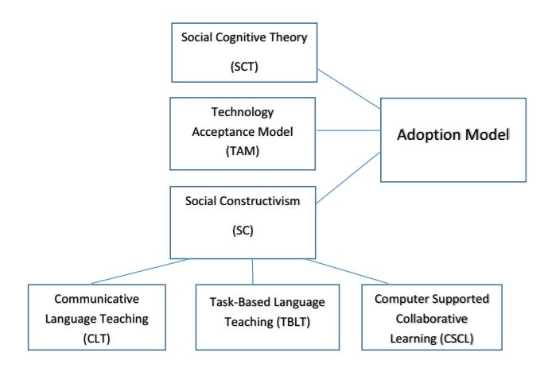

<!-- A3.R50 | source: papers_json/A3.R50/ -->

## **Cambridge Journal of Education**

**ISSN: 0305-764X (Print) 1469-3577 (Online) Journal homepage: ****[www.tandfonline.com/journals/ccje20](https://www.tandfonline.com/journals/ccje20?src=pdf)**

## **By** **nature,** **a** **social** **animal:** **an** **exploration** **of** **perceptions** **of** **online** **group** **work**

**Christopher** **Hill,** **Emad** **Abu-Ayyash** **&** **Tendai** **Charles**

**To** **cite** **this** **article:** Christopher Hill, Emad Abu-Ayyash & Tendai Charles (2023) By nature, a social animal: an exploration of perceptions of online group work, Cambridge Journal of Education, 53:5, 665-681, DOI: [10.1080/0305764X.2023.2206795](https://www.tandfonline.com/action/showCitFormats?doi=10.1080/0305764X.2023.2206795)

**To** **link** **to** **this** **article:** [https://doi.org/10.1080/0305764X.2023.2206795](https://doi.org/10.1080/0305764X.2023.2206795)

Published online: 08 May 2023.Submit your article to this journalArticle views: 308View related articlesView Crossmark dataCiting articles: 6 View citing articles

<!-- page 2 -->

## **By nature, a social animal: an exploration of perceptions of ** **online group work**

Christopher Hill, Emad Abu-Ayyash and Tendai Charles

Faculty of Education, The British University in Dubai, Dubai, United Arab Emirates

## **ABSTRACT**

This research, exploring the value of online group work through postgraduate student perceptions of engagement, surveyed 71 students and interviewed 11, over three rounds of data collection. Participants were taught postgraduate students in a higher education institution education faculty in the United Arab Emirates. The findings are relevant for our understanding of online group work; assessment design; communication; and community building. Research took place over a 12-month period, beginning before COVID-19, in February 2020 with face to face teaching, and ending during the third term of fully online teaching in January 2021. This phenomenological research charts student perception and attitude changes. Social Cognitive Theory, the Technology Acceptance Model and Social Constructivism form the theoretical framework within which participant engagement, behaviour and perception are explored. The findings provide a reflective analysis regarding student perception, engagement and acceptance of online group work as a valid approach to meeting learning outcomes.

## **ARTICLE HISTORY **

Received 22 September 2021 Accepted 10 April 2023

## **KEYWORDS **

Online learning; group work; learning dynamics; student engagement; technology acceptance

## **Introduction**

This paper outlines phenomenological research undertaken at a research intensive university in the United Arab Emirates (UAE), examines using online learning for group work, and analyses how perception, student engagement and acceptance impact the learning experience and outcomes. The understanding of group work here is well discussed in literature and is a social function of interaction, collaboration and teamwork, a means to increase achievement and persistence, and a provider of peer feedback and shared learning (Johnson & Johnson, [2009](#page-17-0); Johnson et al., [2014;](#page-17-1) Lamm et al., [2012](#page-17-2)).

Research took place over a 12-month period, beginning in early 2020, prior to COVID-19, with face-to-face teaching on campus, with elements of blended learning. With the onset of COVID-19, the research was extended to students taking modules fully online, and these results were compared to the original data set, to determine the extent to which necessity and environment had changed expectations and perceptions. A third round of data collection took place in January 2021, when students were in their third term of fully online teaching. The findings are relevant as they speak to student perceptions and activity, as well as the possible ramifications these have for teaching planning,

<!-- page 3 -->

management and delivery. This research is not a commentary on COVID-19 conditions, but the dynamic and environment of teaching and student engagement was significantly impacted as a result of the pandemic, and therefore the research makes a valuable contribution to the literature with its exploration of perception, engagement and interaction.

## *Technology in teaching*

COVID-19 significantly escalated the debate surrounding the value of online learning and issues of equivalency and quality assurance. This paper examines the role of online group work as both an extension of face-to-face group work, and a means by which the use of technology can both facilitate and hamper student activity and engagement. The paper seeks less to examine the nature of technology itself, but rather its application, and that we should consider and 'recognise the difficulties that universities and students face in making "good" use of digital technologies'. (Henderson et al., [2017,](#page-16-0) p. 1568). The primary platform used throughout this study was Blackboard, in use at the university prior to the pandemic and the formal platform throughout. The platform has functionality to support online group work, with breakout rooms and chat functions, in addition to the ability to create bespoke online sessions. All online classes were conducted using this platform and students and teachers alike were provided with access to training sessions to increase their capabilities and levels of engagement. Uptake for these training sessions was relatively low.

## *Research aims*

The aim was to examine the value of online group work and identify key lessons for implementation, through exploration of student perceptions of engagement. The research used a comparative cohort approach to examine changes in student perception of the use and value of online group work. The core question underpinning this research was 'to what extent does online group work provide a valuable learning environment for student engagement?' To address this, students were asked to compare their experiences of group work face-to-face and fully online. The research question above was underpinned by sub-questions, 'what factors of online group work promote student activity and work completion' and 'what factors of online group work hinder student activity and work completion'?

## **Literature review**

## *Theoretical framework*

This paper incorporates the Technology Acceptance Model (TAM) and Group Behaviorism, to understand the nature of interaction and the manner in which this impacts learning activity online. This research situates its analysis within an explanatory framework of TAM and Social Cognitive Theory (SCT). The framework posits that how people act and interact depends on environment, personal experience and perceived value of the approach/technology they are using. This is directly relevant to the research

<!-- page 4 -->

at hand where the environment and form of interaction changed significantly as a result of external factors.

## *Developing a conceptual framework*

TAM highlights the perceived usefulness (PU) and perceived ease of use (PEU) of technology, as key elements to its ultimate acceptance and adoption by stakeholders (Davis, [1989](#page-16-1)). TAM posits that using technology will improve performance and reduce time needed to complete exercises. It is important to consider, from the SCT perspective, the context and environment within which any such use of technology is undertaken, as variables such as culture, environment and access are relevant. This paper explores student responses over time (pre and during pandemic) and under dramatically different environmental conditions – face to face and pandemic lockdown. Social Constructivism (SC) stresses the role of social interaction in learning, which is one of the main tenets of group work in all its forms (Richards & Rodgers, [2001](#page-17-3)). As a learning theory, SC links well to three compatible pedagogies that emphasise the importance of collaborative interaction, which are Communicative Language Teaching (CLT), Task-Based Language Teaching (TBLT) and Computer Supported Collaborative Learning (CSCL), as these approaches emphasise the role of the teacher as facilitator who encourages the learners to construct meaning through genuine interaction with other students (Brown, [2007b](#page-16-2)). CSCL is a process whereby groups of students (usually limited in number) work together in order to solve a loosely defined problem or complete an assessed piece of work (Johnson et al., [2000](#page-17-4)). The group works together, through a process of negotiation and collaboration to achieve the common objective. As per the Community of Inquiry (CoI) framework, this interaction involves the interrelation of teaching presence, cognitive presence and social presence (Garrison et al., [2000](#page-16-3)). There is a considered need for this process to be underpinned by a social presence, namely through personal recognition and group interaction and engagement (Garrison et al., [2010](#page-16-4)).

Given this emphasis, the notion of collaborative learning, whereby peer-to-peer learning fosters deeper thinking, advocated in this study is the one suggested by the interactive hypothesis. This suggests that interactive communication is a key factor in the learning process and that contexts for interaction should be carefully designed in order to create optimal environments for learners to be stimulated to construct their knowledge (Brown, [2007a)](#page-16-5). SCT incorporates three main factors – behaviour, personal and environment – to explain and predict group and individual behaviour (Middleton et al.,[ 2018](#page-17-5)). In SCT, behavioural outcomes are linked to usage, performance and adoption. The perceived value and usefulness of online learning must be examined through the lens of SCT and human engagement and interaction. In essence, the extent to which a community of action and interaction can be replicated and developed through online access only. Openness to experience resulted in individual preference for virtual team engagement over face-to-face teams. (Luse et al.,[ 2013](#page-17-6)). This is relevant given the climate within which this research took place. The desire for social interaction, in whatever format available as a direct response to the COVID-19 lockdown and absence of mobility and physical social engagement, increased the openness of students and raised levels of satisfaction and engagement with online learning. As the environmental factors shift, so does the response and level of engagement/acceptance by the student.

<!-- page 5 -->

## *Group work*

Online learning has been defined as 'learning experiences in synchronous or asynchronous environments using different devices (e.g. mobile phones, laptops, etc.) with internet access. In these environments, students can be anywhere (independent) to learn and interact with instructors and other students' (Singh & Thurman, [2019,](#page-17-7) p. 302). The lack of research on how groups work online (Lowes, [2014)](#page-17-8) is further evident by the abundance of the research available for face-to-face group work and for online group chat and engagement (Oliveira et al., [2011](#page-17-9)). Research identifies several pivotal issues, such as the time individual members assign to contribute to team activity (Cummings & Haas, [2012)](#page-16-6) and the experience of working together and degree of familiarity.

The CoI framework can be understood as a 'learning presence' (Shea & Bidjerano, [2010](#page-17-10)) and it 'refers to learner self-efficacy as well as self- and co-regulation, focusing on the active roles of students in terms of metacognitive, motivational, and behavioural traits'. (Popescu & Badea, [2020](#page-17-11), p. 61). The nature of interaction is key as 'affiliation, fellowship and welfare might be of equal importance as academic knowledge, or they may even be prerequisites for learning' (Hammar Chiriac, [2014,](#page-16-7) p. 2). Group work is a function of social interaction and the period in which this research took place highlights the issue of social interaction as a prerequisite for learning; communication, coordination and knowledge sharing are critical for team success and engagement (Gilson et al.,[ 2014](#page-16-8)). Over the course of this research, the landscape of teaching shifted dramatically and this makes the findings interesting, as we are able to ground the perceptions and measure them against change, by comparing them to a pre-COVID-19 environment. As Aristotle stated in *Politics*, 'man is by nature a social animal' [(1981](#page-16-9)). What has become evident, as a result of COVID-19, and is highlighted in the findings of this research and the use of SCT, is the shifting perception of social interaction and the impact this has upon pedagogy, student engagement and learning outcomes.

The desire for interaction does not necessarily correlate to actual interaction, however, as 'regardless of a CSCL environment . . . researchers and teachers both find that the expected social interaction often does not occur' (Kreijns et al.,[ 2013](#page-17-12), p. 2). This may well be driven by our assumptions about basic social interaction and engagement, namely that 'learners, for example, trust one another in the team to do what has been agreed upon, know one another's weak and strong points and make use of them, share similar norms for working and goals of the teamwork' (Kirschner & Erkens, [2013,](#page-17-13) p. 2). This reality may well evolve over time, but this level of trust is not always, if rarely, present from the onset of group work and collaborative engagement.

'It is important to note that the overall online learning experience for students is also composed of non-teaching factors which we briefly mention. Three such factors are (1) convenience, (2) learner characteristics and readiness, and (3) antecedent conditions that may foster teaching quality but are not directly responsible for it' (Van Wart et al., [2020,](#page-17-14) p. 2). 'Many differences exist between group work in an asynchronous online environment and group work in traditional face-to-face environments' (Lowes, [2014,](#page-17-8) p. 2). While the nature of the asynchronous environment enables ease of access over a time period, rather than constrained within a single session, the lack of sense of community can have

<!-- page 6 -->

a negative impact on work completion and learning outcomes. The platform, structure and guidelines help to set the framework, but an absence of interaction will ensure a failed outcome.

'The presence of technology without sufficient structure or limitation from the teacher was problematic' (Harper, [2018,](#page-16-10) p. 220). Technology without guidance, buy-in or understanding of expectations is insufficient for the acceptance or adoption phase to be achieved. Literature highlights the need to establish a community and process for interaction, based upon face-to-face social norms, and driven by outcomes and expectations. 'Among strangers who do not share a common past and are unfamiliar with each other's personalities, there is no shared context. Hence electronic communication can be expected to be impersonal and task-focused' (Jarvenpaa et al., [1998](#page-17-15), p. 32). The approach cannot simply rely on technology to solve the issue when it is not adequately designed to do so; therefore, 'there is a need to create effective social collaboration and networking between members as computer-mediated learning will not automatically lead to effective collaboration' (Moule, [2007,](#page-17-16) p. 46). The literature draws upon studies published in peer reviewed journals (Harper, [2018)](#page-16-10), systematic literature reviews (Shea & Bidjerano, [2010;](#page-17-10) Singh & Thurman,[ 2019](#page-17-7); Van Wart et al., [2020)](#page-17-14) and case studies from the USA (Hammar Chiriac, [2014](#page-16-7)) and Europe (Oliveira et al.,[ 2011](#page-17-9)). There is very little that directly refers to online engagement in group work in the context of the UAE. From this perspective, this paper offers a genuine contribution to literature.

## **Methodology**

## *Background*

The research adopted a mixed-methods approach (Creswell, [2012](#page-16-11)) using a survey including closed and open-ended questions, followed by interviews with selected participants, in order to gain a more in-depth understanding of perception and engagement. Interviews took place in person for Group 1, the first cohort group one, and remotely for Groups 2 and 3.

## *Participants*

Participants were all postgraduate students at a research-intensive UAE university. Research was conducted during the 2019/20 and 2020/21 academic years, where online group activity was embedded within this process. All participants were fully informed of the research project and its objectives and were given the opportunity to withdraw at any point. The study complied with institutional ethics, and anonymity was guaranteed. The study involved a total of 71 students, 28 in the first round of data collection during face-to -face teaching, 20 in the second round, and a further 23 in the final round ([Table 1](#page-6-0)). Rounds 2 and 3 were during fully online teaching. The initial group of 28 students (Group 1) were conveniently sampled and were members of a postgraduate class on education and technology, taught by the researcher. The base line of participants in the class was valuable as there was prior knowledge, and in some cases engagement, with the use of technology in teaching, as the students were taking an ICT course. Group 2 was the first iteration of fully online pandemic teaching and, so, new to the concept. Group 3

<!-- page 7 -->

were in the third term of online teaching and so had had increased exposure to the medium of delivery.

Students were given clear instructions on the expectations and outcomes of the online group work, but no details regarding group management; task allocation; time management; and interaction. Groups were assigned in class and contact details exchanged. The only stipulation given was that groups could not meet in person and all engagement had to be online. Blackboard was provided as an option for use during the activity, but not mandated. The task was for groups to work together in order to produce a 20-minute presentation – for delivery in the next scheduled face-to-face class. Resources were provided in terms of recommended reading and multi-media files. The assignment was non-graded and did not count towards their final module grade, which is graded with two components – a seminar report and presentation; and a final research paper. The use of non-graded tasks is common throughout the module and used for skill development and to encourage student engagement and independent learning. As a result, all students in class participated in the exercise. This is relevant as it indicates a willingness, on the part of the students, to engage rather than through forced expectations.

Group 2's 20 students were taught by the same academic as Group 1 and were part of the same cohort of students. These students were conveniently sampled and taught fully online using Blackboard. The curriculum and assessment methods remained constant but all teaching and learning, including student group work, was conducted fully online. The aim was, therefore, to review any possible changes in attitude, or levels of engagement, as a result of the changes in context. The second cohort of 23 students (Group 3) were made up of new students in the second term of the academic year. These students were new to the university and, in most cases, did not know each other prior to teaching beginning. There was also the additional issue of lack of direct connection to the teacher in subsequent groups. Group 1 had been taught in person on campus but Groups 2 and 3 were taught entirely online and, in almost all instances, with student cameras off, thus creating a very different dynamic between both student and student and student and teacher. The issue of cameras was a perennial one throughout the online teaching period. While it was, in essence, mandatory for all cameras to be on during teaching, the practice by students was to keep them off. This raised debate regarding issues of access, culture, privacy and control and is highlighted here, not to enter into the full discussion, but to indicate a further factor impacting possible interaction.

## *Instrumentation*

A five-part survey was administered to enable student reflection. The survey recorded a 100% return rate and this can be attributed to the fact that it was administered as part of

<!-- page 8 -->

a class structure, but there were no rewards or penalties introduced for completion or non-completion. The survey drew upon Belbin's [(1981](#page-16-12)) team role inventory analysis and an understanding of TAM. Section 1 examined the direct comparison between online and face-to-face group work. Section 2 dealt with specific challenges and opportunities associated with working online for group work. Section 3 looked at how participants worked within the group and how they individually, and collectively, managed time, workload and interaction. Section 4 gauged overall opinion on the value and relevance of online group work. Section 5 was an open ended question section where participants were encouraged to add any further comments on online group work.

## *Interviews*

Interviews, using open ended questions to elicit a narrative and lived experience, were conducted with students from each group. Interviews were recorded and responses were transcribed. Each interview took between 20 and 30 minutes. Given the dataset, the number of interviews was limited and the students responded to requests for interviews. This represents a form of potential bias as the participants were self-selected. There were three students interviewed in Groups 1 and 2, and 5 in Group 3, for a total of 11 interviews. The interviews took place in person on campus for Group 1 and remotely for Groups 2 and 3. The change in interview protocol was due to pandemic conditions but all ethical procedures were maintained throughout. Students were recruited through convenience sampling and assured that all data would remain anonymous and stored following university research guidelines. Students had been assigned a letter reference point to further protect their anonymity. Students were made fully aware of their right to withdraw from the research project at any point.

## **Analysis**

Data provides an in-depth review of changing student patterns of behaviour and engagement. The combination of quantitative data – to establish statistical baselines and attitudes – and qualitative data – to provide a narrative and individual responses – enables analysis as to the extent to which online learning provides a valuable learning environment for student engagement, and what factors support or hinder the completion of group work. The paper's thematic approach provides a review of the time period in question and subsequent attitudinal changes. By taking into account the external factors, and aligning the data collected to the theoretical framework of personal engagement, technology acceptance and behavioural conditions, this paper provides meaningful intelligence on the manner by which online group work can support student engagement and learning.

The findings presented in this section were recorded using a standard Likert scale approach. The survey was administered to three groups of participants, during face-to-face teaching (Group 1) and during fully online teaching (Groups 2 and 3). The cohorts represent both pre- and during pandemic engagement and the results, fully underpinned by the theoretical framework above, demonstrate how attitudes and perceptions altered over time and as a result of circumstance and external factors. These factors include familiarity with technology; social patterns of working fully online in groups; the pandemic lock-down and its impact on the need for social interaction; and task based approaches to learning. These

<!-- page 9 -->

***Figure 1. **Theoretical Framework. Adapted by authors from Taherdoost [(2018](#page-17-17)).*

factors are linked to the theoretical framework [(Figure 1)](#page-8-0) and are discussed below in the context of attempting to understand how individuals approach group work; how their patterns of behaviour change over time as a result of environment and use of technology; and the extent to which online learning can provide a valuable learning experience for student engagement. The extracts presented below are included due to their relevance to the questions posed and as a demonstration of the changing behaviour patterns over the three groups. The themes below, emerged inductively from the quantitative and qualitative data, through specific observations of the dataset in question. The data were examined across the three groups, to identify any patterns and explored in relation to the underlying theoretical framework in [Figure 1.](#page-8-0)

## **Findings**

**Research Question**: to what extent does online group work provide a valuable learning environment for student engagement?

**Sub Questions**: what factors of online group work promote student activity and work completion; what factors of online group work hinder student activity and work completion?

## **Theme 1: Comparison between online and face-to-face group work**

When asked about the extent to which online group work [(Table 2](#page-9-0)) contributed to effective communication compared to face-to-face teaching, 43% of Group 1 rated online group work as equally or somewhat more effective. For Group 2, this number had increased to 60%. Group 3 mirrored the first with 43%. The platform remained constant for all cohorts during data collection.

When we were doing our group work we used WhatsApp and was straightforward as everybody knew their role. Not the most ideal, as is good to meet face to face. We assigned work load and then it got done. (Group 1 Student A)

<!-- page 10 -->

***Table 2. **Online group work contribution to effective communication compared to face to face.*

Q.1 Online group work contribution to effective communication compared to face-to-face

| Group | Much less effective | Somewhat less effective | Equally effective | Somewhat more effective | Much more effective |
| --- | --- | --- | --- | --- | --- |
| First |  | 57% | 36% | 7% |  |
| Second | 10% | 20% | 20% | 40% | 10% |
| Third | 9% | 43% | 30% | 13% | 4% |

I strongly recommend the online group work. It is very effective way of learning and student's individual response can also be seen in the recordings. (Group 3 Student A)

The initial shift in response can be attributed to tangible use over perceived value of technology itself. Student interview responses above further support the data reported.

In terms of developing a sense of community ([Table 3](#page-9-1)), 57% of Group 1 believed online group work to be much less, or somewhat less, effective compared to face-to-face teaching. For Group 2, this number was 30% and for Group 3 it was 74%. During face-toface teaching, online learning was seen as less than; Group 2 were in online groups by necessity but by Group 3, there was a reasoned understanding of the value of online groups.

Maybe one of the difficulties I feel about the online group is that I never met the people who are on the course face to face before. (Group 2 Student A)

Although I know how group activity is effective by all the means but sometimes I feel shy to participate in groups. (Group 3 Student B)

Interview responses discussed the issue of community as a key factor to acceptance and outputs. This is a significant shift and demonstrates a change in attitude due to exposure and engagement with online learning and an acceptance of the approach as relevant.

When asked about convenience of access ([Table 4](#page-10-0)), 64% of Group 1 responded that online group work was somewhat more, or much more effective in convenience of access than face to face.Twenty-one percent stated it was equally effective. Group 2 responded with 50% for somewhat more or much more effective, but the equally effective response was almost double, at 40%. We can extrapolate from this that the 'new normal' under COVID-19 impacted both the means of communication and individual response to it. Group 3 had a similar response to Group 2 for equally effective (39%) but a lower response overall with 31% for somewhat more or much more effective.

When asked whether online group work promoted interaction and participation ([Table 5)](#page-10-1) compared to face to face, Group 1 had a mixed response. Sixty-four percent

<!-- page 11 -->

| Group | Much less effective | Somewhat less effective | Equally effective | Somewhat more effective | Much more effective |
| --- | --- | --- | --- | --- | --- |
| First | 14% |  | 21% | 50% | 14% |
| Second |  | 10% | 40% | 40% | 10% |
| Third | 4% | 22% | 39% | 22% | 9% |

believed it to be somewhat less, or much less effective, and only 14% believed it to be somewhat more, or much more effective. Group 2 viewed it in a much more positive manner, with 30% believing it to be somewhat less, or much less effective and 70% seeing it as equally, or somewhat more effective. This reversal of opinion is evidence of acceptance and engagement over time and use. Group 3 continued this trend with 34% somewhat less or much less effective, and 61% seeing it as equally or somewhat more effective.

Online group work plays a major role during my Masters journey. I learned a lot from my colleagues' opinions, skills, performance and discussions. Sharing ideas with online group is the key to effective learning. (Group 3 Student C)

When asked whether online group work contributed to meeting individual learning needs ([Table 6)](#page-10-2), 71% of Group 1 believed it to be equally or somewhat more effective than face to face. Group 2 responded 60% over the same categories, but also registered 10% responding that online group work was much more effective in this regard. Group 3 responded 47% for equally or somewhat more effective, and 4% much more effective. The number of responses believing online work to be somewhat less effective in this area were 28%, 30% and 35% respectively, and so the difference can perhaps be attributed to the understanding of how effective online work can be when engaged with properly.

The responses regarding types of group work engagement are interesting and perhaps more indicative of the situation than the technology, particularly when compared against data from other questions ([Table 7)](#page-11-0). Group 1 responded 100% to

|  |  |  |  | Q. 5 Online group work contribution to meeting individual learning needs compared to face to face |  |
| --- | --- | --- | --- | --- | --- |
| Group | Much less effective | Somewhat less effective | Equally effective | Somewhat more effective | Much more effective |
| First |  | 28% | 14% | 57% |  |
| Second |  | 30% | 20% | 40% | 10% |
| Third | 13% | 35% | 30% | 17% | 4% |

<!-- page 12 -->

| Q. 8 Overall, I am happy with my level of participation during online group work |  |  |  |  |
| --- | --- | --- | --- | --- |
| Group Yes No Would have liked to participate more Would have liked to participate less |  |  |  |  |
| First | 64% |  | 28% | 8% |
| Second | 50% |  | 40% | 10% |
| Third | 52% |  | 48% |  |

their desire for a combination of online and face-to-face group work. Group 2 offered a much more balanced response with 20% opting for purely face to face, 20% for purely online and 60% for a combination. Group 3 responded 35% face to face, 17% online only and 48% for a combination. The fact that 20% and 17% of Groups 1 and 2 respectively were in favour of purely online can be seen as a reflection of engagement and understanding. The fact that 35% and 20% respectively were in favour of purely face to face can be seen as a reflection of circumstance and a desire to return to the social norm of face-to-face engagement.

When asked about general levels of satisfaction regarding their participation in online group work ([Table 8)](#page-11-1), 64% of Group 1 responded yes and 28% would have liked to participate more. In Group 2, 50% responded yes and 40% would have liked to participate more. In Group 3, 52% responded yes and 48% would have liked to participate more. This can be seen as an indication of technology acceptance and a greater understanding of associated capabilities.

## **Sub questions 1 and 2**

## *Theme 2: challenges and opportunities of online group work*

When asked which factors were important in achieving success in online group work, Group 1 ranked their top three as teamwork, clarity of objectives and accountability ([Table 9)](#page-11-2). The focus had shifted somewhat by Group 2, which listed clarity of objectives, time management and accountability. The introduction of time management would indicate an awareness of engagement and access patterns. This trend continues with Group 3 also placing time management second. The addition of technology comfort levels

<!-- page 13 -->

(Group 3, third top priority) indicates a growing awareness of the role of technology. While accountability remained a key factor, increased levels of engagement and interaction over the period reviewed had established a pattern of understanding that heightened the understanding of requirements, expectations and necessary levels of engagement.

Two comments received in the interviews identify one of the key challenges to online learning. The first comment, from a member of Group 1 (Student C), indicates a natural preference for face to face.

To be honest, I am the kind of person who likes to work face to face because I enjoy learning in that way. I am visual learner, I like to see, interact and observe.

A comment from Group 2 (Student A) demonstrates that, even with acceptance of new approaches, there remains underlying tendencies for a more social approach.

Though we are getting the same learning and instructions that we are supposed to get I still believe that face to face interaction is more effective.

A Group 3 (Student C) continues in this vein with:

feeling less active by studying online individually at home comparing to attending a lecture with my colleagues in Campus.

## **Theme 3: engagement with the online group work process**

This section yielded the most varied results across the three groups, with greater similarity between Groups 1 and 2. The dynamics of group interaction had changed significantly from Groups 1 to 3 with Group 3 assigning work according to activity levels, as opposed to Groups 1 and 2 that sought to build a consensus from the start and clearly outline processes to follow ([Table 10](#page-12-0)). The manner in which students approached work and leadership allocation also changed over time and corresponds to an increased comfort level with the online platform and a reduced need for control and agenda setting within the groups. A respondent (Student D) from Group 2 highlighted the clear role of a leader by commenting:

Online group work needs to be very organized. The group of learners has to be divided based on their abilities, learning style or the given task. Learners are very aware of the objectives and the purpose of the task. A leader of the group has to be determined before starting the group activity. The roles of each group member will help set the responsibility of each group member.

This can be compared with a comment by Student (A) from Group 3:

<!-- page 14 -->

What I liked about the experience was it was very flexible . . . we didn't have to assign one member to collate the work and prepare a single presentation. I could take my time editing without worrying about others waiting for me.

An interesting finding is in the responses to the question looking at frequency of interaction during the online group work. Group 1 responded 71% to meeting whenever necessary, as compared to the more structured approach of Group 2 that responded 40% whenever necessary. Group 3 continued this trend with 56%. Students became more comfortable managing time and interaction as their familiarity with online use increased. This is a further indication of the understanding and awareness of engagement and interaction, and the ability to better manage these accordingly.

## **Theme 4: value and relevance of online group work**

When asked how they measured success in online group work, we can see similar responses across the groups in terms of many of the issues and some significant differences. Where there is a marked difference is in the need for a safe environment for discussion. Responses dropped from 71% in Group 1 to 49% in Group 3. As groups became more familiar with online learning, so too did their levels of comfort with it. We also see a significant change in the attitude to success as measured by completion of task. The responses increased from 57% in Group 1 to 91% in Group 3, once more indicating the increased transactional nature of interaction and focus on completion rather than social interaction.

These results ([Tables 11 and](#page-13-0)[ 12](#page-13-1)) indicate a continued and sustained need for interaction online over the first and second cohort, but as the acceptance of technology became more apparent, the groups shifted their focus and priorities to learning outcomes and became less dependent on group structures and formal meeting arrangements.

What we can see here, along with similar responses in terms of access and time management, is a realisation and acceptance of the platform for interaction and group work. The value of online group work is evident to those who have engaged with it, but it

<!-- page 15 -->

does rest upon key variables such as clarity of role and expectations and the sense of community and engagement shared and experienced by the group itself. The manner of engagement and acceptance of the technology as a means for interaction and work completion changed over time and as a result of contributing factors. This was highlighted by student interview comments.

There wasn't that much engagement between the group members but we could manage individual work really well. Lack of engagement is a failure of online work. (Group 1 Student C)

Sometimes they explain the task wrongly, so it confuses me and my understanding as all of us understand the topic differently and from our perspective or point of view. (Group 3 Student E).

## **Discussion**

Findings demonstrate that learners often struggle to build a working rapport with group members through a fully online medium and to manage their time effectively. These realities are often driven by a lack of communication and coordination of goals and objectives. Once the community has been established, however, the levels of engagement, interaction, accountability and ability to achieve learning outcomes dramatically increases.

The researchers were fully conscious of the purpose of group work to serve as an incentive for learning, and were aware that the simple act of assigning a group does not guarantee group interaction or a successful outcome (Harper, [2018)](#page-16-10). The aim of this research was to capture student reflections regarding their engagement in online group work and explore the nature of their interactions as discussed by Jarvenpaa et al. ([1998](#page-17-15)). As a result, the instructions were explicit in terms of workload and outcomes, but specifically vague in terms of group organisation or time management. This reality led to issues of engagement and frustration on the part of participants.

Our findings demonstrate a clear understanding of the nature of interaction and an acceptance of the absence of alternatives and is linked to the nature of group behaviourism and SCT discussed above (Middleton et al., [2018](#page-17-5)). Levels of trust develop over time and by Groups 2 and 3, there had been both an increase in PEU and value of the platform as well as with the social dynamic of interaction and work allocation online.

Not only did perception of the medium change over time, but so did the fundamental understanding of the nature of interaction (Van Wart et al., [2020)](#page-17-14). The role of group leader changed from Groups 1 and 2 with groups having become more comfortable with assigning a leader from the start or working as a team throughout – with no need for a leader to emerge. This would indicate an increased level of comfort with the medium and a more nuanced understanding of accountability and engagement tactics, and is both a reflection of TAM and of SCT. Seventy-one percent of both cohorts listed in-depth interaction with team members as a key factor for determining the success of online group work. When we compare this to the responses regarding the effectiveness of online group work to encourage communication (43% and 70% respectively), we can see an emerging acceptance of the platform and medium as a successful avenue for group interaction and activity. This acceptance should be further harnessed and embedded

<!-- page 16 -->

within teaching and learning. The value of TAM is evident here as a student's initial approach and their development and change in attitude over time play significant roles in the value of their learning experience. As the sense of community and interaction, made possible by online activity, begins to more readily resemble traditional views of group work, the acceptance of the process will more closely align to the acceptance of the technology itself (Middleton et al., [2018](#page-17-5)). Over time, the implications of SCT become increasingly clear. As the acceptance and familiarity with the environment and level of interaction increases, so does the ability and willingness of the user to engage ([Hammar](#page-16-7) [Chiriac 2014)](#page-16-7). The findings of the paper demonstrate an evolution in the approach of the participants and an acceptance, not just of the technology, but of an understanding of the nature of online group interaction and its ability to meet learning outcomes and expectations, as discussed by Popescu and Badea ([2020)](#page-17-11). This study is of course limited in scope and by the self-selection process of interviewed students. Further research on this topic would look to expand the dataset and compare across modules with compulsory assessment criteria.

## **Conclusion**

Online group work is a valuable tool, but there are key criteria that must be explored to ensure activity supports and enhances the learning experience and expected outcomes. Expectations must be clearly defined and the roles of the group understood. The platform does not need to be flashy, but the system of interaction and access does need to be clear and consistent for group members. This reality responds directly to the core research question and demonstrates that online group work can indeed provide a valuable learning environment for student engagement.

A review of the sub questions identifies the need for practitioners and teachers to set clear objectives to increase the likelihood of interaction. This is underpinned by the initial cohort's assumption that flexibility and freedom of online access would make the task easier to complete. With too much freedom can come too little action. The assumption, from students, was that online group work would be the same as face to face, but they failed to grasp the need to build in clear guidelines about communication, deadlines for activity and completion. The advantages of online work were those largely associated with digital devices, namely ease of access and a flexibility as to when the work could be completed.

Successful group work relies upon a degree of collaboration and engagement and leads to an improvement of individual learning as a result (Hernández-Sellés et al., [2020)](#page-16-13). This all points to the interplay of TAM and SCT and demonstrates the role played by behaviour and environment in the use and acceptance of technology. From a macro perspective, and of direct relevance to institutions, a sense of community needs to be in place. This can be engineered to a certain extent by the teacher, but will also develop organically as students become more readily accepting of online group work. This sense of community, and an understanding of the nature of interaction, will outweigh the need for assessment to be present. As groups become more familiar with online interaction, levels of interaction increase. In this regard, the online approach mirrors the face-to-face one, as well as the predictive element of human nature in this regard. The theoretical framework firmly demonstrates the need for a fundamental understanding of social

<!-- page 17 -->

interaction supported, but not driven by, technology, in the pursuit of increased interaction and collaboration for student online group work. The alignment of personal, behavioural and environmental factors with the dynamics of language, task-based and collaborative learning patterns, are relevant for our understanding of online group work and student preferences.

Further research, from other countries and increased datasets, is recommended to broaden and deepen our understanding of online group work dynamics and their relevance to higher education provision. Research exploring teacher–student dynamics in the online space would further contribute to our understanding of role creation and development. Research should continue to explore student perspectives and perceptions of the use of technology in teaching and learning. The use of technology is continuously evolving and so must our attempts to understand student use and understanding of it.

## **Disclosure statement**

No potential conflict of interest was reported by the authors.

## **References**

Aristotle (350 B.C.E). ([1981)](#page-4-0). *The Politics*. Sinclair Penguin Classics.

Belbin, R. M. ([1981)](#page-7-0). *Management Teams: Why they succeed or fail*. Taylor & Francis.

Brown, H. D. ([2007a](#page-3-0)). *Principles of language learning and teaching*. Pearson Education.

Brown, H. D. [(2007b](#page-3-1)). *Teaching by principles: An interactive approach to language pedagogy*. Pearson Education.

Creswell, J. W. ([2012](#page-5-0)). *Educational research: Planning, conducting, and evaluating quantitative and * *qualitative research*. Pearson Education.

Cummings, J. N., & Haas, M. R. [(2012)](#page-4-1). So many teams, so little time: Time allocation matters in geographically dispersed teams. *Journal of Organizational Behavior*, *33*(3), 316–341. [https://doi.](https://doi.org/10.1002/job.777) [org/10.1002/job.777 ](https://doi.org/10.1002/job.777)

Davis, F. D. [(1989](#page-3-2)). Perceived usefulness, perceived ease of use, and user acceptance of information technology. *MIS Quarterly*, *13*(3), 319–339.

Garrison, D. R., Anderson, T., & Archer, W. ([2000)](#page-3-3). Critical inquiry in a text-based environment: Computer conferencing in higher education. *The Internet and Higher Education*, *2*(2–3), 87–105. [https://doi.org/10.1016/S1096-75160000016-6 ](https://doi.org/10.1016/S1096-75160000016-6)

Garrison, D. R., Cleveland-Innes, M., & Fung, T. S. ([2010)](#page-3-4). Exploring causal relationships among teaching, cognitive and social presence: Student perceptions of the community of inquiry framework. *The Internet and Higher Education*, *13*(1), 31–36.

Gilson, L. L., Maynard, M. T., Yong, N. C. J., Vartiainen, M., & Hakonen, M. ([2014)](#page-4-2). Virtual teams research: 10 years, 10 themes and 10 opportunities. *Journal of Management*, *41*(5), 1313–1337. [https://doi.org/10.1177/0149206314559946 ](https://doi.org/10.1177/0149206314559946)

Hammar Chiriac, E. [(2014](#page-4-3)). Group work as an incentive for learning – students' experiences of group work. *Frontiers in Psychology*, *5*(558), 1–10.

Harper, B. ([2018)](#page-5-1). Technology and teacher-student interactions: A review of empirical research. *Journal of Research on Technology in Education*, *50*(3), 214–225. [https://doi.org/10.1080/](https://doi.org/10.1080/15391523.2018.1450690) [15391523.2018.1450690 ](https://doi.org/10.1080/15391523.2018.1450690)

Henderson, M., Selwyn, N., & Aston, R. [(2017)](#page-2-0). What works and why? Student perceptions of 'useful' digital technology in university teaching and learning. *Studies in Higher Education*, *42 * (8), 1567–1579. [https://doi.org/10.1080/03075079.2015.1007946](https://doi.org/10.1080/03075079.2015.1007946)

Hernández-Sellés, N., Muñoz-Carril, P. C., & González-Sanmamed, M. ([2020](#page-15-0)). Interaction in computer supported collaborative learning: An analysis of the implementation phase.

<!-- page 18 -->

- *International Journal of Educational Technology in Higher Education*, *17*(1), 23. [https://doi.org/](https://doi.org/10.1186/s41239-020-00202-5) [10.1186/s41239-020-00202-5](https://doi.org/10.1186/s41239-020-00202-5)
- Jarvenpaa, S. L., Knoll, K., & Leidner, D. E. [(1998)](#page-5-2). Is anybody out there? Antecedents of trust in global virtual teams. *Journal of Management Information Systems*, *14*(4), 29–64. [https://doi.org/](https://doi.org/10.1080/07421222.1998.11518185) [10.1080/07421222.1998.11518185](https://doi.org/10.1080/07421222.1998.11518185)
- Johnson, D. W., & Johnson, R. T. ([2009)](#page-1-0). An educational psychology success story: Social interdependence theory and cooperative learning. *Educational Researcher*, *38*(5), 365–379. [https://doi.org/10.3102/0013189X09339057 ](https://doi.org/10.3102/0013189X09339057)
- Johnson, D. W., Johnson, R. T., & Smith, K. A. ([2014](#page-1-0)). Cooperative learning: Improving university instruction by basing practice on validated theory. *Journal on Excellence in College Teaching*, *25 * (3–4) , 85–118.
- Johnson, D. W., Johnson, R. T., & Stanne, M. B. [(2000](#page-3-5)). *Cooperative learning methods: A meta**analysis*. University of Minnesota.
- Kirschner, P. A., & Erkens, G. ([2013](#page-4-4)). Toward a framework for CSCL research. *Educational * *Psychologist*, *48*(1), 1–8. [https://doi.org/10.1080/00461520.2012.750227](https://doi.org/10.1080/00461520.2012.750227)
- Kreijns, K., Kirschner, P. A., & Vermeulen, M. [(2013)](#page-4-5). Social aspects of CSCL environments: A research framework. *Educational Psychologist*, *48*(4), 229–242. [https://doi.org/10.1080/](https://doi.org/10.1080/00461520.2012.750225) [00461520.2012.750225](https://doi.org/10.1080/00461520.2012.750225)
- Lamm, A. J., Shoulders, C., Roberts, T. G., Irani, T. A., Snyder, J. L., & Brendemuhl, B. J. [(2012)](#page-1-0). The influence of cognitive diversity on group problem solving strategy. *Journal of Agricultural * *Education*, *53*(1), 18–30. [https://doi.org/10.5032/jae.2012.01018](https://doi.org/10.5032/jae.2012.01018)
- Lowes, S. [(2014)](#page-4-6). How much "group" is there in online group work? *Journal of Asynchronous * *Learning Networks*, *18*(1), 1–14. [https://doi.org/10.24059/olj.v18i1.373 ](https://doi.org/10.24059/olj.v18i1.373)
- Luse, A., McElroy, J. C., Townsend, A. M., & DeMarie, S. ([2013](#page-3-6)). Personality and cognitive style as predictors of preference for working in virtual teams. *Computers in Human Behavior*, *29*(4), 1825–1832. [https://doi.org/10.1016/j.chb.2013.02.007](https://doi.org/10.1016/j.chb.2013.02.007)
- Middleton, L., Hall, H., & Raeside, R. [(2018](#page-3-7)). Applications and applicability of social cognitive theory in information science research. *Journal of Librarianship and Information Science*, *51*(4), 927–937. [https://doi.org/10.1177/0961000618769985](https://doi.org/10.1177/0961000618769985)
- Moule, P. ([2007](#page-5-3)). Challenging the five-stage model for e-learning: A new approach. *Research in * *Learning Technology*, *15*(1), 37–50. [https://doi.org/10.3402/rlt.v15i1.10911](https://doi.org/10.3402/rlt.v15i1.10911)
- Oliveira, I., Tinoca, L., & Pereira, A. [(2011)](#page-4-7). Online group work patterns: how to promote a successful collaboration. *Computers & Education*, *57*(1), 1348–1357. [https://doi.org/10.1016/](https://doi.org/10.1016/j.compedu.2011.01.017) [j.compedu.2011.01.017 ](https://doi.org/10.1016/j.compedu.2011.01.017)
- Popescu, E., & Badea, G. ([2020](#page-4-8)). Exploring a community of inquiry supported by a social media-based learning environment. *Educational Technology & Society*, *23*(2), 61–76.
- Richards, J. C., & Rodgers, T. S. [(2001](#page-3-8)). *Approaches and methods in language teaching*. Cambridge University Press.
- Shea, P., & Bidjerano, T. [(2010](#page-4-9)). Learning presence: Towards a theory of self-efficacy, self-regulation, and the development of a communities of inquiry in online and blended learning environments. *Computers & Education*, *55*(4), 1721–1731. [https://doi.org/10.1016/j.](https://doi.org/10.1016/j.compedu.2010.07.017) [compedu.2010.07.017](https://doi.org/10.1016/j.compedu.2010.07.017)
- Singh, V., & Thurman, A. ([2019)](#page-4-10). How many ways can we define online learning? A systematic literature review of definitions of online learning (1988-2018). *The American Journal of Distance * *Education*, *33*(4), 289–306.[ https://doi.org/10.1080/08923647.2019.1663082](https://doi.org/10.1080/08923647.2019.1663082)
- Taherdoost, H. [(2018](#page-8-1)). A review of technology acceptance and adoption models and theories. *Procedia Manufacturing*, *22*, 960–967. [https://doi.org/10.1016/j.promfg.2018.03.137 ](https://doi.org/10.1016/j.promfg.2018.03.137)
- Van Wart, M., Ni, A., Medina, P., Canelon, J., Kordrostami, M., Zhang, J., & Liu, Y. [(2020)](#page-4-11). Integrating students' perspectives about online learning: A hierarchy of factors. *International * *Journal of Educational Technology in Higher Education*, *17*(53). [https://doi.org/10.1186/s41239-](https://doi.org/10.1186/s41239-020-00229-8) [020-00229-8](https://doi.org/10.1186/s41239-020-00229-8)
