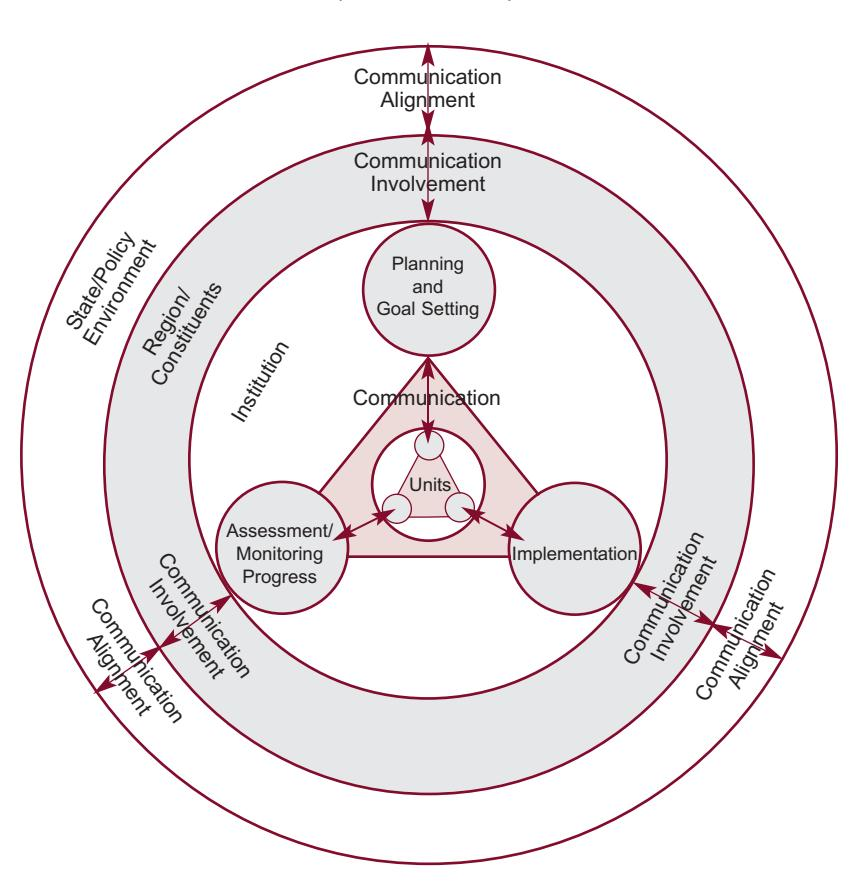
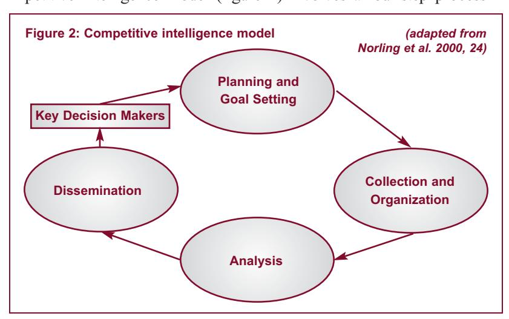

<!-- A3.R51 | source: papers_json/A3.R51/ -->

## Improving Strategic Planning and Implementation in Universities through Competitive Intelligence Tools:

A Means to Gaining Relevance

Stephanie Hughes, Rebecca J. White

## **Abstract **

Institutions of higher education can use competitive intelligence (CI) techniques to become more relevant to their communities. In Stepping Forward as Stewards of Place the American Association of State Colleges and Universities (AASCU) provides a model for public engagement that emphasizes internal strategic planning, implementation, and assessment processes that involve regional communities and are aligned with state and policy environments. Universities can more fully utilize competitive intelligence to improve information collection and strategic planning, which can ultimately yield better decision making by university administrators. This article provides an overview of the steps involved in the competitive intelligence model and demonstrates how state universities can integrate this model with the existing Stewards of Place model to enhance their efforts and gain strategic advantage in public engagement.

## Introduction

convinced that state universities were facing some of the greatest changes in their history, the National Association of State Universities and Land-Grant Colleges sought the help of the W. K. Kellogg Foundation to provide recommendations for the future of U.S. state educational institutions. The collaboration led to the development of the Kellogg Commission on the Future of State and Land-Grant Universities and six reports designed to help state educational institutions develop strategies for the future. In its executive summary report, Returning to our Roots: The Engaged Institution, the Kellogg Commission (2001) articulated the importance of public universities to their communities and called for them to establish a focus on "public engagement." Engagement, as defined by the report, is more than "extension, conventional outreach, and even most conceptions of public service" (13) and will require strategic effort and leadership. In the report, the commission suggests that most criticisms universities receive are based on a perception that they are "out of touch and out of date" (13).

<!-- page 2 -->

In response to this report, the American Association of State Colleges and Universities (AASCU) developed a guide for leading public engagement in state-sponsored educational institutions (AASCU 2002). This guide coined the term stewards of place and presented a model for aligning institutions for effective public engagement. The model identifies three key activities for university leadership: planning and goal setting, implementation, and assessment/monitoring progress (figure 1). These three elements require extensive communication and interaction with all institutional stakeholders. This model clearly argues for a strategic approach to public engagement and is highly dependent upon strategic planning tools and techniques.

*Figure 1: A guide for leading public engagement at state colleges and universities (AASCU 2002, 14)*

<!-- page 3 -->

Strategic planning has been widely discussed in the literature, yet little is known about the factors that lead to successful strategic planning in universities *(Cope 1987; Kotler and Murphy* *1981; Shirley 1988; Mintzberg 1994)*. Recently Dooris, Kelley, and Trainer *(2002) *concluded that although there are many stories of success and failure on the topic, "a convincing, generalizable empirical study on the efficacy of strategic planning in higher education has yet to be published" *(9)*. Strategic planning nonetheless continues to be one of the most important management activities in higher education today *(Welsch and Nunez 2005)*.

The process of strategic planning "requires at least three fundamental activities: discovering institutional strengths and weaknesses, looking to the environment in an attempt to discern potential threats and opportunities, and seeing how the institution can best respond to both" *(Karr and Kelley 1996, 34)*. In other words, strategic planning is a process of realistic evaluation of the organization and its environment and aligning or matching the organization to that environment.

Stewards of Place *(AASCU 2002)* offers lessons from business writers Collins and Porras *(1994)* regarding the need to align all aspects of the organization internally to achieve high levels of performance. This is a classic method that businesses have used to implement their strategic objectives. Using strategic goals and rewards and reinforcements for choices and decisions based in strategy can certainly lead to more effective implementation of strategy in any organization, and higher education can benefit greatly from applying this method.

However, educational institutions who wish to become more relevant to their communities by pursuing a strategic approach to public engagement can do so only if they have access to the highquality, future-oriented information that is necessary for good long-term decision making. Obtaining such information involves identifying bits and pieces of the future that already exist: that is, looking for specific ways that driving forces and trends are already taking hold in the environment. Without such insight, strategic planning and decision making is marginalized, and organizations risk "garbage in, garbage out" errors. This article provides a brief overview of strategic approaches to management in higher education, discusses concepts of competitive intelligence, and offers methods for enhancing strategic efforts to become a more engaged institution through their use.

<!-- page 4 -->

## Strategic Planning in Universities

Strategic planning has been used in higher education for almost fifty years. The first significant formal meeting of higher education planners was held in 1959 on the Massachusetts Institute of Technology campus with an agenda focused on facilities and space planning *(Dooris, Kelley, and Trainer 2002)*. This group continued to have a primary interest in campus physical planning; by 1966 its membership numbered three hundred, and it formed the Society for College and University Planners (SCUP) *(Holmes* *1985)*. By the 1970s the environment for higher education had begun to experience significant demographic, economic, and technological changes that had the potential for great impact on colleges and universities. Higher education costs began to consistently out-

*"[C]hanging envi**ronments have forced* *universities to rein**vent themselves to* *survive, and strategic* *planning tools and* *techniques have been* *widely applied."*

pace inflation, and by the 1980s strategic planning was considered a solution for many of the management challenges facing higher education leaders *(Dooris, Kelley, and* *Trainer 2002)*. Since that time changing environments have forced universities to reinvent themselves to survive, and strategic planning tools and techniques have been widely applied. The literature has frequently included criticisms of strategic planning and debates on its merits as a management tool in higher education *(Dooris, Kelley, and Trainer 2002;* *Rowley, Lujan, and Dolence 1997)*.

As universities have become more proficient at using strategic planning tools and techniques, and the environments more challenging, the perceived value of the process has improved. For example, in 1987 a national study of planning efforts in higher education indicated a strong skepticism among study participants regarding the perceived value of strategic planning in their universities *(Schmidtlein and Milton 1990)*. However, by 1996, attitudes toward the value of strategic planning had become significantly more positive. Participants in a similar study had gained experience in using these tools and techniques, and they realized that the environment was creating dramatic changes in higher education *(Taylor and Schmidtlein 1996)*.

<!-- page 5 -->

Strategic planning in higher education can be a mammoth undertaking. Higher education organizations are typically large and complex. In addition, there is often a great deal of internal competition among self-contained departments who may be more loyal to their discipline than to the university *(Taylor and Knarr 1999)*. Moreover, groups attempting to adapt the traditional strategic planning model to nonprofit and higher education environments find it very difficult to identify the customer base, competitive motivation, relevant timeline, appropriate value and reward system, and a quantifiable set of outcomes *(Lerner 1999; Wagner 2003)*.

The literature reflects a consensus that the use of strategic planning in higher education has produced some successes but alone does not ensure organizational effectiveness *(Dooris, Kelley,* *and Trainer 2002)*. Business leaders have long recognized the value and foundational importance of high-quality future-oriented information to successful strategic decision making; however, few universities have followed suit. We suggest that institutions with strategic goals related to public engagement will benefit from finding ways to capture and assimilate high-quality information for decision making. This goal may be achieved by modifying planning activities to incorporate a powerful set of tools and techniques often collectively referred to as competitive intelligence.

## Competitive Intelligence

Competitive intelligence (CI) activities include a set of legal and ethical processes for gathering, organizing, analyzing, and disseminating information from both internal and external sources to assist organizations in managing risks in their operational environment *(Gilad 2003)*. Due largely to increasing competitive rivalry, CI utilization among for-profit corporations continues to grow at a substantial pace. In a 2004 Society of Competitive Intelligence Professionals (SCIP) survey respondents indicated the level of their companies' annual expenditures on competitive intelligence activities. For 15.3 percent of respondents the amount was over $500,000; for 11 percent, over $1 million. Overall, it is currently estimated that corporations spend in excess of $2 billion annually on competitive intelligence activities *(SCIP 2005)*.

CI utilization in for-profit environments has led to some high-profile wins in recent years. For example, the Texas Instruments CI team uncovered information that suggested a rival was pursuing an acquisition that had enormous profit potential. Armed with this forward-leaning information, Texas Instruments

<!-- page 6 -->

was able to make the acquisition before their rivals, gaining what has now become a $100 million business with significant growth potential *(Lavelle 2001)*. The former CEO of Merck, Clifford Kalb, presented a 2001 case study that indicated that Merck's CI group developed a counterstrategy to a competitor's forthcoming product rollout. Through this strategy Merck saved approximately $200 million; Merck's ultimate savings may go as high as $400 million *(Weber 2002)*. Finally, NutraSweet's CEO indicated that he

believed that the CI function was worth at least $50 million to the company in terms of both increased opportunities and defensive savings *(Bresnahan 1998)*.

Like their for-profit counterparts, nonprofits clearly have embraced strategic planning techniques. However, only a few studies have examined CI use in nonprofits. Bennett *(2003) *investigated organizational members of 134 British charities to ascertain their attitudes and behavior toward the use of competitive intelligence practices. The results of the study suggest that increasing competition was indeed encouraging

*"[T]he external envi**ronment that higher* *education leaders face* *today presses them to* *make their institutions* *more relevant as it* *threatens practically* *every element of a* *university's opera**tional environment."*

nonprofits to employ CI practices in an effort to compete more effectively for charitable donations. However, most cases yielded suboptimal results because the projects did not receive the resources necessary to achieve the best possible results, and the CI techniques used were informal and unsophisticated.

Horne and Parks *(2004)* investigated the application of a CI process in a university environment threatened by increased competition from online degree programs and correspondence courses. Their findings suggest that the incorporation of a CI unit resulted in improved intelligence regarding criteria upon which prospective students base their enrollment decisions and the degree to which the school was currently meeting their needs.

The application of competitive intelligence in higher education environments remains limited to a great extent by a confluence of factors: lack of resources, loosely coupled organizational structures, lack of a for-profit orientation, fears of academic turf wars, general disagreement about what competitive intelligence really

<!-- page 7 -->

## Effective Use of Competitive Intelligence in Higher Education

According to the Stewards of Place model *(AASCU 2002)*, universities who wish to build a core competency in public engagement must practice regular strategic planning, implementation, and assessment and monitoring. Furthermore, to enhance the effectiveness of these processes, universities must involve regional constituents and align engagement efforts with state and policy environments. This involvement and alignment process can be greatly enhanced by applying CI processes to improve both the volume and quality of information flowing into the planning process. The traditional competitive intelligence model (figure 2) involves a four-step process

<!-- page 8 -->

which includes planning and goal setting, collecting and organizing incoming information, analysis, and dissemination of intelligence back to organizational members *(Norling et al. 2000)*.

*"[U]niversities need to* *develop a CI function* *that helps populate each* *stage with relevant,* *high-quality information* *from diverse sources* *across the organizational* *landscape and its* *boundary-spanning* *external relationships."*

According to the Stewards of Place model, universities must engage in two-way communication throughout the planning, implementation, and evaluation process, but there is little attention to issues such as message facilitation and topics. In order to create the greatest potential value from these processes, universities need to develop a CI function that helps populate each stage with relevant, high-quality information from diverse sources across the organizational landscape and its boundary-spanning external relationships. Ultimately, for max-

imum effectiveness, this involves formalizing the CI function into a CI unit within the university.

*Planning and goal setting: *The first step in the intelligence model involves identifying the key intelligence topics (KITs) or goals of the intended research effort. To facilitate the identification of distinctive internal resources that set the university apart from its competitors in the marketplace, the CI unit collects information from as many members of the organization's internal and external constituency as possible. The university's own staff, faculty, and administrators are often the best place to begin this process since they carry a wealth of information about the university's internal and external environments. In most for-profit environments, key intelligence topic development begins and ends with the internal client. However, given the public mission of the university, solicitation of similar information from key stakeholders in the external environment is critical to a comprehensive quality-driven planning effort.

Decision makers may find it useful to hire experienced CI specialists to facilitate this outward solicitation. It is important to tap into all available potential sources of information to ensure that the university remains cognizant of the needs of all its constituents

<!-- page 9 -->

rather than relying solely on organizational members, who often can be biased in one direction or another *(Wagner 2003)*. CI specialists can objectively identify and solicit feedback from external constituents, including such diverse entities as legislators, community groups, local corporate executives, education industry lobbyists, university suppliers, and current and potential students.

*Collection and organization: *Step 2 involves targeting additional key information sources, then collecting and organizing all incoming information. This stage involves reviewing secondary sources such as newspapers, magazines, trade journals, industry presentations, competitors' marketing materials, press releases, and relevant government filings to obtain valuable contextual knowledge as well as names of potential primary source contacts. Primary source contacts can then be used to follow up in an effort to fill in the information gaps and confirm the validity of the information uncovered through secondary source collection. Each of these sources represents potentially valuable, yet often underutilized, avenues for obtaining knowledge about a university's operational environment.

The process of capturing all of this information and turning it into a codified asset has given rise to the term knowledge management. Knowledge management is defined "as a concept, a way of doing business, under which information is turned into actionable knowledge and made available effortlessly in a usable form to decision makers and other users" *(Nakra 2000)*. In many organizations, the competitive intelligence unit is tasked with figuring out the best way to capture and codify information that may ultimately be used to improve the performance of the company. Today, technology helps facilitate this process so that organizations can respond effectively and quickly to changing environmental circumstances.

*Analysis: *Merely providing the technological tools to collect this information is not enough to create a functional and effective CI process. Analysis involves the utilization of various scientific and nonscientific techniques to generate insights or inferences from the information collected *(Fleisher and Bensoussan 2003)*. The analysis step reduces the number of input variables, allowing more time for decision making as opposed to fact absorption; provides connections among seemingly unrelated data and information; provides a context by relating information to the organizational mission, objectives, and strategy; and creates a working

<!-- page 10 -->

hypothesis by making a story out of disparate environmental information *(Langley 1995)*. It is nearly impossible for administrators to perform this function in addition to their other responsibilities. Optimal performance of step 3 requires the establishment of a dedicated CI unit tasked with analyzing this information and turning it into actionable intelligence.

Given that Herring *(1998)* identified the analysis function as the brain of the CI process, it is critical that universities staff this function with individuals who have the requisite skill sets and contextual experience to turn information into intelligence that enables the organization to manage its operational environment. While innate reasoning skills are critical in an effective analyst, there is an equal need to develop better analysts through education and training *(Fleisher and Bensoussan 2003)*. Gilad *(1998) *argued that good analysis goes beyond the obvious fact-based assessment techniques and crosses to the category of insight: the ability to synthesize disparate data to yield novel understanding and additional dimensions. The ideal analyst transcends fact-based knowledge about an industry to achieve a true understanding of competitors' motives, thinking, blind spots, and psychological and economic constraints *(Gilad 1998)*.

Insight can typically be developed through frontline experience in dealing with industry issues and competitors over time. Additionally, standard and well-tested techniques for transforming fact-based information into intelligence include environmental trend analysis to evaluate the impact of changes in the environment, Porter's five forces model to evaluate industry attractiveness, the BCG matrix to evaluate service offering mixes, SWOT analysis to align internal strengths and weaknesses with market opportunities and threats, and the McKinsey/GE matrix to align organizational capabilities with market attractiveness. Each of these techniques requires a significant amount of high-quality internal and external information *(Wagner 2003)*, as well as unique insight gleaned from experience. Without adequate information and insight, the analysis function will produce "garbage out," no matter how experienced and capable the analyst.

*Dissemination: *Step 4 involves dissemination of the information back to key decision makers within the university to facilitate better operational activity. Given that the only constant in organizations is change, the competitive intelligence function must be an ongoing activity providing continuous intelligence on how

<!-- page 11 -->

change is impacting both the organization and its environment. Thus step 4 is really a two-stage continuous process of intelligence delivery and feedback. Information becomes intelligence when the right person receives the right information and ultimately incorporates it into decision-making processes *(Mockus* *2001)*. Since effective analysis resides largely in the analyst's insight, face-to-face communication with the end user is the most effective form of dissemination of intelligence. Active dialogue and debate can reveal the insights that influenced the analysis and can facilitate incorporation of intelligence into the decision-making process *(Lewis 2003)*.

*"Information becomes* *intelligence when the* *right person receives* *the right information* *and ultimately incorpo**rates it into decision**making processes."*

Although the ability to foster these face-to-face collaborations ultimately depends on the credibility of the CI analyst, it can often be influenced by the actual physical location of the CI unit. A CI unit colocated with the end user of the intelligence can gain an increased understanding of the decision maker's priorities as well as insights surrounding the organizational unit *(Lewis 2003)*. Disadvantages of colocation include the increased expense of staffing the

various units, the isolated nature of the CI unit activities, and the possible operational redundancy of multiple CI units performing similar tasks.

Despite the conglomerate-like nature of many university environments, resource constraints suggest that a single CI unit, closely positioned among senior university administrators, may be the most economically feasible and operationally effective. This positioning can also ensure that the CI unit has the visibility and the credibility to maintain face-to-face interaction with key administration officials, facilitating dialogue and debate and ensuring a key role in the organization's decision-making process.

## Conclusion

State-sponsored universities have been called to become engaged in meaningful ways with their communities and environments. Higher education institutions who wish to build core competencies in public engagement and who seek to become

<!-- page 12 -->

more relevant to their communities have significant challenges associated with the need to communicate, capture, organize, and apply vast amounts of information. These institutions may find essential assistance from tools and techniques commonly known in for-profit organizational circles as competitive intelligence. This category of tools, techniques, and processes represents a virtually untapped opportunity for state-sponsored organizations to become more effective in their strategic planning, implementation, and assessment processes. CI offers a cost-effective model for capturing, assimilating, and analyzing information from relevant environments and can be applied directly to public engagement models such as the Stewards of Place model developed by AASCU *(2002)*. In fact, learning about and applying these tools may yield significant advantages for institutions of higher education.

## References

- American Association of State Colleges and Universities Task Force on Public Engagement (AASCU). 2002. *Stepping forward as stewards of* *place: A guide for leading public engagement at state colleges and uni**versities*. Washington, D.C.: American Association of State Colleges and Universities.
- Bennett, R. 2003. Competitor analysis practices of British charities. *Marketing Intelligence & Planning 21*(6): 335–45.
- Bresnahan, J. 1998. Legal espionage. CIO Enterprise. http://www.cio.com/ archive/enterprise/071598_ci.html (July 15).
- Cope, R. G. 1987. Opportunity from strength: Strategic planning clarified with case examples. *ASHE-ERIC Higher Education Report* no. 8. Washington, D.C.: American Association for Higher Education.
- Collins, J. C., and J. I. Porras. 1994. *Built to last*. New York: HarperCollins.
- Dooris, M. J., J. M. Kelley, and J. F. Trainer. 2002. Strategic planning in higher education. *New Directions in Higher Education 116*: 5–11.
- Fine, S. H. 1987. Social and non-profit marketing: Some trends and issues. In *Advances in nonprofit marketing*, vol. 2, edited by R. W. Belk, 71–98. Greenwich, Conn.: JAI Press
- Fleisher, C. S., and B. Bensoussan. 2003. Why is analysis performed so poorly and what can be done to improve it? In *Controversies in com**petitive intelligence: The enduring issues*, edited by Craig S. Fleisher and David L. Blenkhorn, 110–22. Westport, Conn.: Praeger.
- Giguere, D. 1999. Enrollment management, meet competitive intelligence. *New England Board of Higher Education* (summer): 24–26.
- Gilad, B. 1998. What is intelligence analysis? Part 2. *Competitive* *Intelligence Magazine* (October–December): 29–31.
- Gilad, B. 2003. CI education Harvard style. *Competitive Intelligence* *Magazine 6*(4): 12–16.
- Herring, J. 1998. What is intelligence analysis? *Competitive Intelligence* *Magazine* (July–September): 13–16.

<!-- page 13 -->

- Holmes, J. 1985. *20/20 planning*. Ann Arbor, Mich.: Society for College and University Planning.
- Horne, M., and T. Parks. 2004. Implementing competitive intelligence in a non-profit environment. *Competitive Intelligence Magazine 7*(1): 33–36.
- Karr, S. M., and R. V. Kelley. 1996. Attracting new sources of research funding. In *Strategies for promoting excellence in a time of scarce* *resources*, edited by D. W. Breneman and A. L. Taylor, 33–43. New directions in higher education 94. San Francisco: Jossey-Bass.
- Kellogg Commission on the Future of State and Land-Grant Universities. 2001. *Returning to our roots: The engaged institution*. Washington, D.C.: National Association of State Universities and Land-Grant Colleges.
- Kotler, P., and P. E. Murphy. 1981. Strategic planning for higher education. *Journal of Higher Education 52*: 470–89.
- Langley, A. 1995. Between paralysis by analysis and extinction by instinct. *Sloan Management Review 36*(3): 63–76.
- Lavelle, L. 2001. The case of the corporate spy. *Business Week 3759* (November 25): 56–57.
- Lerner, A. L. 1999. A strategic planning primer for higher education. College of Business Administration and Economics, California State University, Northridge. http://www.des.calstate.edu/strategic.html. (July).
- Lewis, D. 2003. Rules of engagement: An essential prerequisite for delivering intelligence. *Competitive Intelligence Magazine 6*(5): 15–19.
- Mintzberg, H. 1994. *The rise and fall of strategic planning*. New York: Free Press.
- Mockus, D. S. 2001. Avoid the intelligence disconnect. *Competitive* *Intelligence Magazine 4*(6): 9–12.
- Nakra, P. 2000. Knowledge management: The magic is in the culture. *Competitive Intelligence Review 11*(2): 53–60.
- Norling, P. M., J. P. Herring, W. A. Rosenkrans, Jr., M. Stellpflug, and S. B. Kaufman. 2000. Putting competitive technology intelligence to work. *Research Technology Management 43*(5): 23–28.
- Rowley, D. J., H. D. Lujan, and M. G. Dolence. 1997. *Strategic change in* *colleges and universities*. San Francisco, Calif.: Jossey-Bass.
- Schmidtlein, F., and T. Milton. 1990. Review of literature on higher education planning. Unpublished manuscript, National Center for Postsecondary Governance and Finance, University of Maryland, College Park.
- Shirley, R. C. 1988. Strategic planning: An overview. In *Successful strate**gic planning: Case studies*, edited by D. W. Steeples, 5–14. New directions for higher education. San Francisco: Jossey-Bass.
- Society of Competitive Intelligence Professionals (SCIP). 2005. How large is the competitive intelligence market? http://www.scip.org/2_faq.php.
- Taylor, A. L., and S. Knarr. 1999. Strategic planning approaches used to respond to issues confronting research universities. *Innovative Higher* *Education 23*(3): 221–34.
- Taylor, A. L., and F. A. Schmidtlein. 1996. *Issues posed by graduate**research universities' change environment and their planning responses*. Final technical report on National Science Foundation Project: Strategic Planning's Role in Establishing University Research Policies

<!-- page 14 -->

- and Plans. Project no. RST9320680. Washington, D.C: National Science Foundation Project.
- Wagner, R. B. 2003. Can CI be applied to public-sector organizations? In *Controversies in competitive intelligence: The enduring issues*, edited by Craig S. Fleisher and David L. Blenkhorn, 70–82. Westport, Conn: Praeger.
- Weber, B. 2002. Creating bottom line value. *Competitive Intelligence* *Magazine 5*(1): 64.
- Welsch, J. F., and W. J. Nunez. 2005. Faculty and administrative support for institutional effectiveness activities. *Community College Review 32*: 20–39.

## About the Authors

- Dr. Stephanie Hughes is an assistant professor of management at Northern Kentucky University. Her primary research interests are in risk management and strategy. Dr. Hughes is also founder and CEO of RiskAware, a provider of risk management services, including background checks, for higher education.
- Dr. Rebecca J. White is an associate professor of management and entrepreneurship and founding director of the Fifth Third Bank Entrepreneurship Institute at Northern Kentucky University. Her primary research interests are in entrepreneurial strategy and leadership.
