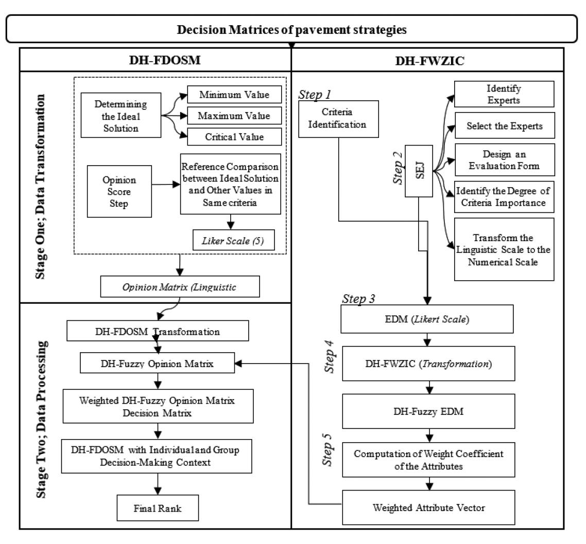
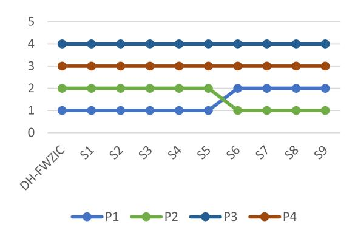
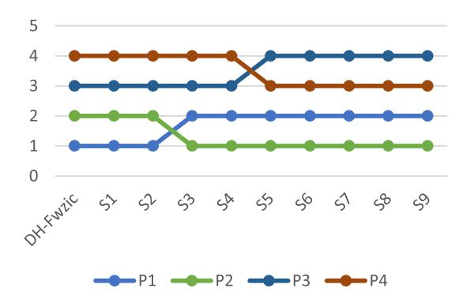
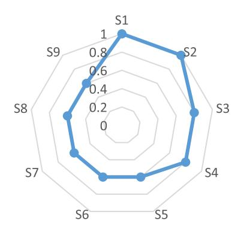

<!-- A3.R52 | source: papers_json/A3.R52/ -->

## Toward Sustainable Transportation: A Pavement Strategy Selection Based on the Extension of Dual-Hesitant Fuzzy Multicriteria Decision-Making Methods

S. F. Ismael, A. H. Alias, A. A. Zaidan, B. B. Zaidan, H. A. Alsattar, Sarah Qahtan, O. S. Albahri, Mohammed Talal, A. H. Alamoodi, and R. T. Mohammed

Abstract—Pavement strategy is critical for achieving sustainable transportation. However, the presence of many evaluation criteria, criteria tradeoffs, criteria conflict, and criteria importance categorize the evaluation and selection of pavement strategies under complex multicriteria decision-making (MCDM) problems. To date, no study has presented an evaluation framework for selecting the most optimal pavement strategy to be utilized as a way to achieve sustainable transportation considering multicriteria evaluation of pavement strategies and sustainable solutions. This article presents a pavement strategy selection based on a new extension of fuzzy MCDM methods. The methodology is developed in two phases. First, the evaluation decision matrix is formulated on the basis of intersecting the "evaluation criteria" and "pavement strategies list." Second, the proposed MCDM methods are developed: multilayer dual hesitant fuzzy weighted zero inconsistency (DH-FWZIC) to assign weights to the pavement's evaluation criteria followed by dual hesitant fuzzy decision by opinion score method (DH-FDOSM)

Manuscript received 28 January 2022; revised 21 March 2022; accepted 6 April 2022. Date of publication 19 April 2022; date of current version 3 February 2023. (Corresponding author: A. A. Zaidan.)

S. F. Ismael is with W. T. Byler Co., Inc., TX 77060 USA, and also with the Department of Civil Engineering, Faculty of Engineering, Universiti Putra Malaysia, Serdang 43400, Malaysia (e-mail: sarmadfismael@gmail.com).

A. H. Alias is with the Department of Civil Engineering, Faculty of Engineering, Universiti Putra Malaysia, Serdang 43400, Malaysia (e-mail: aidihizami@upm.edu.my).

A. A. Zaidan was with the Faculty of Engineering and IT, British University in Dubai, Dubai 345015, UAE. He is now with the SP Jain School of Global Management, Lidcombe, NSW 2141, Australia (e-mail: aws.alaa@gmail.com).

B. B. Zaidan is with the Future Technology Research Center, National Yunlin University of Science and Technology, Douliou 64002, Taiwan (e-mail: bilalbahaa@fskik.upsi.edu.my).

H. A. Alsattar is with the Department of Business Administration, College of Administrative Science, The University of Mashreq, Baghdad 10021, Iraq (e-mail: hassan.alsattar@gmail.com).

Sarah Qahtan is with the Department of Computer Center, Middle Technical University, Baghdad 10011, Iraq (e-mail: sarah.qahtan@mtu.edu.iq).

O. S. Albahri and A. H. Alamoodi are with the Department of Computing, Universiti Pendidikan Sultan Idris, Tanjong Malim 35900, Malaysia (e-mail: osamah@fskik.upsi.edu.my; alamoodi@fskik.upsi.edu.my).

Mohammed Talal is with the Department of Communication Engineering, Faculty of Electrical and Electronic Engineering, Universiti Tun Hussein Onn Malaysia, Parit Raja 86400, Malaysia (e-mail: moha_talal2000@yahoo.com).

R. T. Mohammed is with the Department of Computer Science, Faculty of Science, Komar University of Science and Technology, Sulaymaniyah 46012, Iraq (e-mail: rawiatahrirs@gmail.com).

This article has supplementary material provided by the authors and color versions of one or more figures available at https://doi.org/10.1109/TFUZZ. 2022.3168050.

Digital Object Identifier 10.1109/TFUZZ.2022.3168050

for selecting the best pavement strategy. Four alternatives, namely, flexible/asphalt, rigid/concrete, reflective, and permeable alternatives pavement strategies, are evaluated on the basis of 30 criteria. Results show the following. 1) The multilayer DH-FWZIC method has weighted the pavement strategies' evaluation criteria at three layers in a consistent manner, showing that a region's environment criterion has the highest final weight (0.1215) and the lowest importance value (0.0089) assigned for its windy criterion. 2) According to DH-FDOSM, the flexible/asphalt pavement achieved the first rank among the four pavement strategies. Finally, the robustness of the developed framework was assessed by conducting sensitivity analysis and comparison study.

Index Terms—Fuzzy decision by opinion score method, fuzzy-weighted zero-inconsistency, hesitant fuzzy sets, multicriteria decision making, pavement strategy, sustainable transportation.

## I. INTRODUCTION

VARIETY of strategies may be used to make urbanization A environmentally sustainable, including stringent requirements in the new urban transportation strategy, leveraging the benefits of linked vehicles, and enhancing overall infrastructure. The new urban transportation strategy should prioritize the development of sustainable automobiles, fair access to public transportation modes, improved connectivity, and improved goods logistics planning. Automated transportation support systems can alter road appearance. For example, traffic jams can be reduced through ramp meter readings and improved traffic circulation on road infrastructure; tightly concentrated driverless vehicles when travelling; eliminating traffic lights, road markings, street signs, or road drawing and small routes indicating more space for two-wheeler vehicles, pedestrian walkways, green grass, and coffee shops [1]. Given that transportation consumes a significant amount of energy, it is critical for longterm sustainability [2]. Pavements are an important component of road infrastructure. In many countries, transportation is the most expensive infrastructure. Pavement materials account for the majority of road spending. Pavement repair and reconstruction (M&R) also necessitates significant financial commitment. Decision-makers can use these enormous investments to find cost-effective paving techniques [3].

The increasingly concerning global warming calls for different sustainable strategies. The transportation sector, of which

<!-- page 2 -->

pavements are a part, is considered one of the most important components due to its substantial effect on greenhouse gas emissions [4]. Goals toward improving triple sustainability can be achieved by making optimistic variations to pavement production concerning pavement supplies, building, plan, and protection approaches [4]. The urban heat island (UHI) effect has become a major issue in the 21st century [5]. Scientists are facing challenges in decreasing the effect of city warmness [6]. Building heat causes many problems such as high air temperature on the ground level and health risks to humans [7]. A few studies discuss the effect of building heat on the human–biometeorological aspect [8].

Other problems are related to pavement techniques. For example, impermeable pavement contradicts cooling, which leads to poor urban design, hence increasing the UHI effect [9]. Another challenge is the availability of data regarding the UHI phenomenon [10]. The absence of a standardization of cool pavement and a full understanding of pavement performance under abnormal conditions (i.e., high temperature) also leads to an increased effect of UHI [8]. The literature shows variability in the types and complexity of pavement implementation in transportation. Many types of pavements are constructed: those without cooling techniques are subdivided into flexible and rigid pavements [11]. Those with cooling techniques are subdivided to reflective pavement, which has two types: asphalt and concrete. Evaporation pavement is another type of pavement that uses cooling techniques, such as permeable pavement concrete, pervious pavement asphalt/concrete, and porous pavement [12].

Pavement sustainability can be assessed by using a variety of techniques and technologies, such as road measuring performance, life cycle cost–benefit analysis, life cycle analysis, and sustainable grading systems [3]. The literature shows many experiments to measure the effects of the physical properties of pavement layers on the UHI phenomenon. Five Parisian pavement structures (conventional pavements and grass paver) have been examined and ranked to evaluate their effect on the environment [13]. Another study used decision making theory based on multicriteria (MCDM) to rank the sustainability of alternatives of sustainable pavements and railways DSS [14]. In addition, the MCDM was used to list and hierarchize pavement infrastructure for maintenance and rehabilitation to evaluate the tradeoff between the criteria [15]. The impact of pervious concrete can be evaluated from the two dimensions of economy and environment [14]. Many parameters associated with three sustainable systems have considerable importance in choosing a suitable pavement. Despite an effort to rank pavement types using more than one criterion [13], the authors were not able to consider all other criteria in their evaluation process. The authors also neglected the effect of one criterion on another and the existence of possible conflict or tradeoff between these criteria. To date, no study has presented an evaluation framework for selecting the most optimal pavement strategy to be utilized as a way to achieve sustainable transportation considering multicriteria evaluation of pavement strategies and sustainable solutions.

To bridge this gap, four selection issues can be addressed. First, the required evaluation and selection for potential pavement type depend on diverse assessment measures (e.g., cost, UHI, environment, limitations of pavement, road safety, and human comfort) [13] because they indicate the entire performance of the pavement. Second, the opposite association among measures produces a tradeoff among the evaluation criteria of pavement performance evaluation [16]. Pavement performance changes with date, time, and seasons, caused by factors like wind, shade, and water [17]. For example, flexible pavement has a shorter construction length and lower initial cost than does rigid pavement. Reflective pavement offers simplicity in implementation and low initial and maintenance cost. However, it is prone to glare problems at daytime. Permeable pavement, which is the best solution for thermal discomfort, requires a water source and is designed for low traffic load. Third, in the comparison procedure of pavement type, a change in one of the pavement components is caused by the increase and decrease of another criterion's value. It is logically considered a conflict issue amongst the criteria [18]. Fourth, data about the UHI effect are lacking in many cities (no standardization of cool pavements) and the understanding on new green pavement is insufficient [11]. No valid attempt has been made to consider all evaluation and selection issues. Thus, the evaluation and selection of pavement type strategy is a complex MCDM issue because every pavement type is treated as different from the other.

MCDM is a subfield of operational research that is concerned with achieving optimal solutions in complicated scenarios involving multiple criteria. Despite all efforts, the imprecise and ambiguous issues resulting from decision makers' (DMs') hesitancy remain open issues in MCDM methods. Therefore, many MCDM methods are extended under different fuzzy set environments to tackle these issues. Many types of fuzzy sets aim to handle ambiguous and imprecise information such as intuitionistic fuzzy sets (IFSs) [19] and hesitant fuzzy sets (HFSs) [20]. However, Zhang et al. [21] introduced the dual hesitant fuzzy sets (DHFS), which incorporates the advantages of intuitionist and hesitant concepts. HFSs enable the membership grade to be associated with multiple alternative values rather than two values, allowing DMs to express their hesitancy [21]. As with IFSs, DHFS has grades of membership (GM) and nonmembership (GNM). However, these grades are not represented by a single number but by several predefined numbers. This feature is accurate and flexible in representing real-world problems. For example, within an organization, some DMs assign 0.6 to the GM and 0.3 to the GNM of an alternative *A* that meets a criterion *x*. Some may assign (0.8, 0.2), while others may assign (0.7, 0.2). No consistency occurs among these DMs. Accordingly, the difficulty in defining a common GM and a GNM is not due to the presence of a margin of error (IFS) but rather to the presence of a set of possible values (HFS). In this situation, the desirable degrees are represented by the DHFS elements {(0.6, 0.8, 0.7, 0.3, 0.2)}, which is clearly distinct from the IFS numbers (0.8, 0.2 or 0.7, 0.2) and the HFS values {0.6, 0.8, 0.7}.

<!-- page 3 -->

DHFS is particularly advantageous for group decisionmaking problems in which the h˜ and g˜ functions are difficult to determine [22]. In the context of MCDM methods, the fuzzy decision by opinion score method (FDOSM) [23] has been proven to be highly effective in resolving different challenges in MCDM. FDOSM makes logical decisions by relying on the expertise of specialists (DMs) through the selection of optimal solutions for each criterion in an opinion matrix. However, FDOSM is limited to explicitly weighting the criteria. Hence, it requires an external method such as the fuzzy-weighted zero-inconsistency (FWZIC) method [21] to assign the level of importance to each pavement's criterion. FWZIC has been proposed to find the weights of the criteria with zero inconstancy subjectively [21]. FDOSM and FWZIC have been integrated with many fuzzy sets such as Pythagorean fuzzy sets, T-spherical fuzzy sets [24], and q-rung Orthopair fuzzy sets [25] to handle imprecise and ambiguous issues. Those methods (i.e., FDOSM and FWZIC) are not developed by using DHFS, which is considered a theory gap. Motivated by the aforementioned issues, this article develops a new unified MCDM framework under the DHFS environment. The following points summarize the study's contributions.

- 1) This article developed a new formulation of the decision matrix based on 30 pavement criteria and four pavement strategies.
- 2) This article developed a new formulation of a multilayer dual hesitant FWZIC (DH-FWZIC) for weighting the pavement evaluation criteria.
- 3) This article developed a new formulation of a dual hesitant FDOSM (DH-FDOSM) for ranking the pavement strategies.
- 4) This article developed a novel pavement strategy selection based on a formulated decision matrix using DH-FWZIC and DH-FDOSM.

The rest of this article is organized as follows. The methodology of selecting and benchmarking pavement strategies is proposed in Section II. The benchmarked results are presented and discussed in Section III. The evaluation and validation of the proposed method is presented in Section IV. Finally, Section V concludes this article.

## II. METHODOLOGY

The designed methodology is divided into two phases, as presented in Fig. 1.

## *A. Phase I: Evaluation Decision Matrix*

First, the pavement evaluation criteria and the pavement strategies (alternatives) are defined and identified in this phase. In this process, 30 pavement criteria and four pavement strategies are identified from previous studies. The data value of the alternatives in terms of the evaluation criteria is assigned according to the literature. The pavement strategies are divided into two main categories: with and without cooling techniques. Each category has two alternatives: the flexible/asphalt and rigid/concrete pavements without cooling technique category and the reflective and

permeable pavements with cooling technique category. The evaluation criteria for selecting the pavement strategies are analyzed and categorized into two main groups: the general evaluation criteria (GEC) and specific evaluation criteria (SEC). The GEC considers all the criteria regardless of the area or region, whereas the SEC focuses on the related criteria of a particular region.

The GEC have three layers of criteria, whereas the SEC have two layers. The first layer of the GEC consists of three criteria, namely, A1 (environment), B1 (economy), and C1 (social). By contrast, the second layer of the GEC consists of 11 criteria: A1-1 (UHI), A1-2 (local environment), A1-3 (pavement limitation), B1-1 (aged), B1-2 (physical properties), B1-3 (improvement and maintenance), B1-4 (implementation), B1-5 (energy usage), C1-1 (strength), C1-2 (human comfort), and C1-3 (road safety). The third layer of the GEC consists of eight criteria: A1-3-1 (climate), A1-3-2 (water), A1-3-3 (wind), B1-2-1 (reflective), B1- 2-2 (absorb), B1-2-3 (permeability), B1-3-1 (cost), and B1-3-2 (frequency/number of M&R). The first layer of the SEC consists of two criteria: A2 (initial cost) and B2 (region's environment). The second layer of the SEC consists of six criteria: A2-1 (urban surface), A2-2 (air temperature), A2-3 (urban design), A2-4 (day and night difference), A2-5 (season), and A2-6 (shading). Finally, the pavements' criteria and alternatives are utilized to propose the evaluation decision matrix of pavement strategies.

Table IX in the Appendix defines all criteria at the three layers. The pavement criteria can be categorized into beneficial, cost and critical criteria. The high/yes value is desirable in the beneficial criteria (i.e., A1-3-2, A1-3-3, B1-1, B1-2-1, B1-2-3, C1-1, C1-2, C1-3, A2-3, and A2-6), whereas the low/no value is preferable in the cost criteria (i.e., A1-1, A1-2, B1-2-2, B1-3-1, B1-3-2, B1-4, B1-5, A2-1, A2-2, A2-4, and B2). The critical criteria (i.e., A1-3-1 and A2-5) affect pavements with the cooling technique category (reflective and permeable pavements) only, where the evaluation of reflective and permeable pavements depends on the climate and season.

## *B. Phase II: Development*

This section presents the new extensions of MCDM methods for evaluating and selecting pavement strategies.

*1) Formulation of Multilayer DH-FWZIC Weighting* *Method:* The multilayer DH-FWZIC method is the developed version of the original FWZIC [26] under a dual hesitant fuzzy environment. For determining the pavement's criteria weights, the method has five phases, which are illustrated in detail as follows.

## *Step 1: Criteria definition*

The predefined set of evaluation criteria are explored and presented. Then, these criteria are classified and categorized. In Step 2, a panel of experts is identified and chosen to evaluate the categorized criteria.

## *Step 2: Structured expert judgment*

Experts in construction engineering are identified and selected. An evaluation form is then designed to collect data from

<!-- page 4 -->

*Fig. 1. Phases of the proposed method.*

experts. The validity and reliability of the form are determined by the experts.

Then, the experts defined the importance/significance level of each pavement criterion using a five-point Likert scale. Table I shows the numerical equivalents of the linguistic terms.

## Step 3: Building expert decision matrix (EDM)

On the basis of the data collected in the previous step, an EDM is constructed for each expert. The expert panel is intersected with pavement criteria, where each expert has scored the

importance level of all pavement criteria. The result of this step (i.e., EDM) is fed to Step 4 for further analysis.

*Step 4: DHFS membership function application*

The EDM data are transformed to DHFS-EDM by applying the DHFS membership function. This step is critical because assigning a specific preference to any criterion is difficult. Therefore, fuzzy sets are used instead of crisp numbers to solve or decrease the uncertainty and imprecise information resulting from the experts' hesitation. DHFSs were defined in [27] and [28] as an extension of HFSs. Given a fixed set U, a DHFS D in X is represented as \tilde{D}=\{x,\tilde{h}_{\tilde{D}}(x),\tilde{g}_{\tilde{D}}(x)\mid x\in U\}, in which \tilde{h}_{\tilde{D}}(x) and \tilde{g}_{\tilde{D}}(x) are in the range [0], [1] denoting the degrees of membership and nonmembership of the element x\in U to set D, respectively, under the conditions: 0\leq\gamma,\eta\leq1 and 0\leq\gamma^++\eta^+\leq1, for all x\in U \gamma\in\tilde{h}_{\tilde{D}}(x),\eta\in\tilde{g}_{\tilde{D}}(x), \gamma^+\in\tilde{h}_{\tilde{D}}^+(x)=\cup_{\gamma\in\tilde{h}_{\tilde{D}}(x)}\max\{\gamma\}, \gamma^+\in\tilde{g}_{\tilde{D}}(x)=\cup_{\eta\in\tilde{g}_{\tilde{D}}(x)}\max\{\eta\}.

The following DHFS arithmetic operations are adopted from [27] and [29]. For the DHFS aggregation operation (DHFA), (1)

<!-- page 5 -->

is utilized

$$
DHFA \left(\tilde{d}_{1}, \tilde{d}_{2}, \dots, \tilde{d}_{n}\right) = \bigoplus_{j=1}^{n} \left(\tilde{d}_{j}\right)
= \bigcup_{\tilde{\gamma}_{j} \in \tilde{h}_{j}, \tilde{\eta}_{j} \in \tilde{g}_{j}} \left\{ \left\{ 1 - \prod_{j=1}^{n} \left(1 - \tilde{\gamma}\right) \right\}, \left\{ \prod_{j=1}^{n} \left(\tilde{\eta}\right) \right\} \right\}. \tag{1}
$$

For the DHFS division operation, (2) is used

d_1 \emptyset d_2 =

$$
\begin{cases} \bigcup_{\tilde{\gamma}_1 \in \tilde{h}_1, \tilde{\gamma}_2 \in \tilde{h}_2, \tilde{\eta}_1 \in \tilde{g}_1, \tilde{\eta}_2 \in \tilde{g}_2} \left\langle \frac{\tilde{\gamma}_1}{\tilde{\gamma}_2}, \frac{\tilde{\eta}_1 - \tilde{\eta}_2}{1 - \tilde{\eta}_2} \right\rangle, & \text{if } 0 \leq \frac{\tilde{\gamma}_1}{\tilde{\gamma}_2} \leq \frac{1 - \tilde{\eta}_1}{1 - \tilde{\eta}_2} \leq 1 \\ \left\langle 1, 0 \right\rangle & \text{otherwise.} \end{cases}
$$

Table I shows the linguistic scoring scale with their equivalent DHF numbers (DHFNs). The numerical scoring scales that represent the linguistic scoring scale (Step 2) are replaced with DHFNs in this step.

The DHFNs can be defuzzified and converted to crisp value using (3) [24] as follows:

$$
S(d_j) = \frac{1}{\#\tilde{h}} \sum_{\tilde{\gamma}_j \in \tilde{h}_j} \tilde{\gamma}_j - \frac{1}{\#\tilde{g}} \sum_{\tilde{\eta}_j \in \tilde{g}_j} \tilde{\eta}_j. (3)
$$

*Step 5: Evaluation criteria's weight coefficients calculation*

The fuzzified data of pavement criteria (Step 4) are utilized to find the final criteria's weight coefficients as follows.

1) The fuzzified data ratio calculation is performed by using (1) and (2). Equation (4) depicts the process in its symbolic form

$$
\tilde{E}_{ij}: \tilde{C}_{ij} = \frac{\operatorname{Im}\left(\widetilde{E1/C1}\right)}{\sum_{j=1}^{n} \operatorname{Im}\left(\widetilde{E1/C_{1j}}\right)} (4)
$$

where Im(\widetilde{E1/C1}) is the fuzzy number of Im(E1/C1).

- 1) In this extension of multilayer DH-FWZIC, the defuzzification is implemented on the DH-EDM to convert all fuzzy values (\tilde{E}_{ij}:\tilde{C}_{ij}) to crisp values (E_{ij}:C_{ij}) by using (3) before calculating the mean values due to the DHFS fuzzy environment.
- 2) The mean is used to determine the final weight values of pavement criteria, and (5) depicts the process in its symbolic form. For rescaling purposes, the weight assigned to each criterion should be determined by the sum of all the criteria weights

$$
W_j = \left(\sum_{i=1}^m E_{ij} : C_{ij}/m\right), \text{ for } i = 1, 2, 3, ..m \text{ and}
j = 1, 2, 3, ..n. \tag{5}
$$

2) Formulation of DH-FDOSM Selection Method: DH-FDOSM is an extended version of the FDOSM [23] developed in this article for selecting and benchmarking pavement strategies.

The formulation of DH-FDOSM is performed in two stages, as detailed below.

Stage One: Data transformation unit

According to [23], the decision matrices are transformed into opinion matrices as follows.

Step 1: The ideal solution of each criterion or subcriterion (in case the criterion has subcriteria) in the decision matrices is selected. Equation (6) defines the process of selecting the ideal solution

$$
A^* = \left\{ \left[ \left( \max_i v_{ij} | j \in J \right), \left( \min_i v_{ij} | j \in J \right) \right. \right.\left. \left( Op_{ij} \in I.J \right) | i = 1.2.3...m \right] \right\} (6)
$$

where max, min, and Op_{ij} represent the ideal solution of the benefit, cost, and critical criteria, respectively. All pavement criteria are explained in detail in Phase A.

Step 2: The ideal solution of a certain criterion is compared with all pavement strategy values under that criterion in terms of difference. A five-point Likert scale is used. Equation (7) depicts the comparison process

$$
Op_{\text{Lang}} = \left\{ \left( \left( \tilde{v}_{ij} \otimes v_{ij} | j \in J \right) . | i = 1.2.3....m \right) \right\} (7)
$$

where \otimes refers to the comparison process. The outcome of this step is opinion matrices ((8) filled with linguistic terms by the selected experts (four paving experts)

$$
O p_{\text{Lang}} = \begin{bmatrix} A_1 & op_{11} & \cdots & op_{1n} \\ \vdots & \ddots & \vdots \\ A_m & op_{m1} & \cdots & op_{mn} \end{bmatrix}. (8)
$$

Stage Two: Data-processing unit

Four opinion matrices resulting from the previous stage are transformed into fuzzy opinion decision matrices in this stage. Table II shows the linguistic terms in opinion matrices replaced with DHFNs [24].

This article presents two contexts to benchmark pavement strategies: individual and group decision making (GDM). The obtained weights of each evaluation criteria of pavement (i.e., Phase B (1) were introduced to DH-FDOSM to evaluate and benchmark the pavement strategies thoroughly. Each fuzzy opinion matrix can be aggregated by using i) dual hesitant fuzzy weighted averaging (DHFWA) operator, as shown in (9) [27], or ii) dual hesitant fuzzy weighted geometric (DHFWG) operator,

<!-- page 6 -->

as shown in (10) [30]. However, this article study used both operators to rank pavements

$$
DHFWA \left(\tilde{d}_{1}, \tilde{d}_{2}, \dots, \tilde{d}_{n}\right) = \bigoplus_{j=1}^{n} \left(\omega_{j} \tilde{d}_{j}\right)
= \bigcup_{\tilde{\gamma}_{j} \in \tilde{h}_{j}, \tilde{\eta}_{j} \in \tilde{g}_{j}} \left\{ \left\{ 1 - \prod_{j=1}^{n} \left(1 - \tilde{\gamma}\right)^{\omega_{j}} \right\}, \left\{ \prod_{j=1}^{n} \left(\tilde{\eta}\right)^{\omega_{j}} \right\} \right\}. 
(9)
DHFWG \left(\tilde{d}_{1}, \tilde{d}_{2}, \dots, \tilde{d}_{n}\right) = \bigoplus_{j=1}^{n} \left(\tilde{d}_{j}^{\omega_{j}}\right)
= \bigcup_{\tilde{\gamma}_{j} \in \tilde{h}_{j}, \tilde{\eta}_{j} \in \tilde{g}_{j}} \left\{ \left\{ \prod_{j=1}^{n} \left(\tilde{\gamma}\right)^{\omega_{j}} \right\}, \left\{ 1 - \prod_{j=1}^{n} \left(1 - \tilde{\eta}\right)^{\omega_{j}} \right\} \right\}.
$$

Subsequently, (3) is applied to the aggregated result to defuzzify it and generate a score value for each pavement strategy. These scores are ranked, with the highest score indicating the best pavement strategy. Owing to the variations in the benchmark values of the pavement strategy among DMs, aggregating their decisions is necessary to unify the benchmark results. Thus, this article utilized the GDM context with DH-FDOSM. The final GDM score was calculated by using the arithmetic mean, as indicated in (11). The strategy with the highest score value is the best pavement strategy

$$ Group DH - FDOSM = \bigoplus S^* (11) $$

where represents the arithmetic mean and S* represents the final rank of each expert.

## III. RESULTS AND DISCUSSION

## A. Decision Matrix Evaluation Results

The evaluation decision matrix is constructed by intersecting the identified pavement strategies and the pavement's criteria. After defining and identifying the pavement's evaluation criteria and strategies, as well as assigning the values of each pavement strategy per pavement criterion, the completed evaluation decision matrix of the pavement strategies is constructed. Table III presents the decision matrix. Each pavement strategy is evaluated by using 30 pavement criteria, and the values are assigned on the basis of the literature.

Some values in the decision matrix are evaluated as N/A, indicating that the criterion is not applicable to that pavement strategy, as illustrated in Table III. In total, 19 criteria are assessed in terms of high to low. In total, three criteria are evaluated on a yes/no basis, and one criterion is evaluated on a comfort/discomfort basis. Critical criteria (i.e., A1-3-1 and A2-5) are evaluated as such. In a tropical climate, A1-3-1 evaluated permeable pavement as high because it provides factors that improve performance [11].

However, Mediterranean climate zones prefer (high) reflective pavement due to their dry and hot climate [45]. A2-5 shows the different effects of pavement performance because reflective pavements reduce the surface and ambient temperature during summer [7]. Reflective pavements could improve human thermal comfort during winter and reduce it in summer [33]. Permeable pavement can also help reduce hot temperatures in summer without reducing heat during winter [33]. Selecting the most optimal pavement strategy according to a specific criterion is straightforward. However, selecting the optimal pavement strategy while considering the entire identified criteria is difficult.

<!-- page 7 -->

Therefore, the produced decision matrix is utilized as an input to the development phase (multilayer DH-FWZIC and DH-FDOSM) to solve this challenge.

## *B. Criteria Weighting Results*

Based on multilayer DH-FWZIC, the methods are implemented in five steps. The weighted criteria generated by DH-FWZIC have no inconsistencies. Exploring and categorizing the predefined criteria (i.e., 30 pavement criteria, Phase A) is the first phase of multilayer DH-FWZIC's methodology. Then, the data are collected from each expert, as outlined in Phase 2. Four paving experts have contributed their insights in assessing the degree of importance of all the pavement criteria that have been collected through the designed assessment form. The experts' preferences are transformed into an equivalent numerical scale. Then, the EDM is built as explained in the second step of the multilayer DH-FWZIC methodology. The DHFS membership function is then applied to convert all the crisp numbers of the EDM into the DHFS-EDM as detailed in Step 3. In Step 4a, the ratio values of the pavement's criteria (i.e., layers 1, 2, and 3) are determined by using (2) and (3). To determine the fuzzy weight (Step 4b), the mean of the experts' preferences for all the criteria at the three layers is computed by using (4). Finally, the final weights of the 30 criteria at the three layers are determined by using (5), as explained in Step 4c. Table IV lists the overall criteria weighting results.

Table IV shows the weight results for each criterion in the three layers and the final weights. At layer 1, A2 has the highest importance weight of 0.2644, whereas B2 has the lowest

importance value of 0.1215. At layer 2, for the A1 subcriteria, the A1-1 criterion has the highest weight of 0.4191 and A2-3 has the smallest weight value. For the B1 subcriteria, B1-4 received the highest value of 0.2419 and B1-1 received the lowest value of 0.1101. For C1 subcriteria, C1-1 and C1-3 received the same highest value of 0.3707, and the last subcriterion C1-2 received the lowest value of 0.2586. For A2 subcriteria, A2-2 and A2-5 received the highest value of 0.2239, and A2-3 received the lowest value of 0.0734. At layer 3, for A1-3 subcriteria, the order of the criteria importance was A1-3-1, A1-3-2, and A1-3-3. In the B1-2 subcriteria set, the order was B1-2-1, B1-2-3, and B1-2- 2. Finally, at this layer, the B1-3-1 and B1-3-2 subcriteria of B1-3 received the weight values of 0.5019 and 0.4981, respectively.

Overall weighting values were obtained by multiplying the weights of criteria at layers 1, 2, and 3. In this context, the B2 criterion has the highest importance value of 0.1215, which is identical to the value at layer 1 due to the absence of the subcriteria at layers 2 and 3. The lowest importance value (0.0089) was received by A1-3-3. To benchmark the identified pavement strategies properly, the final weight values were introduced to DH-FDOSM.

## *C. Selection Results*

In this section, the reported results and discussion are based on the contexts of individual decision-making and GDM to benchmark the identified pavement strategies. The decision matrix was evaluated by four DMs and converted into an opinion matrix using the five scales. The DMs determined the ideal pavement strategy for each criterion by using (6). The opinion matrix was generated by comparing the ideal pavement value to the other values for each criterion using linguistic terms and then converting the opinion matrix to DHFNs. By utilizing Table II, the opinion matrix of all DMs was transformed to a fuzzy opinion matrix. Individual and GDM contexts were generated by applying the DH-FDOSM method on the generated fuzzy opinion matrix, as presented in Table V.

The most desirable pavement must have the highest score, whereas the least desirable pavement must have the lowest score. As Table V shows, some scores have negative values. In these instances, the nonmembership value exceeds the membership value, illustrating the DHF concept. For the rankings obtained by DHFWA operator, a consistent ranking across the first three DMs is observed for all alternatives (flexible/asphalt, rigid/concrete, reflective, and permeable pavements), with the first, second, fourth, and third rankings, respectively. These findings show that the proposed method is effective in overcoming DMs' hesitancy and narrowing the differences in their preferences. The fourth DM swapped the rankings for reflecting and permeable pavements with the third and fourth rankings, respectively. The remaining two alternatives (flexible/asphalt pavement and rigid/concrete pavement) obtained the same ranking results given by DM1, 2, and 3.

For the rankings obtained by DHFWG operator, flexible/asphalt, and rigid/concrete pavements swapped their ranking results (first and second ranks) across the four DMs. Here, flexible/asphalt pavement ranked first by DM1 and 3, while

<!-- page 8 -->

rigid/concrete pavement ranked first by DM2 and 4. Similarly, reflective and permeable pavements swapped their ranking results (third and fourth ranks) across the four DMs. Here, reflective pavement ranked fourth by DM2 and 3, while permeable pavement ranked fourth by DM1 and 4.

Finally, the GDM considered all the experts' perspectives and produced a unified ranking for the alternatives. For the GDM rankings obtained based on DHFWA operator, the flexible/asphalt pavement achieved the first rank with a score value of (0.5010), followed by rigid/concrete pavement and permeable pavement, ranking second and third, respectively. The reflective pavement received the lowest rank with a score value of (-0.0018). By contrast, for the GDM rankings obtained based on DHFWG operator, flexible/asphalt pavement had the same ranking result (first rank) as in GDM rankings based on DHFWA operator with a score value of (0.0194), followed by rigid/concrete and reflective pavements. The fourth and lowest rank is received by permeable pavement with a score value of (-0.4926). The rankings produced using DHFWG operators reflect DMs' preference information well, as proven by [46].

## IV. EVALUATION

## A. Sensitivity Analysis

The weights assigned to the different criteria can have a substantial effect on the selection results of the identified pavement strategies. Therefore, the proposed method's robustness may be verified by examining the effect of changing the weights of criteria on the benchmarked results. The sensitivity analysis assessment examines the effect of the most important criterion on the ranking results. Among the 30 criteria used to evaluate the pavement strategies, the most important criterion determined by multilayer DH-FWZIC is B2 (w = 0.1215), as shown in Table IV. Equation (12) was used to produce nine scenarios on the basis of the relative value of the criteria weights [47]

$$
w_c = (1 - w_s) \times \left(\frac{w_c^o}{W_c^o}\right) = w_c^o - \Delta x \alpha_c \tag{12}
$$

where w_s denotes the most important criterion. w_c^o denotes the weights calculated by the multilayer DH-FWZIC method. W_c^0 denotes the total weights generated by multilayer DH-FWZIC. \Delta x denotes the adjustment range applied to the criteria weights,

*Fig. 2. Sensitivity analysis based on DHFWA operator.*

which are the upper and lower limits of the most important

The elasticity coefficient (\alpha_c) was used to determine how much each criterion changed over the most important one, and the upper and lower limits for changing the weight coefficient of the most important criterion were determined. The ranks produced by varying the criteria weights in the generated scenarios were compared with the ranking results calculated according to the multilayer DH-FWZIC method. Table VI presents the results of computing \alpha_c for each criterion. The B2 criterion's limit values were -0.1215 \leq \Delta x \leq 0.8785. According to the total number of scenarios, the specified limit values were separated into nine sequences. Each scenario led in the formation of nine scenarios and the production of nine new weight values (see Table VI).

Fig. 2 depicts the effects of altering the criteria weights on the ranking results of the pavement strategies (i.e., flexible/asphalt pavement [P1], rigid/concrete pavement [P2], reflective pavement [P3], and permeable pavement [P4]) based on DHFWA operator. The criteria weights have a considerable effect on how pavement strategies are ranked in certain scenarios. The pavement strategy ranking results based on the multilayer DH-FWZIC method indicate its effectiveness in most scenarios. The new ranking results of the four pavement strategies were compared with the original ranking achieved on the basis of multilayer DH-FWZIC. In five scenarios (S1–S5), flexible/asphalt pavement remained first but fell to the second rank in S6–S9. Rigid/concrete pavement had the same ranking under multilayer DH-FWZIC (rank = 2) in five scenarios (S1–S5), but it was

<!-- page 9 -->

*Fig. 3. Sensitivity analysis based on DHFWG operator.*

*Fig. 4. Ranks correlation based on DHFWA operator.*

raised to the first rank in four scenarios (S6–S9). In nine scenarios, reflective and permeable pavements were ranked fourth and third, respectively, under multilayer DH-FWZIC.

When the DHFWG operator is used to rank pavement strategies, changes in weighting of criteria modified the ranking results is shown in Fig. 3.

In two scenarios (S1 and S2), the flexible/asphalt pavement earned the same ranking as the multilayer DH-FWZIC (rank = *1*) but fell to second rank in the remaining scenarios. By comparison, rigid/concrete pavement was ranked second in the first two scenarios (S1 and S2) but first in the remaining scenarios. In four scenarios (S1–S4), reflective pavement stayed stable (Rank = 3) but slipped to the fourth rank in the remaining scenarios. By contrast, permeable pavement had the lowest rank as a multilayer DH-FWZIC in S1–S4 but jumped to third rank in the remaining scenarios.

These results indicate that the weights assigned to the criteria have a significant effect on how the final ranking results are determined. For instance, the A1-1, A1-2, and A2-2 subcriteria have the second, third, and fourth highest weights, respectively, under multilayer DH-FWZIC (i.e., Table IV). However, these three subcriteria significantly dropped in S6–S9. Consequently,

the ranks of the first and second alternatives (flexible/asphalt pavement and rigid/concrete pavement) were interchanged (see Fig. 2).

Finally, a statistical analysis of the associations between the ranking results based on multilayer DH-FWZIC and the ranking results based on the nine scenarios was conducted by using the Spearman correlation coefficient (SCC) [47]. The ranking results obtained with the DHFWA operator revealed a strong association between the multilayer DH-FWZIC and the nine scenarios ranks, as shown in Fig. 4.

The obtained results for the ranking of the pavement strategies revealed a strong relationship (SCC = 1.0) between multilayer DH-FWZIC and five over nine scenarios (S1–S5). The remaining scenarios (S6–S9) had an SCC value of 0.9, with a mean value of 0.911 for all scenarios. The overall results revealed a strong and positive correlation.

The ranking results obtained with the DHFWG operator revealed a strong association between the multilayer DH-FWZIC and the nine scenarios ranks, as shown in Fig. 5.

The rankings of pavement strategies demonstrated a moderate relationship between multilayer DH-FWZIC and four scenarios

<!-- page 10 -->

*Fig. 5. Ranks Correlation based on DHFWG operator.*

(SCC = 1.0 in S1 and S2, SCC = 0.8 in S3 and S4). The remaining scenarios (S5–S9) exhibited a moderate relationship with multilayer DH-FWZIC (SCC = 0.6), with a mean value of 0.733 for all scenarios. The findings indicated a moderately positive correlation.

## *B. Comparison Study*

DH-FWZIC and DH-FDOSM are compared with other wellknown DH-based MCDM approaches in this section. The aim of the comparison is to demonstrate the stability and superiority of the DH-FWZIC and DH-FDOSM method over other MCDM approaches.

First**,** the analytic hierarchy process (AHP) is a well-known MCDM weighting method. The initial version of AHP has two issues: imprecise and ambiguous information. Therefore, AHP was extended under the DHFS environment into DH-AHP [48] to overcome these issues. However, substantial deficiencies arise when comparing DH-AHP to DH-FWZIC, including the inconsistency problem caused by the comparison numbers (how many comparisons are to be made) and unnatural comparison (comparing uncorrelated criteria such as sound and smell) in DH-AHP, making the work of experts far more difficult. DH-AHP also requires more time for pairwise comparison and is more complex in terms of obtaining expert feedback. Furthermore, in DH-AHP, high dependency occurs among criteria (adding or eliminating a criterion necessitates a redo of pairwise comparison). Table VII summarizes these points.

Owing to all of these comparison points, Table VII demonstrates that DH-FWZIC is superior to DH-AHP in terms of weighing criteria. DH-FWZIC addressed all of the previously mentioned issues (n = 6/6), whereas DH-AHP solved only the imprecise and ambiguous information (*n* = 1/6).

Second**,** technique for order of preference by similarity to ideal solution (TOPSIS) [49]–[51], VlseKriterijuska Optimizacija I Komoromisno Resenje (VIKOR) [52], and TODIM (an acronym in Portuguese for interactive multicriteria decision making) [53] are well-known MCDM ranking methods that have been successfully applied to a variety of applications. The original version of these methods suffers imprecise and ambiguous information. As such, it was extended using the same DHFS as in DH-FDOSM into dual hesitant fuzzy TOPSIS, VIKOR, and TODIM (DH-TOPSIS [49], DH-VIKOR [52], and DH- TODIM [53]). These extensions including DH-FDOSM successfully addressed the issues of imprecise and ambiguous information. However, DH-FDOSM outperformed these methods in terms of managing missing data (i.e., N/A values in the decision matrix), immeasurable criterion (e.g., color), weighting the criteria implicitly, normalization (unifying different measures of data in the decision matrix), ideal solution (optimal value under the same criterion), and distance measurement (distance between the ideal solution and other alternatives. Furthermore, compared with DH-FDOSM-based DHFWA, the DH-FDOSM-based DHFWG accurately reflected preference information. The remaining ranking methods, by contrast, did not consider DHFWA and DHFWG. These points are summarized in Table VIII.

As shown in Table VIII, DH-FDOSM-based DHFWG solved seven out of seven issues, whereas DH-TOPSIS, DH-VIKOR, and DH-TODM solved only the imprecise and ambiguous information (one out of seven).

Therefore, the integration of DH-FWZIC and DH-FDOSM for weighting pavement criteria and ranking pavement strategies is more sensible than the other MCDM solutions. Thus, it was used in this article.

<!-- page 11 -->

## V. CONCLUSION

The managerial implications of the most desirable pavement can assist governments, human wellness experts, and future researchers. After selecting the best sustainable pavement strategy, beneficiaries can achieve a sustainable transportation environment, and governments can maximize economic performance and decrease energy consumption. As a result, the intensifying UHI phenomenon and global warming problems can be reduced. Human wellness will benefit immensely from reducing the negative effects of heat on pedestrians, and visual perception issues can be reduced. Finally, this article will assist contractors

and future researchers by offering a solution to select a suitable pavement strategy (i.e., modifying pigments and coating performance).

This article has some limitations as follows.

- 1) All experts in this article are treated equally, regardless of their level of expertise.
- 2) DH-FWZIC is formulated with a single aggregation operator and a single defuzzification method to provide the final weighting.
- 3) DH-FDOSM is formulated with a single defuzzification method to provide the ranking results.

<!-- page 12 -->

4) To generate opinion matrices, just a five-point Likert scale is utilized.

Several future directions can be explored as follows:

- 1) assigning weight to each expert based on their level of experience;
- 2) applying additional aggregation operator and defuzzification technique with DH-FWZIC;
- 3) applying another defuzzification technique with DH-FDOSM;
- 4) employing seven-, nine-, or eleven-point Likert scales to construct the opinion matrices;
- 5) integrate FWZIC and FDOSM with other fuzzy set such as picture fuzzy set [54] and complex interval-valued Pythagorean fuzzy set [55];
- 6) fuzzy failure mode effect analysis can be explored to weight pavement's criteria [56].

## APPENDIX

See Table IX.

## REFERENCES

- [1] J. Malasek, "A set of tools for making urban transport more sustainable," *Transp. Res. Procedia*, vol. 14, pp. 876–885, 2016.
- [2] R. C. W. Kwok and A. G. O. Yeh, "The use of modal accessibility gap as an indicator for sustainable transport development," *Environ. Plan. A*, vol. 36, no. 5, pp. 921–936, 2004.
- [3] S. Salehi, M. Arashpour, J. Kodikara, and R. Guppy, "Sustainable pavement construction: A systematic literature review of environmental and economic analysis of recycled materials," *J. Cleaner Prod.*, vol. 313, 2021, Art. no. 127936.
- [4] C. Plati, "Sustainability factors in pavement materials, design, and preservation strategies: A literature review," *Construction Building Materials*, vol. 211, pp. 539–555, 2019.
- [5] Y. Liu, T. Li, and H. Peng, "A new structure of permeable pavement for mitigating urban heat island," *Sci. Total Environ.*, vol. 634, pp. 1119–1125, 2018.
- [6] M. Pasetto, E. Pasquini, G. Giacomello, and A. Baliello, "Innovative pavement surfaces as urban heat islands mitigation strategy: Chromatic, thermal and mechanical characterisation of clear/coloured mixtures,"*Road* *Mater. Pavement Des.*, vol. 20, pp. S533–S555, Apr. 2019.
- [7] G. E. Kyriakodis and M. Santamouris, "Using reflective pavements to mitigate urban heat island in warm climates - Results from a large scale urban mitigation project," *Urban Climate*, vol. 24, pp. 326–339, 2018.
- [8] T. F. Zhao and K. F. Fong, "Characterization of different heat mitigation strategies in landscape to fight against heat island and improve thermal comfort in hot–humid climate (Part I): Measurement and modelling," *Sustain. Cities Soc.*, vol. 32, pp. 523–531, 2017.
- [9] G. Battista and E. M. Pastore, "Using cool pavements to mitigate urban temperatures in a case study of Rome (Italy)," *Energy Procedia*, vol. 113, pp. 98–103, 2017.
- [10] M. Noro and R. Lazzarin, "Urban heat island in Padua, Italy: Simulation analysis and mitigation strategies," *Urban Climate,* vol. 14, pp. 187–196, Dec. 2015.
- [11] S. H. Ibrahim, N. I. A. Ibrahim, J. Wahid, N. A. Goh, D. R. A. Koesmeri, and M. N. M. Nawi, "The impact of road pavement on urban heat island (UHI) phenomenon," *Int. J. Technol.*, vol. 9, no. 8, Dec. 2018, Art. no. 1597.
- [12] S. Al-Humairi, A. Alias, N. Haron, S. Hassim, and F. Mohd Jakarni, "Sustainable pavement: A review on the usage of pavement as a mitigation strategy for UHI," *IOP Conf. Ser. Mater. Sci. Eng.*, vol. 1075, no. 1, 2021, Art. no. 012010.
- [13] M. Hendel, S. Parison, A. Grados, and L. Royon, "Which pavement structures are best suited to limiting the UHI effect? A laboratory-scale study of Parisian pavement structures," *Building Environ.*, vol. 144, pp. 216–229, 2018.
- [14] J. Santos, S. Bressi, V. Cerezo, and D. Lo Presti, "SUP&R DSS: A sustainability-based decision support system for road pavements," *J.* *Cleaner Prod.*, vol. 206, pp. 524–540, 2019.

- [15] S. Abu Dabous, W. Zeiada, T. Zayed, and R. Al-Ruzouq, "Sustainabilityinformed multi-criteria decision support framework for ranking and prioritization of pavement sections," *J. Cleaner Prod.*, vol. 244, 2020, Art. no. 118755.
- [16] A. S. Albahri, R. A. Hamid, O. S. Albahri, and A. A. Zaidan, "Detectionbased prioritisation: Framework of multi-laboratory characteristics for asymptomatic COVID-19 carriers based on integrated Entropy–TOPSIS methods," *Artif. Intell. Med.*, vol. 111, Jan. 2021, Art. no. 101983.
- [17] D. D. Kolokotsa, G. Giannariakis, K. Gobakis, G. Giannarakis, A. Synnefa, and M. Santamouris, "Cool roofs and cool pavements application in Acharnes, Greece," *Sustain. Cities Soc.*, vol. 37, pp. 466–474, 2018.
- [18] K. Yang, N. Zhu, C. Chang, D. Wang, S. Yang, and S. Ma, "A methodological concept for phase change material selection based on multi-criteria decision making (MCDM): A case study," *Energy*, vol. 165, pp. 1085–1096, 2018.
- [19] S. Ebrahimnejad, H. Hashemi, S. M. Mousavi, and B. Vahdani, "A new interval-valued intuitionistic fuzzy model to group decision making for the selection of outsourcing providers," *Econ. Comput. Econ. Cybern. Stud.* *Res.*, vol. 49, no. 2, pp. 1–22, 2015.
- [20] H. Gitinavard, S. M. Mousavi, and B. Vahdani, "A new multi-criteria weighting and ranking model for group decision-making analysis based on interval-valued hesitant fuzzy sets to selection problems," *Neural Comput.* *Appl.*, vol. 27, no. 6, pp. 1593–1605, 2016.
- [21] H. Zhang, L. Shu, S. Liao, and C. Xiawu, "Dual hesitant fuzzy rough set and its application," *Soft Comput.*, vol. 21, no. 12, pp. 3287–3305, 2017.
- [22] D. Yu, D. F. Li, and J. M. Merigó, "Dual hesitant fuzzy group decision making method and its application to supplier selection," *Int. J. Mach.* *Learn. Cybern.*, vol. 7, no. 5, pp. 819–831, 2016.
- [23] M. M. Salih, B. B. Zaidan, and A. A. Zaidan, "Fuzzy decision by opinion score method," *Appl. Soft Comput. J.*, vol. 96, 2020, Art. no. 106595.
- [24] M. A. Alsalem *et al.*, "Based on T-spherical fuzzy environment: A combination of FWZIC and FDOSM for prioritising COVID-19 vaccine dose recipients," *J. Infect. Public Health*, vol. 14, no. 10, pp. 1513–1559, 2021.
- [25] A. S. Albahri *et al.*, "Integration of fuzzy-weighted zero-inconsistency and fuzzy decision by opinion score methods under a q-rung orthopair environment: A distribution case study of COVID-19 vaccine doses," *Comput. Stand. Interfaces*, vol. 80, Mar. 2022, Art. no. 103572.
- [26] R. T. Mohammed *et al.*, "Determining importance of many-objective optimisation competitive algorithms evaluation criteria based on a novel fuzzy-weighted zero-inconsistency method," *Int. J. Inf. Technol. Decis.* *Mak.*, vol. 21, pp. 195–241, 2021.
- [27] L. D. D. R. Calache, L. G. Zanon, R. F. M. Arantes, L. Osiro, and L. C. R. Carpinetti, "Risk prioritization based on the combination of FMEA and dual hesitant fuzzy sets method," *Production*, vol. 31, pp. 1–16, 2021.
- [28] B. Zhu, Z. Xu, and M. Xia, "Dual hesitant fuzzy sets," *J. Appl. Math.*, vol. 2012, no. 1, pp. 13–27, 2012.
- [29] W. S. Du, "Subtraction and division operations on intuitionistic fuzzy sets derived from the Hamming distance," *Inf. Sci.*, vol. 571, pp. 206–224, 2021.
- [30] D. Yu, W. Zhang, and G. Huang, "Dual hesitant fuzzy aggregation operators," *Technol. Econ. Dev. Econ.*, vol. 22, no. 2, pp. 194–209, Mar. 2016.
- [31] H. Wu, B. Sun, Z. Liu, and J. Yin, "Laboratory-simulated investigation on thermal behaviours of permeable concrete pavements," *Road Mater.* *Pavement Des.*, vol. 18, pp. 97–108, 2017.
- [32] Y. Qin, "A review on the development of cool pavements to mitigate urban heat island effect," *Renew. Sustain. Energy Rev.*, vol. 52, pp. 445–459, 2015.
- [33] H. Li, Y. He, and J. Harvey, "Human thermal comfort: Modeling the impact of different cool pavement strategies," *Transp. Res. Rec.*, vol. 2575, pp. 92–102, 2016.
- [34] M. Daniel, A. Lemonsu, and V. Viguié, "Role of watering practices in large-scale urban planning strategies to face the heat-wave risk in future climate," *Urban Climate,* vol. 23, pp. 287–308, 2018.
- [35] J. Wang, Q. Meng, K. Tan, L. Zhang, and Y. Zhang, "Experimental investigation on the influence of evaporative cooling of permeable pavements on outdoor thermal environment," *Building Environ.*, vol. 140, pp. 184–193, 2018.
- [36] N. Xie, H. Li, A. Abdelhady, and J. Harvey, "Laboratorial investigation on optical and thermal properties of cool pavement nano-coatings for urban heat island mitigation," *Building Environ.*, vol. 147, pp. 231–240, 2019.
- [37] J. A. Villena Del Carpio, D. L. Marinoski, G. Trichês, R. Lamberts, and J. V. S. de Melo, "Urban pavements used in Brazil: Characterization of solar reflectance and temperature verification in the field," *Sol. Energy*, vol. 134, pp. 72–81, 2016.

<!-- page 13 -->

- [38] H. Li, D. Jones, R. Wu, and J. Harvey, "Development and validation of a mechanistic-empirical design method for permeable interlocking concrete pavement," *Transp. Res. Rec.*, vol. 2590, pp. 74–83, 2016.
- [39] G. Rossi, P. Iacomussi, and M. Zinzi, "Lighting implications of urban mitigation strategies through cool pavements: Energy savings and visual comfort," *Climate*, vol. 6, no. 2, pp. 26–41, 2018.
- [40] F. Rosso, A. L. Pisello, F. Cotana, and M. Ferrero, "On the thermal and visual pedestrians' perception about cool natural stones for urban paving: A field survey in summer conditions," *Building Environ.*, vol. 107, pp. 198–214, 2016.
- [41] M. Taleghani, D. Sailor, and G. A. Ban-Weiss, "Micrometeorological simulations to predict the impacts of heat mitigation strategies on pedestrian thermal comfort in a Los Angeles neighborhood," *Environ. Res. Lett.*, vol. 11, no. 2, 2016, Art. no. 24003.
- [42] M. Taleghani, "The impact of increasing urban surface albedo on outdoor summer thermal comfort within a university campus," *Urban Climate,* vol. 24, pp. 175–184, 2018.
- [43] F. Salata, I. Golasi, D. Petitti, E. de Lieto Vollaro, M. Coppi, and A. de Lieto Vollaro, "Relating microclimate, human thermal comfort and health during heat waves: An analysis of heat island mitigation strategies through a case study in an urban outdoor environment," *Sustain. Cities Soc.*, vol. 30, pp. 79–96, 2017.
- [44] A. Mohajerani, J. Bakaric, and T. Jeffrey-Bailey, "The urban heat island effect, its causes, and mitigation, with reference to the thermal properties of asphalt concrete," *J. Environ. Manage.*, vol. 197, pp. 522–538, 2017.
- [45] S. Tsoka, T. Theodosiou, K. Tsikaloudaki, and F. Flourentzou, "Modeling the performance of cool pavements and the effect of their aging on outdoor surface and air temperatures," *Sustain. Cities Soc.*, vol. 42, pp. 276–288, 2018.
- [46] J. Krejˇcí and J. Stoklasa, "Aggregation in the analytic hierarchy process: Why weighted geometric mean should be used instead of weighted arithmetic mean," *Expert Syst. Appl.*, vol. 114, pp. 97–106, Dec. 2018.
- [47] D. Pamucar, M. Yazdani, R. Obradovic, A. Kumar, and M. Torres-Jiménez, "A novel fuzzy hybrid neutrosophic decision-making approach for the resilient supplier selection problem," *Int. J. Intell. Syst.*, vol. 35, no. 12, pp. 1934–1986, Dec. 2020.
- [48] Z. Qiu, "Product design scheme evaluation method based on AHP and dual hesitant fuzzy sets," *Rev. la Fac. Ing.*, vol. 31, pp. 222–231, 2017.
- [49] L. Wang, Q. Wang, S. Xu, and N M., "Distance and similarity measures of dual hesitant fuzzy sets with their applications to multiple attribute decision making," in *Proc. IEEE Inter. Conf. Prog. Informat. Comp.*, 2014, pp. 88–92.
- [50] R. Gergin, I. Peker, and A. Kısa, "Supplier selection by integrated IFDEMATEL-IFTOPSIS method: A case study of automotive supply industry," *Decis. Mak. Appl. Manage. Eng.*, vol. 5, no. 2, pp. 1–25, 2022.
- [51] Ö. Yorulmaz, S. Yıldırım, and B. Yıldırım, "Robust Mahalanobis distance based TOPSIS to evaluate the economic development of provinces," *Oper.* *Res. Eng. Sci., Theory Appl.*, vol. 4, no. 2, pp. 102–123, 2021.
- [52] Z. Ren, Z. Xu, and H. Wang, "Dual hesitant fuzzy VIKOR method for multi-criteria group decision making based on fuzzy measure and new comparison method," *Inf. Sci. (Ny).*, vol. 388, pp. 1–16, May 2017.
- [53] D. Liang, M. Wang, Z. Xu, and D. Liu, "Risk appetite dual hesitant fuzzy three-way decisions with TODIM," *Inf. Sci. (Ny).*, vol. 507, pp. 585–605, Jan. 2020.
- [54] R. Sahu, S. Dash, and S. Das, "Career selection of students using hybridized distance measure based on picture fuzzy set and rough set theory," *Decis. Mak. Appl. Manage. Eng.*, vol. 4, no. 1, pp. 104–126, 2021.
- [55] Z. Ali, T. Mahmood, K. Ullah, and Q. Khan, "Einstein geometric aggregation operators using a novel complex interval-valued pythagorean fuzzy setting with application in green supplier chain management," *Rep. Mech.* *Eng.*, vol. 2, no. 1, pp. 105–134, 2021.
- [56] D. Kushwaha, D. Panchal, and A. Sachdeva, "Risk analysis of cutting system under intuitionistic fuzzy environment," *Rep. Mech. Eng.*, vol. 1, no. 1, pp. 162–173, 2021.

**S. F. Ismael** received the B.Sc. degree in building and construction engineering from the University of Technology, Baghdad, Iraq, in 2008, and the M.Sc. degree in civil engineering from Yildiz Technical University, Istanbul, Turkey, in 2017. He is currently working toward the Ph.D. degree in project management with the Faculty of Engineering, Universiti Putra Malaysia, Malaysia.

His research interests include construction management and decision theory.

**A. H. Alias** received the Diploma in civil engineering and the B.Eng. degree (Hons.) in civil engineering from Universiti Teknologi MARA, Shah Alam, Malaysia, in 2007 and 2009, respectively, and the Ph.D. degree in civil engineering from The University of Auckland, Auckland, New Zealand, in 2015.

He is currently a Senior Lecturer with the Department of Civil Engineering Faculty of Engineering, Universiti Putra Malaysia, Malaysia. His research interests include construction management, construction technology, and BIM.

**A. A. Zaidan** received the B.Eng. (hons.) degree in computer engineering from the University of Technology, Baghdad, Iraq, in 2004, the M.Sc. degree in data communications and computer network from the University of Malaya, Kuala Lumpur, Malaysia, in 2009, and the Ph.D. degree in artificial intelligence from Multimedia University, Cyberjaya, Malaysia, in 2013.

His research interests include artificial intelligence and decision theory.

**B. B. Zaidan** received the B.Eng. (hons.) degree in mathematics and computer applications form the Faculty of Science, Saddam University (currently Al-Nahrain University), Baghdad, Iraq, in 2005, the M.Sc. degree in computer science from the University of Malaya, Kuala Lumpur, Malaysia, in 2009, and the Ph.D. degree in computer engineering from Multimedia University, Cyberjaya, Malaysia, in 2017.

His research interests include artificial intelligence and decision theory.

**H. A. Alsattar** received the bachelor's and master's degrees in statistics from the Baghdad University, Baghdad, Iraq, in 2012 and 2015, respectively. He is currently working toward the Ph.D. degree in computer science with Universiti Pendidikan Sultan Idris, Tanjong malim, Malaysia.

His main research interests include intelligent computation, optimization, and decision theory.

**Sarah Qahtan** received the B.Sc. degree in computer science from Baghdad University, Baghdad, Iraq, in 2006 and the M.Sc. degree in computer graphics from Universiti Putra Malaysia, Seri Kembangan, Malaysia, in 2017. She is currently working toward the Ph.D. degree in software engineering with Faculty of Computer Science and Information Technology, Universiti Putra Malaysia, Seri Kembangan, Malaysia.

Her research interests include artificial intelligence and decision theory.

<!-- page 14 -->

**O. S. Albahri** received the B.Sc. degree in computer science from Al Turath University College, Baghdad, Iraq, 2011, the M.Sc. degree in computer science and communication from Arts, Sciences, and Technology, University in Lebanon, Lebanon, in 2014, and the Ph.D. degree in artificial intelligence from Sultan Idris Educational University, Tanjung Malim, Malaysia, in 2019.

His research interests include artificial intelligence and decision theory.

**A. H. Alamoodi** received the B.Sc. (hons.) degree in information and communication technology and the M.Sc. degree in computer networking from Limkokwing University of Creative Technology, Cyberjaya, Malaysia, in 2015 and 2017, respectively, and the Ph.D. degree in artificial intelligence from Sultan Idris Educational University, Tanjung Malim, Malaysia, in 2019.

His research interests include artificial intelligence, data mining, and decision theory.

**Mohammed Talal** received the bachelor's degree in electronics and communications engineering from Al-Nahrain University, Baghdad, Iraq, in 2009, and the M.Sc. degree in communication systems engineering from Universiti Tenaga Nasional, Kajang, Malaysia, in 2015. He is currently working toward the Ph.D. degree in optical communication with Universiti Tenaga Nasional, Kajang, Malaysia.

His research interests include artificial intelligence applications based on multiple-criteria decisionmaking, and information security.

**R. T. Mohammed** received the B.Sc. degree in computer science from University of Baghdad, Baghdad, Iraq, in 2004, the M.Sc. degree in computer science from the University of Technology, Baghdad, Iraq, in 2007, and the Ph.D. degree in intelligent systems from Universiti Putra Malaysia, Seri Kembangan, Malaysia, in 2021.

Her research interests include intelligent systems and decision theory.
