## **Enhancing Urban Connectivity and Regeneration ** **of Historic Areas: Case Study of Heart of Sharjah**

## **Ghadeer** **Jumah**

Master of Sustainable Design of Built Environment, Faculty of Engineering and IT, the British University in Dubai, United Arab Emirates

## **Hanan** **Taleb**

Professor, Faculty of Engineering and IT, the British University in Dubai, United Arab Emirates hanan.taleb@buid.ac.ae

## **Abstract **

This study employs the integrative design process of sustainable urban regeneration of the historical district in Sharjah city in UAE by It also improves physical and visual connectivity and integration within the neighbourhood and among the surrounding areas to encourage walkability in the district provides a liveable community, and increase accessibility and social interaction. Applying comprehensive design strategies to promote connectivity and revitalize the public places in historical district. The study employs a combination of field studies and parametric simulation tools to investigate the district and identify opportunities for improvement. By optimizing the master plan, the research aims to enhance integration and connectivity within the neighbourhood. The study yielded several significant findings; most notable was the increment of the integration value of the optimized master plan by approximately 41% in comparison with Shurooq proposed master plan 2025, as a result of improving the urban configuration, the street network enhances the connection between the old district and the waterfront, and introducing a central plaza to be connected with Al Rola park to achieve the holistic desired

<!-- page 2 -->

approach. The study's outcomes offer practical implications for urban planners and policymakers in the Gulf Region, highlighting the importance of integrative design strategies in fostering sustainable urban regeneration and improving social interactions within historical districts. The study contributes to the promotion of sustainable urban development methods in the Gulf Region by providing insights into how to improve social interactions, promote a holistic approach to urban regeneration in historical districts, and enhance urban sustainability.

**Keywords:** Public Spaces, Connectivity, Integration.

## **Introduction**

Several years ago, after the industrialization and the innovations, the style of architecture in the cities was influenced as being introduced to structures that can match anywhere without taking into account the identity and heritage of cities. While, UAE cities witnessed rapid vast expansion, construction, that affected the historic district's identity and sense of places. Considering that 50 % of the population now lives in towns and that this number is projected to hit 70% by 2050, makes urbanization among the most transformative trends of the twenty-first century 1. Recently, a growing trend in urban sustainability has become more common in the international policy debate over the past decade and has emerged as one of the main concepts of sustainable urban development in global development agendas, including the New Urban Agenda, the SDGs GOALS, the Paris Agreement, and the SENDAI Framework. However, creating more sustainable communities saves resources and the climate on a wide scale. In 2010, the UAE government launched the UAE Vision 2021, which aims to make UAE one of the top destinations. Sustainable growth has become a priority on the agenda in cities across the globe. In consideration of all that has been discussed so far in the pursuit of these goals, the United Nations has outlined a holistic approach to SDGs. Meanwhile, UAE is

<!-- page 3 -->

committed to provide a sustainable environment as a continuation of the eleven goals of the SDGs which concentrated on sustainable cities and communities 2. In this regard, several attempts have been made by Sharjah Investment and Development Authority (Shurooq) was formed to oversee Sharjah's social, cultural, environmental, and economic growth in line with its Islamic identity as an autonomous government body. This aligned with H.H Sheikh Dr. Sultan bin Muhammad Al Qassimi and the Sharjah government vision to restore and revitalize the historical center of the city since 2008 and recall the city image and identity from 1950 as a hybrid hub of the city and enhance the social, cultural, and economical values. Thus, the motivation of this study will focus on sustainable urban regeneration in historical district. Which will introduce recommendations for future studies of urban regeneration in our cities' at both local and global levels. Additionally, urban connectivity and integration is considered a strong base and inspiration to enhance people perception of urban spaces where they can live or meet, entertain, and spend time which consequently will introduce the holistic approach of the master plan. The previous discussion prompted the development of three important research questions:

- 1. Why the urban configuration and fabric enhance the urban experience visually and physically?
- 2. Does the regeneration of the historical part of the city promote the sense of a rich cultural heritage and people's lifestyle within the Sharjah city context?
- 3. How we can improve the urban quality and connectivity through a sense of places and entertainment along with safety and well-being?

## **Theoretical Underpinning**

## **Urban Design Theme and Trends (past, present, and future):**

Recently urban environment has changed dramatically. The phase of urban transition and its results in terms of industrial, post-industrial, and technological urban change

<!-- page 4 -->

3. In the late 1960s and early 1970s, cultural and historical factors of the traditional urban world were adopted across Europe and the United States with considerable reverence for the individuality of places and their history. There was a growing presence from ideas that were disappointed with the successes of the modernist urban revolution, which struggled to create decent streets or towns. As a result, highways have no social features and continued to separate and break local areas, resulting in effective urban regeneration problems today. Mitchell (1999) suggests that the influence of the digital revolution would redefine the philosophical and professional goals of planners, and those who think about the spaces. Besides, the Congress for New Urbanism (CNU): The Sustainable Urban Planning Movement was founded by six architects and was first held in Alexandria, Virginia, in 1993. Emphasis on combining high-performance buildings and high-performance infrastructure by combining five attributes: concept, compactness, completeness, accessibility, and biophilia as stated by Douglas Farr, 2009. In 1993, the USGBC United States Building Council was formed. LEED Neighborhood ranking system was established in 2010 with the priority of sitting policies at the local and regional level. As a result, LEED has become an increasingly mainstream power that has moved policymakers around the world to more sustainable policies 4.

## **Sustainable Urban Regeneration in Historical District:**

Rapid economic progress, population growth, and evolving habits, most of the Gulf's historical centers have faced difficulties in making the required improvements and transitions to new requirements and changes 5. In the Gulf, cities have observed significant social, cultural, and economic shifts due to the oil discovery in the 1950s and 1960s. These transformations have had a direct effect on their historic surroundings, thereby significantly endangering the distinctiveness and identity of their towns. 6 found that walking strategies, can have a dramatic effect on accessibility, walkability, and the efficiency of public spaces. As well as,

<!-- page 5 -->

pedestrianization leads to economic development in terms of cultural interaction and tourism. Decision-makers should also increase awareness of heritage places to improve strategy development and regeneration policies by applying integrated urban planning to support all layers of planning. Public spaces are divided as per the aspect of human well-being and how they perform, perceive, and use space to establish the experience of all meanings. As stated by Kevin Lynch (1960), the visual place is full of life, creativity, unforgettable, mimicking curiosity that can generate an impression and a sense of place by a mixture of multi-physical and spiritual elements. cities key functions elaborate in the following spaces: workspaces to strengthen our economy, public places to enhance the social interaction and human wellbeing, public services, tourist spaces, transportation hubs, and schools, all to be connected in a safe and attractive network so all can benefit and flourish the community life 3. Sharjah city was listed on the UNESCO list in 2014 as the Arab cultural city. Aligned with the vision of H.H Al Qasimi culture and education build cohesive societies as well as a more inclusive approach, supporting innovation, creativity, and sustainable jobs. Over the last decade, several Gulf cities, such as UAE, and Doha have begun urban conservation and have grown from an initial concern for the preservation of individual buildings to the conservation of urban areas. Heritage preservation has gradually been used as a powerful policy tool to help restore old Dubai 7. To define the future of the tourism industry from a sustainable perspective,' Shurooq has played a vital role in facilitating this, leading to SDG 15 and SDG 11. In 2012, The Kalba eco-tourism project was initiated by Shurooq, one of the ancient mangroves, as a tourist destination both for protection of the natural environment and increase environmental awareness through various projects and education centres. in collaboration with the Environment and Protected Areas Authority in Sharjah also under the supervision of SUPC. Another project invested by Shurooq that falls under Eco-tourism sustainability is the Mleiha

<!-- page 6 -->

archaeological project which was nominated by UNESCO as a World Heritage Site 8.

## **Methodology**

Heart of Sharjah considered as a comprehensive historical case study to examine connectivity and regeneration strategies that reflect different phases of multiple historical, cultural, and urban structures. A mixed mode methodology was incorporated as a holistic approach to maintain the valuable history and incorporating the heritage area with the new neighborhoods to satisfy the needs of existing users and improve the urban environment for future generations. The first stage of the analysis presented a macro scale picture of the city of Sharjah to understand the physical and visual aspects of the city in the form of the movement pattern, connectivity, and cultural tourism. It starts with the marking of landmarks that have relevance from the tourism perspective and others major nodes in the city, moving ahead towards Heart of Sharjah to analyze the current status of the area and highlight all the problems in all levels (city, Neighbourhood, and between houses) which made the government of Sharjah rethink and decide of regeneration. Then, the next stage involved the analysis of the Heart of Sharjah site through conducting a field study and observing the area in terms of urban configuration, movement flow either pedestrian or vehicles, and network connectivity and integration and how this affects the liveability of public spaces in the study area. After that, a computer simulation was used to validate and test different parameters to compare the analytical result to reach the optimized design option.

<!-- page 7 -->

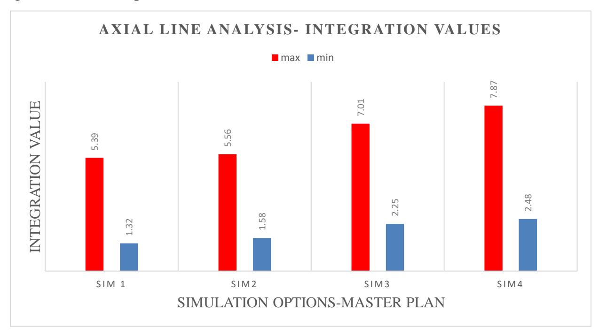

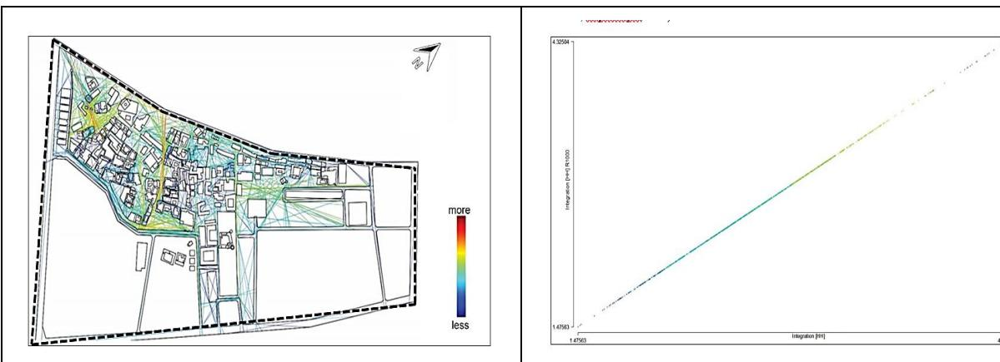
*Figure (1): Google Map of Sharjah City Highlight the Study Area of Heart of Sharjah, (source: 9)*

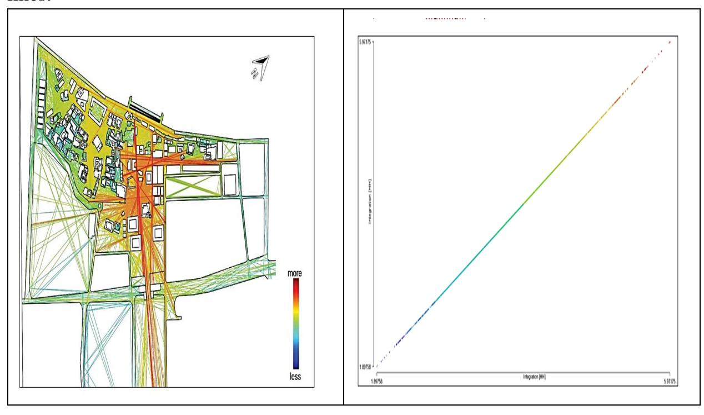
*Figure (2): Heart of Sharjah existing master plan, extracted from OSM by Grasshopper, (source: Author, 2020)*

Figure 2 illustrate collecting input data from the parametric tool as road networks, building structure, and land uses in the implementation of new tools as a quantitative process in urban analysis has introduced strong techniques over the conventional qualitative methodology that increase the scholarly interest in this pattern 10.

<!-- page 8 -->

Figure 3 represent the proposed master plan 2025 by Shurooq as a concptual master planning and devloping the area based on Dr. Sultan Al Qassimi vision. Shurooq developer divides the project into 4 phases.

<!-- page 9 -->

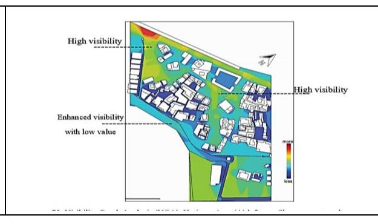

Meanwhile, to be able to regenerate the urban configuration of the area to create the physical layer of the design process, a parametric plan was created by using Grasshopper, which allowed a certain degree of flexibility, especially in the first stages of the design process. The Rhino Visual Programming Interface is incredibly useful for visualizing and accessing the results of the study,

The optimized layout proposal is then developed to broaden the spatial views between the heritage building to accomplish the goal of reconnecting living environments on both the spatial and the visible layers. As a result, the removal of visual restrictions has contributed to a substantial improvement in the average value of the Rn (r1000) integration measure. This approach allows for the structuring of the iterative process between research and design. One of the main objectives of this study is to improve the connectivity and livability of public spaces in a historical district, through restoring the historical relationship between the old city and the sea. Which has been isolated due to the presence of Corniche road that creates a barrier. The first attempt was to break down visual and physical boundaries to promote the creation of visual connections between spaces. This led to attracts people inside spaces, giving the form a cleaner look as well as a less fragmented structure. In this regard, two proposed simulations suggested by Author were evaluated in space syntax. According to Whyte, the area where the street and the plaza meet is a key to success or failure. The concept behind the suggested scenarios evolved around eliminating the road lanes, replace the car lanes with pedestrian or cycling pathways. Meanwhile, the urban configuration, in this case, can be regenerated and fill it with old urban fabric only in Al Hisin avenue instead of the High rise building which going to be demolished. At the same time, other old buildings can be improved by adaptive reuse, renovation, restoration, etc. The process of evaluation and assess the proposed scenario focusing on the main goal of this study which elaborated as

<!-- page 10 -->

reconnecting the two parts of the heart of Sharjah, and the old souq, in addition, to celebrate the ceremonial presence of Al Hisin.

## **Result**

## **Axial Analysis on the Global Level:**

Space syntax technology promoted the development of many analytical techniques based on mathematical and computer simulation to capture the configurational properties of urban spaces at various scales. While DepthMap X software is applied to generate the assessment by conducting axial line analysis and visibility graph analysis. Firstly, testing the proposed master plan by Shurooq on the neighborhood level and the optimized options on the global level by using axial line analysis to decide the best scenario of the regeneration options. Then, evaluate the chosen optimized proposed design options and compare it with the previous result of the Shurooq master

Plan through the running of axial line analysis on the local level to prove the previous result. After that, Forecasts on the future transformations in terms of public life can be made at this point through a visibility graph analysis. In the end, this will provide a sufficient way to understand the nature of the larger space and determine livability within spaces by studying how these unit spaces are connected, integrated on both physical and visible dimensions. However, the results of this study indicate that the vitality and success of the design of the public place relies on the value of integration, connectivity, choice, and visibility graph analysis (VGA) when we converted into space syntax terminology.

<!-- page 11 -->

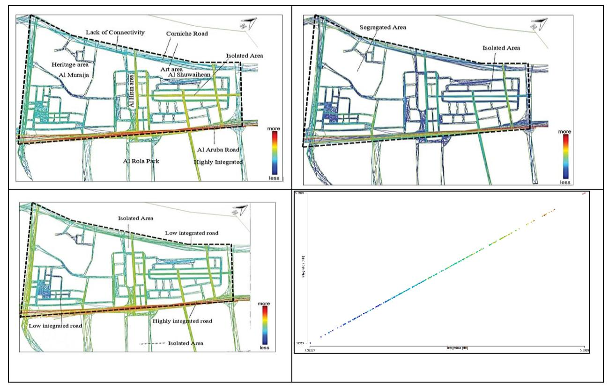
*Figure (5): Axial Map Analysis- Existing Master Plan (sim1), Global Connectivity, Choice, Integration Scatterplot (Min 1.32, Max 5.39), Rn, (source: Author, DepthMapX, 2020)*

Figure 5 shows the axial maps of the existing master plan associated with colour scale ranging from blue to red which means the level of connectivity or integration as the blue colour represent lack of connectivity. The highest integration and connectivity value showed in Al Auroba Street, which reflects the high traffic flow along the day. But the surrounding street of both Al Muraijah and Shuwaihean neighbourhood shows a lack of connectivity which resulted in an isolated area. However, the most integrated value in this analysis about (5.39) which considered a very low value as highlighted in the above axial maps. Since most of the maps are marked with blue color. This resulted in a segregated unsafe historical area.

<!-- page 12 -->

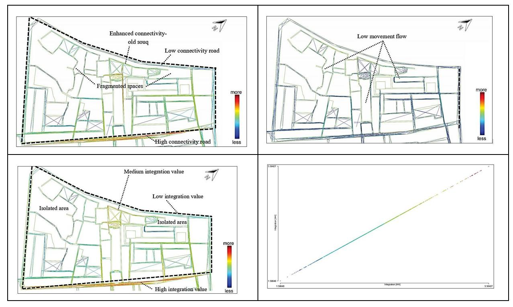
*Figure (6): Axial Integration Value of Shurooq Proposed Master Plan (sim2), Global Integration Scatterplot (Min 1.59,Max 5.56), Rn, (source: Author, DepthMapX, 2020)*

However, as shown in figure 6, provide a colourful presentation of the connectivity, choice, and integration values respectively. The result of the correlation analysis, to observe the difference between the current status of the study area and the proposed master plan by Shurooq was not significant. At the same time, as per the result still suffer from segregation between its spaces. Might this due to the adding of the old fabric instead of the modern demolished building in the Bank Street Although, the old souq being more connected is still isolated from the waterfront elevation due to the presence of Cornich road.

<!-- page 13 -->

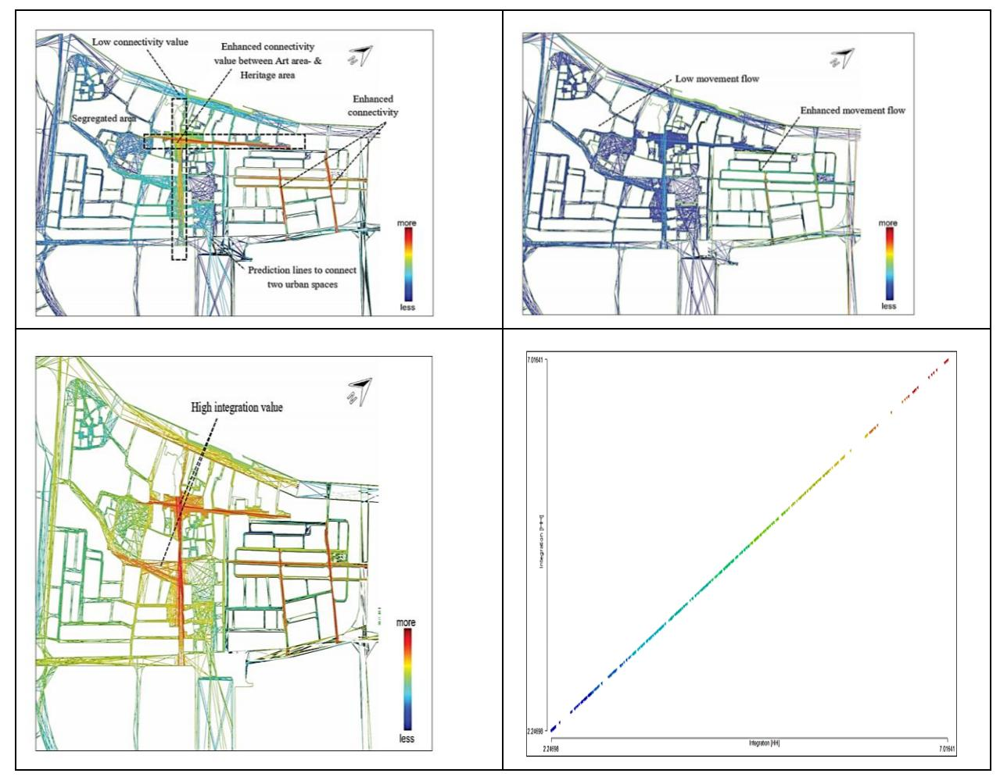
*Figure (7): Axial Integration Value of Optimized Proposed Master Plan- Option 1 (sim 3), Global Integration Scatter Plot, Rn, (Min 2.25, Max 7.01), (source: Author, DepthMapX, 2020)*

On the other hand, [Figure (](#page-12-0)7, shows that the integration value was significantly improved in optimized option one simulation-3, in comparison to the integration value were tested in the Shurooq proposal (sim2), where the difference between them around 2 degrees as shown in the scatter plot, The integration is measured in this scenario around (7.01).

<!-- page 14 -->

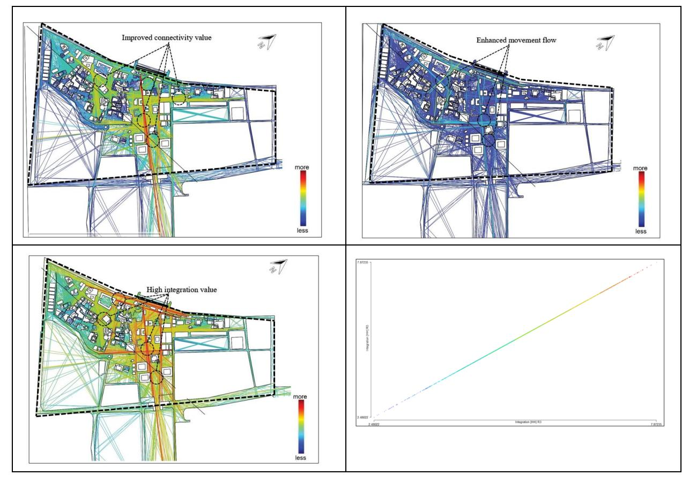
*Figure (8): Axial Integration Value of the Optimized Proposed Master Plan- Option 2 (sim 4), Global Integration Scatterplot, Rn, (Min 2.48, Max 7.87), (source: Author, DepthMapX, 2020)*

The new design proposal (option 2) is developed accordingly and structured in a way that increasing liveability and to create attractive places in the urban context. The first decision after analyzing the previous options was to transform the corniche road into an interactive plaza which will promote a car-free environment, and attract more pedestrian activities where they can flow easily toward the heritage and art area through organic sustainable corridors. In addition to that, those vistas will enhance the fresh breeze coming from the sea, which will have a good impact on the air quality for users. In this view, Al Hisn plaza will be designed as a central plaza for

<!-- page 15 -->

## International Journal for Scientific Research (IJSR)

## المجلة الدولية للبحوث العلمية

Vol. (3), No. (10)

October 2024

الإصدار (3)، العدد (10)

special events. Also, create a pedestrian bridge to connect the historical district with Al Rola Park. Meanwhile, the integration value was enhanced in this option in comparison with the previous simulations which account for (7.87) at the global level. The result of this analysis proved the final design proposal will lead more agents inside the spaces.

*Figure (9): Axial Line Analysis Chart of all Simulations at the Global Level Rn as following: (sim1): Existing Master Plan, (sim2): Shurooq Proposed Plan, option 1 (sim3): Optimized Proposed Plan, Options 2 (sim4): Optimized Proposed Plan, (source: Author, 2020)*

The above chart, illustrates the integration value of all axial line analysis results at the global level (Rn) of the study area. Overall, it is evident that the optimized proposed design option two (sim 4) measured the highest integration value at the global level which almost (7.87). Whereas the least integration value is shown at the existing master plan sim1, (5.39). Furthermore, comparing these two measures showed that, the most significant increment in the integration value around half 46%

<!-- page 16 -->

among them. However, the optimized proposal plan option one (sim3), was improved by roughly one quarter 26% in comparison with Shurooq proposed master plan (sim2). On the other hand, the optimized proposed plan option two (sim 4), its integration value results increased by 41% in comparison with the Shurooq proposal (sim2) at the global level Rn. Based on the axial analysis results and the predictions provided from space syntax, the selected optimized proposal for this study will be option two (sim 4). Consequently, design validation analysis will be conducted on the local level R800.

## **Axial Analysis on the Local Level:**

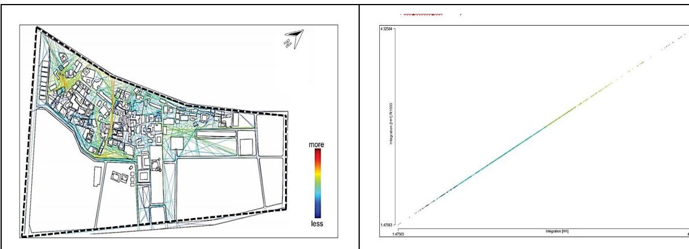
*Figure (10): Axial Integration Value of Shurooq Proposed Master Plan (sim2b), Local Integration Scatterplot, R800, (Min 1.4, Max 4.32), (source: Author, DepthMapX, 2020)*

The analysis was repeated within a metric radius of 800m as a walking distance within the community, which needs 10 minutes.[ Figure (](#page-15-0)10 shows the result of the local integration in the heritage area, the spaces were more connected from the waterfront side. But, the historical wall side still isolates the area from the adjacent neighbourhood. On the other hand, Al Hisin area and the Art area are still segregated and have a lot of disconnected pathways and fragmented spaces.

<!-- page 17 -->

Also based on the space syntax theory these lines can be helpful to predict the movement flow so the optimized options will be built on those analytical forecasting lines.

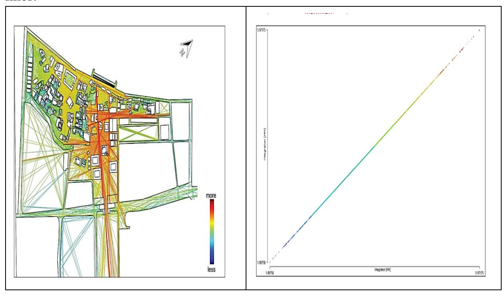
*Figure (11): Axial integration value of optomized proposed master plan- option 2 (sim 4), local Integration, R800, (Min 1.897, Max 5.97), (source: Author, DepthMapX, 2020)*

[Figure (](#page-16-0)11, shows that the results are significant at the majority of the area around (5.97), which at the same time still higher than the value was recorded in the proposed design by Shurooq on the same level (R800) which was almost (4.32). In order to ensure the reliability of the previous results, visibility graph analysis to be conducted to continue the evaluation process of the selected optimized proposal option two (sim4) and compare the results with Shurooq proposal subsequently.

<!-- page 18 -->

## **Visibility Graph Analysis (VGA):**

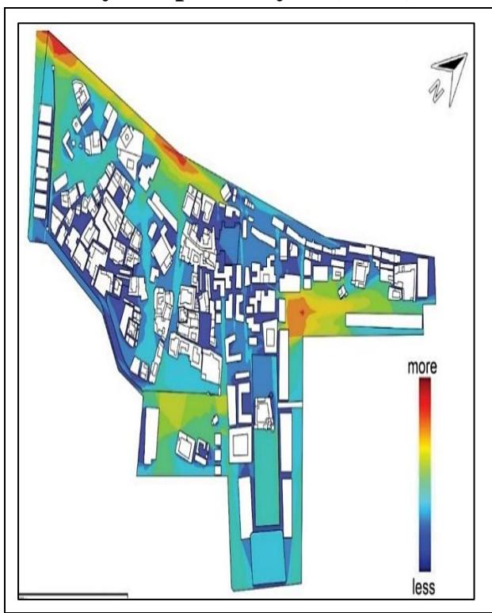

As shown in[ Figure (](#page-17-0)12, the results of the global level analysis represent improvement in the connectivity value in the whole area of the optimized proposed plan in comparison to the Shurooq master plan. Whereas, spaces highlighted with red showing a high level of connectivity and visibility, which can be used for social interaction. On the other hand, spaces highlighted with yellow represent the lowest value of connectivity or the least visibility. Further analysis was conducted at the local level for each area of the site separately, defined as Heritage area, Art area, and Al Hisin area.

<!-- page 19 -->

## Heritage Area -- (A) left map Shurooq master plan, -- (B) right map optimized proposed plan

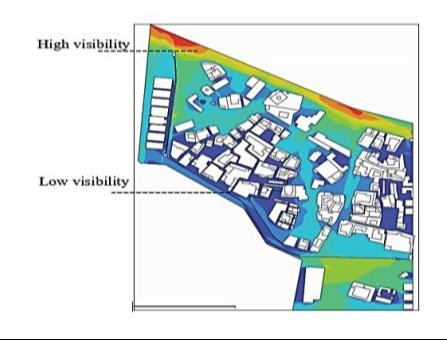

## Art Area

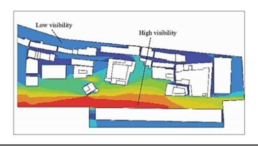

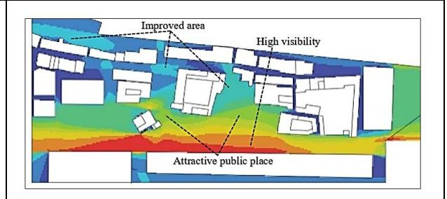

## Al Hisin Area

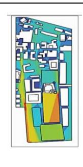

<!-- page 20 -->

## **Conclusion**

The results of the study described Sharjah City's actual picture, which indicates that much of its land are filled by wide car lanes, towers, retail outlets, and residential neighbourhoods were scattered over the entire system and segregated from each other. Which needed further effort at the city level. In the meantime, the study findings have shown that it is very important for Sharjah's historic area to be carefully built as a connected, integrated, and interactive place that can dramatically change the social, economic, and environmental conditions. Additionally, as investigated through the visibility graph analysis, the liveability of public spaces can be improved through the concept of narrative design experience which concentrating on social, and cultural values through juxtaposition of events, and space movement. Activating green spaces for a healthy lifestyle, and public spaces. Finally, sustainable urban regeneration is an iterative process that is designed to investigate cities from a holistic perspective.

## **References**

- NATION, U. (2018). Wo r l d U r b a n i z at i o n Pro s p e c t s : The 2018 Revision. Available at: https://population.un.org/wup/Publications/Files/WUP2018-KeyFacts.pdf.
- Oliver Wyman. (2019). Achieving sustainable development goals in the uae. Available at: [https://fcsa.gov.ae/en-us/Documents.](https://fcsa.gov.ae/en-us/Documents)
- Telford, T. (2001). the value of urban design. Available at: [https://www.designcouncil.org.uk/sites/default/files/asset/document/the-value-of-urban](https://www.designcouncil.org.uk/sites/default/files/asset/document/the-value-of-urban-design_0.pdf)[design_0.pdf.](https://www.designcouncil.org.uk/sites/default/files/asset/document/the-value-of-urban-design_0.pdf)
- Haapio, A. (2012). Towards sustainable urban communities. Environmental Impact Assessment Review. Elsevier Inc., vol. 32(1), pp. 165–169. Available At: https://wwwsciencedirect-com.buid.idm.oclc.org/science/article/pii/S0195925511000849
- Boussaa, D. (2018). Urban Regeneration and the Search for Identity in Historic Cities.
- Heart of Sharjah. (2020). image [online]. [Accessed 18 May 2020]. Available at: [https://www.heartofsharjah.ae/heart-of-sharjah-project.html](https://www.heartofsharjah.ae/heart-of-sharjah-project.html)

<!-- page 21 -->

- Hussein, N. (2017). The Pedestrianisation and Its Relation with Enhancing Walkability in Urban Spaces. Contemporary Urban Affairs, vol. 2(1), pp. 102–112. Available At: https://doi.org/10.25034/ijcua.2018.3666
- Boussaa, D. (2017). Urban Heritage and Tourism in the Gulf: The Case of Dubai in the UAE, (April 2014).
- "SUPC | initiatives". (2020). [Accessed 17 July 2020]. Available at: [https://supc.shj.ae/initiatives_new.aspx?id=12](https://supc.shj.ae/initiatives_new.aspx?id=12)
- A. Iyer, K. Deboo, Sh. Gandhi, D. P. (2019). Architectural & Urban Development of Sharjah : Spatial Analysis of Museums Typology. Available at: https://www.researchgate.net.
- Ye, Y., Yeh, A., Zhuang, Y., Nes, A. Van & Liu, J. (2016). '" Form Syntax "' as a contribution to geodesign : A morphological tool for urbanity-making in urban design, vol. 22, pp. 73–90. Available At: www.palgrave.com/journals
- Heart of Sharjah. (2008).. Dar Al Omran (Planners, Architects, Engineers). 2008
