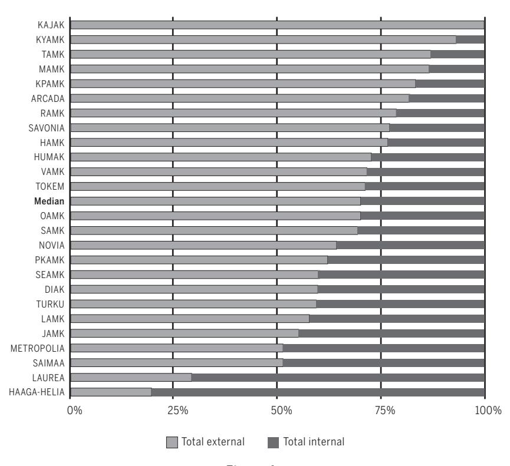
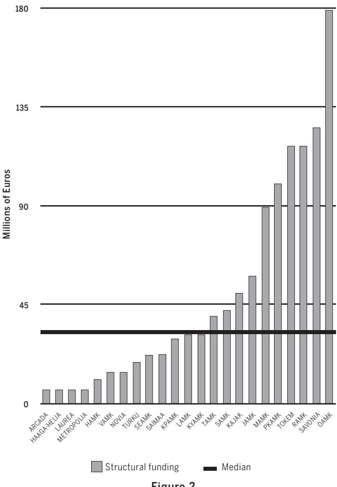

<!-- A3.R56 | source: papers_json/A3.R56/ -->

## Resourcedependent RDI?

Regional resource environments influencing the Finnish Universities of Applied Sciences' Research, Development and Innovation Activities in 2011–2012

## Matti Kajaste

VTM

Jyväskylän yliopisto matti.kajaste@gmail.com

<!-- page 2 -->

## Tiivistelmä

Artikkeli käsittelee alueellisen resurssiympäristön vaikutuksia Suomen ammattikorkeakoulujen tutkimus-, kehitys- ja innovaatiotoimintaan (TKI). Empiirisenä aineistona hyödynnetään ammattikorkeakoulujen TKI-toiminnan arvioinnissa vuosina 2011–2012 kerättyjä itsearviointeja sekä TKI-toiminnan rahoituksesta kertovaa tilastoaineistoa koko ammattikorkeakoulupopulaation osalta, joita analysoidaan resurssiriippuvuusteoriaa hyödyntäen. Koko ammattikorkeakoulukentän käsittävä tutkimus pyrkii vastaamaan kysymykseen: Kuinka alueellinen resurssien saatavuus vaikutti ammattikorkeakoulujen TKI-toiminnan luonteeseen eri oppilaitoksissa vuosina 2011–2012. Artikkeli osoittaa, että alueellinen ulottuvuus vaikutti merkittävästi ammattikorkeakoulujen TKI-toiminnan luonteeseen 2010-luvun alkupuolella. Tutkimus nostaa esiin kaksi mahdollista reittiä, joista monet ammattikorkeakoulut valitsivat. Oppilaitokset joko hyödynsivät merkittävästi opettajakuntaa TKI-toiminnassa sekä integroivat koulutuksen ja TKI-toiminnan läheisesti yhteen tai hankkivat merkittävästi ulkoista rahoitusta ja päätoimista TKI-työvoimaa tehtävän suorittamiseksi. Vahvasti toisistaan eroavat alueelliset kontekstit asettivat paineita korkeakoulujen ohjaukselle.

Asiasanat: *TKI, koulutus, integrointi, * *ammattikorkeakoulut, resurssiriippuvuus**teoria*

## Abstract

This study explores the impact of the regionally available resources to Finnish Universities of Applied Sciences (UAS) in their research, development and innovation activities (RDI). The empirical data used comprise of the self-evaluation reports from an external evaluation conducted in 2011-2012 and statistics on RDI funding to consider the whole UAS population in Finland using Resource Dependence as the theoretical framework to answer the question: How did the regional resource availability influence the nature of the Finnish UAS RDI activities in different institutions in 2011-2012 especially in relation to RDI-education integration? The analysis shows that the regional resource availability affected the form which different UAS RDI activities took by offering two main paths to RDI success; Either mobilise the teachers to RDI activities or attract significant external funding to hire dedicated RDI staff for the task. This situation posed some serious policy implications since it was difficult to consider the diversified resource contexts of regional higher education institutions in a unified performance funding scheme.

Keywords: *RDI, education, integration, * *universities of applied sciences, Resource * *dependency theory*

<!-- page 3 -->

## Introduction

he research, development, and innovation (RDI) activities of Finnish universities of applied sciences (UAS) is a topic that has received surprisingly little attention from

higher education researchers (see the comprehensive overview of most academic research on Finnish UASs by Rauhala et al., 2016). Overwhelmingly, the existing studies have concentrated on the internal activities of individual institutions or a comparison of a handful at most (e.g., Laakso et al., 2020; Helminen, 2020; Övermark, 2020). Majority of the research in RDI has been conducted by the UAS personnel themselves (see, for example: Rauhala et al., 2016). What is sorely lacking is a system-wide analysis on this legal requirement of a whole sector of higher education in Finland. The purpose of this study is to explore the diversity in approaches of higher education institutions' RDI profiles in 2012 with a special emphasis on the regional context and education integration as sources of diversity.

This article will first set the stage by outlining the Resource Dependence Theory, which will provide the theoretical context for considering universities of applied sciences' relationship with their operating environment. Next, a working definition for research, development and innovation activities will be offered together with the necessary background information of the UAS RDI sector in Finland. The article will then briefly consider the funding environment of UAS RDI activities. We will then utilize self-evaluation reports of all Finnish universities of applied sciences received in a national evaluation process

conducted by the Finnish Higher Education Evaluation Council in 2011-2012 as empirical data. The material provides with a snapshot of UAS RDI in time on the entire UAS population of Finland (25 institutions in 2012). A qualitative content analysis will be used to show how the role of the RDI was interpreted, how different staff groups were utilised and what was the subsequent role of students in the RDI effort. Finally, several key observations will be put forward.

## Resource dependence theory

esource dependence theory (RDT) is theoretical framework original-√y developed by Jeffrey Pfeffer and Gerald Salancik in 1978. It is a seminal work in organizational sociology on how an organization interacts with is environment and other organizations. The theory holds that all organizations need human, financial, technological, and other resources from the surrounding environment to be effective and essentially to survive. Organizations' strategy and interest tends to be dominated by the necessity of acquisition of resources. Resource providers are usually other organizations that offer resources in exchange for a degree of control and power on how those organizations use them. This translates into a relationship of dependence on the organization from its resource providers. It makes the organization vulnerable, so it is its interest to diversify its sources of resources to reduce dependence and constraints to its actions and to foster stability. The level of power which the external resource providers wield depends on the importance of the resource to the organization (Frooman, 1999). Organizations tend to prioritize the demands of the most important resource providing organizations over those of others.

<!-- page 4 -->

Much of the study of organization deals with the characteristics and internal dynamics of successful organizations, values and beliefs of leaders and structures inside the organization. The RDT offered a useful theoretical tool to extend the scope of analysis outside the organization. To focus less on what is going on inside the organization and more on the situation in which the organization is and pressures that the outside world places upon it. Crozier and Friedberg (1980) argued that the resource dependence does not determine the direction of the organization but limits the options available to the management and therefore affect the behavior of the organization. Nor is the organization at the mercy of resource providers but all organizations can and do attempt to influence their operating environment in many ways to create acceptance and demand for their activities.

For students of higher education, RDT is a useful tool through which to analyze the behavior of especially publicly funded higher education institutions (HEI) that have a small number of resource providers with which they dwell in a close relationship (Fowles, 2014). The funding streams are easily followed through public databases and the many outputs can be quantified. RDT is applied in many empirically oriented higher education studies, which seek to explain behavior through dependencies. Slaughter and Leslie (1997), have for example, used the RDT to show how funding organizations expect certain results from HEIs that they provide support for. HEIs look for alternative revenue sources to create stability and thus enter implicit or explicit contracts with funding organizations, which can alter the direction of the organization. RDT has been previously used at times to discuss the behavior of Finnish universi-

ties of applied sciences (Kohtamäki, 2009; 2022; Länsiluoto et al., 2013) and also internationally (e.g. Agasisti et al., 2023; Nam et al., 2019). It has been noted how UASs seek to foster their autonomy by diversifying funding sources. In the Finnish case, most of the funding is sourced from a small number of important public providers, such as the Ministry of Education and Culture. The RDT thus provides us with a useful viewpoint to analyze how the surrounding the resource environment influences the activities of the UAS. The article will next provide the necessary information of the UAS RDI and provide a working definition on what is understood as RDI.

## Finnish Universities of Applied Sciences' Research, Development, and Innovation Activities

Innish universities of applied sciences are vocational higher education institutions that were formed in the 1990s by upgrading the status of 210 vocational upper secondary institutions. In 2012 there were 25 UASs in Finland. In addition to providing higher education, they have had a legal requirement since 2003 to conduct RDI activities that serve the educational mission of the institution but also development of the local and regional businesses and public organizations. All Finnish UASs were publicly funded institutions that operated under the Ministry of Education and Culture. The Ministry steers the UASs and acts as the most important funding source for them (Päällysaho et al., 2021). Universities of applied sciences are set in every region of Finland to secure equality of higher education opportunities and serving regional needs across the country.

<!-- page 5 -->

The nature of university of applied sciences' RDI work is an elusive and difficult phenomenon to define (de Weert, 2011). Researchers on the topic have often shown a degree of frustration on the liberal ways the UASs and writers of the issue have chosen to define the RDI activities. Kyvik and Lepori (2010) noted that this problem is not unique to Finland. There is a lack of common perception on which types of activities are to be understood as research in the UAS sector, both within and between countries and within individual institutions.

For the purposes of this study, we can agree that RDI is essentially working life needs-oriented applied research and development work. The RDI aims to create new or improved products, means of production or methods and services, usually in collaboration with companies and/ or public sector organisations (Pitkänen et al., 2019). It is intended to serve the educational mission of the institution by studying the phenomena of the working life. UAS RDI is especially useful and necessary to SMEs that have little or no RDI function themselves. Next, this article will consider the existing information on the most important resources necessary for conducting UAS RDI activities.

The purpose of this study is to explore how the regional resource environment affected the form of Finnish UAS RDI activities. The research question thus becomes: How did the regional resource availability influence the nature of the Finnish UAS RDI activities in different institutions in 2011-2012 especially in relation to RDI-education integration?

## **Data and Method **

ll Finnish universities of applied sciences took part in the 2010-2012 evaluation of RDI activities by Finnish Higher Education Evaluation Council. The sole exception was Högskolan på Åland that have only very limited RDI activities. In addition, the Police University College was omitted from the material since it does not operate under the jurisdiction of the Ministry of Education and Culture and has quite different mission. FINHEEC's evaluation team requested UASs to complete a written PDF self-evaluation on its RDI activities. The evaluation team provided a ready template for the self-evaluation in the form of an electronic questionnaire with 15 open questions that dealt with views on the role of RDI in general and more specific questions on the procedures and practicalities of the activities. Self-evaluations were originally created for an international review panel for background information.

Universities of applied sciences' RDI work has been allowed to develop relatively freely with only limited steering from the Ministry of Education and Culture or other national authorities (Maassen et al., 2012). As a result, consensus on national level or amongst the UAS institutions on what constitutes desirable RDI work, did not exist. There were many competing views or models of RDI work and none of them seemed to be preferred by majority of the institutions. Therefore, UASs could present their individual views on RDI in the self-evaluations rather openly, as their interpretation was just as valid as any other then available.

The evaluation project did not include financial objectives or individual feedback to the participating UASs, as the

<!-- page 6 -->

evaluation team aimed at producing useful information to the development of the whole sector. The UAS sector could, therefore, hope to gain elevated general recognition from the national evaluation. The self-evaluation reports are valuable data in the sense that they include some surprisingly open, honest, and self-critical comments on the state of the UAS RDI. The reports were usually written by RDI directors or equivalent, aided by RDI coordinators and the top management of the organization, reflecting the views of the top management at a given point in time. The weakness of this data source is that it primarily served the needs of the evaluation process. However, a national evaluation process can attract the attention of UAS rectors and RDI directors in a way impossible for a single researcher. Of the fifteen original questions of the self-evaluations, this study concentrates on two: Q7 Staffing policy of RDI activities and Q8 the student participation in RDI. In addition to funding, the availability of competent workforce can be considered the most important resource necessary to conduct impactful RDI activities. The responses to these questions reveal that UASs have solved the question of human resources in divergent ways. They thus provide us with insights into how the regional resource environment impacted the UAS RDI activities in 2012.

The qualitative material of self-evaluations for the first question (number 7) consisted of 7012 words (average word count per UAS was 270 words, SD = 111 words). The second question (question 8) was answered with 5626 words (with an average of 216 words per UAS, SD = 91 words). The data was analysed through the means of Qualitative Content Analysis as described by Neuendorf (2002) and Schreier (2013). First, all institution-

al self-evaluations were read once to gain good general understanding of the data in general. A coding framework was then constructed for each of the two questions. Coding was conducted using Nvivo 11 qualitative analysis software. Coding itself was done thrice by the author for enhanced reliability. When a disagreement between codings was found, those cases were investigated more closely and corrected. The strict categorisation of UASs according to the codings would not have been sensible since they were based on free responses to open questions. It is likely that many more UASs shared similar characteristics but failed to report them since they were not specifically asked. The article will next briefly explore the RDI funding environment in which the Finnish UASs operated in 2012 as it will provide the background for the qualitative data subsequently analysed.

## **Findings **

Funding of the RDI activities

ne crucial resource and a determinant for the role of the RDI in each UAS was the volume and primary source of research funding. The Finnish UASs spent approximately 148 million euros in 2010 on RDI activities of which 66 % was external competitive funding from various sources. The most important of these were the European Union (37 % of external funding), Ministry of Education (19 %) and domestic companies (8 %). Roughly third of the overall RDI funding was internal funding. This was essentially money provided by the Ministry of Education Culture for the fulfilment of the educational mission, mostly teachers' salaries, which the UAS decided to use in RDI activities instead.

Figure 1 below is a chart of the ratio

<!-- page 7 -->

of internal and external RDI funding by UAS in 2008-2010. The three-year -span was selected to omit the occurrence of one large successful project-funding bid on a given year (note that the figure does not illustrate the relative difference in absolute volume of funding). The three-year-period is significant here as the EU 7th framework programme took place in 2007- 2013, which meant that RDI funding allocations changed strongly during this time (Laakso et al., 2020).

The Figure 1 illustrates the strong variance in the ratio of external and internal funding (Please find a list of Finnish UASs together with their respective regions and staff count in 2010 in attachment 1). What is interesting is that those that have the largest share of internal RDI funding

were mostly based on the Helsinki metropolitan region or in the largest towns in Finland (HAAGA-HELIA, LAUREA and METROPOLIA). In contrast, those who had the most external funding tended to be located in the Eastern and Northern parts of the country where most of the economically less-developed regions were (KAJAK, KYAMK, MAMK and RAMK especially). The reason for this is illustrated by figure 2 next page.

EU funding and especially Structural funds were extremely important for many Finnish universities of applied sciences. These funds were divided amongst the regions to support the weakest regional economies most, while the richest and most educated regions received very little structural support. UASs from the rich-

*Figure 1. Ratio of internal and external RDI funding in 2008-2010 (Statistics Finland n.d.)*

<!-- page 8 -->

*Figure 2.
Division of EU structural funding by region in 2007–2010
(Ministry of Economic affairs and Employment n.d.)*

er regions, for the most part, couldn't apply for funding from the calls of other regions. This is the reason the UASs in the largest towns on south of Finland, including LAUREA, METROPOLIA and HAAGA-HELIA tended to spend internal funding on RDI instead. This contributed to the very unequal distribution of RDI funding and subsequent resource diversity amongst the UASs of Finland with important consequences to the nature and profile of the type of RDI activities the institutions adopt.

## Staffing Policy of RDI Activities

Question posed at the self-evaluation template on this topic was: 'Please explain the staffing policy with respect to RDI activities at your UAS, including a description of the minimum requirements or qualifications for staff participation in RDI activities (e.g., work experience, project management training); the way in which staff members are stimulated to participate in RDI activities; the ways in which RDI competences are taken into account in staff recruitment; and the way in which RDI competences of staff members are developed. Here we would also like to

<!-- page 9 -->

know how many of the institutional academic staff members have an RDI related function only?'

From the self-evaluations two broad RDI profiles could be identified. Both relate strongly to regional environment and subsequent human and financial resource availability. First, the concentration on teachers and emphasising RDI-education integration. Second, the reliance on dedicated RDI staff as primary workers in research, development, and innovation activities. Several UASs stated that they have effectively selected the former profile. The UASs situated in the Helsinki metropolitan area (METROPOLIA, ARCADA, LAUREA) and TURKUAMK emphasised this strongly.

*'At our UAS RDI work is integrated with * *teaching. In practice this means that the * *qualifications for staff participating in * *RDI are always intertwined with the * *requirements of a degree programme.' * (METROPOLIA).

In these UASs, there appeared to be a determined effort to foster RDI-education integration, often accompanied by a supporting pedagogic model. Many UASs stated that they intentionally involved teachers and lecturers to the RDI projects to facilitate closer integration of RDI and education.

These findings show how important RDI-education integration was considered in many Finnish UASs. In fact, over half (15/25) of the UASs stated that they were actively encouraging teachers to participate in RDI activities. This illustrated the top managements' positive attitudes towards RDI-teaching integration while suggesting that the teachers' attitudes towards RDI were a challenge to at least half

of the UASs. This also supports findings of a number of previous studies (Maassen et al., 2012; Naukkarinen, 2004; Marttila et al., 2005). Savonia UAS also admitted that one obstacle was posed by staff members who were not yet willing to accept new identities:

*'Participation in RDI activities is thought * *to be a standard for all staff, although we * *still are forced to acknowledge the restric**tive inertia in the traditional staff identi**ties.' *(SAVONIA).

Minna Söderqvist (2005) noticed similar tendencies in her study. RDI functions were seen as alien to the UAS, which was built on the culture of education. Salomaa and Caputo had similar findings as recently as 2021. Incorporating a new research-centred mission requires changes to teacher identity, which is difficult and often results in inertia. UAS staff appeared to define their professional identity quite strictly (Väänänen & Peltonen, 2020). Savonmäki (2007) has argued that UAS teachers only find conducting research activities on their own work motivating, when the questions rise from the bottom up. However, the strategic profile of UAS RDI is often quite strongly steered by the top management (Kajaste, 2018; Pitkänen et al., 2019). It is likely that RDI activities do not always appear especially inviting in these circumstances.

CENTRIA UAS regretted in her self-evaluation report that teachers were lacking the necessary competences to fully participate in RDI.

*'A current challenge in the Finnish UAS * *sector is the weakness of teaching staff re**search qualifications. Legally schools have a * *duty to implement RDI, but teachers lack * *sufficient tools for RDI activity implemen**tation.' *(CENTRIA).

<!-- page 10 -->

In the context of a national evaluation, this is a surprisingly honest statement. It is not, by any means, unique. Löytönen and colleagues (2010), found that one of the principal obstacles to stronger RDI effort in LAUREA UAS was the lack of personnel with adequate level of research methodology knowledge and skills. Kolehmainen notes similar human resources problems in a much more recent study published in 2019. Alarmingly, according to Zacheus (2009), less than 50 % of the stakeholder respondents considered the UAS staff as having up-to-date working life and substance knowledge. Hazelkorn (2008) reminds us that the concern over UAS teachers' competences is not unique to Finland, but a European one. UAS teachers were usually originally recruited for a teaching role only without regard to competence, interest, or experience in RDI. Generating a solid competence base appears to be very slow and difficult. Hazelkorn's earlier study (2005) suggests that RDI expertise is more easily recruited from outside. The problem of insufficient teacher RDI competences was most likely a real one, but it is interesting that most often it is the top management that presents it is a major challenge to UAS RDI. Competent and skilled researchers are certainly an important resource for the UAS. Success in recruiting and honing the best RDI-talent appeared to be one of key factors in the RDI effort. CENTRIA's statement is also another example of the general blaming game as highlighted by Hazelkorn (2005) and Zacheus (2009). The top management tended to be critical of teachers' competences, while the teachers themselves blamed the working conditions that were not seen to be supportive towards RDI. It is quite likely that most UASs suffered from the obstacles to integration to an extent, but it seems especially prevalent in regions without a research university and generally lower general level of education.

A second RDI profile was chosen by many UASs that stated that they recruit RDI professionals from outside the institution whenever teachers were lacking the necessary expertise. In addition, 40 % (10/25) of the UASs stated that most of the RDI work is conducted by full-time RDI staff members. Most of these UASs were located in less-develop and lower educated regions of Finland. This is possible where external funding, often from the European union, was available.

*'In 2010 altogether 62.6 person-years * *were used for RDI activity in our organ**isation, of which 13.9 person-years were * *accumulated by teachers.'*(RAMK).

Here a UAS from Lapland stated that teachers were responsible for only a minority of the overall RDI effort. The expectation was that most of the RDI projects was conducted with external funding, with only a limited integration into education. Below, from the response of another provincial UAS, it can be calculated that roughly 2/3 of the total RDI effort was put in by RDI employees.

*'KTUAS headcount in August 2010 * *was 209 employees (full time) consist**ing of 135 teachers, 40 RDI employees * *and 34 other employees. Altogether 180 * *employees (incl. part time) have partic**ipated in the RDI activities during year * *2010, which makes a total of 67 per**son-years.'*(TOKEM).

Most UASs of this second profile also emphasised heavily the technology transfer and business sector modernization role as part of the RDI activities. This function was mostly absent from the responses of the metropolitan UASs.

<!-- page 11 -->

*'Basically, the role of RDI activities of * *the UAS is to link the science-based ba**sic and applied research of academic uni**versities to product development of small * *and medium-size companies and enter**prises. In a way we can describe it as an * *"umbilical cord between basic research * *and enterprises".' *(RAMK).

One reason for the prevalence of this function was perhaps the funding criteria of the European Union structural funds, which emphasised the working-life development aspects of RDI. One of the major hindrances towards closer integration between education and RDI activities seemed to be that the teachers were simply unwilling to participate. As RDI activities did not seem to be very attractive amongst the UAS teacher population, it appeared likely that the integration of RDI and education was most advanced, where the motivation efforts had been most successful. Therefore, it appears that some UASs managed to accumulate the resource of research-intensive teachers, while others have not. Since much of the research project ideas and proposals originated from the teacher population, this is very important factor in determining the performance of the organization in this regard.

## Student Participation in RDI Activities

Question posed at the self-evaluation template on this topic was: 'Please explain the nature of student participation in RDI activities of your UAS. Which parts of RDI processes and activities do they participate in, and how do they participate in them?'

The extent and nature of students' participation in RDI activities varied quite

significantly in Finnish UASs, as it did also elsewhere in Europe (de Weert, 2011). By volume, the most common way to get involved was through courses and modules with mandatory RDI tasks. UAS degree programmes had a mandatory practical training, which can be held in an RDI project, especially if external partners are involved. The more student RDI involvement the UAS entertains, more instances of actual, in-depth student participation in the projects can be expected.

Six UASs in the self-evaluations placed greater emphasis on student participation in the self-evaluation report than others. Many of these were metropolitan or close to Uusimaa, although not all. Those that concentrated on student involvement seemed to see the benefits participation in projects can have on students' experience. Also, it is likely that these UASs conducted the kind of RDI activities, which are especially inclusive towards student involvement. Naturally, increased student involvement went hand in hand with increased teacher participation.

In marked contrast were the six UASs that showed far less active student participation in RDI activities. These UASs were more provincial and more often from non-university regions. There seemed to be a connection between external funding and lower student involvement, since a number of UASs, for example KAJAK, stated that almost all externally funded projects were done without student participation.

*'A significant amount of RDI projects are * *only implemented by the staff of KUAS * *and its partners in cooperation without * *the involvement of students. Many solely * *externally funded projects with companies * *are implemented on this basis. Such pro-*

<!-- page 12 -->

jects require such a high and demanding level of expertise that the role of students (if involved) remains limited.' (KAJAK).

TAMK also agreed that when funding was international and/or there are regional development projects and companies involved, students were mostly not participating. Student involvement obviously made prompt scheduling of the project more challenging and can apparently make it more difficult to ensure the quality of the RDI output. Often, the student participation took place only in terms of mandatory training periods in the project or in the form of student theses in the RDI projects. Interestingly, more recently, Hero and colleagues (2022) have found that student RDI projects can have considerable regional impacts. Hakomäki (2013) has studied the difficulties of RDI-education integration in the work of teachers of one UAS. The teachers were content with their competences for integration but felt that the students' study plans, and the teachers' scheduling did not support the RDI –education integration.

SAVONIA confirmed being committed to increasing student involvement despite the traditional teacher identities may hinder it. A large group of UASs stated that they considered student involvement important but do not provide much evidence or argumentation for it. This is probably not surprising given the vocal support of UAS top management to the RDI-education integration. Similarly, to teacher involvement, the more ambitious student involvement appeared to be a goal that the UASs are striving for. The many, extensively documented obstacles to closer integration of RDI and education are also visible in the self-evaluations used in this study. There appears to be a persistent attitudinal problem towards RDI that most tions in the more educated and econom-

UASs struggled with. Many teachers considered RDI as extra or additional task, secondary to teaching. The empirical data suggests that there were large differences between UASs in terms of the RDI profiles they have adopted. This was reflected by the RDI staffing policy and the role of students and integration of RDI with education.

## **Conclusion and Discussion **

The question this article aimed to answer was: How did the regional resource availability influence the development of the Finnish UAS RDI activities in different institutions in 2011-2012 especially in relation to RDI-education integration? The previous research on UAS RDI, the self-evaluation reports analysed, and statistics used in this study showed that there was a fairly high degree of diversity across the sector in terms of the financial and human resources available and how the RDI mission was ultimately interpreted, providing support for the Resource Dependence Theory. There were also clear tensions between education and RDI in the UAS sector. The RDI activities often needed funds and time from teaching, while education remained the primary task of the institution and the most important source of revenue (Hazelkorn, 2008). Internal competition for resources emerged, as took place in Switzerland, for example (Lepori & Kyvik, 2010). As expected by the RDT, the regional resource context certainly appeared to affect the RDI operating environment quite significantly and to constrain the possibilities available to the UASs by offering essentially two alternative profiles for the UAS RDI activities.

First was the one adopted by institu-

<!-- page 13 -->

ically vibrant metropolitan regions of Southern Finland. Teachers and students in those UASs tended to be actively involved in RDI and the integration into education appeared more advanced. Second profile was available to UASs in the comparatively poor and less-educated regions of Eastern and Northern Finland that received the bulk of European Union structural funds resulting in external RDI funding resource being more readily available. Most of the RDI projects were conducted by dedicated RDI staff, hired fixed term with external funding. The money attracted local companies to take part in the projects, thereby contributing to more sustained relationships and collaboration on RDI. Technology transfer to modernize the SME-sector was an important and necessary function here. Most UASs could be placed somewhere on this continuum, although the qualitative data used here does not quite lend itself to strict categorisation of institutions. In 2011-2012 most of the external UAS RDI funding was essentially competitive, extra money on top of the budget funding offered by the Ministry. RDI activities could, therefore, be seen as an effort to increase the degree of autonomy of the institution from the main resource providing organization and to reduce dependency from it. These findings are broadly in line with more recent studies (Kitagawa et. al., 2016; Salomaa 2019; Schlegel et al., 2022; Agasisti et al., 2023) suggesting that this phenomenon most likely persists also today.

One important caveat should be noted. As the empirical data was gathered in 2010-2011, significant changes may have happened to the approaches to RDI-education integration in over ten years. Therefore, caution should be exercised in drawing current policy conclusions from the data. Some authors have, however, not-

ed the persistent nature of many of these challenges that UAS RDI are still facing (Vetoshkina et al., 2023). One would very much like to see a repeated nation-wide UAS RDI evaluation exercise, conducted by the Finnish Education Evaluation Centre, to assess the current situation and any potential changes. Furthermore, there was and is an unfortunate lack of knowledge on what is going on inside the RDI projects. Systematic categorisation of RDI projects on a national scale would be very useful to expand our knowledge on the forms and practices of the UAS RDI.

This study showed that there were often multiple ways to achieve success and reduce the dependence on a single provider of resources in RDI. Organizations used the regional opportunities available to them and made use of a lack of certain resource to gain new avenues in RDI. The obvious resource disparity posed challenges to effective national steering of UAS RDI. Creating accountable and balanced performance indicators for RDI is difficult when the regional contexts in which the universities of applied sciences operate are highly divergent.

<!-- page 14 -->

## Attachment 1

List of abbreviations and basic information on the UASs Finnish Universities of Applied Sciences in 2010

| Abbreviation | Full name | Region | Total Staff Headcount in 2010* |
| --- | --- | --- | --- |
| ARCADA | Arcada University of Applied Sciences | Uusimaa | 167 |
| DIAK | Diaconia University of Applied Sciences | Uusimaa / Network | 359 |
| HAMK | Häme University of Applied Sciences | Kanta-Häme | 451 |
| HAAGA-HELIA | Haaga-Helia University of Applied Sciences | Uusimaa | 519 |
| HUMAK | Humak University of Applied Sciences | Network | 155 |
| JAMK | JAMK University of Applied Sciences | Central Finland | 623 |
| KAJAK | Kajaani University of Applied Sciences | Kainuu | 168 |
| KPAMK | Central-Ostrobothnia University of Applied Sciences (Centria UAS in 2021) | Central Ostrobothnia | 288 |
| KYAMK | Kymenlaakso University of Applied Sciences (part of XAMK in 2021) | Kymenlaakso | 397 |
| LAMK | Lahti University of Applied Sciences (part of LAB UAS in 2021) | Päijät-Häme | 386 |
| LAUREA | Laurea University of Applied Sciences | Uusimaa | 518 |
| MAMK | Mikkeli University of Applied Sciences (part of XAMK in 2021) | South Savo | 395 |
| METROPOLIA | Metropolia University of Applied Sciences | Uusimaa | 1075 |
| NOVIA | Novia University of Applied Sciences | Ostrobothnia | 332 |
| OAMK | Oulu University of Applied Sciences | North Ostrobothnia | 658 |
| PKAMK | North Carelia University of Applied Sciences (Karelia UAS in 2021) | North Carelia | 404 |
| RAMK | Rovaniemi University of Applied Sciences (part of the Lapland UAS in 2021) | Lapland | 277 |
| SAIMAA | Saimaa University of Applied Sciences(part of LAB UAS in 2021) | South Carelia | 240 |
|  |  |  |  |

<!-- page 15 -->

## References

Agasisti, T., Egorov, A., & Serebrennikov, P. (2023). Universities' efficiency and the socioeconomic characteristics of their environment—Evidence from an empirical analysis. *Socio-Economic Planning * *Sciences*, *85*, 101445. https://doi.org/10.1016/j. seps.2022.101445

Crozier, M., & Friedberg, E. (1980). *Actors and * *systems: The politics of collective action*. University of Chicago Press. https://doi.org/10.7202/029369ar

Fowles, J. (2014). Funding and focus: Resource dependence in public higher education. *Research * *in Higher Education,* *55*(3), 272–287. https://doi. org/10.1007/s11162-013-9311-x

Frooman, J. (1999). Stakeholder influence strategies. *Academy of Management Review*, *24*(2), 191– 205. https://doi.org/10.2307/259074

Hakomäki, S. (2013). *Kuvaus opettajien TKI**työn ja opetuksen integraatiosta*. [UAS Master's Thesis, Metropolia ammattikorkeakoulu]. URN:N-BN:fi:amk-2013060613320

Hazelkorn, E. (2005). *University research manage**ment: Developing research in new institutions.* OECD Publishing.

Hazelkorn, E. (2008). Motivating individuals: Growing research from a 'fragile base'. *Tertiary Ed**ucation and Management*, *14*(2), 151–171. https:// doi.org/10.1080/13583880802053184

Helminen, J. (2020). Näkökulmia osallistavaan tutkimus-, kehittämis-ja innovaatiotoimintaan. *Diakonia-ammattikorkeakoulun TKI-to**iminnan vuosikirja* 5. https://urn.fi/URN:IS-BN:978-952-493-348-3

Hero, L. M., Lintula, N. C., Wilkinson, S., & Pitkäjärvi, M. (2022). Regional effects of multidisciplinary innovation projects. Innovation education impact assessment model. *ISPIM Conference Pro**ceedings *(pp. 1–23). The International Society for Professional Innovation Management (ISPIM).

Kajaste, M. (2018). Quality management of research, development and innovation activities in Finnish universities of applied sciences. *Quality in * *Higher Education*, *24*(3), 271–288. https://doi.org/1 0.1080/13538322.2018.1558505

Kitagawa, F., Sánchez Barrioluengo, M., & Uyarra, E. (2016). Third mission as institutional strategies: Between isomorphic forces and heterogeneous pathways. *Science and Public Policy*, *43*(6), 736–750. https://doi.org/10.1093/scipol/scw015

Kohtamäki, V. (2009). *Financial autonomy in * *higher education institutions - Perspectives of sen**ior management of Finnish AMK institutions*. Tampere University Press. https://urn.fi/urn:isbn:978-951-44-7756-0

Kohtamäki, V. (2022). Autonomy-driven segmentation for competition among Finnish universities: Leaders' perceptions. *Studies in higher education*, *47*(1), 67–79. https://doi.org/10.1080/03075079.2 020.1730314

<!-- page 16 -->

Kolehmainen, M. (2019). *Selvitys ammattiko**rkeakouluopettajien TKI-osaamisesta*. [UAS Master's Thesis, Savonia-ammattikorkeakoulu].

Kyvik, S., & Lepori, B. (2010). Research in higher education institutions outside the university. In S. Kyvik, & B. Lepori (Eds.), *The research mission * *of higher education institutions outside the university * *sector. Striving for differentiation* (pp. 3-21). Higher Education Dynamics 31. Springer. http://dx.doi. org/10.1007/978-1-4020-9244-2_1

Laakso, A., Stormi, I., & Mikkonen, A. (2020). Ammattikorkeakoulujen TKI-toiminta Suomen kilpailukyvyn edistäjänä. *Tieteessä tapahtuu,* *38*(5). https://journal.fi/tt/article/view/99571

Lepori, B., & Kyvik, S. (2010). The research mission of universities of applied sciences and the future configuration of higher education systems in Europe. *Higher Education Policy*, *23*(3), 295–316. https://doi.org/10.1057/hep.2010.11

Länsiluoto, A., Järvenpää, M., & Krumwiede, K. (2013). Conflicting interests but filtered key targets: Stakeholder and resource-dependency analyses at a university of applied sciences. *Management * *Accounting Research*, *24*(3), 228–245. https://doi. org/10.1016/j.mar.2013.02.001

Löytönen, M., Schwab-Matkovits, I., Spaapen, J., & Varmola, T. (2010). *Evaluation Report of Laurea * *University of Applied Sciences 2010*. Laurea-ammattikorkeakoulun julkaisusarja B 39.

Maassen, P., Spaapen, J., Kallioinen, O., Keränen, P., Penttinen, M., Wiedenhofer, R., Mattila, J., & Kajaste, M. (2012). *From the bottom up – Evalua**tion of RDI activities of Finnish universities of applied * *sciences*. FINHEEC 7:2012.

Marttila, L, Kautonen, M, Niemonen, H. & Von Bell, K. (2005). Ammattikorkeakoulujen T&K-toiminta: T&K-yksiköt koulutuksen, tutkimuksen ja kehittämistyön rajapinnassa. *Työraportteja* 75/2005, Työelämän tutkimuskeskus, Tampereen yliopisto.

Ministry of Economic affairs and Employment. (n.d.) *Division of EU structural funding by region in * *2007-2010.*

Ministry of Education and Culture. (n.d.) *Educa**tion statistics Finland. Total staff headcount in 2010.* (Retrieved 26.4.2024) https://vipunen.fi/en-gb/polytechnic/Pages/Henkil%C3%B6st%C3%B6.aspx

Nam, G. M., Kim, D. G., & Choi, S. O. (2019). How resources of universities influence industry cooperation. *Journal of Open Innovation: Technol**ogy, Market, and Complexity*, *5*(1), 9. https://doi. org/10.3390/joitmc5010009

Naukkarinen, M. (2004). *Tampereen ammattiko**rkeakoulun soveltavan tutkimus- ja kehitystyön toteu**tusmalli* [Licenciate thesis. Tampereen teknillinen yliopisto].

Neuendorf, K.A. (2002). *Content Analy**sis Guidebook*. Sage Publications. https://doi. org/10.4135/9781071802878

Pfeffer, J. & Salancik, G. R. (1978). *The External * *control of organizations: A resource dependence perspec**tive*. Harper & Row.

Pitkänen, E., Lempinen, P., & Vainio, E. (2019). *Innovaatioita ja osaamista työelämään.* Ammattikorkeakoulujen rehtorineuvosto Arene ry. http://www. arene.fi/wp-content/uploads/Raportit/2019/TKI_ raportti/Innovaatioita%20ja%20osaamista%20 raportti%202019.pdf

Päällysaho, S., Latvanen, J., Lehto, A., Riihimaa, J., Lahti, P., Kärki, A., & Puhakka-Tarvainen, H. (2021). Key aspects of open data in Finnish RDI cooperation between higher education and businesses. *Data Intelligence*, *3*(1), 176–188. https://doi. org/10.1162/dint_a_00065

Rauhala, P., Kantola, M., Friman, M., & Huttula, T. (2016). Ammattikorkeakoulutus tutkimuksen kohteena. *Tiedepolitiikka,* *41*(3), 57–68.

Salomaa, M. (2019). Third mission and regional context: assessing universities' entrepreneurial architecture in rural regions. *Regional Studies, Regional * *Science*, *6*(1), 233–249. https://doi.org/10.1080/216 81376.2019.1586574

Salomaa, M., & Caputo, A. (2021). Business as usual? Assessing the impact of the COVID-19 pandemic to research, development and innovation (RDI) activities of universities of applied sciences. *Tertiary Education and Management,* *27*(4), 351–366. http://dx.doi.org/10.1007/s11233-021- 09079-z

Savonmäki, P. (2007). *Opettajien kollegiaalin**en yhteistyö ammattikorkeakoulussa: mikropoliittinen * *näkökulma opettajuuteen (No. 23).* Koulutuksen tutkimuslaitos. [Doctoral Thesis, Jyväskylän yliopisto]. http://urn.fi/URN:ISBN:978-951-39-3005-9

Schlegel, T., Pfister, C., Harhoff, D., & Backes-Gellner, U. (2022). Innovation effects of universities of applied sciences: An assessment of regional heterogeneity. *The Journal of Technology Transfer*, *47*(1), 63–118. http://dx.doi.org/10.1007/s10961- 020-09839-w

Schreier, M. (2013). Qualitative content analysis. In U. Flick (Ed.) *The SAGE handbook of qualita**tive data analysis *(pp. 170–184). SAGE Publications.

Slaughter, S., & Leslie, L. L. (1997). *Academ**ic capitalism: Politics, policies, and the entrepreneurial * *university*. Johns Hopkins University Press.

Statistics Finland. (n.d.) *R&D expenditure in the * *higher education sector according to the source of funds * *by higher education institute, 1991-2022* (Retrieved 26.4.2024) https://pxdata.stat.fi/PxWeb/pxweb/en/

<!-- page 17 -->

StatFin/StatFin__tkke/statfin_tkke_pxt_129x.px/ Söderqvist, M. (2005). Vaihtoehtona sosio-konstruktivismi. In H. Kotila, & A. Mutanen (Eds.) *Tutkiva ja kehittävä ammattikorkeakoulu *(pp. 24– 39). Edita.

Vetoshkina, L., Lamberg, L., Ryymin, E., Rintala, H., & Paavola, S. (2023). Innovation activities in a university of applied sciences: Redefining applied research. *Journal of Applied Research in Higher Educa**tion*, *15*(2), 289–302. https://doi.org/10.1108/JAR-HE-10-2021-0380

Väänänen, I., & Peltonen, K. (2020). Siiloista saumattomaan opetuksen ja TKI-toiminnan integrointiin ammattikorkeakouluissa. *Ammattikasvatuk**sen aikakauskirja*, *22*(2), 52–69. https://journal.fi/ akakk/article/view/95963

De Weert, E. (2011). Transformation or systems convergence? The Research profile of universities of applied sciences in Europe. In J. Enders, H. de Boer, & D. Westerheijden (Eds.) *Reform of higher ed**ucation in Europe *(pp. 103–122). Sense Publishers. https://doi.org/10.1007/978-94-6091-555-0_7

Zacheus, T. (2009). *Työelämäyhteydet ammattiko**rkeakouluissa 2008*. Keski-Pohjanmaan ammattikorkeakoulu.

Övermark, K. (2020). *Asiakastyytyväisyyden * *hyödyntäminen palveluliiketoiminnan kehittämi**sessä: Centria-ammattikorkeakoulun TKI-toimin**ta ja palvelutoiminta *[UAS Bachelor's Thesis. Centria ammattikorkeakoulu]. https://urn.fi/URN:N-BN:fi:amk-2020100721098
