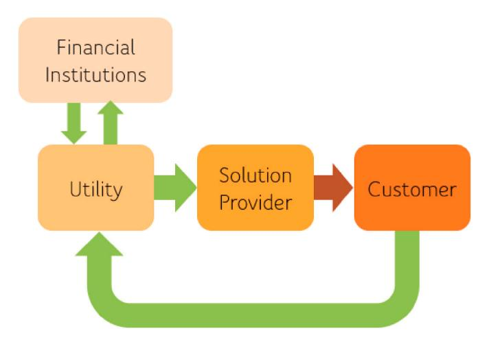
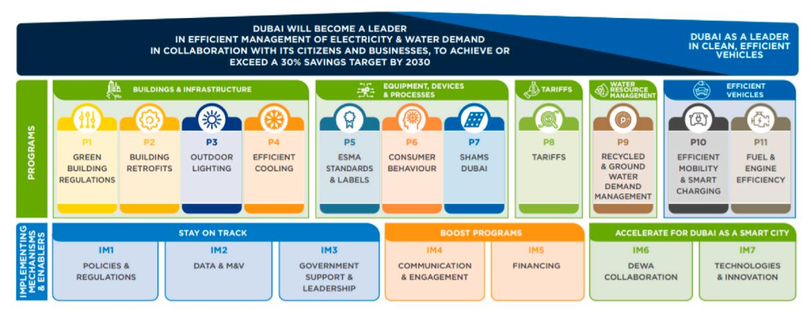
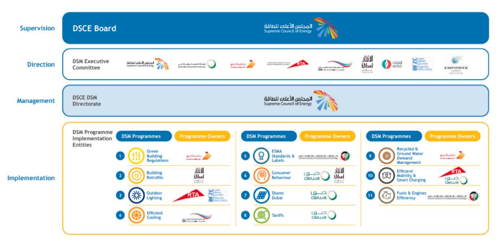
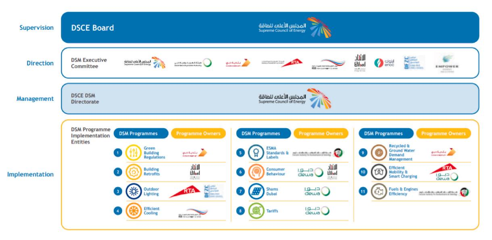
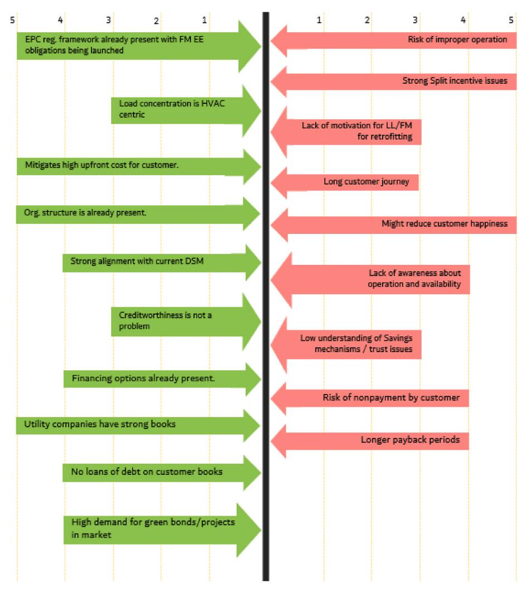

<!-- A3.R57 | source: papers_json/A3.R57/ -->

Contents lists available at[ ScienceDirect](www.sciencedirect.com/science/journal/09571787)

## Utilities Policy

journal homepage: [www.elsevier.com/locate/jup](https://www.elsevier.com/locate/jup)

## Full-length article

Hasan Zulfiquar Kamal, Bassam Abu-Hijleh *

*The British University in Dubai, United Arab Emirates *

## ARTICLE INFO

*Keywords: * Demand-side management Retrofit financing Refurbishment financing UAE On Bill Tariff (OBT) On Bill Financing (OBF) On Bill Repayment (OBR)

## 1. ABSTRACT

In this paper, we examine the factors that may influence the implementation of an OnBill Financing (OBF) program for promoting energy efficiency in Dubai. The data was collected using a semi-structured expert on expert interview method. Interviews were conducted with institutional stakeholders involved in OBF program implementation. A forcefield diagram was created from the interview responses to understand better the identified conducive and deterrent forces that must be considered when implementing an OBF program locally. The main finding of the qualitative review suggests that an OBF program could be implemented locally in Dubai. The findings also show that implementation is not without challenges. A tailored OBF program that addresses the repayment model and covered equipment/projects under the program can mitigate these hurdles.

## **2.** **Introduction **

The world's energy demand and consumption have expanded rapidly with the rising population and urbanization, straining the world's natural resources. Every country is now responsible for resource conservation and sustainability. Government organisations globally have adopted energy efficiency as a mitigation measure. Utilities concentrate on supply-side and demand-side energy efficiency to manage rising energy demand and enhance total energy production, distribution, and consumption efficiency ([Ahmad and Zhang, 2020](#page-10-0)) .

Demand Side Management (DSM) focuses on regulating the energy efficiency "after" the utility meter. Demand and consumption are managed by modifying customer behaviour or using efficient technologies. Historically, DSM initiatives were designed to delay the need for new power plants ([Gellings, 1985](#page-10-0)) . The DSM definition has not changed much since its inception, but the offering has evolved with technology. Utility companies use DSM to stimulate technical advancement and improve customer services [(U.S. Department of Energy, 2002](#page-11-0)) [(Khan, ](#page-11-0) [2019)](#page-11-0).

Customers and utilities benefit from adopting energy efficiency, but efficient technology adoption is slow despite obvious economic and environmental benefits. The main challenge in encouraging the adoption of energy-efficient technologies is to mitigate the numerous existing barriers. The most prominent barrier is the high upfront cost of energyefficient technology projects [(Cattaneo, 2019](#page-10-0)).

This paper assesses the viability of introducing On Bill Financing (OBF) in Dubai as a policy measure to mitigate some of the adoption barriers. OBF allows utility customers to buy energy-efficient equipment and improve their building envelope without upfront fees. The utility provider pays for the initial costs of the improvements, and the customer reimburses them through increased utility bills ([Hummel and Lachman, ](#page-11-0) [2018)](#page-11-0).

Innovative finance strategies for promoting sustainable growth and a low-carbon economy are growing. Over the last decade, numerous onbill financing programs for promoting efficient energy technologies were implemented in the US and Europe. Market failures (such as information asymmetries and principal-agent issues) and behavioural anomalies (like status quo bias, heuristics, and limited attention) can be addressed using such financing mechanisms ([Rahmat and Wah, 2019](#page-11-0), Hummel and Lachman, 2018).

The study aims to assess the OBF program's viability in Dubai. We assess the proposal's feasibility qualitatively. Semi-structured expert interviews were undertaken with the OBF programs' possible stakeholders in Dubai. The interview responses were evaluated to identify distinct favourable and deterrent forces acting "for" or "against" the planned OBF program. They were then plotted on a Forcefield diagram to assess the situation holistically.

The paper starts with a brief literature survey covering the barriers to energy-efficient technology adoption and introducing the proposed OBF program. The research methodology is then discussed, covering the

*E-mail addresses: *[Hasan@hzmak.com ](mailto:Hasan@hzmak.com)(H.Z. Kamal), [Bassam.abuhijleh@buid.ac.ae](mailto:Bassam.abuhijleh@buid.ac.ae) (B. Abu-Hijleh).

> ^*^ Corresponding author.

<!-- page 2 -->

***Fig. 1.** Barriers to energy Efficiency (source: [Hesselink and Chappin, 2019)](#page-11-0).*

interview type and interviewee/stakeholder selection. After that, the data collected in the interviews and the surveys are presented. Finally, a forcefield analysis is conducted to understand the inducing and impeding force, which might affect the proposed OBF program.

## **3.** **Literature review **

We reviewed the literature to assess the existing condition, justify the research, and plan the research technique. The literature review begins with a look at the current impediments to adopting energy-efficient technologies. Then the core concepts of OBF are presented, along with case studies of previous OBF operations. The literature review aided the preparation for interviews and analysis.

## *3.1.* *Barriers to energy efficient technology adoption *

The IEA calls energy efficiency "the first fuel" [(Liu, 2016](#page-11-0)). Despite its potential economic viability, its global adoption faces many obstacles. Understanding the many barriers to energy-efficient technology adoption is critical to overcoming them.

[Schleich et al. (2016) ](#page-11-0)identified internal barriers to energy efficiency related to customer behaviour & preferences, and external barriers that depend on market conditions or institutional preferences exercised in the geography (see also, [Cattaneo (2019)](#page-10-0).

[Ramos et al. (2015)](#page-11-0) studied the residential sector's adoption barriers. The residential sector has a complex combination of energy-efficient technology adoption difficulties, as economic rewards and logic do not drive motives. They stated that while the economic rationale is sound and logical, consumers are challenging the established methods of addressing market and policy failures in energy efficiency.

[Weber (1997)](#page-11-0) highlighted four basic categories of barriers to energy efficiency measures: institutional (public government), market, organisational, and behavioural.

[Hesselink and Chappin (2019) ](#page-11-0)conducted agent-based research to identify barriers to residential customer adoption of energy-efficient technologies. Their paper divides practical hurdles into four categories: structural, economic, behavioural, and social ([Hesselink and ](#page-11-0) [Chappin, 2019)](#page-11-0).

Structural barriers are challenges caused by physical infrastructure limits. These include split incentives and supply infrastructure difficulties. The issue of split or mismatched incentives arises when the invested party does not profit. Building occupants will always be involved in energy efficiency retrofit projects. The renter saves money on their electricity bill, while the landlord invests in the retrofit ([Cas](#page-10-0)[tellazzi et al., 2017)](#page-10-0). [Melvin (2018)](#page-11-0) examined this phenomenon and found that landlords underinvest in rented assets due to the divided incentive, causing renters to consume more.

The supply infrastructure can be another structural barrier reflecting the market's failure to meet the demand for technology owing to institutional barriers [(Pelenur and Cruickshank, 2012](#page-11-0)). The building user cannot control these variables.

Economic barriers relate to the economics of technology adoption. High transaction costs and limited technical and operational

information are among the reasons for the lack of available capital. Transaction costs are incurred by parties exchanging goods or services. When numerous parties are involved in the transaction, costs to the parties rise. Thus, increasing the number of stakeholders affects the customer's economic viability ([Howarth and Andersson, 1993)](#page-11-0).

Behavioural and social barriers relate to the customer's adoption of efficient technology include inertia of acceptance, customer ignorance, and other behavioural biases. Social hurdles include challenges with product trust, lack of knowledge about current efficient technological solutions, and other mass behavioural issues [(Hesselink and Chappin, ](#page-11-0) [2019; Vasseur and Marique, 2019](#page-11-0)).

A summary of all the barriers outlined in various publications has been compiled in Fig. 1 :

Understanding the numerous obstacles in adopting energy-efficient technologies is the basis for creating an OBF program. The proposed program should be able to overcome some (if not all) of the obstacles. Classifying these barriers helps us identify which ones affect particular stakeholders and helps us develop the interview themes. The standard paradigm may not function in the future, and creative, tailor-made solutions may be required. With this in mind, the next section of the review examines OBF essentials.

## *3.2.* *Introduction to On Bill financing (OBF) *

The case for adopting energy-efficient technology is strong, so utilities worldwide have deployed interventions to remove identified barriers to energy efficiency adoption.

Using financing mechanisms and tools to support the uptake and adoption of energy efficiency has been well established. A paper by [Bertoldi et al. (2020)](#page-10-0) outlined the EU-wide review and assessment of various financial instruments, discussing their uptake, characteristics, benefits, and challenges, as well as applicability for various segments of the residential building stock.[ Fig. 2](#page-2-0) has been adopted from that study, outlining the various emerging financial instruments and identifying the positioning of OBF.

This study investigates the use of an On Bill Financing (OBF) program to mitigate some structural and economic barriers. In an OBF program, utility companies fund energy efficiency retrofit/replacement projects for homeowners or commercial building owners and recoup their investment by levying a charge/tariff on the occupants' utility bills. The surcharge continues until the utility receives the total amount from the consumer ([Henderson, 2013](#page-11-0)). According to the American Council for Energy-Efficient Economy ([American Council for Energy ](#page-10-0) [Efficient Economy, 2020)](#page-10-0), OBF programs fall into three categories:

- **OnBill Financing (OBF). **The utility invests and may or may not assign a loan/debt obligation to the property owner. The utility recovers the money based on a fixed charge on the consumer's utility bill. *In some contexts, on-bill financing has become an umbrella term for * *any financing program that includes charges on a utility bill, including on**bill repayment and tariffed on-bill. *
- **On Bill Repayment (OBR). **A third-party lender, such as a bank or other financial institution, invests in the energy efficiency retrofit/ replacement project and assigns a loan/debt obligation to the property owner. At the same time, the utility acts as a collection agent, helping the bank or financial institution recover the investment through a fixed charge on the utility bill.
- **On Bill Tariff (OBT). **The utility invests and recovers the investment through a Tariff assigned to the property's billing meter rather than the individual or property owner. The key differentiating trait of OBT is that it does not assign a loan to the customer, which helps remove financial credit scores as an obstacle to eligibility. Additionally, if the tariff is assigned to the meter and not to an individual, it can be transferable to the next renter/owner of the property.

Various utilities have implemented and benefited from customised

<!-- page 3 -->

OBF programs globally. Hawaii Electric's SolarSaver Program, Midwest Energy's How$mart [(Johnson et al., 2011](#page-11-0)), Holland On-Bill Loan Program, Seattle City Light Program [(Michigan Saves et al., 2017)](#page-11-0), Home Energy Lending Program (HELP) (USA), UK's Green Deal [(Mundaca and ](#page-11-0) [Kloke, 2018)](#page-11-0), India's UJALA Lamp Program [(Efficiency Services ](#page-10-0) [Limited, 2018](#page-10-0)) are just a few of the successful OBF programs.

Several US programs have built their funding models on the Pay-as-You-Save Framework proposed by Energy Efficiency Institute in 1999. The program combines utility investment with a utility-led cost recovery plan. Recovering costs is done by charging the customer a fee. The PAYS framework is not sector-specific and can be used by all utility customers ([Clean Energy Works, 2019;](#page-10-0)[ Hummel and Lachman, 2018](#page-11-0); [Cillo, 2011](#page-10-0)).

Our study will examine the applicability and feasibility of an OBF program modelled after the PAYS framework. We selected the PAYS framework because it provides a solid foundation for exploring OBF models. The PAYS model has been around since 2007, with programs like How$martVR running since then ([Johnson et al., 2011](#page-11-0)). The PAYS model's basic framework will allow us to explore future context-specific tailoring, supporting OBF implementation.

Any PAYS OBF program must have four essential features:

- The annual charges/tariff levied on the bill should be assigned to a physical address/utility meter rather than an individual.
- Consumers' non-payment protocol should be defined.
- The on-bill financing should not create any debt or liability for the consumer .

The operational framework of PAYS OBT can be understood by tracking funds flow. The utility company raises funds from banks/ financial institutions/markets or arranges funds internally. On-site energy efficiency retrofit/replacement projects are implemented by solutions providers using these funds. The consumer or a service provider may generate the project demand. The utility can even identify targeted projects and technologies. The consumer saves money after the energy efficiency project is completed. Utility companies recoup their investment from customers via a tariff/charge on their bills. The funds are returned to the banks/financial institutions/market if the initial investment is borrowed. Fig. 3depicts the fund flow and model ([Clean ](#page-10-0) [Energy Works, 2019](#page-10-0)) .

***Fig. 2.** Review of current and emerging financing instruments in the [EU,](#page-10-0) highlighting the positioning of OBF for promoting EE technologies (source: [Bertoldi et al., 2020](#page-10-0)).*

***Fig. 3.** Schematic of the PAYS – OBT framework Fund flow and operation model [(Hummel and Lachman, 2018](#page-11-0)).*

## *3.3.* *Lessons learned from past OBF implementation cases *

It is critical to understand and identify the lessons from previous programs and the key challenges faced during implementation to support its adoption in Dubai. We thus reviewed various case studies ([Heffner et al., 2013,](#page-11-0) [Michigan Saves et al., 2017](#page-11-0), [Fisher and Colton, ](#page-10-0) [2015,](#page-10-0)[ The Southeast Energy Efficiency Alliance (SEEA), 2020](#page-11-0),[ Mundaca ](#page-11-0) [and Kloke, 2018](#page-11-0),[ Henderson, 2013)](#page-11-0). The lessons learned are summarised below.

- Program goal and target audience. A program's goal must be defined. This goal can be to reduce energy consumption, peak demand, carbon emissions, or the social upliftment of the less fortunate. Sometimes, the goal can be aligned with a federal or local mandate. A clear goal helps design a tangible and appropriate program output.
- Eligibility criteria. Clear participant eligibility criteria should be defined, covering the society's impact group. Participants' consumer sector and financial status should be defined. According to the case studies reviewed, less stringent criteria encourage higher participation rates and, thus, a more successful program. Customers of Tallahassee Utilities were only eligible based on bill payment history, resulting in an 18% participation rate ([Michigan Saves et al., 2017](#page-11-0)). Although less stringent criteria increase the financing institution's risk, the threat of disconnection reduces the default risk. Despite less stringent eligibility criteria in Tallahassee, the default rate was only 1%.

o Utility funding sources. Financial terms with low-interest rates and Long payment terms help reach bill neutrality (energy savings offset the loan payment) while encouraging participation due to the low/no upfront cost. Every program discussed in the case studies seems to have a loan term of no less than five years.

- Customer financial terms. Incentives such as low-interest rates and extended payment terms help achieve bill neutrality (energy savings offset loan payments) while encouraging participation. Every program discussed in the case studies appears to have a five-year loan term.
- Contractor partnerships. The program's success depends on competent contractors and installers. Contractors were essential in promoting and implementing the OBF Program in at least three case studies (Tallahassee, Eugene, and Midwest). This method saves the utility money on marketing and provides new business for the

<!-- page 4 -->

contractors. However, regulating contractors should be the utility's responsibility to ensure customer satisfaction.

The PAYS framework proposed a promising solution for various economic and structural barriers identified in the literature review. Specifically, using the OBT framework, the inventive split issue and the high upfront capital issue can be effectively mitigated [(Johnson et al., ](#page-11-0) [2011)](#page-11-0) [(Bird and Hernandez, ](#page-10-0)´ 2012). From the survey of various case studies, the critical factors of program implementation have also been identified.

These challenges are in line with the challenges & limitations identified by [Bell et al. (2004),](#page-10-0) who observed that the challenges faced towards implementing OBF are similar to the challenges faced during energy efficiency technology or behaviour adoption. They also observed particular specific challenges such as; the need to Modify Billing Systems, Risks of Non-Payment, issues with the handling of property by the utility company and arranging for the Source of Capital Moving, are also observed.

Moving forward, we will review the energy efficiency and utility landscape locally in Dubai.

## *3.4.* *Energy efficiency and utility landscape in dubai *

In Dubai, the utility company serving the emirate is vertically integrated with all energy generation, transmission and distribution functions performed by one government-owned utility. Furthermore, Dubai has employed Demand Side and Supply-side management strategies via its Integrated Energy Strategy (DIES). The strategy has been active since 2010 and sets ambitious targets for clean energy adoption, diversifying Dubai's fuel mix, carbon footprint reductions, and energy efficiency ([Dubai Supreme Council of Energy, 2017)](#page-10-0).

As part of its Energy Efficiency (EE) commitment, DIES outlined Dubai's Demand Side Management (DSM) 2030 strategy, aiming to achieve a 30% reduction in Electricity and Water consumption by 2030. Dubai's DSM strategy consists of 11 programs that aim at reducing electricity and water consumption on the customer side. The strategy also outlines several Implementation Mechanisms which help implement the DSM programs ([Taqati, 2019)](#page-11-0). A snapshot of all the DSM programs and the Implementation Mechanisms is shown in Fig. 4.

By 2020, the DSM Strategy had saved 5.4 TW h of electricity and 9.9 Billion Imperial Gallons of water, or 11.8% and 7.9% of baseline consumption, respectively. The achieved electricity savings of 4% exceed the 5.2 TW h target, while the achieved water savings of 21% exceed the 8.1 BIG annual targets. AED 7.1 billion has been saved in electricity and water since the strategy began in 2011, AED 1.5 billion in capital investments and AED 5.6 billion in operational costs. This strategy saves

over 226,000 million standard cubic feet of natural gas and avoids the installation of 5 × 200 MW open-cycle gas turbines ([Dubai Supreme ](#page-10-0) [Council of Energy, 2020](#page-10-0)).

Several organisations are working in the field to implement the Dubai DSM strategy. These include ESCOs, sustainable project funds, EPC contractors, RE system aggregators, utility companies, and municipal service providers. [Fig. 5 ](#page-4-0)depicts the institutional framework responsible for DSM strategy implementation.

Although DSM strategy deployed in Dubai has gone through various upgrades over the years, it still is does not employ all available DSM programs and technologies. Programs such as Battery Energy Storage Systems (BESS), Demand Response (DR) and the Dynamic Thermal Rating (DTR), that have a proven record in reducing or shifting peak demand and load management, have not found a business case locally and thus are missing from the landscape. Various studies have been carried out showing that conventional DSM programs (covering retrofitting, efficiency improvement, Distributed Energy Resource integration, etc) have benefited from parallel implementation of the programs promoting load flexibility and demand management ([Khoo et al., 2020)](#page-11-0) ([Mohamad et al., 2018)](#page-11-0). But, as the focus of the paper is OBF implementation feasibility here in Dubai, the study will not cover its overlap and interaction with such programs. Although with the increase of uptake of such programs worldwide, this may be a possible area of future research.

## **3.5.** **Conclusions from the literature survey **

A key takeaway from the literature survey was the importance of overcoming current barriers to energy-efficient technology adoption. Various utilities around the world have used On Bill Financing to overcome local obstacles. The local government has set clear efficiency goals and implemented a streamlined institutional framework to achieve them. The key learning from the implemented OBF programs helped us understand what factors must be evaluated qualitatively to increase the likelihood of success in Dubai. We will discuss the qualitative analysis and interview methodology in the following sections.

## **4.** **Methodology **

The research methodology guides data collection, analysis, and result generation [(Rehman et al., 2016)](#page-11-0). We conducted a qualitative analysis of the issue for our research, which comes under the interpretivism paradigm. Interpretivism is a research paradigm that emphasises the human interpretation of reality's actions and interactions [(Kwong ](#page-11-0) [and Wong, 2014](#page-11-0)).

Our research falls under the Grounded Theory category. Grounded

***Fig. 4.** House of DSM: Snapshot of the Dubai DSM strategy 2030 (DSM Annual report 2019; [Taqati, 2019)](#page-11-0).*

<!-- page 5 -->

***Fig. 5.** DSM strategy 2030 - Institutional framework (DSM Annual report 2019; [Taqati, 2019](#page-11-0)).*

Theory as a set of methods allows systematic collection and analysis of qualitative data to generate hypotheses ([Charmaz, 2006](#page-10-0)). Semi-structured Explorative Expert-on-Expert Interviews with experts from various stakeholder institutions are the primary data source for this qualitative analysis. We chose qualitative analysis to understand the current situation better and develop a path forward because the issue is subjective. However, OBF's success in Dubai is not solely subjective. Assessing the program's impact on electricity and water consumption is also needed but is outside the scope of this study.

The acceptance of various factors by the involved stakeholders is required for the implementation of an OBF program in Dubai. Thus, a forcefield analysis was performed to determine what drives or hinders OBF adoption. Forcefield analysis is a variation of Kurt Lewin's Field Theory. It is a simple technique for identifying forces for and against change [(Burnes and Cooke, 2012](#page-10-0)). Force field analysis is the preferred method for qualitative research. Subjective factors affecting a problem can be systematically analysed using this method [(Mind Tools, 2009](#page-11-0)). From the change agent's perspective, it helps identify all aspects that must be addressed and regularly monitored so decision-makers can assess the change's effectiveness. ([Shrivastava et al., 2017)](#page-11-0). This section describes the proposed general methodology and how to identify and interview stakeholders.

## *4.1.* *Interviews *

An interview is a conversation to gather data or information. The interviewer and interviewee's literal exchange of opinions creates value and, thus, new knowledge ([Libakova and Sertakova, 2015)](#page-11-0).

With interviews as a research tool,[ Kvale (1996)](#page-11-0) proposes a standard process for conducting analysis. In order to capture the problem's relevant aspects, the process begins with thematising the subject. Interviews should be designed based on observed themes, considering the entire process. After identifying stakeholder representatives, conduct the interview using the designed interview template. Interviews should be transcribed and analysed carefully to avoid author/researcher biases. Before reporting and publishing the results, the collected data should be verified.

Our study has taken a similar approach. The literature survey identified a set of appropriate stakeholders and general themes for each stakeholder. These themes formed an interview guide. The interview guide ensures that all themes and topics are covered. The collected data will be analysed to identify emerging forces working for or against implementing an OBF program in Dubai.

Interviews can be structured, semi-structured, or unstructured. In a structured or formal interview, the interviewee's response is predetermined. In a semi-structured interview, the interviewer has a defined thematic area within which the interlocutors can converse. There is no predefined set of questions in a semi-structured interview meant to be exploratory. As for the third type – unstructured interviews, there is no specific guide or predefined set of questions and are opposite of the structured interview ([Van Audenhove, 2011](#page-11-0); [Libakova and Ser](#page-11-0)[takova, 2015)](#page-11-0).

The proposed semi-structured interviews are best suited to collect data required for our research forcefield analysis. The interviewer stays within the thematic boundary but can follow topical trajectories in semistructured interviews ([Van Audenhove, 2011)](#page-11-0). This approach allows the interviewer to cover the entire topic. It also allows the interviewer to collect data from a broader range of topical experts within the thematic boundary, providing a more comprehensive picture.

Interviewing a subject expert is a one-on-one interview. This type of survey is reliable because the respondents are highly skilled [(Dorussen ](#page-10-0) [et al., 2005](#page-10-0)). Interviewing experts in the field generates rich content, knowledge, and credibility for the collected data.

As we have chosen expert on expert interviews, it is also relevant to understand the interviewer's credentials and understanding of the field. Here, the interviewer will direct the interview under thematic areas. The lead author conducted the interviews for this study. The lead author has ten years of experience designing Demand Side Management (DSM) programs for utilities across Asia. He has numerous energy efficiency and performance contracting certifications and has worked in four countries.

## *4.2.* *Stakeholder identification **& **interviewee selection *

Building on our understanding of the PAYS framework, four stakeholders are involved in the entire process. The pivotal stakeholder is the utility company that intends to implement an OBT program. Various financial institutions will be involved if the utility company plans to source the funds externally, i.e., from banks or the market. Hence, our study will also consider representatives from potential financing institutions. After the utility and financial institutions come the different solution providers. Solution providers are generally Energy Services Companies (ESCOs) or Facility Management companies (FMs) that work with the customer to develop an energy conservation project. They are generally responsible for project implementation and management. The final stakeholders are the utility company's consumers, who will directly

<!-- page 6 -->

benefit from the OBF program deployment.

To gather the representative views of all the institutional stakeholders, i.e., utility companies, solution provider organisations, and financial institutions, numerous representatives will be chosen who have the authority to influence policymaking and have the expertise in the field of DSM program implementation. Accordingly, based on the defined stakeholder-specific thematic areas, an interview guide is prepared before proceeding.

The "Judgement Sampling" method was used to determine the number of interviewees. The approach, known as "judgment sampling," usually referred to as a purposeful sample, is the most frequently used technique in qualitative analytical research. The researcher actively picks the most beneficial sample to address the research question. This step may entail building a framework for the variables that may affect an individual's contribution, informed by the researcher's practical understanding of the research field, the existing literature, and evidence from the study itself ([Marshall, 1996)](#page-11-0).

A total of eight interviews were carried out to capture the inputs from the institutional stakeholders: three experts from the utility company, two from two financial institutions, and three from three different FM and ESCO companies. The chosen experts were seasoned industry professionals with an average field experience of 15 years. The chosen professionals are currently in positions of influence in the energy–efficiency policy space and their respective institutions. The number of interviews is supported by similar studies carried out in the field, such as the study carried out by [(Mundaca and Kloke, 2018)](#page-11-0); twelve semi-structured interviews were carried out with experts for qualitatively evaluating OBF programs in the UK and the USA. Looking at the population and market size of the UAE in comparison to the UK and USA, the number of interviews selected for his study seems reasonable.

The utility company's customers were surveyed using a structured questionnaire (survey) to capture the non-institutional stakeholders' inputs and further fortify the interview findings. The QuestionPro survey tool was us to capture consumer requirements and opinions towards the implementation of OBF. The details about the customer survey are further discussed in the "survey results" section.

## *4.3.* *Thematic areas and interview templates *

Developing upon the key lessons learned from the review of the international case studies and the general understanding of the functioning of the Pay-As-You-Save OBF model, we identified the thematic areas under which every stakeholder will be questioned. Accordingly, every stakeholder was interviewed regarding the following:

- Target audience and the eligibility criteria
- Availability for Funding
- Operational and financial terms of engagement
- Contractor obligation and engagement.

The intersection of each thematic area with the stakeholders helped identify relevant questions, which helped explore the possibility of implementation or the experts' opinions on the current condition. Although the questions were different for different stakeholders, this approach helped identify cross-functional forces and helped formulate the entire case holistically. Fig. 6 shows the various points of discussion with the applicable stakeholder.

As we move on to the next section to discuss the outputs of the interviews, it is worth noting that the views shared by the experts of the utility company and the other institutions are their personal views and cannot be construed as the view of the local utility company or other institutions, here in Dubai. Accordingly, to respect their privacy and to avoid misrepresentation, the names and designations of the experts will not be mentioned in the paper.

## **5.** **Interview and survey results **

This section discusses the summary of the interviews conducted with experts from various stakeholder organisations. The section also discusses the results of the public survey.

## *5.1.* *Interview with utility experts *

From the utility company's perspective, interviews with utility

<!-- page 7 -->

experts were conducted to understand the inducing and impeding forces. Questions covered risks, liabilities, barriers in implementing DSM programs, OBF program alignment in the current strategic framework, customer creditworthiness, and the customer journey. The questions and responses are discussed below.

What are the risks and liabilities of the utility company if such a program is implemented?

When considering the risk and liability question, respondents clarified that a utility's primary responsibility and core business is to provide high-quality, reliable electricity and water to customers at reasonable prices. Anything unrelated to the utility company's core business could increase its liabilities.

The liability of installation, maintenance, and non-performance of the retrofits must not be associated with the utility company in the case of an OBF program that the utility company will implement. The respondents suggested an operating model in which the utility is only responsible for collecting money from customers, as the program's other liabilities may not be acceptable to the utility.

It was also emphasised how important customer satisfaction is to the Dubai Government's organisations. The experts also discussed how, in the past, adding costs to the utility bill that were not part of the utility's core offering resulted in lower customer satisfaction.

What are the current barriers identified for the implementation of DSM programs?

The main barriers to the implementation of the programs under the DSM strategy and the issues discussed by the experts have been summarised in the below main points –

- The issue with the high upfront cost of energy-efficient equipment: According to the respondents, there is a significant price difference between energy-efficient (4 and 5 stars) appliances and relatively inefficient one-star appliances. Because the initial price is still the dominant factor in product sales, these products' high upfront costs make them difficult to adopt.
- The issue with customer awareness: Customer awareness of such products is also low, according to the discussion. The experts also emphasised the public's lack of understanding of how savings are generated. Furthermore, the presence of multiple savings claims perplexes and concerns customers. Furthermore, the lack of awareness disadvantages customers by failing to assist them in explaining or justifying the high retrofit price.
- Lack of availability in the market: efficient appliances are not readily available in the market, nor are they aggressively marketed. Also, the customer is unaware of where such products are available, as there are no dedicated marketplaces for such appliances.

The above points have created a lack of trust and created doubt in customers' minds, slowing adoption even more. According to the literature survey, the barriers discussed and identified during the interview were similar to those faced by other utilities worldwide, particularly the high upfront cost that OBF has proven to be effective in overcoming. Moreover, similar conclusions were drawn from the public survey, further bolstering our findings.

What is the strategic alignment OBF program in Dubai's DSM strategy?

Accordant to the responders, the planned OBF program is strategically aligned with the current Energy Efficiency environment. They discussed the Dubai Integrated Energy Strategy, which will directly support the city's strategies. Experts say the proposed OBF program is directly aligned with Program #5 on Standards and Labels (owned by Ministry of Industry and Advanced Technogy – U.A.E), Program #2 on Building Retrofits (owned by Etihad ESCO, the local Super Energy Service Company owned by the local utility), and Program #6 on Consumer Behaviour (owned by the utility).

These efforts attempt to boost households' adoption of energyefficient and smart appliances. The overall amount saved by these

initiatives is measured by the number of energy-efficient/smart appliances sold or energy-efficient retrofit projects performed. An OBF initiative will support these DSM programs by boosting energy efficiency in Dubai. An innovative funding tool or program can assist programs in getting off the ground. The proposed OBF program fits nicely with IM5 for "Financing." The availability of an in-house green financing fund and a super ESCO (energy service company) makes implementing such a system locally much easier.

[Bird and Hernandez ](#page-10-0)´ (2012) argue that utilities' commitment to on-bill programs is questionable because revenues are closely related to electricity sales, and energy efficiency reduces energy use and hence revenue, giving a perverse incentive for utilities to engage in OBF programs. A strong institutional commitment to aggressive savings targets may alleviate concerns about utility companies' motivation and commitment to such a program. Some institutional impediments may need to be cleared first.

Is customer creditworthiness an issue for the utility?

Respondents stated that the local utility company will always give electricity and water to all Dubai residents without credit checks. They stated that a public utility is required by law to provide adequate and effective service without discrimination and at reasonable pricing.

However, a utility company's OBF program depends on the repayment model and whether or not a financial institution is engaged in the project's funding. There should be sufficient checks and balances in place to reduce the energy company's risk. Thus, particular limits on per-customer spending may be implemented based on historical billing and payment habits.

In addition, the utility company must establish methods for nonpayment after determining the appropriate level of intervention. Experts say cutting electricity may seem severe if only the OBF portion is unpaid.

What is the model of engagement with the customer and the service provider?

The utility's specialists underlined that running such a program is not connected with the utility's primary business. So the model that reduces the utility companies' obligations is the best.

A model where the utility company operates as a collection agency responsible for collecting consumer bills may be a viable option. Because it is one of the program owner's primary/core operations, a specialist organisation (rather than the utility) will focus on it more. There is a local organisational context; however, the model to be chosen requires more research. Aside from payment collection and payback, the engagement model should incorporate the non-performance of the asset. In this instance, consumers risk losing energy or water supply unless proper processes are followed. These unpleasant scenarios may lead to customer complaints and reduce customer satisfaction, which is crucial for local government entities.

What are the possible customer journey and probable models of engagement?

The utility experts accept the original OBF customer journey. Still, the utility may not agree to extra liabilities. Creating a separate firm to run the program may help the cause. In this instance, the electric provider will act as a collector. The OBF program is run as a distinct business, unlike the original OBF model. This company may be supported by a utility or one of the current market-leading organisations.

## **Summary **

In summary, utility experts voiced concern about the possible liabilities of such a program. The engagement model reduces their obligations. The liabilities of the utility firm should be kept low, and accordingly, the program may be run by a third party, which could be a new or existing organisation from the current pool. The proposed OBF program coincides with various local efforts. This program's engagement model must be thoroughly analysed for success in Dubai. Moreover, the DSM plan reveals that energy authorities actively attempt to

<!-- page 8 -->

remove several institutional hurdles.

## *5.2.* *Interview with solution providers *

The "solution providers" will consist of facility management and equipment supply and installation companies, which are locally present. Accordingly, experts from two leading FM companies (who also deal in equipment supply) were selected for the interviews. Questions about possible barriers in implementation, liabilities, viable models of engagement, motivation for technology adoptions, and most favourable appliances for such programs were asked of the solution providers. The questions and responses are discussed below.

What general barriers might be faced in implementing such a program?

During the interview, the solution providers' specialists stressed the importance of split incentives. Most ex-pats in Dubai rent, and many reside in flats/apartments. They are not motivated to spend money on an energy-efficient retrofit for a rental house, especially if they may not recoup the entire cost.

Experts also stated that facility management businesses are responsible for maintaining flats and apartments. Because facility management businesses cannot enter the premises, they are unconcerned with the equipment's efficiency. Also, facilities management businesses have no incentive to save. The main goal of property management businesses is to keep residents happy. Contractually, FM firms must save energy. So the FM company's motivation is low. The landlord is also unmotivated, as the renter is responsible for the building's operating and maintenance costs. Since OBF may not be enough to motivate landlords and FM firms to repair inefficient equipment, experts advise tackling motivation first. The local government has introduced the "Building Energy Management Accreditation Scheme" to raise awareness of the essential role competent Energy Management organisations play in offering energy-efficient building operations in Dubai. It does so by recognising individuals who have assembled people, processes, and systems that have resulted in client energy efficiency. We expect the plan will help building owners minimise energy expenses and maximise investment returns. Energy and water costs often account for half of a building's service charges; therefore, management improvement is crucial ([RSB ](#page-10-0) [Dubai, 2021](#page-10-0)).

Experts also noted that the end-use load in the villa/flat owner sector is not typically the customers' residential appliances (owners/renters). HVAC equipment has the greatest environmental impact, accounting for over 60% of energy consumption in a building (particularly in the commercial and residential sectors [(DEWA, 2021](#page-10-0)). An effective program targets HVAC equipment owned or managed by the building owner or facility management business. As a result, HVAC equipment and its responsible stakeholders should be targeted for engagement.

Finally, they cited landlord/tenant risk aversion, which depends on equipment warranties, awareness, and policy-based incentives (both for the utility and the consumer), and the experts raised a similar worry. When implementing OBF, the UK government dealt with warranty difficulties by issuing a "5–10 year guarantee to cover any subsequent building damage incurred as a result of the measure being installed" ([Fylan et al., 2016)](#page-10-0).

What are the possible models of engagement which can be developed?

In line with the barriers identified, two models of engagement were proposed –

The first one focuses on the owners of individual flats and villas: the customer goes to the market and buys the equipment in such a case. In this model, only the cost of the appliance will be financed on the bill, and the Equated Monthly Installments (on the charges on the bill) may or may not be linked to savings. In such a case, the customer will typically

buy appliances that require minimal installation support. The maintenance and related installation that will be required shall be the responsibility of the appliance seller/manufacturer. This model can target the low-impact, low and medium-cost appliances generally sold in the retail sector. The experts also highlighted that if the customer is directly responsible for the operation of the equipment, the savings might not be guaranteed as the customer might not operate the equipment efficiently. Hence the option to decouple the savings from the on-bill charges for such instances should be explored. Another disadvantage of this model may be that it might not target HVAC equipment, as residents of the buildings generally do not buy their HVAC equipment. Similar findings were also observed from the consumer surveys, where only 4% of the residents bought AC equipment.

The second model will target the landlord or FM sector. In such a case, a project can be developed by the FM company focusing on bulk replacement of equipment (especially HVAC), after which the owner will apply for the OBF facility for part of or the entire amount to be financed on the utility bill. In this case, the entire project's costs with installation can be financed on OBF. This route is also advantageous as Dubai already has well-defined Energy Performance Contracting (EPC) regulations. In such a case, the utility, or the OBF implementation agency, can also specify other parameters such as:

- The largest size project that can be applied under the OBF program.
- Set of defined equipment/projects which can be applied under the OBF program.
- The period of engagement.

Defining such paraments will ease the adoption of such projects by streamlining engagement.

What are the most favourable products for such a program?

As discussed, the most impactful projects will involve HVAC equipment. The experts recommended that focusing on specific HVAC equipment is crucial for such a project's success. They also recommended that the utility (or the OBF implementation agency) can start by focusing on customer types where replacing such equipment is easy and will be in bulk. Two such sectors might be labour accommodations that mainly use old window ACs and are operated by a limited number of owners and residential buildings with large-size HVAC equipment.

Choosing the proper product/project and customer sector can also prompt bulk buying, which will help reduce equipment costs. The expert also discussed a case where around 1000 window ACs were replaced with inverter split units in a labour accommodation. Due to the quantity, the cost of the inverter split was discounted to the price of a typical window AC.

## **Summary **

The Energy Performance Contracting Regulatory framework is highly advantageous for developing an OBF Program, according to interviews with experts in the "Solution Providers" domain. However, only an OBF program may not be enough to motivate building owners. Building Energy Management Accreditation Scheme should encourage EE technology adoption, but it will take time. Because of the replicability of projects, the load concentration in buildings may allow more extensive coverage with limited technical resources. According to experts, mistakes in operation can impede savings and cause issues with the overall project. Hence they recommended that post-implementation, the responsibility of operation should be with a technically competent authority. They acknowledged that the Split incentive issue is a significant impediment to program adoption due to the city's social makeup. They also mentioned being mindful of the long customer journey based on the engagement model chosen.

<!-- page 9 -->

## *5.3.* *Interview with experts from financial institutions *

For the Financial Institutions, questions about low-cost financing options, liabilities for the financial institution, creditworthiness of customers, and other factors that will contribute to the higher costs of finance were asked. The questions and responses are discussed below.

What are the options for low-cost financing for an OBF program? The experts explained that there are various options for low-cost debt financing, the most common being:

- Raising funds from banks as debt on the books of the utility or OBF implementation agency.
- Raising funds from dedicated funds that focus on financing green projects
- Raising funds in capital markets by issuing green bonds.

The interest rate depends on the overall risk associated with the repayment and various other factors. The risk of the project will significantly decrease if the raised money is backed by a governmental organisation, in this case – a utility. From a high-level perspective, in this case, the lowest cost financing can be raised through capital markets, i.e., issuing of green bonds or from funds.

The experts from the financial institutions highlighted that the availability of funding options for such programs might be easier here in Dubai due to the presence of dedicated financial institutions and a mature EPC market.

What are the liabilities for the financial institution to support such a program?

The most significant liability associated with any financing institution is the risk associated with repayment. In any case, the financing institution will analyse the risk and try to understand the default rate of customers, the expected savings from each customer, the financial books of the utility, and other factors, to quantify the risk associated with nonpayment.

Although, in the case where the initial funds are directly being raised by the utility/OBF implementation agency, which will be a governmental agency, the risk of non-payment of the debt is lower. Accordingly, the rates will be lower.

Will the financial institutions consider customers' creditworthiness while estimating risks?

Yes, financial institutions will consider customers' creditworthiness, but it depends on the engagement model and the debt structure. Suppose a government organisation is backing the debt amount. In that case, the risk of non-repayment is minimum, and the customer's creditworthiness will not be a significant factor, although it will still be considered in the risk quantification.

What other factors will contribute to the higher costs of finance? The parameters defining the cost of funds are:

- Risk-free rate in the country
- The credit score of the borrower (in this case, the utility company)
- Security available for the debt and ease of liquidating the same
- Repayment structure and frequency of repayment
- Cost of collection

In the case of OBF, if the process is through the local utility company, the costs will be relatively low. However, for OBF only, if the financial institution is working on its own for each loan sanctioning and collecting the money, the transaction costs will be too high. Hence again, the model of engagement becomes imperative.

## **5.4.** **Results of the public survey **

To supplement the interviews and further validate the discussion and observations made by the experts, a public survey was carried out to capture the final non-institutional stakeholder – i.e. the public. For the

public survey, the survey questions were designed to capture factors related to equipment buying behaviour, general awareness about energy-efficient equipment, barriers towards buying energy-efficient equipment, and the type of dwellings in which the consumers generally live.

Towards the sampling, [Morse (1990)](#page-11-0) recommends six participants for phenomenological research, 30–50 interviews or observations for ethnographies and grounded theory studies, and 100–200 observations for qualitative ethological studies [(Morse, 1990)](#page-11-0). In our case, we need at least 50 observations to do a qualitative grounded theory investigation. To effectively capture non-institutional stakeholders' variables, we picked a sample size of 100 respondents.

To summarise the survey results:

- A total of 102 respondents answered the survey, which was limited to people in UAE; although some responses were observed from outside, they were limited to 3–4, which might be due to VPN.
- 78.49% of the respondents live in rented apartments; this fortifies the issues raised in the interview with FM/OE representatives.
- Around 60% of the respondents were unaware of the rating scheme, while 53% of the respondents were unaware of star-rated products in the market. This point further validated the reservations of the utility expert regarding the lack of awareness and its effect on the adoption of energy-efficient technologies/equipment.
- 88% of the respondents perceived OBF acceptable and agreed to engage in an OBF scheme
- The most common types of equipment which the respondents buy are televisions (14.9%), refrigerators (13.8%), ovens (10.2%), lights (8.4%), and air conditioners (4%). The top four items bought by respondents are not high impact, further validating the point raised by the facility company expert that air conditioners are generally provided by building owners (landlords).

The key takeaway from the public survey was that it validated key points raised by the experts representing the institutional stakeholders. The results also suggest which products should be considered while designing the OBF engagement model.

## **6.** **Forcefield analysis **

We conducted a forcefield analysis to understand how feasible the proposed OBF program is for Dubai. Kurt Lewin introduced the forcefield analysis in the 1959s. It is an analysis tool that helps visualise and quantify (by strength) the driving and impeding forces for a proposed change. According to[ Hustedde and Score (1995)](#page-11-0), "the potential benefits of the Force-Field Analysis, it assists in better-designed goals that reflect diverse and critical thinking and gives a better understanding of goal opposition and support and also help in minimising needless confrontation and friction within and outside the organisation" ([Hustedde and ](#page-11-0) [Score, 1995](#page-11-0)).

The interviews and surveys identified the inducing and impeding forces working for or against the proposed OBF program. However, it is impossible to capture all the forces working for or against; the identified forces can be considered significant due to several time limitations and personal access during the COVID-19 pandemic.

Forcefield analysis has various drawbacks, the most significant of which is that when we use the relatively simple technique of forcefield analysis, we risk overlooking important intricacies inherent in the identified forces. These intricacies may be better appreciated when utilising more advanced tools [(Swanson and Creed, 2013](#page-11-0)). However, due to its simplicity and low cost, it is a valuable tool for rapidly identifying the driving and restraining forces of change that may be addressed later during the planning and execution of the change under study ([Heinert and Galindo-Gonzalez, 2019](#page-11-0)). The identified forces were given strengths on a scale of 1–5 for both the inducing/positive side and the impeding/negative side. A score of 5 implies that the factor is

<!-- page 10 -->

***Fig. 7.** Forcefield analysis (source: author).*

considered highly relevant. The experts defined the relevance score during the interviews, not the interviewer. Fig. 7 shows the compiled forcefield diagram.

To summarise, the forces which were identified from the interviews with utility experts were:

Inducing forces.

- Mitigates high upfront costs for the customer
- Organisational structure is already present
- Strong alignment with current DSM
- Creditworthiness is not a problem

Impeding forces:

- Might reduce customer happiness1
- Lack of awareness about operation and availability
- Low understanding of Savings mechanisms/trust issues

The forces which were identified from the interviews with Solution providers were:

## **Inducing forces **

- Energy Performance Contracting Regulatory framework already present with FM EE obligations being launched
- Load concentration is HVAC centric

- Risk of improper operation
- Strong Split incentive issues
- Lack of motivation for Land Lord/FM for retrofitting
- Long customer journey

While the forces identified in the interviews with financial institutions were:

## **Inducing forces **

- Financing options are already present
- Utility companies have strong books
- No loans of debt on customer books
- High demand for green bonds/projects in the market

## **Impeding forces **

- Risk of non-payment by the customer
- Longer payback periods

From the analysis, it can be observed that a score of 42 points is the strength of inducing forces, while a score of 38 points is the strength of impeding forces. This finding implies a case for possibly implementing such a policy in Dubai. Another observation is that the point tally is neck to neck; this shows that impeding forces are also present, and it is crucial to mitigate them for moving forward. Proper mitigation of the impeding

<!-- page 11 -->

forces will strengthen the case for OBF adoption.

## **7.** **Conclusions **

The impact of implementing policy measures towards energy efficiency adoption is clear. Even in geographies having policies focusing on appliances, buildings, and automobiles, this may not be sufficient to drive efficiency adoption due to various technical, social, and economic factors. The need for exploring enablers to support the uptake of EE adoption is crucial in this sense and makes such studies important (Bertoldi, 2022) (Bertoldi and Mosconi, 2020).

The interviews with the stakeholders' experts have given a rich insight towards understanding the feasibility of implementing an OBF program locally. From the discussions, the key takeaways are:

- Customer happiness/satisfaction is crucial to Dubai government organisations, including the local utility. Any program being developed must keep customer happiness/satisfaction at its core and accordingly proceed forward.
- Awareness about the products and savings is low among the city's residents, evident from the interviews and the surveys. OBF needs the support of parallelly run awareness programs disseminating knowledge about and improving access to energy-efficient technologies and the OBF scheme itself.
- Due to Dubai's demographics, the split incentive issue is critical. This issue poses a significant roadblock during the implementation of such mechanisms. OBF has been viewed as a solution to mitigate the Split Incentive issue in specific markets (Bird and Hernandez, ´ 2012). To some extent, this locally present issue can also be overcome by incorporating innovative engagement models.
- OBF alone might not be enough motivation and might need other regulations to supplement its adoption. Accordingly, it will require handholding from other DSM programs. One regulation that will complement OBF would be to mandate certain energy savings obligations onto FM companies. The recently launched "Building Energy Management Accreditation Scheme" is a positive step in this direction and may obligate the building owners/FM companies to pursue energy efficiency projects.
- Various researchers have discussed the issue of financing, but for Dubai (and the wider Gulf region) this is not a cause of concern due to the market structure and available institutions tasked with financing green projects, e.g. Dubai Green Fund.
- It is also crucial for the utility company to identify high-impact consumer sectors and appliances before starting the OBF program.
- The proposed program aligns with Dubai's energy efficiency strategic direction. There exist local EPC ecosystems and well-defined regulations. A mature Facility Management Services market with access to smaller energy efficiency projects may further support the OBF implementation.
- Finally, the most crucial aspect will be selecting an engagement model. This point was raised in nearly all the interviews. Selecting an appropriate engagement model will help resolve various impeding forces related to stakeholder liability, customer satisfaction, and the customer journey. These issues will be the focus of future related research.

In conclusion, the engagement models remain the most crucial aspect for the success of an OBF in the region, focusing on addressing the incentives of tenants, landlords, and utility companies (Bird and Hern´ andez, 2012). A value flow approach employed by Bianco et al. (2022) may help identify a suitable business case for implementing OBF, specifically viable in Dubai and similar markets.

Furthermore, although the study's scope was limited to exploring the viability of OBF programs locally in Dubai, the key takeaways shall remain relevant for markets having similar utility structures and socioeconomic makeup to that of Dubai. Such cities with similar conditions

are prevalent in the GCC region; hence, the research outcomes are

relevant to these places. 1 Dubai and UAE use the term "Consumer/Customer Happiness" rather than "Consumer/Customer Satisfaction".

## **Declaration of competing interest **

The authors declare that they have no known competing financial interests or personal relationships that could have appeared to influence the work reported in this paper.

## **Data availability **

No data was used for the research described in the article.

## **References **

- Ahmad, T., Zhang, D., 2020. A critical review of comparative global historical energy consumption and future demand: the story told so far. Energy Rep. 6 (6), 1973–1991.[ https://doi.org/10.1016/j.egyr.2020.07.020.](https://doi.org/10.1016/j.egyr.2020.07.020)
- American Council for Energy Efficient Economy (ACEEE), 2020. On-Bill Energy Efficiency. Available at:[ www.aceee.org ](http://www.aceee.org)[https://www.aceee.org/toolkit/2020/02 ](https://www.aceee.org/toolkit/2020/02/bill-energy-efficiency) [/bill-energy-efficiency](https://www.aceee.org/toolkit/2020/02/bill-energy-efficiency). Accessed 7 Jun. 2021.
- [Bell, C., Nadel, S., Hayes, S., 2004. ON-BILL financing for energy efficiency ](http://refhub.elsevier.com/S0957-1787(22)00119-9/sref3) [improvements: a review of current program challenges. OPPORTUNITIES, AND](http://refhub.elsevier.com/S0957-1787(22)00119-9/sref3) [BEST PRACTICES 202, 429](http://refhub.elsevier.com/S0957-1787(22)00119-9/sref3)–2248.
- Bertoldi, P., 2022. Policies for energy conservation and sufficiency: review of existing policies and recommendations for new and effective policies in OECD countries. Energy Build. 264, 112075 [https://doi.org/10.1016/j.enbuild.2022.112075.](https://doi.org/10.1016/j.enbuild.2022.112075)
- Bertoldi, P., Mosconi, R., 2020. Do Energy Efficiency Policies Save Energy? A New Approach Based on Energy Policy Indicators (In the EU Member States). Energy Policy, 111320.[ https://doi.org/10.1016/j.enpol.2020.111320 ](https://doi.org/10.1016/j.enpol.2020.111320)[online] 139.
- [Bertoldi, P., Economidou, M., Palermo, V., Boza-Kiss, B., Todeschi, V., 2020. How to](http://refhub.elsevier.com/S0957-1787(22)00119-9/sref6) [Finance Energy Renovation of Residential Buildings: Review of Current and ](http://refhub.elsevier.com/S0957-1787(22)00119-9/sref6) [Emerging Financing Instruments in the.](http://refhub.elsevier.com/S0957-1787(22)00119-9/sref6)
- Bianco, V., Sonvilla, P.M., Gonzalez Reed, P., Villoslada Prado, A., 2022. Business models for supporting energy renovation in residential buildings. The case of the on-bill programs. Energy Rep. 8, 2496–2507.[ https://doi.org/10.1016/j.egyr.2022.01.188.](https://doi.org/10.1016/j.egyr.2022.01.188)
- Bird, S., Hernandez, ´ D., 2012. Policy options for the split incentive: increasing energy efficiency for low-income renters. Energy Pol. 48, 506–514. [https://doi.org/](https://doi.org/10.1016/j.enpol.2012.05.053) [10.1016/j.enpol.2012.05.053.](https://doi.org/10.1016/j.enpol.2012.05.053)
- Burnes, B., Cooke, B., 2012. Kurt lewin's field theory: a review and Re-evaluation. Int. J. Manag. Rev. 15 (4) [https://doi.org/10.1111/j.1468-2370.2012.00348.x.](https://doi.org/10.1111/j.1468-2370.2012.00348.x)
- Castellazzi, L., Bertoldi, P., Economidou, M., 2017. Overcoming the Split Incentive Barrier in the Building Sector 2017. In: EUR 28058 EN.[ https://doi.org/10.2790/](https://doi.org/10.2790/912494) [912494](https://doi.org/10.2790/912494).
- Cattaneo, C., 2019. Internal and external barriers to energy efficiency: which role for policy interventions? Energy Efficiency 12 (5), 1293–1311.[ https://doi.org/ ](https://doi.org/10.1007/s12053-019-09775-1) [10.1007/s12053-019-09775-1.](https://doi.org/10.1007/s12053-019-09775-1)
- Charmaz, K., 2006. *Charmaz 2006*. [online] Available at: [http://www.sxf.uevora.pt/w](http://www.sxf.uevora.pt/wp-content/uploads/2013/03/Charmaz_2006.pdf) [p-content/uploads/2013/03/Charmaz_2006.pdf.](http://www.sxf.uevora.pt/wp-content/uploads/2013/03/Charmaz_2006.pdf)
- Cillo, P., 2011. Pay as You Save ® (PAYS ®[) Tariffed On-Utility Bill Efficiency System ](http://refhub.elsevier.com/S0957-1787(22)00119-9/sref14) [KEEA Webinar](http://refhub.elsevier.com/S0957-1787(22)00119-9/sref14).
- [Clean Energy Works, 2019. Inclusive Financing for Efficiency Upgrades](http://refhub.elsevier.com/S0957-1787(22)00119-9/sref15).
- DEWA, 2021. HANDBOOK OF ELECTRICITY & WATER CONSERVATION MEASURES [online] dewa.gov.ae, p. [https://www.dewa.gov.ae/en/consumer/Sustainability/su](https://www.dewa.gov.ae/en/consumer/Sustainability/sustainability-and-conservation) [stainability-and-conservation ](https://www.dewa.gov.ae/en/consumer/Sustainability/sustainability-and-conservation)[Accessed 23 Oct. 2021.
- Dorussen, H., Lenz, H., Blavoukos, S., 2005. Assessing the reliability and validity of expert interviews. Eur. Union Polit. 6 (3), 315–337.[ https://doi.org/10.1177/](https://doi.org/10.1177/1465116505054835) [1465116505054835.](https://doi.org/10.1177/1465116505054835)
- Dubai, R.S.B., 2021. RSB Dubai. [online] RSB -. Available at:[ https://rsbdubai.gov.ae/se ](https://rsbdubai.gov.ae/services/fm-energy-accreditation/) [rvices/fm-energy-accreditation/.](https://rsbdubai.gov.ae/services/fm-energy-accreditation/) (Accessed 23 October 2021). Accessed.
- Dubai Supreme Council of Energy, 2017. *About DSCE*. [online] Available at:[ http://www. ](http://www.dubaisce.gov.ae) [dubaisce.gov.ae](http://www.dubaisce.gov.ae)[ https://www.dubaisce.gov.ae/en/about-dsce](https://www.dubaisce.gov.ae/en/about-dsce). Accessed 29 May 2021.
- Dubai Supreme Council of Energy, 2020. DSM Annual Report 2020 [online] *dubaisce.gov. * *ae*. Available at: [https://dubaisce.gov.ae/wp-content/uploads/2021/08/DSM-](https://dubaisce.gov.ae/wp-content/uploads/2021/08/DSM-Annual-Report-2020_ENG_vF.pdf)[Annual-Report-2020_ENG_vF.pdf](https://dubaisce.gov.ae/wp-content/uploads/2021/08/DSM-Annual-Report-2020_ENG_vF.pdf). (Accessed 19 October 2021). Accessed.
- Efficiency Services Limited (Eesl), Energy, 2018. *Vikaspedia Domains*. [online] vikaspedia. Available at:[ https://vikaspedia.in/energy/policy-support/energy-efficie ](https://vikaspedia.in/energy/policy-support/energy-efficiency/domestic-efficient-lighting-programme-delp) [ncy/domestic-efficient-lighting-programme-delp.](https://vikaspedia.in/energy/policy-support/energy-efficiency/domestic-efficient-lighting-programme-delp) (Accessed 7 June 2021). Accessed. EU. WIREs Energy and Environment. doi:10.1002/wene.384.
- [Fisher, Sheehan, Colton, 2015. Weatherization Leveraged Partnerships Project Risks of ](http://refhub.elsevier.com/S0957-1787(22)00119-9/sref23)
- [On-Bill Financing](http://refhub.elsevier.com/S0957-1787(22)00119-9/sref23). Fylan, F., Glew, D., Smith, M., Johnston, D., Brooke-Peat, M., Miles-Shenton, D., Fletcher, M., Aloise-Young, P., Gorse, C., 2016. Reflections on retrofits: overcoming barriers to energy efficiency among the fuel poor in the United Kingdom. Energy Res. Social Sci. 21, 190–198.[ https://doi.org/10.1016/j.erss.2016.08.002](https://doi.org/10.1016/j.erss.2016.08.002).
- Gellings, C.W., 1985. The concept of demand-side management for electric utilities. Proceedings of the IEEE 73 (10), 1468–1470. [https://doi.org/10.1109/ ](https://doi.org/10.1109/proc.1985.13318) [proc.1985.13318.](https://doi.org/10.1109/proc.1985.13318)

<!-- page 12 -->

- [Heffner, G., Du Pont, P., Rybka, G., Paton, C., Roy, L., 2013. Energy Provider-Delivered ](http://refhub.elsevier.com/S0957-1787(22)00119-9/sref25) [Energy Efficiency A Global Stock-Taking Based on Case Studies](http://refhub.elsevier.com/S0957-1787(22)00119-9/sref25).
- [Heinert, S., Galindo-Gonzalez, S., 2019. Making Decisions Using Force Field Analysis](http://refhub.elsevier.com/S0957-1787(22)00119-9/sref26). [Henderson, P., 2013. On-Bill Financing On-Bill Financing Overview and Key ](http://refhub.elsevier.com/S0957-1787(22)00119-9/sref27) [Considerations for Program Design NRDC Issue brIef.](http://refhub.elsevier.com/S0957-1787(22)00119-9/sref27)
- Hesselink, L.X.W., Chappin, E.J.L., 2019. Adoption of energy efficient technologies by households – barriers, policies and agent-based modelling studies. Renew. Sustain. Energy Rev. 99, 29–41.[ https://doi.org/10.1016/j.rser.2018.09.031](https://doi.org/10.1016/j.rser.2018.09.031).
- Howarth, R.B., Andersson, B., 1993. Market barriers to energy efficiency. Energy Econ. 15 (4), 262–272. [https://doi.org/10.1016/0140-9883(93)90016-k.](https://doi.org/10.1016/0140-9883(93)90016-k)
- [Hummel, H., Lachman, H., 2018. What Is Inclusive Financing for Energy Efficiency, and ](http://refhub.elsevier.com/S0957-1787(22)00119-9/sref30) [Why Are Some of the Largest States in the Country Calling for it Now?](http://refhub.elsevier.com/S0957-1787(22)00119-9/sref30).
- Hustedde, R., Score, M., 1995. Force-field analysis: incorporating critical thinking in goal setting. CD Practice [online] Available at: [https://eric.ed.gov/?id](https://eric.ed.gov/?id=ED384712)=ED384712. (Accessed 23 October 2021). Accessed.
- Johnson, K., Willoughby, G., Shimoda, W., Volker, M., 2011. Lessons learned from the field: key strategies for implementing successful on-the-bill financing programs. Energy Efficiency 5 (1), 109–119. [https://doi.org/10.1007/s12053-011-9109-7](https://doi.org/10.1007/s12053-011-9109-7).
- Khan, I., 2019. Energy-saving behaviour as a demand-side management strategy in the developing world: the case of Bangladesh. International Journal of Energy and Environmental Engineering 10 (4), 493–510. [https://doi.org/10.1007/s40095-019- ](https://doi.org/10.1007/s40095-019-0302-3) [0302-3.](https://doi.org/10.1007/s40095-019-0302-3)
- Khoo, W.C., Teh, J., Lai, C.-M., 2020. Integration of wind and demand response for optimum generation reliability, cost and carbon emission. IEEE Access 8, 183606–183618. [https://doi.org/10.1109/access.2020.3029273.](https://doi.org/10.1109/access.2020.3029273)
- [Kvale, S., 1996. Interviews: an Introduction to Qualitative Research Interviewing. Sage ](http://refhub.elsevier.com/S0957-1787(22)00119-9/sref36) [Publications](http://refhub.elsevier.com/S0957-1787(22)00119-9/sref36).
- [Kwong, K., Wong, K., 2014. Research 101: Paradigms and Methodologies.](http://refhub.elsevier.com/S0957-1787(22)00119-9/sref37)
- Libakova, N.M., Sertakova, E.A., 2015. The Method of Expert Interview as an Effective Research Procedure of Studying the Indigenous Peoples of the North. Journal of Siberian Federal University. Humanities & Social Sciences, pp. 114–129.[ https://doi. ](https://doi.org/10.17516/1997-1370-2015-8-1-114-129) [org/10.17516/1997-1370-2015-8-1-114-129](https://doi.org/10.17516/1997-1370-2015-8-1-114-129).
- Liu, Y., 2016. The IEA's energy efficiency market report 2016 [online] Available at: [https://www.researchgate.net/publication/311541015_The_IEA%27s_Energy_](https://www.researchgate.net/publication/311541015_The_IEA%27s_Energy_Efficiency_Market_Report_2016#x2019;s_Energy_Efficiency_Market_Report_2016) [Efficiency_Market_Report_2016#x2019;s_Energy_Efficiency_Market_Report_2016](https://www.researchgate.net/publication/311541015_The_IEA%27s_Energy_Efficiency_Market_Report_2016#x2019;s_Energy_Efficiency_Market_Report_2016). (Accessed 7 March 2021). Accessed.
- Marshall, M.N., 1996. Sampling for qualitative research. Fam. Pract. 13 (6), 522–526. [https://doi.org/10.1093/fampra/13.6.522.](https://doi.org/10.1093/fampra/13.6.522)
- Melvin, J., 2018. The split incentives energy efficiency problem: evidence of underinvestment by landlords. Energy Pol. 115, 342–352. [https://doi.org/10.1016/ ](https://doi.org/10.1016/j.enpol.2017.11.069) [j.enpol.2017.11.069.](https://doi.org/10.1016/j.enpol.2017.11.069)
- Mohamad, F., Teh, J., Lai, C.-M., Chen, L.-R., 2018. Development of energy storage systems for power network reliability: a review. Energies 11 (9), 2278. [https://doi. ](https://doi.org/10.3390/en11092278) [org/10.3390/en11092278.](https://doi.org/10.3390/en11092278)
- Morse, J.M., 1990. Qualitative Nursing Research: A Contemporary Dialogue. Available at:. SAGE Publications [online] *Google Books*. [https://books.google.ae/books?hl](https://books.google.ae/books?hl=en&lr=&id=_-NyAwAAQBAJ&oi=fnd&pg=PA127&ots=9Koobadko2&sig=ywLapgHtt22VkY6Vy9Dy2AgqL1o&redir_esc=y#v=onepage&q&f=false)=e n&lr=&id=[_-NyAwAAQBAJ](https://books.google.ae/books?hl=en&lr=&id=_-NyAwAAQBAJ&oi=fnd&pg=PA127&ots=9Koobadko2&sig=ywLapgHtt22VkY6Vy9Dy2AgqL1o&redir_esc=y#v=onepage&q&f=false)&oi=fnd&pg=PA127&ots=9Koobadko2&sig =[ywLapgHtt22VkY6Vy9Dy2AgqL1o](https://books.google.ae/books?hl=en&lr=&id=_-NyAwAAQBAJ&oi=fnd&pg=PA127&ots=9Koobadko2&sig=ywLapgHtt22VkY6Vy9Dy2AgqL1o&redir_esc=y#v=onepage&q&f=false)&redir_esc=y#v=onepage&q&f=false. Accessed 23 Oct. 2021.

- Mundaca, L., Kloke, S., 2018. On-bill financing programs to support low-carbon energy technologies: an agent-oriented assessment. Rev. Pol. Res. 35 (4), 502–534. [https:// ](https://doi.org/10.1111/ropr.12302) [doi.org/10.1111/ropr.12302.](https://doi.org/10.1111/ropr.12302)
- Pelenur, M.J., Cruickshank, H.J., 2012. Closing the Energy Efficiency Gap: a study linking demographics with barriers to adopting energy efficiency measures in the home. Energy 47 (1), 348–357. [https://doi.org/10.1016/j.energy.2012.09.058](https://doi.org/10.1016/j.energy.2012.09.058).
- Rahmat, MohdK., Wah, K.H.C., 2019. Analysis and Recommendations for Building Energy Efficiency Financing in Malaysia. APPLIED PHYSICS OF CONDENSED MATTER. [https://doi.org/10.1063/1.5118122](https://doi.org/10.1063/1.5118122). APCOM 2019). [online].
- Ramos, A., Gago, A., Labandeira, X., Linares, P., 2015. The role of information for energy efficiency in the residential sector. Energy Econ. 52, S17–S29. [https://doi.org/](https://doi.org/10.1016/j.eneco.2015.08.022) [10.1016/j.eneco.2015.08.022.](https://doi.org/10.1016/j.eneco.2015.08.022)
- [Rehman, A., Profile, S., Alharthi, K., Abdul, A., 2016. An introduction to research](http://refhub.elsevier.com/S0957-1787(22)00119-9/sref48) [paradigms an Introduction to Research Paradigms, 2016 International Journal of](http://refhub.elsevier.com/S0957-1787(22)00119-9/sref48) [Educational Investigations (8), 51](http://refhub.elsevier.com/S0957-1787(22)00119-9/sref48)–59. *Available online @*.
- [Saves, Michigan, Holland Board of Public Works (HBPW), 2017. Collaborative efficiency ](http://refhub.elsevier.com/S0957-1787(22)00119-9/sref50) [(CE) and the environmental and energy study Institute (EESI). In: ](http://refhub.elsevier.com/S0957-1787(22)00119-9/sref50)• 1 • PROGRAM [DESIGN CONSIDERATIONS for DEVELOPING an ON-BILL FINANCING PROGRAM ](http://refhub.elsevier.com/S0957-1787(22)00119-9/sref50) [PROGRAM DESIGN CONSIDERATIONS for DEVELOPING an ON-BILL FINANCING ](http://refhub.elsevier.com/S0957-1787(22)00119-9/sref50) [PROGRAM A Primer For Utilities In Michigan](http://refhub.elsevier.com/S0957-1787(22)00119-9/sref50).
- Schleich, J., Gassmann, X., Faure, C., Meissner, T., 2016. Making the implicit explicit: a look inside the implicit discount rate. Energy Pol. 97, 321–331. [https://doi.org/ ](https://doi.org/10.1016/j.enpol.2016.07.044) [10.1016/j.enpol.2016.07.044.](https://doi.org/10.1016/j.enpol.2016.07.044)
- Shrivastava, S., Shrivastava, P., Ramasamy, J., 2017. Force field analysis: an effective tool in qualitative research. Journal of Current Research in Scientific Medicine 3 (2), 139. [https://doi.org/10.4103/jcrsm.jcrsm_55_17](https://doi.org/10.4103/jcrsm.jcrsm_55_17).
- Swanson, D.J., Creed, A.S., 2013. Sharpening the focus of force field analysis. J. Change Manag. 14 (1), 28–47. [https://doi.org/10.1080/14697017.2013.788052.](https://doi.org/10.1080/14697017.2013.788052)
- Taqati, 2019. Dubai Demand Side Management Strategy 2019 Annual Report 'For an Efficient Future' [online] Available at: [https://etihadesco.ae/taqati/wp-content/ ](https://etihadesco.ae/taqati/wp-content/uploads/2020/08/Taqati-Annual-Report-2019_ENG.pdf) [uploads/2020/08/Taqati-Annual-Report-2019_ENG.pdf.](https://etihadesco.ae/taqati/wp-content/uploads/2020/08/Taqati-Annual-Report-2019_ENG.pdf) (Accessed 29 May 2021). Accessed.
- [The Southeast Energy Efficiency Alliance (SEEA), 2020. Utility Guide to Tariffed On-Bill ](http://refhub.elsevier.com/S0957-1787(22)00119-9/sref55) [Programs](http://refhub.elsevier.com/S0957-1787(22)00119-9/sref55).
- Tools, Mind, 2009. Force Field AnalysisAnalyzing the Pressures for and against Change [online] Mindtools.com. Available at: [https://www.mindtools.com/pages/arti](https://www.mindtools.com/pages/article/newTED_06.htm) [cle/newTED_06.htm.](https://www.mindtools.com/pages/article/newTED_06.htm) (Accessed 7 March 2021). Accessed.
- U.S. Department of Energy, 2002. *U.S. Electric utility demand-side management*. [online] Washington DC: energy information administration office of coal, nuclear, electric and alternate fuels U.S. Department of energy. Available at:[ https://www.eia.gov ](https://www.eia.gov/electricity/data/eia861/dsm/058900.pdf) [/electricity/data/eia861/dsm/058900.pdf.](https://www.eia.gov/electricity/data/eia861/dsm/058900.pdf) (Accessed 4 March 2021). Accessed.
- Van Audenhove, L., 2011. Expert Interviews and Interview Techniques for Policy Analysis [online] Brussels: vrije universiteit. Available at: [https://www.ies.be/files/ ](https://www.ies.be/files/060313%20Interviews_VanAudenhove.pdf) [060313%20Interviews_VanAudenhove.pdf](https://www.ies.be/files/060313%20Interviews_VanAudenhove.pdf). (Accessed 8 March 2021). Accessed.
- Vasseur, V., Marique, A.-F., 2019. Households' willingness to adopt technological and behavioral energy savings measures: an empirical study in The Netherlands. Energies 12 (22), 4294. [https://doi.org/10.3390/en12224294](https://doi.org/10.3390/en12224294).
- Weber, L., 1997. Some reflections on barriers to the efficient use of energy. Energy Pol. 25 (10), 833–835.[ https://doi.org/10.1016/s0301-4215(97)00084-0.](https://doi.org/10.1016/s0301-4215(97)00084-0)
