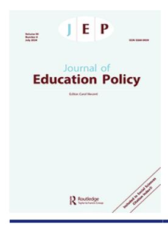

<!-- A3.R58 | source: papers_json/A3.R58/ -->

## **Journal of Education Policy**

**ISSN: (Print) (Online) Journal homepage:****[ www.tandfonline.com/journals/tedp20](https://www.tandfonline.com/journals/tedp20?src=pdf)**

## **Performance** **agreement** **through** **the** **lens** **of** **resource** **dependence** **theory**

## **Vuokko** **Kohtamäki**

**To** **cite** **this** **article:** Vuokko Kohtamäki (2024) Performance agreement through the lens of resource dependence theory, Journal of Education Policy, 39:4, 541-563, DOI: [10.1080/02680939.2023.2245791](https://www.tandfonline.com/action/showCitFormats?doi=10.1080/02680939.2023.2245791)

**To** **link** **to** **this** **article:** [https://doi.org/10.1080/02680939.2023.2245791](https://doi.org/10.1080/02680939.2023.2245791)

| © 2023 The Author(s). Published by Informa UK Limited, trading as Taylor & Francis Group. |
| --- |
| Published online: 13 Aug 2023. |
| Submit your article to this journal |
| Article views: 2565 |
| View related articles |
| View Crossmark data |
| Citing articles: 5 View citing articles |

<!-- page 2 -->

## **Performance agreement through the lens of resource ** **dependence theory**

Vuokko Kohtamäki

Faculty of Management and Business, Tampere University, Tampere, Finland

## **ABSTRACT**

This study applies resource dependence theory to address the question of how the critical resource dependence relationship emerges in the context of a university's performance agreement. This study focuses on two Nordic universities that have adopted performance agreements while simultaneously using strong performance-based state funding. Resource dependence involves an asymmetry and power imbalance that leads an organisation to believe that it is dependent on a more powerful organisation that has resources under its control. The theory reveals the central role of performance agreements and their associated instruments in the universities' relationship with the ministry and within universities. We found minor differences in Nordic university examples indicating the influence of the performance regimes within the management arena and within the material dimensions of university autonomy. Performance agreements and their related instruments are isolated from the other key realities of universities. Understanding the loose coupling between the agreements and the characteristics of universities are needed to enhance universities' ability to pursue their unique mission in society. Resource dependence theory provides a valuable framework for analysing the dynamics and dependencies that exist between organisations and within loosely coupled organisations, shedding light on the interactions and influences that shape these relationships.

## **ARTICLE HISTORY **

Received 19 January 2023 Accepted 4 August 2023

## **KEYWORDS **

resource dependence theory; performance agreement; performance funding; control; autonomy

## **Introduction**

Performance agreements and contracts have been introduced to serve as modern governance and policy mechanisms in the public sector, aiming to outline the actions and contributions of public organisations to society. For this purpose, these agreements establish goals, objectives, and standards that organisations are expected to achieve within a specified timeframe (Degn, Mads, and Sørensen [2015](#page-20-0); Larsen et al. [2020](#page-21-0)). Similar rationales for improving performance can be observed in performance-driven budgeting and funding models, resource allocation models, and accountability mechanisms that have been implemented in the public sector (Van Dooren, Bouckaert and Halligan [2015;](#page-22-0) Larsen et al. [2020;](#page-21-0) Taylor and Claire [2012)](#page-22-1). However, performance

**CONTACT **Vuokko Kohtamäki vuokko.kohtamaki@tuni.fi Faculty of Management and Business, Tampere

<!-- page 3 -->

agreements do not exist alone. Different performance governance mechanisms collectively aim to influence the goals of public organisations and transform them into 'intentional' organisations (Brunsson and Sahlin-Andersson [2000](#page-20-1), 721, referring to Thompson [1967)](#page-22-2).

The implementation of performance governance has spread as a component of the new public management reform agendas in numerous Western countries over the past three to five decades (Adam [2020,](#page-19-0) Van Dooren, Bouckaert and Halligan [2015](#page-22-0); Ter Bogt and Scapens [2012;](#page-22-3) Dougherty et al. [2014;](#page-20-2) Mouritzen and Niels [2020](#page-21-1); Nisar [2015;](#page-21-2) Poutanen et al. [2020)](#page-22-4). Performance agreements and related governance mechanisms, when introduced and applied, aim to provide guidance for the governance of public organisations. Performance governance mechanisms vary in their rationales and applications across different country contexts and public policy sectors due to variations in political – administrative traditions and cultures. The higher education sector in various Western countries is also adopting performance agreements and their justifications.

However, there is a limited body of research that specifically focuses on performance agreements within the higher education sector. Examining performance agreements and the interactions that shape such contractual relationships is interesting due to their implications for university autonomy. Public universities typically depend on public funding, but they are also facing growing pressure to secure external funding from other sources, which researchers themselves often apply for. As a result, accessing external funding requires competition. Public universities typically depend on public funding while also being increasingly pressured to acquire external funding from other sources. As a result, accessing external funding requires competition. The same applies to public funding. Public funding for universities in various countries has undergone reforms that incorporate performance-based funding (PBF) principles (e.g. Bleiklie, Enders, and Lepori [2015](#page-20-3); Burke [2002;](#page-20-4) Degn, Mads, and Sørensen [2015](#page-20-0); Dougherty et al. [2014](#page-20-2)).

Universities are complex and loosely coupled organisations that can experience fragmentation within the systems and between them and their environments, as intentions and actions become disconnected across different organisational levels, sub-units, individuals, and activities (Orton and Weick [1990)](#page-21-3). However, current performance governance mechanisms aim to transform universities into more tightly connected and controlled organisations to maximise their outputs (Pinheiro, Geschwin, Hansen, Pinheiro and Pulkkinen [2019](#page-21-4)). National policy goals (which also transfer performance agreements) can objectify science and attempt to direct research towards 'planned, managed and improved' outcomes (Whitley [2012](#page-23-0) p. 206). Loose coupling can pose challenges for managers as the actions within a loosely coupled system become less predictable (Pfeffer and Salancik [2003)](#page-21-5). Universities and their sub-units have their own intentions and goals, which they create autonomously. Furthermore, the production of knowledge and research standards within universities is under the collective and intellectual control of researchers and different scientific disciplines (Whitley [2000;](#page-23-1) Whitley and Gläser [2014)](#page-23-2).

The purpose of this article is to gain theoretical insights into the performance governance of Danish and Finnish universities. The focus is on the contractual relationship, specifically the performance agreement, between the university and its main resource provider, which in this case is the ministry (The Ministry of Higher

<!-- page 4 -->

Education and Science in Denmark [2022,](#page-21-6) the Ministry of Education and Culture in Finland, hereafter the Ministry [2022)](#page-21-7) in both countries. This study utilises the concepts of resource dependence theory (RDT) to enhance the understanding of the above-mentioned relationship. Pfeffer and Salancik's, [2003 ](#page-21-5)study and related contributions (Bleiklie, Enders, and Lepori [2015](#page-20-3); Davis and Cobb [2010](#page-20-5); Fowles [2014](#page-20-6), Hillman, Withers and Collins [2009](#page-20-7); Nienhüser [2008)](#page-21-8) serve as a theoretical foundation for the article. The research scope lies in organisational and policy studies, particularly within public higher education institutions and their performance governance and autonomy.

Empirically, this study aims to shed light on how universities navigate within the governance frames imposed by performance agreements. We use two university examples from two Nordic countries, Denmark and Finland, which are considered among the most extreme performance governance reformers in the Nordic region (Geschwin, Hansen, Pinheiro and Pulkkinen [2019;](#page-21-4) see also Degn and Sørensen [2015](#page-20-8)). The research question that guides the article is: How does a critical resource dependence relationship emerge between the university and the Ministry in the context of the performance agreement?

In the context of two university examples, we place the university- and mid-level leaders in the centre as performance leader-managers, explicating their practical opinions and experiences. These leaders have the responsibility to prepare and implement performance agreements. However, it is important to note that the viewpoints of researchers, teachers, and students are not considered in this study. This limitation arises from their loose and distant connections to agreement-related interactions with the Ministry. Their responsiveness to the external influence of the performance agreement may be the focus of future research.

The article is organised into six sections. After the introduction, we present key rationales for performance agreements and indicate the differences between performance agreements and PBF. Thereafter, we present the theoretical approach (RDT) and describe the Danish and Finnish university contexts. This is followed by a report of the empirical findings and discussion. The last section presents the conclusion and implications of the study. This study is expected to be relevant for several target audiences, including policymakers, researchers, university leaders, practitioners, and countries engaged in the design of performance governance mechanisms.

## **Rationales for performance agreement and definitional approaches**

Higher education, as in other public service sectors, has increasingly been subjected to performance targets and evaluative metrics (Grossi et al. [2020](#page-20-9); Larsen et al.[ 2020](#page-21-0); Martin-Sardesai, Guthrie, and Basil [2020;](#page-21-9) Nisar [2015,](#page-21-2) Ter Bogt and Scapens [2012](#page-22-3); Parker [2013;](#page-21-10) Pettersen[ 2015)](#page-21-11). For instance, it is known that strong connections between organisational performance and funding can redirect the attention of organisational management towards financial management (Martin-Sardesai, Guthrie, and Basil [2020;](#page-21-9) Grossi et al. [2020](#page-20-9); Parker [2013;](#page-21-10) Rabovsky [2014](#page-22-5); Slaughter and Rhoades [2004](#page-22-6); Slaughter and Leslie [1997](#page-22-7)). Thus, financial objectives might even be prioritised over academic objectives (e.g. Christopher [2012](#page-20-10), Mouritzen and Opstrup [2020](#page-21-1); Poutanen et al. [2020;](#page-22-4) Slaughter and Rhoades [2004](#page-22-6); cf.; Speklé and Frank [2014](#page-22-8)), and performance metrics can be used to

<!-- page 5 -->

internally establish a calculative governance logic, providing university leaders and managers a sense of illusive control, clarity, and a picture that is less ambiguous than the reality within the university (e.g. Vakkuri and Pentti [2006)](#page-22-9).

The underlying principles of performance governance instruments have aimed to modernise state governance, shift state control from input control to result control, and enhance the autonomy of public organisations (Brunsson and Sahlin-Andersson [2000](#page-20-1), Geschwin, Hansen, Pinheiro and Pulkkinen [2019](#page-21-4); Pinheiro et al. [2019](#page-21-4); Verhoest [2005](#page-22-10)). The rise of performance-driven global governance trends has had a significant impact on the internal governance and management of Western universities, shaping their execution and development over the past 30 years. Today, performance-led practices are extensively implemented in the governance and management of public organisations in various countries (Bjørnholt and Salomonsen [2015;](#page-20-11) Pinheiro et al. [2019;](#page-21-4) Poister, Aristigueta, and Hall [2015](#page-22-11); Speklé and Frank [2014;](#page-22-8) Van Dooren, Bouckaert, and Halligan[ 2015](#page-22-0); van Helden and Reichard[ 2019;](#page-22-12) Verhoest et al.[ 2004](#page-22-13)), including public universities in Nordic countries.

By establishing a contractual agreement between the government and the organisation, a performance agreement serves as a policy instrument to promote performance, accountability, and improvement in line with the pre-defined policy goals. According to Vedung's [(1998](#page-22-14)) typology, performance agreements can be classified as economic and information-related policy instruments. Economic policy instruments are designed to influence the allocation and distribution of resources, and performance agreements can serve this purpose by linking funding or resource allocation to the achievement of specific performance targets. Information-related policy instruments, by contrast, aim to provide transparency, accountability, and feedback to stakeholders.

Performance agreements are used, for example, in Austria, Canada, Denmark, Finland, Germany, the Netherlands, Norway, and the UK (Degn, Mads, and Sørensen [2015](#page-20-0);). The introduction of agreements aims to modernise the conventional controloriented approach of public organisations. Scholars such as Brunsson and Sahlin-Andersson ([2000](#page-20-1)) argue that public sector reforms are transforming traditional public service providers into comprehensive organisations with defined structures, hierarchies, and rationales for action.

It is challenging to provide strict definitions of performance agreements, as their characteristics can vary. These agreements are typically referred to by different labels, such as target agreement, performance agreement, or development contract. In essence, an agreement can be understood as a contractual relationship that outlines the goals that an institution aims to achieve within a specific time period in exchange for public resources (Degn, Mads, and Sørensen [2015](#page-20-0), 12; see also Larsen et al. [2020)](#page-21-0). Performance agreements can vary in agreement periods within the same country, although their purposes are typically the same from a governance perspective.

One rationale frequently discussed in recent public policy literature for the reform of management and governance is based on the concept of 'given' autonomy. According to this idea, autonomy is granted as an incentive for organisations to enhance their efficiency and effectiveness (Bjørnholt and Salomonsen [2015](#page-20-11); Van Dooren, Bouckaert, and Halligan[ 2015;](#page-22-0) van Helden and Reichard[ 2019](#page-22-12); Verhoest[ 2005](#page-22-10)). Given that autonomy does not eliminate the control aspect of the governance of publicly funded organisations. Instead, governance instruments, such as performance agreements and PBF, serve as

<!-- page 6 -->

control mechanisms that focus on past (PBF) and future (performance agreement) performance (Verhoest [2005)](#page-22-10). Performance agreements outline the goals, objectives, and standards that an organisation is expected to adhere to in order to fulfil and advance its core functions (Bjørnholt and Salomonsen[ 2015;](#page-20-11) Larsen et al. [2020)](#page-21-0). PBF, by contrast, is a funding mechanism that links the allocation of specific resources to past results using designated indicators. These indicators can include metrics such as the number of graduates, volumes of external funding, and the number of research publications (Burke [2002;](#page-20-4) Dougherty et al. [2014)](#page-20-2). Despite the development and implementation of various performance governance instruments, there is a lack of consensus regarding their long-term policy impacts (Dougherty et al. [2014;](#page-20-2) Pinheiro et al.[ 2019](#page-21-4)). We briefly present some key rationales for the adoption of these two governance instruments in the following paragraphs.

The scope of performance measurement within the higher education context encompasses the entire spectrum of the academic working environment (Martin-Sardesai, Guthrie, and Basil [2020;](#page-21-9) Arnaboldi, Lapsley, and Steccolini [2015;](#page-19-1) Grossi et al. [2020;](#page-20-9) Nisar [2015](#page-21-2); Rabovsky [2014](#page-22-5)). The purpose of performance governance instruments in higher education, such as performance agreements and PBF, is to capture matters and issues that align with the policies of public funders and other key external stakeholders. The performance governance literature pertaining to this domain emphasises the scope of measurement and explores what is measured and at what level of detail (Poister, Aristigueta, and Hall [2015;](#page-22-11) Van Dooren, Bouckaert, and Halligan [2015)](#page-22-0). The scope of performance measurement reflects policy goals that encourage universities to enhance their reputation, improve research and teaching quality, and address societal needs (Larsen et al. [2020](#page-21-0); Nisar [2015)](#page-21-2).

The literature discusses both research and teaching performance measures (Jacobsen Christian and Andersen [2014](#page-21-12); Martin-Sardesai, Guthrie, and Basil [2020](#page-21-9); Parker [2013;](#page-21-10) Pinheiro et al.[ 2019;](#page-21-4) Rabovsky[ 2014;](#page-22-5) Ter Bogt and Scapens[ 2012](#page-22-3)). Performance measures are indicators that involve comparing two sets of data, such as the student – faculty ratio. These measures translate operational performance into metrics, allowing for quantitative assessment (Bjørnholt and Salomonsen [2015](#page-20-11), Verbeeten and Speklé [2015](#page-22-15); Poister, Aristigueta, and Hall [2015](#page-22-11); Vakkuri and Pentti [2006](#page-22-9)). When indicators are linked to funding allocations, they are referred to as PBF indicators (Burke[ 2002](#page-20-4)). The logic behind PBF is based on a zero-sum game, in which a predetermined pool of resources is distributed among universities based on their performance results. A body of literature explores how these applied indicators influence the behaviour of both academic departments and individual academics within universities (Bjørnholt and Salomonsen [2015,](#page-20-11) Ter Bogt and Scapens [2012;](#page-22-3) Grossi et al. [2020;](#page-20-9) Martin-Sardesai, Guthrie, and Basil [2020;](#page-21-9) Pinheiro et al. [2019;](#page-21-4) Rabovsky [2014](#page-22-5); Slaughter and Rhoades [2004)](#page-22-6). Monitoring and reporting progress and performance goals may be an explicit policy aim of performance agreements and PBF (Brunsson and Sahlin-Andersson [2000](#page-20-1)). Vakkuri and Pentti [(2006)](#page-22-9) discussed ambiguity in the use of performance measurement instruments for unintended purposes, which can have unintended consequences for the entire design of a performance governance system.

Lastly, it is crucial to recognise the degree to which an organisation aligns its decision-making with performance governance instruments and potentially adopts decisions and strategies that correspond to the applied governance mechanisms

<!-- page 7 -->

(Poister, Aristigueta, and Hall [2015](#page-22-11); Vakkuri and Pentti [2006](#page-22-9)). Poister Aristigueta, and Hall ([2015,](#page-22-11) 10) defined performance management as 'the strategic use of this performance information in management decision-making to maximise key organisational goals through a variety of decision-making areas, including management, budgeting, personnel, contracts, and quality and process improvement'. These multiple dimensions theoretically stem from different concepts and approaches in organisational and management research. As Firestone ([1989](#page-20-12), 19) pointed out, 'policies take on different meanings in different arenas'. Similarly, performance agreements are instruments that can have diverse meanings (e.g. Degn, Mads, and Sørensen [2015](#page-20-0)). This study applies RDT to enhance our understanding of universities operating within a performance agreement-based governance framework.

## **Resource dependence theory**

RDT has been one of the leading theories in organisational studies for understanding interorganisational relationships and dependencies, but its potential and application can be extended can be extended to the field of policy and governance studies, including higher education policy and governance studies. Rhoades ([1992)](#page-22-16) claimed that RDT is an appropriate organisational theory when focusing on resource providers' organisational revenues and potential influence and constraints (also Fowles [2014](#page-20-6), Kholmuminov, Kholmuminov, and Wright [2019;](#page-21-13) Slaughter and Rhoades [2004](#page-22-6); Slaughter and Leslie [1997)](#page-22-7). Understanding the policy environment, and the necessity to acquire vital resources from that environment is key to approaching interorganisational relationships and organisational actions according to RDT. RDT fits well with universities' performance governance environments that impose resource relationships, performance accountability, and control but do not guarantee financial stability (Kearns et al. [2014;](#page-21-14) Kohtamäki [2019](#page-21-15); Nienhüser [2008;](#page-21-8) Slaughter and Rhoades [2004)](#page-22-6).

Pfeffer and Salancik [(2003](#page-21-5), xvi) pointed out that 'there is a limited amount of empirical work explicitly extending and testing RDT and its central tenets'. In the 1990s, for example, Slaughter and Leslie ([1997)](#page-22-7) tested RDT in the context of the behaviour of universities and professors regarding alternative resources to maintain institutional operations. Goedegebuure and Meek [(1994)](#page-20-13) tested RDT's ability to explain higher education institutions' mergers. RDT has been statistically tested in more recent higher education research to determine whether there is a relationship between the share of tuition fee revenues and the share of teaching expenditures (Kholmuminov, Kholmuminov, and Wright [2019)](#page-21-13). Earlier, Fowles ([2014](#page-20-6)) applied RDT in a similar setting. Other researchers (Fowles [2014;](#page-20-6) Grossi et al. [2020;](#page-20-9) Kohtamäki [2019,](#page-21-15) Lind [2020;](#page-21-16) Parker [2013;](#page-21-10) Pfeffer and Salancik [2003)](#page-21-5) have indicated that resources and organisational behaviour are connected.

The concepts of RDT can theoretically extend the previous research focus to the critical resource relationships in the higher education sector and applied performance governance instruments. Theorising the resource relationship between the university and the Ministry (the national governing and funding body, regulative body, and policymaker) according to the RDT will conceptualise the realities the performance agreement mirrors. RDT, which has its roots in Emerson's [(1962](#page-20-14)) exchange-based power relationships and recognises resources,

<!-- page 8 -->

relationships between the environment and organisation, and the essential role of an organisation in improving and guaranteeing the continuity of organisational operations (Davis and Cobb [2010;](#page-20-5) Fowles [2014](#page-20-6), Hillman, Withers and Collins [2009;](#page-20-7) Nienhüser [2008](#page-21-8); Pfeffer and Salancik [2003](#page-21-5); Poister, Aristigueta, and Hall [2015](#page-22-11)). Therefore, we chose RDT to theorise policy instrument reality as the resource relationship between an organisation (university) and its environment (Ministry).

In line with RDT, resources are under the control and power of the external resource provider (Pfeffer and Salancik [2003](#page-21-5), 48). The criticality of resources is based on an individual university's ability to continue operations without external resources and its conditional factors when no alternative resources are available (Pfeffer and Salancik [2003](#page-21-5)). Accessing resources requires exchange acts with the Ministry. Exchanges occur not only interorganisationally but also intra-organisationally between departments and individuals. RDT recognises intra-organisational environments, but its fundamental assumption pertains to the external environment (Hillman, Withers and Collins [2009;](#page-20-7) Nienhüser [2008](#page-21-8); Pfeffer and Salancik[2003)](#page-21-5).

Universities and their resource providers have varying needs, and the elements under exchange depend on the functions of the university and its departments, among other things (cf. Levine and White [1961)](#page-22-17). The relative magnitude of exchanges and the criticality of resources are two dimensions of exchange relationships that generate potential instability and vulnerability to universities. The direction of the exchange can be unilateral (elements flowing to another organisation without any elements given in return), reciprocal (organisation provides in return for other elements), and collective (two or more organisations act together in relation to a third partner; Levine and White [1961](#page-22-17)). By considering the real-life experiences, we can gain a better understanding of the direction of exchange relationships between universities and the Ministry in our specific case examples.

## **Data and analysis**

The empirical data consisted of interviews with university and mid-level leaders at one university in Denmark (referred to hereafter as UniDenmark) and one university in Finland (UniFinland), reflecting the performance agreement periods 2017/2018–2020/ 2021. Both are public universities of a similar size (student enrolments) operating in the same policy area with similar core functions, and both are funded by PBF and have similar main revenue structures. These are key agency features that affect their control and autonomy (Verhoest et al. [2010](#page-22-18)).

The seven leaders interviewed at UniFinland were the university's administrative director, head of planning, two deans, two heads of administration, and one facultylevel controller. Five leaders were interviewed at UniDenmark: the university director, a special university consultant, two deans and one department head. The term 'university leaders' is now used to refer to both university-level leaders, such as senior executives, as well as mid-level leaders and managers, including deans and heads of departments. A theory-driven content analysis was conducted on the interview data (Krippendorff [2018](#page-21-17)).

<!-- page 9 -->

## **Background of Danish and Finnish Universities' performance governance**

Performance governance has guided how higher education is governed in our case Nordic country examples for over 20 years. Denmark and Finland are small Nordic countries with well-developed university systems. Unlike Finland, Denmark has been a forerunner in structurally reorganising its universities, leading to institutional mergers and a reduction in the number of universities from 12 to 8 in 2006–2007 (Degn and Sørensen [2015](#page-20-8)). Finland has 13 universities, down from 18 previously. Both countries have public policies concerning universities with the goal of contributing to socioeconomic well-being. They have somewhat similar higher education policy trends regarding performance governance instruments (performance agreements and PBF), and university autonomy reforms. Denmark reformed its university legislation and institutional autonomy in 2002, and Finland followed it seven years later in 2009. The policy goal in both countries has been to make universities autonomous institutions responsible for their finances, management, and governance (Degn and Sørensen [2015;](#page-20-8) Holmén [2022;](#page-21-18) Kohtamäki [2019;](#page-21-15) Lind [2020)](#page-21-16). Both Danish and Finnish universities operate under a public funding system characterised by a zero-sum logic. This system entails a pool of resources determined by their respective national governments. In recent years, both countries have experienced a decreasing trend in the development of public funding for higher education institutions.Universities' public funding systems rely on PBF, and universities depend on this funding. The shares of funding based on specific indicators in the current university funding formulas are very high in Denmark (over 60%) and Finland (76%). One key difference is that Denmark has two separate funding formulas (one for education and one for research), and Finland has one common funding formula for education and research. Another difference is that in Denmark, there are both basic funding elements (funding beyond indicator-based funding) and indicator-based funding elements within their two funding formulas, while the Finnish funding formula does not have basic funding elements. In Denmark, 75% of the education funding is designated to indicators and 55% to research funding indicators (Ministry of Education and Science [2022)](#page-21-6). In Finland, the share of indicator-related funding is 76% (covering both

<!-- page 10 -->

education and research), while the rest is strategic funding (Ministry of Education and Culture [2022](#page-21-7); [Table 1](#page-8-0)).

Despite the similarities, both countries have their own county-specific politicaladministrative contexts, history, culture, and other peculiarities (see for more Carney [2006](#page-20-15); Degn and Sørensen [2015;](#page-20-8) Holmén [2022](#page-21-18)).

In Finland and Denmark, the performance agreement is a signed document between the Ministry and the university. Before the final signed document, the performance agreement process takes place between the university leadership and the Ministry. It is a collaborative process that includes performance reporting by the universities to the Ministry, guidelines and a draft agreement from the Ministry to each university, universities' responses to draft agreements from the Ministry, and a set of meetings and seminars between the universities' leadership and the Ministry.

In Denmark, the board of governors signs the three-year development contract. The goal-setting process, the relationship between the contracting parties, and other contracting-related processes, such as dialogue between the parties before signing the agreement, are not considered in detail in this study. Denmark requires the performance agreement to set 3–5 goals each (the policy to self-select goals has been abolished later).

In Finland, the chair of the university board and the university rector are responsible for signing the performance agreement. The four-year performance agreements include university-specific performance goals. The agreements also contain the higher education policy goals set by Finland's national government for the entire sector. These goals are derived from the national government's plan. In both countries, the Ministry responsible for higher education and science signs the agreements.

## **Findings**

## *Contractual relationship between the university and the ministry*

The performance agreement in both UniDenmark and UniFinland specified the agreement parties (the university and the Ministry), the performance demands, the reporting responsibilities, and the operational funding frame. This is how performance agreements are typically designed (Bjørnholt and Salomonsen[ 2015;](#page-20-11) Carney [2006](#page-20-15); Larsen et al. [2020,](#page-21-0) Verbeeten and Speklé [2015](#page-22-15); Verhoest [2005)](#page-22-10). According to the choreography of the agreement, the university's senior executives had the formal responsibility to negotiate with the Ministry (the agreement process), and put the signed agreement and its performance demands into action. In this arena, the signed agreement portrayed a toplayer relationship that reinforced their linkages and responsibilities to the Ministry.

'[The performance agreement] contract is something we do because we have to', according to a UniDenmark leader. It defined performance demands as 'what we need to do . . . and have to fulfil one way or the other' (UniDenmark). Leaders reported that the contract pushed the entire university operationally in the 'correct direction' (UniDenmark). The performance agreement established a framework for the allocation of state budget funding for both universities. The agreement's goals were not the primary interest of the academic units; rather, 'the PBF was the core of the agreement' (UniFinland).

<!-- page 11 -->

The above views indicate that the agreements were not voluntary contracts for universities. The relationship with the Ministry projected structural hierarchy, rationality, and power asymmetry. In both countries, the Ministry had a powerful position as a resource holder, as a body allocating financial resources, and as a body channelling policy goals for universities in line with the RDT (Davis and Cobb [2010](#page-20-5); Fowles [2014;](#page-20-6) Pfeffer and Salancik [2003](#page-21-5)).

Both universities have a public mission, and withdrawal from the agreement was not possible. Moreover, three four-year agreements have been signed (UniDenmark 2018–2020, UniFinland 2017–2021) despite the level of performance attainment of the previous periods (UniDenmark 2015–2017, UniFinland 2013–2016), which indicates features of loose coupling between the agreement periods. Different agreement periods provided fragmented demands because the agreement channels policy goals from the prevailing state government plan to the universities (see Control section). In line with the new public management ideology, the senior executives (chair of the university board in UniDenmark and university rector in UniFinland) represented the university vis-à-vis the Ministry. University leaders described the agreement as 'high-level' and 'top-level'. In the university management arena, the meaning of agreements can also be interpreted as mechanisms to enhance their managerial position inside the university hierarchy and in relation to the Ministry (cf. Firestone [1989;](#page-20-12) Nisar [2015)](#page-21-2).

## *Resources*

Regarding critical resources, the agreement set an operational frame of the level of state budget funding that leaders 'have to take into account' (UniDenmark) and a restricting 'frame' of the number of study places to control student flows and funding (UniFinland). The universities did not receive their state budget funding automatically; they had performance indicators that measured their actual performance. The agreements addressed the significance of state resources in the university budget.

In 2021, UniDenmark's core funding from the Ministry accounted for 74% of its total revenues, which remained unchanged compared to 2017. Additionally, 20% of its revenues came from external funding in 2021 and 2017. In UniFinland, the share of core funding was 61% in 2018 and 60% in 2014. Furthermore, the portion of external funding was around 31% of the total revenues in 2018, while in 2014, it accounted for 28% of the total revenues. This indicates an increase in the share of external funding between 2014 and 2018.[1](#page-19-2) As mentioned in the previous section, the external funding indicator's value of research funding was 20% in the Danish state funding model, whereas it was 12% in Finland.

The agreements' performance indicators included information on how universities get access to state funding and how the funding was determined. Both universities paid attention to the agreement targets (have-to-do list) in the form of performance indicators: 'You can take the performance funding model, which is the core of the agreement, and look at what goals you have to attain' (UniFinland). Similarly, a leader at UniDenmark pointed out, 'Concrete actual goals are the figures'.

It is evident that the list of detailed performance indicators of the agreement, as policy carrots and sticks, effectively captured university leaders' attention, potentially

<!-- page 12 -->

diminishing the long-term outlook. The division of performance indicators into education and research (see the Background section) further reinforces the Ministry's control over the allocation of funding and the core activities of universities. The quotations below show the survival orientation of university leaders and their need to acquire financial resources, as well as the pressures they face in obtaining the resources.

So, there is a close connection between what we need to do to survive and what is in the contract. (UniDenmark)

We try to achieve the goals at our level . . . so we need publications . . . collaboration with external partners . . . external funding as well . . . (UniDenmark)

Everyone who is leading and managing a unit has to manage with these indicators; there is no culture of giving money'. (UniFinland)

The university leaders acknowledged that performance indicators served as management instruments within the university. The indicators were seen as the 'rules of the game' (UniFinland) that guided internal decision-making and actions within the university. A leader pointed out, 'It produces a pretty straightforward exchange-based thinking and culture . . . people are increasingly aware of the financial value of their publications. If I publish, the university earns money, so when I publish, the university has to pay me'. Performance indicators were not only seen as efficient funding-earning instruments to secure funding but also as effective management instruments among university leaders.

Despite the criticality of state funding, the university leaders emphasised the importance of external research funding. While the volume of external research funding was an indicator within the state funding model, it held additional significance. External money was seen as a means to strengthen the university's research function, expand research networks, and enhance the university 's reputation as a science institution. This perspective highlights the university's engagement within the scientific arena. One of the leaders mentioned the importance of having 'closer collaboration [with others] and external partners, and arranging time and conditions for genuine academic work' (UniDenmark). Another leader said they had 'to make sure that researchers and teachers are doing research and teaching and not spending time on different new political agendas' (UniDenmark). A leader emphasised the need for sensitivity and persistence in balancing academic work and external interests: 'So we have to have a management that is able to find a balance between the political interest and that kind of dynamic conservatism that we have at universities, and what we should have'. Another leader (UniFinland) pointed out that 'the most important thing in research is to achieve something interesting'. A UniDenmark's leader mentioned consequences: 'in these conditions [measurement based ideology] the mainstream research tends to grow, because in research publishing it is safer to rely on such research questions and research settings that rely on previous research codifications rather than making the most creative research openings'.

The statements above highlight the significance of scientific communities, their members, and their work as valuable resources. The leaders acknowledged the role of research peer reviews and external experts in legitimising research excellence and contributions. One leader mentioned, 'A lot of people inside academia participate in it

<!-- page 13 -->

[research evaluations]' (UniDenmark). The research reputation and image of universities rely on the efforts of researchers and teachers (Whitley and Gläser [2014](#page-23-2), Whitley [2012](#page-23-0)).

Universities, along with their core activities of education and research, operate within complex settings that involve numerous resource relationships, research networks, and partnerships. This goes beyond a bilateral and mandatory funding relationship between the university and the Ministry. Scholars such as (Nienhüser [2008)](#page-21-8); Whitley and Gläser ([2014)](#page-23-2)), Hicks ([2017](#page-20-16)), Parker [(2013](#page-21-10)) and Lind ([2020](#page-21-16)) highlight the diverse exchanges and interactions that universities engage in, particularly in the context of third-party funding activities. Some of these relationships are crucial for the continuity of their research endeavours. Although these resource relationships were not explicitly addressed in the performance agreements, the case universities faced significant pressure to demonstrate tangible outcomes from externally funded activities to the Ministry, as will be further discussed in this article.

## *Control*

Controlling complex, financially and operationally dynamic organisations, such as universities, is a challenging task (Whitley and Gläser, [2014](#page-23-2); Orton and Weick [1990](#page-21-3)). However, in both countries, the Ministry played a central role in controlling and coordinating the agreements and performance of individual universities, as well as the overall higher education system. The Ministry was responsible for overseeing the agreement protocol, as well as the processes of monitoring, measuring, and evaluation. Throughout the preparation, implementation, and performance monitoring and evaluation of the agreements, the universities were subject to political influence and demands for accountability. In this section, we will examine these aspects by using RDT.

The universities were under the control of the Ministry in terms of the protocol of the agreements. Each phase of the agreement process had specific formats and requirements that the universities were obligated to follow. This included delivering performancerelated documents and engaging in negotiations. In both countries, the process was interactive and followed pre-defined step-by-step phases through which public policy priorities were communicated to individual universities. During performance negotiations with the Ministry, there were discussions on what should be produced and in what quantities. For instance, the volumes of institutional outputs, such as the number of graduates, were considered, as well as strategies to enhance national priorities.

The processes of the agreements have undergone changes in recent years in both countries. Previously, there used to be negotiations with the Ministry regarding projects and project funding, but that was no longer the case. The main shift has been towards a greater emphasis on performance indicators in Finland. In Denmark, the earlier approach was referred to as 'Soviet-style planning', but now the Ministry expects universities to perform in specific directions and provide them with performance data. A leader from a Danish university mentioned that in the new regime, the goals set by the Ministry have negative consequences for the quality of education, particularly when target numbers are set too high. Danish universities have included a few self-selected goals in their agreements, but academic units have not shown high commitment to these goals, despite being chosen by the university itself.

<!-- page 14 -->

The agreements set demands that reflect individual university-level control and control across universities, as documented by Degn, Mads, and Sørensen [(2015)](#page-20-0) and Larsen et al. [(2020](#page-21-0)). According to a leader from UniFinland, 'Legislation applies to all universities, but this [agreement] enables the assignment and agreement of university-specific tasks and goals'. Regarding tasks, the agreement from UniFinland served as an allocative channel for dividing certain national tasks and responsibilities, such as teacher education, among the universities. These demands constituted mandated national tasks and provided resources to the universities through the PBF.

The agreement manifested as policy directions, mandatory tasks, detailed performance target demands, and reporting responsibilities. The agreements involved reciprocal exchanges and unilateral elements, highlighting the diverse nature of the demands and responsibilities outlined in the agreements. The policy directions reflected a range of concerns in higher education and science policy (Adam [2020;](#page-19-0) Broucker et al. [2017;](#page-20-17) Degn, Mads, and Sørensen [2015;](#page-20-0) Ter Bogt and Scapens [2012)](#page-22-3). In the case of UniFinland, the agreement demonstrated coordinated efforts across universities by thoroughly documenting national higher education policy priorities derived from the government plan and other policy documents, such as strategic visions and road maps for research and education. In both countries, the Ministry incorporated the government plan, including aspects such as socio-economic development, solving global challenges, digitalisation, and sustainability, into the performance agreement. The content of the agreement at UniDenmark was shorter, but the targets were more detailed, as discussed further in this section.

Performance target demands were set as organisational targets, and their progress was monitored as organisational achievement in accordance with performance governance regimes. The performance targets and performance control included aspects such as research outputs (publications), irrespective of the funding sources (core funding or another source). Therefore, research performance supported by external funding (thirdparty funding) was also subject to control in terms of target setting and reporting.

The agreements required performance reporting that reflected organisational accountability and policy loyalty (Larsen et al. [2020](#page-21-0)). The universities were required to regularly provide performance information data, reporting both the attainment and nonattainment of the agreement goals. Due to the obligation for mandatory reporting, the agreement 'as a document has an exact meaning' (UniFinland). If underperformance occurred, UniDenmark had an annual obligation to provide explanations to the Ministry and indicate the actions taken to overcome the underperformance. UniDenmark had yearly targets, such as the number of graduates, for each year of the agreement period. By contrast, in Finland, the goals were set for the entire agreement period. The Ministry's performance control in the case of UniDenmark involved more frequent checkpoints. In Finland, the Ministry conducted a mid-term review to assess institutional performance, which included discussions and meetings with universities.

Noncompliance with the performance agreement and its associated control mechanisms was not a real option, considering the public mission and the high financial dependence of the universities. However, it is evident that noncompliance with policies does occur (Pfeffer and Salancik [2003](#page-21-5)). Achieving long-term policy goals cannot be accomplished within a single contract period. Additionally, policies may not always be

<!-- page 15 -->

easily measurable; they can be contradictory or heterogeneous, and their implementation can be subject to misinterpretation (Vakkuri and Pentti [2006](#page-22-9)).

The leaders perceived the mode and manner of control (goals and measurement) as concentrated and influential (controlling the scarce resources and direction of the university). They viewed control as coercive, resembling a 'have-to-do list' and allencompassing (the kinds and quantities irrespective of the source of funding). Further, the leaders observed the normative aspect of agreement when it, together with performance funding, caused financial consequences.

As mentioned in the Resources section, peer review serves as a valuable resource and is based on external expert evaluations. Consequently, the Ministry did not have access to control the advancement of the substance and intellectual content of academic work. A leader from UniDenmark emphasised the role of peer reviewers, stating that 'there are no external criteria imposed, but rather researchers establish criteria for themselves through the peer-review process'.

## *Interdependencies*

The university leaders were aware of several external and internal dependencies, including financial reliance on the Ministry, interdependence driven by competition with other universities, internal dependencies within the organisation, and dependencies on the scientific community. It was evident that the demands of the agreements and various perceived dependencies required the involvement and actions of multiple actors (cf. Hillman et al. [2009](#page-20-7); Nienhüser [2008](#page-21-8)). Pfeffer and Salancik [(2003](#page-21-5), 40) emphasised that 'Interdependence is the reason why nothing comes out quite the way one wants it to. Any event that depends on more than a single causal agent is an outcome based on interdependent agents'.

Universities were mutually dependent on each other in both countries due to the zero-sum nature of the PBF system. Pfeffer andSalancik ([2003,](#page-21-5) 41) stated that 'In a competitive relationship, the outcome achieved by one can only be higher if the outcome achieved by the other is lower'. This implies that a better-performing university would receive more funding, while underperforming universities would receive fewer resources. This funding allocation mechanism applied to both universities in terms of their PBF, which was directly linked to the attainment of performance targets. Interdependence among universities serves as a motivational factor to enhance performance, while also acting as a mechanism to maximise performance.

UniDenmark also perceived the possibility of collective sanctions. According to the leaders, the Ministry established a collective dependence of Danish universities on the performance of the national higher education system. All individual universities were obligated to take action if the overall performance of the national-level system did not meet the requirements. This indicated that regardless of meeting the university-specific goals, the university was expected to make further contributions to overall national performance. Although this demand was not explicitly stated in the agreement, it was inferred from the leaders' perspectives. UniDenmark's annual milestones and annual performance control enforced the aforementioned consequences.

<!-- page 16 -->

All levels of the organisations within UniDenmark and UniFinland engaged in reciprocal interactions. Performance targets were distributed internally, starting from the university level and then cascading down to the faculty level. Subsequently, the faculties allocated the targets to the departments. As a UniDenmark leader pointed out, 'The rector and deans take these targets seriously'. However, academic units did not fully commit to or respond to all aspects of the performance agreement. Awareness of the agreement decreased as it reached the academic sub-units. According to a leader from UniDenmark, 'The agreement does not make a difference to a researcher'. In this context, the organisational dependence on resources and the use of performance indicators as management tools have led to pressure on each organisational layer to effectively demonstrate and communicate its performance. A UniDenmark representative pointed out that one of the consequences of this for research was the 'pressure to publish research in fragmented pieces'.

The use of performance mechanisms required 'compromises' in order to meet specific performance targets, as observed in UniDenmark. For instance, the university adhered to a policy of increasing the number of part-time PhD students and 'admitted individuals who may not have been the ideal candidates, not because of the applicants themselves, but because of the challenging conditions during their PhD studies, unless they were superhuman'. This quote illustrates how the university attempted to fulfil the requirement of educating part-time doctoral students by achieving the target number of doctoral graduates, even in situations where the university faced a shortage of qualified supervisors.

Pfeffer and Salancik [(2003,](#page-21-5) 69) suggested that 'the greater the level of system connectedness, the more unstable and uncertain the environment for given organizations.' In other words, as university senior executives adhere to external policy determinants, they encounter increased levels of uncertainty. The environment in which universities operate and their perceptions of and responses to it are highly complex. However, the logic and procedures of performance agreements assume that all universities (including their sub-units) are responsive and ultimately contribute to enhancing the performance of the system. The agreement and its protocol failed to acknowledge the complexities of universities. Instead, the performance agreement policy environment operated as an isolated system, detached from the multiple realities and environments that individual universities and their academic personnel face.

## **Conclusions and discussion**

In this study, we theoretically and empirically approached how performance agreements between the Ministry and Danish and Finnish universities emerge as interorganisational relationships using the concepts of RDT. Here, we further discuss the implications of our findings and present concluding remarks.

In the case of two Nordic universities, the actual institutional financial autonomy is focused on tangible resources, which include performance agreement and PBF related elements. Performance agreements and PBF make universities responsible for financial resources and dependencies highlighting their significance in shaping the material aspects of autonomy within these universities. The autonomy pertaining intangible resources and scientific autonomy, encompasses academic freedom, knowledge creation,

<!-- page 17 -->

and intellectual capital. RDT highlights the multifaceted nature of university autonomy and universities' relationships to the external environment. This study suggests that actual material-side autonomy and governance in two Nordic universities are influenced by various factors and manifest in different ways in their interactions with the broader context in which they operate (cf. Larsen et al. [2020)](#page-21-0).

From the point of view of the management arena, the performance agreement represented a mandatory relationship and contract with the Ministry in both universities. The agreements, along with the PBF, created conditions of control and dependence rather than functioning as mechanisms for universities to act as independent strategic actors (cf. Whitley [2012)](#page-23-0). The agreements expected senior executives to possess formal authority and power within the organisational hierarchy to represent, negotiate, and conduct transactions on behalf of the entire university organisation in relation to the Ministry. RDT posits that universities and their material dimensions of autonomy can be perceived as constrained by centralised control, power, and dependencies (cf. Bjørnholt and Salomonsen [2015](#page-20-11); Pfeffer and Salancik [2003;](#page-21-5) Verhoest [2005](#page-22-10)).

External control emerged as university-specific state demands, of which agreements were articulated in detail (cf. Degn, Mads, and Sørensen [2015](#page-20-0); Degn and Sørensen [2015;](#page-20-8) Larsen et al. [2020](#page-21-0); Mouritzen and Niels [2020](#page-21-1); Pfeffer and Salancik [2003](#page-21-5)). The state demands in the form of performance indicators were critical for how to gain access to state funding and how to decrease financial uncertainty. Further, performance indicators were standards to control organisational goals and to create competitive benchmarks between universities (Adam [2020;](#page-19-0) Martin-Sadesai, Guthrie, and Basil [2020](#page-21-9), Mouritzen and Opstrup[ 2020](#page-21-1); Burke [2002;](#page-20-4) Dougherty et al. [2014](#page-20-2); Fowles[ 2014;](#page-20-6) Aristigueta, and Hall [2015](#page-22-11)). Performance indicators gain local ground inside the universities when they serve as exchange mechanisms to maintain access to public resources in a predictable manner (cf. Pfeffer and Salancik [2003)](#page-21-5).

The analysis shows that these tow Nordic universities have been given increased responsibility for managing their own finances. The performance agreements and, specifically, the performance indicators were applied as internal management instruments and survival strategies in a similar way in the two universities (cf. Fowles [2014;](#page-20-6) Nienhüser [2008](#page-21-8); Pfeffer and Salancik [2003](#page-21-5); Slaughter and Rhoades [2004)](#page-22-6). From these external and internal conditions, it follows that agreement demands efficiently draw individual academics to the requirements of agreements (see also Davis and Cobb [2010;](#page-20-5) Degn and Sørensen [2015](#page-20-8); Lind [2020;](#page-21-16) Poutanen [2022)](#page-22-19). Furthermore, the performance governance instruments have also freed the hands of the Ministry as an overseer and made the universities – community and all – more responsible than before for maintaining their performance.

Universities' external financial dependence is well recognised in the previous literature (Fowles [2014;](#page-20-6) Lind [2020](#page-21-16); Mouritzen and Niels [2020;](#page-21-1) Parker [2013](#page-21-10)). In both universities, the education function was specifically based on state-provided financial resources, strengthening university dependence and the basis for control. RDT revealed the material dimension of university autonomy and its frames, which emerged as a result of multiple simultaneous interdependencies and performance control (cf. Fowles [2014;](#page-20-6) Nienhüser [2008](#page-21-8); Parker [2012;](#page-21-19) Pfeffer and Salancik [2003)](#page-21-5). The externally funded operations of universities are also connected by performance governance and its associated instruments.

<!-- page 18 -->

This study indicates how performance governance instruments were utilised to enhance the progress orientation of individual universities and the entire higher education system. This was done by tightening linkages between funding and performance, between control and performance, and by fostering competition among universities in line with the ideologies of new public management.

RDT reveals that the performance agreements and related instruments operated in isolation from the intangible resources and realities within the case universities and their environments (Nisar [2015;](#page-21-2) Whitley [2012)](#page-23-0). Performance governance assumes that an entire university is a rational system and has a consensus on how to respond to the Ministry, thus simplifying the university, its internal dynamics, and its relationships with other important agencies and partners. Universities' organisational sub-systems and their interconnectedness to the environment are critical resources for universities' survival (Martin-Sardesai, Guthrie, and Basil [2020](#page-21-9); Parker [2013](#page-21-10), Ter Bogt and Scapens [2012;](#page-22-3) Whitley [2012](#page-23-0)). In other words, the performance agreements failed to acknowledge the overall complexity and heterogeneity present within universities (cf. Whitley [2000](#page-23-1)). Performance agreements and related instruments exhibit a loose coupling with the logics of scientific arenas, on which universities fundamentally depend (cf. Orton and Weick [1990](#page-21-3); Whitley [2000](#page-23-1)). This dependence is based on how reputation, credibility, and legitimation in scientific fields are controlled (Whitley [2000](#page-23-1)).

The agreement, its protocol and its sub-instruments (performance indicators and performance monitoring) face challenges in the university context when it does not recognise the nature of loosely coupled organisations (Orton and Weick [1990)](#page-21-3) and the nature of key functions of universities (e.g. Nisar [2015)](#page-21-2). The university leaders in this study acknowledged that their organisations and knowledge production are connected to the standards of scientific communities. Scientific fields generate the context in which public scientific research is conducted (Whitley [2000](#page-23-1)). Whitley ([2000,](#page-23-1) 81) suggested that 'scientific fields are a particular kind of work organisation which structure and control the production of intellectual novelty through competition for reputations from national and international audience for contributions to collective goals'.

In Finland, academic freedom and the autonomy of universities are protected by constitutional law and the Universities Act. However, in Denmark, there are no similar regulations in constitutional law. Instead, the Universities Act in Denmark designates universities as self-governing institutions. This study suggests that the legal aspects of university autonomy and the performance governance conditions pull universities and their management in different directions (see also Degn and Sørensen [2015)](#page-20-8). The performance agreement-based relationship between university and the Ministry is not solely reciprocal. It encompasses various types of exchanges, including unilateral (such as policy directions) and collective elements (such as zero-sum funding) in addition to reciprocal ones.

External funding, its acquisition, and its volume in two Nordic universities were not yet mechanisms for strengthening the material side of university autonomy. This indicates that the current level of external funding, which is less than 50% of the total revenues from various sources, did not have a significant impact on enhancing the universities' control over tangible resources or financial autonomy. Furthermore, external funding is typically allocated to individuals and research teams, giving them more financial autonomy to utilise the funds as they see fit. This implies that autonomy lies

<!-- page 19 -->

more with individuals and teams than with the university as a whole in terms of the allocation and management of external funding. External funding influences the internal governance circumstances of universities and their ability to be controlled both internally and externally. This, in turn, affects the development of universities' strategic actorhood, as supported by the works of Brunsson and Sahlin-Andersson [(2000)](#page-20-1) and Whitley ([2001](#page-23-1)). The more external funding there is from different funding agencies, the less universities can be centrally controlled (cf. Bleiklie, Enders, and Lepori [2015;](#page-20-3) Pfeffer and Salancik [2003](#page-21-5)). A mixed economy, consisting of a combination of state funding and external funding, creates a highly complex reality (Adam [2020](#page-19-0); ; Christopher [2012](#page-20-10); Hicks [2017;](#page-20-16) Parker [2012)](#page-21-19). As mentioned, academic autonomy, particularly in the realm of science, remains in the hands of academics, regardless of the source of tangible resources.

An aggressive performance policy fundamentally characterised Danish and Finnish universities' governance transformation (cf. Adam [2020](#page-19-0), Ter Bogt and Scapens [2012](#page-22-3); Christopher [2012](#page-20-10); Degn and Sørensen [2015,](#page-20-8) Mouritzen and Opstrup [2020](#page-21-1); Parker [2012;](#page-21-19) Poutanen et al. [2020)](#page-22-4) and indicated how performance governance and its instruments demand also position universities to respond to performance targets and PBF framed resource environments similarly in Nordic countries with some minor differences between the university examples. This raises the question of whether performance agreements, along with their associated instruments, such as performance indicators and PBF, turn university leaders into a combination of symbolic and adaptive leaders, lacking discretionary leadership (cf. Nisar [2015](#page-21-2); Parker [2012;](#page-21-19) Pfeffer and Salancik [2003](#page-21-5); Poutanen et al. [2020](#page-22-4); Rabovsky [2014)](#page-22-5).

Performance governance has the potential to limit how universities' contributions are communicated and conveyed to society. The way universities' achievements and impacts are portrayed may be restricted, potentially narrowing the understanding of the relationships between universities and society. Given the core functions and nature of universities as scientific organisations, senior university executives cannot solely focus on material resources and external factors. It is essential for them to consider the internal dynamics and unique characteristics of universities (cf. Nisar [2015;](#page-21-2) Parker [2012,](#page-21-19) [2013](#page-21-10); Whitley [2012)](#page-23-0). Strategically managing university operations and finances, particularly research, in a top-down fashion faces critical challenges (Whitley and Gläser [2014)](#page-23-2).

Lastly, resource dependence is a strong ground in the context of the governance and autonomy of higher education organisations. RDT provides a valuable framework for analysing the dynamics and dependencies that exist between organisations and within organisations, shedding light on the interactions and influences that shape these relationships. RDT reveals the dual sides of university autonomy. This implies that RDT sheds light on both the tangible and intangible aspects of autonomy within universities, considering their reliance on external resources and dependencies. Performance governance regimes have far-reaching implications for the entire higher education system, as they are built on the premise that centralised control through performance agreements and related instruments can effectively manage large-scale policy interventions.

Further studies are needed to examine how competitive funding designs impact the structure and dynamics of universities, as well as the effects on academics' working ethos

<!-- page 20 -->

and social relations (e.g. Parker [2013;](#page-21-10) Poutanen [2022)](#page-22-19). Additionally, it is important to investigate how these funding mechanisms shape the future development of key functions within universities.

## **Note**

1. The source of UniDenmark's figures is their annual reports (2017 and 2021). UniFinland's figures are from the national Vipunen database, which is provided by the Ministry of Education and Culture. Due to changes in Vipunen statistics, the figures after 2018 are not comparable to those before 2018. In 2019, UniFinland's core funding was 60% and external research funding accounted for 30% of the university's turnover.

## **Disclosure statement**

No potential conflict of interest was reported by the author(s).

## **Funding**

The authors did not receive support from any organisation for the submitted work.

## **Notes on contributor**

*Vuokko Kohtamäki *is a member of the Higher Education Group at Tampere University, Faculty of Management and Business, Finland. She is as an academic leader of the national higher education expert training program, Higher Education Administration and Management. Her research interests include autonomy, governance, funding, leadership, and management of higher education institutions.

## **ORCID**

Vuokko Kohtamäki http://orcid.org/0000-0003-4438-0829

## **Availability of data and materials**

Interview data (anonymised) are available by request.

## **References**

Adam, Edmund. [2020](#page-2-0). "Governments Base Performance-Based Funding on Global Rankings Indicators: A Global Trend in Higher Education Finance or a Global Rankings Literature Fiction? A Comparative Analysis of Four Performance-Based Funding Programs." *International Journal of Educational Development *76:102197. [https://doi.org/10.1016/j.ijedu](https://doi.org/10.1016/j.ijedudev.2020.102197) [dev.2020.102197](https://doi.org/10.1016/j.ijedudev.2020.102197).

Arnaboldi, Michela, I. Lapsley, and Ileana Steccolini. [2015](#page-5-0). "Performance Management in the Public Sector: The Ultimate Challenge." *Financial Accountability & Management *31 (1): 1–22. [https://doi.org/10.1111/faam.12049.](https://doi.org/10.1111/faam.12049)

<!-- page 21 -->

- Bjørnholt, Bente, and H. H. Salomonsen. [2015](#page-4-0). "Contracting and Performance in Agencies: A Question of Control, Dialogue or Autonomy?" *Public Organization Review *15 (4): 509–530. [https://doi.org/10.1007/s11115](https://doi.org/10.1007/s11115).
- Bleiklie, Ivar, J. Enders, and B. Lepori. [2015.](#page-2-1) "Organizations as Penetrated Hierarchies: Environmental Pressures and Control in Professional Organizations." *Organization Studies * 36 (7): 873–896. [https://doi.org/10.1177/0170840615571960.](https://doi.org/10.1177/0170840615571960)
- Broucker, B., Wit K De, C. Verhoeven, and Verhoven. [2017.](#page-13-0) "Higher Education Research: Looking Beyond New Public Management." In *Theory and Method in Higher Education Research*, edited by J. Huisman and M. Tight, 21–38. 2017. Emerald Publishing Limited. [https://doi.org/10.1108/](https://doi.org/10.1108/S2056-375220170000003002) [S2056-375220170000003002](https://doi.org/10.1108/S2056-375220170000003002).
- Brunsson, Nils, and K. Sahlin-Andersson. [2000](#page-2-2). "Constructing Organizations: The Example of Public Sector Reform." *Organization Studies *21 (4): 721–746. [https://doi.org/10.1177/](https://doi.org/10.1177/0170840600214003) [0170840600214003.](https://doi.org/10.1177/0170840600214003)
- Burke, Joseph C.[ 2002.](#page-2-1) *Funding Public Colleges and Universities for Performance: Arguments About * *Performance Funding: Rhetoric and Reality*. New York: SUNY Press.
- Carney, Stephen. [2006.](#page-9-0) "University Governance in Denmark: From Democracy to Accountability?" *European Educational Research Journal *5 (3–4): 221–233. [https://doi.org/10.](https://doi.org/10.2304/eerj.2006.5.3.221) [2304/eerj.2006.5.3.221](https://doi.org/10.2304/eerj.2006.5.3.221).
- Christopher, Joe. [2012.](#page-3-0) "Tension Between the Corporate and Collegial Cultures of Australian Public Universities: The Current Status,"critical Perspectives on Accounting." *Critical * *Perspectives on Accounting *23 (7–8): 556–571. [https://doi.org/10.1016/j.cpa.2012.06.001](https://doi.org/10.1016/j.cpa.2012.06.001).
- Davis, Gerald F., and J. Adam Cobb. [2010](#page-3-1). "Resource Dependence Theory: Past and Future." In *Research in the Sociology of Organizations*, edited by Frank Dobbin and Claudia Bird Schoonhoven, 21–42. Emerald Group Publishing Limited. [https://doi.org/10.1108/S0733-](https://doi.org/10.1108/S0733-558X(2010)0000028006) [558X(2010)0000028006](https://doi.org/10.1108/S0733-558X(2010)0000028006).
- Degn, L., and Mads P. Sørensen. [2015](#page-3-2). "From Collegial Governance to Conduct of Conduct: Danish Universities Set Free in the Service of the State." *Higher Education *69 (6): 931–946. [https://doi.org/10.1007/s10734-014-9814-1.](https://doi.org/10.1007/s10734-014-9814-1)
- De, Boer H, B. Jongbloed, P. Benneworth, L. Cremonini, R. Kolster, A. Kottmann, K. Lemmens-Krug, and H. Vossensteyn. [2015](#page-1-0). *Performance-Based Funding and Performance Agreements in * *Fourteen Higher Education Systems*. Twente, Netherlands: CHEPS.
- Dougherty, Kevin J., M. Sosanya, Hana Jones, Rebecca Lahr, S. Natow, and Pheatt Lara. [2014](#page-2-3). "Performance Funding for Higher Education: Forms, Origins, Impacts, and Futures." *The * *Annals of the American Academy of Political and Social Science *655 (1): 163–184. [https://doi.](https://doi.org/10.1177/0002716214541042) [org/10.1177/0002716214541042.](https://doi.org/10.1177/0002716214541042)
- Emerson, Richard M. [1962](#page-6-0). "Power-Dependence Relations." *American Sociological Review *27 (1): 31–41. [https://doi.org/10.2307/2089716.](https://doi.org/10.2307/2089716)
- Firestone, William A. [1989.](#page-6-1) "Educational Policy as an Ecology of Game." *Educational Researcher * 18 (7): 18–24. [https://doi.org/10.3102/0013189X018007018.](https://doi.org/10.3102/0013189X018007018)
- Fowles, Jacob. [2014](#page-3-1). "Funding and Focus: Resource Dependence in Public Higher Education." *Research in Higher Education *55 (3): 272–287. [https://doi.org/10.1007/s11162-013-9311-x](https://doi.org/10.1007/s11162-013-9311-x) .
- Goedegebuure, L. C. J., and L. Meek. [1994](#page-6-2). "A resource dependence perspective on mergers: Comparing institutional amalgamations in Australia and the Netherlands." In *"Comparative * *Policy Studies in Higher Education"*, edited by L. C. J. Goedegebuure and F. A van Vughy, 127– 164. Vol. 19. Management and policy in higher education.
- Grossi, Giuseppe, Kallio Kirsi-Mari, Sargiacomo Massimo, and Skoog. Matti. [2020.](#page-3-3) "Accounting, Performance Management Systems and Accountability Changes in Knowledge-Intensive Public Organizations: A Literature Review and Research Agenda." *Accounting, Auditing, and * *Accountability *33 (1): 256–280. [https://doi.org/10.1108/AAAJ-02-2019-3869](https://doi.org/10.1108/AAAJ-02-2019-3869).
- Hicks, Diana. [2017](#page-12-0). "What Year? Difficulties in Identifying the Effect of Policy on University Output." *Journal of Informetrics *11 (3): 933–936. [https://doi.org/10.1016/j.joi.2017.05.020](https://doi.org/10.1016/j.joi.2017.05.020) .
- Hillman, Amy J., Michael C. Withers, and Brian J. Collins.[ 2009](#page-3-4). "Resource Dependence Theory: A Review." *Journal of management *35 (6): 1404–1427.

<!-- page 22 -->

- Holmén, Janne. [2022.](#page-8-1) "The Autonomy of Higher Education in Finland and Sweden: Global Management Trends Meet National Political Culture and Governance Models." *Comparative * *Education *58 (2): 147–163. [https://doi.org/10.1080/03050068.2021.2018826.](https://doi.org/10.1080/03050068.2021.2018826)
- Jacobsen Christian, B., and L. B. Andersen. [2014](#page-5-1). "Performance Management in the Public Sector: Does It Decrease or Increase Innovation and Performance?" *International Journal of Public * *Administration *37 (14): 1011–1023. [https://doi.org/10.1080/01900692.2014.928317.](https://doi.org/10.1080/01900692.2014.928317)
- Kearns, Kevin P., David Bell, Bobbi Deem, and Lydia McShane. [2014](#page-6-3). "How Nonprofit Leaders Evaluate Funding Sources: An Exploratory Study of Nonprofit Leaders." *Nonprofit and * *Voluntary Sector Quarterly *43 (1): 121–143. [https://doi.org/10.1177/0899764012458038.](https://doi.org/10.1177/0899764012458038)
- Kholmuminov, S., Shayzak Kholmuminov, and Robert E. Wright. [2019](#page-6-4). "Resource Dependence Theory Analysis of Higher Education Institutions in Uzbekistan." *Higher Education *77 (1): 59–79. [https://doi.org/10.1007/s10734-018-0261-2.](https://doi.org/10.1007/s10734-018-0261-2)
- Kohtamäki, Vuokko. [2019](#page-6-5). "Academic Leadership and University Reform-Guided Management Changes in Finland." *Journal of Higher Education Policy & Management *41 (1): 70–85. [https://](https://doi.org/10.1080/1360080X.2018.1553499) [doi.org/10.1080/1360080X.2018.1553499.](https://doi.org/10.1080/1360080X.2018.1553499)
- Krippendorff, Klaus. [2018](#page-7-0). *Content Analysis: An Introduction to Its Methodology*. Fourth. Thousand Oaks, CA: SAGE Publications. [https://doi.org/10.4135/9781071878781.](https://doi.org/10.4135/9781071878781)
- Larsen, Ingvild M., Mai-Lin Hofsøy, Zheng Ørvim Yuan, and P. Aasen. [2020.](#page-1-1) "Performance Agreements for Clearer Institutional Profiles and Better Division of Labour." *Tertiary * *Education & Management *26 (3): 311–327. [https://doi.org/10.1007/s11233-019-09034-z](https://doi.org/10.1007/s11233-019-09034-z).
- Lind, Jonas K. [2020.](#page-6-5) "Resource Environment and Hierarchy in Universities." *Science & Public * *Policy *47 (2): 184–193. [https://doi.org/10.1093/scipol/scz057.](https://doi.org/10.1093/scipol/scz057)
- Martin-Sardesai, Ann, James Guthrie, and P. Tucker Basil. [2020](#page-3-3). "What You See Depends on Where You Look: Performance Measurement of Australian Accounting Academics." *Accounting Auditing & Accountability Journal *33 (6): 1193–1218. [https://doi.org/10.1108/](https://doi.org/10.1108/AAAJ-08-2019-4133) [AAAJ-08-2019-4133.](https://doi.org/10.1108/AAAJ-08-2019-4133)
- Ministry of Education and Culture. [2022.](#page-3-5) Funding for Higher Education, Finland. [https://minedu.](https://minedu.fi/-/korkeakouluille-uusi-rahoitusmalli) [fi/-/korkeakouluille-uusi-rahoitusmalli](https://minedu.fi/-/korkeakouluille-uusi-rahoitusmalli) .
- Ministry of Higher Education and Science.[ 2022](#page-3-6). Funding for Higher Education, Denmark.[ https://](https://ufm.dk/en/education/higher-education/danish-universities/the-universities-in-denmark/funding-for-danish-universities/funding-for-higher-education-1/funding-for-higher-education) [ufm.dk/en/education/higher-education/danish-universities/the-universities-in-denmark/fund](https://ufm.dk/en/education/higher-education/danish-universities/the-universities-in-denmark/funding-for-danish-universities/funding-for-higher-education-1/funding-for-higher-education) [ing-for-danish-universities/funding-for-higher-education-1/funding-for-higher-education](https://ufm.dk/en/education/higher-education/danish-universities/the-universities-in-denmark/funding-for-danish-universities/funding-for-higher-education-1/funding-for-higher-education) .
- Mouritzen, Poul E., and Niels Opstrup. [2020.](#page-2-4) *Performance Management at Universities: The * *Danish Bibliometric Research Indicator at Work*. 1st ed. Springer International Publishing [https://doi.org/10.1007/978-3-030-21325-1 ](https://doi.org/10.1007/978-3-030-21325-1).
- Nienhüser, Werner. [2008](#page-3-4). "Resource Dependence Theory: How Well Does It Explain Behavior of Organizations?" *Management Revue *19 (1/2): 9–32. [https://doi.org/10.5771/0935-9915-2008-](https://doi.org/10.5771/0935-9915-2008-1-2-9) [1-2-9](https://doi.org/10.5771/0935-9915-2008-1-2-9).
- Nisar, Muhammad A. [2015.](#page-2-4) "Higher Education Governance and Performance Based Funding as an Ecology of Games." *Higher Education *69 (2): 289–302. [https://doi.org/10.1007/s10734-014-](https://doi.org/10.1007/s10734-014-9775-4) [9775-4](https://doi.org/10.1007/s10734-014-9775-4).
- Orton, J. Douglas, and Karl E. Weick. [1990](#page-2-5). "Loosely Coupled Systems: A Reconceptualization." *The Academy of Management Review *15 (2): 203–223. [https://doi.org/10.2307/258154](https://doi.org/10.2307/258154).
- Parker, Lee D. [2012.](#page-16-0) "From Privatised to Hybrid Corporatised Higher Education: A Global Financial Management Discourse." *Financial Accountability & Management *28 (3): 247–268. [https://doi.org/10.1111/j.1468-0408.2012.00544.x](https://doi.org/10.1111/j.1468-0408.2012.00544.x).
- Parker, Lee D. [2013.](#page-3-7) "Contemporary University Strategising: The Financial Imperative." *Financial * *Accountability & Management *29 (1): 1–25. [https://doi.org/10.1111/faam.12000](https://doi.org/10.1111/faam.12000).
- Pettersen, Inger J. [2015.](#page-3-8) "From Metrics to Knowledge? Quality Assessment in Higher Education." *Financial Accountability & Management *31 (1): 23–40. [https://doi.org/10.1111/faam.12048.](https://doi.org/10.1111/faam.12048)
- Pfeffer, Jeffrey, and Gerald R. Salancik. [2003.](#page-2-6) *The External Control of Organizations: A Resource * *Dependence Perspective*. Stanford, California: Stanford University Press.
- Pinheiro, Romulo, Lars Geschwind, Hanne Foss Hansen, Kirsi Pulkkinen. [2019 ](#page-2-7)ed. *Reforms, * *Organizational Change and Performance in Higher Education: A Comparative Account from * *the Nordic Countries*. Springer Nature. [https://doi.org/10.1007/978-3-030-11738-2.](https://doi.org/10.1007/978-3-030-11738-2)

<!-- page 23 -->

- Poister, Theodore H., Maria P. Aristigueta, and Jeremy L. Hall. [2015.](#page-4-1) *Managing and Measuring * *Performance in Public and Nonprofit Organizations: An Integrated Approach*. 2nd ed. San Francisco: Jossey-Bass.
- Poutanen, Mikko. [2022](#page-16-1). "'I Am Done with That now.' Sense of Alienations in Finnish Academia." *Journal of Education Policy *38 (4): 625–643. [https://doi.org/10.1080/02680939.2022.2067594.](https://doi.org/10.1080/02680939.2022.2067594)
- Poutanen, Mikko, Tuukka Tomperi, Hanna Kuusela, Veera Kaleva, and Tuomas Tervasmäki. [2020](#page-2-8). "From Democracy to Managerialism: Foundation Universities as the Embodiment of Finnish University Policies." *Journal of Education Policy *37 (3): 419–442. [https://doi.org/10.](https://doi.org/10.1080/02680939.2020.1846080) [1080/02680939.2020.1846080](https://doi.org/10.1080/02680939.2020.1846080).
- Rabovsky, Thomas M. [2014](#page-3-7). "Using Data to Manage for Performance at Public Universities." *Public Administration Review *74 (2): 260–272. [https://doi.org/10.1111/puar.12185.](https://doi.org/10.1111/puar.12185)
- Rhoades, Gary. [1992.](#page-6-6) "Organization Theory." In *Burton Rl Clark and Guy Neave 8ed.) the * *Encyclopedia of Higher Education*, 1884–1896. Exter: Pergamon Press.
- Slaughter, Sheila, and Larry L. Leslie. [1997](#page-3-7). *Academic Capitalism : Politics, Policies, and the * *Entrepreneurial University*. Baltimore and London: The Johns Hopkins University Press.
- Slaughter, Sheila, and Gary Rhoades. [2004](#page-3-9). *Academic Capitalism and the New Economy: Markets, * *State, and Higher Education*. Baltimore and London: The Johns Hopkins University Press.
- Sol, Levine, and Paul E. White. [1961.](#page-7-1) "Exchange as a Conceptual Framework for the Study of Interorganizational Relationships." *Administrative science quarterly *5 (4): 583–601.
- Speklé, Roland, F., and Frank H.M. Verbeeten. [2014](#page-3-9). "The Use of Performance Measurement Systems in the Public Sector: Effects on Performance." *Management Accounting Research *25 (2): 131–146. [https://doi.org/10.1016/j.mar.2013.07.004.](https://doi.org/10.1016/j.mar.2013.07.004)
- Taylor, John, and Claire Baines. [2012](#page-1-1). "Performance Management in UK Universities: Implementing the Balanced Scorecard." *Journal of Higher Education Policy & Management * 34 (2): 111–124. [https://doi.org/10.1080/1360080X.2012.662737.](https://doi.org/10.1080/1360080X.2012.662737)
- Ter Bogt, Henk J., and Robert W. Scapens. [2012](#page-2-4). "Performance Management in Universities: Effects of the Transition to More Quantitative Measurement Systems." *European Accounting * *Review *21 (3): 1–47. [https://doi.org/10.1080/09638180.2012.668323.](https://doi.org/10.1080/09638180.2012.668323)
- Thompson, James, D[.1967.](#page-2-9) *Organizations in Action*. New York: McGraw-Hill.
- Vakkuri, Jarmo, and Meklin. Pentti. [2006.](#page-4-2) "Ambiguity in Performance Measurement: A Theoretical Approach to Organisational Uses of Performance Measurement." *Financial * *Accountability & Management *22 (3): 235–250. [https://doi.org/10.1111/j.0267-4424.2006.](https://doi.org/10.1111/j.0267-4424.2006.00401.x) [00401.x](https://doi.org/10.1111/j.0267-4424.2006.00401.x).
- Van Dooren, Wouten, G. Bouckaert, and J. Halligan.[ 2015](#page-1-1). *Performance Management in the Public * *Sector*. Routledge. [https://doi.org/10.4324/9781315817590](https://doi.org/10.4324/9781315817590).
- van Helden, Jan, and C. Reichard. [2019.](#page-4-3) "Management Control and Public Sector Performance Management." *Baltic Journal of Management *14 (1): 158–176. [https://doi.org/10.1108/BJM-01-](https://doi.org/10.1108/BJM-01-2018-0021) [2018-0021.](https://doi.org/10.1108/BJM-01-2018-0021)
- Vedung, Evert. [1998.](#page-4-4) *Policy instruments and typologies*, edited by Carrots, *Policy instruments and * *typologies*, edited by, John McCormick, Ray Rist, and Evert Vedung, 23–54. London and New York: Routledge Taylor & Francis Group.
- Verbeeten, Frank H., and Roland F. Speklé. [2015](#page-5-2). "Management Control, Results-Oriented Culture and Public Sector Performance: Empirical Evidence on New Public Management." *Organization Studies *36 (7): 953–978. [https://doi.org/10.1177/0170840615580014](https://doi.org/10.1177/0170840615580014).
- Verhoest, Koen. [2005](#page-4-3). "Effects of Autonomy, Performance Contracting, and Competition on the Performance of a Public Agency: A Case Study." *Policy Studies Journal *33 (2): 235–258. [https://](https://doi.org/10.1111/j.1541-0072.2005.00104.x) [doi.org/10.1111/j.1541-0072.2005.00104.x.](https://doi.org/10.1111/j.1541-0072.2005.00104.x)
- Verhoest, Koen, G. Roness Paul, Verschuere Bram, Rubecksen Kristin, and MacCarthaigh. Muiris. [2010](#page-7-2). *Autonomy and Control of State Agencies: Comparing States and Agencies*. Basingstoke, England: Palgrave Macmillian. [https://doi.org/10.1057/9780230277274.](https://doi.org/10.1057/9780230277274)
- Verhoest, Koen, B. Peters, Geert Guy, Bouckaert, and Bram. Verschuere. [2004.](#page-4-5) "The Study of Organisational Autonomy: A Conceptual Review." *Public Administration and Development * 24:101–118. [https://doi.org/10.1002/pad.316](https://doi.org/10.1002/pad.316).

<!-- page 24 -->

Whitley, Richard.[ 2000](#page-2-10). *The Intellectual and Social Organization of the Sciences*. Second ed. Oxford: University Press.

Whitley, Richard. [2012](#page-2-11). "Transforming Universities: National Conditions of Their Varied Organisational Actorhood." *Minerva (London) *50 (4): 493–510. [https://doi.org/10.1007/](https://doi.org/10.1007/s11024-012-9215-5) [s11024-012-9215-5 ](https://doi.org/10.1007/s11024-012-9215-5)

Whitley, Richard, and Jochen Gläser.[ 2014.](#page-2-12) "The Impact of Institutional Reforms on the Nature of Universities as Organisations." *Transformation and Scientific Change: The Impact of * *Institutional Restructuring on Universities and Intellectual Innovation*, edited by Whitley, Richard, Jochen Gläser and Michael Lounsbury, 19–49. Bingley, UK: Emerald Publishing Limited. [https://doi.org/10.1108/S0733-558X20140000042020.](https://doi.org/10.1108/S0733-558X20140000042020)
