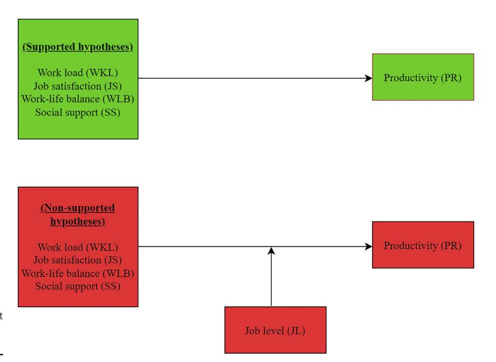
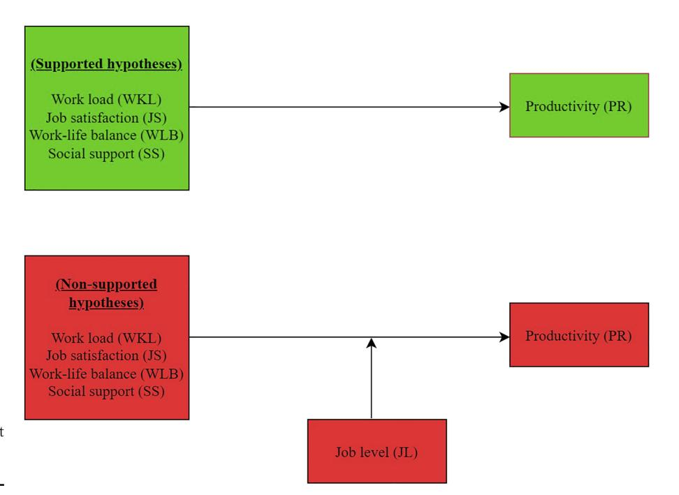

<!-- A3.R60 | source: papers_json/A3.R60/ -->

## The impact of remote working on employee productivity during COVID-19 in the UAE: the moderating role of job level

Employee productivity during COVID-19

330

Received 19 September 2022 Revised 3 December 2022 31 December 2022 Accepted 1 January 2023

Dania M. Kurdy

The British University in Dubai, Dubai, United Arab Emirates Husam-Aldin Nizar Al-Malkawi

Faculty of Business and Law, The British University in Dubai, Dubai, United Arab Emirates, and

## Shahid Rizwan

Universiti Kuala Lumpur Business School, Kuala Lumpur, Malaysia

## Abstract

**Purpose** – The purpose of this study is to examine the various factors that influence the productivity (PR) of employees who worked remotely in the United Arab Emirates (UAE) during the COVID-19 pandemic.

**Design/methodology/approach** — This study adopts a quantitative approach to analyze data collected online from 110 respondents using the snowball sampling technique during the pandemic. The analysis of the data is conducted using the structural equation modeling (SEM) technique of Smart PLS (Partial least squares) to evaluate the direct and moderating variables.

**Findings** – The results indicate that direct variables such as workload, job satisfaction, work–life balance and social support have a significant positive impact on employee PR in the UAE. However, the analysis of the moderating variable indicates that job level is not a significant moderator of the above relationships. The findings, generally, provide support for social exchange theory.

**Practical implications** – The findings of this study will help businesses of various domains in a variety of industries in understanding the core factors that should be considered to enhance the overall PR of their employees while working from home. Businesses can achieve their organizational goals by ensuring steady growth even during uncertain times.

**Originality/value** – This paper answers the question of whether remote working affects employee PR during the pandemic in an emerging market, namely the UAE. The current study contributes to the existing literature by combining the variables investigated in previous studies into a single study and by considering job level as a moderator variable.

**Keywords** Remote working, Productivity, COVID-19 pandemic, UAE **Paper type** Research paper

## 1. Introduction

With the outbreak of the COVID-19 pandemic, several governments throughout the world were forced to implement lockdown measures to curb the spread of Coronavirus. Remote

© Dania M. Kurdy, Husam-Aldin Nizar Al-Malkawi and Shahid Rizwan. Published in *Journal of Business and Socio-economic Development*. Published by Emerald Publishing Limited. This article is published under the Creative Commons Attribution (CC BY 4.0) licence. Anyone may reproduce, distribute, translate and create derivative works of this article (for both commercial and non-commercial purposes), subject to full attribution to the original publication and authors. The full terms of this licence may be seen at <a href="http://creativecommons.org/licences/by/4.0/legalcode">http://creativecommons.org/licences/by/4.0/legalcode</a>

The authors thank the anonymous reviewer's diligent reading of the manuscript as well as the insightful comments and suggestions. The authors would also like to acknowledge and thank Swasan Al Khayyat and Ali El Khatib of the University of Wollongong in Dubai for their assistance in data collection

Journal of Business and Socioeconomic Development Vol. 3 No. 4, 2023 pp. 339-352 Emerald Publishing Limited e-ISSN: 2635-1692 p-ISSN: 2635-1374 DOI 10.1108/JBSED-09-202-0104

<!-- page 2 -->

working was one of the measures implemented during the lockdown. It was adopted by all firms in developing and developed countries across a wide range of industries to protect their employees, while also maintaining business operations to mitigate any possible losses as much as possible. Except for a few businesses that relied on remote working before the pandemic, virtually, everyone was unfamiliar with this decision. This topic has not been adequately addressed in the literature, and few studies have examined the impact of remote working on the productivity (PR) of employees working in the private and public sectors in general, and in the United Arab Emirates (UAE) in particular.

Businesses in a variety of industries have faced challenges over the past few years as a result of the COVID-19 pandemic. The pandemic affected households, organizations and societies at all levels [(Carroll and Conboy, 2020](#page-11-0)). Thus, to maintain businesses' PR, an adequate framework has been created by employers to continue operations remotely. Consequently, the fast adoption of working remotely has impacted employees' daily lives as well as their relationships with their families and colleagues. This has resulted in numerous types of depression, and studies have shown that depression is closely related to employee PR ([Matli, 2020](#page-12-0)). Besides this, studies conducted during the pandemic have identified a wide range of other problems that have impacted employees' PR. Such issues include excessive workload (WKL), low job satisfaction (JS) and poor work–life balance (WLB). Therefore, this study aims at examining the impact of working remotely on employee PR using potential variables such as (WKL), JS, WLB and social support (SS), while using job level (JL) as a moderator for the direct relationships of the above variables with employee PR. It is worth mentioning that JL has rarely been utilized as a moderator variable in previous studies, making the present study more significant. In addition, the analysis of the participants' responses about their remote working experiences will contribute to existing studies on the effectiveness of remote working.

More specifically, this study intends to provide insights into the impact of working remotely on employee PR by studying the relationship between WKL, JS, WLB and SS during COVID-19 within the UAE context. This is because working remotely during COVID-19 affected the personal and professional lives of employees across the globe [(Donnelly and](#page-11-1) [Johns, 2021](#page-11-1)).

The purpose of this study is to answer the central research question of whether remote working affects employee productivity during the pandemic in the United Arab Emirates. Although previous studies investigated the impact of the variables included in this study (WKL, JS, WLB and SS) individually, no study combined all of these variables in a single study and tested the moderating role of JL. For instance, Dick et al[. (2020)](#page-11-2), [Matli (2020)](#page-12-0) and Wang et al[. (2021)](#page-13-0) investigated the impact of WKL on remote working, whereas other studies including [Bailey and Kurland (2003)](#page-10-0) and Bartel et al[. (2007)](#page-10-1) examined the relationship between JS and remote working. Similarly, [Lowry](#page-12-1) et al. (2006) investigated communication during remote working, while [Dubrin (1991)](#page-11-3) linked JS with teleworker PR vs. in-house workers. [Feldman and Gainey (1997)](#page-11-4) investigated WLB, while [Koehne](#page-12-2) et al. (2012) and [Rai](#page-12-3)s[ien](#page-12-3)e_ et al[. (2020)](#page-12-3) addressed SS. Furthermore, [Baudot](#page-10-2)et al., 2020 and [Toscano and Zappal](#page-13-1)a [(2020)](#page-13-1) investigated the impact of remote working on social isolation and stress during COVID-19.

An extensive review of relevant studies conducted in different parts of the world shows that several studies were conducted to examine various factors that influence employee PR when working remotely. However, potential factors such as WKL, JS, WLB and SS were previously tested separately and not combined in a single study. Moreover, there is a significant gap in the previous literature since employee PR was not tested using "job level" as a moderating variable (MV). Thus, this study attempts to address the gap in the literature by including JL as a moderator to determine its significance for the relationship between WKL, JS, WLB and SS and employee PR. This enhances the significance of this study as it will

<!-- page 3 -->

Employee

help businesses in understanding the PR of their employees operating at different levels within an organization, such as operational, tactical and strategic levels among others.

## 2. Literature review and hypothesis development

Remote working, often known as distance working, is a type of work process in which employees operate away from their office, either from home or from any other location. According to [Elshaiekh](#page-11-5) et al. (2018), employees who work from home are self-disciplined and self-motivated and they choose to work remotely either to stay close to family or to avoid issues related to social distancing. However, challenges frequently encountered while working remotely include poor time management, social isolation from colleagues and change in daily routine. Moreover, it is difficult to control the working hours at home, which could have a detrimental impact on family relationships ([Elshaiekh](#page-11-5) et al., 2018). The concept of remote working is not new, and it has been employed for a long time, as evidenced by various studies before the pandemic that erupted in 2019. The first instance of remote work occurred in 1970 amid the oil crisis when Jack Nilles and his colleagues published their report calculating the potential savings from the decreased locomotion [(Golden](#page-11-6) et al., 2008). Because remote workers operate away from their managers and leaders, they are supervised and assessed differently than other employees who work face-to-face with their managers. According to past studies, remote workers face fewer institutional controls than face-to-face workers [(Elshaiekh](#page-11-5) et al., 2018). Recently, using a sample of 526 respondents from the information technology (IT) industry in India, [Patanjali and Bhatta, 2022](#page-12-4) discovered that nearly two-thirds of IT employees report greater PR while working from home. The authors attributed this result to various factors, including the Hawthorne effect, increased working hours and a better working environment (because of lesser meetings, more flexible working hours and a better WLB). The next sub-sections discuss the different variables included in this study and develop the research hypotheses.

## 2.1 Workload (WKL)

Following previous studies such as Dick et al[. (2020)](#page-11-2), [Matli (2020)](#page-12-0) and Wang et al[. (2021),](#page-13-0) this study explores the impact of WKL on employee PR. The WKL is one of the variables employed in those studies to examine the impact of remote working. [Wu and Chen (2020)](#page-13-2) examined the impact of working from home on WKL and PR. The authors revealed the results of a nationwide survey to assess the WKL and PR of workers working from home. According to the findings, an increase in working hours of around three hours per week produces a decline in employee PR due to stress and pressure. However, [Felstead and](#page-11-7) [Henseke (2017)](#page-11-7) found that remote workers tend to work harder and longer and "are more committed to the organization, are more enthusiastic about the job, and exhibit higher levels of job satisfaction, and therefore expend more effort (as suggested by social exchange theory)" (p. 200). More recently, [Wang](#page-13-0) et al. (2021, p. 33) stated that "employees with higher workload and those who are under more intensive monitoring will experience less procrastination during the period of working from home and, therefore, will have higher levels of performance".

Two statements were employed to quantify WKL: (1) The WKL increased during remote working and (2) I am working longer hours to keep up with the WKL. The purpose of using these two items is to examine the relationship between teleworking and WKL during COVID-19 when employees were forced to work remotely rather than voluntarily. Based on the above discussion and in line with allocation of time and social exchange theories, we propose the following hypothesis.

H1. Workload significantly affects employee productivity during remote working.

<!-- page 4 -->

## 2.2 Job satisfaction (JS)

Previous research has employed the expectation disconfirmation theory (EDT) in different settings, including marketing, education, information technology, hospitality and tourism ([Carraher-Wolverton, 2022](#page-10-3)). [Carraher-Wolverton (2022)](#page-10-3) recently applied EDT for remote work. The author proposed that EDT can be used to better understand remote work, employees' level of satisfaction, and their intention to continue working remotely. Working from home is one of the teleworking features that is associated with JS as it promotes employees' flexibility and independence, which usually leads to a high level of JS ([Bailey and](#page-10-0) [Kurland, 2003;](#page-10-0) [Yu and Wu, 2021)](#page-13-3), and, as a result, PR. For instance, Bartel et al[. (2007)](#page-10-1) and [Kowalski](#page-12-5)et al. (2022) found that employees working from home report higher levels of JS than those working face-to-face.

The positive relationship between remote working and JS was supported by several studies ([Yu and Wu, 2021;](#page-13-3) [Jawabri](#page-12-6) et al., 2022; [Carraher-Wolverton, 2022)](#page-10-3). Moreover, [Dubrin](#page-11-3) [(1991)](#page-11-3) compared teleworker JS and PR to in-house workers. The results showed that teleworkers are more productive than in-house workers. Similarly, [Halkos and Bousinakis](#page-11-8) [(2010)](#page-11-8) collected data from 425 employees in the public and private sectors in Greece to test the relationship between JS and employee PR. They found that JS has a positive impact on employee PR. Following [Morganson](#page-12-7) et al. (2010), respondents were asked to express their level of agreement on three statements to measure JS during the pandemic: (1) I am satisfied with my job remote working schedule, (2) I recommend my workplace to others as a good place to work remotely and (3) overall, I am satisfied with my current remote work option. Based on the above discussion and consistent with the EDT, we propose the following hypothesis.

H2. Job satisfaction significantly affects employee productivity during remote working.

## 2.3 Work–life balance (WLB)

According to [Clark (2000, p. 751),](#page-11-9) work–family balance can be defined as "satisfaction and good functioning at work and at home, with a minimum of role conflict". [Clark (2000)](#page-11-9) developed the work–family border theory (W-FBT), which proposes that "'work' and 'family' constitute different domains or spheres which influence each other" (p. 750). This theory provides a useful theoretical insight into the relationship between WLB and remote working. Moreover, considering the social exchange theory (SET), Hasan et al[. (2021)](#page-11-10) argued that when employees feel autonomous, they have a better life-work balance and are more committed to their organizations.

According to [Feldman and Gainey (1997)](#page-11-4), employees choose to telework to spend more time with their families and maintain a WLB. This largely causes an increase in employees' desire for teleworking and drives them to look for jobs at companies that offer the option of teleworking. [Shareena and Mahammad (2020)](#page-12-8) found that remote working offers time flexibility, especially by saving time spent driving to and from the office or meetings. Therefore, the time saved can be spent with family, resulting in a better WLB. Furthermore, [Amabile and Kramer (2013)](#page-10-4) concluded that remote working saves travel time that may be spent on personal matters, which improves PR. [Patanjali and Bhatta, 2022](#page-12-4) recently provided evidence that working from home creates a better work environment and WLB, improving employee performance (see also [Haridas](#page-11-11) et al., 2021).

During the pandemic, many companies in the UAE and around the world shifted from face-to-face working to teleworking, not only to improve WLB but also to control the spread of the Coronavirus. The WLB measure used in this study was adopted from [Morganson](#page-12-7) et al. [(2010),](#page-12-7) who conducted a comparative analysis of employees working in teleworking and faceto-face working structures. Respondents were asked three questions: (1) I am happy with the amount of time I spend with my family; (2) The work environment within my department/

<!-- page 5 -->

Employee productivity during COVID-19

division supports balance between work and personal life; (3) Overall, work environment supports a balance between work and personal life. Based on the above discussion and in line with work–family border and social exchange theories, we propose the following hypothesis:

H3. Work-life balance significantly affects employee productivity during remote working.

## 2.4 Social support (SS)

Despite the advancements in technology and telework's technical progress, teleworkers still miss the "social support". According to the social exchange theory, organizations can optimize their employees' satisfaction and commitment by showing that they care about them and support their family lives ([Hasan](#page-11-10) et al., 2021). [Bentley](#page-10-5) et al. (2016) reported that during teleworking, organizational SS mitigates social isolation, which in turn increases JS and performance. [Koehne](#page-12-2) et al. (2012) conducted a comprehensive study using semi-structured interviews to identify the various challenges that teleworkers face during distance working. The study's findings showed a negative effect of SS owing to the absence of face-to-face communication since employees have no interaction with colleagues. The lack of SS reduces their PR. This suggests that providing SS to teleworking employees will significantly improve their PR.

Park et al[. (2004)](#page-12-9) conducted a survey of 240 workers in a public hospital in the United States and confirmed that SS has a direct positive impact on PR. Moreover, [Baruch-Feldman](#page-10-6) et al[. (2002)](#page-10-6) reported a positive relationship between SS, PR and JS. More recently, [Rai](#page-12-3)s[ien](#page-12-3)e_ et al[. (2020)](#page-12-3) surveyed 436 Lithuanian remote workers to examine the impact of telework during the COVID-19 pandemic on employee PR in both the private and public sectors. The results revealed that a lack of sociability negatively influences employee PR. To measure SS, respondents were asked to express their opinion on the importance of each of the following factors during remote working: (1) Lack of face-to-face interaction with colleagues and managers is stressful; (2) Lack of team spirit, the "we" feeling; (3) Lack of inspirational work atmosphere. Based on the previous discussion and consistent with SET, the following hypothesis is formulated:

H4. Social support significantly affects employee productivity during remote working.

## 2.5 Job level

Generally, an organization has three levels of control, including operational (basic level), tactical (middle level) and strategic (highest level). Since each employee's contribution is important to achieving organizational objectives, businesses need to evaluate employees at all levels. As a result, JL has grown in importance in recent years in business research. This is because a better evaluation of employees for their roles, responsibilities and PR can significantly contribute to the overall success of businesses in various sectors. JL has been used as a moderator variable in various studies. For instance, [Nguyen and Malik (2022)](#page-12-10) employed JL to examine its moderating effect in analyzing the impact of artificial intelligence (AI) service quality on AI satisfaction and JS. The study found that AI service quality influences AI satisfaction only in the nonsupervisory group, although it has an impact on JS at both nonsupervisory and supervisor/managerial levels.

Although prior studies have shown that JL affects employee PR during remote work ([Matli, 2020](#page-12-0); [Spagnoli](#page-13-4) et al., 2020; Dick et al[., 2020](#page-11-2); Wang et al[., 2021)](#page-13-0), little attention has been paid to the moderating role of JL on the relationship between employee PR and other variables included in this study (i.e. WKL, JS, WLB and SS).

Previous studies have examined JL in terms of its direct relationship with the PR of employees ([Skitmore and Sariathi, 2003;](#page-12-11) Ilies et al[., 2007;](#page-11-12) [Lee and Choo, 2011](#page-12-12); [Zhao and](#page-13-5) [Namasivayam, 2012](#page-13-5); [Miheli](#page-12-13)c[, 2014](#page-12-13); Lu et al[., 2016)](#page-12-14), while other studies have explored various

<!-- page 6 -->

JBSED 3,4

344

types of conflicts that employees face at different JLs [(Skitmore and Sariathi, 2003](#page-12-11); [Johns,](#page-12-15) [2006;](#page-12-15) [Bhar and Padmaja, 2014)](#page-10-7). Hence, there is a dearth of literature that has examined the moderating role of JL as pointed out by earlier studies.

Following the suggestion of previous research, this study incorporates JL as a MV to examine its effect on the relationship between employee PR and the other variables discussed above. The current paper considers three JLs namely managerial, supervisory and entrylevel. Based on the above discussion, the following four hypotheses have been formulated.

H5–H8. Job level moderates the relationship between WKL/JS/WLB/SS and employee productivity during remote working.

## 2.6 Productivity (PR)

Several studies have previously explored the impact of remote working on PR. [Baudot](#page-10-2) et al., [2020](#page-10-2) conducted a comprehensive study among Amazon employees in the United States. The primary purpose was to evaluate employee and subordinate PR during the obligatory teleworking throughout the COVID-19 lockdown. The study revealed that when participants telework, their PR and the PR of their subordinates improve. Moreover, employees are willing to spend more time on job tasks as they are working from home and can save time commuting. In addition, when given the chance to select the working mode, respondents indicate a preference for remote working.

It is important to highlight that various study outcomes have been seen throughout the past few years. For example,[Toscano and Zappala (2020)](#page-13-1) investigated the impact of remote working on employee PR from various perspectives. The data were collected from 265 respondents from various areas of life. They found that employee PR decreases while working remotely during the pandemic. However, other studies such as [Patanjali and Bhatta, 2022](#page-12-4) and [Prasetyaningtyas](#page-12-16) et al[. (2021)](#page-12-16) showed that working from home increases employee PR.

To measure employee PR, respondents were asked whether remote working during the pandemic affected the following: (1) personal work PR, (2) subordinate work PR, (3) actual working hours before COVID, (4) formal working hours before COVID, (5) actual working hours after COVID and (6) formal working hours after COVID.

Based on the aforementioned literature review and consistent with the relevant underpinning theories such as social exchange theory, expectation disconfirmation theory, and work-family border theory, we propose the following conceptual framework (see Figure 1).

*Figure 1. Conceptual framework of the study*

<!-- page 7 -->

Employee productivity during COVID-19

## 3. Methodology

3.1 Data collection, sampling and demographic profile of respondents

The data for this study were collected online through Google Forms, while the questionnaire was distributed to participants via WhatsApp. Before questionnaire dissemination, as an ethical consideration, participants were informed that their responses will be treated continentally and no details will be shared with any third parties. The questionnaire included the following statement "By returning the questionnaire fully answered, your consent is implied in this instance and all answers will be analyzed solely for the purpose of this study".

In this study, a nonprobability sampling technique known as the snowball sampling technique was used, as is common in most business research. First, we invited a selected set of participants who met the study's requirements. Participants were also encouraged to spread the questionnaire to others who fit the respondents' profile and are eager to participate. The distribution of the questionnaire was halted when the target number of respondents was attained.

In this research, a total of 110 respondents who worked remotely during the pandemic were included. The sample size is deemed appropriate as similar studies such as [Haridas](#page-11-11) et al. [(2021)](#page-11-11) who used a sample of 115 respondents to examine the impact of telecommuting on IT employee PR in India during the COVID-19 pandemic. All respondents in our study worked in the public and private sectors. It is important to note that the study's respondents were chosen from the two major emirates of the United Arab Emirates, namely Abu Dhabi and Dubai. Since the study was conducted at the outset of the pandemic, a small number of staff began working remotely at that time. A total of 41% of respondents were employed in the education sector, 33% in the financial sector, 19% in different government entities and 7% in IT. In terms of JL, 53 of the 110 respondents worked at the managerial level, 35 at the supervisory level and 22 at the entry-level. Almost 68% of respondents were between the ages of 28 and 40 years and lived in the UAE with their families and children.

## 3.2 Questionnaire and measurement scales

Before the final survey, a pilot test was conducted to test the validity and reliability of each question (item). A total of 12 respondents were approached and all pilot test participants confirmed their understanding of the questionnaire before starting the final survey.

The questionnaire was divided into two sections, five measurement scales and 20 items (questions). Respondents were asked at the beginning of the questionnaire if they worked remotely during the COVID-19 pandemic. Only those who answered "yes" were allowed to proceed with the main survey. The questionnaire was divided into two sections. [Section 1](#page-0-0) included fourteen items, with three of which related to "job satisfaction (JS)", "work–life balance (WKL)" and "productivity (PR)" and two each related to "workload (WKL)" and "social support (SS)". Similarly, [Section 2](#page-2-0) included seven items related to the respondents' demographic profile and JL. To collect data, a five-point Likert scale was used with 1 denoting "strongly disagree" and 5 denoting "strongly agree".

## 4. Data analysis

The structural equation modeling (SEM) technique of Smart PLS was used to analyze the study's data. Data analysis in Smart PLS was conducted in two stages. The first stage comprises the evaluation of the measurement model also known as the outer model, while the second stage consists of evaluating the structural model, also known as the inner model.

## 4.1 Evaluation of the measurement (outer) model

Hair et al[. (2014)](#page-11-13) suggest that the measurement model evaluation comprises four main assessments. These include indicator reliability (outer loadings), composite reliability,

<!-- page 8 -->

346

convergent validity (also known as average variance extracted (AVE)) and discriminant validity. These four assessments of the measurement model are discussed below.

According to [Urbah and Ahleman (2010)](#page-13-6), Hair et al[. (2014)](#page-11-13) and Hair et al. [(2017)](#page-11-14), values of 0.70 and above are acceptable for indicator reliability and composite reliability, while 0.50 and above for convergent validity. Similarly, discriminant validity is measured by the strength of outer loadings, i.e. items in a variable should load strongly on intended constructs and weakly on unintended constructs. Consolidated results for the first three assessments of the measurement model of the study are combined in Table 1, where the values of outer loadings, Cronbach's alpha, and composite reliability exceeds 0.70, while convergent validity (AVE) exceeds 0.5 and above.

Similarly, as shown in Table 2, all the items of variables loaded strongly on intended constructs and weakly on unintended constructs, confirming the discriminant validity of the measurement model.

As shown in Tables 1 and 2, the values of the four key assessments of the measurement model are in line with the standard evaluation criteria, confirming the study's measurement model's reliability and validity.

## 4.2 Evaluation of the structural (inner) model

The second stage of data analysis in Smart PLS is the evaluation of the structural model which aims to test the relationships between the dependent, independent, and MVs. The structural model is evaluated using path coefficients (β), t-statistics and p-values derived from the Smart PLS bootstrapping method. The assessments indicate the strength of the relationship between different variables to test the study's various hypotheses [(Rifai and](#page-12-17) [Hasan, 2016](#page-12-17)). [Cohen (1992)](#page-11-15) defines the evaluation of path coefficient significance as 0.02 being

|  |
| --- |
| Table 2. |
| Discriminant validity |
| of the |
| measurement model |

| Constructs | WKL | JS | WLB | SS | PR |
| --- | --- | --- | --- | --- | --- |
| WKL | 0.736 |  |  |  |  |
| JS | 0.469 | 0.813 |  |  |  |
| WLB | 0.315 | 0.463 | 0.796 |  |  |
| SS | 0.332 | 0.514 | 0.262 | 0.779 |  |
| PR | 0.406 | 0.507 | 0.483 | 0.504 | 0.840 |

<!-- page 9 -->

weak, 0.15 being acceptable and 0.35 being strong. The acceptable values of *t*-statistics and *p*-values are 1.96 and 0.05, respectively, as suggested by Rifai and Hasan (2016).

4.2.1 Moderation (interaction effect). The MV or the moderator as defined by Hair et al. (2014) is a third variable that impacts the relationship between two variables. In Smart PLS, the moderating role of a variable is measured through the value of the interaction effect (Latan and Ramli, 2013). According to the standard evaluation criteria of Ghozali and Latan (2015) and Chin et al. (2003), interaction effect values of 0.02, 0.15, and 0.35 are considered as weak, moderate and strong, respectively.

It is important to note that including a moderator variable is crucial in business research for testing the relationship between independent and dependent variables. One of the study's main contributions is the inclusion of "job level" as a MV, to determine how WKL, JS, WLB and SS affect the PR of employees working at different levels of an organization. This study includes four hypotheses of moderating relationships to find out the significance of JL as a moderator.

Table 3 presents the results of the structural model evaluation to test all eight hypotheses of this study. This includes four direct relationship hypotheses and four indirect (moderating) relationship hypotheses. Results show that all four direct relationship hypotheses are significant which means that WKL, JS, WLB and SS have a significant positive impact on employee PR during remote work in the UAE.

The first hypothesis (H1) was used to measure the impact of WKL on PR. The Smart PLS analysis shows a beta value of 0.16 and a t-statistic and a p-value of 2.96 and 0.01, respectively. All three values are significant and meet match the standard evaluation criteria of Cohen (1992) and Rifai and Hasan (2016). Thus, H1 is supported, consistent with Wu and Chen (2020), and in line with allocation of time and social exchange theories. Similarly, the second hypothesis (H2) was utilized to test the relationship between IS and PR. This relationship has a \beta value of 0.873, a t-statistic of 4.294 and a p-value of 0.00, consistent with the foregoing evaluation criteria. This confirms that H2 is also significant, in line with previous studies (Dubrin, 1991; Haloks and Bousinakis, 2010) and consistent with EDT. The third hypothesis (H3) examined the relationship between WLB and PR. Results show that this relationship has a \beta value of 0.372, a t-statistic of 4.294 and a p-value of 0.00. This hypothesis is also supported and in line with the previous studies of Feldman and Gainey (1997), Shareena and Mahammad (2020) and Hasan et al. (2021). The finding also provides support for the SET. The last hypothesis of direct relationship (H4) explored the impact of SS on employee PR. The analysis provided a beta value of 0.120, a t-statistic of 2.30, and a p-value of 0.00. Thus, H4 is significant, similar to earlier findings by Baruch-Feldman et al. (2002) and Park et al. (2004). This finding is also in line with the SET, which predicts that organizations can optimize employee satisfaction and commitment by caring for them and providing them with support for their family lives, which in turn improves their PR.

| Hypothesis | Path | Type | (\beta) | t-statistic | *p*-value | Remarks |
| --- | --- | --- | --- | --- | --- | --- |
| 1 2 3 4 5 6 7 | WKL \rightarrow PR JS \rightarrow PR WLB \rightarrow PR SS \rightarrow PR JL*WKL \rightarrow PR JL*WLB \rightarrow PR JL*WLB \rightarrow PR IL*SS \rightarrow PR | Direct Direct Direct Direct Moderating Moderating Moderating Moderating | 0.160 0.873 0.372 0.120 0.056 0.024 0.021 | 2.960 4.294 3.118 2.302 1.070 0.164 0.182 0.066 | 0.01 0.00 0.00 0.00 0.285 0.870 0.856 0.947 | Significant Significant Significant Significant Nonsignificant Nonsignificant Nonsignificant Nonsignificant |

**Table 3.** Evaluation of the structural model of the study

<!-- page 10 -->

JBSED 3,4

348

After the evaluation of direct relationships, the indirect (moderating) relationships are assessed. An analysis of Smart PLS confirms that all four moderating relationships of moderating role are insignificant with t-statistics being less than 1.96 and p-values greater than 0.05. These results do not meet the standard evaluation criteria of moderation (interaction effect) as suggested by Chin et al[. (2003)](#page-11-17) and [Ghozali and Latan (2015),](#page-11-16) concluding that JL does not moderate the relationship between WKL, JS, WLB and SS and employee PR during remote working in the UAE. Figure 2 depicts a diagrammatic illustration of the testing of all eight hypotheses of the study, with the green color denoting significant hypotheses and the red color representing nonsignificant hypotheses.

## 5. Conclusion and implications of the study

The primary objective of this study was to examine the various factors that influence employees' PR while working remotely in the UAE during the pandemic. For this purpose, based on relevant theories and a thorough assessment of the literature, potential variables such as WKL, JS, WLB and SS were identified and a total of eight hypotheses were formulated, four of which were direct relationships and four were indirect (moderating) relationships.

The result of this study reveals a positive impact of WKL, JS, WLB and SS on employee PR. The analysis, however, shows that the JL does not play a moderating role between the independent variables (WKL, JS, WLB and SS) and the dependent variable (employees' PR).

The findings of this study provide several policy implications for employers in the UAE's private and public sectors. Firstly, employers should facilitate their employees with such measurements that contribute to overall JS, since a higher level of JS positively affects employee PR. Secondly, flexible work settings/timings should be provided to ensure that

*Figure 2. Graphical representation of direct and indirect relationships*

<!-- page 11 -->

employees have ample time for both their personal and professional lives, as WLB is positively associated with employee PR. Moreover, SS for employees is also essential since it contributes to the on-job PR of the employees. Lastly, the study's findings reveal that during remote working, employees can take on additional WKLs, increasing their PR. This means that employers should allow employees to work from home if the nature of their job does not need their presence in the office. This can enhance their overall PR because the time spent commuting can be utilized to perform office tasks. This suggests that firms might consider adopting a hybrid working model to enhance employee PR.

## 6. Limitations and future research

Inevitably, the current study has some limitations. For instance, the findings of this study cannot be generalized to other countries that lack similar features as the UAE. It is important to note that the UAE has one of the most advanced workplace infrastructures among Arab countries. Therefore, teleworking was easily adopted and implemented during the pandemic. However, this does not apply to other countries that lack technological infrastructures and even struggle with electricity and Internet connectivity. Thus, we recommend extending this study to other countries in the MENA region to ensure that the findings are generalized. Moreover, we recommend a "cross-cultural" study to examine the cultural factors that may have an impact on teleworking.

Finally, the research was conducted during a period when teleworking was mandatory rather than voluntary, thus, there was no choice but to work remotely during the pandemic. A detailed study with comparative analyses of teleworking before, during and after the COVID-19 pandemic is recommended so that more reliable results on several dimensions to test the PR of employees working in different sectors can be obtained.

## References

- Amabile, T. and Kramer, S. (2013), "Working from home: a work in progress", Harvard Business Review, available at: [https://hbr.org/2013/07/working-from-home-a-work-in-pr](https://hbr.org/2013/07/working-from-home-a-work-in-pr) (accessed 15 July 2020).
- Bailey, D.E. and Kurland, N.B. (2003), "A review of telework research: findings, new directions, and lessons for the study of modern work", Journal of Organizational Behavior, Vol. 23 No. 24, pp. 383-400.
- Bartel, C.A., Wrzesniewski, A. and Wiesenfeld, B. (2007), "The struggle to establish organizational membership and identification in remote work contexts", in Bartel, C.A. (Ed.), Identity and the Modern Organization, Lawrence Erlbaum Associates, Mahwah, NJ, pp. 253-272.
- Baruch-Feldman, C., Brondolo, E., Ben-Dayan, D. and Schwartz, J. (2002), "Sources of social support and burnout, job satisfaction, and productivity", Journal of Occupational Health Psychology, Vol. 7 No. 1, pp. 84-93, doi: [10.1037/1076-8998.7.1.84.](https://doi.org/10.1037/1076-8998.7.1.84)
- Baudot, L. and Baudot, L. and Kelly, K. (2020), "A Survey of Perceptions of Remote Work and Work Productivity in the United States during the COVID-19 Shutdown", Available at SSRN: [https://](https://ssrn.com/abstract=) [ssrn.com/abstract](https://ssrn.com/abstract=)53646406; [http://dx.doi.org/10.2139/ssrn.3646406](http://dx.doi.org/10.2139/ssrn.3646406).
- Bentley, T.A., Teo, S.T.T., McLeod, L., Tan, F., Bosua, R. and Gloet, M. (2016), "The role of organisational support in teleworker wellbeing: a socio-technical systems approach", Applied Ergonomics, Vol. 52, pp. 207-215.
- Bhar, S. and Padmaja, K.V. (2014), "A comprehensive study on the relationship between job classification and job satisfaction", International Journal of Innovative Research and Development, Vol. 3 No. 12, pp. 306-317.
- Carraher-Wolverton, C. (2022), "The co-evolution of remote work and expectations in a COVID-19 world utilizing an expectation disconfirmation theory lens", Journal of Systems and Information Technology, Vol. 24 No. 1, pp. 55-69, doi: [10.1108/JSIT-05-2021-0085.](https://doi.org/10.1108/JSIT-05-2021-0085)

<!-- page 12 -->

- Carroll, N. and Conboy, K. (2020), "Normalising the 'new normal': changing tech-driven work practices under pandemic time pressure", International Journal of Information Management, Vol. 55, p. 102186.
- Chin, W.W., Marcolin, B.L. and Newsted, P.R. (2003), "A partial least squares latent variable modeling approach for measuring interaction effects: results from a Monte Carlo simulation study and an electronic-mail emotion/adoption study", Information Systems Research, Vol. 14 No. 2, pp. 189-217.
- Clark, S.C. (2000), "Work/family border theory: a new theory of work/family balance", Human Relations, Vol. 53 No. 6, pp. 747-770.
- Cohen, J. (1992), "Statistical power analysis", Current Directions in Psychological Science, Vol. 1 No. 3, pp. 98-101.
- Dick, E., Raithatha, A., Musker, L., Redhead, J., Mehta, A. and Amiras, D. (2020), "Remote reporting in the COVID-19 era: from pilot study to practice", Clinical Radiology, Vol. 75 No. 9, pp. 710.e5-710.e8.
- Donnelly, R. and Johns, J. (2021), "Recontextualising remote working and its HRM in the digital economy: an integrated framework for theory and practice", International Journal of Human Resource Management, Vol. 32 No. 1, pp. 84-105.
- Dubrin, A.J. (1991), "Comparison of the job satisfaction and productivity of telecommuters versus in-house employees: a research note on work in progress", Psychological Reports, Vol. 68 No. 3, Pt 2, pp. 1223-1234, doi: [10.2466/PR0.68.4.1223-1234](https://doi.org/10.2466/PR0.68.4.1223-1234).
- Elshaiekh, N.E.M., Hassan, Y.A.A. and Abdallah, A.A.A. (2018), "The impacts of remote working on workers performance", 2018 International Arab Conference on Information Technology (ACIT), 2018, pp. 1-5, doi: [10.1109/ACIT.2018.8672704](https://doi.org/10.1109/ACIT.2018.8672704).
- Feldman, D.C. and Gainey, T.W. (1997), "Patterns of telecommuting and their consequences: framing the research agenda", Human Resource Management Review, Vol. 7, pp. 369-388.
- Felstead, A. and Henseke, G. (2017), "Assessing the growth of remote working and its consequences for effort, well-being and work-life balance", New Technology, Work and Employment, Vol. 32, pp. 195-212.
- Ghozali, I. and Latan, H. (2015), Partial Least Squares: Concepts, Techniques, and Applications Using Smart PLS 3.0 Program for Empirical Researchers, Agency Publisher Diponegoro University, Semarang.
- Golden, T.D., Veiga, J.F. and Dino, R.N. (2008), "The impact of professional isolation on teleworker job performance and turnover intentions: does time spent teleworking, interacting face-to-face, or having access to communication-enhancing technology matter?", Journal of Applied Psychology, Vol. 93 No. 6, pp. 1412-1421.
- Hair, J.F., Hult, G.T.M., Ringle, C.M. and Sarstedt, M. (2017), A Primer on Partial Least Squares Structural Equation Modeling (PLS-SEM), 2nd edn., Sage, Thousand Oaks, CA.
- Hair, J.F., Ringle, C.M. and Sarstedt, M. (2014), "PLS-SEM: indeed, a silver bullet", Journal of Marketing Theory and Practice, Vol. 19 No. 2, pp. 139-152.
- Halkos, G. and Bousinakis, D. (2010), "The effect of stress and satisfaction on productivity", International Journal of Productivity and Performance Management, Vol. 59 No. 5, pp. 415-431, doi: [10.1108/17410401011052869](https://doi.org/10.1108/17410401011052869).
- Haridas, P., Rahul, P.R. and Subha, K. (2021), "Impact of work from home model on the productivity of employees in the IT industry", International Journal of Innovative Research In Technology, Vol. 8 No. 2, pp. 662-670.
- Hasan, T., Jawaad, M. and Butt, I. (2021), "The influence of person–job fit, work–life balance, and work conditions on organizational commitment: investigating the mediation of job satisfaction in the private sector of the emerging market", Sustainability, Vol. 13 No. 12, pp. 1-20.
- Ilies, R., Nahrgang, J.D. and Morgeson, F.P. (2007), "Leader-member exchange and citizenship behaviors: a meta-analysis", Journal of Applied Psychology, Vol. 92 No. 1, p. 269.

<!-- page 13 -->

Employee productivity during

- Jawabri, A., Alarmoti, A. and Rehman, W. (2022), "Impact of remote working environment on employee motivation, engagement, and job satisfaction: a study of service sector from UAE", Business and Economic Research, Vol. 12 No. 1, pp. 82-98.
- Johns, G. (2006), "The essential impact of context on organizational behavior", Academy of Management Review, Vol. 31 No. 2, pp. 386-408.
- Koehne, B., Shih, P.C. and Olson, J.S. (2012), "Remote and alone: coping with being the remote member on the team", Proceedings of the ACM 2012 Conference on Computer Supported Cooperative Work, pp. 1257-1266.
- Kowalski, K.B., Aruldoss, A., Gurumurthy, B. and Parayitam, S. (2022), "Work-from-home productivity and job satisfaction: a double-layered moderated mediation model", Sustainability, Vol. 14, pp. 1-29.
- Latan, H. and Ramli, N.A. (2013), "The results of partial least squares-structural equation modelling analysis (PLS-SEM)", available at: [https://ssrn.com/abstract](https://ssrn.com/abstract=2364191)5[2364191](https://ssrn.com/abstract=2364191) (accessed 3 November 2022).
- Lee, J. and Choo, S.L. (2011), "Work-family conflict of women entrepreneurs in Singapore", Women in Management Review, Vol. 16 No. 5, pp. 204-221.
- Lowry, P., Roberts, T., Romano, N., Cheney, P. and Hightower, R. (2006), "The impact of group size and social presence on small-group communication: does computer-mediated communication make a difference?", Small Group Research, Vol. 37 No. 6, pp. 631-661.
- Lu, C.Q., Lu, J.J., Du, D.Y. and Brough, P. (2016), "Crossover effects of work-family conflict among Chinese couples", Journal of Managerial Psychology, Vol. 31 No. 1, pp. 235-250.
- Matli, W. (2020), "The changing work landscape as a result of the Covid-19 pandemic: insights from remote workers' life situations in South Africa", International Journal of Sociology and Social Policy, Vol. 40 Nos 9/10, pp. 1237-1256.
- Mihelic, K.K. (2014), "Commitment to life roles and work-family conflict among managers in a postsocialist country", Career Development International, Vol. 19 No. 2, pp. 204-221, doi: [10.1108/](https://doi.org/10.1108/CDI-11-2012-0116) [CDI-11-2012-0116](https://doi.org/10.1108/CDI-11-2012-0116).
- Morganson, V.J., Major, D.A., Oborn, K.L., Verive, J.M. and Heelan, M.P. (2010), "Comparing telework locations and traditional work arrangements: differences in work-life balance support, job satisfaction, and inclusion", Journal of Managerial Psychology, Vol. 25 No. 6, pp. 578-595.
- Nguyen, T.M. and Malik, A. (2022), "A two-wave cross-lagged study on AI service quality: the moderating effects of the job level and job role", British Journal of Management, Vol. 33 No. 3, pp. 1221-1237.
- Park, K.O., Wilson, M.G. and Lee, M.S. (2004), "Effects of social support at work on depression and organizational productivity", American Journal of Health Behavior, Vol. 28 No. 5, pp. 444-455.
- Patanjali, S. and Bhatta, N.M.K. (2022), "Work from home during the pandemic: the impact of organizational factors on the productivity of employees in the IT industry", Vision, Vol. 0 No. 0, doi: [10.1177/09722629221074137](https://doi.org/10.1177/09722629221074137).
- Prasetyaningtyas, S., Heryanto, C., Nurfauzi, N. and Tanjung, S.B.S. (2021), "The effect of work from home on employee productivity in banking industry", Journal of Applied Management, Vol. 19 No. 3, pp. 507-521.
- Raisiene, A.G., Rapuano, V., Varkulevi _ ciut e, K. and Stachov _ a, K. (2020), "Working from Home—who is Happy? A Survey of Lithuania's employees during the COVID-19 quarantine period", Sustainability, Vol. 12 No. 13, p. 5332.
- Rifai, A. and Hasan, B. (2016), "Exploring user expectancy with regard to the use of institutional repositories among university academics in Indonesia: a case study at Syarif Hidayatullah State Islamic University", E-Journal of Library Philosophy and Practice, pp. 1-16.
- Shareena and Mahammad, S. (2020), "Work from home during COVID-19: employees perception and experiences", Vol. 9 No. 5, pp. 2277-8160, doi: [10.36106/gjra.](https://doi.org/10.36106/gjra)
- Skitmore, M. and Sariathi, A. (2003), "Work-family conflict: a survey of Singaporean workers", Singapore Management Review, Vol. 25 No. 1, pp. 35-52.

<!-- page 14 -->

- Spagnoli, P., Molino, M., Molinaro, D., Giancaspro, M.L., Manuti, A. and Ghislieri, C. (2020), "Workaholism and technostress during the COVID-19 emergency: the crucial role of the leaders on remote working", Frontiers in Psychology, Vol. 11, p. 620310.
- Toscano, F. and Zappala, S. (2020), "Social isolation and stress as predictors of productivity perception and remote work satisfaction during the COVID-19 pandemic: the role of concern about the virus in a moderated double mediation", Sustainability, Vol. 12 No. 23, p. 9804.
- Urbah, N. and Ahleman, F. (2010), "Structural equation modeling in information system research using partial least squares", Journal of Information Technology and Application, Vol. 11 No. 2, pp. 5-40.
- Wang, B., Liu, Y., Qian, J. and Parker, S.K. (2021), "Achieving effective remote working during the COVID-19 pandemic: a work design perspective", Applied Psychology, Vol. 70 No. 1, pp. 16-59.
- Wu, H. and Chen, Y. (2020), "The impact of work from home (WFH) on workload and productivity in terms of different tasks and occupations", 22nd International Conference on Human Computer Interaction, HCII 2020; 12427 LNCS, 2020, pp. 693-706.
- Yu, J. and Wu, Y. (2021), "The impact of enforced working from home on employee job satisfaction during COVID-19: an event system perspective", International Journal of Environmental Research and Public Health, Vol. 18, pp. 1-22.
- Zhao, X.R. and Namasivayam, K. (2012), "The relationship of chronic regulatory focus to work-family conflict and job satisfaction", International Journal of Hospitality Management, Vol. 31 No. 2, pp. 458-467.

## About the authors

Dania M. Kurdy is a PhD scholar at the British University in Dubai. She is the founder and CEO of Dr. Business Consultant. She holds a bachelor degree in Business Administration and Commerce (accounting major) and a master degree in Business Administration. Dania is an adjunct lecturer in accounting, finance, and auditing at a well-known university in the UAE and a trainer in accounting, finance and taxation. She is a Certified Fraud Examiner (CFE) and a registered Tax Agent with the Federal Tax Authority (FTA) of UAE. Dania is a consultant for the Financial Reorganization Committee under the Ministry of Finance; she is participating in the amendment of the bankruptcy law in UAE with the World Bank.

Husam-Aldin Nizar Al-Malkawi is a Professor of Finance at the Faculty of Business and Law, The British University in Dubai, UAE. He received his Ph.D. from the University of Western Sydney, Australia. Prof. Al-Malkawi is a Certified Islamic Finance Executive (CIFE). He has worked in various capacities at different institutions in the UAE, Saudi Arabia, Jordan and Australia. He has received several awards for excellence in research including Emerald Literati Award and outstanding contribution in reviewing. He has published over 40 research papers in international journals and conference proceedings. Prof. Al-Malkawi serves as a reviewer for several international journals. His works have appeared in journals such as Economic Modeling, Research in International Business and Finance, Physica A: Statistical Mechanics and its Applications, Managerial Finance, Business Ethics: A European Review, Humanomics, Journal of Emerging Market Finance, African Journal of Economic and Management Studies, and Journal of Risk and Financial Management, among others. His research interests include Islamic finance, corporate governance, corporate financial policy, FinTech, financial economics and applied econometrics. Husam-Aldin Nizar Al-Malkawi is the corresponding author and can be contacted at: [h.almalkawi@gmail.com,](mailto:h.almalkawi@gmail.com) [husam.almalkawi@buid.ac.ae](mailto:husam.almalkawi@buid.ac.ae)

Shahid Rizwan, PhD, is a UAE-based business management professional having over 15 years of industry experience with leading business organizations of various domains. He completed his PhD in Management from the Universiti Kuala Lumpur Business School, Malaysia. Prior to this, he completed an MBA (Master of Business Administration) and a PGD (Post Graduate Diploma) in Islamic Finance, both from Abu Dhabi, UAE. His research interests include retail business, consumer behavior, marketing and religiosity.
