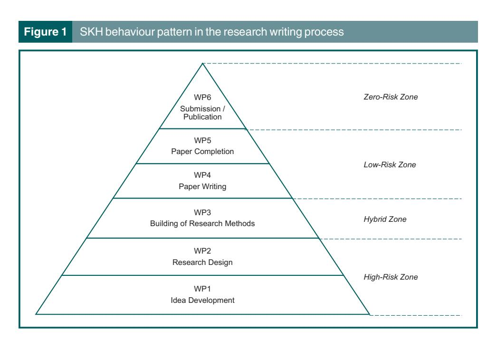
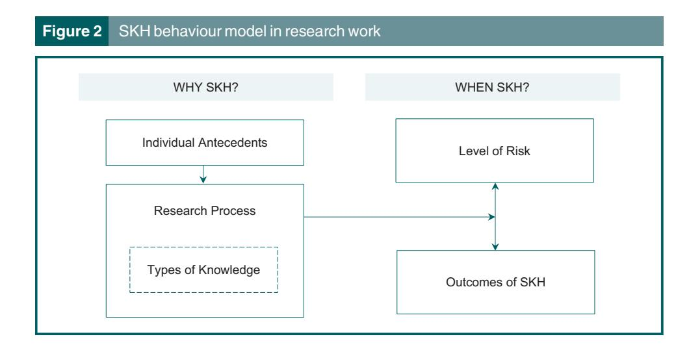

<!-- A3.R63 | source: papers_json/A3.R63/ -->

## How strategic knowledge hiding drives competitive individuals to establish research superiority: a case in UK Business Schools

## Ashmiza Mahamed Ismail and Christine Elizabeth Welch

Ashmiza Mahamed Ismail is based at the Faculty of Business and Law, British University in Dubai, Dubai, United Arab Emirates. Christine Elizabeth Welch is based at Portsmouth Business School, University of Portsmouth, Portsmouth, UK.

## Abstract

Purpose – Why and when people working in organisations hide their knowledge has received considerable academic attention. However, little attention has been paid to knowledge hiding in academia itself, even though universities are known as places where knowledge is shared. This study aims to consider the dilemma faced by academics when undertaking research work: should they share or hide what they are doing?

Design/methodology/approach – Using empirical evidence drawn from 20 academics in a number of UK Business Schools, the authors carried out in-depth interviews to investigate the effects of strategic knowledge hiding (SKH) on research knowledge work. The authors argue that SKH can drive competitive individuals to establish research superiority.

Findings – The findings revealed that most respondents have, for strategic reasons, hidden their tacit and/or explicit knowledge from others during ongoing research processes, but have, at the same time, purposefully sought for knowledge from targeted colleagues.

Originality/value – The findings extend the previous literature by revealing not only the distinctive individual antecedents of SKH but also its positive outcomes. The findings illustrate a pioneering contribution of a systematic model of SKH among university business school academics.

Keywords Strategic knowledge hiding, Academia, Individual antecedent, Tacit knowledge, Explicit knowledge

Paper type Research paper

## 1. Introduction

Knowledge hiding began to capture the attention of scholars from 2012, when Connelly et al. coined and defined that term as an intentional act of withholding or concealing particular knowledge from co-workers who requested it. There is a general human tendency to look guardedly at the knowledge we possess [(Ipe, 2003](#page-17-0); [Weiss, 1999)](#page-19-0), perceiving knowledge as a finite personal asset that is, therefore, valuable and worth hiding [(Skerlavaj](#page-19-1) et al.[, 2018](#page-19-1)). Studies show that employees may hide their knowledge due to a range of feelings: ownership and territoriality [(Singh, 2019;](#page-19-2) Li et al.[, 2015](#page-18-0)); personal competitiveness [(Hernaus](#page-17-1) et al., 2018); personal characteristics (Jiang et al.[, 2019](#page-17-2); [Connelly](#page-17-3) et al., 2012); interpersonal distrust (Cerne et al.[, 2014;](#page-17-4) [Connelly](#page-17-3) et al., 2012); prosocial motivation, perspective taking and time pressure [Skerlavaj](#page-19-1) et al., 2018). The theory of cooperation suggests that organisational members are competitive regarding personal goals and preferences [(Tjosvold](#page-19-3) et al., 1983) but cooperative in their perceptions of goal interdependence [(Tjosvold, 1984)](#page-19-4).

Received 18 July 2022 Revised 14 December 2022 21 January 2023 Accepted 30 January 2023

<!-- page 2 -->

In academia, an ever-present emphasis on research ranking and performance ([Scott, 2009](#page-19-5), [2016)](#page-19-6) has served to create a harshly competitive environment for academics wishing to progress their careers and sustain their development by acquiring or enhancing research superiority. This work involves competitive pressures to perform and even to outperform others. Quantity and impact of publications are often used as key measures for academic professional development [(Cameron](#page-17-5) et al., 2013). This can create unwillingness to disclose the nature and content of ongoing research [(Walsh and Hong, 2003](#page-19-7)), which could have an effect of stifling development in academic disciplines. The importance of knowledge-hiding in non-academic organisations has been well-researched, whereas the antecedents and outcomes of knowledge hiding in academia have not been examined extensively. This is a serious omission (Cerne et al.[, 2014)](#page-17-4), which may hinder task and team performance ([Singh,](#page-19-2) [2019)](#page-19-2); create interpersonal distrust among co-workers ([Connelly](#page-17-3) et al., 2012); cause interpersonal relationships to deteriorate [(Connelly and Zweig, 2015)](#page-17-6); reduce employee creativity (Fong et al.); and increase workplace deviance (Shelly et al.[, 2018](#page-19-8)).

This study attempts to bridge this gap in the existing literature on knowledge hiding by identifying the factors influencing strategic knowledge hiding (SKH) among academics in ongoing research writing processes (RWP). As both explicit and tacit knowledge reside in the minds of individuals, it is critical to understand why and when academics hide such knowledge, and what effect this has on research superiority. Thus, this study addresses three specific research questions:

- RQ1. Why do academics hide their knowledge from colleagues during their research writing process?
- RQ2. When does SKH occur in that process?
- RQ3. What types of knowledge are involved?

This study offers three contributions. Firstly, a pioneering investigation of SKH among academics, exploring whether such behaviour enhances research superiority. Earlier studies on knowledge hiding suggest that withholding and concealing knowledge could form a barrier to employees' ability to thrive in the workplace and become destructive to the social fabric of the workplace (Jiang et al.[, 2019](#page-17-2); [Serenko and Bontis, 2016;](#page-19-9) [Connelly and](#page-17-6) [Zweig, 2015)](#page-17-6). Given the norms of academic research, and the distinctive nature of academic life compared to that in non-academic organisations [(Sauermann and Stephan,](#page-19-10) [2010)](#page-19-10), SKH among academics may not necessarily lead to the destructive outcomes apparent in non-academic settings [(Singh, 2019](#page-19-2); [Connelly and Zweig, 2015](#page-17-6); [Cerne](#page-17-4) et al., [2014)](#page-17-4). This contribution is important, given the limited theoretical basis for understanding the interplay between knowledge hiding and research superiority in academic work. Secondly, responding to calls by [Singh (2019)](#page-19-2) and [Peng (2013)](#page-18-1), we contribute an examination of differentiation between tacit and explicit knowledge in the RWP, and their linkage with antecedents and outcomes of SKH. It appears that, in a social context, academics hide their tacit and/or explicit knowledge from others strategically while purposefully seeking knowledge from targeted colleagues. It is proposed that SKH not only allows academics to protect their knowledge but also affords them possibilities to acquire and establish their research superiority. Thirdly, in response to the calls by [Connelly](#page-17-3) et al. [(2012),](#page-17-3) we develop an empirical model to illuminate patterns of SKH among academics during RWP, using an in-depth, qualitative case design. It is argued that the points made in this paper must be addressed by institutions that are seeking to promote collaboration.

The first section of this paper looks at the extent of previous research in this field. A putative model is constructed as the basis for inquiry. Next, the paper seeks to establish the nature and extent of the gap in current understandings of SKH in academia, exploring the factors of interest. The second section discusses the methodology, a report of findings and discussion in the third section, followed by implications for the wider community, and conclusion.

<!-- page 3 -->

## 1.1 Knowledge hiding in academia

While knowledge sharing has been shown to be a critical factor for organisational success and competitive advantage (Malik et al.[, 2020](#page-18-2)), knowledge hiding appears to produce opposite results. Not only is it associated negatively with individual and team performance, but it can actually impede organisational functioning ([Singh, 2019](#page-19-2); Fong et al.[, 2018](#page-17-7); [Connelly and Zweig, 2015)](#page-17-6). However, the outcomes of research knowledge hiding in academia appear to be different to those in other types of organisations due to the distinctive culture, including standards, norms, policies and criteria for professional advancement [(Lee, 2007)](#page-18-3).

In recent decades, a radical shift was seen in the university research landscape. Research has taken centre stage in academic life [(McNaught, 2015)](#page-18-4), where once it was peripheral to academics' roles as instructors. Research is now key to both personal career progression and institutional prestige. Research rankings are now crucial, and the quantity and impact of research publications are key measures of academic performance [(Cameron](#page-17-5) et al., [2013)](#page-17-5). Academics must balance their teaching, research, administration and community engagement duties and also enhance their research superiority to sustain an upward career trajectory [(O'Brien and Hapgood, 2012)](#page-18-5). This creates a competitive atmosphere in academia [(Hernaus](#page-17-1) et al., 2018; [Haas and Park, 2010](#page-17-8)), and hence, generates personal competitiveness or competitive personality among individual academics [(Cyr and Choo,](#page-17-9) [2010)](#page-17-9).

There are strong traditions of academic freedom and autonomy over research, despite its being externally audited and monitored ([Deem, 2004](#page-17-10)). Notwithstanding [Mahdi and](#page-18-6) [Almsafir's (2014)](#page-18-6) suggestion that harnessing knowledge can sustain competitive advantage in academia, we argue that SKH within RWP may actually enhance academics' research superiority and, in turn, facilitate a sustainable environment in university research [(Mahamed Ismail](#page-18-7) et al., 2013).

In a business management context, the concept of "strategy" is "intended as the determination of long-term goals and objective of a company, appropriate courses of action and the allocation of resources necessary for carrying out these goals". Therefore, "strategic thinking" is "about creating and implementing strategies to win in a competition [...]" ([Bolisani and Bratianu, 2017](#page-16-0), pg. 236). In line with this notion of strategy and strategic thinking, we defined SKH as "a modus operandi for an individual academic in retaining or concealing (from other academics) research-related ideas or information possessed, whilst making a purposeful attempt to seek ideas, information, or opinions from targeted informants, with the goal of achieving a personal, professional advantage". This is for the purpose of establishing research superiority through the growth in the research field or publication ([Koder and Ross, 1993](#page-18-8)).

RWP is considered to include idea development (WP1), research design (WP2), building of research methods (WP3), paper writing (WP4), paper completion (WP5) and submission and/or publication (WP6). As such, the focus here is on situations where individual academics hide their tacit and/or explicit knowledge from others strategically while purposefully seeking knowledge from targeted colleagues. There may be differences in SKH behaviour in relation to tacit and explicit forms of knowledge [(Hernaus](#page-17-1) et al., 2018).

Existing literature on knowledge hiding was reviewed initially, focusing on ways in which knowledge hiding occurs in workplaces, including antecedents and outcomes. However, there is limited evidence as to how academics display knowledge-hiding behaviour, what its antecedents are and how it impacts the individual academics concerned. The following sections provide a conceptual background for the study by discussing the research gap this study is intended to address, and by identifying three broad factors, derived from the literature on knowledge hiding in wider organisational sectors, that may influence SKH among academics. These are:

<!-- page 4 -->

- knowledge-hiding antecedents;
- outcomes of knowledge hiding; and
- tacit and explicit knowledge hiding.

## 1.2 Research gap

The literature is replete with buzzwords addressing knowledge hiding as organisational misconduct due to its potential negative outcomes (Xiong et al.[, 2019](#page-20-0); [Serenko and Bontis,](#page-19-9) [2016)](#page-19-9). Existing research primarily focused either on knowledge hiding in dyadic situations, between the knowledge hider and the knowledge seeker (Arain et al.[, 2020;](#page-16-1) [Connelly and](#page-17-6) [Zweig, 2015](#page-17-6); Cerne et al.[, 2014](#page-17-4)); or the role of knowledge hiding within or between teams (Babic et al.[, 2019;](#page-16-2) [Singh, 2019)](#page-19-2). Employee silence is identified as synonymous with knowledge hiding or withholding of work-related knowledge from others [(Brinsfield and](#page-17-11) [Edwards, 2020](#page-17-11); [Knoll and Redman, 2016)](#page-18-9). According to [Knoll and Van Dick (2013)](#page-18-10), although employee silence is not harmful per se, cooperative environments and operation of work processes may be disturbed if silence becomes the norm or knowledge that is explicitly required is withheld. [Beheshtifar](#page-16-3) et al. (2012) classify employee silence as a form of unethical behaviour, resulting from factors such as job characteristics, supervisory style and reward structures [(Trevin˜o](#page-19-11) et al., 2014).

There have been a few studies focused specifically on knowledge hiding in academia. [Hernaus](#page-17-1) et al. (2018) looked at how knowledge hiding influences the collaborative academic environment, revealing that mistrust in academic relationships and personal competitiveness are driving factors of knowledge hiding, while task interdependence and social support can diminish the negative effects. Their work particularly emphasises a typespecific, evasive knowledge hiding in dyadic relationships of science scholars. Another study is focused on second-year undergraduate students (Babic et al.[, 2019](#page-16-2)). These authors report the key role of managers to improve prosocial motivation among team members, ultimately reducing the potential of knowledge hiding in teams. In empirical work involving academics in UK universities, [Fullwood](#page-17-12) et al. (2019) conclude that knowledge related to research is more likely to be shared than other types of knowledge. However, given the distinctive pattern in research-knowledge sharing among academics ([Mahamed](#page-18-7) Ismail et al.[, 2013](#page-18-7)), it is crucial to investigate further why and when academics decide to withhold their different types of research-related knowledge.

Several studies suggest that academics are idiosyncratic, hesitant to share knowledge and attentive to their individual achievements ([Al-Kurdi](#page-16-4) et al., 2018; [Fullwood and Rowley, 2017](#page-17-13)). [Lee (2007)](#page-18-3) describes academic departments as "idiosyncratic and complex" (p. 42), varying from one department, discipline, structure and culture to another. Such characteristics make knowledge hiding a challenge in academic institutions [(Charband and](#page-17-14) [Jafari Navimipour, 2018;](#page-17-14) [Fullwood and Rowley, 2017)](#page-17-13). Despite these findings, there is a dearth of evidence specifically on SKH behaviour. This study aims to bridge this lacuna, arguing that the behaviour of hiding while seeking knowledge may be necessary to ongoing research processes and that this "game of hide-and-seek" can be productive for academics' research superiority.

## 1.3 Factors that play a role in knowledge hiding behaviour

Scholars have stipulated that knowledge hiding is a unique concept, distinct in construct and characteristics to simple failure to share. It should be seen as a purposeful set of behaviours and not simply the opposite end of a continuum of knowledge sharing ([Cerne](#page-17-4) et al.[, 2014](#page-17-4); [Connelly](#page-17-3) et al., 2012). [Ford and Staples (2008)](#page-17-15) indicate that an individual employee may share a piece of less important information with colleagues while, at the same time, hiding another piece of more vital information. It could, therefore, be argued that

<!-- page 5 -->

knowledge hiding has strikingly distinct antecedents and underlying mechanisms ([Connelly](#page-17-3) et al.[, 2012](#page-17-3)). Thus, investigation of factors playing key roles in knowledge-hiding behaviour could be of considerable value. Past studies on knowledge hiding in academic settings have highlighted the type-specific factor of knowledge-hiding behaviour [(Hernaus](#page-17-1) et al., [2018)](#page-17-1). Hence, drawing on the extant literature on factors underlying SKH behaviour, we identify three broader areas for further investigation.

The first is the individual antecedents of knowledge-hiding behaviour – crucial since such factors could trigger individuals to withhold their knowledge (Xiong et al.[, 2019](#page-20-0)). Interpersonal distrust could impact upon the act of hiding knowledge (Cerne et al.[, 2014](#page-17-4); [Connelly](#page-17-3) et al., 2012). [Blau (1964)](#page-16-5), reflecting upon social exchange theory, suggests that the exchange of social and material resources (such as valuable knowledge) is a fundamental form of human interaction based upon trust, involving the reasonable expectation that another person will perform a particular action important to the trustor (Mayer et al.[, 1995)](#page-18-11). Blau argues that breakdown of trust often transforms the relationship to one of avoidance. Individuals tend to hide their knowledge from colleagues they consider distant or separate, with whom they have not established a social exchange relationship (Cerne et al.[, 2014](#page-17-4); [Connelly](#page-17-3) et al., 2012). [Connelly](#page-17-3) et al. (2012) suggest that individuals hide their knowledge from those whom they distrust, although the mode of knowledgehiding behaviour depends upon their perceptions of context. Thus, it can be argued that, at a specific point in RWP, academics may choose to hide specific types of knowledge from others, including those whom they distrust.

Furthermore, the territoriality around knowledge, skills and expertise ([Singh, 2019](#page-19-2)), and the tendency to withhold valuable and important information (Xiao et al.[, 2016)](#page-20-1) confirm that different individual personalities, values and attitudes can trigger knowledge-hiding behaviour and influence social relationships ([Tekleab and Quigley, 2014)](#page-19-12). [Singh (2019)](#page-19-2) notes that the intangible nature of knowledge may influence individuals to establish territories around their knowledge. From a psychological ownership perspective, individuals may form feelings of ownership towards any target they have control, invest time or energy in or are familiar with ([Pierce](#page-18-12) et al., 2001). Hence, [Peng (2013)](#page-18-1) argues that since knowledge is acquired, controlled and created, individuals will feel a strong attachment to their knowledge and see it as their personal psychological property, leading to feelings of ownership over it. Knowledge is considered an individual's personal resource, representing a source of competitive advantage over colleagues. Personal competitiveness is highly relevant in academic environments, where researchers may refuse to collaborate and choose to hide certain knowledge due to academic competition ([Hernaus](#page-17-1) et al., 2018; [Haas](#page-17-8) [and Park, 2010)](#page-17-8). These factors require empirical confirmation in academic contexts.

Secondly, it is important to consider the outcomes attributed to knowledge hiding in the wider organisational sector. Extant research evidence knowledge hiding as counterproductive but has paid little attention to a more positive side of knowledge hiding. Research has shown that knowledge-hiding behaviour can lead to particularly negative outcomes for individuals working in organisations: diminished creativity and reductions in innovative work behaviour (Fong et al.[, 2018;](#page-17-7) Cerne et al.[, 2014](#page-17-4)); weakened interpersonal relationships ([Connelly and](#page-17-6) [Zweig, 2015](#page-17-6)); and increased workplace deviance (Shelly et al.[, 2018)](#page-19-8). Moreover, [Pierce](#page-18-12) et al. [(2001)](#page-18-12) indicate that knowledge-hiding behaviour can lead individuals to experience personal loss, frustration and stress. [Singh (2019)](#page-19-2) concludes that knowledge hiders are "great losers" (pg. 17) due to interpersonal distrust loops that arise between hiders and seekers of knowledge. Seekers often retaliate and reciprocate by hiding knowledge from the particular hiders. Nevertheless, [Connelly and Zweig (2015)](#page-17-6) argue that "knowledge hiding is not necessarily intended to harm an individual or the organisation, rather it is a common response to a given situation". It is, therefore, crucial to examine the idea of knowledgehiding behaviour in the context-specific environment, as proposed in this study. SKH may be necessary to provide a productive function to the knowledge hiders.

<!-- page 6 -->

Thirdly, it is important to understand the different types of knowledge, as a cornerstone in knowledge-hiding behaviour. What we refer to as knowledge can be tacit ("knowing how") or explicit ("knowing about") along a continuum [(Grant, 1996](#page-17-16); [Nonaka, 1994](#page-18-13)). Explicit knowledge can be readily explained to others. An example might the reference list for this paper. Explicit work knowledge is used as a management tool and exploited for effective use ([Singh, 2008)](#page-19-13) through organisational platforms such as groupware, intranets, list servers, knowledge repositories, database management systems and knowledge action networks ([Scarborough](#page-19-14) et al., 1999). Tacit knowledge is different and has become a subject for debate surrounding efforts to manage organisational knowledge [(Panahi](#page-18-14) et al., 2013; [Holste and Fields, 2010](#page-17-17)). [Polanyi (1967)](#page-18-15) describes tacit knowledge as knowing more than we can tell or knowing how to do something without conscious thought. For example, how to swim or ride a bicycle. Tacit knowledge is personal, intangible, hidden and embedded in stories, actions and personal experience, making it hard to articulate ([McInerney, 2002)](#page-18-16). It can be shared [(Tsoukas, 2005](#page-19-15)), but additional activities are needed to support this, e.g. demonstration, situated peripheral participation [(Lave and Wenger, 1991)](#page-18-17). Facilitation may be through networks of peer relationships, whether face-to-face or virtual [(Holste and Fields,](#page-17-17) [2010)](#page-17-17). An understanding of this dichotomy in the nature of "knowledge" is needed when inquiring and when people hide knowledge in work settings [(Peng, 2013;](#page-18-1) [Connelly](#page-17-3) et al., [2012)](#page-17-3).

Organisational knowledge may be "sticky" due to a number of barriers inhibiting sharing. For instance, "best practice" does not always spread evenly within an organisation ([Szulanski, 2002)](#page-19-16). Failure to share may occur for a number of reasons, e.g. inadvertence, pressure of time or a lack of background understanding by colleagues. There may also be cultural barriers, where ideas and suggestions are blocked by a desire "not to rock the boat" ([Argyris, 1990)](#page-16-6). Knowledge can be both "sticky" and, at the same time, "leaky" within an organisation, i.e. the person who has certain knowledge may choose not to share it with colleagues but may share more readily with outsiders ([Brown and Duguid, 2001)](#page-17-18). In a UK academic context, this phenomenon may be encouraged due to the working of the Research Excellence Framework (REF), which enabled work to be double counted when undertaken as a collaboration between different institutions. Explicit knowledge may not be as sticky as tacit ([Szulanski, 2002](#page-19-16)) and is more readily susceptible of management. However, individuals must be feeling comfortable to be willing to share knowledge, particularly tacit knowledge ([Platts and Yeung, 2000)](#page-18-18). It is important to recognise when knowledge becomes sticky, not just because it is difficult to share but also because of SKH behaviour. While academic work has made significant progress in developing, testing and extending knowledge-hiding theory, differences in knowledge-hiding behaviour relating to different types of knowledge has been a neglected area (Xiong et al.[, 2019;](#page-20-0) [Singh, 2019](#page-19-2); [Skerlavaj](#page-19-1) et al., 2018).

In summary, building on the literature that explains the concept of knowledge-hiding behaviour mainly from the perspectives of business organisations, three factors have been identified that may be crucial in relation to the specific context of knowledge-hiding behaviour in RWP in academia. This empirical study aims to investigate whether these context-specific factors do indeed influence SKH behaviour among academics seeking to establish their research superiority, and if so, why, when and how does this take place.

The next section sets out the methodological choices made and the design for this research.

## 2. Methodology

This study was approached as the first part of an on-going project, from which lessons would be learned to direct later stages of inquiry. The intention was to obtain rich data for reflection to devise a putative model of SKH behaviour in academic settings. To avoid

<!-- page 7 -->

issues of bias in interpretive, qualitative, triangulation was provided by a second reading of the raw results and interpretations by a partner researcher.

Twenty interviews were conducted in January 2020 with academics working for the Business Schools in UK universities who were on full-time contracts with teaching and research responsibilities. This includes early-career academics who are within the first five years of their academic career; mid-career academics with more than years; and seniorcareer academics with 10 or more years of academic experience ([Gale, 2011](#page-17-19); [Tung and](#page-19-17) [McKercher, 2017](#page-19-17)). [Table 1](#page-6-0) shows the respondent socio-demographic characteristics. Participants were chosen on a purposive basis as those who could provide the most useful information and with scope for some generalisability ([Teddlie and Yu, 2007)](#page-19-18). This is a nonprobability method used where richness of data is most important. Subjects were selected for maximum variation among the target population based on career stage and type of employing institution. Business School staff were considered to provide ideal subjects because of a perception that there was pressure within this subject area to achieve high performance in publication rankings, for both reputational purposes and financial incentives, as compared to other STEM subjects, where staff more commonly work collaboratively in teams (Rafols et al.[, 2012)](#page-18-19).

A semi-structured interview approach was chosen, as it gives flexibility and considerable freedom to the interviewer to digress, change the order of the questions and pursue emergent themes (Bell et al.[, 2018)](#page-16-7). The interview protocol uses open-ended questions, adapted from the style used in [Connelly's](#page-17-3) et al. (2012) study. Each question aimed to encourage participants to relate their SKH experience during their typical RWP. Participants were encouraged to reflect on their SKH incidents during RWP, to allow for a greater depth of understanding about their reasons for intentional SKH; and when they choose to do it. Questions were designed to emphasise reflexivity, focusing on values and beliefs. Each interview was transcribed. A qualitative data analysis software package, NVivo, was used to assist with analysis, including the systematic collation and evaluation of the transcripts, as well as the creation of the coding structures for further examination ([Jackson and Bazeley,](#page-17-20) [2019;](#page-17-20) [Saldan˜a, 2021](#page-18-20)).

The coding process was an open process to allow for more iterative and interpretative analysis, as described by [Braun and Clarke (2006).](#page-16-8) To ensure similar code interpretation and the trustworthiness of the analysis, the transcriptions were read several times. [Bogdan](#page-16-9) [and Biklen (1997)](#page-16-9) recommend reading data over several times to begin developing a coding scheme. Collaborative reading by more than one researcher is desirable so as to uncover possible ambiguities in interpretation of responses. Interview transcripts were reviewed so that summary notes could be made, and thematic analysis undertaken [(Miles and](#page-18-21) [Huberman, 1994](#page-18-21)). The initial codes were generated through grouping such as ideas related to competitiveness, trust and time constraints when deciding to hide knowledge. These initial codes were then grouped into several themes, where the data is depicted by integrating original quotes from the transcripts for referential accuracy [(Curtin and Fossey, 2007](#page-17-21)). Cross validation was achieved by discussing the codes and categories between authors.

| Table 1 Socio-demographic characteristics of respondents |  |  |  |  |
| --- | --- | --- | --- | --- |
| Characteristics | Levels | Frequency (n) | % |  |
| Sex | Male | 8 | 40 |  |
|  |  | Female | 12 | 60 |
| University type | Pre-1992 | 9 | 45 |  |
|  |  | Post-1992 | 11 | 55 |
| Tenure | Early-career | 6 | 30 |  |
|  |  | Mid-career | 8 | 40 |
|  | Senior-career | 6 | 30 |  |

<!-- page 8 -->

## 3. Results and discussion

## 3.1 Individual antecedents – Why strategic knowledge hiding?

Several individual antecedents are mentioned most by participants in connection with SKH behaviour. Firstly, our evidence suggests that academics may refuse to collaborate and choose to hide certain knowledge due to academic competition and personal competitiveness. This includes pressure from REF and expectations from the academic authorities/managers, leading researchers to become more competitive with colleagues and aggressive in protecting their research. Our evidence highlights how researchers became more self-centred in relation to research knowledge sharing:

Academics nowadays are generally competitive. I mean given the pressure with REF for highrank journal papers, we're made to be self-centred. And for that I believe many of us are sharing what we published than what we're working on. (A1)

There is some competitiveness between people in terms of research [...] especially with the expectation from the top that we need to be REF-able, produce impactful research, submit to the high-rank journals [...]. makes us all a bit aggressive in protecting our work. We've become more self-centred than usual. So formally, I had always been involved in some kind of sharing [...] you know sharing my publications at a conference and so on. But informally, when the paper is not yet published, I'm more guarded. There is kind of public face and a profit face if you like. (A7)

Our evidence helps to explain the reasons for refusing to collaborate and choosing to hide certain knowledge, as stipulated by [Hernaus](#page-17-1) et al. (2018).

Moreover, some participants related their personal competitiveness to jealousy, superiority, time constraint, fear of losing power:

What stops people from sharing, there is jealousy and superiority, especially when someone is thinking about research process. You don't share what you know or what you are doing because [...] if I'm being brutally honest, you don't want your colleagues to do well and overtake you. People fear of losing power. It's real, you just don't see people talk about it openly. (A2)

I just don't have time to do it [sharing]. I'm too busy [...] a lot of teaching workloads, and also there's very strong demand for staff to publish, so we're all busy working on our research, increase our publications. The culture of sharing is dead. Everyone is trying to be on top of the game. As a result, we keep our research to ourselves. (A12)

These individuals' personal competitiveness somehow helps them to advertise their research activities, while observing the behaviour of others in relation to sharing research knowledge with colleagues, as part of their professional development:

[...] when you share your publications to your department, you'll get the recognition. That's the sort of quote-unquote power that you need in academia. Your colleagues need to know you for being research-active! You really need to step up your game and ready to compete. (A5)

The pressure from the top in terms of research publication [...] has created a personal competitiveness among individual academics that everybody is competing to publish in highrank journals and generate income to the institution. Our target is sustainability in terms of both our research publications as well as professional development. (A13)

Secondly, interpersonal distrust. Trust appears to be very important in contributing towards decisions to share knowledge in academic settings:

Oh, I do worry about that [sharing], so I'm guarded only with certain people I trust. Other than that, I would hide what I do. (A8)

<!-- page 9 -->

The selective nature of knowledge sharing/hiding is explained by participants who emphasise on their (un)willingness to share their research with people that they do not know:

If I'm being honest yeah, I do sometimes feel unwilling to share. I have no issue sharing with somebody whom I trust, although I might not be sharing everything with them [...] but I certainly don't do it [sharing] with everyone. (A17)

I know that there are people who are not trustworthy. I've seen incidents where people use your work, your ideas and presenting as theirs. So, I would be unwilling to share my research with just everybody, someone I don't know very well. I would be very reluctant on how much I can share. (A20)

This evidence concurs with the reported literature, where individuals have strong tendencies to hide their knowledge from colleagues who are distant or separate, with whom they have not established a social exchange relationship [(Hernaus](#page-17-1) et al., 2018; [Cerne](#page-17-4) et al., [2014)](#page-17-4).

An interesting view was provided by participants who were practitioners before joining academia. They make comparisons between non-academic and academic atmosphere, in which the latter somehow made them insecure to share their research:

Being a practitioner before, I personally think that universities have a very odd environment and strong competitive culture which is not helping knowledge sharing, particularly in research. And because of this kind of environment, I don't have much trust with people. When I feel like sharing my research stuff, present it in front of people in the department, I feel insecure. Do I have the level of trust with this people? There are always risks there and lacking trust. I know people who put a lot of work and then suddenly senior colleagues have been added as a name to the project and they didn't contribute at all. I am aware that such practice has been quite frequent, especially in the early stages of your career. (A10)

When the first time I came to work as academics from practitioners, I found that it is very difficult for me to get involved in research because there wasn't any natural place to go get support or seek knowledge from. People work in silo when it comes to research. They don't like sharing [...] I mean, I don't blame them for that because everybody competes with each other, so I developed it with few trusted colleagues. We started to collaborate in terms of research as we wanted to get going but we hide the work that we were doing from others until the paper got published, then we disseminate the knowledge with them. (A19)

This reflects not only that the atmosphere in academia is highly competitive in RWP but also demonstrates that academics are idiosyncratic and complex [(Fullwood and Rowley, 2017](#page-17-13)), making research-related knowledge hiding more common in academia.

Some participants narrate how feelings of timidity or lack of confidence triggered them to hide their knowledge. Lack of motivation and confidence were particularly experienced by early career researchers:

Being a newbie in this whole game, I have lack of motivation, no confidence. I believe I am not getting enough training in terms of research, so I hide more than I share, as I feel that my research has lower standard than those senior people. (A3)

Most of the time I just get the feeling that others won't be interested in my area of research. So, for that, I tend to hide my knowledge. I must admit that I have very low confident to share my research with others. (A8)

Sometimes I just don't have the confidence, you know, especially when I only managed to get my research published in a lower rank journal. I won't talk about it. I feel like I am not going to be able to contribute effectively when sharing it with others. I just don't have the confidence. (A9)

One participant highlighted the importance of sharing to get feedback on their own research work, yet a lack of confidence somehow hindered such action and led to knowledge hiding:

<!-- page 10 -->

I feel less than others in research work, hence I hide and seek knowledge more than I share. I want to get feedback. I feel like I need to be better in it before I can share my stuff with people. You know, "Have I made any stupid assumption? Have I used the wrong hypotheses tests? Am I doing something that I think is brand new but actually it was published two years ago, and I never found it?" You know, I need to build that confidence. (A15)

Our finding is in line with previous studies showing that individuals who are capable, motivated and confident about the usefulness of their contributions tend to be more proactive and have prosocial behaviours (Singh et al.[, 2019](#page-19-19); [Grant and Ashford, 2008](#page-17-22)).

One participant even outlined the fact that sharing research knowledge differed from sharing teaching materials, demonstrating the need for academics to be very strategic as to when they share research knowledge:

Sharing your research isn't like sharing your teaching materials. You need to be very careful what you share. Unless the paper is published, I don't talk to people about it. You know, the atmosphere is so tense. The competition is real. (A16)

The third individual antecedent recognised in this study is feelings of ownership of knowledge and territoriality, as the following quotation illustrates:

Problems arise which is why we don't want to share sometimes. There is an element of plagiarism. I know couple of colleagues developed a programme in Kuwait on knowledge sharing and the commercialisation of research and some staff are reluctant to share because they felt that they might be losing control of their intellectual property. So really, we want to protect our ideas, not until it is ready, and the paper gets published that we share the knowledge. (A11)

This includes the risk of losing control of intellectual property due to potential plagiarism by colleagues, especially during the early stage of a publication's RWP:

When I was a PhD student, there was an incident happened to me. I was talking to somebody about a research idea and then about [...] more or less six months later, that same idea had come out as a complete paper under the person's name. They nicked my idea so shamelessly. I'd never forget that. (A18)

This supports the view that the intangible nature of knowledge in terms of possession and ownership influences individuals to construct territories around the knowledge they possess ([Singh, 2019](#page-19-2)). This is due to a lack of confidence to share ideas at the earlier stage, particularly by early career researchers. A professor particularly stressed the critical importance of this factor, echoing the notion of psychological ownership. This suggests that individuals form feelings of ownership in relation to knowledge over which they have control, invest time or energy and are familiar with ([Pierce](#page-18-12) et al., 2001):

When I first started my research career, I had no confidence to share my research ideas. I mean yes, until now, there's always a danger in sharing that someone might steal your ideas. (A6)

There is definitely a danger in academia where one gives away a lot and suddenly you find somebody [...] surprisingly senior people who normally steal your ideas. They're writing a paper about your idea which you yourself never put into a paper yet. (A14)

Feelings of possession and ownership of knowledge increase after a bad previous experience with plagiarism of ideas. One participant shared their bad experience and how it shaped their behaviour in handling research knowledge with other colleagues. Researchers started to behave strategically and consider if benefits outweighed problems of non-sharing of knowledge. This illustrates the importance of research process, which we will discuss later:

Since I have been abused in the past, so I rethought it through and I think that although the benefits outweigh the problems, I'd say, if you really have a pearl of an idea, you hide it, don't share it until you've had a solid paper. (A1)

<!-- page 11 -->

Our findings also highlight that those senior academics were more comfortable to share with junior academics, whom they felt to pose less risk of plagiarism:

I teach some junior staff on research methods and writing for their publications. In that process, both tacit and explicit knowledge are shared. I have nothing to lose. It's not like I put my research at risk here, so it's okay. (A5)

## 3.2 Outcomes of strategic knowledge hiding – when strategic knowledge hiding happens and what type(s) of knowledge are involved?

When asked about the outcomes of SKH behaviour, most participants claimed that they feel less stress and are able to work on their research paper more effectively, as they do not have to worry about risks of subsequent disclosure of their research-related knowledge:

Yeah, I mean we have so much stress already [...] so if we have to tolerate these risks when sharing our ideas, for me it's not worth it. I don't share, no [...] nothing except my publications. (A3)

I'd say hiding my research work before its completion benefits me in many ways. Although there's still pressure to publish, in the process of completing my research paper, I can escape the unnecessary stress. You know when you are less stressful, you can work more effectively. I don't have to worry that my ideas might get stolen, or whether people would give destructive comments about what I do. And when I stay focused on writing, I can complete my paper much quicker. That's my aim [...] publication. You publish more, your career flourishes. (A4)

The participants largely confirm that their main goal is publication. Hence, they are using their time to the best effect by avoiding unnecessary stress caused by knowledge sharing during RWP. This demonstrates that competitive pressure for publications has led to increased secrecy ([Walsh and Hong, 2003)](#page-19-7). Knowledge hiding somehow makes participants feel safer and more relaxed to focus on publication:

Undoubtedly, it's [knowledge hiding] safer and very, very effective for me. No stress because you can actually concentrate at completing your paper. You might go out from your bubble to seek some technical knowledge from your colleagues, but you're not disclosing what you're doing. For me, I work faster this way [...] you know, you can actually focus in writing your paper. After all, the main goal is publication. (A5)

My aim is to produce more publication. That alone caused too much stress already. From my experience, hiding my research work is a lot relaxing. I don't have to worry that someone might steal my ideas. I just write my paper, complete it, and make sure that it gets published [...] then I share it with others. No stress. No drama. And it's proven to be more effective for me [...] to complete my paper and produce more papers. (A16)

The findings posit that SKH not only enhances levels of concentration and speeds up the completion time of papers but also increases potential to produce more publications. This, in turn, helps to sustain academics' career trajectories ([Cameron](#page-17-5) et al., 2013):

I believe it's necessary [knowledge hiding] because only then you can focus more effectively, you can write more effectively. During the process, you just put everything else behind you. After all, nothing is worth worrying about when you're writing. The writing itself is too stressful already. Yeah, it's truly a daunting task. You have to make good choices about what you add to your plate. Remember that the key thing here is to complete your paper and get it published. They don't expect you to share what you're doing [...] I mean, not until your work gets published. But they certainly expect you to publish and keep doing that progressively [...] so one way of doing it effectively is by working silently. (A1)

Thus, the findings suggest that academics prefer to work independently to deal with the stress of RWP more effectively. There is a general consensus among participants that SKH occurs throughout RWP, and our findings highlight an interesting view on how researchers strategically hide their knowledge from others:

<!-- page 12 -->

We conceal what we're working on. I must say, we do it so smartly. (A19)

Some participants report that academics dislike the term "knowledge sharing", preferring "academic exchange", where they expect to gain some knowledge in return for sharing with colleagues. This confirms the norms of reciprocity ([Singh, 2019)](#page-19-2):

In academia, we use another term for knowledge sharing. We call it academic exchange. They wouldn't like the word knowledge sharing. It's like you're not getting something in return, unlike exchange. (A11)

For me, it's [research-related knowledge] more like exchanging, not sharing. When you trust each other, you are willing to exchange your knowledge with them and at the same time you want to embrace knowledge from them as well. (A8)

More importantly, our findings posit that academics hide both their tacit and explicit knowledge intensively during RWP due to the competitive atmosphere in academia ([Hernaus](#page-17-1) et al., 2018; [Haas and Park, 2010](#page-17-8)):

I don't share both [tacit and explicit knowledge] because it's just too risky. People can simply steal your ideas when you speak about it or when you share your written piece, and you can't do nothing about it. I will make sure that it's [research] done before I go out and share. Definitely not, if the process isn't complete. (A10)

Academic life is full of unwritten rules or tacit knowledge where you can only share that through informal interactions and working together but sadly, quite a lot of that does not happen in higher education. (A19).

I believe when it comes to research, I hide and share both tacit and explicit knowledge. I know it does sound peculiar, but the situation isn't straightforward. It's rather complicated what we're doing. Okay [...] before any particular research completes, I hide my work and that applies to both tacit and explicit knowledge. I simply don't do sharing. But after the particular research completes [...] then I would be sharing it happily with other colleagues. (A2)

The participants demonstrate how they hide their research work, mainly at the earlier stages of RWP, and only share it when a paper is completed or published. The perceived risks involved during RWP push academics to hide their knowledge:

The highest risk is during your early stage of your research, and the lowest risk will be at the end of the project where your paper is complete, and you've sent out your paper for publication. (A20)

You can't just share your knowledge with everybody. You have to have some kind of control to it. Say if I go to a conference to present some basic ideas, which is not well-developed, somebody might actually see the potential in my ideas and develop a paper and send for publication quicker than me. So that's reason why I don't simply share because the goal here is to publish. (A16)

These findings confirm the intricate social context in academia, particularly in researchrelated knowledge, leading to SKH behaviour among academics. Academics hide both their tacit and explicit knowledge from others strategically while purposefully seeking knowledge from targeted informants with the goal of achieving an advantage for themselves. We discovered that most participants often sought knowledge in relation to research methods. The following quotations illustrate how academics shared a piece of less important information with colleagues while hiding another piece of vital information ([Ford](#page-17-15) [and Staples, 2008)](#page-17-15):

I go to some colleagues to get some opinions about the research methods that I use for my research. You know, we don't reveal our ideas. We only discuss if the methods we use is appropriate and get some advice. (A11)

<!-- page 13 -->

When I'm not sure on certain techniques or methods, I will seek help from other colleagues. That is common here. Even though we tend to work in silo with our research, we discuss and share things quite often, especially when it comes to any quants or quals methods that we're not sure about. (A2)

The findings confirm that knowledge hiding is reduced in situations where reciprocal social exchange is present or when a mastery climate is prevalent (Cerne et al.[, 2014](#page-17-4)). The following quotation demonstrates the occurrence of SKH among academic staff, where they use other colleagues as a "sounding board" within RWP.

People go and get feedback from other colleagues about the methods that they're using or how they might do it differently. I believe the benefits or reasons why people are doing this is because it isn't a one-way thing. Instead, it is a two-way thing. You're giving out knowledge and you're gaining some knowledge back for yourself. At the very basic level, people are using their colleagues as a kind of sounding board for their ideas [...] when you knock on it, and you hope to hear something back [...] that's the idea of sharing here, it's rather complex, not straightforward. (A14)

Overall, our findings differ from those of Fullwood et al.['s (2019)](#page-17-12), who concluded that knowledge related to research is more likely to be shared than other types of knowledge. In contrast, our study establishes that academics tend to hide both their tacit and explicit research-related knowledge, and only sharing their published work or work nearing completion of RWP and is ready for submission. Their knowledge-seeking behaviour appears to focus most on tacit understandings of the RWP, such as methods, and factors contributing to improved acceptance rates for publications.

From these empirical findings, we, therefore, summarise that there is a distinctively unique behavioural pattern during the RWP, where academics feel insecure and become possessive of their research knowledge. We identify different "risky zones" at certain interval points in the RWP, where academics choose to strategically hide either their tacit or explicit (or both) knowledge from others. [Figure 1](#page-12-0) summarises the SKH behaviour pattern among academics, during the RWP, as revealed in our empirical findings. Here, we discover four zones distinctive to research knowledge, i.e. high-risk, hybrid, low-risk and zero-risk zones.

<!-- page 14 -->

Based on our findings, WP1 and WP2 are recognised as the "high-risk zone" where academics purposefully hide their tacit and explicit knowledge from colleagues to protect their undeveloped or incomplete research ideas from theft. WP3 is the "hybrid zone" where, while concealing their own tacit and explicit knowledge, academics seek knowledge related to research methods from targeted colleagues. WP4 and WP5 are classified as "low-risk zone", where research ideas are no longer vulnerable, and are nearing completion. Although the related risks are lower at both stages, there are still present. Hence, academics still choose to hide their tacit and explicit knowledge and mostly prefer working in isolation or in silos within a trusted group until their research is complete. WP6 is the "zero-risk zone" where academics no longer hide or conceal their knowledge. At this stage, academics willingly and openly share their publications with others, either explicitly through formal platforms like conferences and seminars or informally in more casual conversations with colleagues.

## 4. Discussion and contribution

This paper unveils why academics may hide their knowledge from colleagues during RWP and when SKH occurs in that process. Our contributions provide a new perspective on this topic, highlighting a lack of understanding of SKH in academia ([Hernaus](#page-17-1) et al., 2018). Academic contexts are found to be high-pressure environments, which respondents previously used in industry and commerce find to be more competitive than other types of organisations, especially in relation to RWP. This research provides a pioneering contribution illuminating SKH among academics in their competitive workplace environment. It goes on to explore whether such behaviour establishes research superiority. The contribution is summarised in [Figure 2](#page-13-0), which provides a systematic model of SKH in academic life.

Firstly, we highlight that SKH behaviour in academia, the act of withholding and concealing knowledge, can be explained by understanding individual academic antecedents. Given the very distinctive nature of academic research [(Sauermann and Stephan, 2010](#page-19-10)), academics hide their knowledge strategically to protect ownership of their intellectual properties. Academics perceive themselves to be in competition for career advancement opportunities and to possess power through the possession of academic and researchrelated knowledge. This protective behaviour is due to individual territorial feelings (e.g. superiority, territoriality, timidity, competitiveness and reciprocation). As a "sole leader" for their own research work, an academic takes such an authoritative position, and manages when, and how much or how little knowledge to share [(Nissen](#page-18-22) et al., 2014). Our findings

<!-- page 15 -->

extend the discussion on individual antecedents by adding additional elements showing that academics' SKH behaviour is significantly determined by the level of risks encountered in ongoing research processes and the competitiveness of academic research environment.

Secondly, we showcase the importance of research processes in contributing towards SKH behaviour in academia. Our findings showcase that SKH behaviour among academics may not necessarily lead to the same destructive outcomes as in other types of organisations. This contribution is much needed as the theoretical basis for understanding the interplay between SKH and research superiority in academic work is limited. In particular, it emerged that the research process encourages cross-institutional collaborations. While research knowledge becomes "sticky" within an institution, it can be "leaky" across organisational boundaries. While past research discussed the importance of both knowledge-sharing and knowledge-hiding behaviours, it had not sufficiently explored the specific ways that external influences, such as the REF, could encourage a greater propensity to share across institutional boundaries. Our findings contribute to the literature by providing examples on how SKH not only allows academics to protect their knowledge but also affords them possibilities to establish their research superiority.

Thirdly, our findings contribute to the literature by examining how tacit and explicit knowledge are differentiated during the RWP and their linkage with antecedents and outcomes of SKH. In particular, our findings shed light on a distinctive behavioural pattern among academics involving different levels of risks during the RWP that called for SKH in academia [(Figure 1](#page-12-0)). Also, considering the centrality of the RWP in academia, strategically managing the risks involved in sharing research knowledge is important to establishing academic research superiority.

Overall, our study highlights how SKH in academic life is not counterproductive workplace behaviour intended to cause harm [(Connelly and Zweig, 2015)](#page-17-6). Rather, it is intended to benefit the institution, as individual researchers believe that they can become more productive, publish more, enhance their reputations as scholars, and hence improve the prestige of the University. Knowledge hiders, in the case of research-related knowledge in academia, are not "great losers" as suggested by [Singh (2019).](#page-19-2) Rather SKH is shown to be a necessary behaviour, responsive to the competitive research atmosphere in academia, and is significant for research superiority.

## 5. Implications for the wider community

While the primary focus of this paper is on the internal environment of higher education institutions, it is recognised that research is essentially an outward-facing activity. Researchers disseminate their completed work via conferences and publications as a contribution to their field of inquiry and the wider community. Findings relating to SKH must always be interpreted in this context.

Universities are funded by their primary and secondary clients. Some projects are commissioned by businesses as knowledge transfer, where dissemination of findings is delimited by contractual terms. More generally, research is supported by funding from UK Research & Innovation (UKRI). This agency receives a budget from the Department for Business, Energy and Industrial Strategy that is distributed via seven Research Councils relating to different academic fields. Additionally, Higher Education Funding Councils for each country of the UK fund the research infrastructure of the Universities, supporting the work funded by UKRI ([UK Research & Innovation, 2022a](#page-19-20)). Research Council funds are distributed via a system of peer review. Teams of academics with appropriate expertise examine proposals and determine which of them receive an award from the limited budget.

Policies that influence research funding are likely to reflect governmental priorities, e.g. desire for "Levelling Up" across the regions of the UK. The Arts and Humanities Research

<!-- page 16 -->

Council, for example, is currently funding research into community life: "Its interdisciplinary work embeds a human-focused approach to issues such as health, sustainability, development, economic growth, services, and infrastructure" [(UK Research & Innovation,](#page-19-21) [2022b](#page-19-21)). UKRI's policy also relates to research culture. The Medical Research Council, for instance, have stated their desire to foster "positive research culture", embedding "inclusive excellence". Principles for research best practice include collaboration, interdisciplinarity; open communication and partnership with the public; diversity of talents, skills and outputs and team science (UK Research & Innovation, 2022c). There are proposals for reform of research assessment for the future, to better reflect these principles, with a greater focus on the institution, rather than the individual researcher/department.

If future funding decisions reflect these policies, leaders must consider how best to encourage change. A deepened and sensitive understanding of current SKH behaviours may be crucial to leaders' efforts to change research culture, e.g. encourage formation of interdisciplinary teams and collaboration. Assumptions that SKH is always a negative phenomenon could result in a "blunt instrument" approach to the encouragement of change. The findings reported in this paper relate to a relatively small study but can help to inform a more nuanced approach.

These findings also have relevance for managers in industry and commerce. It has long been recognised that a company's greatest asset in seeking for growth is the "know-how" of its staff [(Davenport and Prusak, 1998)](#page-17-23). Some knowledge may be codified and stored in repositories or in processes that can be protected as intellectual property. However, much organisational knowledge is tacit – individuals may not be aware that they have it or be able to articulate it easily ([Polanyi, 1967](#page-18-15); Nonaka and [Takeuchi, 1995)](#page-18-23). The Chief Knowledge Officer in an organisation will be concerned with knowledge creation and capture for value added. Innovation can encompass products, services, processes or business models as sources of business growth. Management seeking opportunities to innovate may not be fully aware of relevant tacit knowledge residing within the organisation, while the individuals concerned may not be aware that the knowledge they hold is relevant to future strategic plans. Discussing innovation, [Bashir and Farooq (2018)](#page-16-10) state as an assumption that knowledge holders will be reluctant to pass on what they know, suggesting a need for encouragement through extrinsic rewards.

As our findings suggest, SKH is a more complex phenomenon than mere "reluctance". Many and complex issues may be involved that are context specific. In particular, as suggested above, it is important to distinguish between SKH and simple failure to share what is known. Extrinsic rewards may encourage more openness to sharing but will have no effect where useful knowledge has not been identified or recognised as relevant. Encouragement of collaboration, however, may lead to creativity and new ideas. Inquiry into SKH would, it is argued, be beneficial in shining a light on knowledge acquisition processes and effective management initiatives.

## 6. Conclusion

While writing up the results and conclusions from the study, it became apparent that participants considered it was beneficial for them to conduct their RWP alone, expressing this to reduce stress and enable their work to go more smoothly. However, it is impossible not to notice that, in the reference list for this paper, the preponderance of works is by multiple authors. A brief examination of the works suggests that there may be several reasons for co-authorship despite a preference for working alone. Firstly, complementary disciplines may be involved so that more than one author is contributing a single-authored piece to a larger work or is contributing tacit knowledge that is not fully shared in the process, e.g. an expert in statistics who conducts an analysis on data gathered by another team member. No SKH is thus involved. Secondly, a relationship may be involved that reflects legitimate peripheral participation of early career researchers in collaboration with a

<!-- page 17 -->

more experienced research supervisor so that predominantly tacit knowledge is shared. A further possibility is that a relationship of trust exists in which co-authors are willing to pool their knowledge. Sources of such trust, and their impact on SKH, would be a further interesting area for future inquiry.

Research is carried out in universities largely at the expense of the public purse. It is, therefore, unsurprising that policymakers should be giving consideration to ways in which it can be made to serve the needs of the community in ways that will make the most impact. It can be seen that the funding agencies are keen that research should address real issues in society, such as shaping of urban spaces and protection of the environment. As a consequence, more emphasis has been placed upon funding interdisciplinary work around specific problems and issues. While it has been common for scientific research to be a team effort, the current system may have tended to encourage a "sole trader" attitude among many academics. The need for interdisciplinarity together with a greater focus on institution rather than individual in future research assessment exercises, leads to a need for a fundamental shift in culture towards one in which trust is enhanced and collaboration rewarded. Studies such as this one can help to inform thinking about change. There is a need for academic authorities and managers to be aware and understand the importance of knowledge sharing and hiding culture within an institution to support academic to develop relevant skills and capabilities. At the same time, an awareness of the benefits perceived to be accrued through SKH can be useful so that there will be a balance of hiding and sharing knowledge in academia.

Dissemination of research from academics needs to be widely available so that it can be useful to all sectors of society. New ideas developed collaboratively within organisations will be crucial to future growth and prosperity. Careful consideration of the best way to encourage collaboration, interdisciplinarity and creativity are the key in all types of organisations. Studies such as this one can help to inform decision makers.

## References

Al-Kurdi, O., El-Haddadeh, R. and Eldabi, T. (2018), "Knowledge sharing in higher education institutions: a systematic review", Journal of Enterprise Information Management, Vol. 31 No. 2, pp. 226-246.

Arain, G.A., Bhatti, Z.A., Ashraf, N. and Fang, Y.H. (2020), "Top-down knowledge hiding in organizations: an empirical study of the consequences of supervisor knowledge hiding among local and foreign workers in the Middle East", Journal of Business Ethics, Vol. 164 No. 3, pp. 611-625.

Argyris, C. (1990), Overcoming Organizational Defenses, Allyn & Bacon, Boston.

Babic, K., Cerne, M., Connelly, C.E., Dysvik, A. and S ˇ kerlavaj, M. (2019), "Are we in this together? Knowledge hiding in teams, collective prosocial motivation and leader-member exchange", Journal of Knowledge Management, Vol. 23 No. 8, pp. 1502-1522.

Bashir, M. and Farooq, R. (2018), "The synergetic effect of knowledge management and business model innovation on firm competence: a systematic review", International Journal of Innovation Science, Vol. 11 No. 3, pp. 362-387, doi: [10.1108/IJIS-10-2018-0103.](http://dx.doi.org/10.1108/IJIS-10-2018-0103)

Beheshtifar, M., Borhani, H. and Moghadam, M.N. (2012), "Destructive role of employee silence in organizational success", International Journal of Academy Research in Business and Social Science, Vol. 2 No. 11, p. 275.

Bell, E., Bryman, A. and Harley, B. (2018), Business Research Methods, Oxford University Press, Oxford.

Blau, P.M. (1964), Exchange and Power in Social Life, John Wiley & Sons, New York, NY.

Bogdan, R. and Biklen, S.K. (1997), Qualitative Research for Education, Allyn & Bacon, Boston.

Bolisani, E. and Bratianu, C. (2017), "Knowledge strategy planning: an integrated approach to manage uncertainty, turbulence, and dynamics", Journal of Knowledge Management, Vol. 21 No. 2, pp. 233-253.

Braun, V. and Clarke, V. (2006), "Using thematic analysis in psychology", Qualitative Research in Psychology, Vol. 3 No. 2, pp. 77-101.

<!-- page 18 -->

Brinsfield, C.T. and Edwards, M.S. (2020), "Employee voice and silence in organizational behavior", Handbook of Research on Employee Voice, Edward Elgar Publishing, Northampton, MA.

Brown, J.S. and Duguid, P. (2001), "Knowledge and organization: a social-practice perspective", Organization Science, Vol. 12 No. 2, pp. 198-213.

Cameron, E.Z., Gray, M.E. and White, A.M. (2013), "Is publication rate an equal opportunity metric?", Trends in Ecology & Evolution, Vol. 28 No. 1, pp. 7-8.

Cerne, M., Nerstad, C.G., Dysvik, A. and S ˇ kerlavaj, M. (2014), "What goes around comes around: knowledge hiding, perceived motivational climate, and creativity", Academy of Management Journal, Vol. 57 No. 1, pp. 172-192.

Charband, Y. and Jafari Navimipour, N. (2018), "Knowledge sharing mechanisms in the education: a systematic review of the state of the art literature and recommendations for future research", Kybernetes, Vol. 47 No. 7, pp. 1456-1490.

Connelly, C.E. and Zweig, D. (2015), "How perpetrators and targets construe knowledge hiding in organizations", European Journal of Work and Organizational Psychology, Vol. 24 No. 3, pp. 479-489.

Connelly, C.E., Zweig, D., Webster, J. and Trougakos, J.P. (2012), "Knowledge hiding in organizations", Journal of Organizational Behavior, Vol. 33 No. 1, pp. 64-88.

Curtin, M. and Fossey, E. (2007), "Appraising the trustworthiness of qualitative studies: guidelines for occupational therapists", Australian Occupational Therapy Journal, Vol. 54 No. 2, pp. 88-94.

Cyr, S. and Choo, C.W. (2010), "The individual and social dynamics of knowledge sharing: an exploratory study", Journal of Documentation, Vol. 66 No. 6, pp. 824-846.

Davenport, T.H. and Prusak, L. (1998), Working Knowledge: How Organizations Manage What They Know, Harvard Business School Press, Cambridge, MA.

Deem, R. (2004), "The knowledge worker, the manager-academic and the contemporary UK university: new and old forms of public management?", Financial Accountability and Management, Vol. 20 No. 2, pp. 107-128.

Fong, P.S., Men, C., Luo, J. and Jia, R. (2018), "Knowledge hiding and team creativity: the contingent role of task interdependence", Management Decision, Vol. 56 No. 2, pp. 329-343.

Ford, D.P. and Staples, D.S. (2008), "What is knowledge sharing from the informer's perspective?", International Journal of Knowledge Management, Vol. 4 No. 4, pp. 1-20.

Fullwood, R. and Rowley, J. (2017), "An investigation of factors affecting knowledge sharing among UK academics", Journal of Knowledge Management, Vol. 21 No. 5, pp. 1254-1271.

Fullwood, R., Rowley, J. and McLean, J. (2019), "Exploring the factors that influence knowledge sharing between academics", Journal of Further and Higher Education, Vol. 43 No. 8, pp. 1051-1063.

Gale, H. (2011), "The reluctant academic: early-career academics in a teaching-orientated university", International Journal for Academic Development, Vol. 16 No. 3, pp. 215-227.

Grant, R.M. (1996), "Toward a knowledge-based theory of the firm", Strategic Management Journal, Vol. 17(S2), pp. 109-122.

Grant, A.M. and Ashford, S.J. (2008), "The dynamics of proactivity at work", Research in Organizational Behavior, Vol. 28, pp. 3-34.

Haas, M.R. and Park, S. (2010), "To share or not to share? Professional norms, reference groups, and information withholding among life scientists", Organization Science, Vol. 21 No. 4, pp. 873-891.

Hernaus, T., Cerne, M., Connelly, C., Vokic, N.P. and S ˇ kerlavaj, M. (2018), "Evasive knowledge hiding in academia: when competitive individuals are asked to collaborate", Journal of Knowledge Management, Vol. 23 No. 4, pp. 597-618.

Holste, J.S. and Fields, D. (2010), "Trust and tacit knowledge sharing and use", Journal of Knowledge Management, Vol. 14 No. 1, pp. 128-140.

Ipe, M. (2003), "Knowledge sharing in organizations: a conceptual framework", Human Resource Development Review, Vol. 2 No. 4, pp. 337-359.

Jackson, K. and Bazeley, P. (2019), Qualitative Data Analysis with NVivo, Sage, London.

Jiang, Z., Hu, X., Wang, Z. and Jiang, X. (2019), "Knowledge hiding as a barrier to thriving: the mediating role of psychological safety and moderating role of organizational cynicism", Journal of Organizational Behavior, Vol. 40 No. 7, pp. 800-818.

<!-- page 19 -->

Knoll, M. and Redman, T. (2016), "Does the presence of voice imply the absence of silence? The necessity to consider employees' affective attachment and job engagement", Human Resource Management, Vol. 55 No. 5, pp. 829-844.

Knoll, M. and Van Dick, R. (2013), "Do I hear the whistle ...? a first attempt to measure four forms of employee silence and their correlates", Journal of Business Ethics, Vol. 113 No. 2, pp. 349-362.

Koder, M. and Ross, H. (1993), "Funding and load trends in Australian higher education, 1983-1994", Journal of Tertiary Education Administration, Vol. 15 No. 1, pp. 19-33.

Lave, J. and Wenger, E. (1991), Situated Learning, Cambridge university press, Cambridge. [Database]

Lee, J.J. (2007), "The shaping of the departmental culture: measuring the relative influences of the institution and discipline", Journal of Higher Education Policy and Management, Vol. 29 No. 1, pp. 41-55.

Li, J., Yuan, L., Ning, L. and Li-Ying, J. (2015), "Knowledge sharing and affective commitment: the mediating role of psychological ownership", Journal of Knowledge Management, Vol. 19 No. 6, pp. 1146-1166.

McInerney, C. (2002), "Knowledge management and the dynamic nature of knowledge", Journal of the American Society for Information Science and Technology, Vol. 53 No. 12, pp. 1009-1018.

McNaught, K. (2015), "The changing publication practices in academia: inherent uses and issues in open access and online publishing and the rise of fraudulent publications", Journal of Electronic. Publishing, Vol. 18 No. 3, doi: [10.3998/3336451.0018.308.](http://dx.doi.org/10.3998/3336451.0018.308)

Mahamed Ismail, N.A.M., Xu, M.X., Wood, M. and Welch, C. (2013), "To share or not to share? Researchknowledge sharing in higher education institution: preliminary results", International Journal of Information Technology and Management, Vol. 12 Nos 3/4, pp. 169-188.

Mahdi, O.R. and Almsafir, M.K. (2014), "The role of strategic leadership in building sustainable competitive advantage in the academic environment", Procedia – Social and Behavioral Sciences, Vol. 129, pp. 289-296.

Malik, A., Froese, F.J. and Sharma, P. (2020), "Role of HRM in knowledge integration: towards a conceptual framework", Journal of Business Research, Vol. 109, pp. 524-535.

Mayer, R.C., Davis, J.H. and Schoorman, F.D. (1995), "An integrative model of organizational trust", The Academy of Management Review, Vol. 20 No. 3, pp. 709-734.

Miles, M.B. and Huberman, A.M. (1994), Qualitative Data Analysis, Sage, Beverly Hills, CA.

Nissen, H.A., Evald, M.R. and Clarke, A.H. (2014), "Knowledge sharing in heterogeneous teams through collaboration and cooperation: exemplified through public–Private-Innovation partnerships", Industrial Marketing Management, Vol. 43 No. 3, pp. 473-482.

Nonaka, I. (1994), "A dynamic theory of organizational knowledge creation", Organization Science, Vol. 5 No. 1, pp. 14-37.

Nonaka, I. and Takeuchi, H. (1995), The Knowledge-Creating Company: How Japanese Companies Create the Dynamics of Innovation, Oxford University Press, New York, NY.

O'Brien, K.R. and Hapgood, K.P. (2012), "The academic jungle: ecosystem modelling reveals why women are driven out of research", Oikos, Vol. 121 No. 7, pp. 999-1004.

Panahi, S., Watson, J. and Partridge, H. (2013), "Towards tacit knowledge sharing over social web tools", Journal of Knowledge Management, Vol. 17 No. 3, pp. 1-23.

Peng, H. (2013), "Why and when do people hide knowledge?", Journal of Knowledge Management, Vol. 17 No. 3, pp. 398-415.

Pierce, J.L., Kostova, T. and Dirks, K.T. (2001), "Toward a theory of psychological ownership in organizations", The Academy of Management Review, Vol. 26 No. 2, pp. 298-310.

Platts, M.J. and Yeung, M.B. (2000), "Managing learning and tacit knowledge", Strategic Change, Vol. 9 No. 6, p. 347.

Polanyi, M. (1967), The Tacit Dimension, Anchor Books, New York, NY. [Database]

Rafols, I., Leydesdorff, L., O'Hare, A., Nightingale, P. and Stirling, A. (2012), "How journal rankings can suppress interdisciplinary research: a comparison between innovation studies and business & management", Research Policy, Vol. 41 No. 7, pp. 1262-1282.

Saldan˜a, J. (2021), "The coding manual for qualitative researchers", The Coding Manual for Qualitative Researchers, Sage, London, pp. 1-440.

<!-- page 20 -->

Sauermann, H. and Stephan, P.E. (2010), "Twins Or Strangers? Differences and Similarities Between Industrial and Academic Science (No. w16113)", National Bureau of Economic Research.

Scarborough, H., Swan, J. and Preston, J. (1999), Issues in People Management: Knowledge Management: A Literature Review, Institute of Personnel and Development, Cromwell, Wiltshire, UK.

Scott, P. (2009), "Foreword", in Brew, A. and Lucas, L. (Eds), Academic Research and Researchers, Open University Press, Maidenhead.

Scott, P. (2016), "Higher education and the knowledge economy", in Barnett, R. Temple, P. and Scott, P. (Eds), Valuing Higher Education: An Appreciation of the Work of Gareth Williams, UCL Institute of Education Press, London, pp. 195-212.

Serenko, A. and Bontis, N. (2016), "Understanding counterproductive knowledge behavior: antecedents and consequences of intra-organizational knowledge hiding", Journal of Knowledge Management, Vol. 20 No. 6, pp. 1199-1224.

Shelly, M., Bennett, R.J. and Budden, H. (2018), "The structure of an organization: does it influence workplace deviance and its' dimensions?", And to What Extent? Journal of Management Issues, Vol. 30 No. 1, pp. 8-27.

Singh, S.K. (2008), "Role of leadership in knowledge management: a study", Journal of Knowledge Management, Vol. 12 No. 4, pp. 3-15.

Singh, S.K. (2019), "Territoriality, task performance, and workplace deviance: empirical evidence on role of knowledge hiding", Journal of Business Research, Vol. 97, pp. 10-19.

Singh, S.K., Mittal, S., Sengupta, A. and Pradhan, R.K. (2019), "A dual-pathway model of knowledge exchange: linking human and psychosocial capital with prosocial knowledge effectiveness", Journal of Knowledge Management, Vol. 23 No. 5, pp. 889-914, doi: [10.1108/JKM-08-2018-0504.](http://dx.doi.org/10.1108/JKM-08-2018-0504)

Skerlavaj, M., Connelly, C.E., Cerne, M. and Dysvik, A. (2018), "Tell me if you can: time pressure, prosocial motivation, perspective taking, and knowledge hiding", Journal of Knowledge Management, Vol. 22 No. 7, pp. 1489-1509.

Szulanski, G. (2002), Sticky Knowledge, Sage, Thousand Oaks, CA.

Teddlie, C. and Yu, F. (2007), "Mixed methods sampling: a typology with examples", Journal of Mixed Methods Research, Vol. 1 No. 1, pp. 77-100.

Tekleab, A.G. and Quigley, N.R. (2014), "Team deep-level diversity, relationship conflict, and team members' affective reactions: a cross-level investigation", Journal of Business Research, Vol. 67 No. 3, pp. 394-402.

Tjosvold, D. (1984), "Cooperation theory and organizations", Human Relations, Vol. 37 No. 9, pp. 743-767.

Tjosvold, D., Andrews, R. and Jones, H. (1983), "Cooperative and competitive relationships between leaders and subordinates", Human Relations, Vol. 36 No. 12, pp. 1111-1124.

Trevin˜o, L.K., Den Nieuwenboer, N.A. and Kish-Gephart, J.J. (2014), ("Un) ethical behavior in organizations", Annual Review of Psychology, Vol. 65 No. 1, pp. 635-660.

Tsoukas, H. (2005), "Do we really understand tacit knowledge", Managing Knowledge: An Essential Reader, Vol. 107, pp. 1-18.

Tung, V.W.S. and McKercher, B. (2017), "Negotiating the rapidly changing research, publishing, and career landscape", Tourism Management, Vol. 60, pp. 322-331.

UK Research & Innovation (2022a), "About UKRI", available at: [www.ukri.org/about-us/](http://www.ukri.org/about-us/) (accessed 8 December 2022).

UK Research & Innovation (2022b), "AHRC: shaping our cities and urban spaces", available at: [www.](http://www.ukri.org/publications/shaping-our-cities-and-urban-spaces/) [ukri.org/publications/shaping-our-cities-and-urban-spaces/](http://www.ukri.org/publications/shaping-our-cities-and-urban-spaces/) (accessed 8 December 2022).

UK Research & Innovation (2022c), "MRC: we all have a role in building a positive research culture", available at: [www.ukri.org/blog/we-all-have-a-role-in-building-a-positive-research-culture/](http://www.ukri.org/blog/we-all-have-a-role-in-building-a-positive-research-culture/) (accessed 8 December 2022).

Walsh, J.P. and Hong, W. (2003), "Secrecy is increasing in step with competition", Nature, Vol. 422 No. 6934, pp. 801-802.

Weiss, L. (1999), "Collection and connection: the anatomy of knowledge sharing in professional service", Organisational Development Journal, Vol. 17 No. 4, pp. 61-72.

<!-- page 21 -->

Xiao, Y., Zhang, H. and Basadur, T.M. (2016), "Does information sharing always improve team decision making? An examination of the hidden profile condition in new product development", Journal of Business Research, Vol. 69 No. 2, pp. 587-595.

Xiong, C., Chang, V., Scuotto, V., Shi, Y. and Paoloni, N. (2019), "The social-psychological approach in understanding knowledge hiding within international R&D teams: an inductive analysis", Journal of Business Research, Accepted 10 May 2019.

## Further reading

Cheng, M.Y., Ho, J.S.Y. and Lau, P.M. (2009), "Knowledge sharing in academic institutions: a study of multimedia university Malaysia", Electron. Journal of Knowledge Management, Vol. 7 No. 3.

Nonaka, I. and von Krogh, G. (2009), "Perspective—tacit knowledge and knowledge conversion: controversy and advancement in organizational knowledge creation theory", Organization Science, Vol. 20 No. 3, pp. 635-652.

UK Research & Innovation (2022d), "Research excellence framework", available at: [www.ukri.org/about](http://www.ukri.org/about-us/research-england/research-excellence/future-research-assessment-programme-frap/#contents-list.)[us/research-england/research-excellence/future-research-assessment-programme-frap/#contents](http://www.ukri.org/about-us/research-england/research-excellence/future-research-assessment-programme-frap/#contents-list.)[list](http://www.ukri.org/about-us/research-england/research-excellence/future-research-assessment-programme-frap/#contents-list.) (accessed 8 December 2022).

## Corresponding author

Ashmiza Mahamed Ismail can be contacted at: [drashmiza@gmail.com](mailto:drashmiza@gmail.com)

For instructions on how to order reprints of this article, please visit our website: www.emeraldgrouppublishing.com/licensing/reprints.htm Or contact us for further details: permissions@emeraldinsight.com
