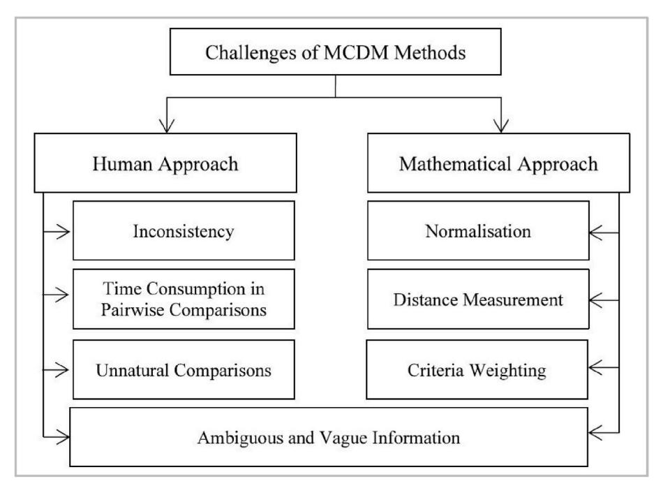
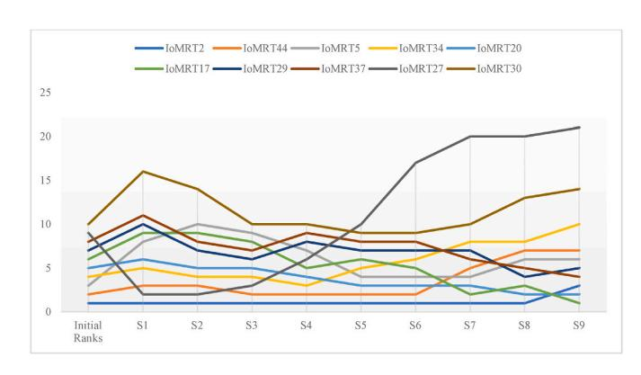
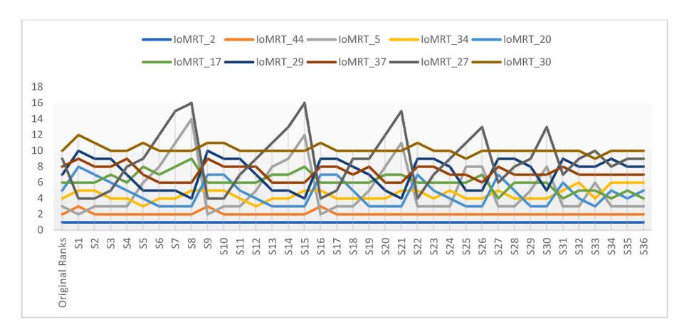
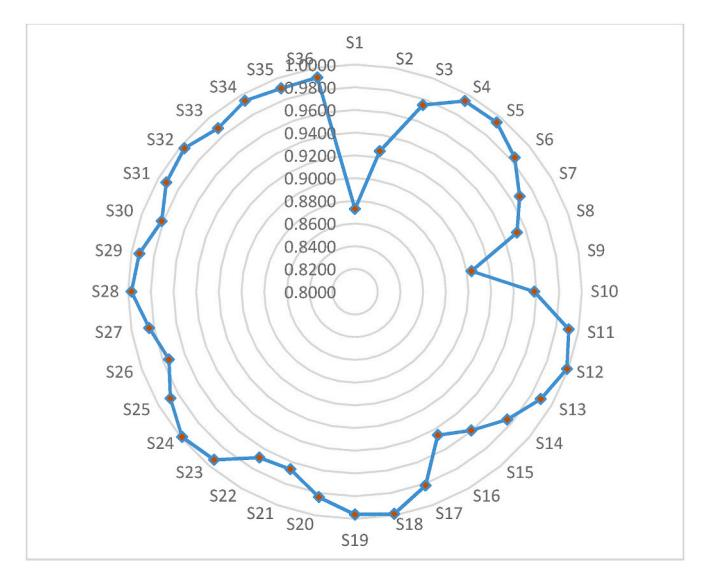
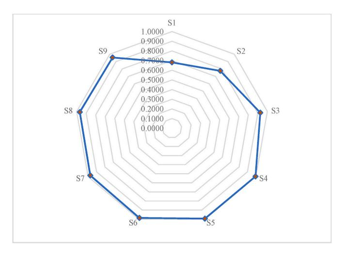
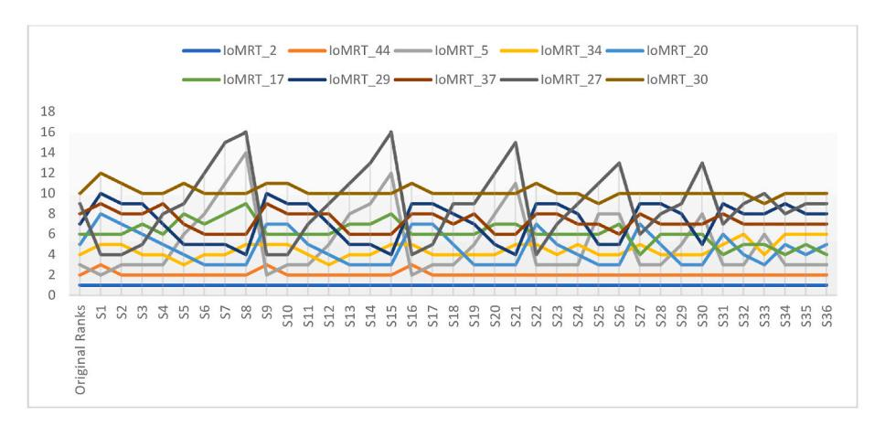

<!-- A3.R68 | source: papers_json/A3.R68/ -->



Contents lists available at ScienceDirect

## Engineering Applications of Artificial Intelligence

journal homepage: www.elsevier.com/locate/engappai




## Dynamic localization based-utility decision approach under type-2 Pythagorean fuzzy set for developing internet of modular self-reconfiguration robot things

Nahia Mourad ^a, A.A. Zaidan ^b, Hassan A. Alsattar ^{c,d}, Sarah Qahtan ^e, B.B. Zaidan ^b, Muhammet Deveci ^{f,g,h}, Dragan Pamucar ^{i,j,*}, Witold Pedrycz ^k

- <sup>a</sup> Faculty of Engineering & IT, British University in Dubai, Dubai, United Arab Emirates
- <sup>b</sup> SP Jain School of Global Management, Lidcombe, Sydney, NSW, 2141, Australia
- <sup>c</sup> Mazaya University College, Nasiriyah, Iraq
- <sup>d</sup> MEU Research Unit, Middle East University, Amman, Jordan
- <sup>e</sup> Information Technology Unit, College of Health and Medical Technology-Baghdad, Middle Technical University, Baghdad, Iraq
- f Department of Industrial Engineering, Turkish Naval Academy, National Defence University, 34942 Tuzla, Istanbul, Turkey
- g Royal School of Mines, Imperial College London, London, SW7 2AZ, UK
- <sup>h</sup> Department of Information Technologies, Western Caspian University, Baku 1001, Azerbaijan
- <sup>i</sup> Faculty of Organizational Sciences, University of Belgrade, 11000, Belgrade, Serbia
- <sup>j</sup> Department of Industrial Engineering & Management, Yuan Ze University, Taoyuan City, Taiwan
- k Department of Electrical and Computer Engineering, Faculty of Engineering, University of Alberta, Canada

## ARTICLE INFO

## Reywords:
Type-2 pythagorean fuzzy set
Decision support systems
Internet of modular robot things
Self-reconfiguration

## ABSTRACT

The Internet of Modular Robot Things (IoMRT) has emerged through the integration of robotic systems into the Internet of Things (IoT), offering a wide range of solutions to meet continuously growing demands. Six selfreconfiguration functionalities/criteria have been proposed for developing IoMRT. However, no study has fully developed an IoMRT that satisfies all the necessary functionalities. Additionally, there is a lack of scholarly research proposing a decision-based approach for evaluating and ranking IoMRT, which highlights a significant research gap. A complex multiple-criteria decision-making (MCDM) problem has arisen in evaluating and ranking IoMRT due to the diversity of functionalities, the need to prioritize these functionalities based on their importance, and data variability. To address this issue, the study proposes a novel decision-based approach for evaluating and ranking IoMRT, which consists of three phases: (i) Developing a novel weighting method called T2PFS-FWZICbIP (Type-2 Pythagorean Fuzzy Set-Fuzzy Weighted Zero Inconsistency based on Interrelationship Process) to measure the importance of the identified functionalities; (ii) Formulating a decision matrix by crossreferencing potential IoMRT developments with the six self-reconfiguration functionalities resulted in the selection of a random sample of 50 IoMRTs as proof of concept. Following this, the DLbU (Dynamic Localizationbased Utility) method was proposed, integrating dynamic localization and utility procedures to manage binary data within the decision matrix; (iii) Developing a novel ranking method, T2PFS-DNMA (Type-2 Pythagorean Fuzzy Set-Double Normalization-based Multiple Aggregation), to address the diversity of functionalities and concerns regarding data variance. The results revealed that the Distributed functionality (C1) received the highest weight value of 0.4060 according to T2PFS-FWZICbIP, indicating its high importance in the ranking of IoMRT. In contrast, the High-Fidelity functionality (C5) received a weight value of 0.0733, indicating its very low importance in the ranking. IoMRT2 and IoMRT35 were identified as the most and least favored, respectively, according to T2PFS-DNMA. The robustness of the proposed approach was assessed through sensitivity analysis and comparative studies.

> ^* ^Corresponding author. Faculty of Organizational Sciences, University of Belgrade, 11000, Belgrade, Serbia.

E-mail addresses: nahia.mourad@gmail.com (N. Mourad), aws.alaa@gmail.com (A.A. Zaidan), hassan.alsattar@gmail.com (H.A. Alsattar), sarah.qahttan@gmail.com (S. Qahtan), bilal.zaidan@spjain.edu.au (B.B. Zaidan), muhammetdeveci@gmail.com (M. Deveci), dpamucar@gmail.com (D. Pamucar), wpedrycz@ualberta.ca (W. Pedrycz).

<!-- page 2 -->

## **1.** **Introduction**

Modular robotics offers unique benefits compared to conventional robotic technology in terms of being easily reconfigurable, reusable, and simple to manufacture [(Dokuyucu](#page-19-0) and Ozmen, ¨ 2023). Conventional robotic designs, such as robotic arms and hexapods, offer solutions for specific real-world applications. However, the resulting prototypes are typically inflexible and not easily adaptable for other uses ([Chennareddy](#page-19-0) et al., [2017;](#page-19-0) [Dokuyucu](#page-19-0) and Ozmen, ¨ 2023).

Most conventional robotic solutions are designed to function within a controlled environment, and any alterations in the environment frequently make these solutions inflexible due to their limited adaptability [(Sahoo](#page-20-0) et al., 2024; Post et al., [2021)](#page-20-0). The repair and maintenance of these conventional designs typically necessitate specialized staff for each model, resulting in increased consumption of resources in industries on average [(Gilpin](#page-19-0) and Rus, 2022; [Morgan](#page-20-0) et al., 2021). The upcoming stage of robotic designs focuses on the construction of modular modules for the purpose of facilitating tasks such as replacement, repair, and control (Post et al., [2021](#page-20-0)). In subsequent phases of development, the researchers introduced the idea of reconfiguration, self-healing, automation, and other similar features to create a modular self-reconfigurable robot (MSRR) (Tan et al., [2020](#page-20-0); Yang et al., [2024)](#page-20-0). In numerous applications, including disaster management, space exploration (Yim et al., [2021)](#page-20-0), prosthetic for the incapacitated, management of large construction sites (Baca et al., [2022)](#page-19-0), and surveillance in military zones, adaptation of MSRR and self-healing capabilities is necessary. The primary distinction between modular robotic designs and MSRR designs lies in their abilities to detach/attach from/in a formation in accordance with application requirements without much human interaction.

Lately [(Yaacoub](#page-20-0) et al., 2023), stated that the Internet of Modular Robot Things (IoMRT) has emerged because of the integration of robotic systems and MSRR into the Internet of Things (IoT), offering a wide range of solutions to meet the continually growing demands. This encompasses a wide range of practical implementations in sectors such as cyber-physical environments, economics, defense, medicine, agriculture, business, and law enforcement ([Haidegger](#page-19-0) et al., 2020). Self-healing and self-reconfiguration functionalities have become increasingly required because of their exceptional capacities to surpass the limitations of conventional robotic systems, particularly in terms of time and power consumption, with minimal reliance on human interaction [(Dokuyucu](#page-19-0) and Ozmen, ¨ 2023; Tan et al., [2021)](#page-20-0). In contrast to conventional robotic systems, modular self-reconfigurable robots in the IoT provide distinct benefits in terms of resource consumption, reconfiguration, size, reusability, and cost. Moreover, these robots operate in complex environments and simple to manufacture, enabling them to produce intricate three-dimensional shapes with minimal human interaction (Tolba and [Al-Makhadmeh,](#page-20-0) 2022; [Yaacoub](#page-20-0) et al., 2023).

[Yaacoub](#page-20-0) et al. (2023) define self-reconfiguration as the ability of an IoMRT to independently modify its overall shape through its control system ([Yaacoub](#page-20-0) et al., 2023). The term "modular" is frequently associated with the concept of a modular robot, which consists of a collection of identical modules that can be attached or detached from the primary modular robotic system. In addition, Yaacoub et al. suggested six self-reconfiguration functionalities/criteria for the development of IoMRT: distribution, homogeneity, motion-parallelism, reliability, high-fidelity, and robustness.

(i) Distributed: The distributed nature of the process permits modules to manage freely and autonomously. This is central in IoT environments where machines ought to work together and adapt to dynamic situations while coordinating their encounters in a shared space. (ii) Homogeneity: Achieved through switchable, mass-producible modular robotic units, homogeneity simplifies the self-reconfiguration process. This is remarkably key in IoT systems where interoperability including devices improves

flexibility and reduces execution complication. (iii) Motion Parallelism: By expanding simultaneous module actions, motion parallelism guarantees efficient operation and reaction in realtime applications. This expertise is crucial for IoT systems that demand quick adjustments to varying conditions. (iv) Reliability: The association between parallelism and convergence is necessary for warranting consistent performance in IoT systems. High reliability is needed for critical functions where system crashes can direct to significant effects. (v) High Fidelity: The superiority of the shape realized by robotic units varies on their ability to exactly express the objects they act together with. In IoT relevance, high dependability in data description is crucial for duties such as supervising, regulator, and control of the environment. (vi) Robustness: Getting robustness minimizes the probability of faults through the system's reconfiguration. Given that fault detection remnants a complex task in robotics, safeguarding that the system can manage realistically under uncertain conditions is essential for the reliability of IoT solutions.

## *1.1.* *Research* *gap*

Despite considerable advancements in the design of MSRRs, the existing body of research lacks a comprehensive framework that incorporates these systems into the IoMRT, based on self-reconfiguration functionalities. In addition, the development and evaluation of IoMRT alternatives depend on six essential self-reconfiguration functionalities, each differing in its level of fulfillment and importance across various IoMRT alternatives. This points to a notable research gap, especially due to the lack of a structured decision-making framework for evaluating and ranking IoMRT alternatives.

To address this gap, our study proposes an IoMRT decision matrix, which offers an evaluation framework encompassing all potential IoMRT configurations, that can be developed in the future, based on selfreconfiguration functionalities. This matrix introduces a decision-based approach specifically tailored to rank IoMRT alternatives by considering multiple functionalities related to self-reconfiguration.

Three issues arise when evaluating/ranking IoMRT alternatives ([Alsalem](#page-19-0) et al., 2021; [Imran](#page-19-0) et al., 2024; [Sarah](#page-20-0) et al., 2025), including: (i) the need to incorporate multiple functionalities/criteria [(Patel](#page-20-0) et al., [2024)](#page-20-0), (ii) the prioritization of these functionalities based on their importance (Naz et al., [2024](#page-20-0)), and (iii) addressing data variance in the ranking process (Naz et al., [2024;](#page-20-0) [Kizielewicz](#page-19-0) and Sałabun, 2024). The ranking of IoMRT alternatives is a complex multiple criteria decision-making (MCDM) problem that necessitates the application of advanced MCDM methods to address these issues (Ali et al., [2024](#page-19-0); [Wang](#page-20-0) et al., [2023)](#page-20-0)

The MCDM methods have been used in various fields [(Alsalem](#page-19-0) et al., [2021;](#page-19-0) Naz et al., [2024)](#page-20-0); however, their application in evaluating IoMRT alternatives remains underexplored, which considered a research gap. This paper aims to fill the research gap by using a decision-based MCDM method, thus offering a framework for the evaluation and ranking of IoMRT alternatives.

## *1.2.* *Research* *motivations*

The rapid progression of MSRRs has exhibited considerable attentions across multiple domains, including automation, robotics, and the IoMRT. The present state of IoMRT research is fragmented, especially with the incorporation of MSRR self-reconfiguration capabilities into IoMRT. As evolving technologies necessitate flexible and intelligent systems, the requirement for a comprehensive evaluation framework to guide the creation of effective IoMRT configurations becomes essential.

The motivation behind this study stems from the growing complexity of IoMRT, where the ability to self-reconfigure dynamically is crucial for addressing real-world challenges. Despite the clear relevance of MSRRs

<!-- page 3 -->


***Fig.** **1.** MCDM challenges adopted from [(Salih](#page-20-0) et al., 2020).*

in IoMRT, there remains a significant research gap in structured decision-making approaches for evaluating and ranking IoMRT alternatives. Without a robust framework that incorporates selfreconfiguration functionalities, it becomes difficult to assess which configurations are most effective across different operational scenarios.

Furthermore, the field of MCDM offers well-established methodologies for dealing with complex decision problems involving multiple conflicting criteria (Tesic and [Marinkovic,](#page-20-0) 2023; Eti et al., [2024;](#page-19-0) [Biswas](#page-19-0) et al., [2023(](#page-19-0)Kara et al., 2024; [Kurtay,](#page-19-0) 2024; Liu, 2024; Majd et al., 2024; Wang and Zhao, [2024;](#page-19-0) Wu et al., 2024; Zhan and Cai, 2024)), but its application in the context of IoMRT is underexplored. This study is motivated by the need to fill this theoretical and practical gap by applying advanced MCDM methods to provide a clear, structured, and decision-driven approach to evaluating IoMRT alternatives.

By developing an IoMRT decision matrix that addresses these challenges, this research aims to contribute significantly to both academic literature and the real-world implementation of IoMRT systems. The proposed decision matrix will not only offer a means for systematically ranking IoMRT alternatives but also promote the integration of selfreconfiguration functionalities into the design and development of future IoMRT configurations. This will provide practitioners with a decision-making tool that supports the optimization of IoMRT designs, ensuring the systems meet their full potential in terms of adaptability, performance, and functionality.

## *1.3.* *Research* *contributions*

The main contributions, along with their novelty, of this study are as follows.

- This study develops the T2PFS-FWZICbIP method to calculate the weights and determine the degree of importance of the selfreconfiguration functionalities.
- In this study, a decision matrix was formulated based on the intersection of the potential development of IoMRT with the six selfreconfiguration functionalities. After creating this matrix, a random selection of 50 IoMRTs was chosen as proof of concept. Then, the DLbU method was proposed, integrating the dynamic

localization procedure and utility procedure to handle the binary data within the decision matrix.

- This study develops the T2PFS-DNMA method to address the diversity of functionalities and concerns regarding data variance.
- A novel decision-based approach was developed in this study for evaluating and ranking IoMRTs using the formulated decision matrix and the integrated T2PFS-FWZICbIP and T2PFS-DNMA methods.

After the introductory discussion on research gap, motivation, and contributions, the content of the paper is presented as follows. Section 2 presents the related works regarding MCDM ranking and weighting methods, fuzzy set theories, and binary data managements. Section [3](#page-5-0) provides an exposition of the mathematical background. Section [4](#page-6-0) covers the decision-based approach. employed in this study. Section [5](#page-9-0) provides the results and discussion. Sections 6 [and](#page-13-0) 7 present the results' validation and performance comparisons. Section [8](#page-17-0) concludes the paper with future research directions.

## **2.** **Related** **works**

## *2.1.* *MCDM* *ranking* *methods*

MCDM is an interdisciplinary discipline within operations research that specifically assesses the several conflicting functionalities when making decisions (M. T. [Mohammed](#page-20-0) et al., 2023; [Narayanamoorthy](#page-20-0) et al., [2022](#page-20-0), [2021)](#page-20-0). The process entails assessing several alternatives by considering their performance within scenarios that involve multiple functionalities ([Agarwal](#page-19-0) et al., 2019; [Zavadskas](#page-20-0) et al., 2014). The academic literature presents numerous MCDM approaches [(Abdulkareem](#page-19-0) et al., [2021;](#page-19-0) [Jumaah](#page-19-0) et al., 2018; [Zaidan](#page-21-0) et al., 2024). Recently, Salih et al. categorize MCDM methods into mathematical approaches (ranking methods) and human approaches (weighting methods) ([Salih](#page-20-0) et al., [2020)](#page-20-0). Mathematical approaches are utilized to rank alternatives according to several assessment functionalities (Zaidan and [Zaidan,](#page-20-0) 2017). Whilst human approaches are utilized to determine the importance level of evaluation functionalities and assign weight to each one (A. S. [Albahri](#page-19-0) et al., [2022](#page-19-0)). Fig. 1 shows the challenges associated with MCDM methods.

Salih et al. show that the ranking methods encounter issues

<!-- page 4 -->

associated with the employed normalization technique, distance measurements, weighting of criteria/functionalities, and vagueness or imprecise information (Salih et al., [2020](#page-20-0)).

Liao et al. classified the ranking methods used for MCDM problems into two categories: outranking methods and utility-value-basedranking methods (Liao et al., [2020](#page-20-0)). Corrente et al. found that the efficacy of outranking methods is constrained when confronted with many experts and functionalities, primarily due to complex mathematical calculations [(Corrente](#page-19-0) et al., 2017). While the usefulness of utility-value-based ranking methods, such as MULTIMOORA (MULTIplicative Multi-Objective Optimization by Ratio Analysis), SMART (Simple Multi-Attribute Rating Technique), VIKOR (VlseKriterijumska Optimizacija I Kompromisno Resenje), and TOPSIS (Technique for Order Preference by Similarity to Ideal Solution), has been proven in the realm of many MCDM problems [(Asante](#page-19-0) et al., 2020; Sał[abun](#page-20-0) et al., [2020)](#page-20-0).

Jahan and Edwards observed that the aggregation and normalization processes utilized by the utility-value-based-ranking methods show variability, which could lead to differing decision outcomes [(Jahan](#page-19-0) and [Edwards,](#page-19-0) 2022). These methods exhibit limitations regarding the application of single normalization techniques (Jahan and [Edwards,](#page-19-0) [2022;](#page-19-0) Salih et al., [2020](#page-20-0)). This limitation arises from the potential bias in the findings caused by the fault normalized values used for aggregation.

Recently, Liao and Wu introduced a Double Normalization-based Multiple Aggregation (DNMA) method to address the limitation of utility-value-based-ranking methods and enhance the dependability of decision outcomes (Liao and Wu, [2020)](#page-20-0). DNMA method is distinguished by the utilization of two normalization techniques and three aggregation operators [(Wang](#page-20-0) and Rani, 2022). It can solve typical MCDM problems that involve both quantitative and qualitative functionalities, such as benefit, cost, or target types (Liao et al., [2024](#page-20-0)). Hence, it is considered a good choice to rank the potential IoMRT alternatives in this paper.

Nevertheless, DNMA method, like other utility-value-based-ranking method, is subject to three main constraints. First, the DNMA is unable to measure the level of importance of the functionalities [(Hezam](#page-19-0) et al., [2023)](#page-19-0). Second, it lacks the ability to handle uncertainty, particularly the imprecise information associated to the data [(Wang](#page-20-0) and Rani, [2022)](#page-20-0). Third, it exhibits limitations in its ability to handle different types of data within the decision matrix, including binary inputs such as yes/no or 1/0 ([Alsattar](#page-19-0) et al., 2024; [Mourad](#page-20-0) et al., 2024). The following sections will review these limitations in detail and propose solutions to address them.

## *2.2.* *MCDM* *weighting* *methods*

As mentioned earlier, most MCDM ranking methods are unable to determine the weights of the evaluation functionalities ([Mehdiabadi](#page-20-0) et al., [2024](#page-20-0)). Selecting an appropriate MCDM weighting method is crucial for achieving accurate and reliable results (Gul, [2024)](#page-19-0). Therefore, the utilization of the MCDM ranking method requires the employment of MCDM weighting methods to prioritize the evaluation functionalities and estimate their weights in the academic literature ([Radovanovic](#page-20-0) et al., 2024).

However, the application of MCDM weighting methods poses certain obstacles (Salih et al., [2020](#page-20-0)), as illustrated in [Fig.](#page-2-0) 1. The primary concern is the inconsistency in the weighing process. Moreover, pairwise comparisons may be time-consuming. An additional issue arises from comparing two uncorrelated functionalities/criteria is not a natural process and is difficult to achieve. Finally, the presence of ambiguity and uncertainty in expert assessments adds another layer of complexity to the weighting process (Salih et al., [2020](#page-20-0)).

Many MCDM weighting methods can be found in the academic literature ([Alsattar](#page-19-0) et al., 2023; [AlSereidi](#page-19-0) et al., 2024; Z. K. [Mohammed](#page-20-0) et al., [2023,](#page-20-0) A.A. [Zaidan](#page-21-0) et al., 2024), such as the Best-Worst Method (BWM), Analytic Network Process (ANP), Analytic Hierarchy Process (AHP), and Fuzzy Weighted Zero Inconsistency (FWZIC). Much attention has been paid to these methods due to their ability to improve the decision-making process ([Ghailani](#page-19-0) et al., 2023). Hussein et al. provided an in-depth examination of these weighing methods ([Alhadad](#page-19-0) et al., [2024)](#page-19-0), as detailed in Table 1.

The results of the study revealed that FWZIC exhibited a higher degree of appropriateness in determining the importance of the evaluation functionalities. Nevertheless, FWZIC failed to account for the interrelationships among functionalities [(Alhadad](#page-19-0) et al., 2024). Thus, Hussein et al., improved FWZIC method by developing the FWZIC-based-on-Interrelationship-Process (FWZICbIP), which considers such interrelationship [(Alhadad](#page-19-0) et al., 2024). FWZICbIP method demonstrates a high level of effectiveness in determining the importance degree of each functionality within the blood supply chain [(Alhadad](#page-19-0) et al., [2024)](#page-19-0). However, like the DNMA method, the uncertainty associated with the subjectivity of decision-makers remain an unresolved issue in the FWZICbIP method.

<!-- page 5 -->

## 2.3. Fuzzy set theory

Fuzzy-based MCDM methodologies have been utilized in different decision-making scenarios, enabling decision-makers to address uncertainties and ambiguities in a more realistic and practical manner (Bozyigit et al., 2022). In 1965, Zadeh introduced Type-1 Fuzzy Set (T1FS) to address the issue of uncertainty (Zadeh, 1965). T1FSs assign exact membership values within the interval [0, 1] (Anari et al., 2022; Ikidid et al., 2023; Zadeh, 1965). Later, Zadeh refined the concept of T1FS and introduced Type-2 Fuzzy Sets (T2FS), which include uncertainty into the membership function (Mendel, 2007, 2024; Zadeh, 1975). In T2FS, the membership degree is expressed as an interval instead of a single value, utilizing a T1FS to express the uncertainty associated with each element's membership. T2FS has greater robustness in managing uncertainty compared to T1FS. However, the implementation of T2FS is more complex, leading to computational difficulties (Mendel, 2007; Shvedov, 2021). Mendel et al. created Interval Type-2 Fuzzy Sets (IT2FS) to mitigate such difficulties (Mendel et al., 2006). These versions of fuzzy sets concentrate exclusively on membership values; however, when modeling uncertainties, it is imperative to additionally account for non-membership and hesitant roles. To integrate non-membership, Atanassov created the Intuitionistic Fuzzy Set (IFS), which incorporates both membership and non-membership values, constrained by the condition that their sum must not exceed 1 (Atanassov, 1986).

Considering the advantages of both IFS (Atanassov, 1986) and T2FS (Zadeh, 1975), Own formulated proposed an axiomatic relationship between the two fuzzy sets (Own, 2009), while Cuong et al. introduced Type-2 Intuitionistic Fuzzy Sets (T2IFS) (Cường et al., 2012). A T2IFS comprises four functions: the primary membership function (PMF), the primary non-membership function (PNMF), the secondary membership function (SMF), and the secondary non-membership function (SNMF). In this instance, the SMF and SNMF are T1FSs themselves. Singh and Garg investigated the footprint of uncertainty (FOU) of a T2IFS and formulated distance measures for evaluating T2IFS (Mendel, 2024; Singh and Garg, 2017). he benefits of T2IFS have led to extend many MCDM methodologies under this fuzzy environment (Bashir et al., 2020; Karmakar et al., 2021; Luo et al., 2019).

Despite the benefits of IFS, this fuzzy set still has constraint regarding membership and non-membership values, which may complicate the task for decision-makers when assigning values in MCDM problems (Sarkar et al., 2023). To overcome this constraint, Yager introduced Pythagorean Fuzzy Sets (PFS), which enhance the IFS architecture by allowing the sum of the squares of the membership and non-membership values to be less than or equal to 1 (Yager, 2013, 2014). PFS has addressed the uncertainty issue across a diverse array of MCDM problems (Han et al., 2020; Pérez-Dominguez et al., 2021; Zhang and Chen, 2022).

Recently, Sarkar et al. proposed Type-2 Pythagorean Fuzzy Sets (T2PFS) by integrating the notions of PFS, T2FS, and T2IFS. T2PFS

<!-- page 6 -->

consists of six components, with the primary fuzzification comprising two elements: membership and non-membership functions in a PFS. The secondary fuzzification includes four components, with each pair forming an element in a PFS that represents the primary membership and non-membership functions (Sarkar et al., 2023). T2PFS is effective in addressing complex practical decision-making scenarios that earlier fuzzy sets could not manage (Wu et al., 2022; Zadeh, 1975), due to the incorporation of Pythagorean fuzzy numbers (PFNs) as auxiliary membership and non-membership values (Sarkar et al., 2023). Compared to other existing variants such as T1FS, T2FS, T2IFS, and PFS, it has a greater ability to resolve uncertainty, as given in Table 2.

One notable benefit of employing T2PFS in MCDM is the utilization of PFNs to represent the membership and non-membership values of each argument, as opposed to relying on intuitionistic fuzzy numbers or fuzzy numbers. Although the modelling complexity of T2PFS may be involved, decision makers can effectively express their opinions with greater flexibility by utilizing this fuzzy set. Hence, it is imperative to extend the DNMA and FWZICbIP methods within a T2PFS environment in order to address the issue of uncertainty.

## 2.4. Managing binary data

Many decision matrices in MCDM problems are based on binary data. Examples include the E-health Industry 4.0 decision matrix in (Yatim et al., 2023), cyber-physical metaverse manufacturing system decision matrix in (Mourad et al., 2024), and circular business model innovation tools in (Zaidan and Zaidan, 2017). In these matrices, one represents the presence of a certain functionality in an alternative, while zeros represent its absence. The presence or existence of a functionality may differ among alternatives, making binary assessments impractical. Recently, Mourad et al. (2024), proposed a utility procedure that allows decision-makers to utilize a percentage-based methodology, depending on their expertise to substitute the values of zeros and ones with percentages (Mourad et al., 2024). In this procedure, decision-makers assign percentage values between 0 and 45 for each '0' and between 50 and 100 for each '1' in the decision matrix. Later, Alsattar et al. proposed a dynamic localization procedure that converts percentage values into a 5-point Likert scale for further analysis (Alsattar et al.,

In this paper, both the dynamic localization procedure (Alsattar et al., 2024) and the utility procedure (Mourad et al., 2024) are used to effectively manage binary data in decision matrices. Therefore, the Dynamic Localization-based Utility (DLbU) method is proposed, integrating both procedures for more robust evaluations by differentiating between levels of evaluation for all alternatives. This conversion is essential for the successful application of the DNMA method. It's worth mentioning that decision matrix in this study is represented by once only, to satisfy all the necessary functionalities as minimum requirements for developing IoMRT. The utility procedure then assigns percentage values to each IoMRT level of satisfaction for each functionality, reflecting the perspectives of randomly generated decision-makers. Dynamic localization forms decision matrices with entries representing the number of scales derived from the percentage tensor output of the utility procedure, providing a broader range of evaluation values for all alternatives.

## 3. Preliminaries

This section presents the T2PFS, coupled with a score function and an aggregation operator, both defined on the same set.

**Definition 1.** (Mendel, 2007; Sarkar et al., 2023) Let X be a nonempty universal set. A T1FS \mathcal{S}^{[1]} is an object of the form

$$
\mathscr{S}^{[1]} = \{ \langle \mathbf{x}, \mu_1(\mathbf{x}) \rangle : \mathbf{x} \in \mathbf{X} \}, \tag{1}
$$

where \mu_1: X \rightarrow [0,1] presents the membership function of \mathscr{S}^{[1]} in X. A T2FS \mathscr{S}^{[2]} is an object of the form

$$
\mathscr{S}^{[2]} = \left\{ \langle x, \mu_2(x), f_{\mu_2}(x) \rangle : x \in X, \mu_2 \in J_{PMF} \right\}, \tag{2}
$$

where J_{PMF} \subseteq [0,1] is the set of primary membership functions, and f_{\mu_2}(x) \in [0,1] represents the secondary membership function.

**Definition 2.** (Yager, 2014) Let *X* be a nonempty universal set. A PFS \mathscr{P}^{[1]} is an object of the form

$$
\mathscr{P}^{[1]} = \{ \langle \mathbf{x}, \mu(\mathbf{x}), \nu(\mathbf{x}) \rangle : \mathbf{x} \in \mathbf{X} \}, \tag{3}
$$

where \mu, \nu: X \rightarrow [0, 1] are the membership and non-membership functions respectively, such that for any x \in X, \mu(x)^2 + \nu(x)^2 \le 1.

**Definition 3.** (Sarkar et al., 2023) Let *X* be a nonempty universal set. A T2PFS \mathscr{P}^{[2]} is an object of the form

$$
\mathscr{P}^{[2]} = \left\{ \left\langle x; \mu(x), \left( f_{\mu}(x), g_{\mu}(x) \right); \nu(x), \left( F_{\nu}(x), G_{\nu}(x) \right) \right\rangle : x \in X \right\}, \tag{4}
$$

where \mu, \nu: X \rightarrow [0,1] are the primary membership and non-membership functions of \mathscr{P}^{[2]}, respectively, and \left(f_{\mu}(x), g_{\mu}(x)\right) and (F_{\nu}(x), G_{\nu}(x)) \in [0,1] \times [0,1] are the secondary membership and non-membership functions of x in \mathscr{P}^{[2]}, satisfying the condition:

$$
max\Big(\mu(x)^2 + \nu(x)^2, f_{\mu}^2(x) + g_{\mu}^2(x), F_{\nu}^2(x) + G_{\nu}^2(x)\Big) \le 1, (5)
$$

for any x \in X

A T2PFS \mathscr{P}^{[2]} can be represented, using the fuzzy union notation, by

$$
\mathscr{P}^{[2]} = \int\limits_{X} \left[ \left( \int\limits_{lowr} \left( f_{\mu}(x), g_{\mu}(x) \middle/ \mu, \int\limits_{lowr} \left( F_{\nu}(x), G_{\nu}(x) \right) \middle/ \nu \right) \right] \middle/ x \qquad (6)
$$

with J_{PMF}, J_{PNMF} \subseteq [0, 1] are the set of primary membership functions and non-membership functions of x \in X.

Any member of a T2PFS is known as a type-2 Pythagorean fuzzy number (T2PFN). For computational convenience a T2PFN is denoted by P = \langle \mu, (f_{\mu}, g_{\mu}); \nu, (F_{\nu}, G_{\nu}) \rangle. Examples of T2PFN can be found in Table 3. Following (Sarkar et al., 2023) a score function S_{T2PF} is defined on T2PFS as:

$$
S_{T2PF}\Big(\langle \mu, \Big(f_{\mu}, g_{\mu}\Big); \nu, (F_{\nu}, G_{\nu})\rangle\Big) = \Big(\mu^{2} - \nu^{2}\Big) - \frac{1}{4} \left| \Big(f_{\mu}^{2} - g_{\mu}^{2}\Big) - \Big(F_{\nu}^{2} - G_{\nu}^{2}\Big) \right|. \tag{7}
$$

It is to be noted that the range of S_{T2PF} is [-1,1]. Moreover, let P_j = \langle \mu_j, \left(f_{\mu_j}, g_{\mu_j}\right); \nu_j, \left(F_{\nu_j}, G_{\nu_j}\right) \rangle, for j=1,...,n, be a collection of T2PFNs, the T2PFA operator defined by

<!-- page 7 -->


*Fig. 2. Decision-based approach.*

$$
T2PFA(P_{1},...,P_{n}) = \bigoplus_{j=1}^{n} \frac{1}{n} \cdot P_{j}
\sqrt{1 - \prod_{j=1}^{n} \left(1 - \mu_{j}^{2}\right)^{\frac{1}{n}}}, \left(\sqrt{1 - \prod_{j=1}^{n} \left(1 - f_{\mu_{j}}^{2}\right)^{\frac{1}{n}}}, \prod_{j}^{n} \left(g_{\mu_{j}}\right)^{\frac{1}{n}}\right);
= \langle \sqrt{\prod_{j=1}^{n} \left(\nu_{j}\right)^{\frac{1}{n}}}, \left(\sqrt{1 - \prod_{j=1}^{n} \left(1 - F_{\nu_{j}}^{2}\right)^{\frac{1}{n}}}, \prod_{j}^{n} \left(G_{\nu_{j}}\right)^{\frac{1}{n}}\right) 
(8)
$$

is an averaging aggregation operator defined from (T2PFS)^n into T2PFS (Sarkar et al., 2023).

## 4. Decision-based approach

This section describes the decision-based approach that was employed for the evaluating and ranking of IoMRT, which consists of three phases, as shown in Fig. 2. Phase 1 is the T2PF-FWZICbIP, which is used to weigh the sixth self-reconfiguration functionalities: Distributed (C_1), Homogeneity (C_2), Motion-Parallelism (C_3), Reliability (C_4), High-Fidelity (C_5), and Robustness (C_6). Phase 2 is the DLbU method, which is built on the utility procedure established in (Mourad et al., 2024) and dynamic localization (Alsattar et al., 2024). This phase formulates decision matrices with identified crip values. Phase 3 is the T2PF-DNMA, which is proposed to rank the selected IoMRT devices. This phase incorporates the two phases to provide the optimum solution.

## 4.1. Phase 1. T2PF-FWZICbIP method

**Step 1.** Identification of decision-makers and functionalities. Let \{C_j|j=1,...,n\} be the set of the self-recognition functionalities to be relatively weighted, where n=6 represents the total number of

functionalities, and \{E_i|i=1,...,s\} be the set of decision-makers involved in the evaluation process, where s represents the total number of decision-makers, in this study s=3.

**Step 2.** Decision-makers matrix. Each decision maker E_i evaluates each self-recognition functionality C_j by choosing a linguistic phrase from Table 3, to obtain a decision matrix array. Entries of this array are converted into numerical values using Table 3, to obtain a decision matrix denoted by DM = (d_{ij})_{1 \le i \le s}.

$$ 1 \le j \le n $$

**Step 3.** Fuzzification. Each entry d_{ij}, which is one of the linguistic phrases in Tables 3 and in the decision matrix DM is converted to its associated T2PFN \widetilde{d}_{ij} in Table 3, to obtain a fuzzified decision matrix denoted by \widetilde{DM} = \left(\widetilde{d}_{ij}\right)_{1 \leq i \leq s}.

**Step 4.** Aggregation. To aggregate all decision-makers' opinions the averaging operator defined in Eq. (8) is used. This will lead to a one-dimensional array of T2PFNs corresponding to each functionality as follows:

$$
\widetilde{DA}_i = T2PFA(\widetilde{d}_{1i}, ..., \widetilde{d}_{si}) \text{ for } i = 1, ..., n. 
(9)
$$

**Step 5.** Defuzzification. The score of each T2PFN \widetilde{DA}_j is calculated based on the score function defined in Eq. (7). To avoid negative scores a shift is done as follows:

$$ S_j = S_{T2PF}(\widetilde{DA}_j) - \inf(S_{T2PF}). \tag{10} $$

In fact, \inf(S_{T2PF}) = -1 as indicated in Section 2.

<!-- page 8 -->

**Step 6.** Interrelation process. To unveil the interrelation between the functionalities the order is identified as follows. Let (O_1, ..., O_n) be the non-ascending ordered list of functionalities' scores S_i in Eq. (10), for j = 1, ..., n. The comparative significance (\sigma) is computed, for j = 1, ..., n. 1, \dots, n, as follows:

$$
\sigma_{j} = \begin{cases} 1, j = 1 \\ 0, j > 1 \text{ and } O_{j} = O_{j-1} \\ \frac{O_{j}}{O_{j-1}}, \text{ otherwise} \end{cases} (11)
$$

Step 7. Weights. The initial functionalities weight coefficients are calculated based on the comparative significance in Eq. (11) by the recurrence relation \omega_j=\frac{\omega_{j-1}}{\sigma_j+1} for j>1 with initial condition \omega_1=1. Then, the ordered weights undergo a scaling process as in Eq. (12) to

sum up to one.

$$ \widehat{\omega}_{j} = \frac{\omega_{j}}{n}, \text{ for } j = 1, ..., n. (12) $$

The final weight is then obtained by distributing the ordered weight \hat{\omega}_i in Eq. (12) on their corresponding functionalities as in Eq. (13).

$$
\mathbf{w}_j = \widehat{\omega}_{\operatorname{argsort}(O_j)}, \text{ for } j = 1, ..., n. (13)
$$

The pseudocode of T2PF-FWZICbIP method is given in Algorithm 1.

## Algorithm 1. T2PF-FWZICbIP method

Return w

```
//Step 1. Identification of decision-makers and the self-recognition functionalities.
Identify C
n = length(C)
Identify E
s = length(E)
//Step 2. Decision-makers matrix.
For i from 1 to s
 For i from 1 to n
 D[i,i] 

E[i] 

C[i]
 End for
//Step 3. Fuzzification using Table 3.
For i from 1 to s
 For j from 1 to n
 D^{\sim}[i,j] \leftarrow D[i,j]
 End for
End For
//Step 4. Aggregation using (4).
For j from 1 to n
 (DA)^{\sim}[j] = T2PFA \setminus (D\tilde{\ }[1,j],...,D\tilde{\ }[s,j] \setminus )
//Step 5. Defuzzification using (3).
For j from 1 to n
 S[j] = S_T2PF((DA)[\widetilde{j}]) + 1
End
//Step 6. Interrelation Process.
[O,ind] = sort([S[1], ...,S[n]],"DESCEND")
For i from 2 to n
 If O[j] = O[j-1]
 \sigma[i] = 0
 \sigma[j] = O[j]/O[j\text{-}1]
 End if
End
//Step 7. Weights
\omega[1] = 1
For j from 2 to n
 \omega[j] = \omega[j\text{-}1]/(\sigma[j] + 1)
For j from 1 to n
 \omega[\hat{j}] = \omega[j]/(\omega[1]+\cdots+\omega[n])
 w[Ind[j]] = \omega[\hat{j}]
End for
```

## 4.2. Phase 2. DLbU method

**Step 1.** Decision matrix identification. Let \{IoMRT_i | i=1,...,m\} be the set of IoMRT to be ranked based on the self-recognition functionalities as minimum requirements \{C_j | j = 1, ..., n\}. It is to be noted that any IoMRT satisfies all the functionalities C_i, for i = 1,...*n*. Identify the decision-makers \{E_k | k=1,...,s\} involved in the assessment procedure. In this study, a random generation for m = 50IoMRT is done with s = 3, that is by three decision-makers.

**Step 2.** Utility procedure. A percentage is assigned to each IoMRT's satisfiability regarding each functionality, reflecting the perspectives of the decision-makers \{E_k\}. Specifically, \mathcal{T} := \{50\%, 60\%, \dots, 60\%, \dots, 60\%, \dots, 60\%, \dots, 60\%, \dots \} 100%} is randomly generated to assess the satisfaction level of each IoMRT_i concerning the C_i functionality. This produces an opinion tensor represented by:

$$
U = (u_{ijk})_{1 \le i \le m},
1 \le j \le n
1 \le k \le s
(14)
$$

where u_{iik} \in \mathcal{T} is the measure given by the k-th decision-maker to the IoMRT_i based on C_i.

Step 3. Dynamic localization. To form a decision-matrices with entries in \{1, \dots, n_s\}, where n_s is the number of scales, from the percentage tensor in Step 2, the dynamic localization is used. Define the transformation maps T_B, T_C from [0,1]^m into \{1,\ldots,n_s\}^m by

$$
T_B((x_i)_{1 \le i \le m}) := \left[ n_s \frac{\left( x_i - \left( \min_{1 \le i \le m} x_i - \epsilon \right) \right)}{\left( \max_{1 \le i \le m} x_i + \epsilon \right) - \left( \min_{1 \le i \le m} x_i - \epsilon \right)} \right], \tag{15}
$$

and

$$
T_{C}((x_{i})_{1 \leq i \leq m}) := n_{s} - \left\lfloor n_{s} \frac{\left(x_{i} - \left(\min_{1 \leq i \leq m} x_{i} - \epsilon\right)\right)}{\left(\max_{1 \leq i \leq m} x_{i} + \epsilon\right) - \left(\min_{1 \leq i \leq m} x_{i} - \epsilon\right)} \right\rfloor, \tag{16}
$$

where 0 < \epsilon \ll 1, and \lfloor \cdot \rfloor (resp. \lceil \cdot \rceil) is the floor (resp. ceil) function. Map each vector (u_{ijk})_{1 \le i \le m} into \{1,...,n_s\}^m using T_B if C_j is a benefit-type functionality otherwise use T_C, for j = 1, ..., n, to obtain a dynamic decision matrix for each decision maker k, denoted by DDM^{[k]}. It is worth mentioning all the C_i used in this study are benefit-type and n_s is chosen to be 5. Therefore,

$$
DDM_{ij}^{[k]} = T_B((u_{ijk})_{1 \le i \le m}), \text{ for } j = 1, ..., n, \text{ and } k = 1, ..., s. (17)
$$

The pseudocode of DLbU method is given in Algorithm 2.

## **Algorithm 2.** DLbU

```
//Step 1. Identification of IoMRT alternatives, the decision-makers and the self-
 recognition functionalities.
Identify IoMRT
m = length(IoMRT)
Identify C
n = length(C)
Identify E
s = length(E)
//Step 2. Utility procedure for decision matrix with entries in the truth set T.
For k from 1 to s
 For j from 1 to n
 For i from 1 to m
 U[i,j,k]\!\leftarrow\!T \land E[k] \land C[j] \land IoMRT[i]
```

(continued on next page)

<!-- page 9 -->

## (continued)

End for
End for
//Step 3. Dynamic Localization using (10)
For k from 1 to s
For j from 1 to n
DDM[:,j,k] = T_B (U[1,j,k], ...,U[m,j,k])
End for
Return DDM

## 4.3. Phase 3. T2PF-DNMA method

**Step 1.** Input. Inherit the weight vector W = (w_j)_{1 \le j \le n} calculated in Phase 1 in Eq. (13), and the dynamic decision matrices DDM^{[k]}, for k = 1, ..., s, computed in Phase 2 in Eq. (17).

**Step 2.** Fuzzification. Associate each entry DDM_{ij}^{[k]} in the dynamic decision matrix DDM^{[k]}, which is one of the numerical values in Table 3, to the corresponding T2PFN, to get the fuzzified array \widehat{DDM}^{[k]}

**Step 3.** Aggregation. Combine decision-makers opinion using the averaging operator in Eq. (8) as in Eq. (18).

$$
\widetilde{DDA}_{ij} = T2PFA\left(\widetilde{DDM}_{ij}^{[1]}, ..., \widetilde{DDM}_{ij}^{[s]}\right) = \bigoplus_{k=1}^{s} \frac{1}{s} \cdot \widetilde{DDM}_{ij}^{[k]}, \tag{18}
$$

for i = 1, ..., m and j = 1, ..., m.

**Step 4.** Scoring. Calculate the score matrix as in Eq. (19).

$$ M_{ij} = S_{T2PF} \left( \widetilde{DDA}_{ij} \right), \tag{19} $$

for i = 1, ..., m and j = 1, ..., n.

**Step 5.** DNMA. Apply the optimum method DNMA to the score matrix M in Eq. (19) as follows. Calculate y^{[1]} the linear normalization of M and y^{[2]} the quadratic normalization of M by:

$$
y_{ij}^{[1]} = 1 - \frac{\left| M_{ij} - I_j \right|}{\max_{i} \left| M_{ij} - I_j \right|} \text{ and } y_{ij}^{[2]} = 1 - \frac{\left| M_{ij} - I_j \right|}{\sqrt{\sum_{i=1}^{m} \left( M_{ij} - I_j \right)^2}}, (20)
$$

where I_j is the ideal value for functionality C_j, i.e., I_j = \max_i M_{ij} if C_j is benefit-type, while I_j = \min_i M_{ij} if C_j is cost-type. Then, get the arithmetic weighted aggregation values (\beta_1), the maximum weighted additive inverse values (\beta_2), and the geometric weighted aggregation values (\beta_3) as:

$$
\beta_{1}(IoMRT_{i}) = \sum_{j} w_{j} y_{ij}^{[1]}, \beta_{2}(IoMRT_{i}) = \max_{j} w_{j} \left(1 - y_{ij}^{[1]}\right), \text{ and } \beta_{3}(IoMRT_{i})
= \Pi_{j} \left(y_{ij}^{[2]}\right)^{w_{j}}
(21)
$$

Rank the IoMRT by listing \beta_1(IoMRT_i) and \beta_3(IoMRT_i) in descending order to get the first type of ranks r_1(IoMRT_i) and the third type of ranks r_3(IoMRT_i), respectively, for i=1,...,m. While rank the IoMRT by listing \beta_2(IoMRT_i) in ascending order to get the second type of ranks r_2(IoMRT_i), for i=1,...,m. Normalize the aggregated values as in Eq.

| Functionalities | T2PFN | Decision- maker~1~ | Decision- maker~2~ | Decision- maker~3~ | Aggregation |
| --- | --- | --- | --- | --- | --- |
| C~1~ | μ | 0.9 | 0.9 | 0.9 | 0.9 |
|  | f_{\mu} | 0.9 | 0.9 | 0.9 | 0.9 |
|  | g_{\mu} | 0.4 | 0.4 | 0.4 | 0.4 |
|  | ν | 0.1 | 0.1 | 0.1 | 0.1 |
|  | F_{\nu} | 0.5 | 0.5 | 0.5 | 0.5 |
|  | G_{\nu} | 0.1 | 0.1 | 0.1 | 0.1 |
| C_2 | μ | 0.8 | 0.5 | 0.8 | 0.8 |
|  | f_{\mu} | 0.8 | 0.5 | 0.8 | 0.8 |
|  | g_{\mu} | 0.4 | 0.5 | 0.4 | 0.4 |
|  | ν | 0.3 | 0.5 | 0.3 | 0.3 |
|  | F_{\nu} | 0.7 | 0.5 | 0.7 | 0.7 |
|  | G_{\nu} | 0.2 | 0.5 | 0.2 | 0.2 |
| C_3 | μ | 0.5 | 0.5 | 0.3 | 0.5 |
|  | f_{\mu} | 0.5 | 0.5 | 0.2 | 0.5 |
|  | g_{\mu} | 0.5 | 0.5 | 0.7 | 0.5 |
|  | ν | 0.5 | 0.5 | 0.8 | 0.5 |
|  | F_{\nu} | 0.5 | 0.5 | 0.4 | 0.5 |
|  | G_{\nu} | 0.5 | 0.5 | 0.8 | 0.5 |
| C~4~ | μ | 0.3 | 0.5 | 0.3 | 0.3 |
| · | f_{\mu} | 0.2 | 0.5 | 0.2 | 0.2 |
|  | g_{\mu} | 0.7 | 0.5 | 0.7 | 0.7 |
|  | ν | 0.8 | 0.5 | 0.8 | 0.8 |
|  | F_{\nu} | 0.4 | 0.5 | 0.4 | 0.4 |
|  | G_{\nu} | 0.8 | 0.5 | 0.8 | 0.8 |
| C~5~ | μ | 0.1 | 0.1 | 0.1 | 0.1 |
| o . | f_{\mu} | 0.1 | 0.1 | 0.1 | 0.1 |
|  | g_{\mu} | 0.5 | 0.5 | 0.5 | 0.5 |
|  | ν | 0.9 | 0.9 | 0.9 | 0.9 |
|  | F_{\nu} | 0.4 | 0.4 | 0.4 | 0.4 |
|  | G_{\nu} | 0.9 | 0.9 | 0.9 | 0.9 |
| C~6~ | μ | 0.3 | 0.3 | 0.1 | 0.3 |
| - | f_{\mu} | 0.2 | 0.2 | 0.1 | 0.2 |
|  | g_{\mu} | 0.7 | 0.7 | 0.5 | 0.7 |
|  | \nu | 0.8 | 0.8 | 0.9 | 0.8 |
|  | F_{\nu} | 0.4 | 0.4 | 0.4 | 0.4 |
|  | G_{\nu} | 0.8 | 0.8 | 0.9 | 0.8 |

(22

$$
\beta_l^N(IOMRT_i) = \frac{\beta_l(IOMRT_i)}{\|(\beta_l(IOMRT_i))_{1 \le i \le m}\|_2},
(22)
$$

for l=1,2,3, where \|\cdot\|_2 is the Euclidean Norm. The final value for each IoMRT is calculated by a weighted Euclidian norm as:

$$
B(IoMRT_{i}) = \sum_{l=1}^{3} \phi \left( \frac{\beta_{l}^{N}(IoMRT_{i})}{\max_{i} \beta_{l}^{N}(IoMRT_{i})} \right)^{2} + (1 - \phi) \left( \frac{\frac{(1 - (-1)^{l})}{2}(m+1) + (-1)^{l}r_{l}(IoMRT_{i})}{m} \right)^{2}, 
(23)
$$

where \gamma_1, \gamma_2 and \gamma_3 are parameters controlling comprehensive performances and risks of IoMRT alternatives with \gamma_1 + \gamma_2 + \gamma_3 = 1, and \phi is a combination parameter. In this study \gamma_1 = \gamma_2 = \gamma_3 = \frac{1}{3} and \phi = \frac{1}{2}. It is to

<!-- page 10 -->

be noted that the experts can give different values for these parameters according to their risk preferences (Liao and Wu, 2020). Finally, the IoMRT alternatives are ranked based on (IoMRT_i), for i=1,...,m, in descending order.

The pseudocode of T2PF-DNMA method is given in Algorithm 3.

## Algorithm 3. T2PF-DNMA method

```
//Step 1. Input the weight and the decision matrices from Algorithm 1 and Algorithm
 respectively
Input W
n = length(C)
Input DDM
[n, m, s] = size(DDM)
//Step 2. Fuzzification using Table 3.
For k from 1 to s
 For i from 1 to m
 For i from 1 to n
 \widetilde{DDM}[i,j,k] \leftarrow DDM[i,j,k]
 End for
 End for
//Step 3. Aggregation using (4).
For i from 1 to m
 For j from 1 to n
 \widetilde{DDA}[i,j] \leftarrow T2PFA(DDM[i,j,1],...,DDM[i,j,s])
 End for
End for
//Step 4. Scoring using (3).
For i from 1 to m
 For j from 1 to n
 M[i,j] \leftarrow S_{T2PF}(\widetilde{DDA}[i,i])
 End for
End for
//Step 5. DNMA.
For i from 1 to n
 I[j] = max(M[1,j],...,M[m,j]) \lor min(M[1,j],...,M[m,j])
 y1[i,j] = 1 - |M[i,j] - I[j]|/max(|M[1,j] - I[j]|,...,|M[m,j] - I[j]|)
 y2[i,j] = 1 - |M[i,j] - I[j]|/\sqrt{(M[1,j] - I[j])^2 + ... + (M[m,j] - I[j])^2}
 End for
End for
For i from 1 to m
 \beta 1[i] = w[1] \cdot y[i,1] + \cdots + w[n] \cdot y[i,n]
 \beta 2[i] = \max(w[1](1 - y[i, 1]) + \dots + w[n](1 - y[i, n]))
 \beta 3[i] = y2[i, 1]^{w[1]} \cdot y2[i, 2]^{w[2]} \dots \cdot y2[i, m]^{w[m]}
End for
r1 = rank(\beta 1, DESCEND)
r2 = rank(\beta 2, ASCEND)
r3 = rank(\beta 3. DESCEND)
For i from 1 to m
 \beta N1[i] = \beta 1[i] / \sqrt{\beta 1[1]^2 + ... + \beta 1[m]^2}
 \beta N2[i] = \beta 2[i] / \sqrt{\beta 2[1]^2 + ... + \beta 2[m]^2}
 \beta N3[i] = \beta 3[i] / \sqrt{\beta 1[1]^2 + ... + \beta 3[m]^2}
End for
\phi = 1/2
\gamma = [1/3, 1/3, 1/3]
For i from 1 to m
 B1[i] = \phi (\beta N1[i]/max(\beta N1[1], ...\beta N1[m]))^2 + (1 - \phi)((m+1-r1[i])/m)^2
 B2[i] = \phi \left(\beta N2[i]/max(\beta N2[1], ...\beta N2[m])\right)^2 + (1-\phi)(r2[i]/m)^2
 B3[i] = \phi (\beta N3[i]/max(\beta N3[1],...\beta N3[m]))^{2} + (1 - \phi)((m+1-r3[i])/m)^{2}
 B[i] = \gamma[1]\sqrt{B1[i]} - \gamma[2]\sqrt{B2[i]} + \gamma[3]\sqrt{B3[i]}
Fnd for
Rank = rank(B)
Return Rank
```

## 5. Results and discussion

The results generation of the decision-based approach are presented in the subsequent sections. The results finding of T2PF-FWZICbIP are outlined in Section 5.1, the results finding of DLbU method, which is built on the utility procedure and dynamic localization. This phase develops decision matrices with identified crip values are provided in Section 5.2 and the outcomes of T2PF-DNMA are detailed in Section 5.3.

## 5.1. Functionalities weighting results

This section presents the functionalities weights generated for ranking IoMRT. The T2PF–FWZICbIP method was formulated in Section 4 (Phase 1) of the decision-based approach to prioritize predefined self-reconfiguration functionalities according to their level of importance. Three decision-makers in the domain of robotic systems and MSRR were selected. The researchers conducted a bibliometric analysis of the authors and co-authors of works that utilized robotic systems and MSRR. This analysis served as the foundation for the decision-maker selection approach employed in this study. Those decision-makers used a preapproved assessment form and five linguistic phrases to express their preferences for each functionality. The evaluation results are given in Table 4.

The linguistic phrases within the decision-makers matrix were initially converted into numerical values for further analysis, as given in Table 5.

These numerical values were converted into fuzzy numbers using the T2PFNs provided in Table 3. This process was carried out to establish the fuzzified decision matrix \widehat{(DM)} for each decision-maker, as reported in Table 6. The following step of T2PF–FWZICbIP entails the aggregation of the T2PFNs included in the fuzzified decision matrix of the three decision-makers.

The aggregated data were subjected to defuzzification using the scoring function defined in (7) and the negative scores are considered by (10). Subsequently, the values of \sigma_j and \hat{\omega}_j were calculated in accordance with the procedure outlined in steps 5 and 6. The \hat{\omega}_j values underwent rescaling to derive the final weights w_j of the evaluation functionalities, as given in Table 7.

Based on the T2PF–FWZICbIP weighting outcomes shown in Tables 7 and it can be observed that the C_1 was assigned the highest weight value of 0.4060, indicating its high importance in the ranking of IoMRT. The weight values of C_2 and C_3 were 0.2127 and 0.1290, respectively. The weight values assigned to both C_4 and C_6 were 0.0895. The weight assigned to C_5 was 0.0733, indicating its very low importance in the ranking of IoMRT.

## 5.2. Decision matrix construction results

This section presents the outcomes of the DLbU method (formulated in Section 4.2), which integrates the dynamic localization procedure and utility procedure to effectively process binary data in the decision matrix. In the absence of real-world data, researchers have generated synthetic data as proof of concept of their proposed decision-based approach. The construction of synthetic data refers to the procedure of producing artificial data that mimics the characteristics, arrangements, and statistical properties of real-world data. IoMRT are still a subject of research by integrating of robotic systems and MSRR into the IoT. This study involves the generation of synthetic data that encompasses all

<!-- page 11 -->

**Engineering* *Applications* *of* *Artiϧcial* *Intelligence* *139* *(2025)* *109671**

<!-- page 12 -->

potential developments of IoMRT according to the self-reconfiguration functionalities.

This study generates an initial decision matrix (synthetic dataset) utilizing binary values, represented by value of 1 indicates the presence of the functionality in the IoMRT as minimum requirements for developing IoMRT. Fifty IoMRT alternatives are selected randomly to represent the opinion of three decision-makers.

Once a decision matrix with 50 alternatives is created, the utility procedure is implemented. A percentage-based approach is used to assess the values of all the ones in the decision matrix, establishing a broader range that differentiates between the levels of evaluation for all alternatives. The threshold is set at 50, meaning that all metrices assigned a numerical value ranging from 50 to 100 for each one in the decision matrix. A value of 50 represents the minimum requirements, indicating the presence of the functionality in the IoMRT, while a value of 100 represents the ideal requirements. This procedure yields three evaluation matrices, each of which is contributed by a decision maker.

[Table](#page-10-0) 8 provides the percentage decision matrices that represents the opinion of three decision-makers. The implementation of the Dynamic Localization method involves the creation of three dynamic decision matrices using a 5-Likert scale. These matrices are derived from the three percentage decision matrices that have been obtained. The dynamic decision matrices of the three decision-makers, can be found in Table 9.

## *5.3.* *IoMRT* *ranking* *results*

The ranking results of IoMRT are reported in this section, utilizing the T2PF–DNMA method as outlined in Section [4.3](#page-8-0) of the decision-based approach. The T2PF–DNMA method is initially provided with the weights of the self-reconfiguration functionalities given in [Table](#page-9-0) 7, as well as the dynamic decision matrices presented in Table 9. To obtain the fuzzified dynamic decision matrices, the numerical values in these matrices are substituted with T2PFNs given in [Table](#page-5-0) 3. Subsequently,

<!-- page 13 -->

<!-- page 14 -->

the fuzzified dynamic decision matrices are aggregated and the values are defuzzied, as reported in Tables 10 and 11, respectively.

In accordance with Step 5, the DNMA method is then applied on the obtained matrix. Table 12 presents the findings of this step.

According to the data presented in Table 12, IoMRT<sub>2</sub> achieved the highest ranking (Rank=1) out of the 50 IoMRT and is regarded as the most promising. It is subsequently followed by IoMRT<sub>44</sub>, IoMRT<sub>5</sub>, and IoMRT<sub>34</sub>. According to the ranking, IoMRT<sub>35</sub> received the lowest rank (Rank=50), followed by IoMRT<sub>9</sub>, IoMRT<sub>6</sub>, and IoMRT<sub>23</sub>. The ranking outcomes of the remaining IoMRT lie within the range of the first and lowest alternatives.

## 6. Sensitivity analysis

The robustness of the proposed method and the impact of variability in weight values and parameters influencing the overall performance and risks of IoMRT alternatives, is evaluated through sensitivity analysis to assess its influence on IoMRT rankings. This analysis focuses on how changes in input data, such as weights and parameters, alter the output

results, specifically the rankings, and quantifies the extent of variance in the outcomes due to these input modifications. The sensitivity analysis is conducted in two phases: (i) evaluating the effect of changes in the weights associated with self-reconfiguration functionalities on the ranking results, as presented in Section 6.1, and (ii) assessing the impact of variations in parameters that influence overall performance and risks on the rankings, as detailed in Section 6.2.

## 6.1. Sensitivity analysis of functionalities' weights alterations

Different weight coefficients are taken to check the response of the optimum solution to the change of the weights. In this study the weights for all the self-reconfiguration functionalities, except the most efficient one, are constructed as:

$$ w_j^{[p]} = w_j - \delta_p \alpha_j $$

where \delta_p represents the size of the change in Scenario p, (\delta_p > 0 for more relative significance and vice versa), \alpha = (\alpha_j)_{1 < j < n} is the coefficient of

<!-- page 15 -->

| Functionalities | C~1~ | C_2 | C~3~ | C~4~ | C~5~ | C~6~ |
| --- | --- | --- | --- | --- | --- | --- |
| Original Weights | 0.4060 | 0.2127 | 0.1290 | 0.0895 | 0.0733 | 0.0895 |
| S_1 | 0.0000 | 0.3581 | 0.2173 | 0.1506 | 0.1234 | 0.1506 |
| S_2 | 0.1250 | 0.3133 | 0.1901 | 0.1318 | 0.1080 | 0.1318 |
| S_3 | 0.2500 | 0.2686 | 0.1629 | 0.1130 | 0.0926 | 0.1130 |
| S_4 | 0.3750 | 0.2238 | 0.1358 | 0.0941 | 0.0771 | 0.0941 |
| S~5~ | 0.5000 | 0.1791 | 0.1086 | 0.0753 | 0.0617 | 0.0753 |
| S_6 | 0.6250 | 0.1343 | 0.0815 | 0.0565 | 0.0463 | 0.0565 |
| S~7~ | 0.7500 | 0.0895 | 0.0543 | 0.0377 | 0.0309 | 0.0377 |
| S_8 | 0.8750 | 0.0448 | 0.0272 | 0.0188 | 0.0154 | 0.0188 |
| S_9 | 1.0000 | 0.0000 | 0.0000 | 0.0000 | 0.0000 | 0.0000 |
| α | 0.6835 | 0.3581 | 0.2173 | 0.1506 | 0.1234 | 0.1506 |

weight elasticity of the most efficient self-reconfiguration functionality, which is Distributed functionality as indicated by the decision-makers, and are calculated as in (24). In this study, the size of change is chosen in \left[-\max_{j}w_{j},1-\max_{j}w_{j}\right] and nine different scenarios else than the


*Fig. 3. New ranking of the top ten IoMRT alternatives.*

original one are analyzed.

$$ \alpha = \frac{w}{1 - \max_{i} w_{i}} \tag{24} $$

The weight of the Distributed functionality for different scenarios are then evaluated by (25).

$$ w_1^{[p]} = 1 - \sum_{i=2}^n w_j^{[p]} \tag{25} $$

The resulting \alpha values and the calculated size of change \delta_p are [-0.4060, 0.5940] and the nine scenarios (S<sub>1</sub>, S<sub>2</sub> ..., S<sub>9</sub>) of the functionalities weights were determined, as given in Table 13.

The new ranking values of the IoMRT alternatives are estimated based on the new weight scenarios. Following that, the newly ranked IoMRT are compared with the original ranking results. Fig. 3 depicts the influence of the new weight scenarios on the ranking order of the top 10 IoMRT. In the first scenario, the ranking positions of nine IoMRT are altered, with only IoMRT<sub>2</sub> maintaining its top position. The second scenario involves altering the ranking orders of five IoMRT out of ten, while the remaining five IoMRT (IoMRT<sub>2</sub>, IoMRT<sub>34</sub>, IoMRT<sub>20</sub>, IoMRT<sub>29</sub>, and IoMRT<sub>37</sub>) maintain their initial ranks of first, fourth, fifth, seventh, and eighth, respectively. In the third scenario, the ranking orders of five IoMRT out of ten are altered, but the remaining five IoMRT (IoMRT<sub>2</sub>, IoMRT<sub>44</sub>, IoMRT<sub>34</sub>, IoMRT<sub>20</sub>, and IoMRT<sub>30</sub>) kept their respective positions as the first, second, fourth, fifth, and tenth. In the fourth scenario, three IoMRT (IoMRT<sub>2</sub>, IoMRT<sub>44</sub>, and IoMRT<sub>30</sub>) maintained their initial rankings, but the ranking sequences of the remaining IoMRT were altered. In the sixth scenario, five IoMRT maintained their initial rankings. In the sixth scenario, four IoMRT maintained their initial rankings.


***Fig. 4.** The r_w values in nine scenarios.*

<!-- page 16 -->


***Fig.** **5.** New ranking of the top ten IoMRT alternatives.*

In the seventh scenario, three IoMRT maintained their initial rankings. In the eighth scenario, one IoMRT maintained its initial rankings. Finally, none of the ten IoMRT maintained their rating order in the ninth scenario.

Overall, the similarity between the original and new ranking orders in each of the examined scenarios were varied based on the weight of the most important functionality. The similarity rates were as follows: 4% in the first scenario, 12% in the second scenario, 14% in the third scenario, 46% in the fourth scenario, 46% in the fifth scenario, 34% in the sixth scenario, 30% in the seventh scenario, 24% in the eighth scenario, and 20% in the tenth scenario.

Finally, the weighted Spearman's rank correlation coefficient (*rw*) is utilized to determine the strength and direction (negative/positive) of the correlation between the initial and new ranking results. The *rw* values in the nine scenarios are depicted in [Fig.](#page-14-0) 4.

In eight scenarios (S2‒S9), a significant positive correlation was observed between the initial and new ranking outcomes, as shown by *rw* values ranging from 0.7748 to 0.9958. Additionally, a moderate positive correlation was observed between the initial and new ranking outcomes in S1, as indicated by a correlation coefficient (*rw*) of 0.6812. The average value for *rw* was 0.9171, indicating a positive and statistically significant correlation.

## *6.2.* *Sensitivity* *analysis* *of* *parameters* *alterations*

This section examines the reliability and sensitivity of the proposed MCDM solution with respect to the parameters that control the comprehensive performance and risks of IoMRT alternatives. As outlined in Section [4.3](#page-8-0), the study assumes *γ*^1^ = *γ*^2^ = *γ*^3^ = ^1^ 3; however, alternative values can be explored. To investigate the impact on ranking results, 36 different scenarios (S1, S2, …, S36) are generated, as provided in Table 14. These scenarios test varying values of *γ*1, *γ*2, and *γ*3, which

influence the overall performance and risks of IoMRT alternatives. The specific values for each scenario used in the sensitivity analysis are provided in the table below.

The ranks of IoMRT alternatives are determined over the 36 scenarios based on the parameter values (see Table 14). Fig. 5 illustrates the ranking of the top ten IoMRT across different scenarios.

IoMRT2 and IoMRT44 exhibit the highest stability in their ranks, continuously demonstrating superior performance across all scenarios. IoMRT5 and IoMRT27 exhibit substantial sensitivity to input alterations, resulting in notable fluctuations in their ranks. The remaining IoMRT demonstrate moderate sensitivity, with most maintaining consistent rankings while exhibiting variability based on specific scenarios. The new ranks of all alternatives are reported in [Table](#page-16-0) 15. The table shows how the rankings of various IoMRT alternatives fluctuate when the parameter values (*γ*1, *γ*2, and *γ*3) are varied across 36 different scenarios. The focus is on understanding how changes in these parameters affect the ranking performance of each alternative, which helps in assessing their overall reliability under different conditions.

As reported in [Table](#page-16-0) 15, IoMRT2 was the most robust alternative. It consistently maintains the top rank across all scenarios, regardless of the changes in the parameter values.

Similarly, IoMRT44 remained consistently near the top, mostly ranking 2nd across the different scenarios, with only minor shifts to 3rd place in a few scenarios. This indicates that both IoMRT2 and IoMRT44 are exceptionally stable alternatives that maintain good performance across varying parameter values. On the other hand, alternatives like IoMRT14, IoMRT19, and IoMRT22, exhibit considerable sensitivity to varying parameter values. Their ranks fluctuate significantly among scenarios, suggesting that their performance is highly volatile and strongly affected by particular parameter combinations. For example, IoMRT14 fluctuates between ranks as high as 7th and as low as 29th, indicating that its appropriateness as a best alternative is highly

<!-- page 17 -->

<!-- page 18 -->


***Fig.** **6.** The *rw* values in 36 scenarios.*

depending on the parameter configurations. These alternatives may not be as reliable in terms of consistent performance across different parameter values. Across all scenarios, alternatives such as IoMRT47, IoMRT48, IoMRT9, and IoMRT35 consistently rank near the bottom at the lower end. These alternatives are unlikely to be effective alternatives for selection, regardless of the parameter settings, as they perform poorly under all parameter configurations.

Finally, the *rw* is utilized to determine the correlation coefficients between the original rankings and the rankings generated across 36 different scenarios, as shown in Fig. 6. Several scenarios, including S12 (0.9988), S18 (0.9987), S24 (0.9990), and S28 (0.9971), demonstrate an exceptionally high correlation with the original ranks. This suggests that changes in the input parameters for these scenarios have little to no impact on the rankings.

Many other scenarios also show moderately high correlations, with *rw* values between 0.97 and 0.99. For example, S5 (0.9944), S6 (0.9838), S19 (0.9963), and S34 (0.9940) reflect minor deviations from the original rankings. Scenarios like S7 (0.9676), S8 (0.9520), S10 (0.9581), and S15 (0.9595) exhibit more moderate correlations with the original ranks, suggesting more noticeable shifts in the ranking outcomes. The lowest correlations are seen in S1 (0.8728) and S9 (0.9042), which display the most considerable deviation from the original rankings.

Overall, the analysis reveals that the rankings are generally robust across most scenarios, with many scenarios maintaining high correlations with the original rankings. However, a few scenarios exhibit more significant changes in rankings, indicating areas where the method is more sensitive to input variations. Decision-makers should pay close attention to these scenarios to ensure that adjustments in parameters align with their desired outcomes.

## **7.** **Comparative** **analysis** **with** **state** **of** **art**

This section aims to evaluate the proposed MCDM solution (T2PFS-FWZICbIP and T2PFS-DNMA methods) with two benchmark studies. The first benchmark research (O. S. [Albahri](#page-19-0) et al., 2022) extended FWZIC method and fuzzy decision by opinion score method (FDOSM) within the context of Pythagorean m-polar fuzzy set. While the FWZIC method and FDOSM were extended in the second benchmark study ([Alamoodi](#page-19-0) et al., 2022) under cubic Pythagorean fuzzy sets. The selection of the aforementioned studies was based on their focus on the ranking issues, such as the incorporation of multiple evaluation functionalities, prioritizing the functionalities based on their importance, and considering data variation. Table 16 reports the comparative factors related to the case studies' associated issues.

The ranking issues presented in Table 16 clearly demonstrates that the proposed study and the two benchmark studies addressed similar issues, achieving a 100% satisfaction rate. An additional comparison analysis is conducted using eleven factors connected to the theories utilized in this study and most related studies. The comparison is discussed from two direction. The first direction discusses the benefits associated with the weighting technique utilized in the compared studies to provide weight to the evaluation functionalities, as reported in [Table](#page-18-0) 17.

The second direction focuses on the benefits associated with the utilization of the ranking technique in the compared studies to rank alternatives, as reported in [Table](#page-18-0) 18.

The proposed study successfully tackled the six comparison factors, achieving a success rate of 100% in terms of weighting perspective. In contrast, both benchmark studies tackled three out of six comparable factors, yielding a success rate of 50%. Furthermore, the proposed study successfully addressed four out of five comparison factors, achieving a success rate of 80% in terms of ranking perspective. In contrast, both benchmark studies addressed one out of five of the comparison factors, indicating a success rate of 20%.

In summary, this study successfully covered 10 out of 11 factors for comparison, accounting for 90.9% of the total factors. However, expectations in one specific factor, constituting 9.1% of the whole evaluation. Conversely, the two benchmark studies achieved a success rate of 36.4% by addressing 4 out of 11 comparison factors, but failed to meet the remaining 7 factors, which similarly accounted for 63.6% of the total. The findings of this study indicate that an efficient method has been developed for assessing IoMRT, enabling the identification of the most and least favored.

## **8.** **Conclusion**

This study introduced a novel decision-based approach developed for evaluating and ranking IoMRTs using the formulated decision matrix and the integrated T2PFS-FWZICbIP and T2PFS-DNMA methods. The proposed approach effectively addressed the challenges of ranking IoMRTs by considering the diversity of functionalities, prioritizing these functionalities based on their importance, managing data variability, and handling binary data within the decision matrix. The ranking process involved the development of IoMRTs with six self-reconfiguration functionalities, which resulted in a random sample of 50 IoMRTs

<!-- page 19 -->

| Comparison Points | The ranking method can assign weights to the functionalities. | The ranking method is a straightforward that empowers decision makers to efficiently address intricate situations. | The ranking method is capable of solving typical MCDM problems that involve both quantitative and qualitative functionalities, such as benefit, cost, or target types. | The employed fuzzy set has a greater ability to resolve uncertainty. | With the employed fuzzy set, decision makers can effectively express their opinions with greater flexibility | Total score | Accumulative difference |
| --- | --- | --- | --- | --- | --- | --- | --- |
| Proposed study Benchmark study1 (O. S. | × × | ✓ × | ✓ ✓ | ✓ × | ✓ × | 80% 20% | 20% 80% |
| Albahri et al., 2022) Benchmark | × | × | ✓ | × | × | 20% | 80% |
| study2 ( Alamoodi et al., 2022) |  |  |  |  |  |  |  |

being selected.

The T2PFS-FWZICbIP method was employed to assign weights to the criteria based on expert preferences. The results revealed that *C*^1^ was assigned the highest weight value of 0.4060, indicating its significant importance in the ranking of IoMRTs. The weight values for *C*^2^ and *C*^3^ were 0*.*2127 and 0*.*1290*,*respectively*,* while *C*^4^ and *C*^6^ were assigned weights of 0.0895. The weight assigned to *C*^5^ was 0.0733, indicating its low importance in the ranking of IoMRTs.

Following this, the T2PFS-DNMA method was applied to rank the IoMRTs. The results indicated that IoMRT2 achieved the highest ranking (Rank = 1) among the 50 IoMRTs and is regarded as the most promising. It was followed by IoMRT44, IoMRT5, and IoMRT34. Conversely, IoMRT35 received the lowest rank (Rank = 50), followed by IoMRT9, IoMRT6, and IoMRT23. The ranking outcomes of the remaining IoMRTs fell within the range of the highest and lowest alternatives.

The ranking process to determine the preference levels of IoMRTs has substantial theoretical and practical implications for various stakeholders, including future developers, researchers, and companies. Theoretically, researchers and developers can identify the most efficient designs by evaluating IoMRTs based on their self-reconfiguration functionalities. Practically, determining the optimal and suboptimal IoMRTs enables more effective resource allocation. Developers can allocate additional resources to enhance the designs of the highest-ranking robots while reducing resources for those deemed less favorable. Furthermore, evaluating IoMRTs can provide valuable insights for future research endeavors, highlighting areas needing improvement and showcasing advancements. Additionally, companies manufacturing such robots can use ranking data to demonstrate their products'

superiority over competitors, assisting consumers in making wellinformed choices when selecting IoMRTs that meet their requirements.

Despite these advantages, this study also has some drawbacks. Firstly, a single aggregation operator and scoring function were utilized in the formulation of the T2PFS-FWZICbIP method. Secondly, all experts were given equal priority, irrespective of their level of experience. Thirdly, the construction of the decision-makers matrix and dynamic decision matrix was limited to the use of only five numerical values.

Future research should focus on employing additional aggregation operators and scoring functions within the T2PFS-FWZICbIP method to enhance the aggregation and defuzzification of values. Additionally, priority and weight can be assigned to experts based on their level of expertise. Furthermore, the decision-makers matrix and dynamic decision matrix can be expanded to incorporate seven or eleven numerical values.

## **CRediT** **authorship** **contribution** **statement**

**Nahia** **Mourad:** Writing – review & editing, Writing – original draft, Visualization, Validation, Supervision, Methodology. **A.A.** **Zaidan:** Writing – review & editing, Writing – original draft, Visualization, Validation, Supervision, Software, Methodology. **Hassan** **A.** **Alsattar:** Writing – review & editing, Writing – original draft, Visualization, Validation, Supervision, Software, Methodology. **Sarah** **Qahtan:** Writing – review & editing, Writing – original draft, Visualization, Validation, Supervision, Software, Methodology. **B.B.** **Zaidan:** Writing – review & editing, Writing – original draft, Visualization, Validation, Supervision, Methodology. **Muhammet** **Deveci:** Writing – review &

<!-- page 20 -->

editing, Writing – original draft, Visualization, Validation, Supervision, Methodology. **Dragan Pamucar:** Writing – review & editing, Supervision. **Witold Pedrycz:** Writing – review & editing, Writing – original draft, Supervision.

## Declaration of competing interest

The authors declare that they have no known competing financial interests or personal relationships that could have appeared to influence the work reported in this paper.

## Acknowledgment

The authors are grateful to the British University in Dubai, Dubai, UAE, for funding this study under BUiD grant code: INFO21.

## Data availability

Data will be made available on request.

## References

- Abdulkareem, K.H., Arbaiy, N., Zaidan, A.A., Zaidan, B.B., Albahri, O.S., Alsalem, M.A., Salih, M.M., 2021. A new standardisation and selection framework for real-time image dehazing algorithms from multi-foggy scenes based on fuzzy Delphi and hybrid multi-criteria decision analysis methods. Neural Comput. Appl. 33, 1029–1054. https://doi.org/10.1007/s00521-020-05020-4.
- Agarwal, S., Agrawal, V., Dixit, J.K., 2019. Green manufacturing: a MCDM approach. Mater. Today Proc. 26, 2869–2874. https://doi.org/10.1016/j.matpr.2020.02.595
- Albahri, A.S., Zaidan, Aws A., AlSattar, Hassan A., Hamid, R.A., Albahri, O.S., Qahtan, Sarah, Alamoodi, A.H., 2022. Towards physician's experience: development of machine learning model for the diagnosis of autism spectrum disorders based on complex T-spherical fuzzy-weighted zero-inconsistency method. Comput. Intell. 39, 225–257. https://doi.org/10.1111/coin.12562.
- Alamoodi, A.H., Albahri, O.S., Zaidan, A.A., AlSattar, H.A., Ahmed, Mohamed A., Pamucar, Dragan, Zaidan, B.B., Albahri, A.S., Mahmoud, Mohammed S., 2022. New extension of fuzzy-weighted zero-inconsistency and fuzzy decision by opinion score method based on cubic pythagorean fuzzy environment: a benchmarking case study of sign language recognition systems. Int. J. Fuzzy Syst. 24, 1909–1926. https://doi. org/10.1007/s40815-021-01246-z.
- Albahri, O.S., AlSattar, HA, Garfan, S., Sarah, Qahtan, Zaidan, AA, Ahmaro, I.Y.Y., Alamoodi, A.H., Zaidan, BB, Albahri, A.S., Al-Samarraay, M.S., Jasim, A.N., Baqer, M.J., 2022. Combination of fuzzy-weighted zero-inconsistency and fuzzy decision by opinion score methods in pythagorean m -polar fuzzy environment: a case study of sign language recognition systems. Int. J. Inf. Technol. Decis. Making 22, 1–29. https://doi.org/10.1142/s0219622022500183.
- Alhadad, Hussein Ali khudhyer, Alsattar, Hassan A., Qahtan, Sarah, Mourad, Nahia, Zaidan, A.A., Zaidan, B.B., Jayaraman, Vaidyanathan, Abdelkarim, E., 2024. Intelligent approach for developing a blood product supply chain to mitigate shortages and preclude wastage. Engineering Applications of Artificial Intelligence.
- Ali, Z., Bibi, I., Moslem, S., Senapati, T., 2024. Scaffolding strategies for tissue engineering and regenerative medicine applications: MABAC method and hamacher aggregation operators for circular q-rung orthopair fuzzy decision-making problems. IEEE Access. https://doi.org/10.1109/ACCESS.2024.3457020, 1–1.
- Alsalem, M.A., Alsattar, HA, Albahri, AS, Mohammed, RT, Albahri, OS, Zaidan, AA, Alnoor, Alhamzah, Alamoodi, AH, Qahtan, Sarah, Zaidan, BB, Aickelin, U., Alazab, M., Jumaah, F.M., 2021. Based on T-spherical fuzzy environment: a combination of FWZIC and FDOSM for prioritising COVID-19 vaccine dose recipients. J. Infect. Public Health 14, 1513–1559. https://doi.org/10.1016/j.jph.2021.08.026.
- Alsattar, Hassan A., Qahtan, Sarah, Mourad, Nahia, Zaidan, AA, Deveci, Muhammet, Jana, Chiranjibe, Ding, Weiping, 2023. Three-way decision-based conditional probabilities by opinion scores and Bayesian rules in circular-Pythagorean fuzzy sets for developing sustainable smart living framework. Inf. Sci. 649, 119681. https://doi.org/10.1016/j.ins.2023.119681.
- Alsattar, Hassan A., Qahtan, Sarah, Zaidan, Aws Alaa, Deveci, Muhammet, Martinez, Luis, Pamucar, Dragan, Pedryc, Witold, 2024. Developing deep transfer and machine learning models of chest X-ray for diagnosing COVID-19 cases using probabilistic single-valued neutrosophic hesitant fuzzy. Expert Syst. Appl. 236, 121300. https://doi.org/10.1016/j.eswa.2023.121300.
- AlSereidi, A., Sarah, Q., Mohammed, R.T., Zaidan, AA., Albayati, Hassan, Dragan, P., Albahri, A.S., Zaidan, BB., Shaalan, K., Al-Obaidi, J., Albahri, O.S., Alamoodi, A., Nazia, A.M., Garfan, S., Al-Samarraay, M.S., Jasim, A.N., Baqer, M.J., 2024. Novel federated decision making for distribution of anti-SARS-CoV-2 monoclonal antibody to eligible high-risk patients. Int. J. Inf. Technol. Decis. Making 23, 197–268. https://doi.org/10.1142/S021962202250050X.
- Anari, Z., Hatamlou, A., Anari, B., 2022. Automatic finding trapezoidal membership functions in mining fuzzy association rules based on learning automata.

- International Journal of Interactive Multimedia and Artificial Intelligence 7, 27. https://doi.org/10.9781/ijimai.2022.01.001.
- Asante, D., He, Z., Adjei, N.O., Asante, B., 2020. Exploring the barriers to renewable energy adoption utilising MULTIMOORA- EDAS method. Energy Pol. 142, 111479. https://doi.org/10.1016/j.enpol.2020.111479.
- Atanassov, K.T., 1986. Intuitionistic fuzzy sets. Fuzzy Set Syst. 20, 87–96. https://doi.org/10.1016/S0165-0114(86)80034-3.
- Baca, J., Pagala, P., Rossi, C., Ferre, M., 2022. Modular robot systems towards the execution of cooperative tasks in large facilities. Robot. Autonom. Syst. 66, 159–174. https://doi.org/10.1016/j.robot.2014.10.008.
- Bashir, Z., Malik, M.G.A., Afridi, F., Rashid, T., 2020. The algebraic and lattice structures of type-2 intuitionistic fuzzy sets. Comput. Appl. Math. 39, 26. https://doi.org/ 10.1007/s40314-019-1008-0.
- Biswas, S., Bozanic, D., Pamucar, D., Marinkovic, D., 2023. A spherical fuzzy based decision making framework with Einstein aggregation for comparing preparedness of SMES in quality 4.0. Facta Universitatis, Series. J. Inst. Eng. 21 (3), 453–478. https://doi.org/10.22190/FUME230831037B.
- Bozyigit, M.C., Olgun, M., Ünver, M., 2022. Circular Pythagorean Fuzzy Sets and Applications to Multi-Criteria Decision Making arXiv e-prints.
- Chennareddy, S.S.R., Agrawal, A., Karuppiah, A., 2017. Modular self-reconfigurable robotic systems: a survey on hardware architectures. Journal of Robotics 1–19. https://doi.org/10.1155/2017/5013532, 2017.
- Corrente, S., Figueira, J.R., Greco, S., Słowiński, R., 2017. A robust ranking method extending ELECTRE III to hierarchy of interacting criteria, imprecise weights and stochastic analysis. Omega (Westport) 73, 1–17. https://doi.org/10.1016/j. omega.2016.11.008.
- Cường, B.C., Anh, T.H., Hải, B.D., 2012. Some operations on type-2 intuitionistic fuzzy sets. Journal of Computer Science and Cybernetics 28. https://doi.org/10.15625/
- Dokuyucu, H.İ., Özmen, N.G., 2023. Achievements and future directions in self-reconfigurable modular robotic systems. J. Field Robot. 40, 701–746. https://doi.org/10.1002/rob.22139.
- Eti, S., Dinçer, H., Yüksel, S., Gökalp, Y., 2024. A new fuzzy decision-making model for enhancing electric vehicle charging infrastructure. Spectrum of Decision Making and Applications 2 (1), 94–99. https://doi.org/10.31181/sdmap21202513.
- Ghailani, H., Zaidan, AA., Sarah, Qahtan, Alsattar, Hassan A., Al-Emran, Mostafa, Deveci, Muhammet, Delen, Dursun, 2023. Developing sustainable management strategies in construction and demolition wastes using a q-rung orthopair probabilistic hesitant fuzzy set-based decision modelling approach. Appl. Soft Comput. 145, 110606. https://doi.org/10.1016/j.asoc.2023.110606.
- Gilpin, K., Rus, D., 2022. Modular robot systems. IEEE Robot. Autom. Mag. 17, 38–55. https://doi.org/10.1109/MRA.2010.937859.
- Gul, R., 2024. An extension of VIKOR approach for MCDM using bipolar fuzzy preference δ-covering based bipolar fuzzy rough set model. Spectrum of Operational Research 2 (1), 72–91. https://doi.org/10.31181/sor21202511.
- Haidegger, T., Virk, G.S., Herman, C., Bostelman, R., Galambos, P., Györök, G., Rudas, I. J., 2020. Industrial and medical cyber-physical systems: tackling user requirements and challenges in robotics. In: Recent Advances in Intelligent Engineering. Topics in Intelligent Engineering and Informatics, pp. 253–277. https://doi.org/10.1007/978-3-030-14350-3 13. Cham
- Han, Q., Li, W., Lu, Y., Zheng, M., Quan, W., Song, Y., 2020. TOPSIS method based on novel entropy and distance measure for linguistic pythagorean fuzzy sets with their application in multiple attribute decision making. IEEE Access 8, 14401–14412. https://doi.org/10.1109/ACCESS.2019.2963261.
- Hezam, I.M., Mishra, A.R., Rani, P., Alshamrani, A., 2023. Assessing the barriers of digitally sustainable transportation system for persons with disabilities using Fermatean fuzzy double normalization-based multiple aggregation method. Appl. Soft Comput. 133, 109910. https://doi.org/10.1016/j.asoc.2022.109910.
- Ikidid, A., Abdelaziz, E.F., Sadgal, M., 2023. Multi-agent and fuzzy inference-based framework for traffic light optimization. International Journal of Interactive Multimedia and Artificial Intelligence 8, 88. https://doi.org/10.9781/ iiimai.2021.12.002.
- Imran, R., Ullah, K., Ali, Z., Akram, M., 2024. A multi-criteria group decision-making approach for robot selection using interval-valued intuitionistic fuzzy information and aczel-alsina bonferroni means. Spectrum of Decision Making and Applications 1 (1), 1–32. https://doi.org/10.31181/sdmap1120241.
- Jahan, A., Edwards, K.L., 2022. A state-of-the-art survey on the influence of normalization techniques in ranking: improving the materials selection process in engineering design. Mater. Des. 65, 335–342. https://doi.org/10.1016/j. matdes.2014.09.022, 1980-2015.
- Jumaah, F.M., Zaidan, A.A., Zaidan, B.B., Bahbibi, R., Sali, A., 2018. Technique for order performance by similarity to ideal solution for solving complex situations in multicriteria optimization of the tracking channels of GPS baseband telecommunication receivers. Telecommun. Syst. 68, 425–443. https://doi.org/10.1007/s11235-017-0401-5.
- Kara, K., Özyürek, H., Yalçın, G.C., Burgaz, N., 2024. Enhancing financial performance evaluation: The MEREC-RBNAR hybrid method for sustainability-indexed companies. J. Soft Comput. Decis. Anal. 2 (1), 236–257. https://doi.org/10. 31181/jscda21202444.
- Karmakar, S., Seikh, M.R., Castillo, O., 2021. Type-2 intuitionistic fuzzy matrix games based on a new distance measure: application to biogas-plant implementation problem. Appl. Soft Comput. 106, 107357. https://doi.org/10.1016/j. appc. 2021.107357.
- Kizielewicz, B., Sałabun, W., 2024. SITW method: a new approach to Re-identifying multi-criteria weights in complex decision analysis. Spectrum of Mechanical

<!-- page 21 -->

- Engineering and Operational Research 1 (1), 215–226. [https://doi.org/10.31181/](https://doi.org/10.31181/smeor11202419) [smeor11202419](https://doi.org/10.31181/smeor11202419).
- Kurtay, K.G., 2024. Selection of military armored vehicle using fuzzy EDAS method. Comput. Decis. Making: Int. J. 1, 134–150. [https://doi.org/10.59543/comdem.v1i.](https://doi.org/10.59543/comdem.v1i.10413) [10413.](https://doi.org/10.59543/comdem.v1i.10413)
- Liao, H., Wu, X., 2020. DNMA: a double normalization-based multiple aggregation method for multi-expert multi-criteria decision making. Omega (Westport) 94, 102058. [https://doi.org/10.1016/j.omega.2019.04.001.](https://doi.org/10.1016/j.omega.2019.04.001)
- Liao, H., Xiao, Y., Wu, X., Bausys, R., 2024. Z-DNMASort: a double normalization-based multiple aggregation sorting method with Z-numbers for multi-criterion sorting problems. Inf. Sci. 653, 119782. [https://doi.org/10.1016/j.ins.2023.119782](https://doi.org/10.1016/j.ins.2023.119782).
- Liao, H., Xu, Z., Herrera-Viedma, E., Herrera, F., 2020. Hesitant fuzzy linguistic term set and its application in decision making: a state-of-the-art survey. Int. J. Fuzzy Syst. 20, 2084–2110. [https://doi.org/10.1007/s40815-017-0432-9.](https://doi.org/10.1007/s40815-017-0432-9)
- Liu, Z., 2024. A belief similarity measure for Dempster-Shafer evidence theory and application in decision making. J. Soft Comput. Decis. Anal. 2 (1), 213–224. [https://doi.org/10.31181/jscda21202443.](https://doi.org/10.31181/jscda21202443)
- Luo, C., Tan, C., Wang, X., Zheng, Y., 2019. An evolving recurrent interval type-2 intuitionistic fuzzy neural network for online learning and time series prediction. Appl. Soft Comput. 78, 150–163. [https://doi.org/10.1016/j.asoc.2019.02.032](https://doi.org/10.1016/j.asoc.2019.02.032).
- Majd, S.S., Maleki, A., Basirat, S., Golkarfard, A., 2024. Fermatean fuzzy TOPSIS method and its application in ranking business intelligence-based strategies in Smart City context. J. Operat. Intell. 3 (1), 1–16. [https://doi.org/10.31181/jopi31202532.](https://doi.org/10.31181/jopi31202532)
- Mehdiabadi, A., Sadeghi, A., Karbassi Yazdi, A., Tan, Y., 2024. Sustainability service chain capabilities in the oil and gas Industry: a fuzzy hybrid approach SWARA-MABAC. Spectrum of Operational Research 2 (1), 92–112. [https://doi.org/](https://doi.org/10.31181/sor21202512) [10.31181/sor21202512.](https://doi.org/10.31181/sor21202512)
- Mendel, J.M., 2007. Advances in type-2 fuzzy sets and systems. Inf. Sci. 177, 84–110. [https://doi.org/10.1016/j.ins.2006.05.003.](https://doi.org/10.1016/j.ins.2006.05.003)
- Mendel, J.M., 2024. Explainable Uncertain Rule-Based Fuzzy Systems. Springer International Publishing, Cham. [https://doi.org/10.1007/978-3-031-35378-9.](https://doi.org/10.1007/978-3-031-35378-9)
- Mendel, J.M., John, R.I., Liu, F., 2006. Interval type-2 fuzzy logic systems made simple. IEEE Trans. Fuzzy Syst. 14, 808–821. [https://doi.org/10.1109/TFUZZ.2006.879986.](https://doi.org/10.1109/TFUZZ.2006.879986)
- [Mohammed,](http://refhub.elsevier.com/S0952-1976(24)01829-3/sref44) M.T., Shubber, M.S., Jalood, N.S., Jasim, A.N., Shareef, A.H., Garfan, S., 2023. Intelligent approach for school teacher [recruitment:](http://refhub.elsevier.com/S0952-1976(24)01829-3/sref44) distributing IT subjects based on multiple attributes. [Applications](http://refhub.elsevier.com/S0952-1976(24)01829-3/sref44) of Modelling and Simulation 7, 100–110.
- Mohammed, Z.K., Zaidan, AA., Aris, H.B., Alsattar, Hassan A., Sarah, Qahtan, Deveci, Muhammet, Delen, Dursun, 2023. Bitcoin network-based anonymity and privacy model for metaverse implementation in Industry 5.0 using linear Diophantine fuzzy sets. Ann. Oper. Res. [https://doi.org/10.1007/s10479-023-](https://doi.org/10.1007/s10479-023-05421-3) [05421-3](https://doi.org/10.1007/s10479-023-05421-3).
- Morgan, J., Halton, M., Qiao, Y., Breslin, J.G., 2021. Industry 4.0 smart reconfigurable manufacturing machines. J. Manuf. Syst. 59, 481–506. [https://doi.org/10.1016/j.](https://doi.org/10.1016/j.jmsy.2021.03.001) [jmsy.2021.03.001](https://doi.org/10.1016/j.jmsy.2021.03.001).
- Mourad, Nahia, Alsattar, Hassan, Qahtan, Sarah, Zaidan, AA, Deveci, Muhammet, Sangaiah, Arun Kumar, Pedrycz, Witold, 2024. Decisioning-based approach for optimising control engineering tools using digital twin capabilities and other cyberphysical metaverse manufacturing system components. IEEE Trans. Consum. Electron. 70, 3212–3221. [https://doi.org/10.1109/TCE.2023.3326047](https://doi.org/10.1109/TCE.2023.3326047).
- Narayanamoorthy, S., Parthasarathy, T.N., Pragathi, S., Shanmugam, P., Baleanu, D., Ahmadian, A., Kang, D., 2022. The novel augmented Fermatean MCDM perspectives for identifying the optimal renewable energy power plant location. Sustain. Energy Technol. Assessments 53, 102488. [https://doi.org/10.1016/j.seta.2022.102488](https://doi.org/10.1016/j.seta.2022.102488).
- Narayanamoorthy, S., Pragathi, S., Parthasarathy, T.N., Kalaiselvan, S., Kureethara, J.V., Saraswathy, R., Nithya, P., Kang, D., 2021. The COVID-19 vaccine preference for youngsters using PROMETHEE-II in the IFSS environment. Symmetry (Basel) 13, 1030. [https://doi.org/10.3390/sym13061030.](https://doi.org/10.3390/sym13061030)
- Naz, S., Tasawar, A., Butt, S.A., Diaz-Martinez, J., De-La-Hoz-Franco, E., 2024. An integrated CRITIC-MABAC model under 2-tuple linguistic cubic q-rung orthopair fuzzy information with advanced aggregation operators, designed for multiple attribute group decision-making. J. Supercomput. [https://doi.org/10.1007/s11227-](https://doi.org/10.1007/s11227-024-06419-9) [024-06419-9.](https://doi.org/10.1007/s11227-024-06419-9)
- Own, C.-M., 2009. Switching between type-2 fuzzy sets and intuitionistic fuzzy sets: an application in medical diagnosis. Appl. Intell. 31, 283–291. [https://doi.org/](https://doi.org/10.1007/s10489-008-0126-y) [10.1007/s10489-008-0126-y](https://doi.org/10.1007/s10489-008-0126-y).
- Patel, V., Kumar, H., Redhu, A., Kumar, K., 2024. Multiattribute decision-making based on TOPSIS technique and novel correlation coefficient of q-rung orthopair fuzzy sets. Granular Computing 9, 74. [https://doi.org/10.1007/s41066-024-00493-3](https://doi.org/10.1007/s41066-024-00493-3).
- P´erez-Dominguez, L., Duran, ´ S.-N.A., Lopez, ´ R.R., P´erez-Olguin, I.J.C., Luviano-Cruz, D., Gomez, ´ J.A.H., 2021. Assessment urban transport service and pythagorean fuzzy sets CODAS method: a case of study of ciudad ju´ arez. Sustainability 13, 1281. [https://](https://doi.org/10.3390/su13031281) [doi.org/10.3390/su13031281](https://doi.org/10.3390/su13031281).
- Post, M.A., Yan, X.-T., Letier, P., 2021. Modularity for the future in space robotics: a review. Acta Astronaut. 189, 530–547. [https://doi.org/10.1016/j.](https://doi.org/10.1016/j.actaastro.2021.09.007) [actaastro.2021.09.007.](https://doi.org/10.1016/j.actaastro.2021.09.007)
- Radovanovic, M., Petrovski, A., Cirkin, E., Behli´c, A., Joki´c, Zeljko, ˇ Chemezov, D., Hashimov, E.G., Bouraima, M.B., Jana, C., 2024. Application of the new hybrid model LMAW-G-EDAS multi-criteria decision-making when choosing an assault rifle for the needs of the army. Journal of Decision Analytics and Intelligent Computing 4 (1), 16–31. [https://doi.org/10.31181/jdaic10021012024r](https://doi.org/10.31181/jdaic10021012024r).
- Sahoo, S.K., Choudhury, B.B., Dhal, P.R., 2024. Exploring the role of robotics in maritime technology: innovations, challenges, and future prospects. Spectrum of Mechanical Engineering and Operational Research 1 (1), 159–176. [https://doi.org/10.31181/](https://doi.org/10.31181/smeor11202414) [smeor11202414](https://doi.org/10.31181/smeor11202414).

- Sałabun, W., Watrobski, ´ J., Shekhovtsov, A., 2020. Are MCDA methods benchmarkable? A comparative study of TOPSIS, VIKOR, COPRAS, and PROMETHEE II methods. Symmetry (Basel) 12. [https://doi.org/10.3390/SYM12091549](https://doi.org/10.3390/SYM12091549).
- Salih, M.M., Zaidan, BB, Zaidan, AA, 2020. Fuzzy decision by opinion score method. Appl. Soft Comput. J. 96. [https://doi.org/10.1016/j.asoc.2020.106595](https://doi.org/10.1016/j.asoc.2020.106595).
- Sarah, Q., Nahia, M., Hassan, A.I., Zaidan, A.A., Zaidan, B.B., Deveci, Muhammet, Ding, Weiping, Pamucar, Dragan, Pedrycz, Witold, Shamini, Saraswathy, 2025. Normal wiggly hesitant fuzzy modelling approach for 6G frameworks based blockchain technology. Expert Syst. Appl. 259, 125304. [https://doi.org/10.1016/j.](https://doi.org/10.1016/j.eswa.2024.125304) [eswa.2024.125304.](https://doi.org/10.1016/j.eswa.2024.125304)
- Sarkar, B., Chakraborty, D., Biswas, A., 2023. Development of type-2 Pythagorean fuzzy set with its application to sustainable transport system selection. Appl. Soft Comput. 142, 110332. [https://doi.org/10.1016/j.asoc.2023.110332.](https://doi.org/10.1016/j.asoc.2023.110332)
- Shvedov, A.S., 2021. On type-2 fuzzy sets and type-2 fuzzy systems. J. Math. Sci. 259, 376–384. [https://doi.org/10.1007/s10958-021-05624-8.](https://doi.org/10.1007/s10958-021-05624-8)
- Singh, S., Garg, H., 2017. Distance measures between type-2 intuitionistic fuzzy sets and their application to multicriteria decision-making process. Appl. Intell. 46, 788–799. [https://doi.org/10.1007/s10489-016-0869-9.](https://doi.org/10.1007/s10489-016-0869-9)
- Tan, N., Hayat, A.A., Elara, M.R., Wood, K.L., 2020. A framework for taxonomy and evaluation of self-reconfigurable robotic systems. IEEE Access 8, 13969–13986. [https://doi.org/10.1109/ACCESS.2020.2965327](https://doi.org/10.1109/ACCESS.2020.2965327).
- Tan, Y.J., Susanto, G.J., Anwar Ali, H.P., Tee, B.C.K., 2021. Progress and roadmap for intelligent self-healing materials in autonomous robotics. Adv. Mater. 33. [https://](https://doi.org/10.1002/adma.202002800) [doi.org/10.1002/adma.202002800.](https://doi.org/10.1002/adma.202002800)
- Tesic, D., Marinkovic, D., 2023. Application of fermatean fuzzy weight operators and MCDM model DIBR-DIBR II-NWBM-BM for efficiency-based selection of a complex combat system. Journal of Decision Analytics and Intelligent Computing 3 (1), 243–256. [https://doi.org/10.31181/10002122023t](https://doi.org/10.31181/10002122023t).
- Tolba, A., Al-Makhadmeh, Z., 2022. Modular interactive computation scheme for the internet of things assisted robotic services. Swarm Evol. Comput. 70, 101043. [https://doi.org/10.1016/j.swevo.2022.101043.](https://doi.org/10.1016/j.swevo.2022.101043)
- Wang, L., Rani, P., 2022. Sustainable supply chains under risk in the manufacturing firms: an extended double normalization-based multiple aggregation approach under an intuitionistic fuzzy environment. J. Enterprise Inf. Manag. 35, 1067–1099. [https://doi.org/10.1108/JEIM-05-2021-0222.](https://doi.org/10.1108/JEIM-05-2021-0222)
- Wang, H., Zhao, W., 2024. A novel ARAS-H approach for normal T-spherical fuzzy multiattribute group decision-making model with combined weights. Comput. Decis. Making: Int. J. 1, 280–319. [https://doi.org/10.59543/comdem.v1i.10263](https://doi.org/10.59543/comdem.v1i.10263).
- Wang, P., Zhu, B., Yu, Y., Ali, Z., Almohsen, B., 2023. Complex intuitionistic fuzzy DOMBI prioritized aggregation operators and their application for resilient green supplier selection. Facta Universitatis, Series. J. Inst. Eng. 21 (3), 339–357. [https://](https://doi.org/10.22190/FUME230805029W) [doi.org/10.22190/FUME230805029W](https://doi.org/10.22190/FUME230805029W).
- Wu, L., Qian, F., Wang, L., Ma, X., 2022. An improved type-reduction algorithm for general type-2 fuzzy sets. Inf. Sci. 593, 99–120. [https://doi.org/10.1016/j.](https://doi.org/10.1016/j.ins.2022.01.078) [ins.2022.01.078](https://doi.org/10.1016/j.ins.2022.01.078).
- Wu, Q., Wang, Y., Wangzhu, Y., 2024. Connecting the numerical scale model with assessing attitudes and its application to hesitant fuzzy linguistic multi-attribute decision making. J. Operat. Intell. 3 (1), 17–45. [https://doi.org/10.31181/jopi3120](https://doi.org/10.31181/jopi31202531) [2531.](https://doi.org/10.31181/jopi31202531)
- Yaacoub, J.-P.A., Noura, H.N., Piranda, B., 2023. The internet of modular robotic things: issues, limitations, challenges, & solutions. Internet of Things 23, 100886. [https://](https://doi.org/10.1016/j.iot.2023.100886) [doi.org/10.1016/j.iot.2023.100886.](https://doi.org/10.1016/j.iot.2023.100886)
- Yager, R.R., 2013. Pythagorean fuzzy subsets. Proceedings of the 2013 Joint IFSA World Congress and NAFIPS Annual Meeting 2013, 57–61. [https://doi.org/10.1109/IFSA-](https://doi.org/10.1109/IFSA-NAFIPS.2013.6608375)[NAFIPS.2013.6608375](https://doi.org/10.1109/IFSA-NAFIPS.2013.6608375). IFSA/NAFIPS.
- Yager, R.R., 2014. Pythagorean membership grades in multicriteria decision making. IEEE Trans. Fuzzy Syst. 22, 958–965. [https://doi.org/10.1109/](https://doi.org/10.1109/TFUZZ.2013.2278989) [TFUZZ.2013.2278989.](https://doi.org/10.1109/TFUZZ.2013.2278989)
- Yang, Z., Zhao, S., Han, K., Qi, J., Zhao, N., Sui, X., Fan, J., Zhao, J., Zhu, Y., 2024. Design of a multi-environmentally adaptable modular self-reconfigurable robot. IEEE Rob. Autom. Lett. 9, 8627–8634. [https://doi.org/10.1109/LRA.2024.3447460.](https://doi.org/10.1109/LRA.2024.3447460)
- Yatim, K., Osman, M.H., Zulzalil, H., Luqman, M., Zakaria, M., 2023. A decision cloud ranking approach based on privacy and security in blockchain E-health Industry 4.0 systems. Journal of Techniques 5, 1–15. [https://doi.org/10.51173/jt.v5i4.1464.](https://doi.org/10.51173/jt.v5i4.1464)
- Yim, M., Shen, W., Salemi, B., Rus, D., Moll, M., Lipson, H., Klavins, E., Chirikjian, G., 2021. Modular self-reconfigurable robot systems [grand challenges of robotics].
- IEEE Robot. Autom. Mag. 14, 43–52. [https://doi.org/10.1109/MRA.2007.339623](https://doi.org/10.1109/MRA.2007.339623). Zadeh, L.A., 1965. Fuzzy sets. Inf. Control 8, 338–353. [https://doi.org/10.1016/S0019-](https://doi.org/10.1016/S0019-9958(65)90241-X) [9958(65)90241-X.](https://doi.org/10.1016/S0019-9958(65)90241-X)
- Zadeh, L.A., 1975. The concept of a linguistic variable and its application to approximate reasoning—I. Inf. Sci. 8, 199–249. [https://doi.org/10.1016/0020-0255(75)90036-5.](https://doi.org/10.1016/0020-0255(75)90036-5)
- Zaidan, B.B., Zaidan, A.A., 2017. Software and hardware FPGA-based digital watermarking and steganography approaches: toward new methodology for evaluation and benchmarking using multi-criteria decision-making techniques. J. Circ. Syst. Comput. 26, 1750116. [https://doi.org/10.1142/S021812661750116X.](https://doi.org/10.1142/S021812661750116X)
- Zavadskas, E.K., Turskis, Z., Kildiene,˙ S., 2014. State of art surveys of overviews on MCDM/MADM methods. Technol. Econ. Dev. Econ. 20, 165–179. [https://doi.org/](https://doi.org/10.3846/20294913.2014.892037) [10.3846/20294913.2014.892037](https://doi.org/10.3846/20294913.2014.892037).
- Zhan, J., Cai, M., 2024. A [cost-minimized](http://refhub.elsevier.com/S0952-1976(24)01829-3/optybtsuE513M) two-stage three-way dynamic consensus mechanism for social network-large scale group [decision-making:](http://refhub.elsevier.com/S0952-1976(24)01829-3/optybtsuE513M) Utilizing K-nearest neighbors for [incomplete](http://refhub.elsevier.com/S0952-1976(24)01829-3/optybtsuE513M) fuzzy preference relations. Expert Syst. Applic. 125705.

<!-- page 22 -->

- Zhang, Z., Chen, S.-M., 2022. Group decision making based on multiplicative consistency and consensus of Pythagorean fuzzy preference relations. Inf. Sci. 601, 340–356. [https://doi.org/10.1016/j.ins.2022.03.097.](https://doi.org/10.1016/j.ins.2022.03.097)
- Zaidan, B.B., Zaidan, A.A., Karim, H. Abdul., Ahmad, N.N., 2024. A new approach based on multi-dimensional evaluation and benchmarking for data hiding techniques. Int. J. Inf. Technol. Decis. Making 23 (2), 1017–1058. [https://doi.org/10.1142/](https://doi.org/10.1142/S0219622017500183) [S0219622017500183](https://doi.org/10.1142/S0219622017500183).
- Zaidan, A.A., Deveci, Muhammet, Alsattar, Hassan A., Qahtan, Sarah, Shang, Wenlong, Delen, Dursun, Mourad, Nahia, Mohammed, Zainab Khalid, 2024. Neutrosophic bipolar fuzzy decision-based approach for developing sustainable circular business model innovation tools. Comput. Ind. Eng. 189, 109966. [https://doi.org/10.1016/j.](https://doi.org/10.1016/j.cie.2024.109966) [cie.2024.109966](https://doi.org/10.1016/j.cie.2024.109966).
