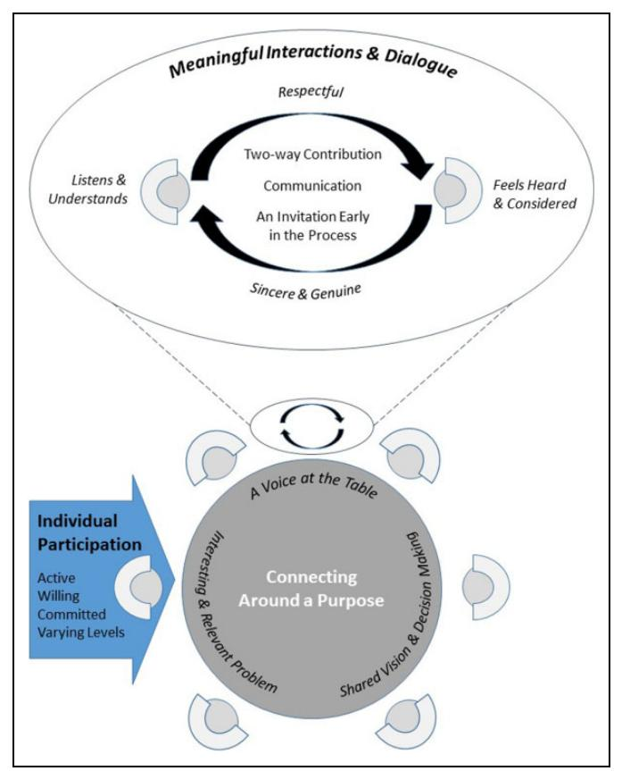
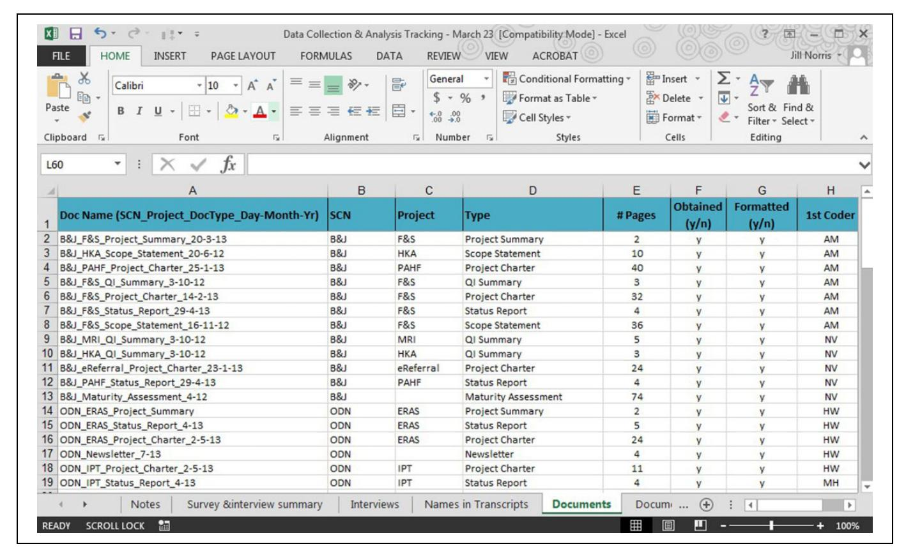
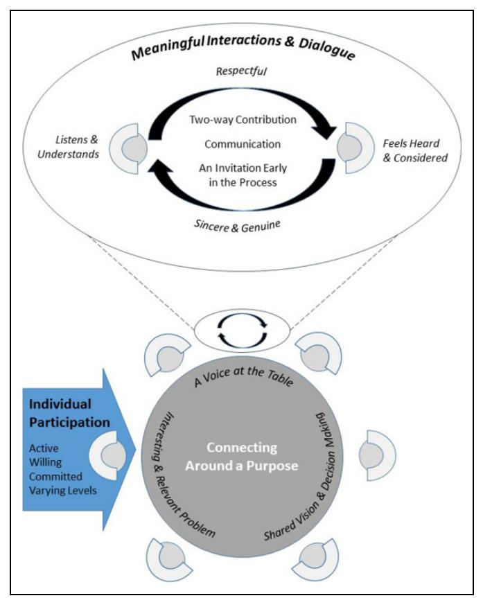

<!-- A3.R72 | source: papers_json/A3.R72/ -->

Article

## Thematic Analysis: Striving to Meet the Trustworthiness Criteria

International Journal of Qualitative Methods Volume 16: 1–13
© The Author(s) 2017
Reprints and permissions: sagepub.com/journalsPermissions.nav DOI: 10.1177/1609406917733847 journals.sagepub.com/home/ijq

**$**SAGE

Lorelli S. Nowell1, Jill M. Norris1, Deborah E. White1, and Nancy J. Moules1

## **Abstract **

As qualitative research becomes increasingly recognized and valued, it is imperative that it is conducted in a rigorous and methodical manner to yield meaningful and useful results. To be accepted as trustworthy, qualitative researchers must demonstrate that data analysis has been conducted in a precise, consistent, and exhaustive manner through recording, systematizing, and disclosing the methods of analysis with enough detail to enable the reader to determine whether the process is credible. Although there are numerous examples of how to conduct qualitative research, few sophisticated tools are available to researchers for conducting a rigorous and relevant thematic analysis. The purpose of this article is to guide researchers using thematic analysis as a research method. We offer personal insights and practical examples, while exploring issues of rigor and trustworthiness. The process of conducting a thematic analysis is illustrated through the presentation of an auditable decision trail, guiding interpreting and representing textual data. We detail our step-by-step approach to exploring the effectiveness of strategic clinical networks in Alberta, Canada, in our mixed methods case study. This article contributes a purposeful approach to thematic analysis in order to systematize and increase the traceability and verification of the analysis.

## Keywords

qualitative methods, qualitative data analysis, rigor, thematic analysis, trustworthiness

## What Is Already Known?

Qualitative research is a valued paradigm of inquiry and the complexity that surrounds qualitative research requires rigorous and methodical methods to create useful results. Thematic analysis is a relevant qualitative research method, yet little has been written to guide researchers in how to conduct a rigorous thematic analysis.

## What This Paper Adds?

Thematic analysis is an apt qualitative method that can be used when working in research teams and analyzing large qualitative data sets. Our step-by-step approach provides a detailed description and pragmatic approach to conduct a thematic analysis. Illustrating the process of how to conduct a trustworthy thematic analysis in tandem with a framework positively contributes to qualitative research as a method.

## Introduction

Qualitative research, intended to generate knowledge grounded in human experience (Sandelowski, 2004), has established a distinctive place in research literature. As qualitative research becomes increasingly recognized and valued, it is imperative

to conduct it in a rigorous and methodical manner to yield meaningful and useful results (Attride-Stirling, 2001). As the qualitative research tradition continues to gain popularity, there is a need for greater disclosure and more sophisticated tools to facilitate researchers in conducting trustworthy qualitative research.

Thorne (2000) characterized data analysis as the most complex phase of qualitative research, and one that receives the least thoughtful discussion in the literature. Data analysis conducted in a systematic approach can be transparently communicated to others (Malterud, 2001; Sandelowski, 1995). Qualitative researchers often omit a detailed description of how analysis is conducted within published research reports (Attride-Stirling, 2001; Tuckett, 2005); however, many have argued that researchers need to be clear about what they are doing, why they are doing it, and include a clear description of

## Corresponding Author:

Lorelli S. Nowell, Faculty of Nursing, University of Calgary, 2500 University Drive NW, Calgary, Alberta, Canada T2N IN4. Email: Inowell@ucalgary.ca

> ^&^lt;sup>1 Faculty of Nursing, University of Calgary, Calgary, Alberta, Canada

<!-- page 2 -->

analysis methods (Braun & Clarke, 2006; Malterud, 2001; Thorne, 2000). If readers are not clear about how researchers analyzed their data or what assumptions informed their analysis, evaluating the trustworthiness of the research process is difficult.

When conducting data analysis, the researcher becomes the instrument for analysis, making judgments about coding, theming, decontextualizing, and recontextualizing the data (Starks & Trinidad, 2007). Each qualitative research approach has specific techniques for conducting, documenting, and evaluating data analysis processes, but it is the individual researcher's responsibility to assure rigor and trustworthiness. Qualitative researchers can demonstrate how data analysis has been conducted through recording, systematizing, and disclosing the methods of analysis with enough detail to enable the reader to determine whether the process is credible (Attride-Stirling, 2001; Coˆt´e & Turgeon, 2005; Ryan, Coughlan, & Cronin, 2007).

Although there are numerous examples of how to conduct qualitative research, there are few discussions in the literature about how to conduct a rigorous and relevant thematic analysis. In this article, we discuss how researchers might conduct theoretically and methodologically sound thematic analysis research that aims to create sensitive, insightful, rich, and trustworthy research findings. We also define thematic analysis and the trustworthiness criteria created by Lincoln and Guba (1985). We outline a practical process for conducting thematic analysis that aims to meet the trustworthiness criteria using exemplars from our study of Strategic Clinical Networks (SCNs) in Alberta, Canada.

## What Is Thematic Analysis?

Thematic analysis has been poorly branded, yet widely used in qualitative research (Braun & Clarke, 2006), and has been rarely appreciated in the same way as grounded theory, ethnography, or phenomenology. Braun and Clarke (2006) argued that thematic analysis should be a foundational method for qualitative analysis, as it provides core skills for conducting many other forms of qualitative analysis. Many authors have maintained that because thematic analysis is a process used by many qualitative methods, it is not a separate method, rather something to be used to assist researchers in analysis (Boyatzis, 1998; Holloway & Todres, 2003; Ryan & Bernard, 2000). Others, including ourselves, have claimed thematic analysis should be considered a method in its own right (Braun & Clarke, 2006; King, 2004; Leininger, 1992; Thorne, 2000).

We argue that thematic analysis is a qualitative research method that can be widely used across a range of epistemologies and research questions. It is a method for identifying, analyzing, organizing, describing, and reporting themes found within a data set (Braun & Clarke, 2006). Boyatzis (1998) described thematic analysis as a translator for those speaking the languages of qualitative and quantitative analysis, enabling researchers who use different research methods to communicate with each other.

A rigorous thematic analysis can produce trustworthy and insightful findings (Braun & Clarke, 2006); however, there is

no clear agreement about how researchers can rigorously apply the method. Although thematic analysis has been described (Aronson, 1994; Attride-Stirling, 2001; Crabtree & Miller, 1999; King, 2004), guides on conducting thematic analysis have primarily focused on conducting research with an applied focus (Guest, MacQueen, & Namey, 2011) or described inductive versus deductive coding (Fereday & Muir-Cochrane, 2006). While much has been written about grounded theory, ethnography, and phenomenology, this trend has not yet reached thematic analysis. There is insufficient literature that outlines the pragmatic process for conducting trustworthy thematic analysis. In writing this article, we attempt to fill this gap in the literature.

## Advantages of Thematic Analysis

Through its theoretical freedom, thematic analysis provides a highly flexible approach that can be modified for the needs of many studies, providing a rich and detailed, yet complex account of data (Braun & Clarke, 2006; King, 2004). As thematic analysis does not require the detailed theoretical and technological knowledge of other qualitative approaches, it offers a more accessible form of analysis, particularly for those early in their research career (Braun & Clarke, 2006). Researchers who are relatively unfamiliar with qualitative methods may find that thematic analysis is easily grasped and can be relatively quick to learn, as there are few prescriptions and procedures (Braun & Clarke, 2006; King, 2004). Braun and Clarke (2006) and King (2004) argued that thematic analysis is a useful method for examining the perspectives of different research participants, highlighting similarities and differences, and generating unanticipated insights. Thematic analysis is also useful for summarizing key features of a large data set, as it forces the researcher to take a well-structured approach to handling data, helping to produce a clear and organized final report (King, 2004). Although there are many advantages to using thematic analysis, it is important to also acknowledge the disadvantages of this method.

## Disadvantages of Thematic Analysis

The disadvantages of thematic analysis become more apparent when considered in relation to other qualitative research methods. The lack of substantial literature on thematic analysis compared to that of grounded theory, ethnography, and phenomenology, for example—may cause novice researchers to feel unsure of how to conduct a rigorous thematic analysis. A simple thematic analysis is disadvantaged when compared to other methods, as it does not allow researcher to make claims about language use (Braun & Clarke, 2006). While thematic analysis is flexible, this flexibility can lead to inconsistency and a lack of coherence when developing themes derived from the research data (Holloway & Todres, 2003). Consistency and cohesion can be promoted by applying and making explicit an epistemological position that can coherently underpin the study's empirical claims (Holloway & Todres, 2003).

<!-- page 3 -->

## Establishing Trustworthiness in Qualitative Research

With the cooperation of key stakeholders, we aim to put the knowledge created through our research into practice. Therefore, it is important that our research is recognized as familiar and understood as legitimate by researchers, practitioners, policy makers, and the public. Trustworthiness is one way researchers can persuade themselves and readers that their research findings are worthy of attention (Lincoln & Guba, 1985). Lincoln and Guba (1985) refined the concept of trustworthiness by introducing the criteria of credibility, transferability, dependability, and confirmability to parallel the conventional quantitative assessment criteria of validity and reliability. The procedures for fulfilling the trustworthiness criteria are familiar to many, even those who have differences in epistemology and ontology, as they rely on methodological arguments and techniques (Green, 2000). While others have more recently presented expansive and flexible markers of quality in qualitative research (Tracy, 2010), we have chosen to use the original, widely accepted, and easily recognized criteria introduced by Lincoln and Guba to demonstrate trustworthiness in our study. We argue these trustworthiness criteria are pragmatic choices for researchers concerned about the acceptability and usefulness of their research for a variety of stakeholders. These trustworthiness criteria will be briefly defined and then interwoven throughout a description of how we attempted to conduct a trustworthy thematic analysis.

## Credibility

Guba and Lincoln (1989) claimed that the credibility of a study is determined when coresearchers or readers are confronted with the experience, they can recognize it. Credibility addresses the "fit" between respondents' views and the researcher's representation of them (Tobin & Begley, 2004). Lincoln and Guba (1985) suggested a number of techniques to address credibility including activities such as prolonged engagement, persistent observation, data collection triangulation, and researcher triangulation. They also recommended peer debriefing to provide an external check on the research process, which may therefore increase credibility, as well as examining referential adequacy as a means to check preliminary findings and interpretations against the raw data. Credibility can also be operationalized through the process of member checking to test the findings and interpretations with the participants (Lincoln & Guba, 1985).

## Transferability

Transferability refers to the generalizability of inquiry. In qualitative research, this concerns only to case-to-case transfer (Tobin & Begley, 2004). The researcher cannot know the sites that may wish to transfer the findings; however, the researcher is responsible for providing thick descriptions, so that those

who seek to transfer the findings to their own site can judge transferability (Lincoln & Guba, 1985).

## Dependability

To achieve dependability, researchers can ensure the research process is logical, traceable, and clearly documented (Tobin & Begley, 2004). When readers are able to examine the research process, they are better able to judge the dependability of the research (Lincoln & Guba, 1985). One way that a research study may demonstrate dependability is for its process to be audited (Koch, 1994), which will be discussed in further detail below.

## Confirmability

Confirmability is concerned with establishing that the researcher's interpretations and findings are clearly derived from the data, requiring the researcher to demonstrate how conclusions and interpretations have been reached (Tobin & Begley, 2004). According to Guba and Lincoln (1989), confirmability is established when credibility, transferability, and dependability are all achieved. Koch (1994) recommended researchers include markers such as the reasons for theoretical, methodological, and analytical choices throughout the entire study, so that others can understand how and why decisions were made.

## Audit Trails

An audit trail provides readers with evidence of the decisions and choices made by the researcher regarding theoretical and methodological issues throughout the study, which requires a clear rationale for such decisions (Koch, 1994). Sandelowski (1986) stated that a study and its findings are auditable when another researcher can clearly follow the decision trail. Furthermore, Koch (1994) argued that another researcher with the same data, perspective, and situation could arrive at the same or comparable, but not contradictory, conclusions. Keeping records of the raw data, field notes, transcripts, and a reflexive journal can help researchers systemize, relate, and cross reference data, as well as ease the reporting of the research process are all means of creating a clear audit trail (Halpren, 1983).

## Reflexivity Is Central to the Audit Trail

Researchers are encouraged to keep a self-critical account of the research process, including their internal and external dialogue (Tobin & Begley, 2004). A reflexive journal can be used by researchers to record to document the daily logistics of the research, methodological decisions, and rationales and to record the researcher's personal reflections of their values, interests, and insights information about self (the human instrument; Lincoln & Guba, 1985).

<!-- page 4 -->

## Toward a Step-by-Step Approach for Conducting a Trustworthy Thematic Analysis

From a thorough examination of our experiences with qualitative analysis, we have attempted to outline a practical and effective procedure for conducting thematic analysis that aims to meet the trustworthiness criteria outlined by Lincoln and Guba (1985). In qualitative research, the process of data collection, data analysis, and report writing is not always distinct steps; they are often interrelated and occur simultaneously throughout the research process (Creswell, 2007). Because data collection and data analysis may happen concurrently, it is important to identify that the data analysis process may not be entirely distinguishable from the actual data (Thorne, 2000). Although thematic analysis as documented by Braun and Clarke (2006) will be presented here as a linear, six-phased method, it is actually an iterative and reflective process that develops over time and involves a constant moving back and forward between phases. Table 1 highlights how researchers may address Lincoln and Guba's (1985) criteria for trustworthiness during each phase of thematic analysis.

## Exemplar Study

In 2014, we began Phase 1 of a 5-year mixed methods case study of nine SCNs in Alberta, Canada. SCNs connect stakeholders across health systems—including patients and families, health-care professionals, researchers, the government, and professional organizations—to identify health and system needs and to develop plans to address those needs using quality improvement initiatives with best evidence. In collaboration with our knowledge users and decision makers, we aimed to understand what made these networks effective, including how networks engaged their stakeholders and what knowledge translation and engagement looked like across their initiatives.

This study was approved by the University of Calgary Conjoint Health Research Ethics Board REB13-0783/0781. Interviewees provided both written and verbal consent to participate. Our study built on a smaller pilot study and guiding conceptual framework that included a modified input–process– output team effectiveness model (Mathieu, Maynard, Rapp, & Gilson, 2008), knowledge translation (Graham et al., 2006), and stakeholder engagement (see Figure 1). The qualitative data in Phase 1 consisted of 71 documents, 117 interview transcripts from exploratory interviews, and 15 observation field notes. Initial codes were generated deductively based on our pilot study, prior research, and conceptual framework. Codes were first fit into a preexisting coding framework to provide detailed analysis of aspects of the data we were most interested in exploring. This variable-oriented strategy (Miles, Huberman, & Saldana, 2014) also facilitated cross-case analysis of the data during later stages of analysis. Phase 1 has been completed (Norris, Hecker, Rabatach, Noseworthy, & White, 2017; Norris, White, Nowell, Mrklas, & Stelfox, 2017). Phase 2 data

are currently undergoing analysis, while data collection for Phase 3 has begun.

## Phase 1: Familiarizing Yourself With Your Data

## Description

Qualitative data come in various forms including recorded observations, focus groups, texts, documents, multimedia, public domain sources, policy manuals, and photographs (Thorne,

<!-- page 5 -->

*Figure 1. Study conceptual framework.*

2000). Textual data may also include field notes from participant observations, reflexive journal entries, and stories and narratives (Crabtree & Miller, 1999). Qualitative researchers may triangulate different data collection modes to increase the probability that the research findings and interpretations will be found credible (Lincoln & Guba, 1985). Regardless of the form of data collection, archiving all records of the raw data provides an audit trail and a benchmark against which later data analysis and interpretations can be tested for adequacy (Halpren, 1983; Lincoln & Guba, 1985).

If data were collected through interactive means, researchers will come to the analysis with some prior knowledge of the data and possibly some initial analytic interests or thoughts. Documenting these thoughts during data collection may mark the beginning of data analysis, as researchers may note initial analysis thoughts, interpretations, and questions (Tuckett, 2005). Regardless of who collected the data, it is vital that researchers immerse themselves with the data to familiarize themselves with the depth and breadth of the content (Braun & Clarke, 2006).

The volume, complexity, and varied formats of qualitative data (e.g., audio recordings, transcriptions, documents, and field notes) often lack consistent structure; however, all are useful and imperative for conducting a comprehensive analysis (Dey, 1993). To become immersed in the data involves the repeated reading of the data in an active way searching for meanings and patterns. Braun and Clarke (2006) recommended that researchers read through the entire data set at least once before beginning coding, as ideas and identification of possible patterns may be shaped as researchers become familiar with all aspects of their data.

Researchers are encouraged to engage with the analysis as a faithful witness to the accounts in the data, being honest and vigilant about their own perspectives, preexisting thoughts and beliefs, and developing theories (Starks & Trinidad, 2007). Researchers can document their theoretical and reflective thoughts that develop through immersion in the data, including their values, interests, and growing insights about the research topic (Lincoln & Guba, 1985; Sandelowski, 1995). During this phase, researchers may also make notes

about ideas for coding that can be returned to in subsequent phases (Lincoln & Guba, 1985).

## Our Experience and Practical Examples

Based on previous experience with large data sets (White, Oelke, & Friesen, 2012), we knew that data management was imperative to the success of this large, complex project. All files (i.e., raw data) were named to represent the case (i.e., SCN) from which the data came from, a unique identifier for the source (e.g., participant code, type/name of document or meeting), and the date originally created. Raw data were stored in a central repository (a secure network location with folders for each type of raw data) and were archived with dates to provide an audit trail and a means of confirming our data analysis and interpretations for adequacy.

We used an Excel spreadsheet to log all raw data and to detail the team's progress in collecting and converting raw data to text that could be subsequently analyzed in NVivo (version 11) (Figure 2). While observation notes and interview transcripts were easily coded in NVivo, the documents came in multiple forms (Word, PowerPoint, Excel, and PDF) and without a consistent structure. This posed additional challenges and often required additional formatting to the documents (e.g., text recognition in Adobe).

## Phase 2: Generating Initial Codes

## Description

The second phase begins once researchers have read and familiarized themselves with the data, having ideas about what is in the data and what is interesting about them (Braun & Clarke, 2006). This phase involves the initial production of codes from the data, a theorizing activity that requires the researchers to keep revisiting the data. Qualitative coding is a process of reflection and a way of interacting with and thinking about data (Savage, 2000). Coding allows the researcher to simplify and focus on specific characteristics of the data. Researchers will

<!-- page 6 -->

*Figure 2. Excel spreadsheet with log of collected data.*

move from unstructured data to the development of ideas about what is going on in the data (Morse & Richards, 2002). During coding, researchers identify important sections of text and attach labels to index them as they relate to a theme or issue in the data (King, 2004). Boyatzis (1998) suggested that a "good code" (p. 1) is one that captures the qualitative richness of the phenomenon.

Braun and Clarke (2006) recommended that researchers work systematically through the entire data set, giving full and equal attention to each data item, and identify interesting aspects in the data items that may form the basis of themes across the data set. Codes should have quite explicit boundaries, ensuring they are not interchangeable or redundant (Attride-Stirling, 2001). There can be as many levels of coding as the researcher finds useful, but too many levels can be counterproductive to the goal of attaining clarity in organizing and interpreting the data (King, 2004). Sections of text can be coded in as many different themes as they fit, being uncoded, coded once, or coded as many times as deemed relevant by the researcher (Braun & Clarke, 2006). Hierarchical coding allows the researcher to analyze texts at varying levels of specificity with broad higher order codes providing an overview and detailed lower order codes allowing for distinctions to be made within and between cases (King, 2004). Accounts that depart from the dominant story in the analysis should not be ignored when coding (Braun & Clarke, 2006).

A consistent approach is needed to begin coding the data, and there are several approaches that can be used in a disciplined way. Creswell (2014) described a systematic process for coding data in which specific statements are analyzed and categorized into themes that represent the phenomenon of interest. King (2004) outlined the process of creating a provisional template to use on the full data set, suggesting that using a template forces the researcher to justify the inclusion of each code, and to clearly define how it should be used. Code manuals, as outlined by Crabtree and Miller (1999), can serve as a data management tool for organizing segments of similar or related text to assist in interpretation, providing a clear trail of evidence for the credibility of the study. When using a code manual, researchers define the codebook before commencing an in-depth analysis of the data (Fereday & Muir-Cochrane, 2006). This technique may be useful for researchers conducting a realist, deductive, thematic analysis. Thematic networks are another tool available to support researchers when conducting a thematic analysis. The development of thematic networks aims to take the researcher deeper into the meaning of the texts, exploring the themes that emerged and identifying the patterns that underlie them (Attride-Stirling, 2001). Whatever technique is used, it is important to consistently apply it to all of the data. Any changes to the analytic approach need to be documented in auditable notations, and any data approached in the old way need to be revisited with the new approach (Sandelowski, 1995).

<!-- page 7 -->

*Table 2. Excerpt From Codebook.*

Theme, Definition Example

Inputs

## CN composition

CN structure, governance, and role of team members Who is on the team (composition) and what do they do (role) to work on task

CN member characteristics

The effort, motivation, skills (technical, content expertise), and tenure of individual CN members

Steering committee

Provides assistance in resolving issues that are beyond the project manager's jurisdiction. Monitors project progress and provides necessary tools and support when milestones are in jeopardy

Team member

Working project team member completes assigned work packages and reports progress against timelines

Project team

The project team, accountable to the project manager, meets every 2 weeks to review progress, identifies, prioritizes, and resolves project issues. The project team:

- -Assesses and resolves project issues/risks
- -Escalates unresolved issues as appropriate to project manager
- -Reviews progress and updates plans
- -Determines planned activities
- -Carries out planned activities/tasks as assigned

The membership on the SCN is 50% clinical, 50% admin partners and others We do have patients and families on every network, and we've actually got trained patient engagement researchers on most networks, where we're hoping that they will be a vehicle for us to get a more public voice on some of this work that we're doing

I have actually run a network before, so I was involved in the bone and joint network for several years and got that network up and running before they became strategic clinical networks. So I feel like I have some lived experience on what works and what doesn't. You know I've been involved in a lot of health systems research work and design work and that has really helped to understand how to take this strategy and make it real in the organization

[in selecting SCN members, leaders] look at the readiness of that group of people if there are key people who are willing to step forward. Because people on the SCNs are mostly paid health professionals who already have their plates full. They need people where they know they can get a toehold and show something is successful

Note. SCN ¼ strategic clinical networks.

Researchers may choose to use one of the software programs to aid in the sorting and organizing the data. Software can enable the researcher to work efficiently with complex coding schemes and large amounts of text, facilitating depth and sophistication of analysis (King, 2004). It is important to note that although computer programs may be helpful to organize and examine large amounts of data, none are capable of the intellectual and conceptualizing processes required to transform data, nor can they make any kind of judgment (King, 2004; Thorne, 2000). Regardless of the analytical procedure used, credibility is enhanced if the data are analyzed by more than one researcher (Coˆt´e & Turgeon, 2005; Lincoln & Guba, 1985).

Peer debriefing and reflexive writing throughout the coding process will help researchers examine how their thoughts and ideas evolve as they engage more deeply with the data (Cutcliffe & McKenna, 1999). Reflexive journaling serves the added function of establishing an audit trail, keeping track of emerging impressions of what the data mean and how they relate to each other (Cutcliffe & McKenna, 1999; Morse & Richards, 2002; Starks & Trinidad, 2007). The notes created

in the reflexive journal become auditable evidence to support the trustworthiness of the study (Lincoln & Guba, 1985).

## Our Experience and Practical Examples

The use of a coding framework provided a clear trail of evidence for the credibility of the study. We developed a code manual that included detailed definitions and exemplar text, which was particularly useful for the novices on the research team who were not content experts (Table 2).

The NVivo software program was used to aid in the sorting and organizing the large data set. This software enabled our research team to work efficiently with complex coding schemes and large amounts of text, facilitating both depth and sophistication of analysis. The credibility of analysis was further enhanced by having two researchers analyze each data set. All members of the research team worked systematically through entire data sets, giving full and equal attention to each data item. Individual extracts of data were coded in as many different themes as they fit and as many times as deemed relevant. Memos were recorded to identify interesting aspects

<!-- page 8 -->

in the data items and emerging impressions that may form the basis of themes across the data set.

Biweekly research meetings were held throughout the coding process to allow time for peer debriefing and to help the research team to examine how their thoughts and ideas were evolving as they engaged more deeply with the data. Meeting minutes were recorded as a means of establishing an audit trail and to help keep track of emerging impressions of what the data means and how they related to each other. Any changes to the analytic approach were documented in auditable notations in the codebook. The notes created became auditable evidence to support the trustworthiness of the study.

## Phase 3: Searching for Themes

## Description

The third phase begins when all data have been initially coded and collated, and a list of the different codes identified across the data set has been developed. This phase involves sorting and collating all the potentially relevant coded data extracts into themes (Braun & Clarke, 2006). DeSantis and Ugarriza (2000) offered the following definition of the concept of theme to guide nurse researchers in maintaining methodological rigor: "A theme is an abstract entity that brings meaning and identity to a recurrent experience and its variant manifestations. As such, a theme captures and unifies the nature or basis of the experience into a meaningful whole" (p. 362). Themes are identified by bringing together components or fragments of ideas or experiences, which often are meaningless when viewed alone (Aronson, 1994). A theme is not necessarily dependent on quantifiable measures but rather on whether it captures something important in relation to the overall research question (Braun & Clarke, 2006). Once identified, themes appear to be significant concepts that link substantial portions of the data together (DeSantis & Ugarriza, 2000).

A theme may be initially generated inductively from the raw data or generated deductively from theory and prior research (Boyatzis, 1998). With an inductive approach, the themes identified are strongly linked to the data themselves and may bear little relation to the specific questions that were asked of the participants. Inductive analysis is a process of coding the data without trying to fit it into a preexisting coding frame or the researcher's analytic preconceptions. In this sense, this form of thematic analysis is data-driven (Braun & Clarke, 2006). In contrast, deductive analysis is driven by the researchers' theoretical or analytic interest and may provide a more detailed analysis of some aspect of the data but tends to produce a less rich description of the overall data (Braun & Clarke, 2006). Researchers need to distinguish if they are conducting an inductive or deductive thematic analysis as it will inform how themes are theorized (Braun & Clarke, 2006).

Part of the flexibility of thematic analysis is that it allows researcher judgment to determine themes in a number of ways; however, it is important that researchers are consistent in how this is done within any particular analysis (Braun & Clarke,

2006). Researchers might use tables, templates, code manuals, or mind maps (Braun & Clarke, 2006). Thematic networks may be used to create a web-like network to organize codes and themes, making the procedures employed in going from text to interpretation explicit (Attride-Stirling, 2001). Some researchers use generic data analysis tools whereas others use less structured and more creative approaches. Maps, matrices, and other diagrams may be useful to explore and display relationships between themes beyond the linear template (Crabtree & Miller, 1999). What is important is that the process of data collection, coding, organizing, and analysis is described in sufficient detail to enable the reader to judge whether the final outcome is rooted in the data generated (Ryan et al., 2007).

King (2004) suggested, when searching for themes, the best place to start is with a few predefined codes to help guide analysis. However, he warned that starting with too many predefined codes may prevent the consideration of data that conflicts with previously made assumptions, and starting with too few predefined codes may leave researchers lacking in any direction and feeling overwhelmed by the amounts of complex data. Novice researchers may attempt to examine and interpret every code to an equal degree of depth, when instead they may seek to identify those themes which are most relevant to building an understanding of the phenomena under investigation (King, 2004). King warned researchers not be so strongly guided by the research question that themes which are not obviously of direct relevance are disregarded.

Initial codes may begin to form main themes, and others may form subthemes. Researchers may also find codes that do not seem to belong anywhere. Braun and Clarke (2006) recommended the creation of a "miscellaneous" theme to temporarily house the codes that do not seem to fit into main themes. It is important not to abandon data or codes at this stage, as without looking at all the extracts in detail during the fourth phase of thematic analysis, it is uncertain whether the themes will hold, or be combined, refined, separated, or discarded (Braun & Clarke, 2006). Themes that seem marginally relevant may play a significant role in adding to the background detail of the study (King, 2004). Halpren (1983) recommended researchers keep detailed notes about the development and hierarchies of concepts and themes to be included in the audit trail and help establish confirmability.

## Our Experience and Practical Examples

We covered a wide variety of concepts in our interviews, so we initially utilized the conceptual framework to develop broad, higher order codes to help organize the data. These deductive codes often formed main themes, some of which matched an interview question, and were represented as parent nodes in NVivo. We used both NVivo and printed copies of the coded data within each theme to subsequently develop subthemes, if required. Subthemes were formed inductively without trying to fit it into a preexisting coding framework, often represented as child nodes in NVivo (Figure 3). Detailed notes about the

<!-- page 9 -->

development of subthemes were kept in the codebook and included in the audit trail and help establish confirmability.

We also retained miscellaneous codes in separate free nodes to ensure they were not lost. Once such example was the code commentary. When participants were asked to define engagement, for example, many responded with laughter, amusement, or comments about the need for a definition or the trendiness the term. These comments did not specifically answer the question but were important data that illuminated the contextual nature of the question in the organization.

We also used diagramming as a way to make sense of the connections between themes and further interrogate the themes. Figure 4 illustrates a much-refined version of the themes and subthemes for the topic of defining engagement. The purpose of this exercise was not to create a model; rather, this exercise was used to visualize the themes and creatively think about how the parts fit together. We first started diagramming on a whiteboard, centered around the visual of being "around the table"—a phrase used by many participants—and extended the diagramming to include what individuals "brought" to the table and how individuals "interacted" with one another.

*Figure 4. Components of engagement.*

## Phase 4: Reviewing Themes

## Description

The fourth phase begins once a set of themes has been devised, and they now require refinement (Braun & Clarke, 2006). During this phase, researchers review the coded data extracts for each theme to consider whether they appear to form a coherent pattern. The validity of individual themes will be considered to determine whether the themes accurately reflect the meanings evident in the data set as a whole (Braun & Clarke, 2006). In the course of this phase, inadequacies in the initial coding and themes will be revealed and may require various changes (King, 2004). If the researcher identifies a relevant issue in the text not covered by an existing code, a new code may be inserted. If the researcher has found no need to use a code or if it substantially overlaps with other codes, it may be deleted (King, 2004). The need for recoding from the data set is to be expected, as coding is an ongoing organic process (Braun & Clarke, 2006).

During this phase, it may also become evident that some themes do not have enough data to support them or the data are too diverse (Braun & Clarke, 2006). Some themes may collapse into each other while other themes may need to be broken down into separate themes (Braun & Clarke, 2006). Selected themes will need to be refined into themes that are specific enough to be discrete and broad enough to capture a set of ideas contained

<!-- page 10 -->

in numerous text segments. Data will be reduced into a more manageable set of significant themes that succinctly summarize the text (Attride-Stirling, 2001). The data within themes should cohere together meaningfully, with a clear and identifiable distinction between themes (Braun & Clarke, 2006).

At the end of this phase, researchers have a good idea of the different themes, how they fit together, and the overall story they tell about the data (Braun & Clarke, 2006). The researcher should be able to clearly show how each theme was derived from the data. Testing the referential adequacy can be accomplished by returning to the raw data and comparing it to the developed themes to make sure that all conclusions are firmly grounded in the data (Lincoln & Guba, 1985).

## Our Experience and Practical Examples

During this phase, members of the researcher team reviewed the coded data extracts for each subtheme to determine if a coherent pattern was apparent. All themes and subthemes were vetted during team meetings. Through our team meetings, it became evident that some themes and subthemes did not have enough data to support them—for example, the SCN member affect and task-focused effort subthemes were too thin—while other subthemes needed to be broken down further. This was particularly apparent once we began cross-case analysis, as the richness and diversity of the data were more apparent with a larger data set (in comparison to single-case data set). To ensure that the themes reflected the participant voice, we also returned to the raw data.

## Phase 5: Defining and Naming Themes

## Description

During the fifth phase, researchers determine what aspect of the data each theme captures and identify what is of interest about them and why (Braun & Clarke, 2006). For each individual theme, researchers need to conduct and write a detailed analysis, identifying the story that each theme tells (Braun & Clarke, 2006). Braun and Clarke suggested that theme names need to be punchy and immediately give the reader a sense of what the theme is about. Sections of data may be included in multiple themes with some overlap between themes (Pope, Ziebland, & Mays, 2000). At this stage, researchers may consider how each theme fits into the overall story about the entire data set in relation to the research questions (Braun & Clarke, 2006).

King (2004) advised that it is possible to go on modifying and refining definitions of themes forever, and one of the most difficult decisions to make is where to stop the process of development. King (2004) suggested that if there remain any sections of text which are clearly relevant to the research question, but are not included, the themes cannot be finalized. A solo researcher may consult outside experts to determine whether the themes are sufficiently clear and comprehensive to call a halt to modifications (King, 2004). The process of peer debriefing, with someone who knows a great deal about the

substantive area of the inquiry and the method of thematic analysis, will help expose the researcher to aspects of the research that might otherwise remain unspoken (Lincoln & Guba, 1985). Written records of each peer-debriefing encounter can help to develop the audit trail and serve as a reference for methodological decisions and rationales (Lincoln & Guba, 1985).

King (2004) also suggested that themes should not be considered final until all of the data have been read through and the coding scrutinized at least twice. Investing sufficient time to develop the themes will increase the probability of developing credible finding (Lincoln & Guba, 1985). It is important that, by the end of this phase, researchers can clearly define what the themes are and what they are not (Braun & Clarke, 2006). If the researcher can clearly and succinctly describe the scope and content of each theme, they may be ready to move onto the next phase; if not, further refinement may be required (Braun & Clarke, 2006).

## Our Experience and Practical Examples

During this phase, we wrote detailed analysis for each individual theme, identifying the story that each theme told while considering how each theme fit into the overall story about the entire data set in relation to the research questions. Team meetings were held to discuss each of the themes and to ensure the themes held true across all cases (e.g., individual SCNs). During our team meetings, the process of peer debriefing helped expose aspects of the research that might otherwise remain unspoken. Individual members of the research team discussed their personal insights into the research findings to ensure that all aspects of the data were thoroughly analyzed. The themes were not considered final until all of the data had been read through and the coding scrutinized by the research team to insure the credibility of the findings. Content experts (senior investigators) debriefed junior research assistants

Part of telling the story was ordering the themes in a way that best reflected the data. As a team, the themes were organized and reorganized until consensus was reached, and all team members were satisfied that all data were represented and displayed in a meaningful and useful manner.

Finally, the team revisited the names of all themes with the intent to ensure that the words of participants were used in the names. For example, purpose was renamed to connecting around a purpose and included subtheme names that provided snapshot of the overall theme: an interesting and relevant problem, shared vision and decision-making, and a voice around the table.

## Phase 6: Producing the Report

## Description

The final phase begins once the researcher has fully established the themes and is ready to begin the final analysis and write-up of the report (Braun & Clarke, 2006). The write-up of a thematic analysis should provide a concise, coherent, logical, nonrepetitive, and interesting account of the data within and

<!-- page 11 -->

across themes (Braun & Clarke, 2006). Thorne (2000) encouraged researchers to clearly communicate the logical processes by which findings were developed in a way that is accessible to a critical reader, so the claims made in relation to the data set are rendered credible and believable. Halpren (1983) recommended that researchers keep methodological notes, trustworthiness notes, and audit trail notes to ease the reporting process.

King (2004) suggested that direct quotes from participants are an essential component of the final report. Short quotes may be included to aid in the understanding of specific points of interpretation and demonstrate the prevalence of the themes. More extensive passages of quotation may be included to give readers a flavor of the original texts. Extracts of raw data need to be embedded within the analytic narrative to illustrate the complex story of the data, going beyond a description of the data and convincing the reader of the validity and merit of the analysis (Braun & Clarke, 2006).

King (2004) argued that if researchers simply report the codes and themes that appeared in the transcripts, the results will only offer a flat descriptive account with very little depth, doing little justice to the richness of the data. Ideally, as researchers engage in the analytic process, they will progress from description, where the data have simply been organized and summarized to show patterns, to interpretation, where researchers attempt to theorize the significance of the patterns and their broader meanings and implications, often in relation to literature (Braun & Clarke, 2006). Researchers can refer to their reflexive journal to get a better sense of if the findings and conclusions have been interpreted in a credible manner and reflect on whether the literature supports the findings (Halpren, 1983; Polit & Beck, 2008).

Researchers can aim to build a valid argument for choosing the themes by referring back to the literature. When the researcher interweaves literature with the findings, the story constructed stands with merit (Aronson, 1994). In addition to proposing plausible interpretations, the researcher may add to the knowledge of the subject through new theoretical or practical interpretations (Coˆt´e & Turgeon, 2005). Literature can be used to confirm the research findings as well as provide an opportunity to challenge and add to the literature (Tuckett, 2005).

The analytic credibility of the research will depend on the coherence of the argument. The trustworthiness of the process will be determined by how the researcher uses the data to support the main points, building toward a convincing explanation (Starks & Trinidad, 2007). In order for the discussion to be credible, the researcher should discuss all of the relevant results, including results that were unexpected or did not correspond to the main explanations of the phenomenon being studied (Coˆt´e & Turgeon, 2005).

Braun and Clarke (2006) suggested that researchers aim to articulate what each theme means, as well as the assumptions that underpin it and the implications of each theme. The final analysis should create an overall story about what the different themes reveal about the topic. In addition, many authors

recommend submitting the analyses to participants for their feedback through the process of member checking (Coˆt´e & Turgeon, 2005). Member checking, as a final step, allows the researcher to establish the fit between respondents' views and the researcher's representation of them (Lincoln & Guba, 1985; Tobin & Begley, 2004).

## Our Experience and Practical Examples

Once the final themes were established, we started the process of writing up the reports. We used the Consolidated criteria for reporting qualitative research (COREQ) reporting guidelines (Tong, Siansbury, & Craig, 2007) to ensure that we transparently detailed the methods used to achieve our findings. Both shorter quotes within the narrative and longer block quotes were included in the reports, and all quotes were accompanied by a unique identifier to demonstrate that various participants were represented across the results. We also presented themes, subthemes, and exemplar quotes in a table, which aided us in keeping the report within journal word limits.

All the themes, including discrepant data, were discussed in the final discussion section of the manuscripts. Our discussion returned to the original theoretical literature used to inform the study, as well as research and other literature that supported our argument. Here, our findings were contrasted with the broader literature, and we identified where our findings were supported, contradicted, or added to the current body of knowledge on the topic. Since we had a large study with many participants, we did not fully conduct member checking with all participants; rather, we brought preliminary reports to the SCNs.

## Conclusions

As qualitative research traditions continue to grow, there is a greater need for guidelines and tools to support researchers in conducting trustworthy qualitative research. In this article, we have attempted to provide guidance toward using thematic analysis as a research method. In offering our own personal insights and practical examples, it is our hope that the process of conducting a rigorous and trustworthy thematic analysis has been illustrated in a way that helps those in the process of interpreting and representing textual data. Highlighting the process of how to conduct a trustworthy thematic analysis may be a positive contribution to qualitative research as a methodology and help to the advance the elusive research method: thematic analysis.

## Authors' Note

The data sets generated and analyzed during the current study are not publicly available due to the sensitive and identifiable nature of our qualitative data but are available from the corresponding author on reasonable request.

## Declaration of Conflicting Interests

The author(s) declared no potential conflicts of interest with respect to the research, authorship, and/or publication of this article.

<!-- page 12 -->

## Funding

The author(s) disclosed receipt of the following financial support for the research, authorship, and/or publication of this article: This work was supported by a Collaborative Research and Innovation Opportunities grant Alberta Innovates Health Solutions (grant number 20130152). Lorelli S. Nowell is supported by the University of Calgary Graduate Student Entrance Scholarship.

## References

- Aronson, J. (1994). A pragmatic view of thematic analysis. The Qualitative Report, 2, 1–3. Retrieved from[ http://www.nova.edu/ssss/](http://www.nova.edu/ssss/QR/BackIssues/QR2-1/aronson.html) [QR/BackIssues/QR2-1/aronson.html](http://www.nova.edu/ssss/QR/BackIssues/QR2-1/aronson.html)
- Attride-Stirling, J. (2001). Thematic networks: An analytic tool for qualitative research. Qualitative Research, 1, 385–405. doi:10.1177/ 146879410100100307
- Boyatzis, R. (1998). Transforming qualitative information: Thematic analysis and code development. Thousand Oaks, CA: Sage.
- Braun, V., & Clarke, V. (2006). Using thematic analysis in psychology. Qualitative Research in Psychology, 3, 77–101. doi:10.1191/ 1478088706qp063oa
- Coˆt´e, L., & Turgeon, J. (2005). Appraising qualitative research articles in medicine and medical education. Medical Teacher, 27, 71–75. doi:10.1080/01421590400016308
- Crabtree, B., & Miller, W. (1999). Using codes and code manuals: A template for organizing style of interpretation. In B. Crabtree & W. Miller (Eds.), Doing qualitative research (2nd ed., pp. 163–178). Newbury Park, CA: Sage.
- Creswell, J. (2007). Data analysis and representation. In J. Creswell (Ed.), Qualitative inquiry and research design: Choosing among five approaches (2nd ed., pp. 179–212). Thousand Oaks, CA: Sage.
- Creswell, J. (2014). Research design: Qualitative, quantitative, and mixed methods approaches (4th ed.). Thousand Oaks, CA: Sage.
- Cutcliffe, J. R., & McKenna, H. P. (1999). Establishing the credibility of qualitative research findings: The plot thickens. Journal of Advanced Nursing, 30, 374–380. doi:10.1046/j.1365-2648.1999. 01090.x
- DeSantis, L., & Ugarriza, D. (2000). The concept of theme as used in qualitative nursing research. Western Journal of Nursing Research, 22, 351–372. doi:10.1177/019394590002200308
- Dey, I. (1993). Qualitative data analysis: A user friendly guide for social scientists. London, England: Routledge.
- Fereday, J., & Muir-Cochrane, E. (2006). Demonstrating rigor using thematic analysis: A hybrid approach of inductive and deductive coding and theme development. International Journal of Qualitative Research, 5, 80–92. Retrieved from[ http://ejournals.library.](http://ejournals.library.ualberta.ca/index.php/IJQM/article/view/4411/3530) [ualberta.ca/index.php/IJQM/article/view/4411/3530](http://ejournals.library.ualberta.ca/index.php/IJQM/article/view/4411/3530)
- Graham, I. D., Logan, J., Harrison, M. B., Straus, S. E., Tetroe, J., Caswell, W., & Robinson, N. (2006). Lost in knowledge translation: Time for a map? Journal of Continuing Education in the Health Professions, 26, 13–24. doi:10.1002/chp.47
- Green, J. (2000) Understanding social programs through evaluation. In N. Denzin & Y. Lincoln (Eds.), Handbook of qualitative research (2nd ed., pp. 981–999). London, England: Sage.
- Guba, E. G., & Lincoln, Y. (1989). Fourth generation evaluation. Newbury Park, CA: Sage.

- Guest, G., MacQueen, K. M., & Namey, E. E. (2011). Applied thematic analysis. Thousand Oaks, CA: Sage.
- Halpren, E. S. (1983). Auditing naturalistic inquiries: The development and application of a model (Unpublished doctoral dissertation). Indiana University, Bloomington.
- Holloway, I., & Todres, L. (2003). The status of method: Flexibility, consistency and coherence. Qualitative Research, 3, 345–357. doi:10.1177/1468794103033004
- King, N. (2004). Using templates in the thematic analysis of text. In C. Cassell & G. Symon (Eds.), Essential guide to qualitative methods in organizational research (pp. 257–270). London, UK: Sage.
- Koch, T. (1994). Establishing rigour in qualitative research: The decision trail. Journal of Advanced Nursing, 19, 976–986. doi:10.1111/ j.1365-2648.1994.tb01177.x
- Leininger, M. (1992). Current issues, problems, and trends to advance qualitative paradigmatic research methods for the future. Qualitative Health Research, 2, 392–415. doi:10.1177/ 104973239200200403
- Lincoln, Y., & Guba, E. G. (1985). Naturalistic inquiry. Newbury Park, CA: Sage.
- Malterud, K. (2001). Qualitative research: Standards, challenges, and guidelines. The Lancet, 358, 483–488. doi:10.1016/S0140- 6736(01)05627-6
- Mathieu, J., Maynard, M. T., Rapp, T., & Gilson, L. (2008). Team effectiveness 1997-2007: A review of recent advancements and a glimpse into the future. Journal of Management, 34, 410–76. doi:10.1177/0149206308316061
- Miles, M. B., Huberman, A. M., & Saldana, J. (2014). Qualitative data analysis: A methods sourcebook (3rd ed.). Los Angeles, CA: Sage.
- Morse, J., & Richards, L. (2002). Coding. In J. Morse & Richards (Eds.), Read me first for a user's guide to qualitative methods (pp. 111–128). Thousand Oaks, CA: Sage.
- Norris, J. M., Hecker, K. G., Rabatach, L., Noseworthy, T. W., & White, D. E. (2017). Development and psychometric testing of the clinical networks engagement tool. PLoS One, 12, e0174056. doi:10.1371/journal.pone.0174056
- Norris, J. M.,White, D. E., Nowell, L., Mrklas, K., & Stelfox, H. T. (2017). How do stakeholders from multiple hierarchical levels of a large provincial health system define engagement? A qualitative study. Implementation Science, 12, 1–13. doi:10.1186/s13012-017-0625-5
- Polit, D., & Beck, C. (2008). Nursing research: Generating and assessing evidence for nursing practice (Vol. 8.). Philadelphia, PA: Lippincott William and Wilkins.
- Pope, C., Ziebland, S., & Mays, N. (2000). Analysing qualitative data. British Medical Journal, 320, 114–116.
- Ryan, G., & Bernard, H. (2000). Data management and analysis methods. In N. Denzin & Y. Lincoln (Eds.), Handbook of qualitative research (2nd ed., pp. 769–802).Thousand Oaks, CA: Sage.
- Ryan, F., Coughlan, M., & Cronin, P. (2007). Step-by-step guide to critiquing research. Part 2: Qualitative research. British Journal of Nursing, 16, 738–744. doi:10.12968/bjon.2007.16.12.23726
- Sandelowski, M. (1986). The problem of rigor in qualitative research. Advances in Nursing Science, 8, 27–37.
- Sandelowski, M. (1995). Qualitative analysis: What it is and how to begin. Research in Nursing and Health, 18, 371–375. doi:10.1002/ nur.4770180411

<!-- page 13 -->

Sandelowski, M. (2004). Using qualitative research. Qualitative Health Research, 14, 1366–1386. doi:10.1177/1049732304269672

- Savage, J. (2000). One voice, different tunes: Issues raised by dual analysis of a segment of qualitative data. Journal of Advanced Nursing, 31, 1493–1500. doi:10.1046/j.1365-2648.2000.01432.x
- Starks, H., & Trinidad, S. B. (2007). Choose your method: A comparison of phenomenology, discourse analysis, and grounded theory. Qualitative Health Research, 17, 1372–1380. doi:10.1177/ 1049732307307031
- Thorne, S. (2000). Data analysis in qualitative research. Evidence Based Nursing, 3, 68–70. doi:10.1136/ebn.3.3.68
- Tobin, G. A., & Begley, C. M. (2004). Methodological rigour within a qualitative framework. Journal of Advanced Nursing, 48, 388–396. doi:10.1111/j.1365-2648.2004.03207.x
- Tong, A., Sainsbury, P., & Craig, J. (2007). Consolidated criteria for reporting qualitative research (COREQ): A 32-item checklist for interviews and focus groups. International Journal for Quality in Health Care, 19, 349–357. doi:10.1093/intqhc/ mzm042
- Tracy, S. J. (2010). Qualitative quality: Eight "big-tent" criteria for excellent qualitative research. Qualitative Inquiry, 16, 837–851. doi:10.1177/1077800410383121
- Tuckett, A. (2005). Applying thematic analysis theory to practice: A researcher's experience. Contemporary Nurse, 19, 75–87.
- White, D. E., Oelke, N. D., & Friesen, S. (2012). Management of a large qualitative data set: Establishing trustworthiness of the data. International Journal of Qualitative Methods, 11, 244–258. doi:10. 1177/160940691201100305
