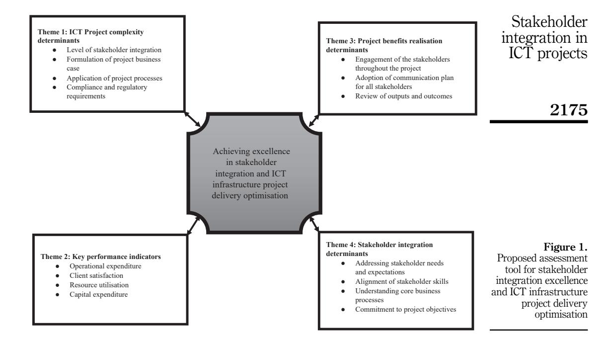

<!-- A3.R74 | source: papers_json/A3.R74/ -->

## An assessment tool for stakeholder integration excellence and project delivery optimisation

Stakeholder integration in ICT projects

2155

Received 15 March 2021 Revised 2 January 2022 Accepted 18 February 2022

## Diana Ominde

Strathmore Business School, Strathmore University, Nairobi, Kenya Edward G. Ochieng

Business Department, Faculty of Business, British University in Dubai, Dubai, United Arab Emirates, and

## Vincent O. Omwenga

Faculty of Information Technology, Strathmore University, Nairobi, Kenya

## Abstract

Purpose – The aim of this study was to appraise the delivery of information communication technology (ICT) projects and identify key determinants for stakeholder integration.

Design/methodology/approach — Given that empirically, little was known about stakeholder integration in the ICT sector and its influence or effect on project delivery; qualitative method was used. Forty-seven semi-structured interviews were carried out to derive senior project practitioners and policymakers' constructs of stakeholder integration and infrastructure performance improvement of ICT projects. The verification and validation of the proposed assessment tool were achieved through the use of focus group discussion.

**Findings** – As established in this research study, there is a need for project delivery teams to evaluate the level of stakeholder integration, the formulation of a project business case, the project processes and issues of compliance and regulation in ICT projects. What is evident in the findings of the study is that the management model adopted for the stakeholders in the Kenyan ICT sector ought to make communication the fulcrum of their engagement.

Originality/value – The inferences made herein are critical in contributing to knowledge regarding the ICT infrastructure project management terrain in developing countries. There is evidence in the study to conclude that the concept of stakeholder management and integration has implications for the sustainability of ICT projects. One of the issues that predominantly featured in the research was the input of stakeholder integration in terms of project sustainability.

**Keywords** Information communication technology, Stakeholder integration, Project complexity, Project benefits realisation, Key performance metrics

Paper type Research paper

## 1. Introduction

The development of the ICT sector in Kenya is considered an impetus to the general economy of the country. In fact, the country has been leveraging its ICT growth as the springboard for growth in other sectors of the economy, and the envisaged economic blueprint of Kenya Vision 2030 lists the ICT sector as one of the principal pillars of its growth (Odhiambo and Kaibui, 2016). What this means is that the ICT sector is the pillar onto which all the other sectors of the country's economy lean. A review of the country's economic growth prospects affirmed that all sectors of the economy have sought to embrace ICT as the basic fabric on which their growth can be woven (Otieno, 2008). With the weight of the economic progression of the country resting on its shoulders, there are implications for the ICT sector in general; this

International Journal of Productivity and Performance Management Vol. 72 No. 7, 2023 pp. 2155-2182 © Emerald Publishing Limited 1741-0401 DOI 10.1108/JPPM-02-2021-0115

*Data availability statement*: The authors confirm that the data supporting the findings of this study are available within the article and its supplementary materials.

<!-- page 2 -->

calls for a more rational view of the implementation of various projects in the ICT sector in Kenya. Considering the Kenyan government had initiated massive infrastructural developments to lay the foundations for harnessing ICT as a potent economic development tool, there is a need to streamline the operations within the ICT sector and chief amongst this was the operationalisation of an assessment tool to evaluate the level of ICT stakeholder integration and the infrastructure performance improvement required in the ICT sector.

Considering the significance attached to the ICT sector in the country, it is imperative that best practices are adopted in the management of the ICT projects in the country. One of the issues observed in the studies of [Gichoya (2005)](#page-24-0) is that the ICT sector in the country lacks a comprehensive stakeholder assessment tool that could be used to guide the implementation of projects in the country ([Gwaya](#page-24-1) et al., 2014). This continues to affect the sustainability of these projects and limit their ability to realise the projects' defined benefits. [Gichoya (2005)](#page-24-0) highlighted that the way ICT projects in the country have been executed in the past is indicative of the urgent need to conceptualise an ICT project management scaffold for the sector. This will not only address the sustainability question therein, but will equally help to optimise project outcomes ([Mburu, 2017)](#page-25-1). Indeed, an evaluation of the implementation of ICT projects in Kenya revealed that the country requires the development of a structured approach in handling its ICT projects [(Gichoya, 2005](#page-24-0)). The execution gaps witnessed in the various stages of the implementation of ICT projects in the country point to a wider need for the development of an assessment tool to improve outcomes. Moreover, a practical operational model is required in a bid to evaluate the progression of these projects and further aid the improvement of benefits realisation. Hence this research aimed to:

- (1) Propose an assessment tool to evaluate the level of ICT stakeholder integration and the infrastructure performance improvement required in the delivery of ICT projects;
- (2) Build on previous works specifically done by [Gwaya](#page-24-1) et al. (2014), [Crawford](#page-24-2)'s (2014) and [Muller (2011)](#page-25-2) € .

## 2. Conceptual framing

The framing of the literature primarily focused on stakeholder integration, performance, project complexity and benefit realisation. These factors were found to be intertwined in influencing the project delivery and outcome. For instance, [Muller (2011)](#page-25-2) € noted that the relationship between the project parties is a critical determinant of the complexity of these projects. Therefore, stakeholder management practices have emerged as key issues in project complexities in the project implementation schema. This research then considers the four theories as most relevant in coming up with a concrete solution to the existing failure of project performance by providing an assessment tool that comprises of all the facets of the four theories. Below is a detailed discussion on how each theory links to the study and the research outcome.

## 2.1 Stakeholder integration and project performance

Developing an effective stakeholder integration framework in any project is fundamental if the objectives and goals of the project are to be realised [(S](#page-26-1)a[nchez, 2015](#page-26-1)). [Thiry (2016)](#page-26-2) suggested that stakeholder integration in the execution of projects aids in the maximisation of the methods through which all project definitions, together with approval, are collected. In essence, project definitions and approval further aid in the identification of the expectations and needs of the stakeholders in the project ([Muller, 2011](#page-25-2) € ). The conceptualisation of a

<!-- page 3 -->

stakeholder integration model in any project must consider the fact that in any project implementation phase, and there needs to be an inventory of the expectations of various stakeholders. Developing an effective stakeholder assessment tool must thus take into consideration the fact that each of the needs of the various clusters of project implementers has to be taken care of if the project is to achieve its objectives. As stated by [Schwalbe (2015)](#page-26-3), the concept of stakeholder integration in projects entails the establishment of an effective and optimal work environment and equally advocates for the incorporation of teamwork.

From a generic perspective, stakeholder integration, as a concept in project management and implementation, is viewed as a progressive process through which the institutional stakeholders are all brought on board throughout the implementation of the specific project ([Plaza-Ubeda](#page-26-4) et al., 2009). From the perspective of communication, the concept of stakeholder integration in project management thus entails the adoption of communication in the management of the specific project – considering that stakeholder integration involves the knowledge of a number of stakeholders involved in the project – and establishes ways to engage stakeholders in the project execution while the goals of the project are pursued. One therefore gets the sense that the performance of any project is deeply dependent on the level of stakeholder integration undertaken during the project implementation phase. [Muller (2017)](#page-25-3) opined that regardless of the methods that have been utilised in the implementation of any project, if the stakeholder integration model adopted in the project is not adequate, the project outcome will be inherently unsatisfactory. The project goals are directly affected if an inadequate stakeholder integration model is adopted ([Chung](#page-24-3) et al., 2009). Such is the importance of stakeholder integration, as a principle of stakeholder management, in the implementation of any project. It is thus imperative that any ICT project, regardless of its nature or complexity, develops the right stakeholder management matrix, which places emphasis on the stakeholder integration model that is to be adopted throughout the project's lifecycle.

2.1.1 Stakeholder management matrix. As specified in the literature ([Ochieng](#page-25-4) et al., 2020), developing a stakeholder management framework requires that the stakeholder understand their roles in the project execution lifecycle. A stakeholder management matrix is a set of tools that aid in appraising stakeholders not only in terms of their roles and contributions to the project, but equally, on their value to the project [(Ochieng](#page-25-4) et al., 2020). The development of the stakeholder management matrix is premised on the idea that there ought to be a clear platform through which the project execution team can clear map out the stakeholders in the project, delineate their roles in the project, the bounds of their operations as well as the expected level of influence that a stakeholder has on the project ([Chinyio and Olomolaiye,](#page-24-4) [2009)](#page-24-4). Management teams in the project execution process rely on stakeholder management matrix to analyse and prioritise the stakeholders in the project features. The matrix supports the project management tool to communicate effectively in the advancement of the project objectives and even assist the project management teams to be able to assess the features of the particular project and its performance as well (Yang et al.[, 2010)](#page-26-5). The development of the stakeholder management matrices are based on a number of theoretical models. [Muller (2011)](#page-25-2) € mentioned that each project management lifecycle is unique to the project context. The development of any project stakeholder management matrix thus borrows from a number of theories in order to establish a more rational stakeholder integration management matrix.

2.1.2 Stakeholder assessment tools. As established from the reviewed literature, there is no evidence that a stakeholder assessment tool unique for ICT projects has been developed for Kenya. While there has been a significant focus on the concept of stakeholder integration in the management of infrastructural projects in the country, there is no evidence to affirm that ICT projects have been taken into consideration. While there seems to be a deep interest in the concept of stakeholder management as a factor in project performance in the globe ([Chinyio and Olomolaiye, 2009)](#page-24-4), it is evident that the Kenyan ICT sector has not been able to

<!-- page 4 -->

find any theory of stakeholder integration onto which it can establish an assessment tool. At the global levels, evidence indicates that there have been attempts to develop assessment models for ICT infrastructure projects. For instance, [Atkin and Skitmore (2008)](#page-23-0) developed a stakeholder tool based on stakeholder theory to analyse telocentric projects. Moreover, the discussions of [Jergeas](#page-25-5) et al. (2000) have been geared towards the development of a stakeholder management tool for analysing risks in ICT projects. Yang et al. [(2010)](#page-26-5) talk of sustainable assessment tools in ICT projects as an important framework for understanding the project stakeholder management. While there have been attempts at the international level, there appears to be no evidence of a stakeholder assessment tool that has been particularly developed for the ICT infrastructure projects. The studies reviewed herein have not explicitly discussed stakeholder assessment for ICT infrastructures even though there are several publications that focus on construction projects. Considering that stakeholder integration management is a key component of project outcomes, then it is imperative that more research is geared towards the development of a stakeholder assessment matrix, particularly for the ICT infrastructure projects.

[Bygstad and Lanestedt (2009)](#page-24-5) identified a number of metrics for evaluating the performance of projects and established that the level of stakeholder management forms a very important project performance parameter that cannot be ignored. In essence, this means that stakeholder management occupies a central place in project evaluation and assessment and this is in consideration of the fact that stakeholder integration is a component of stakeholder management. Current best practices in project management and implementation have further identified stakeholder management as the link between project input and project output [(Heugens](#page-24-6) et al., 2002). This essentially means that the realisation of the objectives of any project depends on the rationality of the methods that have been employed in the management of the stakeholders in the project; stakeholder integration is at the heart of stakeholder management. It could therefore be suggested that the performance of any project, irrespective of the nature of the project, is intertwined with the stakeholder management practices that have been developed in the project, of which stakeholder integration occupies a central part. The research study attempts to give a more complete discussion as to the nexus between project team performance and stakeholder integration. This is based on [Crawford](#page-24-2)'s [(2014)](#page-24-2) assertions that the stakeholder management template within any project implementation schedule plays a crucial role in the advancement of the project's aims and objectives.

## 2.2 Project complexity

Developing a stakeholder assessment model requires a deeper understanding of the level of project complexity of the projects ([Ominde](#page-25-6) et al., 2020a, [b](#page-25-7)). The level at which stakeholders are integrated in the project is defined by the complexity of the project variables. ICT projects are often described as very complex, based on the idea that they entail the integration of both hardware and software. Nevertheless, some of the factors that make ICT projects complex have not been widely understood in the case of Kenyan ICT projects. Some global research focusing on the implications of project complexity during the project implementation phase has been undertaken to establish some of these factors. [Muller (2011)](#page-25-2) € , for instance, indicates that one of the emergent themes in the discussion of project complexities in the ICT sector has been largely based on the question of managing stakeholder expectations in these projects and developing an operational model from which the various expectations can adequately be addressed without having any impact on project progress. A number of factors have been proposed as some of the major project complexity variables in ICT projects. [Bradley (2010)](#page-24-7) identified inherent complexity as one of the major factors in project complexity. The rigidity of sequence, uncertainty, organisational complexity as well as stakeholder management

<!-- page 5 -->

practices have emerged as key issues in project complexities in the project implementation schema. Indeed, the extent of stakeholder management as a key issue in project complexity is discussed by [Muller (2011)](#page-25-2) € , who noted that the relationship between the project parties is a critical determinant of the complexity of these projects. Within the context of ICT projects in Kenya, the manner in which the interpersonal relationships between interpersonal relationships between the stakeholders in the projects is managed defines the level of complexity of these projects. In essence, projects that have a non-defined stakeholder management model are considered to be very complex, since these projects do not have a welldefined stakeholder management model. Nonetheless, extant literature on the Kenyan project management framework have failed to give a detailed discussion of project complexity in ICT projects and have not established the extent to which the Kenyan ICT project management and delivery ecosystem experiences project complexity.

## 2.3 Project benefits realisation

[Muller (2011)](#page-25-2) € described the project benefits realisation process as the derivation of value from the project. It entails the extraction of the desired project values from the project itself. As discussed by[Derby and Zwikael (2012)](#page-24-8), a benefits realisation plan within any project could be applied to the definition of the anticipated project benefits and aid in defining the success criteria for the stakeholders in the project. In order to understand the project benefits realisation process, it is prudent to evaluate the concept of value in projects, especially within the larger context of stakeholder engagement in projects. The concept of value within the stakeholder engagement model entails the realisation of the stakeholders' expectations of the project [(Dupont and Eskerod, 2016](#page-24-9); [Ochieng](#page-25-8) et al., 2017). It essentially means that every stakeholder in the project expects some form of return from the project. For every type of project stakeholder, there are expectations or objectives that the stakeholders anticipate from the project [(Simons and Usher, 2000](#page-26-6)). The project benefits realisation process thus entails the progress of the project processes in order to ensure that the expectations of the various stakeholders in the project are realised. Project benefits realisation management has generated a lot of discussion in the realms of stakeholder management. Current research trends to suggest that it is important to manage the expectations of the stakeholders within the project. In this research study, the concept of project benefits realisation management is discussed within the larger context of stakeholder integration.

As discussed by [Muller (2011)](#page-25-2) € , the justification for focusing on benefits realisation management in projects is primarily associated with ensuring that stakeholder expectations are managed within the project ([Akgun, 2020;](#page-23-1) [Ominde](#page-25-9) et al., 2021; [Derby and Zwikael, 2012)](#page-24-8). Looking at the Kenyan context and the management of ICT projects, there is no well-defined model of benefits realisation within the scope of stakeholder integration. The concept of benefits realisation in project management seeks to assess how projects add value to the company and subsequently, contribute to the realisation of the business objectives of the project. [Breese (2012)](#page-24-10) viewed the concept of project benefit realisation as the definition and the structuring of the project to achieve the set-out objectives of the project both to the consumers of the project and the firm shareholders. [Zwikael](#page-26-7) et al. (2012) looked at project benefit realisation as more of a continuous process where the project management team defines the scope of the project, plan the execution of the project, track the progress of the project towards the realisation of the defined scope and work towards achieving the set objectives. [Serra and Kunc (2015)](#page-26-8) proposed that the ability of any project to realise the defined benefits is predicated on the management principles adopted by the project. [Muller (2011)](#page-25-2) € develops a project benefits management model which entails the "organisation and the management of project deliverables" with a view to achieving the desired project outcomes. A systematic review by [Zwikael](#page-26-7) et al. (2012) suggested that benefit realisation management principles in project implementation regime must ensure that proper alignments are made

<!-- page 6 -->

between the outcomes desired for the projects and the objectives of the business aspect of the project established to increase the success of the projects.

## 3. Method

The interest of the research study was to propose an assessment tool for ICT stakeholder integration and infrastructure performance improvement in the Kenyan ICT sector. The population of interest were the practitioners in the Kenyan ICT sector who are involved in the implementation of ICT infrastructure projects within the Kenyan economy. Qualitative research design was implemented, through semi-structured interviews to discuss the insights, attitudes and the experiences of the practitioners in the ICT sector in the country regarding the project management ecosystem in Kenya especially within the domain of stakeholder integration. The selection of a population of study was based on the relevance of the population in responding to the research objectives that the study aims to achieve ([Suri,](#page-26-9) [2011)](#page-26-9). The locus of the research participants in a study ought to be evaluated in terms of the extent to which they are experienced in the field of interest that the study is keen on researching, as well as their accessibility. These two factors were taken into consideration when coming up with the firms from which the participants to be interviewed would be selected. The other aspects of consideration in the inclusion of these firms in the study were the following:

- (1) The firms had to be currently involved in the implementation of active ICT projects in Kenya.
- (2) The firms had to have been involved in the active implementation of ICT projects in Kenya for not less than eight years cumulatively.
- (3) The projects that were being implemented by these firms were not less than $500,000 in terms of capital outlay.
- (4) The implementing teams of the ICT projects in the firm had to be composed of Kenyans. This is means that the project had to be directly implemented by Kenyans on the ground.

In order to ensure that we appraised the four themes (i.e. benefit realisation, complexity, performance indicator and stakeholder integration) we adopted theoretical elaboration. [Fisher and Aguinis (2017)](#page-24-11) suggested that theoretical elaboration occurs when pre-existing conceptual ideas or preliminary model shapes a study design. Empirically, we assessed, categorised and integrated the qualitative approaches into distinctive aspects of the four themes. We adopted reverse engineering process to extract the fundamental features of impactful theory elaboration studies and make them explicit and researchable. Snowball sampling model was selected for the research study. Earlier recruits in the study were instrumental in recommending other respondents in the study. The selection of the snowball sampling model was based on the idea that the participants in the study were considered to be very few. The identified participants would help in the identification of the subsequent participants to be interviewed. In total, forty-seven was selected as the final number of participants who were interviewed for the research. The selection of forty-seven interview participants did not hinge on any scientific procedure but rather was conceived out of the inclusion criteria. The final list of the participants in the qualitative part of the study is illustrated in [Table 1](#page-6-0) below. For the purposes of data analysis, the entities or project participants were coded using letters of the alphabet.

Though there was a set of interview questions that was used to guide the interview sessions, the adopted model of interviewing allowed for a broader discussion of the issues

<!-- page 7 -->

| Participant | Current job title | Type of contract | Gender | No. of years worked | Role and responsibility | Stakeholder integration in |
| --- | --- | --- | --- | --- | --- | --- |
| A | Regional director | Main contractor | Female | 20 | Managing projects | ICT projects |
|  | Project manager | Sub-contractor | Male | 10 | Coordination of work |  |
| B | Project director | Sub-contractor | Male | 9 | Managing projects |  |
|  | Project planner | Sub-contractor | Male | 6 | Planning projects | 2161 |
| C | Project manager | Main | Female | 8 | Managing projects |  |
|  |  | contractor |  |  |  |  |
|  | Network manager | Main | Male | 17 | Network expansion, |  |
|  | engineer | contractor |  |  | building and upgrade |  |
|  | Project manager | Main | Female | 5 | Managing projects |  |
|  |  | contractor |  |  |  |  |
| D | Chief network | Main | Male | 7 | Coordination of network |  |
|  | manager | contractor |  |  | expansion |  |
|  | Project engineer | Main contractor | Male | 12 | Coordination of work |  |
|  | Project planner | Main contractor | Male | 6 | Planning projects |  |
|  | Transmission engineer | Main contractor | Male | 19 | Network expansion |  |
|  | Project manager | Main | Female | 13 | Managing projects |  |
|  |  | contractor |  |  |  |  |
| E | Project appraiser | Main contractor | Male | 9 | Evaluates projects |  |
|  | Network operation | Main | Male | 19 | Coordination of network |  |
|  | engineer | contractor |  |  | expansion |  |
|  | Project manager | Sub-contractor | Male | 8 | Managing projects |  |
|  | Assistant project | Main | Female | 7 | Coordination of resources |  |
|  | manager | contractor |  |  |  |  |
|  | Project leader | Main contractor | Male | 5 | Coordination of work |  |
|  | Project planner | Main | Female | 8 | Planning projects |  |
|  |  | contractor |  |  |  |  |
| F G | Project manager Regional director | Sub-contractor Main | Male | 6 26 | Managing projects Strategy and new services |  |
|  |  | contractor |  |  |  |  |
|  | Project manager | Sub-contractor | Male | 13 | Managing projects |  |
|  | Head of project | Main | Male | 22 | Connectivity and special |  |
|  | management | contractor |  |  | projects |  |
|  | Network operation | Main | Male | 23 | Coordination of network |  |
|  | engineer | contractor |  |  | expansion |  |
|  | Project planner | Main contractor | Female | 10 | Coordination of work |  |
|  | Assistant project | Main | Male | 9 | Coordination of resources |  |
|  | manager | contractor |  |  |  |  |
|  | Project leader | Main | Female | 7 | Coordination of work |  |
|  | Project director | contractor Main | Male | 20 | Director of corporate |  |
|  |  | contractor |  |  | standards |  |
| H | Project manager | Sub-contractor | Female | 12 | Managing projects |  |
|  | Project planner | Sub-contractor | Male | 6 | Coordination of work |  |
| I | Project manager | Sub-contractor | Female | 15 | Managing projects |  |
| J | Project manager | Sub-contractor | Male | 13 | Managing projects | Table 1. |
|  |  |  |  |  | (continued) | List of participant profiles |

<!-- page 8 -->

|  |  |  |  |  |  |  |
| --- | --- | --- | --- | --- | --- | --- |
| IJPPM 72,7 | Participant | Current job title | Type of contract | Gender | No. of years worked | Role and responsibility |
|  | K | Project manager | Sub-contractor | Male | 11 | Managing projects |
|  |  | Assistant project manager | Sub-contractor | Male | 6 | Coordination of resources |
| 2162 | L | Network operation engineer | Main contractor | Male | 17 | Coordination of network expansion |
|  |  | Project manager |  | Female | 14 | Managing projects |
|  |  | Project leader | Sub-contractor | Male | 7 | Coordination of work |
|  | M | Network operation | Main | Male | 25 | Coordination of network |
|  |  | engineer | contractor |  |  | expansion |
|  | N | Project manager | Sub-contractor | Male | 10 | Managing projects |
|  | O | Project manager | Sub-contractor | Male | 11 | Managing projects |
|  | P | Network operation engineer | Sub-contractor | Male | 22 | Coordination of network expansion |
|  | Q | Project manager | Sub-contractor | Female | 14 | Managing projects |
|  | R | Network operation engineer | Sub-contractor | Male | 18 | Coordination of network expansion |
|  |  | Project manager | Sub-contractor | Female | 8 | Managing projects |
|  | S | Project manager | Sub-contractor | Male | 12 | Managing projects |
|  | T | Project manager | Sub-contractor | Male | 14 | Managing projects |
|  | U | Project manager | Sub-contractor | Female | 16 | Managing projects |
| Table 1. | V | Project manager | Sub-contractor | Male | 12 | Managing projects |

mentioned in the interview questions. Notably, the semi-structured model was selected based on its ability to encourage a detailed discussion regarding the topics and issues mentioned in the research objectives. The interview sessions lasted approximately one hour. The participants were contacted by e-mail or cell phone to establish an appointed time for the interviews. The interviews were undertaken entirely at the convenience of the respondents. The adoption of the semi-structured interview session was equally based on the ability of the model of data collection to allow for clarification of certain issues discussed with the respondents. [Dearnley (2005)](#page-24-12) stated that interview sessions offer the researchers a platform through which they can ask the respondents for a detailed explanation of their responses.

Upon confirmation of their presence and appointment at the relevant time, the interviewees were required to sign a consent form affirming that they were bound by the terms of the interview session. In line with the proposals of [Baumbusch (2010)](#page-23-2), the questions in the interview were read through by the research team to ensure that the meaning intended was highlighted to the respondents. Data was collected by recording and then was transcribed and fed into the NVivo 11 qualitative data analysis platform. Within certain organisations, data was collected as a group. This was more of a focused discussion amongst the respondents – an approach applied based on subject availability. This meant that the responses were treated as emanating from a single individual. To ensure that this did not influence the internal reliability of the study outcome, it was established that there was a consensus amongst the respondents regarding the contents of the final interview. In the data coding and analysis, these responses were treated as single responses from one individual.

Practices in the development of data collection tools in research have traditionally followed the framework outlined by [Moser and Korstjens (2018)](#page-25-10), in the sense that the tool has to be directly related to the research objectives. Indeed, [Mohajan (2018)](#page-25-11) emphasises that the data collection tool adopted in a study ought to show direct responses to the research questions that have been conceived. Moreover, they ought to directly contribute to the main theme of the study. The development of the data collection method in the qualitative research

<!-- page 9 -->

part of this study conformed to the suggestions of [Moser and Korstjens (2018)](#page-25-10). The key questions developed were in line with the critical themes that were conceived for the research. Under theme one, the scale of ICT project complexity was explored; under theme two, the nature of stakeholder integration in the Kenyan ICT sector was discussed; theme three was on project performance metrics and stakeholder integration in the Kenyan ICT sector; theme four particularly explored the question of ICT planning and delivery; and theme five considered the concepts of accountability and delivery.

The five themes formed the mainframe of the data analysis in the study. Thematic analysis of data was embraced in the study. The data obtained from the field was transcribed into a text document. The NVivo program was used in the transcription of the data from the audio transcripts to text documents. The responses to each of the questions under the five themes were grouped. In order to make sense of the data, the themes emerging were then framed into a catalogue. This meant coming up with the main points emerging from each of the questions asked under each of the major themes in the interviews. These were catalogued under various codes. Subsequently, the connections between these themes were established. This entailed the development of a list of the nodes and grouping them into specific themes or sub-themes. This also involved developing the comparisons that emerged between these participants. The most important aspect of the qualitative modelling developed in the NVivo platform was to evaluate the emergent themes under the major themes of the research.

Validity in qualitative studies requires consistency as well as a level of trust in the methods applied [(Natow, 2020](#page-25-12)). In the case of internal validity, this research considered triangulation of the collected data. [Fusch](#page-24-13) et al. (2018) defined triangulation as an aspect of research where the sources of information are corroborated. To develop a comprehensive understanding of the stakeholder integration, project complexity and key performance metrics of projects in the companies and projects selected, it was prudent that the responses from the interviewees were corroborated in one way or another. [Cypress (2017)](#page-24-14) identified four key aspects of triangulation, all of which were applied in the research. These are: investigator triangulation, data source triangulation, theory triangulation, and method triangulation. In terms of data triangulation, the responses from single respondents were verified by other staff members in the specific organisations. The suggestions from the respondents that were not very clear were cross-checked with other staff members, especially the leadership, who were instrumental in setting up the interview sessions. In terms of investigator triangulation, this was equally achieved through the cross-checking of responses from the selected participants in the research study. Within the precincts of data triangulation, [Natow (2020)](#page-25-12) opined that it is possible to have a broader source of verification of the relevant data in terms of theory. This was achieved in the development of the study through the conceptual framing.

This research study embraces the subjectivist ontological viewpoints of knowledge. The qualitative aspect of research relies on the opinions and feelings of the participants in the study to generate knowledge. This is discussed within the suggestions of [Rahman (2017)](#page-26-10) and [Kumar (2019)](#page-25-13), to the effect that knowledge can be perceived from the subjective dispositions of participants in the study. While discussing the stakeholder management models in the Kenyan ICT sector and the need to develop an assessment tool for assessing stakeholder integration, the study proposed to interrogate various entities in the ICT sector in Kenya. This was largely done within the subjectivist ontological philosophy, which contends that knowledge can be generated from the conceptions and consequences of the various social actors that are largely concerned with their existence.

## 4. Findings

The findings are exhibited below under themes drawn from the analysis. Where suitable, descriptive quotes from the interviews have been used to highlight the views of the participants interviewed.

<!-- page 10 -->

4.1 Theme 1: project complexity in Kenyan ICT infrastructure projects

[Baccarini (1999)](#page-23-3) described project complexity as entailing many varied and interacting parts that can be operationalised in terms of interdependency and differentiation. This means that project complexity is the measure of the level of difficulty that the project implementing teams face during the project implementation process. In consideration of the studies of [Bertelsen (2003)](#page-23-4) and [Baccarini (1999),](#page-23-3) the concept of project complexity can be looked at from the context of managerial perspective, meaning that it ought to involve the planning or bringing together of various components of project tasks within the workflow. In terms of the operative as well as technical perspective, project complexity entails some of the technical intricacies as well as the various difficulties that are involved in the execution of specific tasks. According to Participant A, the environment where the project is being implemented is not very flexible and this essentially complicates the project implementation and delivery landscape for the project team:

The environment is not flexible because of the challenges. For example, competition and different ICT brands are not so well known in the market.

The mention of the flexibility of the environment shows that the legal framework for implementing these projects in the country seems to be very rigid. This is evident in the management of government projects, which have been noted to be immersed in a lot of bureaucracy and red tape. This means that the decision-making process is quite slow, thus limiting the ability of the project to be delivered within the specified project timeline. This resonates with the discussions of [Zwikael](#page-26-7) et al. (2012) who implied that rigid project implementation environments limit the ability of the implementing teams to make the right decision promptly. [Karlsen (2002)](#page-25-14) also suggested that the framework of implementing any project ought to be structured in a way that it supports the implementing tams to independently think and operationalize key strategies for improving the project deliverables. But with the admission of the rigidity of the projects being a form of complexity, the question of managerial decisions comes to mind. Earlier, it was noted that project complexity is segmented into managerial and technical complexity and so by talking of flexibility in the environment, the participant is addressing the issue of managerial flexibility. From the assumptions of [Aaltonen and Kujala (2016)](#page-23-5), it follows that when managerial decisions are pursued without taking into account the operational environment, project implementation teams are likely to experience several types of project delivery complexity.

The outcome herein advances an important theory about the project management ecosystem from a very broad perspective. The project implementation space requires a more flexible operational scheme. [De Waal and de Boer (2017)](#page-24-15) averred that such environment of operations inspire creativity and growth in the long run and thus acts as an impetus for the project to achieve its objectives. Though several studies such as [Karlsen (2002)](#page-25-14) indicated that an overly flexible operational framework may not adequately work well for those projects with very stringent requirements, it surely does provide an important environment to inspire creativity in the project. Participant C described the lack of a policy guideline in addressing the various project complexities associated with ICT projects in Kenya. The question of policy is an issue in project management, according to [Karlsen (2002).](#page-25-14) Developing policy guidelines to manage project complexity has been found to be vital for solving issues related to project complexity in project management. This is because when policy guidelines take into account managerial and technical decisions, the project goes through the management cycle smoothly with minimal challenges. By emphasising policy challenges, the majority of participants were keen on informing policy makers of the gaps that exist in policy implementation as far as project management is concerned. It basically informs the policy makers that some of the notable project issues in the ICT sector can be adequately addressed

<!-- page 11 -->

Stakeholder

ICT projects

through the enactment of more rational policy guidelines. The second section of the Participant C's response reads:

We lack standards.

This suggest that there is no standard procedure for monitoring and evaluating various aspects of ICT projects, thus limiting the manner in which these projects can be examined and improved. In relation to the question of project delivery complexity, the outcome of this suggestion is that there ought to be a developed practical standard that can be used to measure and assess the progress of ICT projects. This is at centre of the discussions of [Aaltonen and Kujala (2016),](#page-23-5) who suggested that the development of a practical and relevant project management schedule is imperative if a high standard of assessment is to be achieved in Kenya. In other words, and in relation to the response of Participant C, the suggestion is that Kenya needs to have a contextualised measurement model that can be used to assess project process so that technical and managerial complexity in ICT infrastructure projects can be benchmarked using other case scenarios. Another emerging challenge in relation to project complexity and the environment in the Kenyan context is the question of funding. Funding, as a project complexity, is linked to managerial decisions. Participant D suggested that other than limited funding, the bureaucracy entailed in the management of ICT infrastructure projects is unprecedented. Participant D stated:

Yes, very simple, we fund ourselves, we do not borrow.

As established in this study, project funding presents several project continuation obstacles in infrastructure development. This suggestion herein resonates with the discussions of Yates et al. [(2009)](#page-26-11) to the effect that the project management model developed within any infrastructure project has to be well grounded in very clear financing procedures. While the Kenyan context does not have data on project funding, there have been several projects that have been abandoned along the way due to financial hindrances. In essence, the comments by Participant D resonate well with the findings of [Aaltonen and Kujala (2016)](#page-23-5), who found that project implementation teams, before the initiation of any infrastructure project, have to develop a roadmap through which the project can be funded to its completion. [Sunder (2016)](#page-26-12) showed that unclear funding models in projects come with immense complications in advancing the projects through to the next phase of project delivery. The conception of any remedial strategy in dealing with project delivery complexity thus must include the study of the pecuniary arrangements of the projects (Yates et al.[, 2009)](#page-26-11). According to the findings of Yates et al. [(2009),](#page-26-11) which is comparable to the outcome of this study, this is particularly true of mega projects in developing countries, where large infrastructure projects are budgeted for with the donor funding in mind (Hicks et al.[, 2020](#page-25-15); [Garwood and Poole, 2018](#page-24-16); [Karlsen, 2002)](#page-25-14). Notably, the sustainability of projects require a seamless funding structure. The findings of [Sutter and Kihara (2019)](#page-26-13) are quite significant in understanding this aspect of project management, in the sense that there must be a clear structure for the funding of projects. The capital budgeting model developed for the project has to include the funding options that have been configured in order for the project to progress successfully. In general, therefore, while evaluating the nature of the Kenyan environment in terms of ICT project delivery, a number of issues have been examined in this study.

## 4.2 Theme 2: stakeholder management and project outcomes

Effective stakeholder management is considered to be an instrumental strategy in enhancing project outcomes ([Gidado, 1996](#page-24-17); [Ominde](#page-25-6) et al., 2020a, [b](#page-25-7)). Project management practitioners are keen to model relevant stakeholder strategies that aid in the improvement of project outputs. In the context of Kenyan ICT infrastructure projects, the question of stakeholder

<!-- page 12 -->

management and outcomes is critical. Most of the participants agreed that the aim of developing a robust stakeholder management model is to influence the general outcomes of the project. Participant A stated that:

When we clearly define the interests and the role of all the stakeholders in the organisation, there is a high chance that conflicts will be minimised in the management or the execution of the ICT project.

According to Participant A, the question of stakeholder management can be adequately discussed within the premise of stakeholder conflict management. This suggestion is well established in the conflict resolution strategy proposed by [Curcija](#page-24-18) et al. (2019), which suggests that the foundation of any conflict resolution in any project is consensus building across the various project stakeholders. It seems that the suggestions of participant A in the survey agree with the proposition of Kirira et al. [(2019)](#page-25-16) to the effect that a stakeholder map in any project is crucial in helping the implementation team to declare the level of interest of the stakeholders in the project. [Jergeas](#page-25-5) et al. (2000) observed that it is not only about declaring the interests, but rather agree on an operational framework that would take of the diverse interests in the project.

Admitting that the management model for stakeholders is impactful for resolving conflicts, Kirira et al. [(2019)](#page-25-16) found that within the Kenyan context, there is a lot of significance in the systematic management of project stakeholders. These suggestions essentially mean that the management of stakeholders in a project directly influences the outputs of the project, an admission that is well corroborated by the discussions of [Kirira](#page-25-16) et al. (2019). The management of stakeholders in the project promotes the project outcomes, [Jergeas](#page-25-5) et al. (2000) lay emphasis on "collaborative management" as an important management concept for the Kenyan projects. This is largely because the framework of the management of the Kenyan projects is more of exclusivism than inclusivism and therefore [Jergeas](#page-25-5) et al. (2000) talk of "collaborative models of management".

The outcome of this theme also affirms that stakeholder management is critical in espousing an effective mode of communication – a soft project determinant that is critical in enhancing outcomes of ICT projects. This has been supported by the discussions of [Kirira](#page-25-16) et al. [(2019)](#page-25-16) mentioning that the communication model adopted in any project cannot be effective if the management model of the stakeholders is weak. Significant efforts have to be channelled towards establishing a communication framework within the project. A number of other studies such as [Serra and Kunc (2015)](#page-26-8) is in agreement with the assertions of the participants; ICT infrastructure projects have to configure the strategies through which the stakeholders are being integrated within the project management matrix and this required a well-structured communication model to enhance the integration of the various stakeholders in the project. For instance, the work of Kirira et al. [(2019)](#page-25-16) intimate that having well-managed communication scaffold would not only be essential in defining the project progress but would also address arising conflicts, as discussed earlier in the previous section. Participants D, G and K seem to share the same view. For instance, Participant D disclosed that:

Effective stakeholder management means that the communication model that has been adopted in the project is well-defined. To an extent, this aids in the elimination of abrasions and conflicts in the project, which can directly improve the general project outcomes.

There seems to be a very direct relationship between the results, or rather the output of the projects and the developed stakeholder management model for the project. Adopting excellent strategies of managing stakeholders in these projects means that some level of accountability is integrated into the project. This can be seen in the context of monitoring and evaluation, as discussed by [Kirira](#page-25-16) et al. (2019). It essentially means that when project practitioners, or rather the stakeholders in the project, are well integrated into the project through a well-designed stakeholder management framework, the defined benefits of the

<!-- page 13 -->

project are realised. In the case of ICT infrastructure in Kenya, the question of project sustainability has been the focus of academia in the past, with a number of studies, such as [Ndegwa](#page-25-17) et al. (2017), arguing that the defective stakeholder management model that has been adopted in these projects has led to the lack of a sustainable project implementation model. This has been discussed within the general finding that the projects have failed to progress at some stage because some of the key stakeholders (both primary and secondary) have been left out of the management and implementation equation. The suggestions of Participants G, I and K indicate that the management of stakeholders correlates to the realisation of defined project objectives in terms of project sustainability. Participant I, for example, noted that:

When project stakeholders are managed well, the sustainability of the project is assured in the sense that the stakeholders can consistently put each other in check regarding the project and the deliverables of the project. This is a way of enhancing project accountability as a result of influencing the outcome of the projects.

The tool for stakeholder management has been highlighted as being a significant monitoring tool for evaluating the contribution and performance of various employees in a project. Project management theory emphasises on monitoring and evaluation as a key component of project management [Serra and Kunc (2015)](#page-26-8). The assertions of the participants G, I and K, by talking about sustainability, reinforces the essence of monitoring and evaluation in any project as a key factor in project sustainability. Notably, sustainable project practices are based on effective monitoring and evaluation models ([Kirira](#page-25-16) et al., 2019; [Ominde](#page-25-6) et al., 2020a, [b](#page-25-7)). But other than monitoring and evaluation as aspects of project sustainability, stakeholder management has equally been observed as an important factor of sustainable project implementation. The suggestions of Participants B and H affirm that, in one way or another, when projects have a well-defined stakeholder management model, they are essentially anchoring their project attributes to a very sustainable practice, in the sense that they are able to evaluate how stakeholders are progressing in their responsibilities towards the project. For instance, Participant B avowed that:

Having a management tool for stakeholder management aids in the development of a platform for the stakeholders to be able to review the progress of the stakeholders in their various responsibilities in the project. This is to mean that the progress or the status of the project is well taken care of if the stakeholders in the project consistently engage.

Participant H, admitting that the management of stakeholders can improve the outcome of a project, noted that:

Projects where the stakeholders are in constant roundtables tend to be sustainable in the sense that the stakeholders are consistently expressing their interests and assessing whether these interests are being met in the project.

In the context of project outcomes in relation to the stakeholder management scheme, the outcomes of the discussion were centred on conflict resolution, evaluation and project accountability. Essentially, the suggestions of these participants affirm the disclosures of [Serra and Kunc (2015)](#page-26-8) to the effect that the outcome of the projects is directly influenced by the management models that have been developed therein. These findings are documented by [Oppong](#page-26-14) et al. (2017), who suggested that the development of a well-defined model of managing project teams or interested parties essentially defines the output of projects; the sustainability of these projects can be discussed within the perspectives of the project stakeholder management model.

## 4.3 Theme 3: key project performance metrics

Standard key performance metrics are critical in measuring the progress of any infrastructure project (Yun et al.[, 2016a](#page-26-15), [b)](#page-26-16). The participants were interviewed regarding

<!-- page 14 -->

the key performance metrics as related to the various projects with which they were involved. The majority of participants did suggest that their projects lacked a standard model but stated that they have key performance metrics that are instead aligned to the specific business project with which they are involved. This was mentioned by Participants O, P, Q, R, S, T, U and V:

Key performance indicators (KPIs) are more aligned to business. The ICT project teams also make their own KPIs to guide ICT projects. The technology department ensures it does fit into the end product. Customer satisfaction, among others, drives the projects. Efficiency metrics in waterfall projects is always needed. Agile teams are expensive especially when expertise is needed. The advantages of agility have to be strong to support the methodology used.

In theory, the comments by Participants O, P, Q, R, S, T, U and V show that there is no established standard through which ICT project management teams can measure progress but rather they each have unique templates that coincide with specific project goals. This supports what [Gransberg and Buitrago (2002)](#page-24-19) noted as the need to evaluate projects on a case-by-case basis and not use a general template for all the projects that are being implemented. The assertions of these participants seem to corroborate the proposition of Qazi et al. [(2016)](#page-26-17) that each project has a context which must be well understood in order to drive the project agenda. The need to develop a stakeholder assessment tool for the ICT infrastructure projects for instance, is premised on the idea of these participants that even though there is a general project management template, it is imperative that each project management schedule is handled distinctly. Within the context of stakeholder management, the assertions of participants Q, P, R, S, T, U and V provides an important framework for engaging stakeholders in project management. The salient theme herein is that it is imperative to engage the stakeholders "at their levels of need" in order to understand their position in the project implementation scheme (Kirira et al.[, 2019)](#page-25-16). Therefore, while a standard implementation model is important as a general guideline, project management must be driven by the context. It means that structural adjustments are made on the project implementation procedures based on the context of the project. Participant D was non-committal as to whether they have a standardised model of measuring project progress:

Budget, cost, resources, operational expenses, return on investment, planning project cost variance, percentage of phase completed, client satisfaction, scheduling, quality and capital expenditure are quite important. Compliance and regulation are very key factors.

According to Participant D, there are several performance metrics that are important in evaluating project progress and these are applied in managing projects. The comments by Participant D agree with those of Participants O, P, Q, R, S, T, U and V, to the effect that the Kenyan infrastructure project management domain has not developed a unique standard key performance metrics tool that can be used to measure ICT project outcomes.

These suggestions build onto what [Serra and Kunc (2015)](#page-26-8) observed: that the project implementation teams define their metrics of assessing the project success beforehand. Administratively, such metrics such as the budget as well as investment appraisal models such as NPV and NPR analyses provide an important foundation for evaluating projects. Evidently, there seems to be a convergence of ideas between the disclosures of [Kirira](#page-25-16) et al. [(2019)](#page-25-16) and the participants O, P, Q, R, S, T, U and V with regards to the establishment of project performance metrics as an important aspect of project implementation. Participant C did not explicitly admit the existence of a standard plan but rather mentioned that any planning is consultative. Particularly, Participant C acknowledged that clients are best placed to be consulted in the planning of the project because they are the beneficiaries. This was equally the suggestion of Participant B, who disclosed that the level of consultation with the

<!-- page 15 -->

We involve clients in planning. In terms of coming up with a solution, we need to factor in contingencies and how messy they can be; because it can be messy, cost is another issue. We have created a need to analyse documents that are given to salespeople to allow us to capture customer needs and help us in the contingencies. If one is not clear, there is a model that enables work to

Stakeholder integration in ICT projects

2169

From the above findings, it can be suggested that there is no standard template for evaluating project outcomes. But then, there is also an important theme in the responses to the effect that despite the relevance of a standard stakeholder assessment template in project management, it is important that the assessment tool adopted is contextualised to fit into the project specifics as much as possible. Serra and Kunc (2015) mention that stakeholder integration tools must be as local as possible to mean that it must take care of the unique nature of the project. From these observations, it can be suggested that there is a need to develop a standard template for stakeholder engagement in the project, but the template ought to consider the unique attributes of the project.

## 5. Framework development

continue.

This section focuses on verification and validation of an assessment tool for ICT stakeholder integration and infrastructure performance improvement in Kenya. Moreover, validation and verification were used to assess the suitability of the assessment tool. The assessment tool was developed from the key variables identified from the qualitative analysis. The importance of the tool is that it gives clear boundaries for managing stakeholders in ICT infrastructure projects. It describes some of the variables that directly influence the operations of the stakeholders, identifies the extent of their influence, and applies this in the permutation of relevant approaches to stakeholder management that can be applied in the optimisation. These variables, as depicted in Table 2, are some of the emerging factors in stakeholder management and integration within the Kenyan ICT infrastructure space.

The findings and discussions gave an important insight into the need to have more conversations regarding stakeholder management in Kenya's ICT infrastructure management terrain. A critical observation in the findings of the study suggests that there is a problem in terms of stakeholder engagement in the ICT sector, and there is a need to propose a standardised approach for evaluating the level of stakeholder integration. One of the major indications in the research outcomes was the need to have a format through which the Kenyan ICT sector can adequately integrate stakeholders in projects. The import of the concerns of the participants has led to the development of an assessment tool, the focus of which is to:

## ICT project complexity

- Level of stakeholder integration
- · Formulation of project business case
- Application of project processes
- Compliance and regulatory requirements

## Key performance indicators

- Operational expenditure
- Client satisfaction
- Resource utilisation
- Capital expenditure

## Stakeholder integration

- Addressing stakeholders' needs and expectations
- Alignment of stakeholder skills
- Understanding core business processes
- Commitment to project objectives

## Project benefits realisation

- Engagement of stakeholders throughout the project
- Adoption of communication plan for all stakeholders
- Review of outputs and outcomes

Table 2. Stakeholder integration and infrastructure performance improvement variables in Kenva

<!-- page 16 -->

- (1) Provide a description of ICT stakeholder project variables in Kenya;
- (2) Furnish ICT project practitioners with guidelines that can effectively contribute to stakeholder integration in the delivery of ICT infrastructure projects in Kenya;
- (3) Suggest how ICT infrastructure projects can leverage stakeholder integration to enhance project delivery in the country; and
- (4) Propose how stakeholder integration permutations in the country's ICT infrastructure projects can be applied to enhance project sustainability.

From [Table 1](#page-6-0), it is evident that the concept of stakeholder integration in the country hinges on several factors. These include the concepts of project complexity, benefits realisation, key performance indicators (KPIs) and stakeholder engagement. Therefore, the constructed assessment tool must take into account these components of project management.

## 6. An assessment tool verification and validation process

Two processes preceded the verification and validation process. In the first phase of the process, the participants who were involved in the research were informed of the desire that they engage in the process. This was based on the pre-set ethical provisions in the data collection. This was done through phone contact as well as e-mail. The need to abide by informed consent was a critical factor in the research participation process. Upon getting the consent of the participants, the process proceeded to the second phase, where a questionnaire was mailed to them through the e-mail addresses provided by the participants. In other instances, the participants were met in person to respond to the questionnaire tool. In the second phase of the study, a verification questionnaire that focused on the development of an assessment tool for ICT stakeholder integration and infrastructure performance improvement was administered to the respondents. The questionnaire established the level of importance that the participants placed on a number of factors related to stakeholder integration. In the verification process, the participants in the study were meant to indicate the level of importance of a number of variables related to the project stakeholder integration factors listed in the data collection tool. The Likert scale was applied in the measurement of the levels of importance of these factors. In the scale, five levels were adopted, with 5 denoting "least important", 4 "less important", 3 "moderately important", 2 "important", and 1 "important". The third phase involved a focused group discussion where the merits of the proposed assessment tool were evaluated. In this session, the participants engaged in an objective discussion and critique of the tool. A total of 35 participants who had earlier been involved in the research process were engaged in this process, as illustrated in [Table 3.](#page-16-0) The discussion was guided to ensure that it was undertaken within the delimitations of the research. The whole session took three hours, during which serious deliberations about the tool were undertaken.

## 7. An assessment tool verification and validation of results

The deliberations in the focused group discussion (FGD) affirmed that improvements to project outcomes have to be founded on solid stakeholder management. Moreover, it was notable that the sustainability of projects in the ICT sector ought to be anchored by firm stakeholder management initiatives. In the context of their various roles in the selected organisations, the respondents in the study agreed that if the ICT infrastructure sector is to realise the defined benefits of its projects, it would be prudent to restructure their approach, especially regarding stakeholder management. There seemed to be unanimous agreement amongst the participants that a standard tool for evaluating the level of stakeholder

<!-- page 17 -->

| Code | Years working in ICT Current job title Gender sector | Role and responsibility | Stakeholder integration in |  |  |
| --- | --- | --- | --- | --- | --- |
| A | Regional director | Female | 20 | Managing projects | ICT projects |
|  | Project manager | Male | 10 | Coordination of work |  |
| B | Project manager | Female | 8 | Managing projects |  |
|  | Network manager | Male | 17 | Network expansion and |  |
|  |  |  |  | upgrade | 2171 |
| C | Chief network manager | Male | 7 | Coordination of network expansion |  |
|  | Project engineer | Male | 12 | Coordination of work |  |
|  | Transmission engineer | Male | 19 | Network expansion |  |
| D | Project appraiser | Male | 9 | Evaluation of projects |  |
|  | Network operation | Male | 19 | Coordination of network |  |
|  | engineer |  |  | expansion |  |
|  | Project planner | Female | 8 | Planning projects |  |
| E | Project manager | Male | 6 | Managing projects |  |
| F | Regional director | Female | 26 | Strategy and new services |  |
|  | Head of project | Male | 22 | Connectivity and special |  |
|  | management |  |  | projects |  |
|  | Network operation | Male | 23 | Coordination of network |  |
|  | engineer |  |  | expansion |  |
|  | Project planner | Female | 10 | Coordination of work |  |
|  | Project leader | Female | 7 | Coordination of work |  |
|  | Project director | Male | 20 | Director of corporate standards |  |
| G | Project manager | Female | 12 | Managing projects |  |
|  | Project planner | Male | 6 | Coordination of work |  |
| H | Project manager | Female | 15 | Managing projects |  |
| I | Project manager | Male | 13 | Managing projects |  |
| J | Project manager | Male | 11 | Managing projects |  |
| K | Network operation | Male | 17 | Coordination of network |  |
|  | engineer |  |  | expansion |  |
|  | Project manager | Female | 14 | Managing projects |  |
| L | Network operation | Male | 25 | Coordination of network |  |
|  | engineer |  |  | expansion |  |
| M | Project manager | Male | 10 | Managing projects |  |
| N | Project manager | Male | 11 | Managing projects |  |
| O | Network operation | Male | 22 | Coordination of network |  |
|  | engineer |  |  | expansion |  |
| P | Project manager | Female | 14 | Managing projects |  |
| Q | Network operation | Male | 18 | Coordination of network |  |
|  | engineer |  |  | expansion |  |
|  | Project manager | Female | 8 | Managing projects |  |
| R | Project manager | Male | 12 | Managing projects |  |
| S | Project manager | Male | 14 | Managing projects |  |
| T | Project manager | Female | 16 | Managing projects | Table 3. |
| U | Project manager | Male | 12 | Managing projects | Participant details |

integration in these projects would be an important starting point in the debate about how to improve stakeholder management in Kenya. The respondents acknowledged that the biggest barrier to the sustainability of these projects is the level of stakeholder engagement in the public and private sectors. There seemed to be no format of engaging stakeholders and even if there was, there were no established models that could be used to assess levels of stakeholder engagement. One could therefore suggest that this effectively weakens the outcomes of these projects in general. [Table 4](#page-17-0) summarises the general outcome of the ranking of the variables. To begin with, only four variables under project complexity were subjected

<!-- page 18 -->

| IJPPM 72,7 | ICT project complexity Project complexity variables | Level of measurement |  | Percentage score (%) |
| --- | --- | --- | --- | --- |
|  | Level of stakeholder integration | Very low | 5 | 3 |
|  |  | Low | 4 | 7 |
|  |  | Moderate | 3 | 2 |
|  |  | High | 2 | 65 |
| 2172 |  | Very high | 1 | 23 |
|  | Formulation of project business case | Very low | 5 | 3 |
|  |  | Low | 4 | 7 |
|  |  | Moderate | 3 | 2 |
|  |  | High | 2 | 45 |
|  |  | Very high | 1 | 43 |
|  | Application of project processes | Very low | 5 | 9 |
|  |  | Low | 4 | 7 |
|  |  | Moderate | 3 | 10 |
|  |  | High | 2 | 50 |
|  |  | Very high | 1 | 24 |
|  | Compliance and regulatory requirements | Very low | 5 | 3 |
|  |  | Low | 4 | 7 |
|  |  | Moderate | 3 | 2 |
| Table 4. |  | High | 2 | 65 |
| ICT project complexity |  | Very high | 1 | 23 |

to analysis, based on the notion that the earlier quantitative analysis had loaded these four factors and found them to be the most important factors in the description of the level of project complexity in the ICT sector. From the results, it can be seen that the majority of respondents ranked the factors as either "high" or "very high" based on the question of ranking the variables. In terms of the importance of compliance and regulatory requirements, 65% of the respondents ranked this variable as "very high", 23% ranked it as "high", 2% ranked it as moderate, 7% ranked it as "low", and 5% ranked it as "very low".

As illustrated in Table 4, the majority of the respondents considered compliance and regulatory requirements to be "high" or "very high" in the ranking order. This is well replicated in the other three variables, as shown in Table 4. The conclusion is therefore that the majority of the respondents considered project complexity variables to rank either "high" or "very high". At the same time, the quantitative results corroborated that these four factors rank highly compared to others in the context of project complexity. The outcome indicates that the tool ought to capture these four factors as some of the critical aspects of project complexity that ought to be integrated into the stakeholder integration assessment tool. In terms of the project key performance indicators, [Table 5](#page-18-0) summarises the outcome of the discussion. The variables of operational expenditure, client satisfaction, resource utilisation and capital expenditure obtained the highest rankings of "important" or "very important". This means that in terms of the variables under the category of key performance indicators, the number of participants who ranked these variables as either "important" or "very important" was quite significant. In terms of ranking and based on the factor loadings, again only four variables were selected and the ranking was as tabulated in [Table 5](#page-18-0), from the most important (operational expenditure) to the least important (capital expenditure).

Within the stakeholder engagement theme (see [Table 6)](#page-18-0), the majority of the respondents ranked the factors that are associated with stakeholder engagement as either "important" or "very important". Near similar outcomes were also registered under project benefits realisation (see [Table 7)](#page-19-0).

<!-- page 19 -->

| Key performance indicators Key performance indicators variables | Level of measurement | Percentage score (%) | Stakeholder integration in |  |
| --- | --- | --- | --- | --- |
| Operational expenditure | Least important | 5 | 11 | ICT projects |
|  | Less important | 4 | 9 |  |
|  | Moderate | 3 | 1 |  |
|  | Important | 2 | 65 |  |
|  | Very important | 1 | 14 | 2173 |
| Client satisfaction | Least important | 5 | 3 |  |
|  | Less important | 4 | 4 |  |
|  | Moderate | 3 | 3 |  |
|  | Important | 2 | 45 |  |
|  | Very important | 1 | 45 |  |
| Resource utilisation | Least important | 5 | 2 |  |
|  | Less important | 4 | 2 |  |
|  | Moderate | 3 | 1 |  |
|  | Important | 2 | 50 |  |
|  | Very important | 1 | 45 |  |
| Capital expenditure | Least important | 5 | 3 |  |
|  | Less important | 4 | 7 |  |
|  | Moderate | 3 | 2 | Table 5. |
|  | Important | 2 | 65 | Key performance |
|  | Very important | 1 | 23 | indicators |

| Stakeholder engagement Stakeholder engagement | Level of measurement | Percentage score (%) |  |  |
| --- | --- | --- | --- | --- |
| Addressing stakeholders' needs and expectations | Least important | 5 | 10 |  |
|  | Less important | 4 | 9 |  |
|  | Moderate | 3 | 1 |  |
|  | Important | 2 | 70 |  |
|  | Very important | 1 | 10 |  |
| Alignment of stakeholder skills | Least important | 5 | 5 |  |
|  | Less important | 4 | 5 |  |
|  | Moderate | 3 | 1 |  |
|  | Important | 2 | 45 |  |
|  | Very important | 1 | 34 |  |
| Understanding core business processes | Least important | 5 | 2 |  |
|  | Less important | 4 | 2 |  |
|  | Moderate | 3 | 1 |  |
|  | Important | 2 | 50 |  |
|  | Very important | 1 | 45 |  |
| Commitment to project objectives | Least important | 5 | 3 |  |
|  | Less important | 4 | 2 |  |
|  | Moderate | 3 | 1 | Table 6. |
|  | Important | 2 | 39 | Stakeholder |
|  | Very important | 1 | 55 | engagement |

## 7.1 Verification key observations

The results from the verification process view ICT project complexity as an important consideration in the development of a stakeholder integration assessment tool. The participants essentially suggested that projects that have not integrated effective stakeholder management strategies face a lot of uncertainties in terms of their

<!-- page 20 -->

| IJPPM 72,7 | Project benefits realisation variables | Level of measurement | Percentage score (%) |  |
| --- | --- | --- | --- | --- |
|  | Addressing stakeholders' needs and expectations | Least important | 5 | 5 |
|  |  | Less important | 4 | 4 |
|  |  | Moderate | 3 | 1 |
|  |  | Important | 2 | 75 |
|  |  | Very important | 1 | 15 |
| 2174 | Alignment of stakeholder skills | Least important | 5 | 5 |
|  |  | Less important | 4 | 5 |
|  |  | Moderate | 3 | 1 |
|  |  | Important | 2 | 45 |
|  |  | Very important | 1 | 34 |
|  | Understanding core business processes | Least important | 5 | 1 |
|  |  | Less important | 4 | 1 |
|  |  | Moderate | 3 | 3 |
|  |  | Important | 2 | 50 |
|  |  | Very important | 1 | 45 |
|  | Commitment to project objectives | Least important | 5 | 3 |
|  |  | Less important | 4 | – |
| Table 7. |  | Moderate | 3 | 1 |
| Project benefits |  | Important | 2 | 41 |
| realisation |  | Very important | 1 | 55 |

sustainability. The participants did disclose that a high level of project complexity, as captured in the data collection tool, can be equated to lower stakeholder integration in the project. Developing an assessment tool for stakeholder integration and infrastructure performance improvement in Kenya means that there is need to have a broader understanding of the key performance indicators (KPIs) in the project. The outcome of the validation process furthered this discussion by noting that it is vital for project delivery teams to have a broader understanding of the established project key deliverables. Under this variable, a number of factors were noted to be key in the evaluation of ICT infrastructure project KPIs and instrumental in the development of a stakeholder integration and performance improvement tool. In the context of key performance indicators in the country's ICT infrastructure, the question of the operational expenses of the project arises. This was affirmed by the participants, who disclosed that projects also have to keenly observe capital expenses.

Project benefits realisation is an important determination of stakeholder management concepts in the country's ICT infrastructure projects. The verification results suggest that there needs to be more emphasis on ensuring that the inputs in the project ultimately lead to the desired outputs. In talking about project benefits realisation, the application of the relevant project inputs in order to achieve specific goals has been discussed in detail. What is important, though, is that the participants in the study recognise that the engagement of stakeholders throughout the project is an important factor in the realisation of the project benefits. What is emergent from the discussions herein is that in the development of a stakeholder integration tool for ICT infrastructure projects in Kenya, there are a number of factors that ought to be given priority. The results first of all suggest that the question of project complexity has to be given prominence. Within the ambit of project complexity, there is a need for the project delivery teams to evaluate the level of stakeholder integration, the formulation of a project business case, the project processes and issues of compliance and regulation in the ICT projects. The assessment tool developed also borrows immensely from the discussions around project performance indicators in ICT infrastructure projects (see [Figure 1)](#page-20-0).

<!-- page 21 -->

## 8. Discussion

There is evidence, from the findings of the study, that the participants are well aware of the implications of these project complexities on the general direction of the projects in the country. It is notable that the level of complexity of these projects in the country is significantly high and this elevates the difficulty of the obstacles that are faced within the ICT project delivery template in the country. In essence, it is notable from the outcome of the study, in regard to project propensity, that the ICT sector in Kenya faces immense challenges from both extrinsic and intrinsic factors. The propensity of the project delivery team to encounter these challenges is quite high; this essentially means that the framework for the implementation of ICT projects in the country could be challenging to say the least. It was further found that the interactions between various project complexities further highlight to project implementation teams the extent to which they have to provide an easy project management environment for the delivery of the project goals. What this infers, as adduced in the work, is that more project complexities in the project equals more project management challenges. This is the assertion of [Bakhshi](#page-23-6) et al. (2016) when they argued that the nature of the interactions of the project complexities within the project cumulatively point to the general directions of the challenges that the project is likely to face during the delivery timelines.

Qazi et al. [(2016)](#page-26-17) affirmed the nature of ICT project complexities and suggest that the delivery team must integrate the complexities of ICT projects within the remedy framework. One emergent issue during the interviews was the concept of stakeholder management in Kenyan ICT infrastructure as a project complexity that limits the ability of projects to deliver defined benefits in the country. Methods of engaging and including stakeholders within the main project implementation structure essentially enhance the effectiveness of these projects in realising their objectives. These findings affirm the dispositions of [Odhiambo](#page-25-18) et al. (2020), that the structure of stakeholder management in Kenyan ICT projects has not been well

<!-- page 22 -->

developed. There is no well-defined template for the management of the stakeholders in the various project phases – an issue that has essentially limited the project delivery initiatives in the country. Sticking with the question of propensity to project complexities, an emerging concept herein is that the nature of these project complexities fundamentally influence the project delivery adopted in Kenyan ICT projects. Though the findings of the study did not quantify the levels of project complexity, the assertions therein seem to suggest that within Kenyan ICT projects, there seem to be several components of project complexity – an issue that further complicates the project implementation framework within the Kenyan ICT sector. The findings thus build on the earlier suggestions by [Odhiambo](#page-25-18) et al. (2020) that the sustainability of Kenyan projects in the ICT sector is never assured, basically because there are several complexities that face these projects and require a framework for management.

There was a general agreement amongst the participants in the study regarding the model of management used in Kenyan ICT projects. What is evident in the findings of the study is that the management model adopted for the stakeholders in the Kenyan ICT sector ought to make communication the fulcrum of their engagement. The participants contended that the weakest link in the stakeholder management is the communication strategy that is adopted in the delivery model. This perhaps gives a history of the extent to which stakeholder communication in ICT projects in the country is managed. What is evident, and what was affirmed by the majority of the participants in the study, is that the stakeholders do not have a well-defined model that can be used to update or monitor the progress of ICT projects. There is no forum through which the relevant stakeholders in the sector can be adequately engaged, interrogated or even communicated with in terms of the project. In looking at the proposal to design a model for managing stakeholders in the project, the element of communication is central. Thus, the idea that is propagated herein is that the stakeholder management template for the ICT infrastructure projects in the country needs a firm communication structure. This idea is comparable to the works of [Epstein](#page-24-20) et al. (2017), who contended that the very basis of any stakeholder management theory ought to take into account the need to address the manner in which individuals communicate in projects. The correspondence amongst the stakeholders in the project is considered instrumental in the advancement of the project goals. The question of communication thus becomes central to the management of stakeholders.

It was further found that the Kenyan ICT sector does not have the effective capacity to identify the stakeholders in the project and evaluate the extent of their interest in projects. One key finding of the research study is that within the Kenyan ICT sector, one is unable to clearly define the project stakeholders. Stakeholder management in the ICT sector in the country is impossible if the stakeholders cannot be identified using a predefined tool. The suggestions in the research coincide with the disclosures that stakeholder management is incomplete if the actual stakeholders are not adequately identified. In essence, therefore, what this study has suggested is that the management of the stakeholders in the project must include a framework to ensure that stakeholders can be adequately prioritised and integrated. What is evident is that the template for stakeholder integration in the Kenyan ICT sector ought to take into consideration the fact that stakeholder identification has been a major problem in the country. It ought to be cognisant of the fact that the country has not developed a standardised model that can be utilised to prioritise the relevant stakeholders in ICT projects. What is coming out, in consideration of the findings of the research, is the need to standardise stakeholder integration strategies in ICT infrastructure projects in Kenya. The concerns raised by the participants in the study further validate the essence of this research. This is because the integration of stakeholders in projects requires that an elaborate stakeholder identification format is adopted. What is notable herein is that the participants in the study are basically admitting that it would be prudent to have a template through which they are able to prioritise stakeholder roles.

<!-- page 23 -->

## 9. Conclusion

The study discussed some of the main issues related to stakeholder integration in the delivery of ICT infrastructure projects. The inferences made herein are critical in contributing to knowledge regarding the ICT infrastructure project management terrain in the country. There is evidence in the study to conclude that the concept of stakeholder management and integration has implications for the sustainability of ICT projects. One of the issues that predominantly featured in the research was the input of stakeholder integration in terms of project sustainability. What is evident is that the stakeholder management initiatives developed within any project management framework have a direct implication on project sustainability. Actually, one of the salient outcomes of this research is that having a model of stakeholder inclusion and integration within any project management framework can adequately anchor the project on a scaffold of sustainability.

The outcome of the research gives a very clear link between stakeholder integration principles and project management theories. This link has formed the theme of several research studies, such Plaza-Úbeda et al. (2009) and Sánchez (2015), which have been keen to suggest that no proper project management initiative is possible if the various aspects of stakeholder integration have been ignored. The study linked project complexity to project delivery but within the larger concept of stakeholder integration. The suggestions made herein are that stakeholder integration can be viewed from a broader perspective of project complexity. This has formed a significant portion of recent research on project complexity. Essentially, the issue is that failure to adopt a stakeholder integration model in any ICT infrastructure project poses a huge risk to project delivery. Therefore stakeholder integration is widely seen as a complex issue in ICT projects. The findings of this study thus affirm the dispositions of Heugens et al. (2002), to the effect that the management of stakeholders is a critical component of project progress. Within the context of ICT infrastructure projects in Kenya, the outcome of this study gives an insight into the state of project management initiatives in the country.

The study has achieved its overarching aim of proposing an assessment tool for stakeholder integration and infrastructure delivery optimisation. Although the findings and the assessment tool have universal applicability, it is important that research is conducted to understand the extent to which project management initiatives, such as stakeholder integration, impact on project outcomes. This would not only show the impact but also give a very clear picture of this relationship, thus strengthening the findings that have been presented in this study. There are some issues affecting stakeholder integration that were not covered in depth. They have therefore been highlighted below as themes for subsequent research in this area:

- (1) One of the indications of Muller (2017) is that there are major differences in terms of project management schedules for governments and the private sector. These assumptions further suggest that the management model for public projects differs from that of private projects. Indeed, the veracity of this disclosure can be seen in the manner in which these projects are handled an issue that would mean that future studies on stakeholder integration in the ICT sector ought to take into account the nature of these projects. Therefore, this research proposes that future studies consider developing a distinct tool just for government-sponsored projects, as this is likely to give a broader perspective of the issue.
- (2) There is a need for the ICT sector to further develop its appreciation of digitisation as an important component of stakeholder integration. This calls for comprehensive research into aspects of digitisation, including the uniqueness of project processes and issues of cultural difference and their effect on stakeholder integration.

<!-- page 24 -->

## 10. Implication for future research

There has been a lot of research interest on issues of stakeholder management in projects especially in this era where globalisation has massively influenced the project management concept. Studies such as [De Waal and de Boer (2017)](#page-24-15) have noted that advances in globalisation has for instance, ensured that within any project, several cultures are involved, generating further debate on how effective project stakeholder management can be taken across cultural differences. Through the development of a stakeholder assessment tool for ICT projects in Kenya, this study generates more considerations into future research in terms of effective stakeholder management techniques. By assessing the integration of stakeholders in the project, the research lays down a very strong foundation of how the stakeholders can be adequately integrated into the project to ensure that the project objectives are met. The implication of this research is that it opens up a rational inquiry about how the stakeholders in the project can be adequately integrated in the project.

Within the context of Kenya, the research lays the foundation of future studies on the context of sustainability of ICT infrastructure projects in Kenya. The stakeholder management strategy developed by the project team reinforces the aspect of sustainability in the project. One of the major concerns of the project management ecosystem in the country, based on the works of [Aaltonen and Kujala (2016),](#page-23-5) has been the problem of sustainability. Majority of these projects, even after completion, cannot self-sustain a problem that [Aaltonen](#page-23-5) [and Kujala (2016)](#page-23-5) attribute to poor stakeholder management practices. By proposing a stakeholder integration framework, this research sets up a foundation where future studies on sustainable project practices in the ICT sector can be undertaken. Most Kenyan projects, whether it is in the ICT sector or construction have been bogged down with issues of sustainability. In a number of instances, they fail to take off and self-sustain even after completion meaning that a rational inquiry is required to ensure that these projects can advance to realise their defined benefits. One of the most critical issues that have been found to affect the sustainability of these projects is stakeholder integration. The lack of a welldeveloped stakeholder management model affects the ability of these projects to achieve the objectives desired. This tool shall thus provide an opportunity through which aspects of stakeholder management theories can be practically implemented in an actual project implementation framework to advance project outcomes. By reinforcing sustainability into these projects, the economic value of these projects is equally enhanced since the implementing teams are getting the value for money for these projects.

## References

- Aaltonen, K. and Kujala, J. (2016), "Towards an improved understanding of project stakeholder landscapes", International Journal of Project Management, Vol. 34 No. 8, pp. 1537-1552.
- Akgun, A.E. (2020), "Team wisdom in software development projects and its impact on project performance", International Journal of Information Management, Vol. 50, pp. 228-243.
- Atkin, B. and Skitmore, M. (2008), "Stakeholder management in construction", Construction Management and Economics, Vol. 26 No. 6, pp. 549-552.
- Baccarini, D. (1999), "The logical framework method for defining project success", Project Management Journal, Vol. 30 No. 4, pp. 25-32.
- Bakhshi, J., Ireland, V. and Gorod, A. (2016), "Clarifying the project complexity construct: past, present and future", International Journal of Project Management, Vol. 34 No. 7, pp. 1199-1213.
- Baumbusch, J. (2010), "Semi-structured interviewing in practice-close research", Journal for Specialists in Pediatric Nursing, Vol. 15 No. 3, pp. 238-255.
- Bertelsen, S. (2003), "Construction as a complex system", Proceedings for the 11th Annual Conference of the International Group for Lean Construction, pp. 11-23.

<!-- page 25 -->

Stakeholder integration in ICT projects

- Bradley, G. (2010), "The convergence theory on ICT, society and human beings – towards the good ICT society", Journal for a Global Sustainable Information Society, Vol. 8 No. 2, pp. 183-192.
- Breese, R. (2012), "Benefits realisation management: panacea or false dawn?", International Journal of Project Management, Vol. 30 No. 3, pp. 341-351.
- Bygstad, B. and Lanestedt, G. (2009), "ICT based service innovation–A challenge for project management", International Journal of Project Management, Vol. 27 No. 3, pp. 234-242.
- Chinyio, E. and Olomolaiye, P. (Eds) (2009), in , Construction Stakeholder Management, John Wiley & Sons, Oxford.
- Chung, J.K., Kumaraswamy, M.M. and Palaneeswaran, E. (2009), "Improving megaproject briefing through enhanced collaboration with ICT", Automation in Construction, Vol. 18 No. 7, pp. 966-974.
- Crawford, J.K. (2014), Project Management Maturity Model, 2nd ed., Auerbach Publications, Pennsylvania.
- Curcija, M., Breakey, N. and Driml, S. (2019), "Development of a conflict management model as a tool for improved project outcomes in community-based tourism", Tourism Management, Vol. 70 No. 12, pp. 341-354.
- Cypress, B.S. (2017), "Rigor or reliability and validity in qualitative research: perspectives, strategies, reconceptualization, and recommendations", Dimensions of Critical Care Nursing, Vol. 36 No. 4, pp. 253-263.
- De Waal, A.A. and de Boer, F.A. (2017), "Project management control within a multicultural setting", Journal of Strategy and Management, Vol. 45 No. 7, pp. 91-96.
- Dearnley, C. (2005), "A reflection on the use of semi-structured interviews", Nurse Researcher, Vol. 13 No. 1, pp. pp123-186.
- Derby, C. and Zwikael, O. (2012), "The secret of (defining) success", Project Management Network, Vol. 26 No. 8, pp. 20-22.
- Dupont, D.H. and Eskerod, P. (2016), "Enhancing project benefit realisation through integration of line managers as project benefit managers", International Journal of Project Management, Vol. 34 No. 4, pp. 779-788.
- Epstein, E., Freeman, R.E., Jensen, M.C., Laplume, A.O., Sonpar, K., Litz, R.A., Margolis, J.D., Walsh, J.P., Verbeke, A. and Tung, V. (2017), "The future of stakeholder management theory: a temporal Perspective", Business Ethics Quarterly, Vol. 10 No. 1, pp. 1-45.
- Fisher, G. and Aguinis, H. (2017), "Using theory elaboration to make theoretical advancements", Organisational Research Methods, Vol. 20 No. 3, pp. 438-464.
- Fusch, P., Fusch, G.E. and Ness, L.R. (2018), "Denzin's paradigm shift: revisiting triangulation in qualitative research", Journal of Social Change, Vol. 10 No. 1, pp. 23-45.
- Garwood, D.A. and Poole, A.H. (2018), "Project management as information management in interdisciplinary research: 'lots of different pieces working together'", International Journal of Information Management, Vol. 41, pp. 14-22.
- Gichoya, D. (2005), "Factors affecting the successful implementation of ICT projects in government", The Electronic Journal of E-Government, Vol. 3 No. 4, pp. 175-184.
- Gidado, K. (1996), "Project complexity: the focal point of construction production planning", Construction Management and Economics, Vol. 14 No. 4, pp. 213-225.
- Gransberg, D.D. and Buitrago, M.E.V. (2002), "Construction project performance metrics", AACE International Transactions, Vol. 32 No. 2, pp. 89-106.
- Gwaya, A.O., Masu, S.M. and Wanyona, G. (2014), "A critical analysis of the causes of project management failures in Kenya", International Journal of Soft Computing and Engineering, Vol. 17 No. 1, pp. 64-69.
- Heugens, P.P., Van Den Bosch, F.A. and Van Riel, C.B. (2002), "Stakeholder integration: building mutually enforcing relationships", Business and Society, Vol. 41 No. 1, pp. 36-60.

<!-- page 26 -->

- Hicks, B., Culley, S., Gopsill, J. and Snider, C. (2020), "Managing complex engineering projects: what can we learn from the evolving digital platform?", International Journal of Information Management, Vol. 51, doi: [10.1016/j.ijinfomgt.2019.10.001.](https://doi.org/10.1016/j.ijinfomgt.2019.10.001)
- Jergeas, G.F., Williamson, E., Skulmoski, G.J. and Thomas, J.L. (2000), "Stakeholder management on construction projects", AACE International Transactions, pp. 12-26.
- Karlsen, J.T. (2002), "Project stakeholder management", Engineering Management Journal, Vol. 14 No. 4, pp. 19-24.
- Kirira, D.K., Owuor, B., Liku, C.N. and Mavole, J.N. (2019), "Risk management strategies influence on road construction project performance: implementer insights of Kenya National Highway Authority (KENHA), Coast region projects", International Academic Journal of Information Sciences and Project Management, Vol. 3 No. 4, pp. 655-671.
- Kumar, R. (2019), Research Methodology: A Step-by-step Guide for Beginners, Sage Publications Limited, Newbury Park, California.
- Mburu, D.K. (2017), "Effect of risk management strategies on project performance of small and medium information communication technology enterprises in Nairobi, Kenya", Journal of Sociological Research, Vol. 3 No. 1, pp. 18-28.
- Mohajan, H.K. (2018), "Qualitative research methodology in social sciences and related subjects", Journal of Economic Development, Environment and People, Vol. 7 No. 1, pp. 23-48.
- Moser, A. and Korstjens, I. (2018), "Series: practical guidance to qualitative research. Part 3: sampling, data collection and analysis", European Journal of General Practice, Vol. 24 No. 1, pp. 9-18.
- Muller, R. (2011), € "Project governance", in Morris, P., Pinto, J.K. and S€oderlund, J. (Eds), Oxford Handbook of Project Management, Oxford University Press, Oxford, pp. 297-320.
- Muller, R. (2017), Project Governance, Routledge, London.
- Natow, R.S. (2020), "The use of triangulation in qualitative studies employing elite interviews", Qualitative Research, Vol. 20 No. 2, pp. 160-173.
- Ndegwa, A.K.O., Kiriri, P. and Achoki, G. (2017), "Factors affecting adoption of donor funded ICT projects in the public sector in Kenya", Journal of Entrepreneurship and Project Management, Vol. 2 No. 1, pp. 1-19.
- Ochieng, E.G., Price, A.D.F. and Moore, D. (2017), Major Infrastructure Projects: Planning for Delivery, Palgrave Macmillan's Global Academic, Basingstoke, UK.
- Ochieng, E.G., Zoufa, T. and Badi, S. (2020), Routledge Handbook of Planning and Management of Global Strategic Infrastructure Projects, Routledge Taylor and Francis Group, Oxon, UK.
- Odhiambo, C.O. and Kaibui, M. (2016), "The role of stakeholders in implementation of air safety projects in Kenya: a case study of Jomo Kenyatta International Airport, Nairobi", International Journal of Innovative Research and Advanced Studies, Vol. 3 No. 7, pp. 78-82.
- Odhiambo, A.A., Ouko, R.A. and Muhoho, J. (2020), "Communication as a driver of performance of projects in Kenyan commercial banks", International Academic Journal of Information Sciences and Project Management, Vol. 3 No. 6, pp. 100-112.
- Ominde, D., Ochieng, E.G. and Omwenga, V. (2020a), "Enhancing delivery of information technology projects through stakeholder sense-making", International Journal of Business Process Integration and Management, Vol. 10 No. 1, pp. 1-16.
- Ominde, D., Ochieng, E.G. and Omwenga, V. (2020b), "Refitting stakeholder integration strategies: case ICT projects in Kenya", European Academy of Management (EURAM) Annual Conference, Dublin, Ireland, 2020, 4-6th December, Trinity College, pp. 1-41, ISSN 2466-7498 and ISBN 978- 2-9602195-2-4.
- Ominde, D., Ochieng, E.G. and Omwenga, V. (2021), "Optimising ICT infrastructure performance in developing countries: Kenyan viewpoint", Technological Forecasting and Social Change, Vol. 169 No. 120844, doi: [10.1016/j.techfore.2021.120844](https://doi.org/10.1016/j.techfore.2021.120844) (in press).

<!-- page 27 -->

Stakeholder

integration in

ICT projects

- Oppong, G.D., Chan, A.P. and Dansoh, A. (2017), "A review of stakeholder management performance attributes in construction projects", *International Journal of Project Management*, Vol. 35 No. 6, pp. 1037-1051.
- Otieno, J.O. (2008), "Enterprise Resource Planning (ERP) systems implementation challenges: a Kenyan case study", *International Conference on Business Information Systems*, Berlin, Heidelberg, Springer, Vol. 26 No. 4, pp. 399-409.
- Plaza-Übeda, J.A., Burgos-Jiménez, J., Vazquez, D.A. and Liston-Heyes, C. (2009), "The 'win-win'paradigm and stakeholder integration", *Business Strategy and the Environment*, Vol. 18 No. 8, pp. 487-499, Springer, Berlin, Heidelberg.
- Qazi, A., Quigley, J., Dickson, A. and Kirytopoulos, K. (2016), "Project Complexity and Risk Management (ProCRiM): towards modelling project complexity driven risk paths in construction projects", *International Journal of Project Management*, Vol. 34 No. 7, pp. 1183-1198.
- Rahman, M.S. (2017), "The Advantages and disadvantages of using qualitative and quantitative approaches and methods in language "testing and assessment" research: a literature review", *Journal of Education and Learning*, Vol. 6 No. 1, pp. 102-112.
- Sánchez, M.A. (2015), "Integrating sustainability issues into project management", *Journal of Cleaner Production*, Vol. 96 No. 5, pp. 319-330.
- Schwalbe, K. (2015), Information Technology Project Management, 8th end, Cengage Learning, Boston.
- Serra, C.E.M. and Kunc, M. (2015), "Benefits realisation management and its influence on project success and on the execution of business strategies", *International Journal of Project Management*, Vol. 33 No. 1, pp. 53-66.
- Simons, H. and Usher, R. (2000), "Situated ethics in educational research", Psychology Press: Routledge, London
- Sunder, M., V. (2016), "Lean six sigma project management—a stakeholder management perspective", The TQM Journal, Vol. 28 No. 1, pp. 132-150.
- Suri, H. (2011), "Purposeful sampling in qualitative research synthesis", *Qualitative Research Journal*, Vol. 11 No. 2, pp. 63-89.
- Sutter, F. and Kihara, A. (2019), "Determinants of successful implementation of digital literacy project in public primary schools in Baringo County, Kenya", *Journal of Entrepreneurship and Project Management*, Vol. 4 No. 1, pp. 96-117.
- Thiry, M. (2016), Program Management, Gower Publishing, Oxon.
- Yang, J., Shen, G.Q., Drew, D.S. and Ho, M. (2010), "Critical success factors for stakeholder management: construction practitioners' perspectives", *Journal of Construction Engineering and Management*, Vol. 136 No. 7, pp. 778-786.
- Yates, K., Sapountzis, S., Lou, E.C.W. and Kagioglou, M. (2009), "Be Real: tools and methods for implementing benefits realisation and management", Proc. 5th Nordic Conference on Construction Economics and Organisation, Reykjavík, Iceland, Vol. 1.
- Yun, S., Choi, J., de Oliveira, D.P. and Mulva, S.P. (2016a), "Development of performance metrics for phase-based capital project benchmarking", *International Journal of Project Management*, Vol. 34 No. 3, pp. 389-402.
- Yun, S., Choi, J., Oliveira, D.P., Mulva, S.P. and Kang, Y. (2016b), "Measuring project management inputs throughout capital project delivery", *International Journal of Project Management*, Vol. 34 No. 7, pp. 1167-1182.
- Zwikael, O., Elias, A.A. and Ahn, M.J. (2012), "Stakeholder collaboration and engagement in virtual projects", *International Journal of Networking and Virtual Organisations*, Vol. 10 No. 2, pp. 117-136.

## Further reading

Dao, B., Kermanshachi, S., Shane, J. and Anderson, S. (2016), "Project complexity assessment and management tool", *Elsevier Journal of Procedia Engineering*, Vol. 145 No. 12, pp. 491-496.

<!-- page 28 -->

## IJPPM 72,7

2182

Jabareen, Y. (2009), "Building a conceptual framework: philosophy, definitions, and procedure", International Journal of Qualitative Methods, Vol. 8 No. 4, pp. 49-62.

## About the authors

Diana Ominde is a Lecturer at Strathmore Business School. She holds a PhD in Business and Management from Strathmore University. Her research predominantly focuses on stakeholder management, value creation and optimisation of information technology projects. Her research interests include appraisal of mega projects, mega project complexity, and stakeholder integration, optimisation of ICT projects, multi-partner collaboration and project-based organisational development. She has been involved in a variety of scholarly research activities which included publications and conference presentations. Further recognition of her research achievements is evident in the several papers she has presented in international conferences, such as European Academy of Management, British Academy of Management and Project Management Congress where she shared her knowledge on stakeholder integration, project complexity, delivery and operational effectiveness of projects. She holds a Bachelor of Commerce degree in Finance and Management Science and Master of Commerce in Management Science. Diana has published 3 refereed journal papers, 2 book chapters and 3 conference papers. She has vast experience in project management and organisational development.

Edward G. Ochieng is a Professor and Head of Project Management Programmes at the British University in Dubai. His research interests primarily lies in the field of major project management. He has extensive experience and knowledge relating to organisational challenges and solution development for managing large capital and heavy engineering projects. He has edited 33 book chapters, published 4 books, and 31 book chapters and over 120-refereed papers in refereed journals and conferences. He has supervised 11 PhD students to successful completion and over 300 MSc/MBA industrial projects by research. Edward is currently supervising 14 PhD students. He has also acted as an internal and external examiner of more than 20 PhD students in UK and Middle East. He has secured an estimated £820,314.00 from a range of funders for several projects and consultancy in project management. Edward G. Ochieng is the corresponding author and can be contacted at: [Edwardochieng@buid.ac.ae](mailto:Edwardochieng@buid.ac.ae)

Vincent O. Omwenga is a Senior Lecturer and Research Director at Strathmore University, Faculty of Information Technology. His research interest focus on Information Technology, specifically Information Systems Integrations and Artificial Intelligence. He is an expert in System Dynamic Modelling (SDM) from contextual perspective. He has published 2 books, in the field of ICT applications and Statistical Computations, over 30 refereed articles in refereed journals and conferences. He has supervised 3 PhD and over 70 MSc./MBA Thesis/Dissertations to successful completion. Currently, he is supervising 5 PhD candidates. He has also acted as an internal and external examiner for 3 PhD candidates. His Research Projects and Consultancy Grants portfolio currently is estimated at over £500,000.
